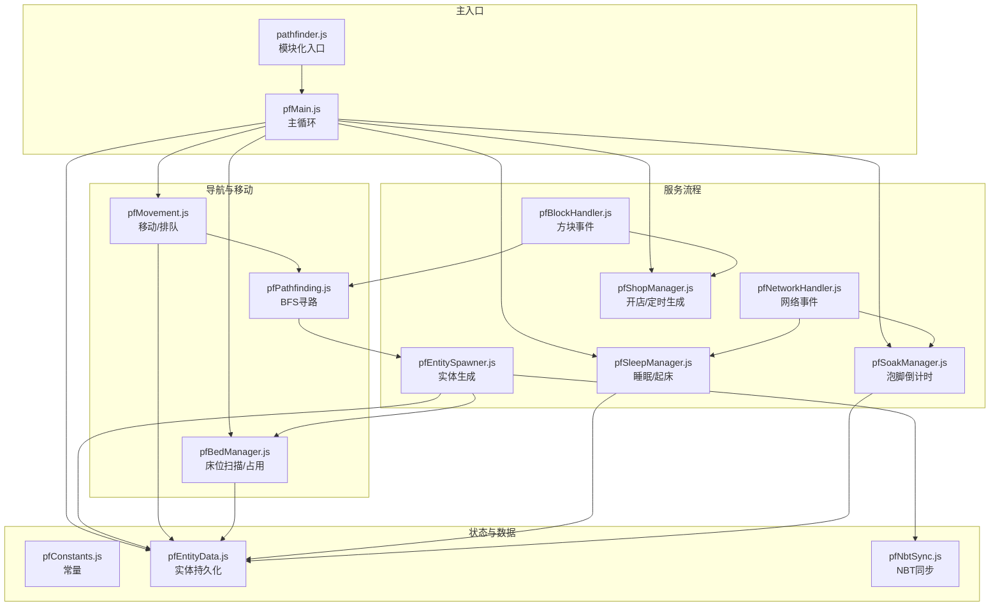
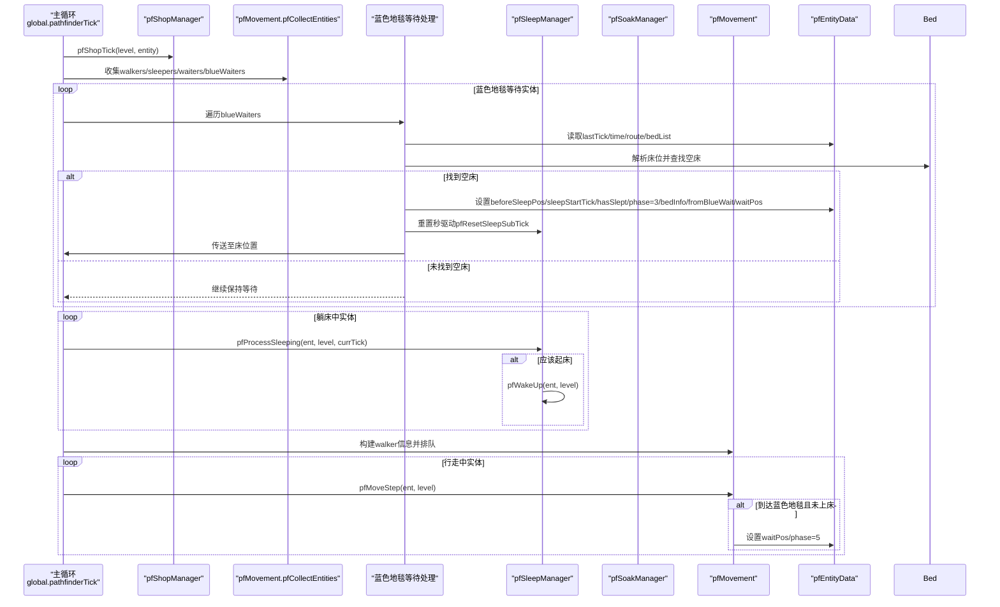
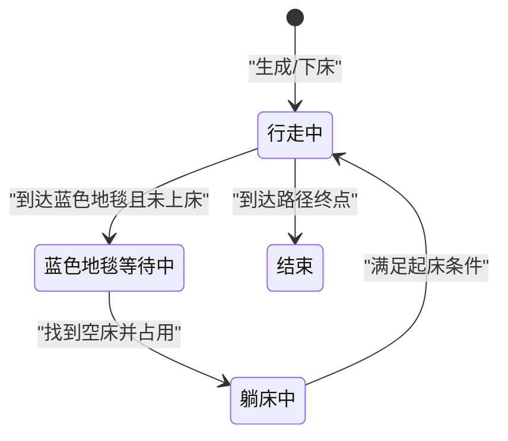
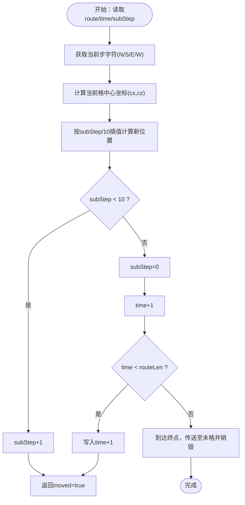
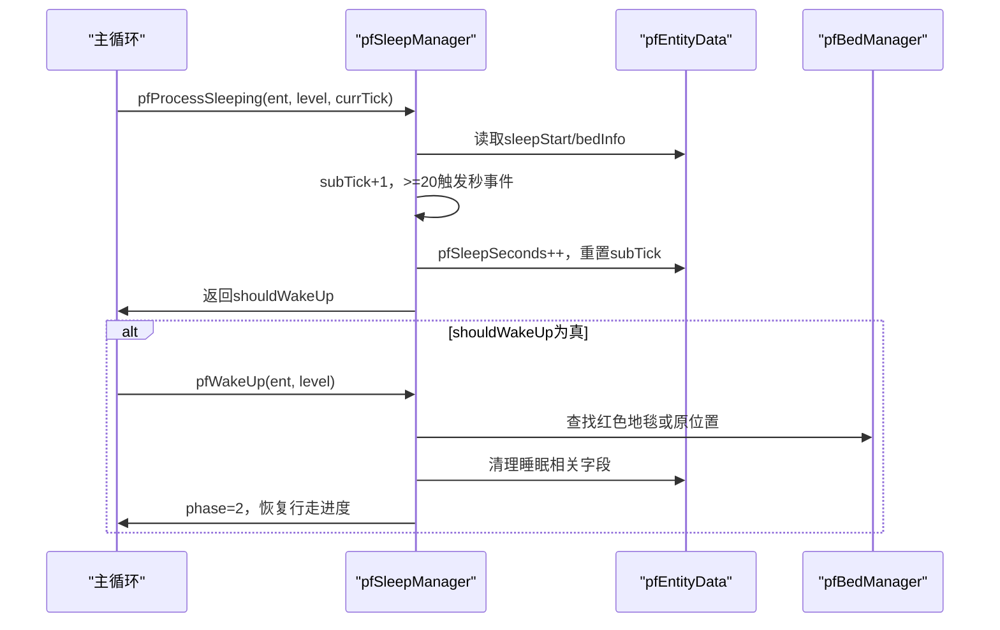
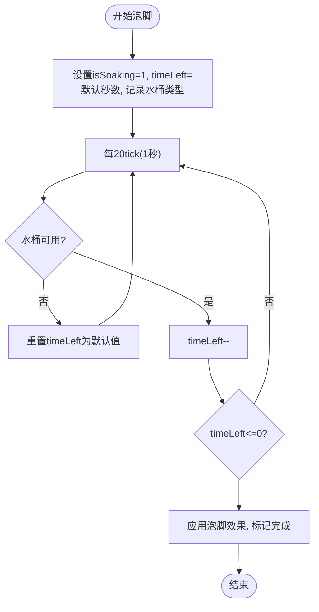
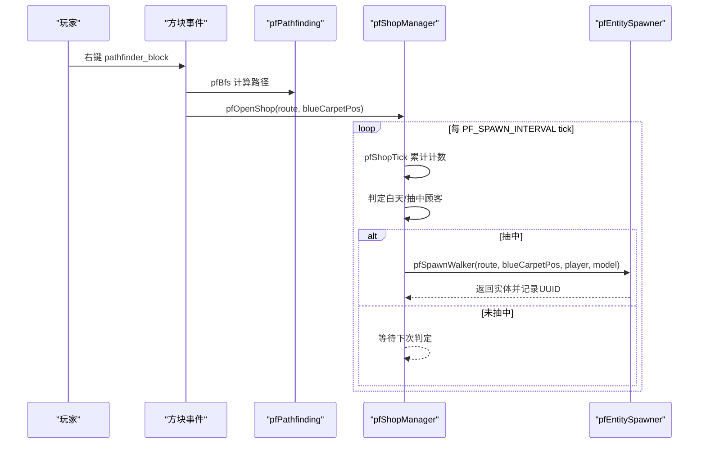
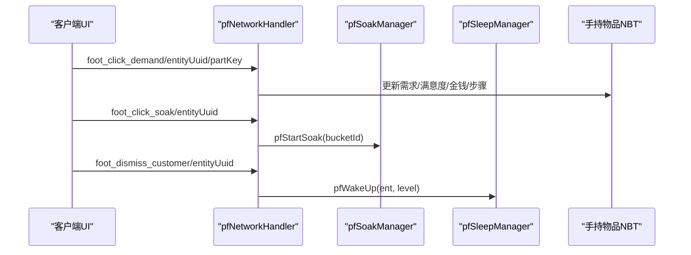
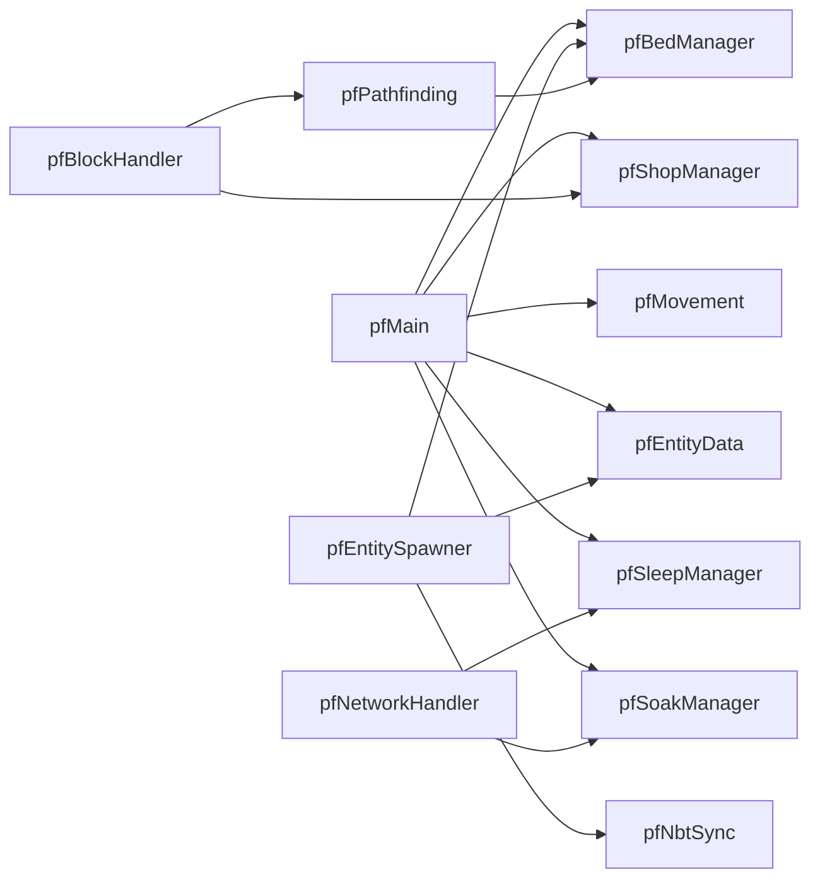

# 状态机模式

<cite>
**本文引用的文件**
- [pathfinder.js](file://kubejs/server_scripts/pathfinder.js)
- [pfMain.js](file://kubejs/server_scripts/pathfinder/pfMain.js)
- [pfEntityData.js](file://kubejs/server_scripts/pathfinder/pfEntityData.js)
- [pfConstants.js](file://kubejs/server_scripts/pathfinder/pfConstants.js)
- [pfMovement.js](file://kubejs/server_scripts/pathfinder/pfMovement.js)
- [pfPathfinding.js](file://kubejs/server_scripts/pathfinder/pfPathfinding.js)
- [pfSleepManager.js](file://kubejs/server_scripts/pathfinder/pfSleepManager.js)
- [pfSoakManager.js](file://kubejs/server_scripts/pathfinder/pfSoakManager.js)
- [pfBedManager.js](file://kubejs/server_scripts/pathfinder/pfBedManager.js)
- [pfNbtSync.js](file://kubejs/server_scripts/pathfinder/pfNbtSync.js)
- [pfEntitySpawner.js](file://kubejs/server_scripts/pathfinder/pfEntitySpawner.js)
- [pfNetworkHandler.js](file://kubejs/server_scripts/pathfinder/pfNetworkHandler.js)
- [pfBlockHandler.js](file://kubejs/server_scripts/pathfinder/pfBlockHandler.js)
- [pfShopManager.js](file://kubejs/server_scripts/pathfinder/pfShopManager.js)
</cite>

## 目录
1. [简介](#简介)
2. [项目结构](#项目结构)
3. [核心组件](#核心组件)
4. [架构总览](#架构总览)
5. [详细组件分析](#详细组件分析)
6. [依赖分析](#依赖分析)
7. [性能考虑](#性能考虑)
8. [故障排查指南](#故障排查指南)
9. [结论](#结论)
10. [附录](#附录)

## 简介
本文件系统性阐述寻路系统中的状态机模式设计与实现，聚焦于实体状态管理、事件驱动与状态转换规则。通过对 pathfinder 子系统的模块化拆解，我们梳理了状态（Phase）、事件（Tick/交互/路径事件）、转换规则（条件判断）与动作（行为执行）四个核心要素，并结合实际代码路径，给出状态图、状态转换表与关键流程图，帮助读者快速理解并扩展该状态机。

## 项目结构
pathfinder 系统采用模块化组织，主入口负责整合各子模块，子模块分别承担常量、寻路、实体数据、移动、睡眠、泡脚、床铺、NBT 同步、生成、网络事件、方块事件与开店管理等职责。整体以“每 tick 驱动 + 事件驱动”为核心控制流。

图表来源
- [pathfinder.js:1-30](file://kubejs/server_scripts/pathfinder.js#L1-L30)
- [pfMain.js:11-177](file://kubejs/server_scripts/pathfinder/pfMain.js#L11-L177)
- [pfShopManager.js:151-284](file://kubejs/server_scripts/pathfinder/pfShopManager.js#L151-L284)
- [pfEntitySpawner.js:8-135](file://kubejs/server_scripts/pathfinder/pfEntitySpawner.js#L8-L135)
- [pfMovement.js:81-162](file://kubejs/server_scripts/pathfinder/pfMovement.js#L81-L162)
- [pfPathfinding.js:46-83](file://kubejs/server_scripts/pathfinder/pfPathfinding.js#L46-L83)
- [pfBedManager.js:10-77](file://kubejs/server_scripts/pathfinder/pfBedManager.js#L10-L77)
- [pfSleepManager.js:65-128](file://kubejs/server_scripts/pathfinder/pfSleepManager.js#L65-L128)
- [pfSoakManager.js:92-145](file://kubejs/server_scripts/pathfinder/pfSoakManager.js#L92-L145)
- [pfNbtSync.js:8-94](file://kubejs/server_scripts/pathfinder/pfNbtSync.js#L8-L94)
- [pfNetworkHandler.js:37-311](file://kubejs/server_scripts/pathfinder/pfNetworkHandler.js#L37-L311)
- [pfBlockHandler.js:8-145](file://kubejs/server_scripts/pathfinder/pfBlockHandler.js#L8-L145)

章节来源
- [pathfinder.js:1-30](file://kubejs/server_scripts/pathfinder.js#L1-L30)
- [pfMain.js:11-177](file://kubejs/server_scripts/pathfinder/pfMain.js#L11-L177)

## 核心组件
- 状态（Phase）
  - 2：行走中（Walking）
  - 3：躺床中（Sleeping）
  - 4：等待床位中（Waiting for Bed）
  - 5：蓝色地毯等待中（Blue Carpet Waiting）
- 事件（Events）
  - 每 tick 主循环事件（global.pathfinderTick）
  - 网络事件（点击需求、点击泡脚、送客）
  - 方块事件（右键 pathfinder_block 触发开店/预约/BOSS）
  - 路径事件（到达蓝色地毯、到达终点）
- 转换规则（Rules）
  - 基于实体 pfPhase 与条件判断（如是否到达蓝色地毯、是否已上床、是否可占用床位）
  - 基于时间状态（pfTime/pfSubStep、pfSleepSeconds/pfSoakTimeLeft 等）
  - 基于外部接口（如 pfShouldWakeUp 回调）
- 动作（Actions）
  - 移动一步（pfMoveStep）、排队检测（pfCheckQueue）、位置计算（pfCalcCurrentPos）
  - 睡眠开始/处理/起床（pfStartSleep/pfProcessSleeping/pfWakeUp）
  - 泡脚开始/倒计时（pfStartSoak/pfProcessSoaking）
  - 床位扫描/占用检测（pfScanBedsAlongRoute/pfIsBedOccupied）
  - NBT 同步（pfSyncPhase/pfSyncCountdown/pfSyncDemandList）

章节来源
- [pfEntityData.js:56-63](file://kubejs/server_scripts/pathfinder/pfEntityData.js#L56-L63)
- [pfMain.js:11-177](file://kubejs/server_scripts/pathfinder/pfMain.js#L11-L177)
- [pfMovement.js:101-162](file://kubejs/server_scripts/pathfinder/pfMovement.js#L101-L162)
- [pfSleepManager.js:24-61](file://kubejs/server_scripts/pathfinder/pfSleepManager.js#L24-L61)
- [pfSoakManager.js:149-186](file://kubejs/server_scripts/pathfinder/pfSoakManager.js#L149-L186)
- [pfBedManager.js:10-77](file://kubejs/server_scripts/pathfinder/pfBedManager.js#L10-L77)
- [pfNbtSync.js:8-41](file://kubejs/server_scripts/pathfinder/pfNbtSync.js#L8-L41)

## 架构总览
下面以序列图展示“每 tick 主循环”如何协调各模块进行状态推进与动作执行。

图表来源
- [pfMain.js:11-177](file://kubejs/server_scripts/pathfinder/pfMain.js#L11-L177)
- [pfMovement.js:81-162](file://kubejs/server_scripts/pathfinder/pfMovement.js#L81-L162)
- [pfSleepManager.js:65-128](file://kubejs/server_scripts/pathfinder/pfSleepManager.js#L65-L128)
- [pfSoakManager.js:92-145](file://kubejs/server_scripts/pathfinder/pfSoakManager.js#L92-L145)
- [pfBedManager.js:109-120](file://kubejs/server_scripts/pathfinder/pfBedManager.js#L109-L120)

## 详细组件分析

### 状态机核心：实体状态与转换
- 状态定义
  - 2：行走中（Walking）。实体沿路径逐步前进，子步累积，满10进位推进格数。
  - 3：躺床中（Sleeping）。实体位于床头，按秒驱动处理倒计时与效果。
  - 4：等待床位中（Waiting for Bed）。实体在蓝色地毯等待，但尚未上床。
  - 5：蓝色地毯等待中（Blue Carpet Waiting）。实体到达蓝色地毯，准备寻找空床。
- 转换规则
  - 行走中 → 蓝色地毯等待中：到达蓝色地毯且未上床。
  - 蓝色地毯等待中 → 躺床中：找到空床并占用。
  - 躺床中 → 行走中：满足起床条件（回调或倒计时结束）。
  - 行走中 → 结束：到达路径终点，销毁实体。
- 动作
  - 移动：pfMoveStep 基于 route/time/subStep 计算插值位置并推进。
  - 睡眠：pfStartSleep 设置床位置与初始状态；pfProcessSleeping 按秒驱动；pfWakeUp 下床并恢复行走进度。
  - 泡脚：pfStartSoak 初始化倒计时；pfProcessSoaking 每秒递减并应用效果。

图表来源
- [pfMain.js:147-173](file://kubejs/server_scripts/pathfinder/pfMain.js#L147-L173)
- [pfMovement.js:101-162](file://kubejs/server_scripts/pathfinder/pfMovement.js#L101-L162)
- [pfSleepManager.js:24-61](file://kubejs/server_scripts/pathfinder/pfSleepManager.js#L24-L61)
- [pfSleepManager.js:131-223](file://kubejs/server_scripts/pathfinder/pfSleepManager.js#L131-L223)

章节来源
- [pfEntityData.js:56-63](file://kubejs/server_scripts/pathfinder/pfEntityData.js#L56-L63)
- [pfMain.js:11-177](file://kubejs/server_scripts/pathfinder/pfMain.js#L11-L177)
- [pfMovement.js:101-162](file://kubejs/server_scripts/pathfinder/pfMovement.js#L101-L162)
- [pfSleepManager.js:24-61](file://kubejs/server_scripts/pathfinder/pfSleepManager.js#L24-L61)
- [pfSleepManager.js:131-223](file://kubejs/server_scripts/pathfinder/pfSleepManager.js#L131-L223)

### 寻路与路径推进（BFS + 插值移动）
- BFS 寻路：pfBfs 在网格上按 NSWE 扩展，支持已有路径避让。
- 路径推进：pfMoveStep 将路径字符串按时间步长推进，子步 0~9 实现格内插值移动。
- 路径终点：到达终点后销毁实体并播放粒子。

图表来源
- [pfMovement.js:101-162](file://kubejs/server_scripts/pathfinder/pfMovement.js#L101-L162)
- [pfPathfinding.js:46-83](file://kubejs/server_scripts/pathfinder/pfPathfinding.js#L46-L83)

章节来源
- [pfPathfinding.js:46-83](file://kubejs/server_scripts/pathfinder/pfPathfinding.js#L46-L83)
- [pfMovement.js:81-162](file://kubejs/server_scripts/pathfinder/pfMovement.js#L81-L162)

### 睡眠与起床（秒驱动 + 床位占用）
- 秒驱动：pfProcessSleeping 每 20 tick（1 秒）推进一次，记录 pfSleepSeconds。
- 床位占用：pfIsBedOccupied 检测床周围是否已有实体处于睡眠状态。
- 起床：pfWakeUp 清理睡眠 NBT，定位下床位置（优先红色地毯，否则原位置），恢复行走进度。

图表来源
- [pfSleepManager.js:65-128](file://kubejs/server_scripts/pathfinder/pfSleepManager.js#L65-L128)
- [pfSleepManager.js:131-223](file://kubejs/server_scripts/pathfinder/pfSleepManager.js#L131-L223)
- [pfBedManager.js:109-120](file://kubejs/server_scripts/pathfinder/pfBedManager.js#L109-L120)

章节来源
- [pfSleepManager.js:24-61](file://kubejs/server_scripts/pathfinder/pfSleepManager.js#L24-L61)
- [pfSleepManager.js:131-223](file://kubejs/server_scripts/pathfinder/pfSleepManager.js#L131-L223)
- [pfBedManager.js:109-120](file://kubejs/server_scripts/pathfinder/pfBedManager.js#L109-L120)

### 泡脚倒计时（秒驱动 + 水桶可用性）
- 初始化：pfStartSoak 设置 isSoaking=1、soakTimeLeft=默认秒数、记录水桶类型。
- 倒计时：pfProcessSoaking 每秒递减，若无可用洗脚水则重置倒计时。
- 结束：倒计时结束触发效果并标记完成。

图表来源
- [pfSoakManager.js:149-186](file://kubejs/server_scripts/pathfinder/pfSoakManager.js#L149-L186)
- [pfSoakManager.js:92-145](file://kubejs/server_scripts/pathfinder/pfSoakManager.js#L92-L145)

章节来源
- [pfSoakManager.js:149-186](file://kubejs/server_scripts/pathfinder/pfSoakManager.js#L149-L186)
- [pfSoakManager.js:92-145](file://kubejs/server_scripts/pathfinder/pfSoakManager.js#L92-L145)

### 开店与实体生成（定时生成 + 路径预扫描）
- 开店：pfOpenShop 将状态写入方块实体 NBT，包含路线、蓝色地毯位置、玩家 UUID 等。
- 定时生成：pfShopTick 每 PF_SPAWN_INTERVAL tick 判定一次，白天且抽中顾客则生成实体。
- 实体生成：pfSpawnWalker 初始化实体基础数据、需求清单、床位列表、模型等。

图表来源
- [pfBlockHandler.js:8-145](file://kubejs/server_scripts/pathfinder/pfBlockHandler.js#L8-L145)
- [pfPathfinding.js:46-83](file://kubejs/server_scripts/pathfinder/pfPathfinding.js#L46-L83)
- [pfShopManager.js:151-284](file://kubejs/server_scripts/pathfinder/pfShopManager.js#L151-L284)
- [pfEntitySpawner.js:8-135](file://kubejs/server_scripts/pathfinder/pfEntitySpawner.js#L8-L135)

章节来源
- [pfBlockHandler.js:8-145](file://kubejs/server_scripts/pathfinder/pfBlockHandler.js#L8-L145)
- [pfShopManager.js:151-284](file://kubejs/server_scripts/pathfinder/pfShopManager.js#L151-L284)
- [pfEntitySpawner.js:8-135](file://kubejs/server_scripts/pathfinder/pfEntitySpawner.js#L8-L135)

### 网络事件与交互（需求点击、泡脚、送客）
- 需求点击：pfNetworkHandler 接收 foot_click_demand，更新需求 NBT、满意度与金钱，记录步骤与掉落。
- 泡脚点击：pfNetworkHandler 接收 foot_click_soak，调用 pfSoakManager.pfStartSoak。
- 送客：foot_dismiss_customer 直接调用 pfWakeUp，跳过结算。

图表来源
- [pfNetworkHandler.js:39-311](file://kubejs/server_scripts/pathfinder/pfNetworkHandler.js#L39-L311)
- [pfSoakManager.js:149-186](file://kubejs/server_scripts/pathfinder/pfSoakManager.js#L149-L186)
- [pfSleepManager.js:131-223](file://kubejs/server_scripts/pathfinder/pfSleepManager.js#L131-L223)

章节来源
- [pfNetworkHandler.js:39-311](file://kubejs/server_scripts/pathfinder/pfNetworkHandler.js#L39-L311)
- [pfSoakManager.js:149-186](file://kubejs/server_scripts/pathfinder/pfSoakManager.js#L149-L186)
- [pfSleepManager.js:131-223](file://kubejs/server_scripts/pathfinder/pfSleepManager.js#L131-L223)

## 依赖分析
- 模块内聚与耦合
  - pfMain 作为中枢，耦合 pfMovement、pfEntityData、pfBedManager、pfSleepManager、pfSoakManager、pfShopManager。
  - pfEntityData 为数据中枢，被所有模块读写，提供统一的持久化接口。
  - pfNbtSync 仅与 pfEntityData 和 UI 同步相关，降低 UI 与业务耦合。
- 外部依赖
  - KubeJS Level/Entity API、BlockPos、Attribute API。
  - 可选模块（如 pfBasinSoakManager、pfVoucherManager、pfBossManager）通过条件调用接入。

图表来源
- [pfMain.js:11-177](file://kubejs/server_scripts/pathfinder/pfMain.js#L11-L177)
- [pfEntitySpawner.js:8-135](file://kubejs/server_scripts/pathfinder/pfEntitySpawner.js#L8-L135)
- [pfNetworkHandler.js:39-311](file://kubejs/server_scripts/pathfinder/pfNetworkHandler.js#L39-L311)
- [pfBlockHandler.js:8-145](file://kubejs/server_scripts/pathfinder/pfBlockHandler.js#L8-L145)

章节来源
- [pfMain.js:11-177](file://kubejs/server_scripts/pathfinder/pfMain.js#L11-L177)
- [pfEntitySpawner.js:8-135](file://kubejs/server_scripts/pathfinder/pfEntitySpawner.js#L8-L135)
- [pfNetworkHandler.js:39-311](file://kubejs/server_scripts/pathfinder/pfNetworkHandler.js#L39-L311)
- [pfBlockHandler.js:8-145](file://kubejs/server_scripts/pathfinder/pfBlockHandler.js#L8-L145)

## 性能考虑
- 每 tick 防重复处理：通过 pfEntityData.pfGetLastTick/pfSetLastTick 避免同一 tick 内重复处理。
- 局部扫描与范围限制：pfCollectEntities 使用 AABB 范围收集实体，减少无关遍历。
- 秒驱动与跨重启友好：睡眠/泡脚均使用独立秒计数器，避免依赖 server.getTickCount() 差值。
- NBT 同步优化：使用单一物品 NBT 同步状态，减少网络冗余。
- BFS 避让：pfBfs 在扩展时检查已有路径，降低冲突概率。

章节来源
- [pfMain.js:34-37](file://kubejs/server_scripts/pathfinder/pfMain.js#L34-L37)
- [pfMovement.js:8-34](file://kubejs/server_scripts/pathfinder/pfMovement.js#L8-L34)
- [pfSleepManager.js:17-21](file://kubejs/server_scripts/pathfinder/pfSleepManager.js#L17-L21)
- [pfSoakManager.js:99-106](file://kubejs/server_scripts/pathfinder/pfSoakManager.js#L99-L106)
- [pfNbtSync.js:8-41](file://kubejs/server_scripts/pathfinder/pfNbtSync.js#L8-L41)
- [pfPathfinding.js:60-73](file://kubejs/server_scripts/pathfinder/pfPathfinding.js#L60-L73)

## 故障排查指南
- 状态未更新
  - 检查 pfEntityData 的 LastTick 防重复逻辑是否生效。
  - 确认 pfSyncPhase 是否正确写入手持物品。
- 睡眠异常
  - 检查 pfResetSleepSubTick 是否在开始睡眠时调用。
  - 确认床铺占用检测 pfIsBedOccupied 是否正确。
- 泡脚无效
  - 检查水桶可用性判定 pfIsSoakWaterAvailable。
  - 确认 pfSoakSubTick 是否按 20 tick 递增。
- 开店不生成
  - 检查白天判定与抽中逻辑。
  - 确认方块实体 NBT 是否正确写入。

章节来源
- [pfMain.js:34-37](file://kubejs/server_scripts/pathfinder/pfMain.js#L34-L37)
- [pfNbtSync.js:8-41](file://kubejs/server_scripts/pathfinder/pfNbtSync.js#L8-L41)
- [pfSleepManager.js:17-21](file://kubejs/server_scripts/pathfinder/pfSleepManager.js#L17-L21)
- [pfBedManager.js:109-120](file://kubejs/server_scripts/pathfinder/pfBedManager.js#L109-L120)
- [pfSoakManager.js:77-88](file://kubejs/server_scripts/pathfinder/pfSoakManager.js#L77-L88)
- [pfShopManager.js:250-254](file://kubejs/server_scripts/pathfinder/pfShopManager.js#L250-L254)

## 结论
该状态机通过“每 tick 主循环 + 事件驱动 + 模块化职责分离”的方式，实现了对寻路实体的稳定状态管理。其关键优势在于：
- 状态持久化：统一通过实体 persistentData/NBT 存储，跨重启保留。
- 并发安全：每 tick 防重复处理与局部范围扫描，降低竞争风险。
- 性能优化：秒驱动、插值移动、BFS 避让与 NBT 同步，兼顾精度与效率。
- 可扩展性：模块边界清晰，新增状态/事件可通过现有接口平滑接入。

## 附录

### 状态转换表（简表）
- 行走中（2）→ 蓝色地毯等待中（5）：到达蓝色地毯且未上床
- 蓝色地毯等待中（5）→ 躺床中（3）：找到空床并占用
- 躺床中（3）→ 行走中（2）：满足起床条件
- 行走中（2）→ 结束：到达路径终点

章节来源
- [pfMain.js:147-173](file://kubejs/server_scripts/pathfinder/pfMain.js#L147-L173)
- [pfMovement.js:101-162](file://kubejs/server_scripts/pathfinder/pfMovement.js#L101-L162)
- [pfSleepManager.js:131-223](file://kubejs/server_scripts/pathfinder/pfSleepManager.js#L131-L223)