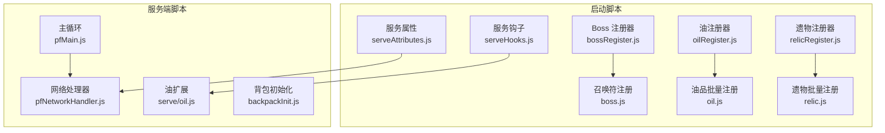
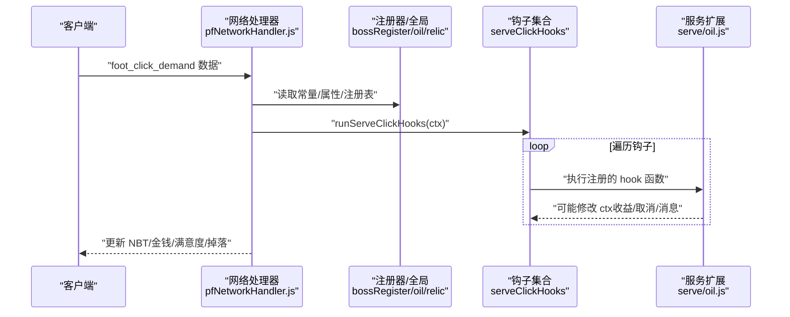
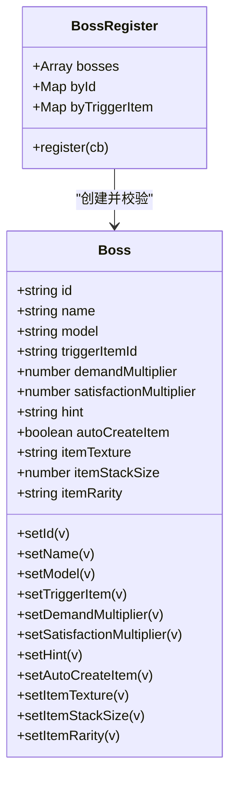
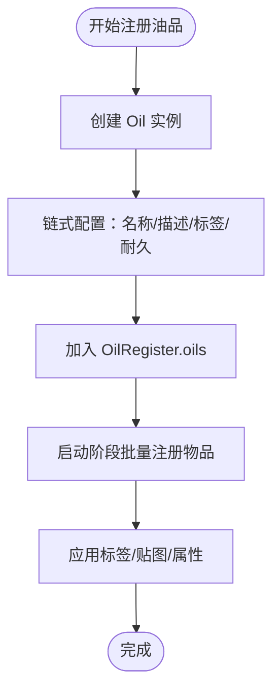
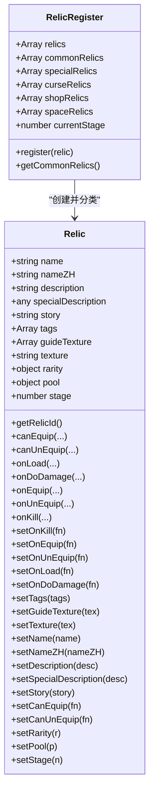
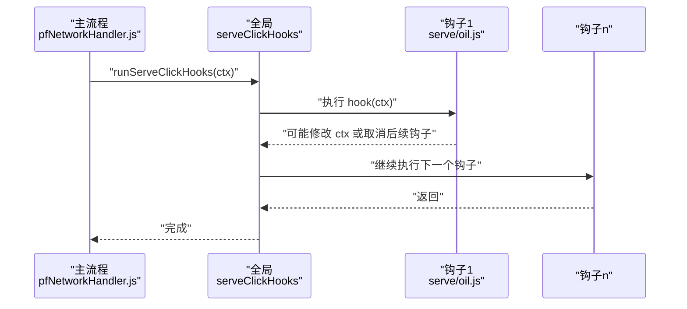
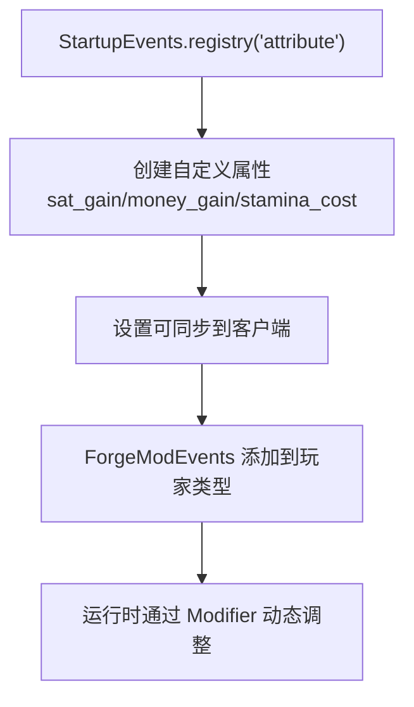
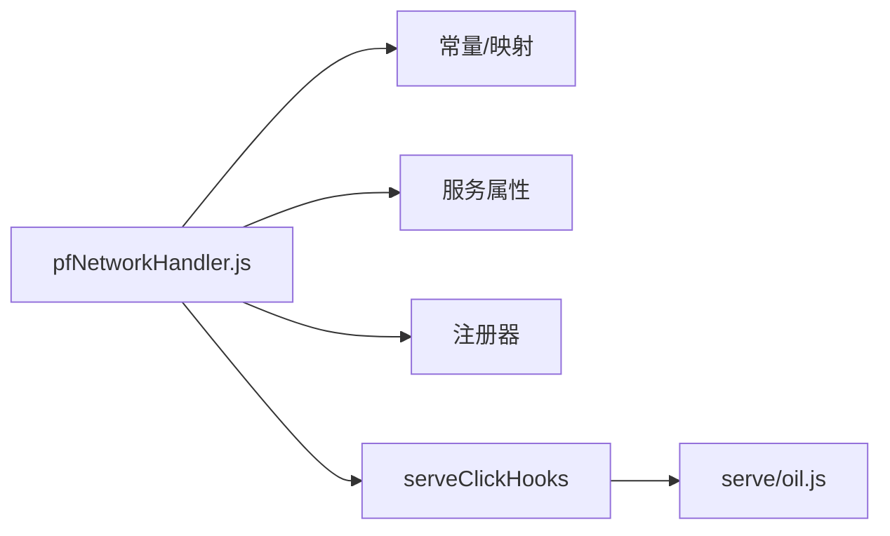

# 设计模式

<cite>
**本文引用的文件**
- [kubejs/启动脚本/怪物/boss注册器.js](file://kubejs/startup_scripts/boss/bossRegister.js)
- [kubejs/启动脚本/怪物/召唤符注册.js](file://kubejs/startup_scripts/boss/boss.js)
- [kubejs/启动脚本/怪物/芙兰朵露.js](file://kubejs/startup_scripts/boss/boss_flandre.js)
- [kubejs/启动脚本/油品/油注册器.js](file://kubejs/startup_scripts/oil/oilRegister.js)
- [kubejs/启动脚本/油品/油.js](file://kubejs/startup_scripts/oil/oil.js)
- [kubejs/启动脚本/油品/油物品/搓泥宝.js](file://kubejs/startup_scripts/oil/oilItem/cuonibao.js)
- [kubejs/启动脚本/遗物/遗物注册器.js](file://kubejs/startup_scripts/relic/relicRegister.js)
- [kubejs/启动脚本/遗物/遗物.js](file://kubejs/startup_scripts/relic/relic.js)
- [kubejs/启动脚本/遗物/阶段1/阶段1.js](file://kubejs/startup_scripts/relic/relicItem/stage1/stage1.js)
- [kubejs/启动脚本/服务钩子.js](file://kubejs/startup_scripts/serveHooks.js)
- [kubejs/服务端脚本/服务/油.js](file://kubejs/server_scripts/serve/oil.js)
- [kubejs/服务端脚本/寻路/网络处理器.js](file://kubejs/server_scripts/pathfinder/pfNetworkHandler.js)
- [kubejs/服务端脚本/寻路/主循环.js](file://kubejs/server_scripts/pathfinder/pfMain.js)
- [kubejs/服务端脚本/背包/背包初始化.js](file://kubejs/server_scripts/backpack/backpackInit.js)
- [kubejs/启动脚本/属性/服务属性.js](file://kubejs/startup_scripts/attributes/serveAttributes.js)
</cite>

## 目录
1. [引言](#引言)
2. [项目结构](#项目结构)
3. [核心组件](#核心组件)
4. [架构总览](#架构总览)
5. [详细组件分析](#详细组件分析)
6. [依赖分析](#依赖分析)
7. [性能考虑](#性能考虑)
8. [故障排查指南](#故障排查指南)
9. [结论](#结论)
10. [附录](#附录)

## 引言
本文件聚焦于项目中体现的设计模式与架构实践，重点涵盖以下主题：
- 注册器模式：Boss 注册器、油品注册器、遗物注册器的实现与应用
- 钩子系统：serveClickHooks 如何实现功能扩展与解耦
- 关键流程：点击结算的网络层、属性系统与注册器协同工作
- 最佳实践：模块化、可插拔扩展、错误隔离与可维护性

## 项目结构
本项目采用 KubeJS 的“启动脚本 + 服务端脚本 + 客户端资源”的分层组织方式。与设计模式相关的关键目录如下：
- 启动脚本：负责注册器与全局对象的初始化，以及物品的批量注册
- 服务端脚本：负责业务主循环、网络事件处理、具体扩展逻辑（如油品扩展）
- 属性系统：通过 StartupEvents.registry 注册自定义属性，供运行时动态调整

图表来源
- [kubejs/启动脚本/怪物/boss注册器.js:60-97](file://kubejs/startup_scripts/boss/bossRegister.js#L60-L97)
- [kubejs/启动脚本/油品/油注册器.js:9-21](file://kubejs/startup_scripts/oil/oilRegister.js#L9-L21)
- [kubejs/启动脚本/遗物/遗物注册器.js:3-42](file://kubejs/startup_scripts/relic/relicRegister.js#L3-L42)
- [kubejs/启动脚本/怪物/召唤符注册.js:9-36](file://kubejs/startup_scripts/boss/boss.js#L9-L36)
- [kubejs/启动脚本/油品/油.js:9-27](file://kubejs/startup_scripts/oil/oil.js#L9-L27)
- [kubejs/启动脚本/遗物/遗物.js:7-79](file://kubejs/startup_scripts/relic/relic.js#L7-L79)
- [kubejs/启动脚本/服务钩子.js:11-30](file://kubejs/startup_scripts/serveHooks.js#L11-L30)
- [kubejs/启动脚本/属性/服务属性.js:27-52](file://kubejs/startup_scripts/attributes/serveAttributes.js#L27-L52)
- [kubejs/服务端脚本/寻路/网络处理器.js:37-311](file://kubejs/server_scripts/pathfinder/pfNetworkHandler.js#L37-L311)
- [kubejs/服务端脚本/寻路/主循环.js:11-174](file://kubejs/server_scripts/pathfinder/pfMain.js#L11-L174)
- [kubejs/服务端脚本/服务/油.js:28-55](file://kubejs/server_scripts/serve/oil.js#L28-L55)
- [kubejs/服务端脚本/背包/背包初始化.js:51-58](file://kubejs/server_scripts/backpack/backpackInit.js#L51-L58)

章节来源
- [kubejs/启动脚本/怪物/boss注册器.js:1-103](file://kubejs/startup_scripts/boss/bossRegister.js#L1-L103)
- [kubejs/启动脚本/油品/油注册器.js:1-61](file://kubejs/startup_scripts/oil/oilRegister.js#L1-L61)
- [kubejs/启动脚本/遗物/遗物注册器.js:1-178](file://kubejs/startup_scripts/relic/relicRegister.js#L1-L178)
- [kubejs/启动脚本/服务钩子.js:1-31](file://kubejs/startup_scripts/serveHooks.js#L1-L31)
- [kubejs/启动脚本/属性/服务属性.js:1-53](file://kubejs/startup_scripts/attributes/serveAttributes.js#L1-L53)
- [kubejs/服务端脚本/寻路/网络处理器.js:1-317](file://kubejs/server_scripts/pathfinder/pfNetworkHandler.js#L1-L317)
- [kubejs/服务端脚本/寻路/主循环.js:1-177](file://kubejs/server_scripts/pathfinder/pfMain.js#L1-L177)
- [kubejs/服务端脚本/服务/油.js:1-56](file://kubejs/server_scripts/serve/oil.js#L1-L56)
- [kubejs/服务端脚本/背包/背包初始化.js:1-67](file://kubejs/server_scripts/backpack/backpackInit.js#L1-L67)

## 核心组件
- 注册器模式
  - Boss 注册器：集中管理 Boss 定义，提供链式配置与冲突检测，支持自动生成触发物品
  - 油注册器：收集油品定义，提供链式配置 API，统一导出 ID 与标签
  - 遗物注册器：收集遗物定义，按稀有度与池分类，支持阶段继承与生命周期钩子
- 钩子系统
  - serveClickHooks：在点击结算的关键节点集中执行扩展逻辑，实现功能解耦与可插拔扩展
- 属性系统
  - 服务属性：通过 StartupEvents.registry 注册自定义属性，供运行时动态修改

章节来源
- [kubejs/启动脚本/怪物/boss注册器.js:60-97](file://kubejs/startup_scripts/boss/bossRegister.js#L60-L97)
- [kubejs/启动脚本/油品/油注册器.js:9-21](file://kubejs/startup_scripts/oil/oilRegister.js#L9-L21)
- [kubejs/启动脚本/遗物/遗物注册器.js:3-42](file://kubejs/startup_scripts/relic/relicRegister.js#L3-L42)
- [kubejs/启动脚本/服务钩子.js:11-30](file://kubejs/startup_scripts/serveHooks.js#L11-L30)
- [kubejs/启动脚本/属性/服务属性.js:27-52](file://kubejs/startup_scripts/attributes/serveAttributes.js#L27-L52)

## 架构总览
下图展示了“点击结算”主流程与注册器、钩子系统的交互关系。

图表来源
- [kubejs/服务端脚本/寻路/网络处理器.js:39-219](file://kubejs/server_scripts/pathfinder/pfNetworkHandler.js#L39-L219)
- [kubejs/启动脚本/服务钩子.js:19-30](file://kubejs/startup_scripts/serveHooks.js#L19-L30)
- [kubejs/服务端脚本/服务/油.js:28-55](file://kubejs/server_scripts/serve/oil.js#L28-L55)

章节来源
- [kubejs/服务端脚本/寻路/网络处理器.js:37-311](file://kubejs/server_scripts/pathfinder/pfNetworkHandler.js#L37-L311)
- [kubejs/启动脚本/服务钩子.js:1-31](file://kubejs/startup_scripts/serveHooks.js#L1-L31)
- [kubejs/服务端脚本/服务/油.js:1-56](file://kubejs/server_scripts/serve/oil.js#L1-L56)

## 详细组件分析

### 注册器模式：Boss 注册器
- 模式定义
  - 通过集中式注册器收集配置，提供链式 API，统一校验与去重，最终在启动阶段批量注册物品
- 实现要点
  - Boss 类：封装 id、名称、模型、触发物品、倍率、提示等字段，并提供链式 setter
  - BossRegister 类：维护 bosses 数组与 byId/byTriggerItem 索引，注册时进行冲突检测与自动触发物品生成
  - 启动阶段注册：遍历已注册 Boss，按需创建触发物品
- 使用场景
  - 新增 Boss 时只需调用全局注册器，自动完成校验、索引与物品生成
- 最佳实践
  - 严格校验必填项，避免重复 id 与触发物品冲突
  - 通过自动触发物品能力降低手工物品注册成本

图表来源
- [kubejs/启动脚本/怪物/boss注册器.js:18-97](file://kubejs/startup_scripts/boss/bossRegister.js#L18-L97)

章节来源
- [kubejs/启动脚本/怪物/boss注册器.js:1-103](file://kubejs/startup_scripts/boss/bossRegister.js#L1-L103)
- [kubejs/启动脚本/怪物/芙兰朵露.js:10-21](file://kubejs/startup_scripts/boss/boss_flandre.js#L10-L21)
- [kubejs/启动脚本/怪物/召唤符注册.js:9-36](file://kubejs/startup_scripts/boss/boss.js#L9-L36)

### 注册器模式：油品注册器
- 模式定义
  - 通过 OilRegister 收集油品定义，提供链式 API 设置名称、描述、标签、耐久等
- 实现要点
  - Oil 类：提供 getOilId、setName、setNameZH、setDescription、setTags、setDurability 等方法
  - OilRegister：注册时创建 Oil 实例并加入数组
  - 启动阶段注册：遍历 Oil 列表，批量创建物品，应用标签与属性
- 使用场景
  - 快速添加新油品，统一命名规范与耐久控制
- 最佳实践
  - 通过标签系统实现通用过滤与行为绑定
  - 将物品属性与定义分离，提升可维护性

图表来源
- [kubejs/启动脚本/油品/油注册器.js:9-21](file://kubejs/startup_scripts/oil/oilRegister.js#L9-L21)
- [kubejs/启动脚本/油品/油.js:9-27](file://kubejs/startup_scripts/oil/oil.js#L9-L27)

章节来源
- [kubejs/启动脚本/油品/油注册器.js:1-61](file://kubejs/startup_scripts/oil/oilRegister.js#L1-L61)
- [kubejs/启动脚本/油品/油.js:1-28](file://kubejs/startup_scripts/oil/oil.js#L1-L28)
- [kubejs/启动脚本/油品/油物品/搓泥宝.js:10-16](file://kubejs/startup_scripts/oil/oilItem/cuonibao.js#L10-L16)

### 注册器模式：遗物注册器
- 模式定义
  - 通过 RelicRegister 收集遗物定义，按稀有度与池分类，支持阶段继承与生命周期钩子
- 实现要点
  - Relic 类：提供 getRelicId、canEquip/canUnEquip、onLoad/onEquip/onUnEquip/onDoDamage/onKill 等钩子
  - RelicRegister：注册时自动继承阶段，按池类型分类，提供查询接口
  - 启动阶段注册：批量创建物品，注入 Curios 能力，应用贴图与标签
- 使用场景
  - 为不同阶段快速添加大量遗物，统一生命周期管理
- 最佳实践
  - 将效果逻辑封装在钩子函数中，避免分散在主流程
  - 通过阶段与池分类，便于后续扩展与平衡性调整

图表来源
- [kubejs/启动脚本/遗物/遗物注册器.js:81-176](file://kubejs/startup_scripts/relic/relicRegister.js#L81-L176)
- [kubejs/启动脚本/遗物/遗物.js:7-79](file://kubejs/startup_scripts/relic/relic.js#L7-L79)

章节来源
- [kubejs/启动脚本/遗物/遗物注册器.js:1-178](file://kubejs/startup_scripts/relic/relicRegister.js#L1-L178)
- [kubejs/启动脚本/遗物/遗物.js:1-81](file://kubejs/startup_scripts/relic/relic.js#L1-L81)
- [kubejs/启动脚本/遗物/阶段1/阶段1.js:7-224](file://kubejs/startup_scripts/relic/relicItem/stage1/stage1.js#L7-L224)

### 钩子系统：serveClickHooks
- 模式定义
  - 在关键节点集中收集并执行扩展函数，实现功能解耦与可插拔扩展
- 实现要点
  - 全局 serveClickHooks 数组：存储注册的钩子函数
  - registerServeClickHook：注册钩子
  - runServeClickHooks：遍历执行钩子，支持 ctx.cancel 中断后续钩子
- 使用场景
  - 点击结算时插入额外逻辑（如抹油、连击奖励等），避免将扩展硬编码进主流程
- 最佳实践
  - 钩子内部捕获异常，避免影响其他钩子执行
  - 通过 ctx 传递上下文，统一扩展接口

图表来源
- [kubejs/启动脚本/服务钩子.js:19-30](file://kubejs/startup_scripts/serveHooks.js#L19-L30)
- [kubejs/服务端脚本/服务/油.js:28-55](file://kubejs/server_scripts/serve/oil.js#L28-L55)
- [kubejs/服务端脚本/寻路/网络处理器.js:39-219](file://kubejs/server_scripts/pathfinder/pfNetworkHandler.js#L39-L219)

章节来源
- [kubejs/启动脚本/服务钩子.js:1-31](file://kubejs/startup_scripts/serveHooks.js#L1-L31)
- [kubejs/服务端脚本/服务/油.js:1-56](file://kubejs/server_scripts/serve/oil.js#L1-L56)

### 属性系统：服务属性
- 模式定义
  - 通过 StartupEvents.registry 注册自定义属性，运行时通过 AttributeModifier 动态调整
- 实现要点
  - 注册四个部位的三类属性：满意度增量、金钱增量、体力消耗
  - 通过 ForgeModEvents 确保属性被添加到玩家类型
- 使用场景
  - 配合钩子系统与遗物效果，动态改变点击收益与消耗
- 最佳实践
  - 属性范围与单位需与 UI/日志一致，便于调试与平衡

图表来源
- [kubejs/启动脚本/属性/服务属性.js:27-52](file://kubejs/startup_scripts/attributes/serveAttributes.js#L27-L52)

章节来源
- [kubejs/启动脚本/属性/服务属性.js:1-53](file://kubejs/startup_scripts/attributes/serveAttributes.js#L1-L53)

## 依赖分析
- 组件耦合
  - 网络处理器依赖常量、属性系统与注册器；点击结算时再委托钩子系统
  - 钩子系统与扩展模块松耦合，通过全局数组与函数接口交互
  - 注册器在启动阶段完成定义收集，运行时只读访问
- 外部依赖
  - KubeJS 事件系统（StartupEvents、NetworkEvents、PlayerEvents）
  - Forge/属性系统（Attribute、AttributeModifier）

图表来源
- [kubejs/服务端脚本/寻路/网络处理器.js:37-311](file://kubejs/server_scripts/pathfinder/pfNetworkHandler.js#L37-L311)
- [kubejs/启动脚本/服务钩子.js:11-30](file://kubejs/startup_scripts/serveHooks.js#L11-L30)
- [kubejs/服务端脚本/服务/油.js:28-55](file://kubejs/server_scripts/serve/oil.js#L28-L55)

章节来源
- [kubejs/服务端脚本/寻路/网络处理器.js:1-317](file://kubejs/server_scripts/pathfinder/pfNetworkHandler.js#L1-L317)
- [kubejs/启动脚本/服务钩子.js:1-31](file://kubejs/startup_scripts/serveHooks.js#L1-L31)
- [kubejs/服务端脚本/服务/油.js:1-56](file://kubejs/server_scripts/serve/oil.js#L1-L56)

## 性能考虑
- 注册器阶段
  - 将定义收集与物品注册分离，避免运行时重复解析
  - 使用索引（byId/byTriggerItem）加速查找
- 钩子系统
  - 遍历钩子时尽早返回（ctx.cancel），减少无效计算
  - 捕获异常，避免单个钩子失败影响整体
- 属性系统
  - 属性值读取带 fallback，避免空值导致的异常与重算
  - 将属性同步到客户端，减少 UI/调试的额外查询

## 故障排查指南
- 注册器常见问题
  - 缺少必要字段：检查 id/model/triggerItemId 是否存在
  - 冲突检测：id 或触发物品重复会导致注册失败
  - 自动触发物品：确认短 id 与命名规范一致
- 钩子系统常见问题
  - 钩子未生效：确认已通过 registerServeClickHook 注册
  - ctx 未传递：确保主流程正确构造并传入 ctx
  - 异常中断：钩子内异常会被吞并，检查日志输出
- 属性系统常见问题
  - 属性未显示：确认属性已添加到玩家类型且可同步
  - 值异常：检查 Modifier 是否正确应用，读取函数是否带 fallback

章节来源
- [kubejs/启动脚本/怪物/boss注册器.js:65-96](file://kubejs/startup_scripts/boss/bossRegister.js#L65-L96)
- [kubejs/启动脚本/服务钩子.js:19-30](file://kubejs/startup_scripts/serveHooks.js#L19-L30)
- [kubejs/启动脚本/属性/服务属性.js:8-11](file://kubejs/startup_scripts/attributes/serveAttributes.js#L8-L11)
- [kubejs/服务端脚本/背包/背包初始化.js:51-58](file://kubejs/server_scripts/backpack/backpackInit.js#L51-L58)

## 结论
本项目通过注册器模式实现了定义与注册的解耦，通过钩子系统实现了扩展点的集中化与可插拔，通过属性系统实现了运行时的动态调节。整体架构清晰、模块职责明确，具备良好的可维护性与扩展性。

## 附录
- 代码示例路径（不展示具体代码内容）
  - Boss 注册器使用示例：[示例路径:10-21](file://kubejs/startup_scripts/boss/boss_flandre.js#L10-L21)
  - 油注册器使用示例：[示例路径:10-16](file://kubejs/startup_scripts/oil/oilItem/cuonibao.js#L10-L16)
  - 遗物注册器使用示例：[示例路径:30-43](file://kubejs/startup_scripts/relic/relicItem/stage1/stage1.js#L30-L43)
  - 钩子注册与执行：[示例路径:28-55](file://kubejs/server_scripts/serve/oil.js#L28-L55)，[示例路径:13-30](file://kubejs/startup_scripts/serveHooks.js#L13-L30)
  - 属性注册与读取：[示例路径:27-52](file://kubejs/startup_scripts/attributes/serveAttributes.js#L27-L52)，[示例路径:8-17](file://kubejs/server_scripts/pathfinder/pfNetworkHandler.js#L8-L17)