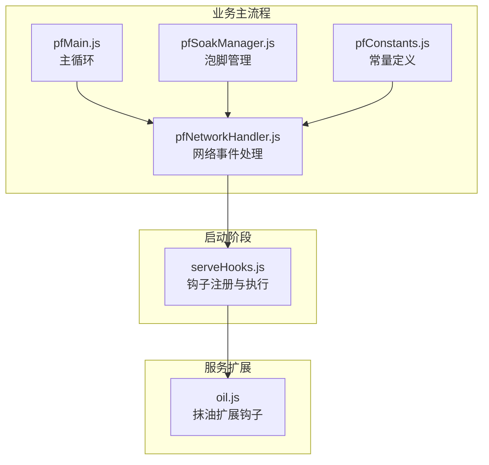
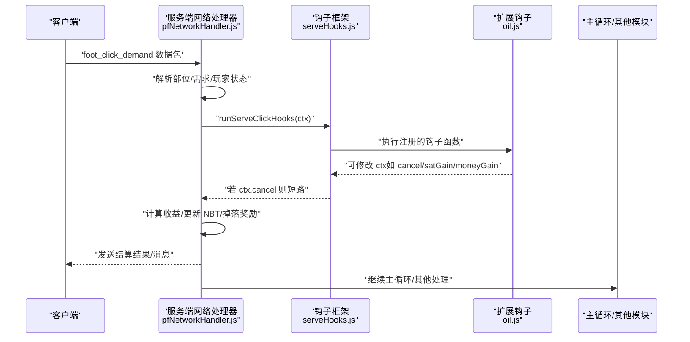
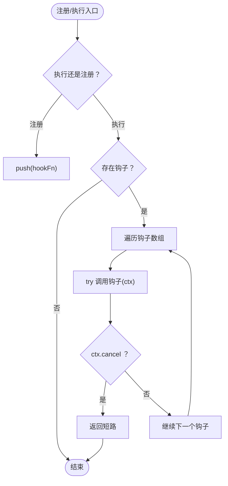
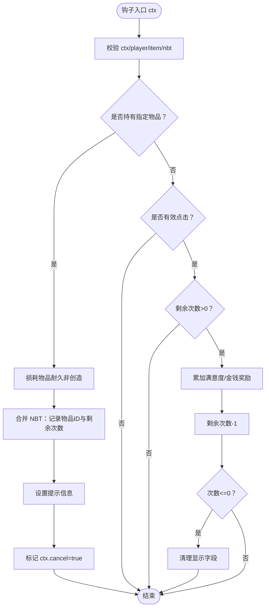
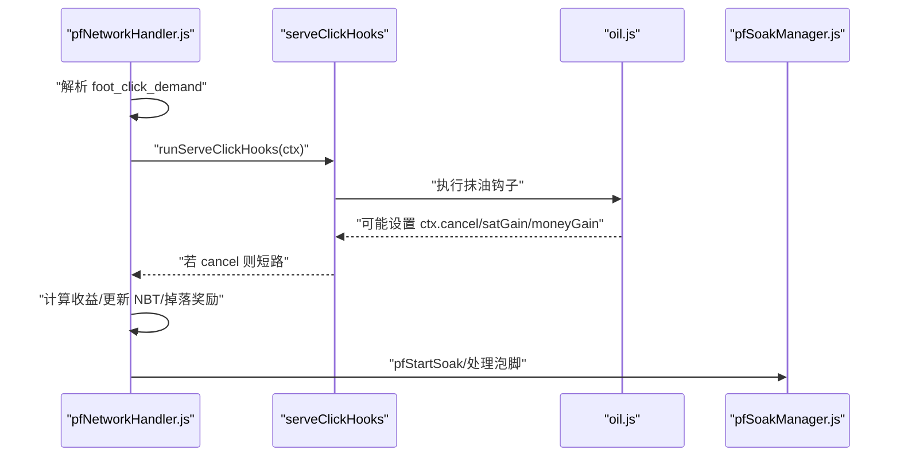
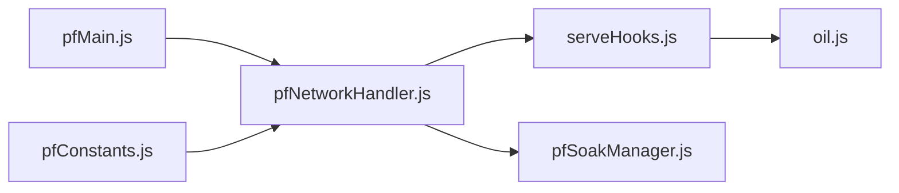

# 钩子模式

<cite>
**本文引用的文件**
- [serveHooks.js](file://kubejs/startup_scripts/serveHooks.js)
- [oil.js](file://kubejs/server_scripts/serve/oil.js)
- [pfNetworkHandler.js](file://kubejs/server_scripts/pathfinder/pfNetworkHandler.js)
- [pfSoakManager.js](file://kubejs/server_scripts/pathfinder/pfSoakManager.js)
- [pfMain.js](file://kubejs/server_scripts/pathfinder/pfMain.js)
- [pfConstants.js](file://kubejs/server_scripts/pathfinder/pfConstants.js)
</cite>

## 目录
1. [引言](#引言)
2. [项目结构](#项目结构)
3. [核心组件](#核心组件)
4. [架构总览](#架构总览)
5. [详细组件分析](#详细组件分析)
6. [依赖分析](#依赖分析)
7. [性能考量](#性能考量)
8. [故障排查指南](#故障排查指南)
9. [结论](#结论)
10. [附录](#附录)

## 引言
本文件系统性阐述 KubeJS 项目中的钩子模式设计与实现，重点围绕 serveClickHooks 点击结算钩子框架，解释其如何实现功能的动态扩展与模块化分离，并给出注册、执行顺序、上下文传递与异常处理机制的完整说明。同时结合 pathfinder 系统中的点击结算流程，展示钩子在服务场景下的落地实践，帮助读者理解如何通过钩子实现松耦合的功能扩展。

## 项目结构
本项目的钩子体系主要分布在以下位置：
- 启动阶段钩子框架：位于启动脚本目录，负责钩子注册与统一执行
- 业务扩展钩子：位于服务扩展目录，按功能拆分，独立注册
- 业务主流程：位于 pathfinder 目录，负责在关键节点调用钩子

图表来源
- [serveHooks.js:1-30](file://kubejs/startup_scripts/serveHooks.js#L1-L30)
- [oil.js:1-56](file://kubejs/server_scripts/serve/oil.js#L1-L56)
- [pfNetworkHandler.js:1-317](file://kubejs/server_scripts/pathfinder/pfNetworkHandler.js#L1-L317)
- [pfSoakManager.js:1-197](file://kubejs/server_scripts/pathfinder/pfSoakManager.js#L1-L197)
- [pfMain.js:1-177](file://kubejs/server_scripts/pathfinder/pfMain.js#L1-L177)
- [pfConstants.js:1-65](file://kubejs/server_scripts/pathfinder/pfConstants.js#L1-L65)

章节来源
- [serveHooks.js:1-30](file://kubejs/startup_scripts/serveHooks.js#L1-L30)
- [oil.js:1-56](file://kubejs/server_scripts/serve/oil.js#L1-L56)
- [pfNetworkHandler.js:1-317](file://kubejs/server_scripts/pathfinder/pfNetworkHandler.js#L1-L317)
- [pfSoakManager.js:1-197](file://kubejs/server_scripts/pathfinder/pfSoakManager.js#L1-L197)
- [pfMain.js:1-177](file://kubejs/server_scripts/pathfinder/pfMain.js#L1-L177)
- [pfConstants.js:1-65](file://kubejs/server_scripts/pathfinder/pfConstants.js#L1-L65)

## 核心组件
- serveClickHooks 钩子框架
  - 提供全局钩子数组与注册/执行函数，支持在关键节点统一调度
  - 注册：通过全局函数将钩子函数加入数组
  - 执行：遍历钩子数组，按注册顺序依次执行，支持通过上下文取消后续执行
- 服务扩展钩子（以抹油为例）
  - 在点击结算前检查玩家是否持有特定物品，决定是否拦截本次点击并注入额外收益
  - 通过合并 NBT 字段记录状态，支持多次有效点击的奖励累加与耗尽清理
- 业务主流程
  - 网络事件处理模块负责解析客户端点击请求，计算收益并更新 NBT
  - 主循环模块在关键节点调用钩子，实现对结算流程的动态扩展

章节来源
- [serveHooks.js:11-30](file://kubejs/startup_scripts/serveHooks.js#L11-L30)
- [oil.js:28-56](file://kubejs/server_scripts/serve/oil.js#L28-L56)
- [pfNetworkHandler.js:39-219](file://kubejs/server_scripts/pathfinder/pfNetworkHandler.js#L39-L219)
- [pfMain.js:11-174](file://kubejs/server_scripts/pathfinder/pfMain.js#L11-L174)

## 架构总览
下图展示了从客户端点击到服务端结算再到钩子扩展的整体流程，强调钩子在结算前的关键节点介入能力。

图表来源
- [pfNetworkHandler.js:39-219](file://kubejs/server_scripts/pathfinder/pfNetworkHandler.js#L39-L219)
- [serveHooks.js:19-30](file://kubejs/startup_scripts/serveHooks.js#L19-L30)
- [oil.js:28-56](file://kubejs/server_scripts/serve/oil.js#L28-L56)

## 详细组件分析

### 组件A：serveClickHooks 钩子框架
- 设计目标
  - 将“额外功能”（如抹油、连击奖励等）从主流程中拆分，保持主流程简洁
  - 在关键节点统一调用钩子，避免分散式扩展带来的耦合
- 关键点
  - 全局数组保存钩子函数，注册时追加
  - 执行时按注册顺序遍历，遇到 ctx.cancel 即停止后续钩子
  - 捕获异常，避免单个钩子错误影响整体流程
- 复杂度
  - 注册/执行均为 O(n)，n 为已注册钩子数量
  - 无额外空间复杂度

图表来源
- [serveHooks.js:13-30](file://kubejs/startup_scripts/serveHooks.js#L13-L30)

章节来源
- [serveHooks.js:11-30](file://kubejs/startup_scripts/serveHooks.js#L11-L30)

### 组件B：服务扩展钩子（抹油）
- 功能概述
  - 当玩家手持特定物品点击按钮时，判定为“抹油”
  - 抹油成功后，接下来若干次“有效点击”（需求>0）将获得额外奖励
  - 奖励次数耗尽后，清理 UI 显示字段
- 上下文与状态
  - 通过合并 NBT 字段记录物品 ID 与剩余次数
  - 通过 ctx.cancel 阻止后续结算逻辑，避免重复消耗
  - 通过 ctx.message 输出提示信息
- 错误处理
  - 对玩家主手物品进行判空与类型校验，避免异常
  - 对物品耐久进行条件性损耗，创意模式跳过

图表来源
- [oil.js:15-56](file://kubejs/server_scripts/serve/oil.js#L15-L56)

章节来源
- [oil.js:1-56](file://kubejs/server_scripts/serve/oil.js#L1-L56)

### 组件C：业务主流程（网络事件与结算）
- 网络事件处理
  - 解析客户端点击数据，确定部位与需求键
  - 一键满足模式与普通模式分别计算体力消耗与收益
  - 更新 NBT 并记录操作玩家 UUID，支持后续结算回查
- 主循环集成
  - 主循环在关键节点调用钩子，实现对结算流程的动态扩展
  - 结合泡脚管理模块，处理泡脚倒计时与水桶可用性判断

图表来源
- [pfNetworkHandler.js:39-219](file://kubejs/server_scripts/pathfinder/pfNetworkHandler.js#L39-L219)
- [serveHooks.js:19-30](file://kubejs/startup_scripts/serveHooks.js#L19-L30)
- [oil.js:28-56](file://kubejs/server_scripts/serve/oil.js#L28-L56)
- [pfSoakManager.js:149-186](file://kubejs/server_scripts/pathfinder/pfSoakManager.js#L149-L186)

章节来源
- [pfNetworkHandler.js:39-219](file://kubejs/server_scripts/pathfinder/pfNetworkHandler.js#L39-L219)
- [pfSoakManager.js:90-145](file://kubejs/server_scripts/pathfinder/pfSoakManager.js#L90-L145)
- [pfMain.js:11-174](file://kubejs/server_scripts/pathfinder/pfMain.js#L11-L174)

## 依赖分析
- 组件耦合
  - serveClickHooks 与各扩展钩子之间为弱耦合：仅通过函数签名约定上下文
  - 业务主流程通过统一接口调用钩子，避免对具体扩展的直接依赖
- 直接依赖
  - pfNetworkHandler 依赖 serveClickHooks 与各扩展钩子
  - pfSoakManager 与 pfNetworkHandler 协作，共同完成泡脚流程
- 间接依赖
  - pfConstants 提供常量与映射，被网络处理器与主循环使用

图表来源
- [serveHooks.js:1-30](file://kubejs/startup_scripts/serveHooks.js#L1-L30)
- [oil.js:1-56](file://kubejs/server_scripts/serve/oil.js#L1-L56)
- [pfNetworkHandler.js:1-317](file://kubejs/server_scripts/pathfinder/pfNetworkHandler.js#L1-L317)
- [pfSoakManager.js:1-197](file://kubejs/server_scripts/pathfinder/pfSoakManager.js#L1-L197)
- [pfMain.js:1-177](file://kubejs/server_scripts/pathfinder/pfMain.js#L1-L177)
- [pfConstants.js:1-65](file://kubejs/server_scripts/pathfinder/pfConstants.js#L1-L65)

章节来源
- [pfNetworkHandler.js:1-317](file://kubejs/server_scripts/pathfinder/pfNetworkHandler.js#L1-L317)
- [pfSoakManager.js:1-197](file://kubejs/server_scripts/pathfinder/pfSoakManager.js#L1-L197)
- [pfMain.js:1-177](file://kubejs/server_scripts/pathfinder/pfMain.js#L1-L177)
- [pfConstants.js:1-65](file://kubejs/server_scripts/pathfinder/pfConstants.js#L1-L65)

## 性能考量
- 钩子执行成本
  - 执行复杂度为 O(n)，建议控制钩子数量与单个钩子内部逻辑复杂度
  - 使用 ctx.cancel 可提前短路，避免无效计算
- 状态访问
  - 通过 NBT 与实体持久化数据读写状态，注意避免频繁大对象合并
- 网络与主循环
  - 网络事件处理应尽量轻量化，将重计算放在钩子或后续流程中

## 故障排查指南
- 常见问题
  - 钩子未生效：确认钩子已在启动阶段注册，且未被 ctx.cancel 短路
  - 上下文缺失：检查传入 ctx 的字段完整性（player/targetEntity/item/nbt）
  - 异常中断：钩子内异常会被捕获并记录日志，需检查日志定位问题
- 排查步骤
  - 在钩子入口打印关键字段，验证上下文
  - 逐步注释钩子，定位具体异常钩子
  - 检查 NBT 合并逻辑，避免覆盖关键字段

章节来源
- [serveHooks.js:23-29](file://kubejs/startup_scripts/serveHooks.js#L23-L29)
- [oil.js:28-56](file://kubejs/server_scripts/serve/oil.js#L28-L56)

## 结论
serveClickHooks 钩子模式通过“启动阶段注册、关键节点统一执行”的方式，实现了服务点击结算流程的动态扩展与模块化分离。它以最小耦合的方式将额外功能（如抹油）注入主流程，在保证稳定性的同时提升了系统的可维护性与可扩展性。结合 pathfinder 系统，钩子模式为 Minecraft 模组开发提供了清晰的插拔式扩展路径。

## 附录
- 使用示例（路径参考）
  - 注册钩子：[serveHooks.js:13-17](file://kubejs/startup_scripts/serveHooks.js#L13-L17)
  - 执行钩子：[serveHooks.js:19-30](file://kubejs/startup_scripts/serveHooks.js#L19-L30)
  - 抹油钩子实现：[oil.js:28-56](file://kubejs/server_scripts/serve/oil.js#L28-L56)
  - 点击结算主流程：[pfNetworkHandler.js:39-219](file://kubejs/server_scripts/pathfinder/pfNetworkHandler.js#L39-L219)
  - 主循环集成钩子：[pfMain.js:11-174](file://kubejs/server_scripts/pathfinder/pfMain.js#L11-L174)
  - 常量与映射：[pfConstants.js:25-50](file://kubejs/server_scripts/pathfinder/pfConstants.js#L25-L50)