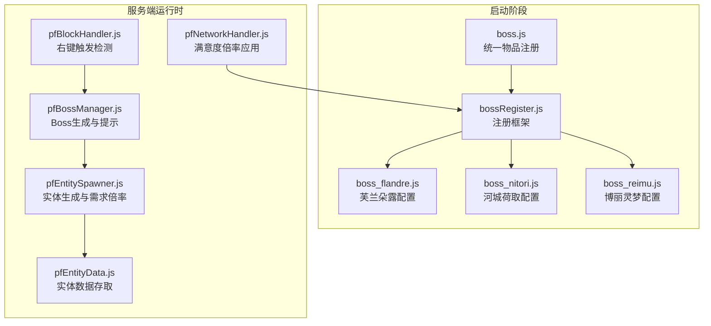
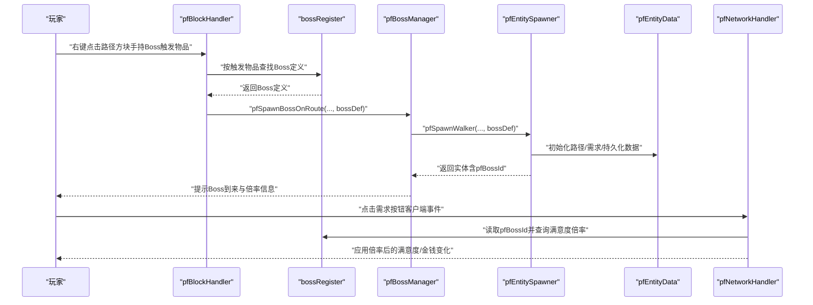
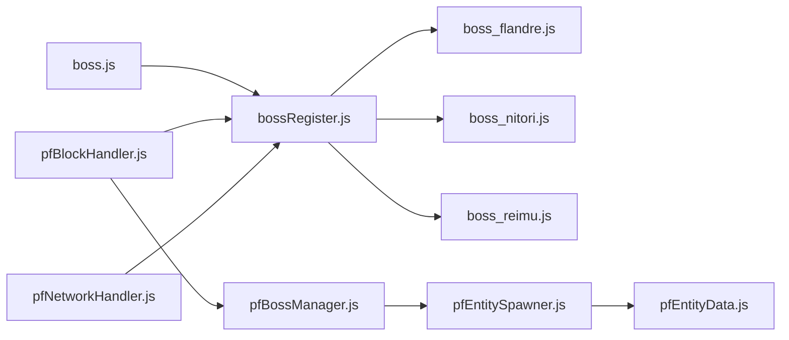

# Boss实现类

<cite>
**本文档引用的文件**
- [boss.js](file://kubejs/startup_scripts/boss/boss.js)
- [bossRegister.js](file://kubejs/startup_scripts/boss/bossRegister.js)
- [boss_flandre.js](file://kubejs/startup_scripts/boss/boss_flandre.js)
- [boss_nitori.js](file://kubejs/startup_scripts/boss/boss_nitori.js)
- [boss_reimu.js](file://kubejs/startup_scripts/boss/boss_reimu.js)
- [pfBlockHandler.js](file://kubejs/server_scripts/pathfinder/pfBlockHandler.js)
- [pfBossManager.js](file://kubejs/server_scripts/pathfinder/pfBossManager.js)
- [pfEntitySpawner.js](file://kubejs/server_scripts/pathfinder/pfEntitySpawner.js)
- [pfNetworkHandler.js](file://kubejs/server_scripts/pathfinder/pfNetworkHandler.js)
- [pfEntityData.js](file://kubejs/server_scripts/pathfinder/pfEntityData.js)
</cite>

## 目录
1. [简介](#简介)
2. [项目结构](#项目结构)
3. [核心组件](#核心组件)
4. [架构总览](#架构总览)
5. [详细组件分析](#详细组件分析)
6. [依赖关系分析](#依赖关系分析)
7. [性能考量](#性能考量)
8. [故障排查指南](#故障排查指南)
9. [结论](#结论)
10. [附录](#附录)

## 简介
本文件聚焦于Boss实现类的设计与使用，系统性解析以下内容：
- 基础Boss类的设计理念与通用功能
- 三个具体Boss实现（芙兰朵露、河城荷取、博丽灵梦）的差异化特征与挑战机制
- Boss实例化与注册流程、属性设置、行为绑定与状态管理
- Boss激活条件、触发机制与战斗开始逻辑
- Boss与寻路系统的交互方式及实体数据管理
- 行为定制指南：如何修改现有Boss或创建全新Boss类型

## 项目结构
Boss相关代码主要分布在两个层面：
- 启动阶段（startup_scripts/boss）：定义Boss注册框架、各Boss配置与统一的召唤符物品注册
- 服务端运行时（server_scripts/pathfinder）：处理Boss触发、生成、行为与数据交互

图表来源
- [bossRegister.js:1-103](file://kubejs/startup_scripts/boss/bossRegister.js#L1-L103)
- [boss_flandre.js:1-22](file://kubejs/startup_scripts/boss/boss_flandre.js#L1-L22)
- [boss_nitori.js:1-22](file://kubejs/startup_scripts/boss/boss_nitori.js#L1-L22)
- [boss_reimu.js:1-22](file://kubejs/startup_scripts/boss/boss_reimu.js#L1-L22)
- [boss.js:9-36](file://kubejs/startup_scripts/boss/boss.js#L9-L36)
- [pfBlockHandler.js:24-138](file://kubejs/server_scripts/pathfinder/pfBlockHandler.js#L24-L138)
- [pfBossManager.js:11-50](file://kubejs/server_scripts/pathfinder/pfBossManager.js#L11-L50)
- [pfEntitySpawner.js:7-81](file://kubejs/server_scripts/pathfinder/pfEntitySpawner.js#L7-L81)
- [pfEntityData.js:18-217](file://kubejs/server_scripts/pathfinder/pfEntityData.js#L18-L217)
- [pfNetworkHandler.js:19-34](file://kubejs/server_scripts/pathfinder/pfNetworkHandler.js#L19-L34)

章节来源
- [bossRegister.js:1-103](file://kubejs/startup_scripts/boss/bossRegister.js#L1-L103)
- [boss.js:9-36](file://kubejs/startup_scripts/boss/boss.js#L9-L36)
- [pfBlockHandler.js:24-138](file://kubejs/server_scripts/pathfinder/pfBlockHandler.js#L24-L138)
- [pfBossManager.js:11-50](file://kubejs/server_scripts/pathfinder/pfBossManager.js#L11-L50)
- [pfEntitySpawner.js:7-81](file://kubejs/server_scripts/pathfinder/pfEntitySpawner.js#L7-L81)
- [pfEntityData.js:18-217](file://kubejs/server_scripts/pathfinder/pfEntityData.js#L18-L217)
- [pfNetworkHandler.js:19-34](file://kubejs/server_scripts/pathfinder/pfNetworkHandler.js#L19-L34)

## 核心组件
- Boss注册框架（BossRegister）：集中管理Boss定义、去重校验、触发物品映射与日志输出
- Boss定义对象（Boss）：封装id、名称、模型、触发物品、需求倍率、满意度倍率、提示语与物品属性
- Boss管理模块（pfBossManager）：服务端入口，负责生成Boss实体、写入持久化数据、提示与粒子效果
- 实体生成模块（pfEntitySpawner）：生成寻路实体、初始化路径与需求数据，并应用Boss需求倍率
- 网络事件模块（pfNetworkHandler）：在客户端点击时应用Boss满意度倍率，影响满意度与金钱增长
- 实体数据模块（pfEntityData）：封装persistentData的读写接口，支撑寻路与状态管理
- 统一物品注册（boss.js）：基于注册表生成Boss召唤符物品

章节来源
- [bossRegister.js:18-96](file://kubejs/startup_scripts/boss/bossRegister.js#L18-L96)
- [pfBossManager.js:11-50](file://kubejs/server_scripts/pathfinder/pfBossManager.js#L11-L50)
- [pfEntitySpawner.js:7-81](file://kubejs/server_scripts/pathfinder/pfEntitySpawner.js#L7-L81)
- [pfNetworkHandler.js:19-34](file://kubejs/server_scripts/pathfinder/pfNetworkHandler.js#L19-L34)
- [pfEntityData.js:18-217](file://kubejs/server_scripts/pathfinder/pfEntityData.js#L18-L217)
- [boss.js:9-36](file://kubejs/startup_scripts/boss/boss.js#L9-L36)

## 架构总览
Boss系统采用“启动期注册 + 运行期触发”的分层设计：
- 启动期：各Boss配置文件通过注册框架完成校验与索引，必要时自动生成触发物品
- 运行期：右键触发方块检测到Boss触发物品后，调用Boss管理模块生成实体，随后由实体生成模块应用需求倍率与持久化数据，网络模块在交互时应用满意度倍率

图表来源
- [pfBlockHandler.js:24-138](file://kubejs/server_scripts/pathfinder/pfBlockHandler.js#L24-L138)
- [bossRegister.js:60-96](file://kubejs/startup_scripts/boss/bossRegister.js#L60-L96)
- [pfBossManager.js:11-50](file://kubejs/server_scripts/pathfinder/pfBossManager.js#L11-L50)
- [pfEntitySpawner.js:7-81](file://kubejs/server_scripts/pathfinder/pfEntitySpawner.js#L7-L81)
- [pfNetworkHandler.js:19-34](file://kubejs/server_scripts/pathfinder/pfNetworkHandler.js#L19-L34)

## 详细组件分析

### 基础Boss类设计与通用功能
- 设计要点
  - Boss对象提供链式setter方法，便于在注册回调中一次性配置
  - 需求倍率与满意度倍率分别进行整数与浮点校验，保证数值有效性
  - 触发物品可自动或手动设置，支持自动生成物品ID与外观
- 关键字段
  - id/name/model/triggerItemId：唯一标识、显示名、模型与触发物品
  - demandMultiplier/satisfactionMultiplier：需求倍率与满意度倍率
  - hint：触发时的提示语
  - autoCreateItem/itemTexture/itemStackSize/itemRarity：触发物品的自动生成与外观
- 注册校验
  - 必填项校验：id、model、triggerItemId
  - 去重校验：id与triggerItemId冲突即拒绝注册
  - 自动生成：当启用autoCreateItem且未设置triggerItemId时，按短ID生成

章节来源
- [bossRegister.js:18-58](file://kubejs/startup_scripts/boss/bossRegister.js#L18-L58)
- [bossRegister.js:65-96](file://kubejs/startup_scripts/boss/bossRegister.js#L65-L96)

### 三个Boss实现的特性与差异
- 芙兰朵露（boss_flandre）
  - 触发物：凋灵骷髅头颅
  - 特性：需求倍率x3、满意度倍率0.3，提示语强调“更难激怒”
- 河城荷取（boss_nitori）
  - 触发物：红石块
  - 特性：需求倍率x2、满意度倍率0.5，提示语体现“挑剔”
- 博丽灵梦（boss_reimu）
  - 触发物：紫水晶碎片
  - 特性：需求倍率x4、满意度倍率0.25，提示语体现“最强巫女”

章节来源
- [boss_flandre.js:10-21](file://kubejs/startup_scripts/boss/boss_flandre.js#L10-L21)
- [boss_nitori.js:10-21](file://kubejs/startup_scripts/boss/boss_nitori.js#L10-L21)
- [boss_reimu.js:10-21](file://kubejs/startup_scripts/boss/boss_reimu.js#L10-L21)

### Boss激活条件与触发机制
- 激活条件
  - 必须在白天触发（非预约凭证模式）
  - 右键点击路径方块（kubejs:pathfinder_block），且主手持有对应的Boss触发物品
- 触发流程
  - 扫描路径网格，确认起点（红地毯）、终点（黄地毯）与蓝色等待区
  - 校验通过后，消耗触发物品，调用Boss管理模块生成实体
  - 生成时写入pfCustomerCategory为空字符串，使其不参与常规评价系统

章节来源
- [pfBlockHandler.js:8-145](file://kubejs/server_scripts/pathfinder/pfBlockHandler.js#L8-L145)
- [pfBossManager.js:20-21](file://kubejs/server_scripts/pathfinder/pfBossManager.js#L20-L21)

### 战斗开始与实体生成逻辑
- 实体生成
  - 通过实体生成模块创建寻路实体，设置模型、禁用AI、持久化起始点与路径
  - 预扫描床位并序列化，生成需求清单
  - 应用Boss需求倍率（每部位次数×倍率），并将pfBossId写入持久化数据
- 状态提示
  - 广播Boss到来与倍率信息
  - 播放红色火焰粒子特效
- 商店集成
  - 若商店已开放，将Boss实体UUID纳入统一管理，随关店清理

章节来源
- [pfEntitySpawner.js:7-81](file://kubejs/server_scripts/pathfinder/pfEntitySpawner.js#L7-L81)
- [pfBossManager.js:11-50](file://kubejs/server_scripts/pathfinder/pfBossManager.js#L11-L50)

### Boss与寻路系统的交互
- 路径与床位
  - 实体生成时预扫描路径上的床位并序列化，供后续寻路与睡眠阶段使用
- 持久化数据
  - 实体持久化数据包含：起始点、路径、阶段、时间、子步、床位列表、蓝色地毯位置、触发玩家UUID等
- 数据读写
  - 通过实体数据模块提供的统一接口读写，保证一致性与可维护性

章节来源
- [pfEntitySpawner.js:51-54](file://kubejs/server_scripts/pathfinder/pfEntitySpawner.js#L51-L54)
- [pfEntityData.js:18-217](file://kubejs/server_scripts/pathfinder/pfEntityData.js#L18-L217)

### 满意度倍率的应用机制
- 应用时机
  - 客户端点击需求按钮时，服务端读取实体持久化数据中的pfBossId
  - 根据Boss定义的satisfactionMultiplier对满意度增益进行缩放
- 影响范围
  - 仅影响满意度增长，金钱增长不受此倍率影响
  - 保证负向收益被截断为非负

章节来源
- [pfNetworkHandler.js:19-34](file://kubejs/server_scripts/pathfinder/pfNetworkHandler.js#L19-L34)

### 召唤符物品的生成与外观
- 生成规则
  - 当autoCreateItem为true时，在启动阶段统一注册item registry
  - 物品ID基于短ID生成（去除前缀“boss_”），名称包含Boss名与特殊符号，堆叠上限与稀有度可配置
  - 可设置自定义贴图与稀有度

章节来源
- [boss.js:9-36](file://kubejs/startup_scripts/boss/boss.js#L9-L36)
- [bossRegister.js:75-80](file://kubejs/startup_scripts/boss/bossRegister.js#L75-L80)

### 行为定制指南
- 修改现有Boss
  - 在对应配置文件中调整id、name、model、triggerItemId、demandMultiplier、satisfactionMultiplier与hint
  - 如需自动生成触发物品，设置autoCreateItem为true并可配置贴图与稀有度
- 创建全新Boss
  - 新建配置文件，调用global.bossRegister.register(cb)，在cb中使用链式setter完成配置
  - 确保id唯一且不与现有触发物品冲突
  - 若希望自动生成触发物品，可省略triggerItemId交由框架生成
- 注意事项
  - 需求倍率必须≥1，满意度倍率必须≥0
  - 触发物品若与已有冲突，注册将失败
  - 生成实体时会写入pfBossId，确保网络事件能正确应用满意度倍率

章节来源
- [bossRegister.js:65-96](file://kubejs/startup_scripts/boss/bossRegister.js#L65-L96)
- [boss.js:9-36](file://kubejs/startup_scripts/boss/boss.js#L9-L36)

## 依赖关系分析
- 组件耦合
  - bossRegister为全局单例，被各Boss配置文件与统一物品注册依赖
  - pfBlockHandler依赖bossRegister进行触发物品匹配
  - pfBossManager依赖pfEntitySpawner生成实体并写入持久化数据
  - pfNetworkHandler依赖bossRegister按pfBossId查询满意度倍率
- 外部依赖
  - 依赖pfConstants、pfShopManager、pfBedManager、pfNbtSync等模块
  - 依赖KubeJS实体类型与网络事件系统

图表来源
- [bossRegister.js:60-96](file://kubejs/startup_scripts/boss/bossRegister.js#L60-L96)
- [boss.js:9-36](file://kubejs/startup_scripts/boss/boss.js#L9-L36)
- [pfBlockHandler.js:24-138](file://kubejs/server_scripts/pathfinder/pfBlockHandler.js#L24-L138)
- [pfBossManager.js:11-50](file://kubejs/server_scripts/pathfinder/pfBossManager.js#L11-L50)
- [pfEntitySpawner.js:7-81](file://kubejs/server_scripts/pathfinder/pfEntitySpawner.js#L7-L81)
- [pfNetworkHandler.js:19-34](file://kubejs/server_scripts/pathfinder/pfNetworkHandler.js#L19-L34)

章节来源
- [bossRegister.js:60-96](file://kubejs/startup_scripts/boss/bossRegister.js#L60-L96)
- [pfBlockHandler.js:24-138](file://kubejs/server_scripts/pathfinder/pfBlockHandler.js#L24-L138)
- [pfBossManager.js:11-50](file://kubejs/server_scripts/pathfinder/pfBossManager.js#L11-L50)
- [pfEntitySpawner.js:7-81](file://kubejs/server_scripts/pathfinder/pfEntitySpawner.js#L7-L81)
- [pfNetworkHandler.js:19-34](file://kubejs/server_scripts/pathfinder/pfNetworkHandler.js#L19-L34)

## 性能考量
- 注册阶段
  - 注册框架在启动时一次性构建索引，避免运行期频繁查找
- 生成阶段
  - 实体生成时进行路径扫描与床位预扫描，建议控制路径复杂度以降低CPU占用
- 网络事件
  - 满意度倍率计算为轻量级数值运算，对性能影响极小
- 数据访问
  - 通过pfEntityData统一接口读写持久化数据，减少分散NBT操作带来的开销

## 故障排查指南
- 注册失败
  - 缺少id或model：检查配置文件是否设置
  - 触发物品缺失：若未设置triggerItemId且未启用autoCreateItem，注册会失败
  - ID或触发物品冲突：查看日志中的冲突提示并调整
- 触发无效
  - 非白天触发：确认当前时间为白天
  - 未找到路径或蓝色地毯：检查路径地毯布局
  - 未消耗触发物品：确认主手持有正确的触发物品
- 生成异常
  - 实体未出现：检查实体生成日志与粒子效果是否播放
  - 倍率未生效：确认实体持久化数据中pfBossId是否存在
- 满意度异常
  - 增益为0：确认satisfactionMultiplier≥0且实体存在pfBossId

章节来源
- [bossRegister.js:73-85](file://kubejs/startup_scripts/boss/bossRegister.js#L73-L85)
- [pfBlockHandler.js:40-44](file://kubejs/server_scripts/pathfinder/pfBlockHandler.js#L40-L44)
- [pfBossManager.js:46-49](file://kubejs/server_scripts/pathfinder/pfBossManager.js#L46-L49)
- [pfNetworkHandler.js:23-28](file://kubejs/server_scripts/pathfinder/pfNetworkHandler.js#L23-L28)

## 结论
Boss系统通过清晰的注册框架与运行期模块分工，实现了可扩展、可定制的Boss体验。三类Boss在需求倍率与满意度倍率上形成差异化挑战，结合寻路系统与网络事件，提供了丰富的交互与策略深度。通过本文档的流程梳理与定制指南，开发者可以快速理解并扩展Boss体系。

## 附录
- 关键流程速览
  - 注册：各Boss配置文件调用注册框架，完成校验与索引
  - 触发：右键路径方块并持有触发物品，扫描路径后生成Boss实体
  - 生成：应用需求倍率、写入pfBossId与路径数据、提示与特效
  - 交互：客户端点击需求按钮，服务端按pfBossId应用满意度倍率