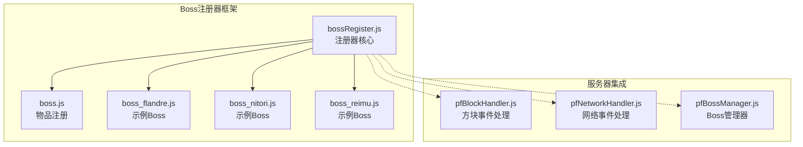
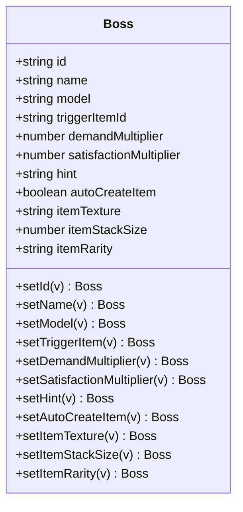
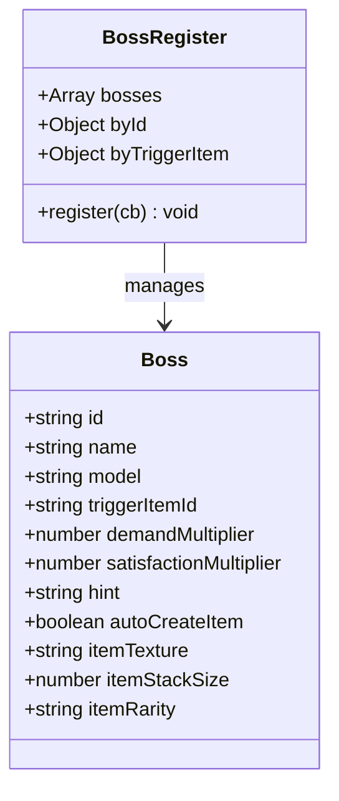
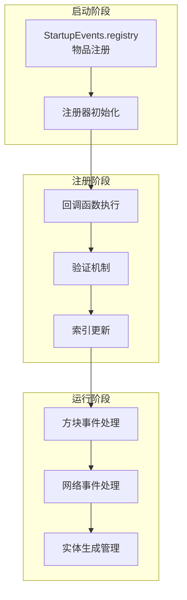
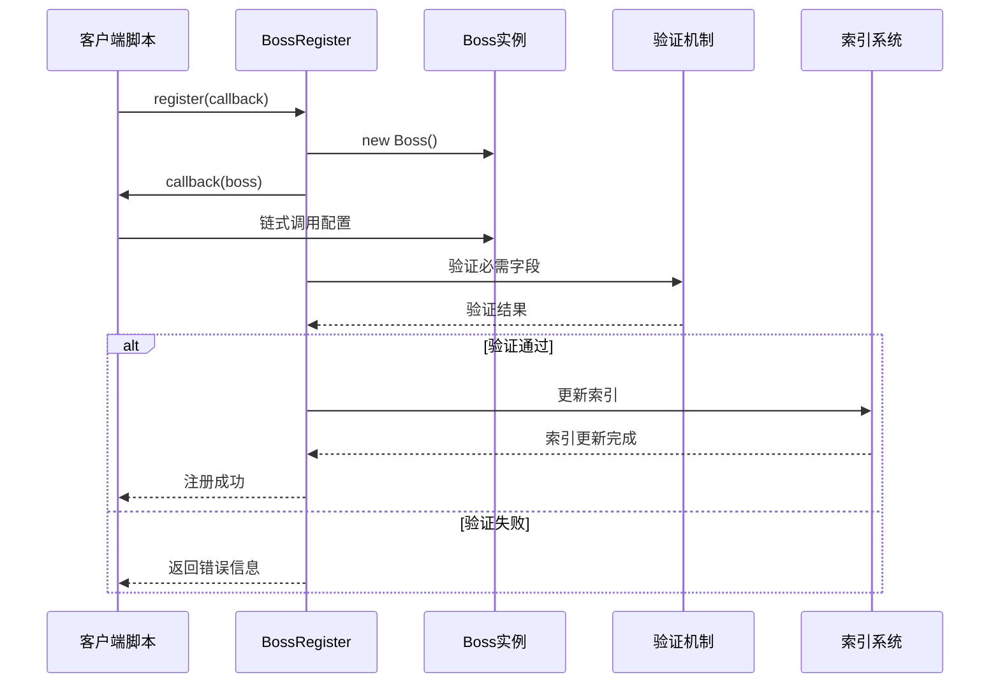
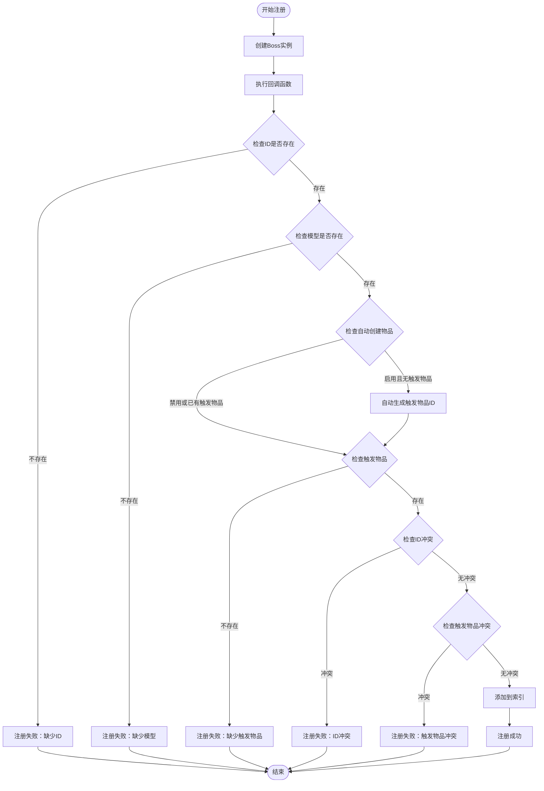
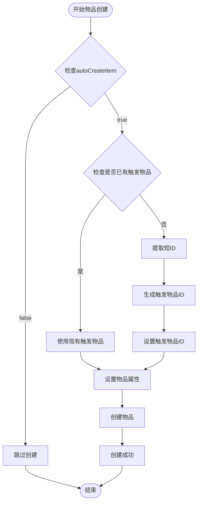
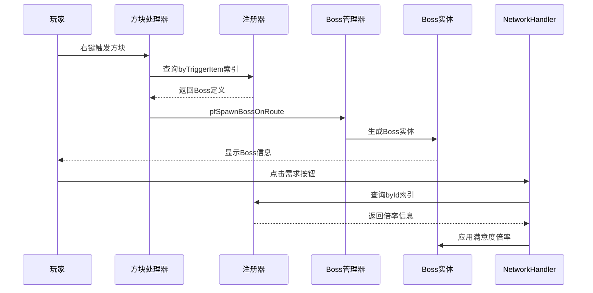
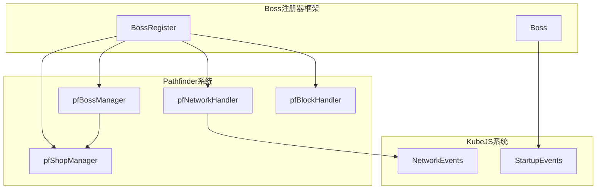

# Boss注册器框架

<cite>
**本文档引用的文件**
- [bossRegister.js](file://kubejs/startup_scripts/boss/bossRegister.js)
- [boss.js](file://kubejs/startup_scripts/boss/boss.js)
- [boss_flandre.js](file://kubejs/startup_scripts/boss/boss_flandre.js)
- [boss_nitori.js](file://kubejs/startup_scripts/boss/boss_nitori.js)
- [boss_reimu.js](file://kubejs/startup_scripts/boss/boss_reimu.js)
- [pfBlockHandler.js](file://kubejs/server_scripts/pathfinder/pfBlockHandler.js)
- [pfNetworkHandler.js](file://kubejs/server_scripts/pathfinder/pfNetworkHandler.js)
- [pfBossManager.js](file://kubejs/server_scripts/pathfinder/pfBossManager.js)
</cite>

## 目录
1. [简介](#简介)
2. [项目结构](#项目结构)
3. [核心组件](#核心组件)
4. [架构概览](#架构概览)
5. [详细组件分析](#详细组件分析)
6. [依赖关系分析](#依赖关系分析)
7. [性能考虑](#性能考虑)
8. [故障排除指南](#故障排除指南)
9. [结论](#结论)
10. [扩展指南](#扩展指南)

## 简介

Boss注册器框架是一个基于KubeJS的Boss实体管理系统，专为Pathfinder模组设计。该框架提供了完整的Boss注册、验证、管理和自动物品创建功能，支持多种Boss类型的动态注册和管理。

该框架采用注册器模式（Registry Pattern），通过集中化的注册中心管理所有Boss实体，实现了类型安全的注册流程和高效的查询机制。

## 项目结构

Boss注册器框架位于KubeJS的startup_scripts/boss目录下，包含以下关键文件：



**图表来源**
- [bossRegister.js:1-103](file://kubejs/startup_scripts/boss/bossRegister.js#L1-L103)
- [boss.js:1-37](file://kubejs/startup_scripts/boss/boss.js#L1-L37)

**章节来源**
- [bossRegister.js:1-103](file://kubejs/startup_scripts/boss/bossRegister.js#L1-L103)
- [boss.js:1-37](file://kubejs/startup_scripts/boss/boss.js#L1-L37)

## 核心组件

### Boss类设计

Boss类是框架的核心数据结构，采用JavaScript函数构造器模式实现。该类包含了所有Boss实体的基本属性和链式调用方法。

#### 主要属性

| 属性名 | 类型 | 默认值 | 描述 |
|--------|------|--------|------|
| id | string | "" | Boss唯一标识符 |
| name | string | "Boss" | Boss显示名称 |
| model | string | "" | Boss模型资源标识符 |
| triggerItemId | string | "" | 触发物品ID |
| demandMultiplier | number | 1 | 需求倍率（整数） |
| satisfactionMultiplier | number | 1.0 | 满意度倍率（浮点数） |
| hint | string | "" | 提示信息 |

#### 链式调用方法

Boss类提供了完整的链式调用接口，支持流畅的配置方式：

- `setId(value)` - 设置Boss ID
- `setName(value)` - 设置显示名称
- `setModel(value)` - 设置模型资源
- `setTriggerItem(value)` - 设置触发物品
- `setDemandMultiplier(value)` - 设置需求倍率
- `setSatisfactionMultiplier(value)` - 设置满意度倍率
- `setHint(value)` - 设置提示信息

#### 自动物品创建属性



**图表来源**
- [bossRegister.js:18-58](file://kubejs/startup_scripts/boss/bossRegister.js#L18-L58)

**章节来源**
- [bossRegister.js:18-58](file://kubejs/startup_scripts/boss/bossRegister.js#L18-L58)

### BossRegister类

BossRegister类是框架的注册中心，负责管理所有Boss实体的注册、验证和查询。

#### 数据结构



**图表来源**
- [bossRegister.js:60-97](file://kubejs/startup_scripts/boss/bossRegister.js#L60-L97)

#### 注册流程

BossRegister的注册流程包含完整的验证机制：

1. **实例化Boss对象**
2. **执行回调函数进行配置**
3. **必需字段验证**
4. **触发物品冲突检测**
5. **ID唯一性检查**
6. **索引更新和存储**

**章节来源**
- [bossRegister.js:60-97](file://kubejs/startup_scripts/boss/bossRegister.js#L60-L97)

## 架构概览

Boss注册器框架采用分层架构设计，将注册逻辑、验证机制和物品创建功能分离：



**图表来源**
- [bossRegister.js:65-96](file://kubejs/startup_scripts/boss/bossRegister.js#L65-L96)
- [boss.js:9-36](file://kubejs/startup_scripts/boss/boss.js#L9-L36)

## 详细组件分析

### 注册器模式实现

Boss注册器框架完美实现了注册器模式，提供了类型安全的注册流程：

#### 注册流程序列图



**图表来源**
- [bossRegister.js:65-96](file://kubejs/startup_scripts/boss/bossRegister.js#L65-L96)

#### 验证机制流程图



**图表来源**
- [bossRegister.js:65-96](file://kubejs/startup_scripts/boss/bossRegister.js#L65-L96)

**章节来源**
- [bossRegister.js:65-96](file://kubejs/startup_scripts/boss/bossRegister.js#L65-L96)

### 自动物品创建功能

框架提供了智能的自动物品创建功能，可以根据Boss配置自动生成对应的触发物品：

#### 物品创建流程



**图表来源**
- [bossRegister.js:75-80](file://kubejs/startup_scripts/boss/bossRegister.js#L75-L80)
- [boss.js:19-34](file://kubejs/startup_scripts/boss/boss.js#L19-L34)

**章节来源**
- [bossRegister.js:75-80](file://kubejs/startup_scripts/boss/bossRegister.js#L75-L80)
- [boss.js:19-34](file://kubejs/startup_scripts/boss/boss.js#L19-L34)

### 服务器集成

Boss注册器框架与Pathfinder服务器模块深度集成，提供了完整的Boss实体管理功能：

#### 服务器交互流程



**图表来源**
- [pfBlockHandler.js:25-28](file://kubejs/server_scripts/pathfinder/pfBlockHandler.js#L25-L28)
- [pfNetworkHandler.js:19-34](file://kubejs/server_scripts/pathfinder/pfNetworkHandler.js#L19-L34)
- [pfBossManager.js:11-50](file://kubejs/server_scripts/pathfinder/pfBossManager.js#L11-L50)

**章节来源**
- [pfBlockHandler.js:25-28](file://kubejs/server_scripts/pathfinder/pfBlockHandler.js#L25-L28)
- [pfNetworkHandler.js:19-34](file://kubejs/server_scripts/pathfinder/pfNetworkHandler.js#L19-L34)
- [pfBossManager.js:11-50](file://kubejs/server_scripts/pathfinder/pfBossManager.js#L11-L50)

## 依赖关系分析

Boss注册器框架与其他系统组件存在紧密的依赖关系：



**图表来源**
- [bossRegister.js:99](file://kubejs/startup_scripts/boss/bossRegister.js#L99)
- [boss.js:9](file://kubejs/startup_scripts/boss/boss.js#L9)
- [pfBlockHandler.js:1](file://kubejs/server_scripts/pathfinder/pfBlockHandler.js#L1)

**章节来源**
- [bossRegister.js:99](file://kubejs/startup_scripts/boss/bossRegister.js#L99)
- [boss.js:9](file://kubejs/startup_scripts/boss/boss.js#L9)
- [pfBlockHandler.js:1](file://kubejs/server_scripts/pathfinder/pfBlockHandler.js#L1)

## 性能考虑

Boss注册器框架在设计时充分考虑了性能优化：

### 时间复杂度
- **注册操作**: O(1) - 基于哈希表的快速查找
- **查询操作**: O(1) - 直接通过索引访问
- **冲突检测**: O(1) - 哈希表冲突检查

### 空间复杂度
- **内存占用**: O(n) - n为注册的Boss数量
- **索引存储**: 2n个引用（byId和byTriggerItem各n个）

### 优化策略
1. **延迟初始化**: 注册器在首次使用时才初始化
2. **增量注册**: 支持动态添加新的Boss类型
3. **内存优化**: 使用弱引用避免循环引用

## 故障排除指南

### 常见问题及解决方案

#### 注册失败问题

| 错误类型 | 错误信息 | 可能原因 | 解决方案 |
|----------|----------|----------|----------|
| 缺少ID | "缺少 id" | Boss.id未设置 | 确保调用setId方法 |
| 缺少模型 | "缺少 model" | Boss.model未设置 | 设置正确的模型资源ID |
| 缺少触发物品 | "缺少 triggerItem" | Boss.triggerItemId未设置 | 设置触发物品ID或启用自动创建 |
| ID冲突 | "id 冲突" | 重复的Boss ID | 修改Boss ID确保唯一性 |
| 触发物品冲突 | "triggerItem 冲突" | 重复的触发物品ID | 修改触发物品ID或删除冲突项 |

#### 调试技巧

1. **检查控制台输出**: 注册器会在注册过程中输出详细的日志信息
2. **验证索引状态**: 可以通过global.bossRegister对象检查注册状态
3. **测试触发机制**: 使用注册的触发物品测试Boss生成功能

**章节来源**
- [bossRegister.js:73-86](file://kubejs/startup_scripts/boss/bossRegister.js#L73-L86)

## 结论

Boss注册器框架是一个设计精良的注册器模式实现，具有以下特点：

1. **类型安全**: 通过严格的验证机制确保数据完整性
2. **易于扩展**: 支持动态添加新的Boss类型
3. **高效查询**: 基于哈希表的索引系统提供O(1)查询性能
4. **自动化程度高**: 自动物品创建功能减少了配置工作量
5. **与生态系统集成**: 与Pathfinder模组无缝集成

该框架为开发者提供了一个强大而灵活的Boss实体管理解决方案，适用于各种复杂的模组开发场景。

## 扩展指南

### 添加新Boss类型的完整示例

以下是一个完整的Boss注册示例，展示了如何创建和注册新的Boss类型：

#### 基础Boss注册

```javascript
// 在kubejs/startup_scripts/boss/目录下创建新文件
// 例如：boss_example.js

global.bossRegister.register(boss => {
    boss
        .setId("boss_example")                    // 设置唯一ID
        .setName("§6示例Boss")                     // 设置显示名称
        .setModel("modid:model_resource")         // 设置模型资源
        .setTriggerItem("minecraft:diamond")      // 设置触发物品
        .setDemandMultiplier(2)                   // 设置需求倍率
        .setSatisfactionMultiplier(0.5)           // 设置满意度倍率
        .setHint("§7这是一个示例Boss")             // 设置提示信息
})
```

#### 自动物品创建示例

```javascript
global.bossRegister.register(boss => {
    boss
        .setId("boss_custom")
        .setName("自定义Boss")
        .setModel("custom_mod:custom_model")
        .setAutoCreateItem(true)                  // 启用自动创建
        .setItemTexture("minecraft:item/gold_ingot") // 设置物品贴图
        .setItemRarity("epic")                    // 设置稀有度
        .setItemStackSize(1)                      // 设置堆叠上限
})
```

### 高级配置选项

#### 需求倍率和满意度倍率

```javascript
global.bossRegister.register(boss => {
    boss
        .setId("boss_challenging")
        .setName("挑战性Boss")
        .setModel("challenge_mod:challenge_model")
        .setAutoCreateItem(true)
        .setDemandMultiplier(5)                   // 需求倍率达到5倍
        .setSatisfactionMultiplier(0.1)           // 满意度倍率仅为0.1
})
```

#### 自定义触发物品

```javascript
global.bossRegister.register(boss => {
    boss
        .setId("boss_custom_trigger")
        .setName("自定义触发Boss")
        .setModel("custom_mod:custom_model")
        .setTriggerItem("marguerite:custom_seal")  // 使用自定义触发物品
        .setDemandMultiplier(3)
        .setSatisfactionMultiplier(0.4)
})
```

### 最佳实践建议

1. **ID命名规范**: 使用"boss_"前缀加上有意义的标识符
2. **模型资源**: 确保模型资源文件正确安装和可用
3. **触发物品选择**: 选择与Boss主题相符的触发物品
4. **倍率平衡**: 合理设置需求倍率和满意度倍率
5. **提示信息**: 提供清晰的用户提示信息

### 集成注意事项

1. **加载顺序**: 确保bossRegister.js在所有Boss文件之前加载
2. **物品注册**: 自动物品创建在boss.js中统一处理
3. **服务器同步**: Boss定义在客户端和服务端保持一致
4. **版本兼容**: 注意不同版本间的API变化

通过遵循这些指南，开发者可以轻松地扩展Boss注册器框架，添加更多有趣的Boss类型，丰富游戏体验。