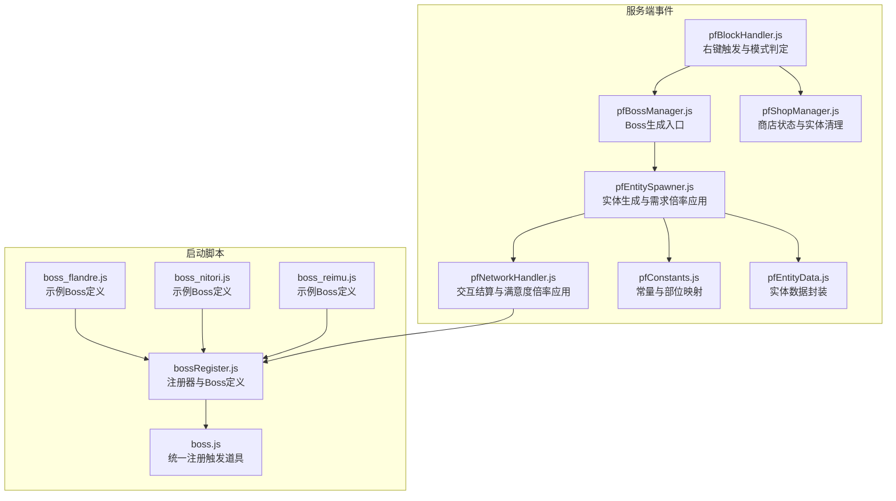
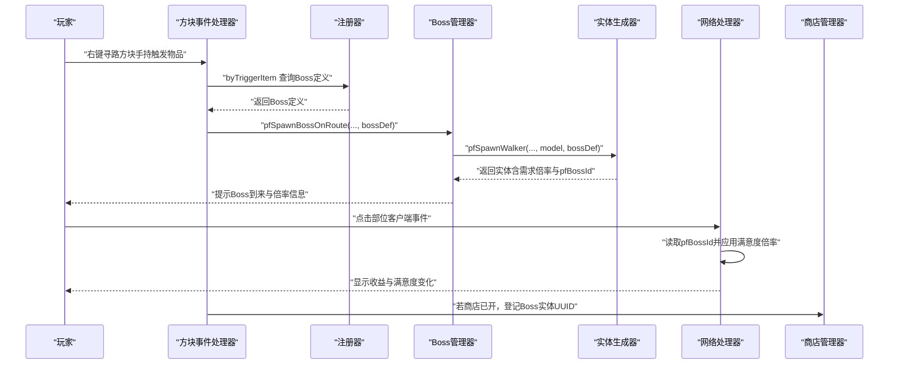
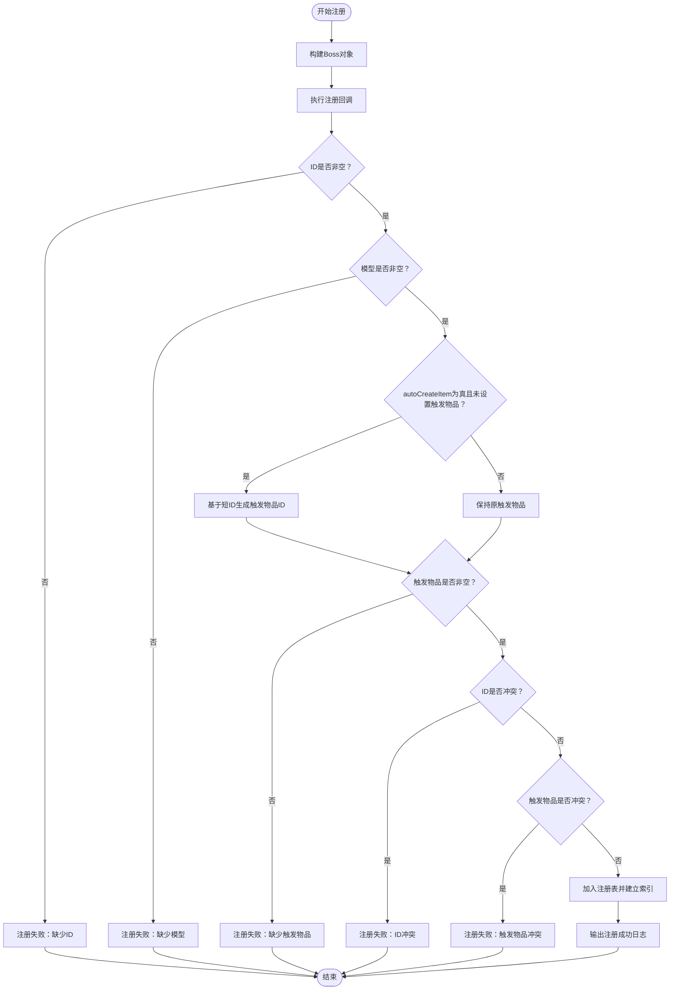
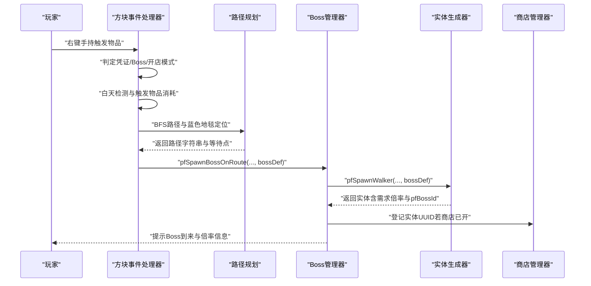
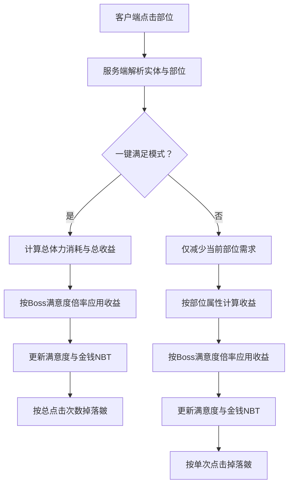
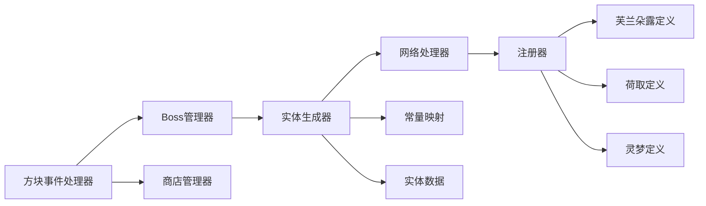

# Boss系统

<cite>
**本文引用的文件**
- [bossRegister.js](file://kubejs/startup_scripts/boss/bossRegister.js)
- [boss.js](file://kubejs/startup_scripts/boss/boss.js)
- [boss_flandre.js](file://kubejs/startup_scripts/boss/boss_flandre.js)
- [boss_nitori.js](file://kubejs/startup_scripts/boss/boss_nitori.js)
- [boss_reimu.js](file://kubejs/startup_scripts/boss/boss_reimu.js)
- [pfBlockHandler.js](file://kubejs/server_scripts/pathfinder/pfBlockHandler.js)
- [pfBossManager.js](file://kubejs/server_scripts/pathfinder/pfBossManager.js)
- [pfEntitySpawner.js](file://kubejs/server_scripts/pathfinder/pfEntitySpawner.js)
- [pfNetworkHandler.js](file://kubejs/server_scripts/pathfinder/pfNetworkHandler.js)
- [pfConstants.js](file://kubejs/server_scripts/pathfinder/pfConstants.js)
- [pfEntityData.js](file://kubejs/server_scripts/pathfinder/pfEntityData.js)
- [pfShopManager.js](file://kubejs/server_scripts/pathfinder/pfShopManager.js)
</cite>

## 目录
1. [简介](#简介)
2. [项目结构](#项目结构)
3. [核心组件](#核心组件)
4. [架构总览](#架构总览)
5. [详细组件分析](#详细组件分析)
6. [依赖关系分析](#依赖关系分析)
7. [性能考量](#性能考量)
8. [故障排查指南](#故障排查指南)
9. [结论](#结论)
10. [附录](#附录)

## 简介
本文件系统性阐述Boss系统的注册器模式、Boss实例统一管理机制以及完整的游戏流程（生成、激活、战斗与奖励）。文档聚焦以下要点：
- 注册器模式设计：通过全局注册中心集中管理Boss定义，支持自动创建触发道具、去重校验与日志输出。
- Boss实例管理：Boss定义在服务端生成实体时生效，需求倍率与满意度倍率贯穿生成与交互阶段。
- 行为与挑战机制：不同Boss具有独特的触发方式、需求倍率与满意度倍率，体现差异化挑战。
- 完整流程：从右键触发到路径规划、实体生成、交互结算、奖励掉落与商店联动。
- 扩展指南：如何新增Boss类型、自定义行为与平衡性调整。

## 项目结构
Boss系统位于KubeJS脚本的启动与服务端模块中，采用“启动脚本注册 + 服务端事件驱动”的分层组织：
- 启动脚本层：负责注册Boss定义与自动创建触发道具。
- 服务端事件层：负责右键触发、路径规划、实体生成、交互结算与商店联动。

图表来源
- [bossRegister.js:1-103](file://kubejs/startup_scripts/boss/bossRegister.js#L1-L103)
- [boss.js:1-37](file://kubejs/startup_scripts/boss/boss.js#L1-L37)
- [boss_flandre.js:1-22](file://kubejs/startup_scripts/boss/boss_flandre.js#L1-L22)
- [boss_nitori.js:1-22](file://kubejs/startup_scripts/boss/boss_nitori.js#L1-L22)
- [boss_reimu.js:1-22](file://kubejs/startup_scripts/boss/boss_reimu.js#L1-L22)
- [pfBlockHandler.js:1-148](file://kubejs/server_scripts/pathfinder/pfBlockHandler.js#L1-L148)
- [pfBossManager.js:1-58](file://kubejs/server_scripts/pathfinder/pfBossManager.js#L1-L58)
- [pfEntitySpawner.js:1-141](file://kubejs/server_scripts/pathfinder/pfEntitySpawner.js#L1-L141)
- [pfNetworkHandler.js:1-200](file://kubejs/server_scripts/pathfinder/pfNetworkHandler.js#L1-L200)
- [pfConstants.js:1-65](file://kubejs/server_scripts/pathfinder/pfConstants.js#L1-L65)
- [pfEntityData.js:1-218](file://kubejs/server_scripts/pathfinder/pfEntityData.js#L1-L218)
- [pfShopManager.js:69-299](file://kubejs/server_scripts/pathfinder/pfShopManager.js#L69-L299)

章节来源
- [bossRegister.js:1-103](file://kubejs/startup_scripts/boss/bossRegister.js#L1-L103)
- [boss.js:1-37](file://kubejs/startup_scripts/boss/boss.js#L1-L37)
- [pfBlockHandler.js:1-148](file://kubejs/server_scripts/pathfinder/pfBlockHandler.js#L1-L148)

## 核心组件
- 注册器与Boss定义
  - Boss注册器集中管理Boss定义，提供链式API设置ID、名称、模型、触发物品、需求倍率、满意度倍率与提示语，并支持自动创建触发道具。
  - 注册时进行ID与触发物品唯一性校验、模型存在性校验与日志输出。
- 实体生成与需求倍率
  - 服务端生成Boss实体时，将Boss定义注入实体持久化数据，并按需求倍率放大需求清单。
- 交互结算与满意度倍率
  - 客户端点击部位时，服务端按部位属性计算收益，再乘以Boss的满意度倍率，最终累加到实体满意度。
- 商店联动
  - Boss触发不影响商店开关状态；若商店已开启，Boss实体会被纳入统一管理并在日落或手动关闭时清理。

章节来源
- [bossRegister.js:18-96](file://kubejs/startup_scripts/boss/bossRegister.js#L18-L96)
- [pfEntitySpawner.js:56-81](file://kubejs/server_scripts/pathfinder/pfEntitySpawner.js#L56-L81)
- [pfNetworkHandler.js:19-34](file://kubejs/server_scripts/pathfinder/pfNetworkHandler.js#L19-L34)
- [pfBossManager.js:11-50](file://kubejs/server_scripts/pathfinder/pfBossManager.js#L11-L50)

## 架构总览
Boss系统遵循“启动注册 + 事件驱动 + 数据持久化”的架构：
- 启动阶段：各Boss定义文件通过注册器完成注册，必要时自动创建触发道具。
- 事件阶段：右键触发识别模式（凭证/普通/Boss），Boss模式下消耗触发物品并生成实体。
- 生成阶段：实体生成时应用需求倍率与Boss标识，预扫描床位并同步需求清单。
- 交互阶段：点击部位结算收益，按Boss满意度倍率应用，记录步骤并可能掉落奖励。
- 管理阶段：Boss实体不受常规评价系统影响，但可与商店状态联动。

图表来源
- [pfBlockHandler.js:24-28](file://kubejs/server_scripts/pathfinder/pfBlockHandler.js#L24-L28)
- [pfBossManager.js:11-50](file://kubejs/server_scripts/pathfinder/pfBossManager.js#L11-L50)
- [pfEntitySpawner.js:56-81](file://kubejs/server_scripts/pathfinder/pfEntitySpawner.js#L56-L81)
- [pfNetworkHandler.js:19-34](file://kubejs/server_scripts/pathfinder/pfNetworkHandler.js#L19-L34)
- [pfShopManager.js:152-170](file://kubejs/server_scripts/pathfinder/pfShopManager.js#L152-L170)

## 详细组件分析

### 注册器与Boss定义（注册器模式）
- 设计要点
  - Boss类提供链式setter，便于在注册回调中一次性配置。
  - 注册器在注册时执行严格校验：ID非空、模型非空、触发物品非空且唯一、ID唯一。
  - 支持自动创建触发道具：当启用自动创建且未显式设置触发物品时，基于短ID生成默认触发物品ID。
  - 日志输出包含关键配置项，便于调试与确认。
- 关键流程
  - 注册回调执行 → 校验与补全 → 去重插入 → 输出注册成功日志。

图表来源
- [bossRegister.js:65-96](file://kubejs/startup_scripts/boss/bossRegister.js#L65-L96)

章节来源
- [bossRegister.js:18-96](file://kubejs/startup_scripts/boss/bossRegister.js#L18-L96)

### Boss触发与生成（右键触发 → 路径规划 → 实体生成）
- 触发判定
  - 右键触发时优先判定凭证模式，其次Boss模式，最后普通开店模式。
  - Boss模式下需要白天且消耗1个触发物品。
- 路径规划
  - 扫描红/蓝/黄地毯构成的地图，BFS寻找起点到终点的路径，定位蓝色地毯作为等待点。
- 实体生成
  - 调用实体生成器，应用需求倍率与Boss标识，预扫描床位并同步需求清单。
  - 若商店已开，Boss实体UUID登记至商店管理器以便统一清理。

图表来源
- [pfBlockHandler.js:8-145](file://kubejs/server_scripts/pathfinder/pfBlockHandler.js#L8-L145)
- [pfBossManager.js:11-50](file://kubejs/server_scripts/pathfinder/pfBossManager.js#L11-L50)
- [pfEntitySpawner.js:8-135](file://kubejs/server_scripts/pathfinder/pfEntitySpawner.js#L8-L135)
- [pfShopManager.js:152-170](file://kubejs/server_scripts/pathfinder/pfShopManager.js#L152-L170)

章节来源
- [pfBlockHandler.js:24-44](file://kubejs/server_scripts/pathfinder/pfBlockHandler.js#L24-L44)
- [pfBossManager.js:11-50](file://kubejs/server_scripts/pathfinder/pfBossManager.js#L11-L50)
- [pfEntitySpawner.js:56-81](file://kubejs/server_scripts/pathfinder/pfEntitySpawner.js#L56-L81)

### 交互结算与满意度倍率（客户端点击 → 服务端结算 → 奖励掉落）
- 结算流程
  - 客户端发送点击事件，服务端解析目标实体与部位。
  - 一键满足模式：清零所有需求，按总点击次数结算奖励与掉落。
  - 正常模式：仅减少当前部位需求，按部位属性结算收益。
  - 应用Boss满意度倍率：读取实体持久化数据中的Boss ID，查注册器获取满意度倍率并向下取整。
- 奖励与掉落
  - 一键满足按总清零次数结算掉落“皴”。
  - 正常模式按单次点击结算掉落“皴”。

图表来源
- [pfNetworkHandler.js:39-200](file://kubejs/server_scripts/pathfinder/pfNetworkHandler.js#L39-L200)
- [pfEntitySpawner.js:77-81](file://kubejs/server_scripts/pathfinder/pfEntitySpawner.js#L77-L81)

章节来源
- [pfNetworkHandler.js:19-34](file://kubejs/server_scripts/pathfinder/pfNetworkHandler.js#L19-L34)
- [pfNetworkHandler.js:95-154](file://kubejs/server_scripts/pathfinder/pfNetworkHandler.js#L95-L154)
- [pfNetworkHandler.js:155-200](file://kubejs/server_scripts/pathfinder/pfNetworkHandler.js#L155-L200)

### Boss实例与行为特征
- 芙兰朵露（boss_flandre）
  - 触发物：凋灵骷髅头颅。
  - 特性：需求倍率x3，满意度倍率x0.3，提示语强调“小心别激怒她”。
- 河城荷取（boss_nitori）
  - 触发物：红石块。
  - 特性：需求倍率x2，满意度倍率x0.5，提示语强调“让她检查手艺”。
- 博丽灵梦（boss_reimu）
  - 触发物：紫水晶碎片。
  - 特性：需求倍率x4，满意度倍率x0.25，提示语带有“赛钱拿来”的傲娇语气。

章节来源
- [boss_flandre.js:1-22](file://kubejs/startup_scripts/boss/boss_flandre.js#L1-L22)
- [boss_nitori.js:1-22](file://kubejs/startup_scripts/boss/boss_nitori.js#L1-L22)
- [boss_reimu.js:1-22](file://kubejs/startup_scripts/boss/boss_reimu.js#L1-L22)

### 触发道具自动注册
- 当Boss定义启用自动创建触发道具时，系统在启动阶段统一注册相应物品，设置显示名、堆叠上限、稀有度与贴图。
- 注册顺序：注册器优先加载，各Boss定义随后加载，最后由统一注册文件遍历注册。

章节来源
- [boss.js:9-36](file://kubejs/startup_scripts/boss/boss.js#L9-L36)
- [bossRegister.js:75-80](file://kubejs/startup_scripts/boss/bossRegister.js#L75-L80)

## 依赖关系分析
- 组件耦合
  - 注册器与Boss定义文件：低耦合，通过注册回调解耦。
  - 事件处理器与管理器：高内聚，右键触发→Boss生成→商店登记形成闭环。
  - 实体生成器与网络处理器：通过实体持久化数据与常量映射协作。
- 外部依赖
  - KubeJS事件系统（StartupEvents.registry、BlockEvents.rightClicked、NetworkEvents.dataReceived）。
  - 寻路常量与部位映射（pfConstants）。
  - 商店管理器（pfShopManager）用于实体登记与清理。

图表来源
- [bossRegister.js:65-96](file://kubejs/startup_scripts/boss/bossRegister.js#L65-L96)
- [pfBlockHandler.js:24-28](file://kubejs/server_scripts/pathfinder/pfBlockHandler.js#L24-L28)
- [pfBossManager.js:11-50](file://kubejs/server_scripts/pathfinder/pfBossManager.js#L11-L50)
- [pfEntitySpawner.js:56-81](file://kubejs/server_scripts/pathfinder/pfEntitySpawner.js#L56-L81)
- [pfNetworkHandler.js:19-34](file://kubejs/server_scripts/pathfinder/pfNetworkHandler.js#L19-L34)
- [pfConstants.js:25-50](file://kubejs/server_scripts/pathfinder/pfConstants.js#L25-L50)
- [pfEntityData.js:185-218](file://kubejs/server_scripts/pathfinder/pfEntityData.js#L185-L218)
- [pfShopManager.js:152-170](file://kubejs/server_scripts/pathfinder/pfShopManager.js#L152-L170)

章节来源
- [pfConstants.js:25-50](file://kubejs/server_scripts/pathfinder/pfConstants.js#L25-L50)
- [pfEntityData.js:185-218](file://kubejs/server_scripts/pathfinder/pfEntityData.js#L185-L218)
- [pfShopManager.js:152-170](file://kubejs/server_scripts/pathfinder/pfShopManager.js#L152-L170)

## 性能考量
- 注册阶段
  - 注册器在启动时一次性构建索引，后续查询为哈希表O(1)查找。
- 事件阶段
  - 右键触发时进行白天检测与路径扫描，建议确保地图规模合理以避免BFS开销过大。
- 生成阶段
  - 需求倍率应用为O(1)乘法，实体生成包含预扫描床位与NBT同步，注意实体数量过多时的内存与I/O压力。
- 交互阶段
  - 一键满足模式按总点击次数结算，可能产生较多掉落判定，建议在掉落概率与数量上做节流。

## 故障排查指南
- 注册失败
  - 缺少ID/模型/触发物品：检查注册回调与自动创建逻辑。
  - ID或触发物品冲突：检查是否存在重复定义或命名不规范。
- 触发无效
  - 非白天：Boss触发需要白天条件。
  - 未找到蓝色地毯：确认路径中存在蓝色地毯。
  - 未找到终点：确认路径连通到黄色地毯。
- 生成失败
  - 实体生成异常：查看服务端日志中的生成失败提示。
  - 商店登记失败：检查商店管理器可用性与权限。
- 交互异常
  - 无法确定部位：确认手持物品与部位映射关系。
  - 体力不足：检查属性配置与体力消费逻辑。
  - 奖励掉落失败：检查掉落模块可用性与数量计算。

章节来源
- [bossRegister.js:73-86](file://kubejs/startup_scripts/boss/bossRegister.js#L73-L86)
- [pfBlockHandler.js:40-44](file://kubejs/server_scripts/pathfinder/pfBlockHandler.js#L40-L44)
- [pfBlockHandler.js:74-83](file://kubejs/server_scripts/pathfinder/pfBlockHandler.js#L74-L83)
- [pfBossManager.js:46-49](file://kubejs/server_scripts/pathfinder/pfBossManager.js#L46-L49)
- [pfNetworkHandler.js:58-61](file://kubejs/server_scripts/pathfinder/pfNetworkHandler.js#L58-L61)
- [pfNetworkHandler.js:113-117](file://kubejs/server_scripts/pathfinder/pfNetworkHandler.js#L113-L117)

## 结论
Boss系统通过注册器模式实现了Boss定义的集中管理与自动触发道具创建，结合服务端事件驱动与实体持久化数据，提供了可扩展的挑战机制与奖励体系。通过需求倍率与满意度倍率的组合，不同Boss展现出差异化的行为与挑战强度，既保证了游戏平衡，也为后续扩展预留了充足空间。

## 附录

### Boss配置参数说明
- 基础参数
  - id：Boss唯一标识，用于持久化与注册索引。
  - name：Boss显示名称。
  - model：模型ID，决定实体外观。
  - triggerItemId：触发物品ID，用于右键触发。
  - hint：触发提示语，增强叙事体验。
- 倍率参数
  - demandMultiplier：需求倍率，影响生成时的需求次数。
  - satisfactionMultiplier：满意度倍率，影响交互收益的满意度部分。
- 自动创建触发道具
  - autoCreateItem：是否自动创建触发道具。
  - itemTexture：触发道具贴图路径。
  - itemStackSize：触发道具堆叠上限。
  - itemRarity：触发道具稀有度。

章节来源
- [bossRegister.js:18-58](file://kubejs/startup_scripts/boss/bossRegister.js#L18-L58)

### 难度调节与平衡性考虑
- 需求倍率
  - 适度提高需求倍率可增加挑战时长与操作频率，但需避免过度延长导致玩家疲劳。
- 满意度倍率
  - 降低满意度倍率可提升挑战难度，但应配合收益与掉落以维持正反馈。
- 触发条件
  - 白天限制与触发物品消耗可控制Boss出现频率，平衡稀有度与可玩性。
- 掉落与奖励
  - 掉落“皴”的数量与概率应与挑战强度匹配，避免过强或过弱的激励效果。

### 扩展指南：添加新Boss类型
- 新建定义文件
  - 在启动脚本目录新建一个JS文件，使用注册器注册Boss定义，设置ID、名称、模型、触发物品与倍率。
- 自动创建触发道具
  - 若启用自动创建，系统将基于短ID生成触发物品ID；可自定义贴图与稀有度。
- 行为实现
  - 如需特殊行为（如特定交互、动画或掉落），可在服务端模块中扩展事件处理器或实体生成逻辑。
- 平衡性测试
  - 通过调整需求倍率与满意度倍率，结合玩家反馈进行迭代优化。

章节来源
- [bossRegister.js:65-96](file://kubejs/startup_scripts/boss/bossRegister.js#L65-L96)
- [boss.js:9-36](file://kubejs/startup_scripts/boss/boss.js#L9-L36)

### 代码示例路径（不展示具体代码内容）
- 注册器与Boss定义
  - [注册器类与注册流程:18-96](file://kubejs/startup_scripts/boss/bossRegister.js#L18-L96)
  - [自动创建触发道具:9-36](file://kubejs/startup_scripts/boss/boss.js#L9-L36)
- Boss定义示例
  - [芙兰朵露定义:10-21](file://kubejs/startup_scripts/boss/boss_flandre.js#L10-L21)
  - [荷取定义:10-21](file://kubejs/startup_scripts/boss/boss_nitori.js#L10-L21)
  - [灵梦定义:10-21](file://kubejs/startup_scripts/boss/boss_reimu.js#L10-L21)
- 事件与生成
  - [右键触发与模式判定:8-145](file://kubejs/server_scripts/pathfinder/pfBlockHandler.js#L8-L145)
  - [Boss生成入口:11-50](file://kubejs/server_scripts/pathfinder/pfBossManager.js#L11-L50)
  - [实体生成与需求倍率应用:8-135](file://kubejs/server_scripts/pathfinder/pfEntitySpawner.js#L8-L135)
- 交互与结算
  - [满意度倍率应用:19-34](file://kubejs/server_scripts/pathfinder/pfNetworkHandler.js#L19-L34)
  - [一键满足与掉落:95-154](file://kubejs/server_scripts/pathfinder/pfNetworkHandler.js#L95-L154)
  - [正常模式结算:155-200](file://kubejs/server_scripts/pathfinder/pfNetworkHandler.js#L155-L200)
- 常量与数据
  - [部位映射与常量:25-50](file://kubejs/server_scripts/pathfinder/pfConstants.js#L25-L50)
  - [实体数据封装:185-218](file://kubejs/server_scripts/pathfinder/pfEntityData.js#L185-L218)
- 商店联动
  - [商店开启与登记:152-170](file://kubejs/server_scripts/pathfinder/pfShopManager.js#L152-L170)
  - [商店关闭与清理:179-231](file://kubejs/server_scripts/pathfinder/pfShopManager.js#L179-L231)