# 女仆脚部服务系统

<cite>
**本文引用的文件**   
- [README.md](file://README.md)
- [01-模拟经营-足浴店系统.md](file://docs/01-模拟经营-足浴店系统.md)
- [pfMain.js](file://kubejs/server_scripts/pathfinder/pfMain.js)
- [pfShopManager.js](file://kubejs/server_scripts/pathfinder/pfShopManager.js)
- [pfCustomerTypes.js](file://kubejs/server_scripts/pathfinder/pfCustomerTypes.js)
- [pfEntitySpawner.js](file://kubejs/server_scripts/pathfinder/pfEntitySpawner.js)
- [pfMovement.js](file://kubejs/server_scripts/pathfinder/pfMovement.js)
- [pfSoakManager.js](file://kubejs/server_scripts/pathfinder/pfSoakManager.js)
- [foot_ui.js](file://kubejs/client_scripts/ui/foot_ui.js)
- [stamina_hud.js](file://kubejs/client_scripts/ui/stamina_hud.js)
- [footsoak.html](file://apricity/kubejs/footsoak.html)
</cite>

## 目录
1. [引言](#引言)
2. [项目结构](#项目结构)
3. [核心组件](#核心组件)
4. [架构总览](#架构总览)
5. [详细组件分析](#详细组件分析)
6. [依赖关系分析](#依赖关系分析)
7. [性能与稳定性](#性能与稳定性)
8. [故障排查指南](#故障排查指南)
9. [结论](#结论)

## 引言
本仓库实现了一个以“女仆脚部服务”为核心的模拟经营玩法：玩家开店后，顾客按种族类别与权重生成，沿路径寻路到床位躺下，随后进行搓脚服务与泡脚流程；服务完成后结算奖励并影响声誉。系统由服务端 KubeJS 脚本驱动，客户端通过 ApricityUI 展示脚部交互界面与体力 HUD。

## 项目结构
- 服务端逻辑集中在 `kubejs/server_scripts/pathfinder`，包含开店、顾客生成、移动排队、泡脚计时、实体数据等模块。
- 客户端 UI 位于 `kubejs/client_scripts/ui`，负责脚部交互窗口、体力条显示。
- 资源与 HTML 视图在 `apricity/kubejs` 与 `kubejs/assets` 中。
- 设计文档位于 `docs`，提供玩法说明与数值设定。

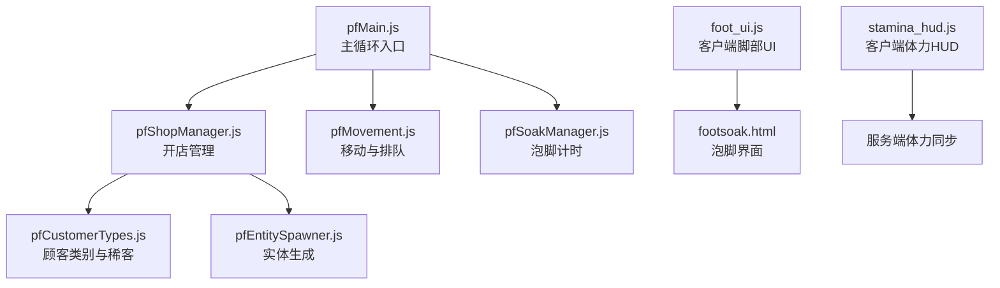

**图示来源**
- [pfMain.js:11-214](file://kubejs/server_scripts/pathfinder/pfMain.js#L11-L214)
- [pfShopManager.js:413-479](file://kubejs/server_scripts/pathfinder/pfShopManager.js#L413-L479)
- [pfMovement.js:8-34](file://kubejs/server_scripts/pathfinder/pfMovement.js#L8-L34)
- [pfCustomerTypes.js:349-382](file://kubejs/server_scripts/pathfinder/pfCustomerTypes.js#L349-L382)
- [pfEntitySpawner.js:10-99](file://kubejs/server_scripts/pathfinder/pfEntitySpawner.js#L10-L99)
- [pfSoakManager.js:92-145](file://kubejs/server_scripts/pathfinder/pfSoakManager.js#L92-L145)
- [foot_ui.js:136-179](file://kubejs/client_scripts/ui/foot_ui.js#L136-L179)
- [footsoak.html:10-28](file://apricity/kubejs/footsoak.html#L10-L28)
- [stamina_hud.js:64-73](file://kubejs/client_scripts/ui/stamina_hud.js#L64-L73)

**章节来源**
- [README.md:1-6](file://README.md#L1-L6)
- [01-模拟经营-足浴店系统.md:1-63](file://docs/01-模拟经营-足浴店系统.md#L1-L63)

## 核心组件
- 主循环与调度：`pfMain.js` 每 tick 收集实体、处理排队等待、泡脚倒计时、睡眠逻辑与移动。
- 开店管理：`pfShopManager.js` 维护店铺状态、床位表、生成间隔、昼夜控制与稀客生成。
- 顾客类别与稀有度：`pfCustomerTypes.js` 定义类别、维度映射、评价权重、稀客池与掉落。
- 实体生成：`pfEntitySpawner.js` 创建寻路实体、初始化 NBT、需求清单与 Boss/稀客标记。
- 移动与排队：`pfMovement.js` 计算当前位置、执行步进、排队检测与终点释放床。
- 泡脚计时：`pfSoakManager.js` 读取手持物品状态、秒级倒计时、水可用性校验与效果应用。
- 客户端 UI：`foot_ui.js` 创建世界窗口、拖拽搓脚、泡茶按钮、泡脚进度；`stamina_hud.js` 显示体力条。
- 视图资源：`footsoak.html` 提供泡脚界面的 HTML/CSS。

**章节来源**
- [pfMain.js:11-214](file://kubejs/server_scripts/pathfinder/pfMain.js#L11-L214)
- [pfShopManager.js:35-147](file://kubejs/server_scripts/pathfinder/pfShopManager.js#L35-L147)
- [pfCustomerTypes.js:30-215](file://kubejs/server_scripts/pathfinder/pfCustomerTypes.js#L30-L215)
- [pfEntitySpawner.js:10-99](file://kubejs/server_scripts/pathfinder/pfEntitySpawner.js#L10-L99)
- [pfMovement.js:8-34](file://kubejs/server_scripts/pathfinder/pfMovement.js#L8-L34)
- [pfSoakManager.js:19-88](file://kubejs/server_scripts/pathfinder/pfSoakManager.js#L19-L88)
- [foot_ui.js:136-179](file://kubejs/client_scripts/ui/foot_ui.js#L136-L179)
- [stamina_hud.js:25-60](file://kubejs/client_scripts/ui/stamina_hud.js#L25-L60)
- [footsoak.html:10-28](file://apricity/kubejs/footsoak.html#L10-L28)

## 架构总览
系统采用“服务端驱动 + 客户端渲染”的分离架构：
- 服务端每 tick 运行主循环，统一调度开店、实体移动、泡脚计时与睡眠逻辑。
- 客户端根据手持物品 NBT 同步的数据绘制脚部 UI 与体力 HUD，并通过网络事件与服务端通信。

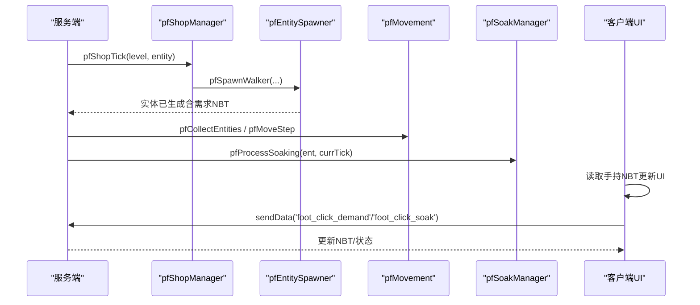

**图示来源**
- [pfMain.js:11-214](file://kubejs/server_scripts/pathfinder/pfMain.js#L11-L214)
- [pfShopManager.js:413-479](file://kubejs/server_scripts/pathfinder/pfShopManager.js#L413-L479)
- [pfEntitySpawner.js:10-99](file://kubejs/server_scripts/pathfinder/pfEntitySpawner.js#L10-L99)
- [pfMovement.js:103-181](file://kubejs/server_scripts/pathfinder/pfMovement.js#L103-L181)
- [pfSoakManager.js:92-145](file://kubejs/server_scripts/pathfinder/pfSoakManager.js#L92-L145)
- [foot_ui.js:186-251](file://kubejs/client_scripts/ui/foot_ui.js#L186-L251)

## 详细组件分析

### 主循环与调度（pfMain.js）
- 每 tick 调用 `global.pathfinderTick`，依次处理：
  - 开店定时生成（委托给 `pfShopManager.pfShopTick`）。
  - 收集实体并按阶段分类（行走、躺床、等待、固定排队区）。
  - 对固定排队区等待实体检查是否已到床并触发躺床回调。
  - 对躺床实体处理泡脚倒计时与睡眠逻辑。
  - 对行走实体执行移动、排队检测与到达固定排队区的判定。

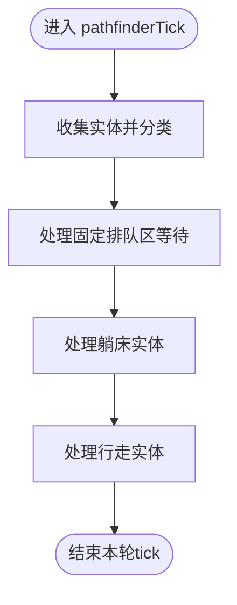

**图示来源**
- [pfMain.js:11-214](file://kubejs/server_scripts/pathfinder/pfMain.js#L11-L214)

**章节来源**
- [pfMain.js:11-214](file://kubejs/server_scripts/pathfinder/pfMain.js#L11-L214)

### 开店管理与生成（pfShopManager.js）
- 维护店铺 BE 的持久化状态：开关、计数器、玩家 UUID、路径、床位表、已生成顾客 UUID 列表。
- 每 100 tick 判定一次：
  - 非旧地狱维度且夜晚则自动关店。
  - 等待中顾客超过上限则暂停生成。
  - 先尝试稀客抽取，命中则生成稀客；否则按维度过滤与活跃白名单抽取普通顾客。
- 床位锁定/释放：防止多实体同时占用同一张床。

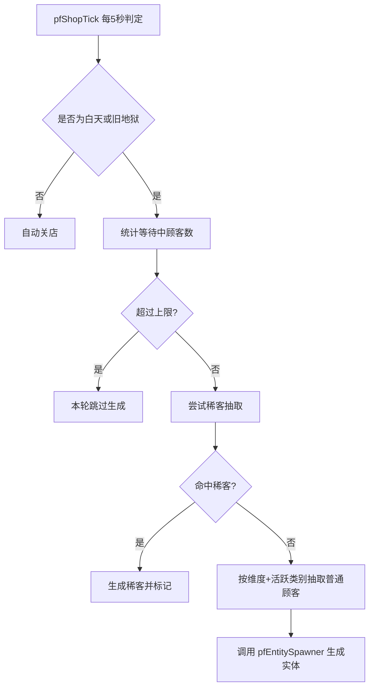

**图示来源**
- [pfShopManager.js:413-479](file://kubejs/server_scripts/pathfinder/pfShopManager.js#L413-L479)

**章节来源**
- [pfShopManager.js:35-147](file://kubejs/server_scripts/pathfinder/pfShopManager.js#L35-L147)
- [pfShopManager.js:270-294](file://kubejs/server_scripts/pathfinder/pfShopManager.js#L270-L294)
- [pfShopManager.js:303-356](file://kubejs/server_scripts/pathfinder/pfShopManager.js#L303-L356)
- [pfShopManager.js:413-479](file://kubejs/server_scripts/pathfinder/pfShopManager.js#L413-L479)

### 顾客类别、评价与稀客（pfCustomerTypes.js）
- 类别与模型：
  - 人类与妖精使用自定义模型变体，其他类别使用东方Project角色模型。
  - 加载时从模型池随机固定一个皮肤，支持 perSpawnRandom 每次随机。
- 评价系统：
  - 每类顾客独立评价值（0–100），满意度达到阈值时评价+1。
  - 生成权重 = 基础权重 + 评价值 × 系数，总池 10000。
- 稀客系统：
  - 每个维度有独立稀客池，自然生成时按概率替换为稀客。
  - 稀客需求倍率放大，好感度分档掉落与专属饰品奖励。

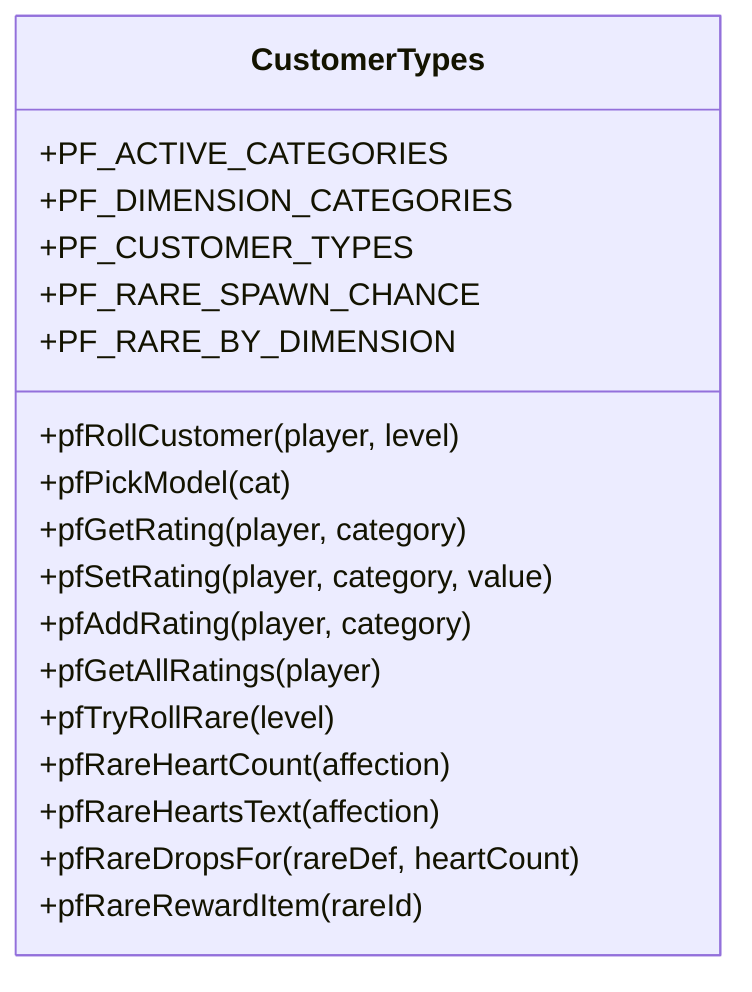

**图示来源**
- [pfCustomerTypes.js:30-215](file://kubejs/server_scripts/pathfinder/pfCustomerTypes.js#L30-L215)
- [pfCustomerTypes.js:278-382](file://kubejs/server_scripts/pathfinder/pfCustomerTypes.js#L278-L382)
- [pfCustomerTypes.js:631-651](file://kubejs/server_scripts/pathfinder/pfCustomerTypes.js#L631-L651)
- [pfCustomerTypes.js:657-733](file://kubejs/server_scripts/pathfinder/pfCustomerTypes.js#L657-L733)

**章节来源**
- [pfCustomerTypes.js:30-215](file://kubejs/server_scripts/pathfinder/pfCustomerTypes.js#L30-L215)
- [pfCustomerTypes.js:278-382](file://kubejs/server_scripts/pathfinder/pfCustomerTypes.js#L278-L382)
- [pfCustomerTypes.js:631-651](file://kubejs/server_scripts/pathfinder/pfCustomerTypes.js#L631-L651)
- [pfCustomerTypes.js:657-733](file://kubejs/server_scripts/pathfinder/pfCustomerTypes.js#L657-L733)

### 实体生成与需求清单（pfEntitySpawner.js）
- 生成寻路实体，设置基础 NBT（不可攻击、无重力、模型ID等）。
- 初始化 persistentData：起点、路径、阶段、时间、子步、店铺坐标、排队区位置。
- 生成需求清单：Boss 按注册范围随机；普通顾客按种族配置范围随机；稀客需求倍率放大。
- 写入 Boss/稀客标识，广播话语，粒子特效。

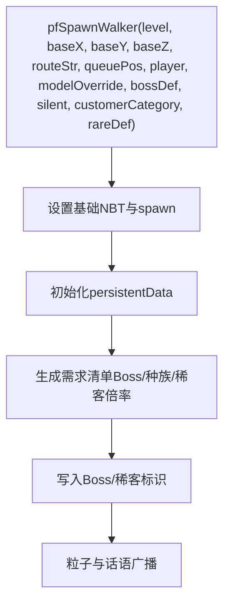

**图示来源**
- [pfEntitySpawner.js:10-99](file://kubejs/server_scripts/pathfinder/pfEntitySpawner.js#L10-L99)
- [pfEntitySpawner.js:100-165](file://kubejs/server_scripts/pathfinder/pfEntitySpawner.js#L100-L165)

**章节来源**
- [pfEntitySpawner.js:10-99](file://kubejs/server_scripts/pathfinder/pfEntitySpawner.js#L10-L99)
- [pfEntitySpawner.js:100-165](file://kubejs/server_scripts/pathfinder/pfEntitySpawner.js#L100-L165)

### 移动与排队（pfMovement.js）
- 收集实体并按阶段分类（行走、躺床、等待、固定排队区）。
- 构建排队信息（进度、坐标），检测是否需要排队（距离与进度比较）。
- 计算当前位置（基于路径字符串与时间/子步），执行步进插值移动。
- 到达终点时判断是否进入固定排队区，否则释放床并丢弃实体。

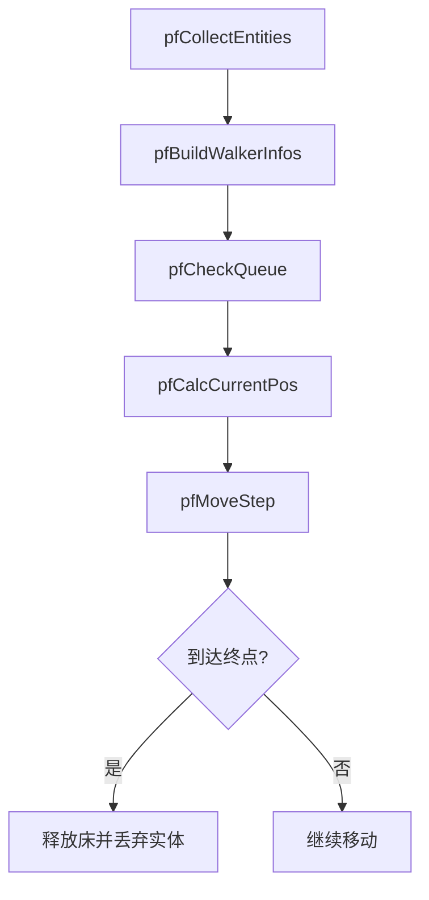

**图示来源**
- [pfMovement.js:8-34](file://kubejs/server_scripts/pathfinder/pfMovement.js#L8-L34)
- [pfMovement.js:37-81](file://kubejs/server_scripts/pathfinder/pfMovement.js#L37-L81)
- [pfMovement.js:84-100](file://kubejs/server_scripts/pathfinder/pfMovement.js#L84-L100)
- [pfMovement.js:103-181](file://kubejs/server_scripts/pathfinder/pfMovement.js#L103-L181)

**章节来源**
- [pfMovement.js:8-34](file://kubejs/server_scripts/pathfinder/pfMovement.js#L8-L34)
- [pfMovement.js:103-181](file://kubejs/server_scripts/pathfinder/pfMovement.js#L103-L181)

### 泡脚计时（pfSoakManager.js）
- 从手持物品 NBT 读取泡脚状态（进行中、完成、剩余秒数、水桶类型）。
- 秒级驱动：每 20 tick 触发一次“秒事件”，若洗脚水可用则剩余秒数减一，否则重置倒计时。
- 倒计时结束标记完成，并应用洗脚水附加效果。
- 开始泡脚时消耗水桶变为空桶，提示玩家。

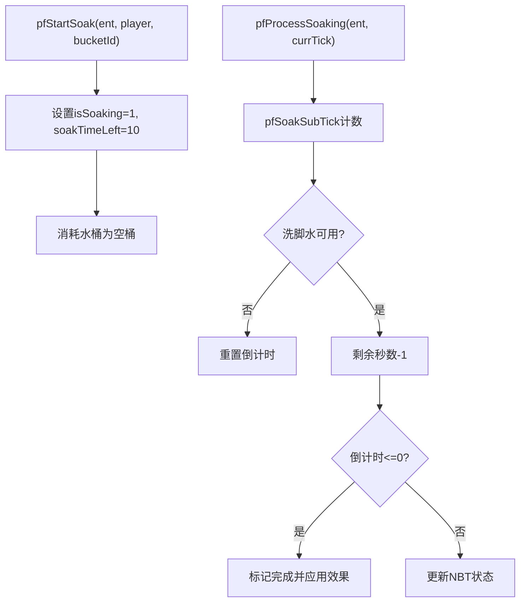

**图示来源**
- [pfSoakManager.js:19-88](file://kubejs/server_scripts/pathfinder/pfSoakManager.js#L19-L88)
- [pfSoakManager.js:92-145](file://kubejs/server_scripts/pathfinder/pfSoakManager.js#L92-L145)
- [pfSoakManager.js:147-186](file://kubejs/server_scripts/pathfinder/pfSoakManager.js#L147-L186)

**章节来源**
- [pfSoakManager.js:19-88](file://kubejs/server_scripts/pathfinder/pfSoakManager.js#L19-L88)
- [pfSoakManager.js:92-145](file://kubejs/server_scripts/pathfinder/pfSoakManager.js#L92-L145)
- [pfSoakManager.js:147-186](file://kubejs/server_scripts/pathfinder/pfSoakManager.js#L147-L186)

### 客户端脚部 UI（foot_ui.js）
- 创建世界窗口：根据床 yaw 计算脚的位置，旋转窗口，调整高度与缩放。
- 拖拽搓脚：鼠标累计移动距离达到阈值触发服务端请求（携带实体 UUID 与请求序列号）。
- 奉茶按钮：发送服务端事件，由服务端判定茶水有效性。
- 泡脚窗口：右键点击桶区域发起泡脚，显示进度条与文字引导。
- 数据读取：从手持物品 NBT 读取需求清单、倒计时、满意度、Boss/稀客信息等。

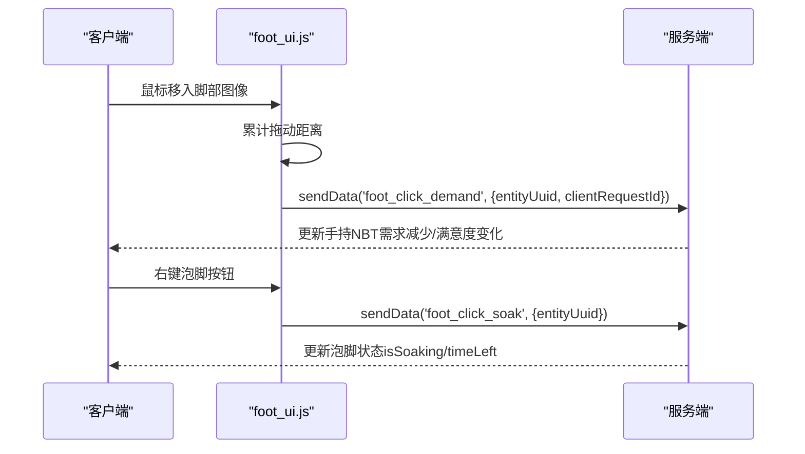

**图示来源**
- [foot_ui.js:186-251](file://kubejs/client_scripts/ui/foot_ui.js#L186-L251)
- [foot_ui.js:278-297](file://kubejs/client_scripts/ui/foot_ui.js#L278-L297)
- [foot_ui.js:364-429](file://kubejs/client_scripts/ui/foot_ui.js#L364-L429)
- [foot_ui.js:584-601](file://kubejs/client_scripts/ui/foot_ui.js#L584-L601)

**章节来源**
- [foot_ui.js:136-179](file://kubejs/client_scripts/ui/foot_ui.js#L136-L179)
- [foot_ui.js:186-251](file://kubejs/client_scripts/ui/foot_ui.js#L186-L251)
- [foot_ui.js:364-429](file://kubejs/client_scripts/ui/foot_ui.js#L364-L429)
- [foot_ui.js:584-601](file://kubejs/client_scripts/ui/foot_ui.js#L584-L601)

### 客户端体力 HUD（stamina_hud.js）
- 首次登录创建 Overlay 文档，周期性向服务端请求体力值。
- 接收服务端推送的体力值，更新进度条颜色与文本。
- 登出/隐藏时清理文档与状态。

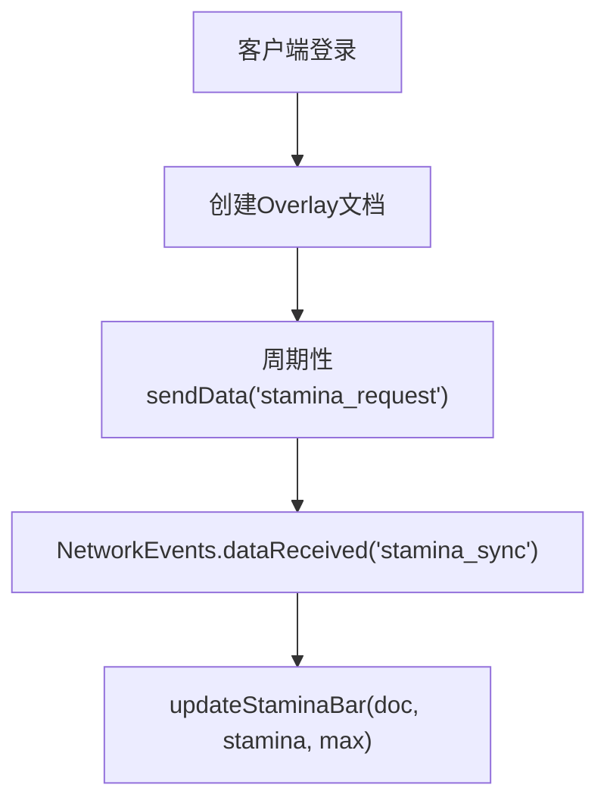

**图示来源**
- [stamina_hud.js:64-73](file://kubejs/client_scripts/ui/stamina_hud.js#L64-L73)
- [stamina_hud.js:77-129](file://kubejs/client_scripts/ui/stamina_hud.js#L77-L129)

**章节来源**
- [stamina_hud.js:25-60](file://kubejs/client_scripts/ui/stamina_hud.js#L25-L60)
- [stamina_hud.js:64-73](file://kubejs/client_scripts/ui/stamina_hud.js#L64-L73)
- [stamina_hud.js:77-129](file://kubejs/client_scripts/ui/stamina_hud.js#L77-L129)

### 泡脚界面 HTML（footsoak.html）
- 提供泡脚界面的背景、桶点击区域、文字引导与进度条。
- CSS 控制布局、图片渲染与进度条动画。

**章节来源**
- [footsoak.html:10-28](file://apricity/kubejs/footsoak.html#L10-L28)
- [footsoak.html:31-158](file://apricity/kubejs/footsoak.html#L31-L158)

## 依赖关系分析
- `pfMain.js` 作为主循环，依赖 `pfShopManager`、`pfMovement`、`pfSoakManager` 等模块。
- `pfShopManager` 依赖 `pfCustomerTypes`（类别与稀客）、`pfEntitySpawner`（实体生成）、`pfBedManager`（床位扫描/序列化，未在本节展开）。
- `pfMovement` 依赖 `pfEntityData`（实体数据读写，未在本节展开）。
- 客户端 `foot_ui.js` 与服务端通过手持物品 NBT 与网络事件通信；`stamina_hud.js` 通过 NetworkEvents 与服务端同步体力。

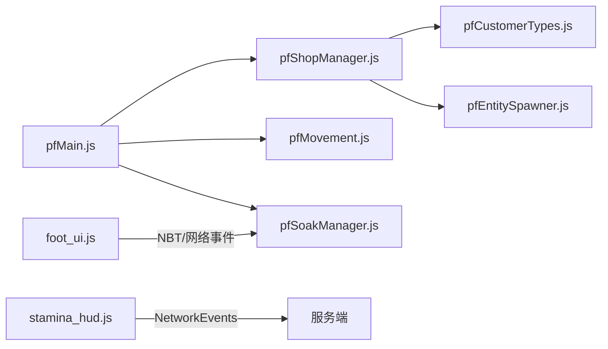

**图示来源**
- [pfMain.js:11-214](file://kubejs/server_scripts/pathfinder/pfMain.js#L11-L214)
- [pfShopManager.js:413-479](file://kubejs/server_scripts/pathfinder/pfShopManager.js#L413-L479)
- [pfMovement.js:8-34](file://kubejs/server_scripts/pathfinder/pfMovement.js#L8-L34)
- [pfSoakManager.js:92-145](file://kubejs/server_scripts/pathfinder/pfSoakManager.js#L92-L145)
- [pfCustomerTypes.js:349-382](file://kubejs/server_scripts/pathfinder/pfCustomerTypes.js#L349-L382)
- [pfEntitySpawner.js:10-99](file://kubejs/server_scripts/pathfinder/pfEntitySpawner.js#L10-L99)
- [foot_ui.js:186-251](file://kubejs/client_scripts/ui/foot_ui.js#L186-L251)
- [stamina_hud.js:64-73](file://kubejs/client_scripts/ui/stamina_hud.js#L64-L73)

**章节来源**
- [pfMain.js:11-214](file://kubejs/server_scripts/pathfinder/pfMain.js#L11-L214)
- [pfShopManager.js:413-479](file://kubejs/server_scripts/pathfinder/pfShopManager.js#L413-L479)
- [pfMovement.js:8-34](file://kubejs/server_scripts/pathfinder/pfMovement.js#L8-L34)
- [pfSoakManager.js:92-145](file://kubejs/server_scripts/pathfinder/pfSoakManager.js#L92-L145)
- [pfCustomerTypes.js:349-382](file://kubejs/server_scripts/pathfinder/pfCustomerTypes.js#L349-L382)
- [pfEntitySpawner.js:10-99](file://kubejs/server_scripts/pathfinder/pfEntitySpawner.js#L10-L99)
- [foot_ui.js:186-251](file://kubejs/client_scripts/ui/foot_ui.js#L186-L251)
- [stamina_hud.js:64-73](file://kubejs/client_scripts/ui/stamina_hud.js#L64-L73)

## 性能与稳定性
- 主循环每 tick 收集实体并分类，避免全图扫描，仅围绕触发方块附近区域。
- 泡脚计时采用“秒事件”机制，跨重启友好，不依赖 server.getTickCount() 差值。
- 开店生成间隔为 100 tick（约 5 秒），限制等待中顾客数量，避免过多实体堆积。
- 客户端 UI 延迟移除 WorldWindow，避免框架 mousePosition NPE；批量更新 DOM 属性以减少重绘。
- 体力 HUD 周期性请求（每 20 tick）并仅在数值变化较大时打印日志，降低开销。

[本节为通用指导，无需具体文件引用]

## 故障排查指南
- 泡脚无效：
  - 检查手持物品 NBT 中的泡脚状态字段（isSoaking、soakDone、soakTimeLeft、waterType）。
  - 确认洗脚水桶 ID 是否在注册表中存在，或为原版水桶。
  - 查看控制台日志 `[PF-SOAK]` 相关输出。
- 顾客不生成：
  - 检查当前维度是否在 `PF_DIMENSION_CATEGORIES` 中配置。
  - 检查 `PF_ACTIVE_CATEGORIES` 是否包含目标类别。
  - 查看 `pfShopTick` 日志，确认是否因夜晚或等待中顾客过多而跳过。
- 移动卡顿或重复：
  - 检查 `pfMoveStep` 与 `pfCheckQueue` 日志，确认进度与距离判定。
  - 确认实体阶段（phase）是否正确切换（2→3→4→5）。
- UI 不显示或闪烁：
  - 检查 `foot_ui.js` 中窗口创建与延迟移除逻辑。
  - 确认 HTML 资源路径正确（`kubejs/footui.html`、`kubejs/footsoak.html`）。
- 体力 HUD 不更新：
  - 检查客户端是否收到 `stamina_sync` 事件。
  - 确认 `stamina_hud.js` 的 Overlay 文档已创建且未被覆盖。

**章节来源**
- [pfSoakManager.js:92-145](file://kubejs/server_scripts/pathfinder/pfSoakManager.js#L92-L145)
- [pfShopManager.js:413-479](file://kubejs/server_scripts/pathfinder/pfShopManager.js#L413-L479)
- [pfMovement.js:103-181](file://kubejs/server_scripts/pathfinder/pfMovement.js#L103-L181)
- [foot_ui.js:136-179](file://kubejs/client_scripts/ui/foot_ui.js#L136-L179)
- [stamina_hud.js:64-73](file://kubejs/client_scripts/ui/stamina_hud.js#L64-L73)

## 结论
本系统通过模块化服务端脚本与客户端 UI 协作，实现了完整的“女仆脚部服务”模拟经营玩法。核心流程包括开店、顾客生成、寻路排队、搓脚服务、泡脚计时与结算奖励；同时引入评价与稀客系统增强长期游玩价值。代码结构清晰、职责分明，具备良好的扩展性与可维护性。建议在后续迭代中完善鬼族/月球类别解锁条件、差异化顾客需求与店铺评级展示，以提升玩法深度与可视化反馈。