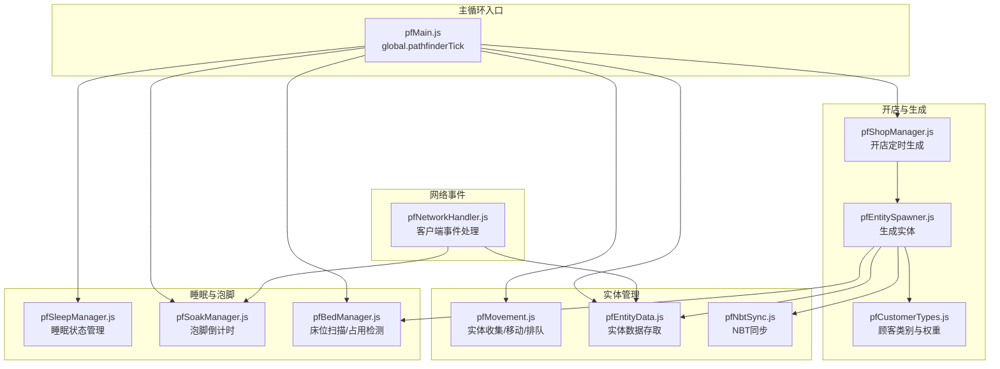
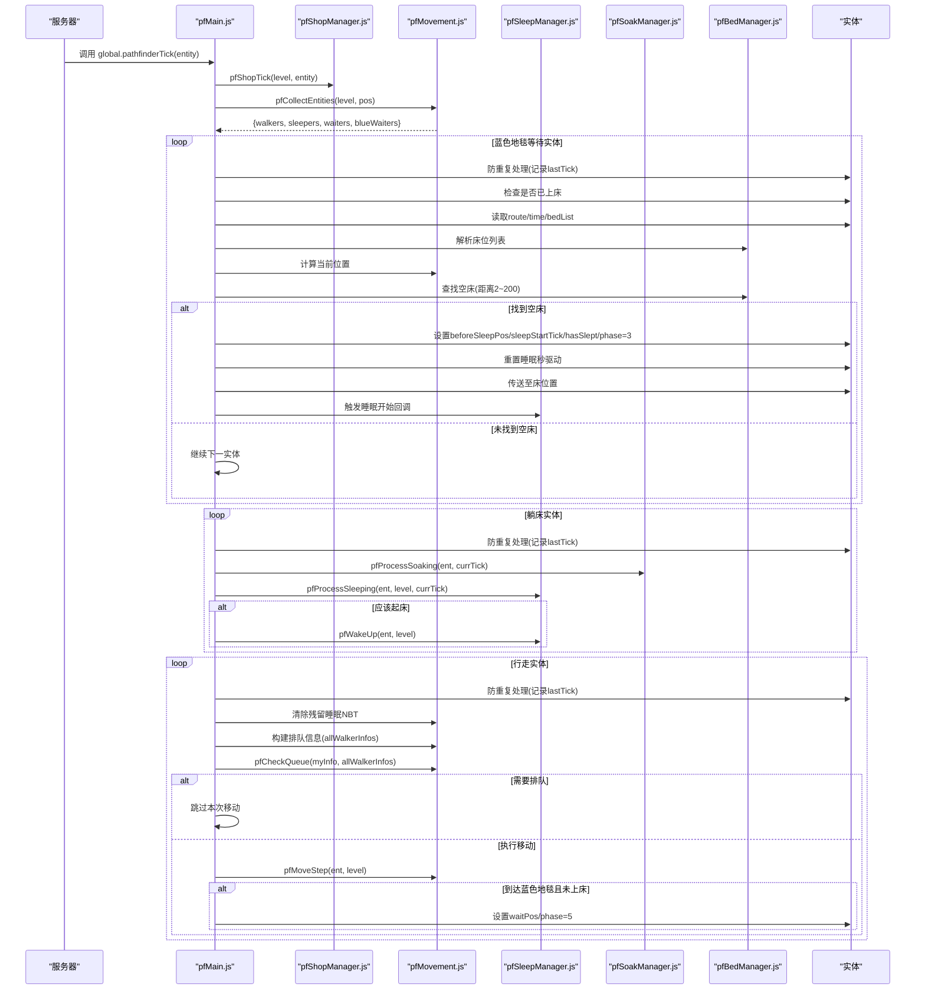
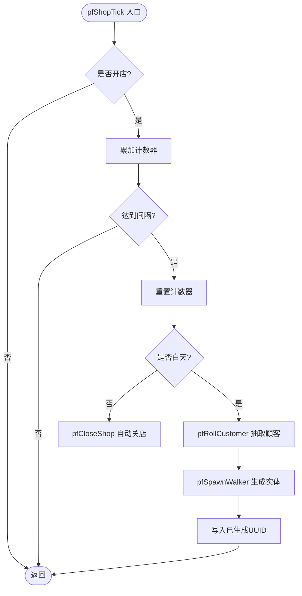
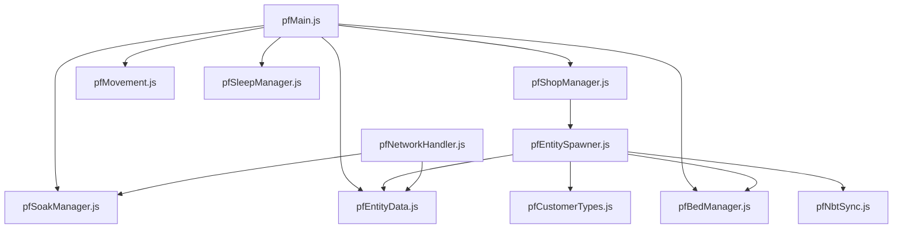

# 主循环入口

<cite>
**本文档引用的文件**
- [pfMain.js](file://kubejs/server_scripts/pathfinder/pfMain.js)
- [pfConstants.js](file://kubejs/server_scripts/pathfinder/pfConstants.js)
- [pfEntityData.js](file://kubejs/server_scripts/pathfinder/pfEntityData.js)
- [pfShopManager.js](file://kubejs/server_scripts/pathfinder/pfShopManager.js)
- [pfSleepManager.js](file://kubejs/server_scripts/pathfinder/pfSleepManager.js)
- [pfMovement.js](file://kubejs/server_scripts/pathfinder/pfMovement.js)
- [pfBedManager.js](file://kubejs/server_scripts/pathfinder/pfBedManager.js)
- [pfSoakManager.js](file://kubejs/server_scripts/pathfinder/pfSoakManager.js)
- [pfEntitySpawner.js](file://kubejs/server_scripts/pathfinder/pfEntitySpawner.js)
- [pfCustomerTypes.js](file://kubejs/server_scripts/pathfinder/pfCustomerTypes.js)
- [pfNetworkHandler.js](file://kubejs/server_scripts/pathfinder/pfNetworkHandler.js)
- [pfNbtSync.js](file://kubejs/server_scripts/pathfinder/pfNbtSync.js)
- [pathfinder.js](file://kubejs/server_scripts/pathfinder.js)
</cite>

## 目录
1. [简介](#简介)
2. [项目结构](#项目结构)
3. [核心组件](#核心组件)
4. [架构总览](#架构总览)
5. [详细组件分析](#详细组件分析)
6. [依赖关系分析](#依赖关系分析)
7. [性能考量](#性能考量)
8. [故障排查指南](#故障排查指南)
9. [结论](#结论)
10. [附录](#附录)

## 简介
本文件聚焦于寻路系统主循环入口，系统性解析 pfMain.js 作为全局主循环的设计理念与实现机制。重点涵盖：
- pathfinder_tick 函数的实现机制与调度逻辑
- 实体收集策略与阶段划分
- 四大阶段处理流程：开店定时生成、蓝色地毯等待实体、躺床实体、行走实体
- 防重复处理机制与时间戳管理
- 性能优化策略与扩展方法

## 项目结构
寻路系统采用模块化设计，各功能模块通过优先级加载，最终在 pfMain.js 中整合为统一的主循环入口。核心模块包括：
- 常量与同步：pfConstants.js、pfNbtSync.js
- 实体数据：pfEntityData.js
- 开店与生成：pfShopManager.js、pfEntitySpawner.js、pfCustomerTypes.js
- 移动与排队：pfMovement.js
- 床位管理：pfBedManager.js
- 睡眠与泡脚：pfSleepManager.js、pfSoakManager.js
- 网络事件：pfNetworkHandler.js
- 主循环入口：pfMain.js

**图表来源**
- [pfMain.js:11-177](file://kubejs/server_scripts/pathfinder/pfMain.js#L11-L177)
- [pfShopManager.js:237-284](file://kubejs/server_scripts/pathfinder/pfShopManager.js#L237-L284)
- [pfMovement.js:8-34](file://kubejs/server_scripts/pathfinder/pfMovement.js#L8-L34)
- [pfEntityData.js:185-217](file://kubejs/server_scripts/pathfinder/pfEntityData.js#L185-L217)
- [pfBedManager.js:123-128](file://kubejs/server_scripts/pathfinder/pfBedManager.js#L123-L128)
- [pfSleepManager.js:226-231](file://kubejs/server_scripts/pathfinder/pfSleepManager.js#L226-L231)
- [pfSoakManager.js:189-196](file://kubejs/server_scripts/pathfinder/pfSoakManager.js#L189-L196)
- [pfEntitySpawner.js:138-140](file://kubejs/server_scripts/pathfinder/pfEntitySpawner.js#L138-L140)
- [pfNetworkHandler.js:36-311](file://kubejs/server_scripts/pathfinder/pfNetworkHandler.js#L36-L311)

**章节来源**
- [pathfinder.js:1-30](file://kubejs/server_scripts/pathfinder.js#L1-L30)

## 核心组件
- 全局主循环入口：global.pathfinderTick
- 实体收集与阶段分类：pfCollectEntities
- 移动与排队：pfMoveStep、pfCheckQueue
- 睡眠与泡脚：pfProcessSleeping、pfProcessSoaking
- 开店定时生成：pfShopTick
- 数据存取与同步：pfEntityData、pfNbtSync
- 床位管理：pfScanBedsAlongRoute、pfIsBedOccupied

**章节来源**
- [pfMain.js:11-177](file://kubejs/server_scripts/pathfinder/pfMain.js#L11-L177)
- [pfMovement.js:8-185](file://kubejs/server_scripts/pathfinder/pfMovement.js#L8-L185)
- [pfEntityData.js:185-217](file://kubejs/server_scripts/pathfinder/pfEntityData.js#L185-L217)
- [pfShopManager.js:237-284](file://kubejs/server_scripts/pathfinder/pfShopManager.js#L237-L284)
- [pfSleepManager.js:65-128](file://kubejs/server_scripts/pathfinder/pfSleepManager.js#L65-L128)
- [pfSoakManager.js:92-145](file://kubejs/server_scripts/pathfinder/pfSoakManager.js#L92-L145)
- [pfBedManager.js:123-128](file://kubejs/server_scripts/pathfinder/pfBedManager.js#L123-L128)

## 架构总览
主循环以每 tick 为单位，按阶段顺序处理所有实体，确保同 tick 内不会重复处理同一实体，并通过持久化状态实现跨重启的连续性。

**图表来源**
- [pfMain.js:11-177](file://kubejs/server_scripts/pathfinder/pfMain.js#L11-L177)
- [pfMovement.js:8-185](file://kubejs/server_scripts/pathfinder/pfMovement.js#L8-L185)
- [pfSleepManager.js:65-128](file://kubejs/server_scripts/pathfinder/pfSleepManager.js#L65-L128)
- [pfSoakManager.js:92-145](file://kubejs/server_scripts/pathfinder/pfSoakManager.js#L92-L145)
- [pfBedManager.js:123-128](file://kubejs/server_scripts/pathfinder/pfBedManager.js#L123-L128)

## 详细组件分析

### pathfinder_tick 主循环实现机制
- 入口参数：触发方块的 BlockEntity，获取所在 Level 与 Tick 数
- 开店定时生成：调用 pfShopManager.pfShopTick，按 PF_SPAWN_INTERVAL 计数，白天判定生成顾客
- 实体收集：使用 pfCollectEntities 在网格范围内按 phase 分类收集 walkers、sleepers、waiters、blueWaiters
- 蓝色地毯等待实体处理：检查是否已上床，解析路径与床位，查找空床并传送至床位置，重置睡眠秒驱动，触发睡眠开始回调
- 躺床实体处理：调用 pfSoakManager.pfProcessSoaking 与 pfSleepManager.pfProcessSleeping，按秒驱动处理倒计时与起床条件
- 行走实体处理：构建排队信息，执行 pfMoveStep，检测到达蓝色地毯并设置等待状态

防重复处理机制：
- 使用 pfEntityData.pfGetLastTick 与 pfSetLastTick 记录实体上次处理的 server.getTickCount()，同 tick 内跳过处理
- 时间戳管理：睡眠与泡脚均使用独立的秒驱动字段，避免依赖 server.getTickCount() 差值，跨重启友好

性能优化策略：
- 网格搜索范围限制：GRID_HALF 控制搜索半径，减少实体遍历成本
- 排队检测：基于距离与进度的简单比较，避免复杂排序
- 持久化状态：所有状态写入实体 persistentData，减少内存占用与跨重启问题

**章节来源**
- [pfMain.js:11-177](file://kubejs/server_scripts/pathfinder/pfMain.js#L11-L177)
- [pfConstants.js:10-13](file://kubejs/server_scripts/pathfinder/pfConstants.js#L10-L13)
- [pfEntityData.js:156-162](file://kubejs/server_scripts/pathfinder/pfEntityData.js#L156-L162)

### 实体收集策略与阶段划分
- 分类依据：pfPhase 字段
  - 2：行走中
  - 3：躺床中
  - 4：等待床位中
  - 5：蓝色地毯等待中
- 收集范围：以触发方块为中心，按 GRID_HALF 扩展的立方体范围
- 排队构建：将实体的 time 与 subStep 组合成进度，结合 x/z 坐标参与排队判断

**章节来源**
- [pfMovement.js:8-34](file://kubejs/server_scripts/pathfinder/pfMovement.js#L8-L34)
- [pfMovement.js:37-79](file://kubejs/server_scripts/pathfinder/pfMovement.js#L37-L79)
- [pfConstants.js:10-13](file://kubejs/server_scripts/pathfinder/pfConstants.js#L10-L13)

### 开店定时生成处理
- 计数器：pfShopManager.pfShopTick 累计 tick，达到 PF_SPAWN_INTERVAL 触发判定
- 白天判定：使用 pfIsDaytime 检查日落时间，夜晚自动关店
- 顾客生成：通过 pfCustomerTypes.pfRollCustomer 抽取类别与模型，调用 pfEntitySpawner.pfSpawnWalker 生成实体
- 状态持久化：所有状态写入触发方块 BlockEntity 的 persistentData，支持跨重启

**图表来源**
- [pfShopManager.js:237-284](file://kubejs/server_scripts/pathfinder/pfShopManager.js#L237-L284)
- [pfCustomerTypes.js:273-296](file://kubejs/server_scripts/pathfinder/pfCustomerTypes.js#L273-L296)
- [pfEntitySpawner.js:8-135](file://kubejs/server_scripts/pathfinder/pfEntitySpawner.js#L8-L135)

**章节来源**
- [pfShopManager.js:237-284](file://kubejs/server_scripts/pathfinder/pfShopManager.js#L237-L284)
- [pfCustomerTypes.js:273-296](file://kubejs/server_scripts/pathfinder/pfCustomerTypes.js#L273-L296)
- [pfEntitySpawner.js:8-135](file://kubejs/server_scripts/pathfinder/pfEntitySpawner.js#L8-L135)

### 蓝色地毯等待实体处理
- 防重复处理：同 tick 内跳过
- 已上床检查：若已上床则直接进入行走阶段
- 路径与床位：读取 route 与 bedList，计算当前位置
- 空床查找：在 2~200 距离内查找未占用床
- 传送与睡眠：设置 beforeSleepPos、sleepStartTick、hasSlept、phase=3，重置睡眠秒驱动，传送至床位置，触发睡眠开始回调

**章节来源**
- [pfMain.js:29-93](file://kubejs/server_scripts/pathfinder/pfMain.js#L29-L93)
- [pfBedManager.js:92-120](file://kubejs/server_scripts/pathfinder/pfBedManager.js#L92-L120)
- [pfSleepManager.js:24-61](file://kubejs/server_scripts/pathfinder/pfSleepManager.js#L24-L61)

### 躺床实体处理
- 泡脚倒计时：pfProcessSoaking 按秒驱动递减剩余时间，无可用洗脚水则重置
- 睡眠逻辑：pfProcessSleeping 设置初始睡姿，按秒事件同步倒计时与 basin 泡脚
- 起床条件：通过 global.pfShouldWakeUp 回调判断是否应起床，否则继续睡眠

**章节来源**
- [pfMain.js:95-114](file://kubejs/server_scripts/pathfinder/pfMain.js#L95-L114)
- [pfSoakManager.js:92-145](file://kubejs/server_scripts/pathfinder/pfSoakManager.js#L92-L145)
- [pfSleepManager.js:65-128](file://kubejs/server_scripts/pathfinder/pfSleepManager.js#L65-L128)

### 行走实体处理
- 防重复处理：同 tick 内跳过
- 清理睡眠 NBT：pfClearSleepNbt 在过渡期清除残留睡眠 NBT
- 排队检测：构建 allWalkerInfos，基于距离与进度判断是否需要排队
- 移动执行：pfMoveStep 按路径字符推进，子步满 10 归零并推进格数
- 到达蓝色地毯：当 sub=0 且位于蓝色地毯或附近时，设置 waitPos 与 phase=5

**章节来源**
- [pfMain.js:123-173](file://kubejs/server_scripts/pathfinder/pfMain.js#L123-L173)
- [pfMovement.js:101-185](file://kubejs/server_scripts/pathfinder/pfMovement.js#L101-L185)

### 防重复处理机制与时间戳管理
- 防重复处理：pfEntityData.pfGetLastTick / pfSetLastTick 记录 server.getTickCount()，同 tick 内跳过
- 时间戳管理：
  - 睡眠：pfSleepStartTick、pfSleepSubTick、pfSleepSeconds、pfSleepInitTicks
  - 泡脚：pfSoakSubTick、pfSoakTimeLeft
  - 清理：pfClearSleepTick 用于过渡期清理残留 NBT

**章节来源**
- [pfEntityData.js:156-172](file://kubejs/server_scripts/pathfinder/pfEntityData.js#L156-L172)
- [pfSleepManager.js:17-21](file://kubejs/server_scripts/pathfinder/pfSleepManager.js#L17-L21)
- [pfSoakManager.js:17-14](file://kubejs/server_scripts/pathfinder/pfSoakManager.js#L17-L14)

## 依赖关系分析
主循环模块间依赖关系如下：

**图表来源**
- [pfMain.js:11-177](file://kubejs/server_scripts/pathfinder/pfMain.js#L11-L177)
- [pfShopManager.js:237-284](file://kubejs/server_scripts/pathfinder/pfShopManager.js#L237-L284)
- [pfEntitySpawner.js:8-135](file://kubejs/server_scripts/pathfinder/pfEntitySpawner.js#L8-L135)
- [pfNetworkHandler.js:36-311](file://kubejs/server_scripts/pathfinder/pfNetworkHandler.js#L36-L311)

**章节来源**
- [pfMain.js:11-177](file://kubejs/server_scripts/pathfinder/pfMain.js#L11-L177)
- [pfShopManager.js:237-284](file://kubejs/server_scripts/pathfinder/pfShopManager.js#L237-L284)
- [pfEntitySpawner.js:8-135](file://kubejs/server_scripts/pathfinder/pfEntitySpawner.js#L8-L135)
- [pfNetworkHandler.js:36-311](file://kubejs/server_scripts/pathfinder/pfNetworkHandler.js#L36-L311)

## 性能考量
- 网格搜索范围：GRID_HALF 控制搜索半径，建议根据地图规模调整以平衡性能与覆盖
- 排队检测复杂度：基于实体数量的 O(n^2) 比较，可通过更精细的区域划分或空间索引优化
- 持久化写入：频繁读写 persistentData，建议合并写入或批量处理
- 跨重启友好：所有时间状态独立存储，避免 server.getTickCount() 差值导致的不一致

[本节为通用性能讨论，无需特定文件来源]

## 故障排查指南
- 重复处理问题：检查 pfEntityData.pfGetLastTick / pfSetLastTick 是否正确设置
- 睡眠状态异常：确认 pfSleepManager.pfProcessSleeping 的秒驱动字段是否正确递增与重置
- 泡脚倒计时异常：检查 pfSoakManager.pfProcessSoaking 的水桶可用性判定与剩余时间更新
- 实体未生成：核对 pfShopManager.pfShopTick 的计数器与白天判定逻辑
- 床位占用冲突：使用 pfBedManager.pfIsBedOccupied 检查占用状态

**章节来源**
- [pfEntityData.js:156-172](file://kubejs/server_scripts/pathfinder/pfEntityData.js#L156-L172)
- [pfSleepManager.js:65-128](file://kubejs/server_scripts/pathfinder/pfSleepManager.js#L65-L128)
- [pfSoakManager.js:92-145](file://kubejs/server_scripts/pathfinder/pfSoakManager.js#L92-L145)
- [pfShopManager.js:237-284](file://kubejs/server_scripts/pathfinder/pfShopManager.js#L237-L284)
- [pfBedManager.js:110-120](file://kubejs/server_scripts/pathfinder/pfBedManager.js#L110-L120)

## 结论
pfMain.js 作为寻路系统的全局主循环，通过模块化设计实现了高内聚、低耦合的处理流程。其核心优势在于：
- 明确的阶段划分与严格的调度顺序
- 防重复处理与跨重启友好的时间戳管理
- 基于持久化的状态存储与网络事件的交互
- 可扩展的模块接口，便于新增实体类型与自定义处理逻辑

## 附录

### 扩展主循环功能的方法
- 新增实体类型集成步骤
  1) 在 pfMovement.js 中扩展实体收集逻辑，增加新 phase 类型与分类
  2) 在 pfMain.js 中新增对应阶段的处理逻辑，遵循防重复处理与时间戳管理
  3) 如需持久化状态，扩展 pfEntityData.js 的读写接口
  4) 如需网络交互，参考 pfNetworkHandler.js 的事件处理模式

- 自定义处理逻辑添加方式
  1) 在 pfMain.js 中插入新的处理分支，确保与现有阶段顺序兼容
  2) 使用 global.pfEntityData 与 global.pfNbtSync 进行状态同步
  3) 通过 global.pfOnStartSleep 等回调接口与外部模块交互

- 示例：新增“等待红色地毯”阶段
  - 在 pfMain.js 中新增阶段处理，检测实体是否位于红色地毯附近
  - 使用 pfEntityData.pfSetPhase 与 pfEntityData.pfSetWaitPos 设置状态
  - 在 pfMovement.js 中扩展排队逻辑，考虑红色地毯等待实体

**章节来源**
- [pfMain.js:11-177](file://kubejs/server_scripts/pathfinder/pfMain.js#L11-L177)
- [pfMovement.js:8-185](file://kubejs/server_scripts/pathfinder/pfMovement.js#L8-L185)
- [pfEntityData.js:185-217](file://kubejs/server_scripts/pathfinder/pfEntityData.js#L185-L217)
- [pfNetworkHandler.js:36-311](file://kubejs/server_scripts/pathfinder/pfNetworkHandler.js#L36-L311)