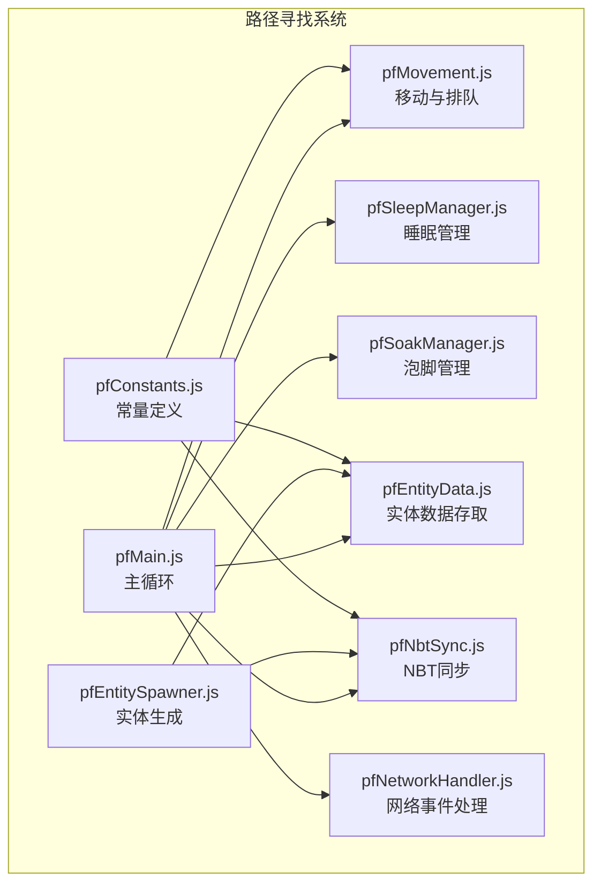
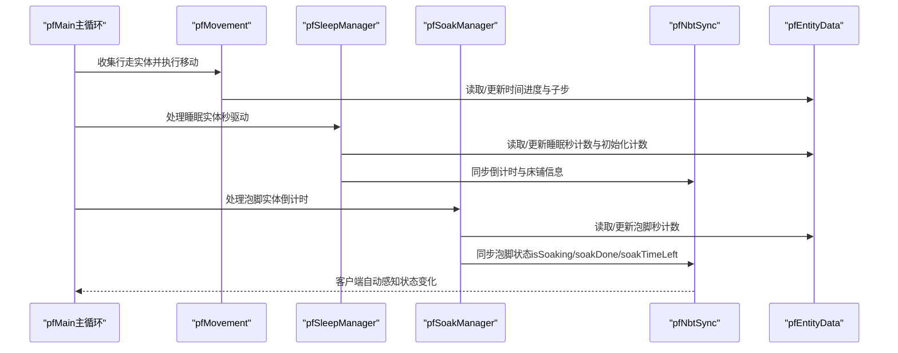
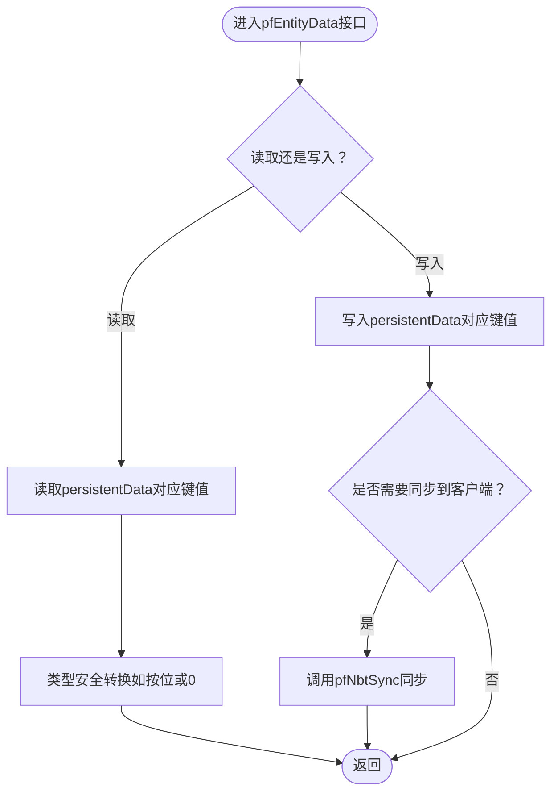
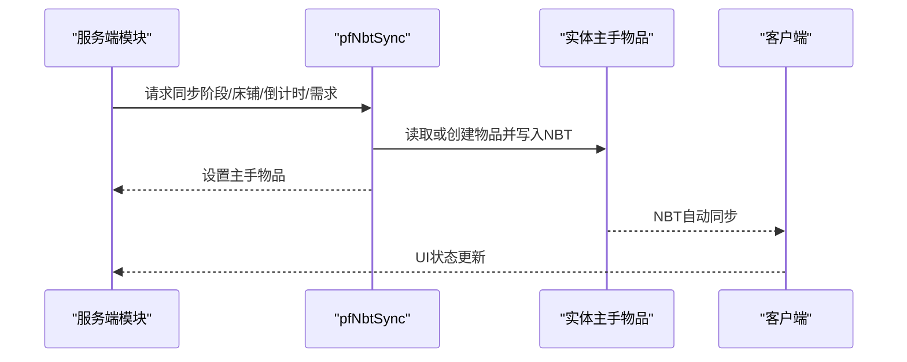
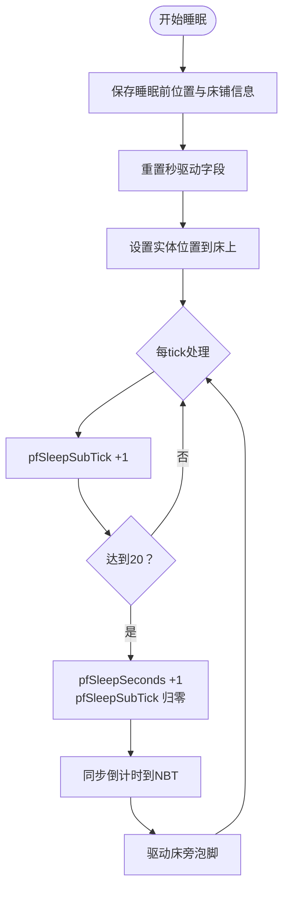
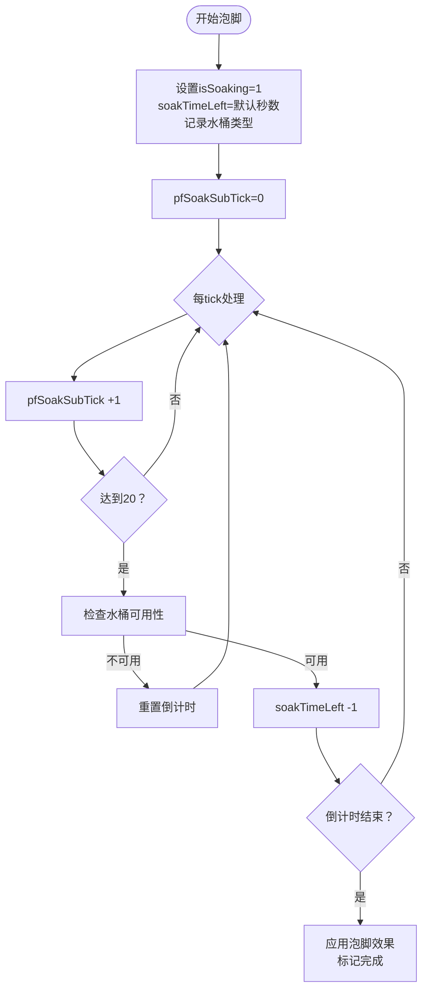
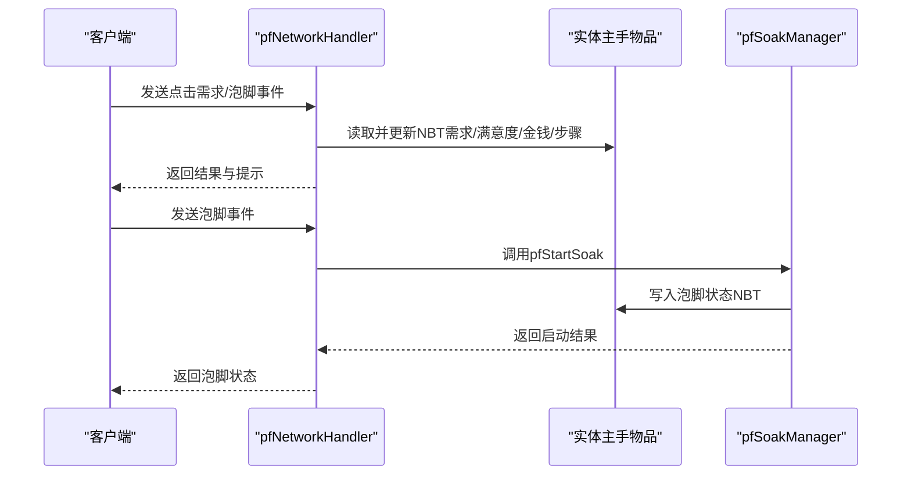
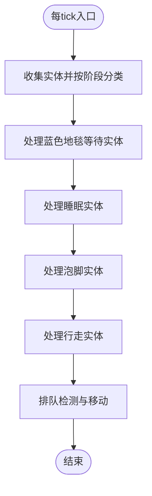
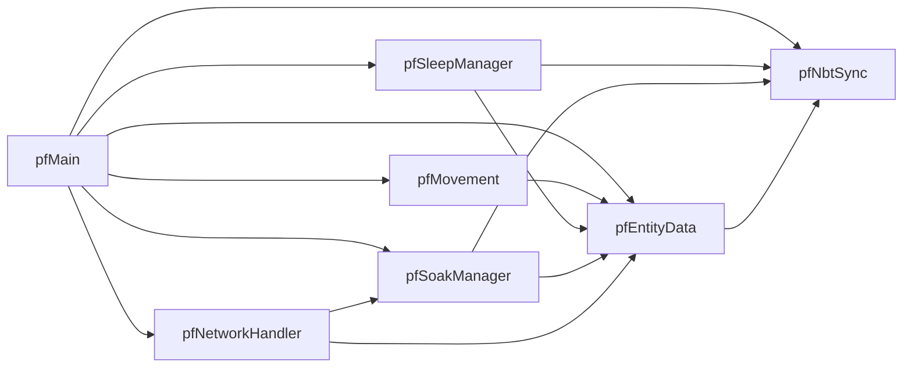

# 实体数据管理

<cite>
**本文引用的文件**
- [pfEntityData.js](file://kubejs/server_scripts/pathfinder/pfEntityData.js)
- [pfNbtSync.js](file://kubejs/server_scripts/pathfinder/pfNbtSync.js)
- [pfSleepManager.js](file://kubejs/server_scripts/pathfinder/pfSleepManager.js)
- [pfMain.js](file://kubejs/server_scripts/pathfinder/pfMain.js)
- [pfConstants.js](file://kubejs/server_scripts/pathfinder/pfConstants.js)
- [pfMovement.js](file://kubejs/server_scripts/pathfinder/pfMovement.js)
- [pfSoakManager.js](file://kubejs/server_scripts/pathfinder/pfSoakManager.js)
- [pfNetworkHandler.js](file://kubejs/server_scripts/pathfinder/pfNetworkHandler.js)
- [pfEntitySpawner.js](file://kubejs/server_scripts/pathfinder/pfEntitySpawner.js)
</cite>

## 目录
1. [简介](#简介)
2. [项目结构](#项目结构)
3. [核心组件](#核心组件)
4. [架构总览](#架构总览)
5. [详细组件分析](#详细组件分析)
6. [依赖分析](#依赖分析)
7. [性能考量](#性能考量)
8. [故障排查指南](#故障排查指南)
9. [结论](#结论)
10. [附录](#附录)

## 简介
本文件聚焦于pfEntityData模块的实体数据管理能力，系统性阐述以下内容：
- 实体状态持久化机制：基于实体persistentData的读写封装，以及通过手持物品NBT进行的客户端同步方案。
- 数据结构与存储格式：时间进度、位置信息、阶段状态、睡眠状态、等待与床铺信息、需求与满意度等。
- 数据同步机制：服务端状态变更如何通过pfNbtSync模块写入手持物品NBT，并由客户端自动感知。
- 状态查询与更新策略：统一的数据访问接口、跨重启友好的时间状态设计、防重复处理策略。
- 扩展指南：如何新增实体状态字段、如何实现自定义数据处理逻辑。

## 项目结构
本模块位于KubeJS服务器脚本的pathfinder子目录，围绕实体生命周期与行为状态进行管理，主要文件如下：
- pfEntityData.js：实体数据存取的统一入口，封装persistentData的读写。
- pfNbtSync.js：NBT同步模块，将关键状态写入手持物品NBT以实现客户端同步。
- pfSleepManager.js：睡眠管理，包含跨重启友好的时间状态与秒驱动逻辑。
- pfMovement.js：实体移动与排队，依赖实体数据进行进度与阶段管理。
- pfSoakManager.js：泡脚管理，包含倒计时与水桶类型的状态管理。
- pfNetworkHandler.js：网络事件处理，负责将客户端交互转化为实体状态变更。
- pfMain.js：主循环入口，整合各模块对实体进行批量处理。
- pfConstants.js：常量定义，如同步物品ID、方向列表、需求类型映射等。
- pfEntitySpawner.js：实体生成与初始化，负责首次写入实体数据。

**图表来源**
- [pfMain.js:11-177](file://kubejs/server_scripts/pathfinder/pfMain.js#L11-L177)
- [pfMovement.js:7-186](file://kubejs/server_scripts/pathfinder/pfMovement.js#L7-L186)
- [pfSleepManager.js:16-232](file://kubejs/server_scripts/pathfinder/pfSleepManager.js#L16-L232)
- [pfSoakManager.js:16-197](file://kubejs/server_scripts/pathfinder/pfSoakManager.js#L16-L197)
- [pfEntityData.js:185-218](file://kubejs/server_scripts/pathfinder/pfEntityData.js#L185-L218)
- [pfNbtSync.js:87-94](file://kubejs/server_scripts/pathfinder/pfNbtSync.js#L87-L94)
- [pfNetworkHandler.js:36-317](file://kubejs/server_scripts/pathfinder/pfNetworkHandler.js#L36-L317)
- [pfEntitySpawner.js:7-63](file://kubejs/server_scripts/pathfinder/pfEntitySpawner.js#L7-L63)
- [pfConstants.js:52-65](file://kubejs/server_scripts/pathfinder/pfConstants.js#L52-L65)

**章节来源**
- [pfMain.js:11-177](file://kubejs/server_scripts/pathfinder/pfMain.js#L11-L177)
- [pfEntityData.js:185-218](file://kubejs/server_scripts/pathfinder/pfEntityData.js#L185-L218)
- [pfNbtSync.js:87-94](file://kubejs/server_scripts/pathfinder/pfNbtSync.js#L87-L94)
- [pfConstants.js:52-65](file://kubejs/server_scripts/pathfinder/pfConstants.js#L52-L65)

## 核心组件
- 实体数据存取（pfEntityData）
  - 提供统一的persistentData读写接口，覆盖基础位置、路径、时间进度、阶段、床铺信息、睡眠相关、等待位置、最后处理tick、清除睡眠NBT的tick计数、床位列表等。
  - 通过导出到global.pfEntityData，被其他模块统一调用。
- NBT同步（pfNbtSync）
  - 将关键状态写入手持物品NBT，利用物品NBT自动同步至客户端的特性，实现UI与状态的实时展示。
  - 支持阶段状态、床铺信息、倒计时、需求清单等的同步。
- 睡眠管理（pfSleepManager）
  - 采用“秒/计数”驱动的时间状态，独立于server.getTickCount()，保证跨重启一致性。
  - 包含秒级tick计数器、累计秒数、初始姿态设置计数器等字段，均存储在实体persistentData中。
- 泡脚管理（pfSoakManager）
  - 维护泡脚倒计时与水桶类型，使用手持物品NBT存储状态，支持可用性判定与效果应用。
- 网络事件（pfNetworkHandler）
  - 处理客户端点击事件，更新实体手持物品NBT中的需求、满意度、金钱、步骤等字段，并记录操作玩家UUID。
- 主循环（pfMain）
  - 每tick收集实体并按阶段分类，执行移动、排队、睡眠、泡脚等逻辑，防止重复处理，保持状态一致性。
- 常量与生成（pfConstants、pfEntitySpawner）
  - 定义同步物品ID、方向列表、需求类型映射等；实体生成时初始化基础数据与预扫描床位列表。

**章节来源**
- [pfEntityData.js:185-218](file://kubejs/server_scripts/pathfinder/pfEntityData.js#L185-L218)
- [pfNbtSync.js:8-94](file://kubejs/server_scripts/pathfinder/pfNbtSync.js#L8-L94)
- [pfSleepManager.js:6-232](file://kubejs/server_scripts/pathfinder/pfSleepManager.js#L6-L232)
- [pfSoakManager.js:16-197](file://kubejs/server_scripts/pathfinder/pfSoakManager.js#L16-L197)
- [pfNetworkHandler.js:36-317](file://kubejs/server_scripts/pathfinder/pfNetworkHandler.js#L36-L317)
- [pfMain.js:11-177](file://kubejs/server_scripts/pathfinder/pfMain.js#L11-L177)
- [pfConstants.js:7-65](file://kubejs/server_scripts/pathfinder/pfConstants.js#L7-L65)
- [pfEntitySpawner.js:7-63](file://kubejs/server_scripts/pathfinder/pfEntitySpawner.js#L7-L63)

## 架构总览
实体数据管理的整体流程如下：
- 服务端每tick由pfMain驱动，收集实体并按阶段分组。
- 对行走中的实体执行移动与排队逻辑，必要时更新阶段状态。
- 对睡眠中的实体执行秒驱动逻辑，同步倒计时与床旁泡脚。
- 对泡脚中的实体执行倒计时与可用性检查。
- 所有需要客户端可见的关键状态通过pfNbtSync写入手持物品NBT，实现自动同步。
- 实体数据的持久化统一由pfEntityData封装，确保跨重启一致性。

**图表来源**
- [pfMain.js:11-177](file://kubejs/server_scripts/pathfinder/pfMain.js#L11-L177)
- [pfMovement.js:101-162](file://kubejs/server_scripts/pathfinder/pfMovement.js#L101-L162)
- [pfSleepManager.js:65-128](file://kubejs/server_scripts/pathfinder/pfSleepManager.js#L65-L128)
- [pfSoakManager.js:92-145](file://kubejs/server_scripts/pathfinder/pfSoakManager.js#L92-L145)
- [pfNbtSync.js:9-94](file://kubejs/server_scripts/pathfinder/pfNbtSync.js#L9-L94)
- [pfEntityData.js:185-218](file://kubejs/server_scripts/pathfinder/pfEntityData.js#L185-L218)

## 详细组件分析

### 实体数据存取（pfEntityData）
- 功能职责
  - 封装实体persistentData的读写，提供统一接口，避免各模块直接操作底层键名。
  - 涵盖基础数据（起点、路径）、时间进度（主步与子步）、阶段状态、床铺信息、睡眠相关、等待位置、最后处理tick、清除睡眠NBT的tick计数、床位列表等。
- 数据结构与复杂度
  - 读写均为O(1)，键名固定，便于维护与扩展。
  - 阶段状态与床铺信息同时写入persistentData与通过pfNbtSync同步，确保服务端持久化与客户端可见性。
- 错误处理与边界
  - 对缺失键或类型不匹配进行安全转换（如按位或0），避免异常传播。
  - 防重复处理：通过lastTick字段避免同一tick内重复处理。
- 性能影响
  - 仅在主循环中按需读写，且为轻量级操作，对整体性能影响可忽略。

**图表来源**
- [pfEntityData.js:20-63](file://kubejs/server_scripts/pathfinder/pfEntityData.js#L20-L63)
- [pfEntityData.js:67-82](file://kubejs/server_scripts/pathfinder/pfEntityData.js#L67-L82)
- [pfEntityData.js:86-122](file://kubejs/server_scripts/pathfinder/pfEntityData.js#L86-L122)
- [pfEntityData.js:126-152](file://kubejs/server_scripts/pathfinder/pfEntityData.js#L126-L152)
- [pfEntityData.js:156-172](file://kubejs/server_scripts/pathfinder/pfEntityData.js#L156-L172)
- [pfEntityData.js:176-182](file://kubejs/server_scripts/pathfinder/pfEntityData.js#L176-L182)

**章节来源**
- [pfEntityData.js:185-218](file://kubejs/server_scripts/pathfinder/pfEntityData.js#L185-L218)

### NBT同步（pfNbtSync）
- 功能职责
  - 将关键状态写入手持物品NBT，利用物品NBT自动同步到客户端的特性，实现UI与状态的实时展示。
  - 支持阶段状态、床铺信息、倒计时、需求清单等的同步。
- 数据流
  - 服务端调用pfSyncPhase/pfSyncBed/pfSyncCountdown/pfSyncDemandList写入NBT。
  - 客户端自动感知并渲染。
- 复杂度与性能
  - 写入NBT为O(1)，仅在状态变更时触发，开销极低。

**图表来源**
- [pfNbtSync.js:9-94](file://kubejs/server_scripts/pathfinder/pfNbtSync.js#L9-L94)

**章节来源**
- [pfNbtSync.js:8-94](file://kubejs/server_scripts/pathfinder/pfNbtSync.js#L8-L94)

### 睡眠管理（pfSleepManager）
- 时间状态规范
  - 采用“秒/计数”驱动，独立于server.getTickCount()，避免跨重启失效。
  - 关键字段：pfSleepSubTick（0~19秒内tick计数器）、pfSleepSeconds（已睡累计秒数）、pfSleepInitTicks（前60tick设置睡姿计数器）。
- 处理流程
  - 开始睡眠：保存睡眠前位置、设置床铺信息、重置秒驱动字段、设置实体位置到床上。
  - 睡眠中：每tick递增pfSleepSubTick，达到20触发秒事件，同步倒计时并驱动床旁泡脚。
  - 起床：移除睡眠NBT、定位下床位置、更新路径进度、恢复阶段状态。
- 复杂度
  - 每tick为O(1)操作，仅涉及整型计数与条件判断。

**图表来源**
- [pfSleepManager.js:16-128](file://kubejs/server_scripts/pathfinder/pfSleepManager.js#L16-L128)
- [pfSleepManager.js:131-223](file://kubejs/server_scripts/pathfinder/pfSleepManager.js#L131-L223)

**章节来源**
- [pfSleepManager.js:6-232](file://kubejs/server_scripts/pathfinder/pfSleepManager.js#L6-L232)

### 泡脚管理（pfSoakManager）
- 时间状态规范
  - 以秒为单位存储pfSoakTimeLeft，不依赖server.getTickCount()差值，避免跨重启失效。
  - pfSoakSubTick（0~19）作为秒内tick计数器，达到20触发“秒事件”。
- 处理流程
  - 开始泡脚：设置isSoaking=1、soakTimeLeft=默认秒数、记录水桶类型、重置pfSoakSubTick。
  - 倒计时：若水桶不可用则重置倒计时；否则每秒-1，结束时应用效果并标记完成。
- 复杂度
  - 每tick为O(1)操作，仅涉及整型计数与条件判断。

**图表来源**
- [pfSoakManager.js:16-197](file://kubejs/server_scripts/pathfinder/pfSoakManager.js#L16-L197)

**章节来源**
- [pfSoakManager.js:16-197](file://kubejs/server_scripts/pathfinder/pfSoakManager.js#L16-L197)

### 网络事件（pfNetworkHandler）
- 功能职责
  - 处理客户端点击事件，更新实体手持物品NBT中的需求、满意度、金钱、步骤等字段。
  - 记录操作玩家UUID，便于后续结算时回查。
- 流程要点
  - 一键满足：按部位需求清零，累加体力消耗与收益，更新满意度与金钱。
  - 正常模式：仅减少当前部位需求，按部位属性计算体力消耗与收益。
  - 泡脚点击：校验玩家手持水桶，启动泡脚流程并记录操作玩家UUID。
- 复杂度
  - 事件处理为O(1)操作，仅涉及NBT读写与简单计算。

**图表来源**
- [pfNetworkHandler.js:36-317](file://kubejs/server_scripts/pathfinder/pfNetworkHandler.js#L36-L317)
- [pfSoakManager.js:147-186](file://kubejs/server_scripts/pathfinder/pfSoakManager.js#L147-L186)

**章节来源**
- [pfNetworkHandler.js:36-317](file://kubejs/server_scripts/pathfinder/pfNetworkHandler.js#L36-L317)

### 主循环（pfMain）
- 功能职责
  - 每tick收集实体并按阶段分类，执行移动、排队、睡眠、泡脚等逻辑。
  - 防重复处理：通过lastTick字段避免同一tick内重复处理。
  - 蓝色地毯等待：检测未睡眠过的实体到达蓝色地毯，引导其上床睡眠。
- 复杂度
  - 主循环遍历实体并按阶段处理，整体为O(N)（N为实体数量）。

**图表来源**
- [pfMain.js:11-177](file://kubejs/server_scripts/pathfinder/pfMain.js#L11-L177)

**章节来源**
- [pfMain.js:11-177](file://kubejs/server_scripts/pathfinder/pfMain.js#L11-L177)

### 常量与生成（pfConstants、pfEntitySpawner）
- 常量定义
  - 同步物品ID、网格参数、实体类型、需求类型、方向列表、部位映射等。
- 实体生成
  - 初始化基础数据（起点、路径、阶段、时间进度、子步）、保存蓝色地毯位置、预扫描床位、生成需求清单、记录店铺基点与生成玩家UUID。

**章节来源**
- [pfConstants.js:7-65](file://kubejs/server_scripts/pathfinder/pfConstants.js#L7-L65)
- [pfEntitySpawner.js:7-63](file://kubejs/server_scripts/pathfinder/pfEntitySpawner.js#L7-L63)

## 依赖分析
- 模块耦合
  - pfMain依赖pfMovement、pfSleepManager、pfSoakManager、pfEntityData、pfNbtSync、pfNetworkHandler。
  - pfMovement依赖pfEntityData进行进度与阶段读取。
  - pfSleepManager依赖pfEntityData进行时间状态读取与更新，并调用pfNbtSync同步倒计时。
  - pfSoakManager依赖pfEntityData进行秒内计数与状态读取，并通过pfNbtSync同步泡脚状态。
  - pfNetworkHandler依赖pfSoakManager与pfEntityData进行状态更新。
  - pfEntityData与pfNbtSync相互配合，前者负责持久化，后者负责客户端同步。
- 外部依赖
  - KubeJS实体API（persistentData、getMainHandItem、setMainHandItem等）。
  - Minecraft命令（data命令用于移除睡眠NBT）。

**图表来源**
- [pfMain.js:11-177](file://kubejs/server_scripts/pathfinder/pfMain.js#L11-L177)
- [pfMovement.js:7-186](file://kubejs/server_scripts/pathfinder/pfMovement.js#L7-L186)
- [pfSleepManager.js:16-232](file://kubejs/server_scripts/pathfinder/pfSleepManager.js#L16-L232)
- [pfSoakManager.js:16-197](file://kubejs/server_scripts/pathfinder/pfSoakManager.js#L16-L197)
- [pfEntityData.js:185-218](file://kubejs/server_scripts/pathfinder/pfEntityData.js#L185-L218)
- [pfNbtSync.js:87-94](file://kubejs/server_scripts/pathfinder/pfNbtSync.js#L87-L94)
- [pfNetworkHandler.js:36-317](file://kubejs/server_scripts/pathfinder/pfNetworkHandler.js#L36-L317)

**章节来源**
- [pfMain.js:11-177](file://kubejs/server_scripts/pathfinder/pfMain.js#L11-L177)
- [pfMovement.js:7-186](file://kubejs/server_scripts/pathfinder/pfMovement.js#L7-L186)
- [pfSleepManager.js:16-232](file://kubejs/server_scripts/pathfinder/pfSleepManager.js#L16-L232)
- [pfSoakManager.js:16-197](file://kubejs/server_scripts/pathfinder/pfSoakManager.js#L16-L197)
- [pfEntityData.js:185-218](file://kubejs/server_scripts/pathfinder/pfEntityData.js#L185-L218)
- [pfNbtSync.js:87-94](file://kubejs/server_scripts/pathfinder/pfNbtSync.js#L87-L94)
- [pfNetworkHandler.js:36-317](file://kubejs/server_scripts/pathfinder/pfNetworkHandler.js#L36-L317)

## 性能考量
- 读写开销
  - 所有数据读写均为O(1)，对主循环性能影响极小。
- 同步成本
  - pfNbtSync仅在状态变更时写入NBT，且写入量较小，带宽占用低。
- 时间状态设计
  - 采用“秒/计数”驱动，避免频繁依赖server.getTickCount()差值，减少跨重启状态失效带来的额外处理。
- 防重复处理
  - 通过lastTick字段避免同一tick内的重复处理，降低无效计算。

## 故障排查指南
- 睡眠状态异常
  - 现象：实体无法正常起床或倒计时不更新。
  - 排查：确认pfSleepManager.pfProcessSleeping是否被调用、pfSleepSubTick与pfSleepSeconds是否正确递增、pfNbtSync.pfSyncCountdown是否同步倒计时。
  - 参考路径：[pfSleepManager.js:65-128](file://kubejs/server_scripts/pathfinder/pfSleepManager.js#L65-L128)、[pfNbtSync.js:33-41](file://kubejs/server_scripts/pathfinder/pfNbtSync.js#L33-L41)
- 泡脚状态异常
  - 现象：倒计时不减少或水桶不可用时未重置。
  - 排查：确认pfSoakManager.pfProcessSoaking是否被调用、水桶ID是否在注册表中、pfSoakSubTick是否正确递增。
  - 参考路径：[pfSoakManager.js:92-145](file://kubejs/server_scripts/pathfinder/pfSoakManager.js#L92-L145)
- 客户端状态不同步
  - 现象：UI不显示倒计时或需求变化。
  - 排查：确认pfNbtSync是否写入NBT、实体主手物品是否为同步物品、客户端是否收到NBT更新。
  - 参考路径：[pfNbtSync.js:9-94](file://kubejs/server_scripts/pathfinder/pfNbtSync.js#L9-L94)
- 实体重复处理
  - 现象：同一tick内多次处理导致状态异常。
  - 排查：确认pfMain中是否正确设置与读取lastTick。
  - 参考路径：[pfMain.js:34-37](file://kubejs/server_scripts/pathfinder/pfMain.js#L34-L37)

**章节来源**
- [pfSleepManager.js:65-128](file://kubejs/server_scripts/pathfinder/pfSleepManager.js#L65-L128)
- [pfSoakManager.js:92-145](file://kubejs/server_scripts/pathfinder/pfSoakManager.js#L92-L145)
- [pfNbtSync.js:9-94](file://kubejs/server_scripts/pathfinder/pfNbtSync.js#L9-L94)
- [pfMain.js:34-37](file://kubejs/server_scripts/pathfinder/pfMain.js#L34-L37)

## 结论
pfEntityData模块通过统一的persistentData封装与pfNbtSync的NBT同步机制，实现了实体状态的可靠持久化与客户端实时展示。结合pfSleepManager与pfSoakManager的“秒/计数”时间状态设计，系统在跨重启场景下仍能保持状态一致性。主循环pfMain将各模块有机整合，形成高效稳定的实体生命周期管理框架。对于扩展需求，建议遵循现有命名规范与同步策略，在pfEntityData中新增字段并在pfNbtSync中补充相应同步逻辑。

## 附录

### 数据结构与存储格式一览
- 基础数据
  - 起点坐标：pfOriginX（float）、pfOriginZ（float）
  - 路径字符串：pfRoute（string）
  - 时间进度：pfTime（int）、pfSubStep（int）
  - 阶段状态：pfPhase（int）
- 床铺信息
  - 床块坐标与朝向：pfBedX（int）、pfBedY（int）、pfBedZ（int）、pfBedYaw（int）
- 睡眠状态
  - 睡眠开始tick：pfSleepStartTick（int）
  - 睡眠前位置：pfBeforeSleepX（float）、pfBeforeSleepY（float）、pfBeforeSleepZ（float）
  - 已睡眠标记：pfHasSlept（int）
  - 来自蓝色地毯等待：pfFromBlueWait（int）
  - 睡眠秒驱动：pfSleepSubTick（int）、pfSleepSeconds（int）、pfSleepInitTicks（int）
- 等待与位置
  - 蓝色地毯位置：pfBlueCarpetX（float）、pfBlueCarpetZ（float）
  - 等待位置：pfWaitX（float）、pfWaitY（float）、pfWaitZ（float）
- 防重复处理与清理
  - 最后处理tick：pfLastTick（int）
  - 清除睡眠NBT的tick计数：pfClearSleepTick（int）
- 床位列表
  - 床位序列化字符串：pfBedList（string）

**章节来源**
- [pfEntityData.js:20-218](file://kubejs/server_scripts/pathfinder/pfEntityData.js#L20-L218)

### 状态查询与更新策略
- 状态查询
  - 使用pfEntityData提供的getter函数读取对应键值，确保类型安全转换。
  - 对于需要客户端可见的状态，通过pfNbtSync进行同步。
- 状态更新
  - 使用pfEntityData提供的setter函数更新对应键值。
  - 在更新阶段状态或床铺信息时，同步调用pfNbtSync以保证客户端即时感知。
- 防重复处理
  - 在主循环中先读取lastTick，若非0且等于当前tick则跳过处理，随后更新lastTick为当前tick。

**章节来源**
- [pfEntityData.js:185-218](file://kubejs/server_scripts/pathfinder/pfEntityData.js#L185-L218)
- [pfNbtSync.js:8-94](file://kubejs/server_scripts/pathfinder/pfNbtSync.js#L8-L94)
- [pfMain.js:34-37](file://kubejs/server_scripts/pathfinder/pfMain.js#L34-L37)

### 扩展实体数据结构指南
- 新增状态字段
  - 在pfEntityData中添加对应的getter/setter函数，统一读写persistentData。
  - 如需客户端可见，使用pfNbtSync添加相应的同步函数。
  - 在实体生成（pfEntitySpawner）或初始化流程中设置默认值。
- 自定义数据处理逻辑
  - 在主循环（pfMain）或对应模块（如pfSleepManager、pfSoakManager）中调用新的getter/setter函数。
  - 确保跨重启一致性：采用“秒/计数”驱动的时间状态，避免依赖server.getTickCount()差值。
  - 防重复处理：在主循环中使用lastTick字段避免同一tick重复处理。

**章节来源**
- [pfEntityData.js:185-218](file://kubejs/server_scripts/pathfinder/pfEntityData.js#L185-L218)
- [pfNbtSync.js:87-94](file://kubejs/server_scripts/pathfinder/pfNbtSync.js#L87-L94)
- [pfEntitySpawner.js:32-54](file://kubejs/server_scripts/pathfinder/pfEntitySpawner.js#L32-L54)
- [pfMain.js:34-37](file://kubejs/server_scripts/pathfinder/pfMain.js#L34-L37)