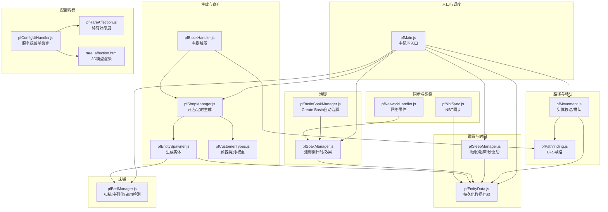
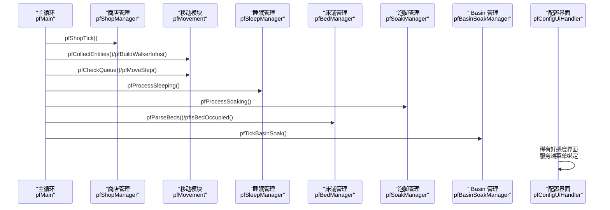
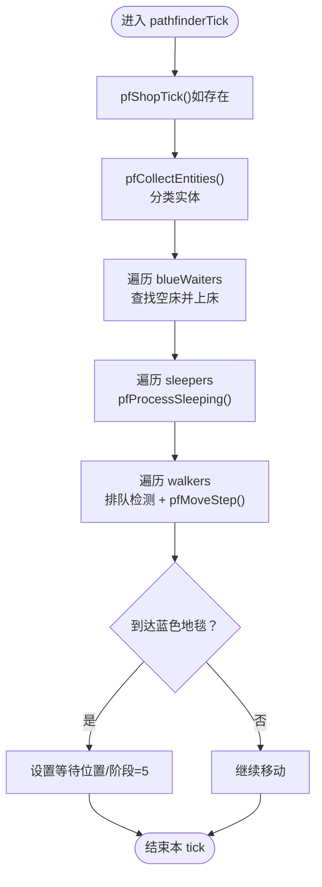
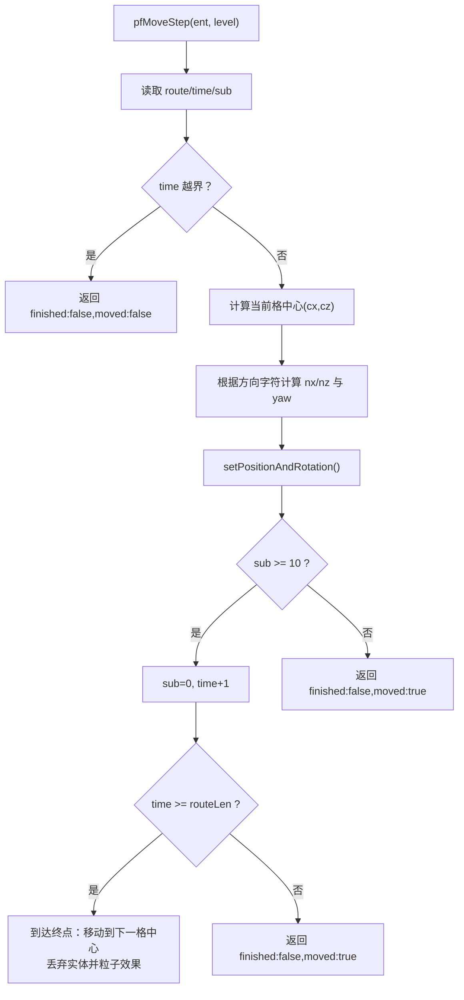
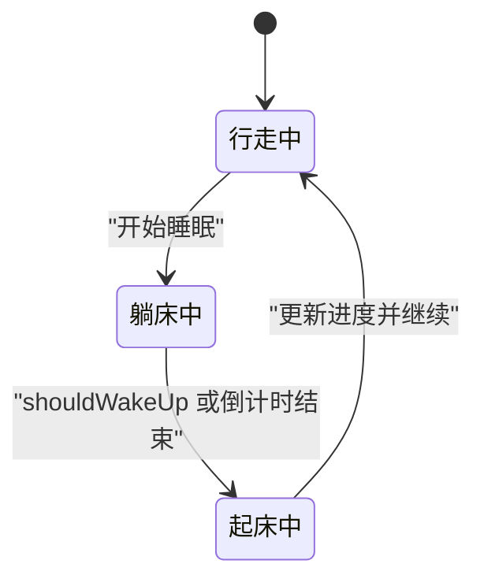
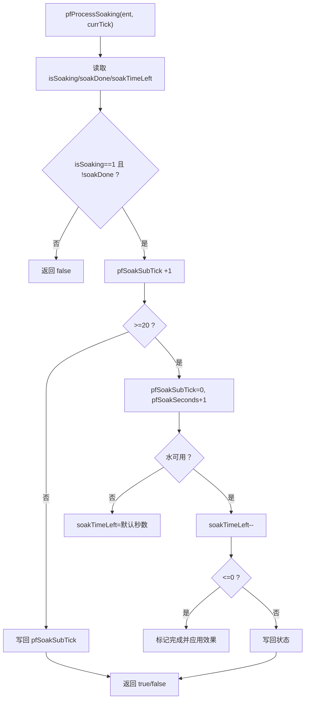
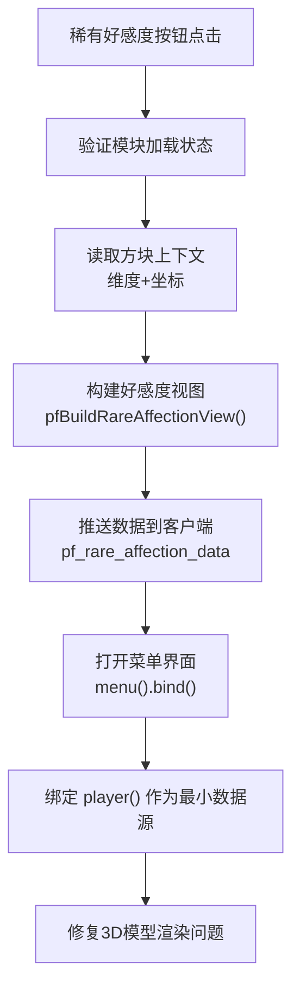
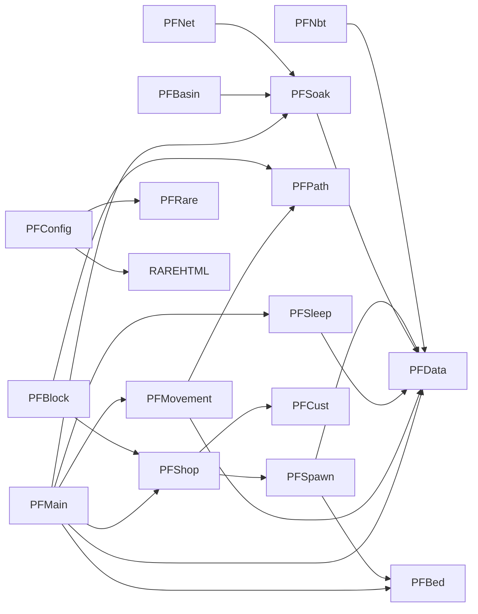

# 寻路系统

<cite>
**本文引用的文件**
- [pfMain.js](file://kubejs/server_scripts/pathfinder/pfMain.js)
- [pfMovement.js](file://kubejs/server_scripts/pathfinder/pfMovement.js)
- [pfSleepManager.js](file://kubejs/server_scripts/pathfinder/pfSleepManager.js)
- [pfEntityData.js](file://kubejs/server_scripts/pathfinder/pfEntityData.js)
- [pfBedManager.js](file://kubejs/server_scripts/pathfinder/pfBedManager.js)
- [pfSoakManager.js](file://kubejs/server_scripts/pathfinder/pfSoakManager.js)
- [pfBasinSoakManager.js](file://kubejs/server_scripts/pathfinder/pfBasinSoakManager.js)
- [pfConstants.js](file://kubejs/server_scripts/pathfinder/pfConstants.js)
- [pfNetworkHandler.js](file://kubejs/server_scripts/pathfinder/pfNetworkHandler.js)
- [pfNbtSync.js](file://kubejs/server_scripts/pathfinder/pfNbtSync.js)
- [pfCustomerTypes.js](file://kubejs/server_scripts/pathfinder/pfCustomerTypes.js)
- [pfPathfinding.js](file://kubejs/server_scripts/pathfinder/pfPathfinding.js)
- [pfEntitySpawner.js](file://kubejs/server_scripts/pathfinder/pfEntitySpawner.js)
- [pfBlockHandler.js](file://kubejs/server_scripts/pathfinder/pfBlockHandler.js)
- [pfShopManager.js](file://kubejs/server_scripts/pathfinder/pfShopManager.js)
- [pfConfigUiHandler.js](file://kubejs/server_scripts/pathfinder/pfConfigUiHandler.js)
- [pfRareAffection.js](file://kubejs/server_scripts/pathfinder/pfRareAffection.js)
- [rare_affection.html](file://apricity/kubejs/rare_affection.html)
</cite>

## 更新摘要
**已进行的变更**
- 稀有好感度界面重构为服务端菜单绑定，解决3D模型渲染问题
- 增加安全验证机制，防止非法命令执行
- 优化网络事件处理流程，提升系统稳定性

## 目录
1. [简介](#简介)
2. [项目结构](#项目结构)
3. [核心组件](#核心组件)
4. [架构总览](#架构总览)
5. [详细组件分析](#详细组件分析)
6. [依赖关系分析](#依赖关系分析)
7. [性能考量](#性能考量)
8. [故障排查指南](#故障排查指南)
9. [结论](#结论)
10. [附录](#附录)

## 简介
本文件系统性解析寻路系统的设计与实现，重点围绕 pfMain.js 作为主循环入口的调度机制，阐述实体收集、状态管理与循环调度；并深入说明各子模块职责：pfMovement 负责实体移动与路径计算、pfSleepManager 负责睡眠状态与时间管理、pfEntityData 负责实体持久化数据、pfBedManager 负责床位分配与占用状态、pfSoakManager 与 pfBasinSoakManager 负责泡脚效果管理。文档还包含状态机设计、数据流转机制、性能优化策略，并提供扩展与自定义寻路行为的具体示例路径。

**最新更新**：稀有好感度界面已重构为服务端菜单绑定，解决了3D模型渲染问题，并增强了安全验证机制。

## 项目结构
寻路系统位于 KubeJS 服务器脚本的 pathfinder 目录下，采用模块化设计，每个功能域独立为一个 JS 文件，通过 global.* 暴露接口，形成清晰的分层与低耦合：

- 入口与调度：pfMain.js
- 路径与移动：pfPathfinding.js、pfMovement.js
- 睡眠与时间：pfSleepManager.js、pfEntityData.js
- 床位管理：pfBedManager.js
- 泡脚与水管理：pfSoakManager.js、pfBasinSoakManager.js
- 数据同步：pfNbtSync.js
- 网络事件：pfNetworkHandler.js
- 生成与商店：pfEntitySpawner.js、pfShopManager.js、pfBlockHandler.js
- 配置界面：pfConfigUiHandler.js（新增）
- 稀有好感度：pfRareAffection.js（增强）
- 常量与配置：pfConstants.js
- 顾客类别与权重：pfCustomerTypes.js

**图表来源**
- [pfMain.js:11-177](file://kubejs/server_scripts/pathfinder/pfMain.js#L11-L177)
- [pfMovement.js:1-186](file://kubejs/server_scripts/pathfinder/pfMovement.js#L1-L186)
- [pfPathfinding.js:1-91](file://kubejs/server_scripts/pathfinder/pfPathfinding.js#L1-L91)
- [pfSleepManager.js:1-232](file://kubejs/server_scripts/pathfinder/pfSleepManager.js#L1-L232)
- [pfEntityData.js:1-218](file://kubejs/server_scripts/pathfinder/pfEntityData.js#L1-L218)
- [pfBedManager.js:1-129](file://kubejs/server_scripts/pathfinder/pfBedManager.js#L1-L129)
- [pfSoakManager.js:1-197](file://kubejs/server_scripts/pathfinder/pfSoakManager.js#L1-L197)
- [pfBasinSoakManager.js:1-418](file://kubejs/server_scripts/pathfinder/pfBasinSoakManager.js#L1-L418)
- [pfNbtSync.js:1-94](file://kubejs/server_scripts/pathfinder/pfNbtSync.js#L1-L94)
- [pfNetworkHandler.js:1-317](file://kubejs/server_scripts/pathfinder/pfNetworkHandler.js#L1-L317)
- [pfEntitySpawner.js:1-141](file://kubejs/server_scripts/pathfinder/pfEntitySpawner.js#L1-L141)
- [pfShopManager.js:1-300](file://kubejs/server_scripts/pathfinder/pfShopManager.js#L1-L300)
- [pfBlockHandler.js:1-148](file://kubejs/server_scripts/pathfinder/pfBlockHandler.js#L1-L148)
- [pfCustomerTypes.js:1-314](file://kubejs/server_scripts/pathfinder/pfCustomerTypes.js#L1-L314)
- [pfConfigUiHandler.js:1-80](file://kubejs/server_scripts/pathfinder/pfConfigUiHandler.js#L1-L80)
- [pfRareAffection.js:1-251](file://kubejs/server_scripts/pathfinder/pfRareAffection.js#L1-L251)
- [rare_affection.html:1-342](file://apricity/kubejs/rare_affection.html#L1-L342)

## 核心组件
- 主循环入口：pfMain.js 提供 global.pathfinderTick，每 tick 调用，整合所有模块，执行实体收集、状态处理与调度。
- 路径与移动：pfPathfinding 提供网格坐标与 BFS 寻路；pfMovement 负责实体收集、排队、进度计算与移动步进。
- 睡眠与时间：pfSleepManager 管理睡眠开始/过程/起床，使用"秒/计数"驱动；pfEntityData 统一封装持久化数据存取。
- 床位管理：pfBedManager 扫描路径上的床、序列化/反序列化、检测占用。
- 泡脚管理：pfSoakManager 管理泡脚倒计时与效果；pfBasinSoakManager 与 Create Basin 集成，实现自动泡脚与流体替换。
- 数据同步：pfNbtSync 通过实体手持物品 NBT 同步状态至客户端。
- 网络事件：pfNetworkHandler 处理客户端点击事件，驱动泡脚与送客等交互。
- 生成与商店：pfEntitySpawner 生成实体并初始化数据；pfShopManager 管理开店/定时生成；pfBlockHandler 处理右键触发；pfCustomerTypes 提供顾客类别与权重。
- **配置界面**：pfConfigUiHandler 提供服务端菜单绑定，支持稀有好感度查看和人物图鉴功能。
- **稀有好感度**：pfRareAffection 管理稀客好感度持久化、爱心文本显示和结算逻辑。

**章节来源**
- [pfMain.js:11-177](file://kubejs/server_scripts/pathfinder/pfMain.js#L11-L177)
- [pfMovement.js:1-186](file://kubejs/server_scripts/pathfinder/pfMovement.js#L1-L186)
- [pfSleepManager.js:1-232](file://kubejs/server_scripts/pathfinder/pfSleepManager.js#L1-L232)
- [pfEntityData.js:1-218](file://kubejs/server_scripts/pathfinder/pfEntityData.js#L1-L218)
- [pfBedManager.js:1-129](file://kubejs/server_scripts/pathfinder/pfBedManager.js#L1-L129)
- [pfSoakManager.js:1-197](file://kubejs/server_scripts/pathfinder/pfSoakManager.js#L1-L197)
- [pfBasinSoakManager.js:1-418](file://kubejs/server_scripts/pathfinder/pfBasinSoakManager.js#L1-L418)
- [pfNbtSync.js:1-94](file://kubejs/server_scripts/pathfinder/pfNbtSync.js#L1-L94)
- [pfNetworkHandler.js:1-317](file://kubejs/server_scripts/pathfinder/pfNetworkHandler.js#L1-L317)
- [pfEntitySpawner.js:1-141](file://kubejs/server_scripts/pathfinder/pfEntitySpawner.js#L1-L141)
- [pfShopManager.js:1-300](file://kubejs/server_scripts/pathfinder/pfShopManager.js#L1-L300)
- [pfBlockHandler.js:1-148](file://kubejs/server_scripts/pathfinder/pfBlockHandler.js#L1-L148)
- [pfCustomerTypes.js:1-314](file://kubejs/server_scripts/pathfinder/pfCustomerTypes.js#L1-L314)
- [pfConfigUiHandler.js:1-80](file://kubejs/server_scripts/pathfinder/pfConfigUiHandler.js#L1-L80)
- [pfRareAffection.js:1-251](file://kubejs/server_scripts/pathfinder/pfRareAffection.js#L1-L251)

## 架构总览
主循环以 pfMain 为核心，按阶段处理实体状态，串联移动、睡眠、泡脚与床铺管理模块，通过持久化数据与 NBT 同步实现跨重启与跨模块的数据一致性。

**图表来源**
- [pfMain.js:11-177](file://kubejs/server_scripts/pathfinder/pfMain.js#L11-L177)
- [pfShopManager.js:237-284](file://kubejs/server_scripts/pathfinder/pfShopManager.js#L237-L284)
- [pfMovement.js:36-162](file://kubejs/server_scripts/pathfinder/pfMovement.js#L36-L162)
- [pfSleepManager.js:65-128](file://kubejs/server_scripts/pathfinder/pfSleepManager.js#L65-L128)
- [pfSoakManager.js:92-145](file://kubejs/server_scripts/pathfinder/pfSoakManager.js#L92-L145)
- [pfBedManager.js:91-120](file://kubejs/server_scripts/pathfinder/pfBedManager.js#L91-L120)
- [pfBasinSoakManager.js:329-408](file://kubejs/server_scripts/pathfinder/pfBasinSoakManager.js#L329-L408)
- [pfConfigUiHandler.js:22-55](file://kubejs/server_scripts/pathfinder/pfConfigUiHandler.js#L22-L55)

## 详细组件分析

### 主循环入口：pfMain.js
设计理念
- 以方块实体为触发源，每 tick 调用 global.pathfinderTick，统一调度各模块。
- 通过持久化数据与 NBT 同步，避免依赖 server.getTickCount() 的差值，提升跨重启稳定性。
- 防重复处理：使用 pfEntityData.pfGetLastTick/pfSetLastTick 控制每 tick 的处理频率。

关键流程
- 开店定时生成：若存在 pfShopManager，则调用 pfShopTick。
- 实体收集与分类：walkers/sleepers/waiters/blueWaiters。
- 蓝色地毯等待逻辑：查找空床、设置睡眠前位置、进入睡眠阶段。
- 躺床中处理：泡脚倒计时、睡眠逻辑、起床条件。
- 行走实体：排队检测、移动步进、到达蓝色地毯的处理。
- 蓝色地毯等待与睡眠的衔接：从等待转为睡眠，重置秒驱动字段。

**图表来源**
- [pfMain.js:11-177](file://kubejs/server_scripts/pathfinder/pfMain.js#L11-L177)

**章节来源**
- [pfMain.js:11-177](file://kubejs/server_scripts/pathfinder/pfMain.js#L11-L177)

### 路径与移动：pfMovement.js
职责
- 实体收集：按 pfPhase 分类 walk/sleep/wait/blueWait。
- 排队构建与检测：基于进度与距离，避免实体拥堵。
- 位置计算：基于路径进度与方向字符，计算当前位置。
- 移动步进：每 tick 子步 +1，满 10 推进一格；终点丢弃实体并播放粒子。

复杂度
- pfBuildWalkerInfos：O(N) 遍历实体列表。
- pfCheckQueue：对每个实体 O(M) 检查邻近实体，整体 O(NM)。
- pfCalcCurrentPos：O(T)（T 为进度 time）。
- pfMoveStep：O(T) 计算当前格偏移，O(1) 移动与进度推进。

**图表来源**
- [pfMovement.js:100-162](file://kubejs/server_scripts/pathfinder/pfMovement.js#L100-L162)

**章节来源**
- [pfMovement.js:1-186](file://kubejs/server_scripts/pathfinder/pfMovement.js#L1-L186)

### 睡眠管理：pfSleepManager.js
设计理念
- "秒/计数"驱动：pfSleepSubTick（0~19）、pfSleepSeconds、pfSleepInitTicks，均存于实体 persistentData，跨重启保留。
- 睡眠初始化：设置 beforeSleepPos、sleepStartTick、phase=3、bedInfo，并重置秒驱动字段。
- 睡眠过程：每秒事件触发倒计时同步与 Basin 泡脚驱动。
- 起床：stopSleeping() + 命令移除 NBT；根据来源定位下床位置并更新路径进度。

**图表来源**
- [pfSleepManager.js:24-223](file://kubejs/server_scripts/pathfinder/pfSleepManager.js#L24-L223)

**章节来源**
- [pfSleepManager.js:1-232](file://kubejs/server_scripts/pathfinder/pfSleepManager.js#L1-L232)

### 实体数据：pfEntityData.js
职责
- 封装实体 persistentData 的读写：origin/route/time/subStep/phase、bedInfo、sleepStartTick、beforeSleepPos、hasSlept、fromBlueWait、blueCarpetPos、waitPos、lastTick、clearSleepTick、bedList。
- 同步：pfSetPhase/pfSetBedInfo 同步至客户端 NBT。

复杂度
- 所有函数均为 O(1)，通过 NBT 键访问。

**章节来源**
- [pfEntityData.js:1-218](file://kubejs/server_scripts/pathfinder/pfEntityData.js#L1-L218)

### 床位管理：pfBedManager.js
职责
- 沿路径扫描床：遍历当前格周围，识别床头方向与朝向，去重后记录。
- 序列化/反序列化：将床列表存为字符串，便于持久化。
- 占用检测：检查床周围是否存在 phase=3 的实体。

复杂度
- 扫描：O(L×R×H)（L 为路径长度，R 为扫描半径，H 为高度范围）。
- 占用检测：O(E)（E 为床附近实体数）。

**章节来源**
- [pfBedManager.js:1-129](file://kubejs/server_scripts/pathfinder/pfBedManager.js#L1-L129)

### 泡脚管理：pfSoakManager.js
设计理念
- "秒"驱动：pfSoakSubTick（0~19）→ pfSoakTimeLeft（秒），跨重启友好。
- 水桶可用性判定：原版水桶始终可用，其它桶需在注册表中存在。
- 倒计时结束：标记完成并应用水效果。

**图表来源**
- [pfSoakManager.js:92-145](file://kubejs/server_scripts/pathfinder/pfSoakManager.js#L92-L145)

**章节来源**
- [pfSoakManager.js:1-197](file://kubejs/server_scripts/pathfinder/pfSoakManager.js#L1-L197)

### Basin 自动泡脚：pfBasinSoakManager.js
职责
- 位置计算：根据床朝向推导 Basin 位置。
- 流体读取：优先使用 Forge Capability API，失败回退 entityData 正则。
- 自动启动/校验/结算：自动模式下启动倒计时，每秒校验流体合法性，完成后替换流体并清除标记。

复杂度
- 读取流体：O(T)（T 为 tanks 数量）。
- 正则扫描：O(S)（S 为 entityData 字符串长度）。

**章节来源**
- [pfBasinSoakManager.js:1-418](file://kubejs/server_scripts/pathfinder/pfBasinSoakManager.js#L1-L418)

### 配置界面与稀有好感度：pfConfigUiHandler.js、pfRareAffection.js
**更新**：稀有好感度界面已重构为服务端菜单绑定，解决3D模型渲染问题

设计理念
- **服务端菜单绑定**：使用 ApricityUI 的 menu() 方法替代客户端 screen，让物品图标进入容器 Screen 的原生渲染上下文，修复 TLM 3D 手办渲染发黑问题。
- **安全验证机制**：在图鉴对话跳转中增加命令白名单验证，只允许 chatbox skip skyfootspa: 前缀的命令。
- **数据流分离**：先推送数据给客户端，再打开菜单界面，确保数据就绪后再渲染。

关键流程
- 稀有好感度界面：读取方块上下文 → 构建好感度视图 → 推送数据 → 打开菜单界面。
- 人物图鉴：直接通知客户端关闭配置容器并打开图鉴 Screen。
- 对话跳转：安全验证 → 执行命令 → 记录日志。

**图表来源**
- [pfConfigUiHandler.js:22-55](file://kubejs/server_scripts/pathfinder/pfConfigUiHandler.js#L22-L55)

**章节来源**
- [pfConfigUiHandler.js:1-80](file://kubejs/server_scripts/pathfinder/pfConfigUiHandler.js#L1-L80)
- [pfRareAffection.js:1-251](file://kubejs/server_scripts/pathfinder/pfRareAffection.js#L1-L251)
- [rare_affection.html:1-342](file://apricity/kubejs/rare_affection.html#L1-L342)

### 网络事件与数据同步
- 网络事件：pfNetworkHandler 处理点击需求、泡脚、送客等事件，调用相应模块接口。
- NBT 同步：pfNbtSync 将 phase、bed、倒计时、需求清单同步到手持物品 NBT，自动下发至客户端。

**章节来源**
- [pfNetworkHandler.js:1-317](file://kubejs/server_scripts/pathfinder/pfNetworkHandler.js#L1-L317)
- [pfNbtSync.js:1-94](file://kubejs/server_scripts/pathfinder/pfNbtSync.js#L1-L94)

### 生成与商店：pfEntitySpawner.js、pfShopManager.js、pfBlockHandler.js、pfCustomerTypes.js
- 生成：pfEntitySpawner 生成实体、设置基础 NBT、初始化持久化数据、预扫描床铺、生成需求清单、同步至 NBT。
- 商店：pfShopManager 管理开店/定时生成，持久化状态在方块实体 NBT 中；pfBlockHandler 处理右键触发，支持凭证与 Boss 分支。
- 顾客：pfCustomerTypes 提供类别与权重，支持评价系统与加权抽取。

**章节来源**
- [pfEntitySpawner.js:1-141](file://kubejs/server_scripts/pathfinder/pfEntitySpawner.js#L1-L141)
- [pfShopManager.js:1-300](file://kubejs/server_scripts/pathfinder/pfShopManager.js#L1-L300)
- [pfBlockHandler.js:1-148](file://kubejs/server_scripts/pathfinder/pfBlockHandler.js#L1-L148)
- [pfCustomerTypes.js:1-314](file://kubejs/server_scripts/pathfinder/pfCustomerTypes.js#L1-L314)

## 依赖关系分析
模块间依赖关系如下：

**图表来源**
- [pfMain.js:11-177](file://kubejs/server_scripts/pathfinder/pfMain.js#L11-L177)
- [pfMovement.js:1-186](file://kubejs/server_scripts/pathfinder/pfMovement.js#L1-L186)
- [pfPathfinding.js:1-91](file://kubejs/server_scripts/pathfinder/pfPathfinding.js#L1-L91)
- [pfSleepManager.js:1-232](file://kubejs/server_scripts/pathfinder/pfSleepManager.js#L1-L232)
- [pfEntityData.js:1-218](file://kubejs/server_scripts/pathfinder/pfEntityData.js#L1-L218)
- [pfBedManager.js:1-129](file://kubejs/server_scripts/pathfinder/pfBedManager.js#L1-L129)
- [pfSoakManager.js:1-197](file://kubejs/server_scripts/pathfinder/pfSoakManager.js#L1-L197)
- [pfBasinSoakManager.js:1-418](file://kubejs/server_scripts/pathfinder/pfBasinSoakManager.js#L1-L418)
- [pfEntitySpawner.js:1-141](file://kubejs/server_scripts/pathfinder/pfEntitySpawner.js#L1-L141)
- [pfShopManager.js:1-300](file://kubejs/server_scripts/pathfinder/pfShopManager.js#L1-L300)
- [pfBlockHandler.js:1-148](file://kubejs/server_scripts/pathfinder/pfBlockHandler.js#L1-L148)
- [pfCustomerTypes.js:1-314](file://kubejs/server_scripts/pathfinder/pfCustomerTypes.js#L1-L314)
- [pfNetworkHandler.js:1-317](file://kubejs/server_scripts/pathfinder/pfNetworkHandler.js#L1-L317)
- [pfNbtSync.js:1-94](file://kubejs/server_scripts/pathfinder/pfNbtSync.js#L1-L94)
- [pfConfigUiHandler.js:1-80](file://kubejs/server_scripts/pathfinder/pfConfigUiHandler.js#L1-L80)
- [pfRareAffection.js:1-251](file://kubejs/server_scripts/pathfinder/pfRareAffection.js#L1-L251)

## 性能考量
- 循环调度防重复：使用 pfEntityData.pfGetLastTick/pfSetLastTick，避免每 tick 重复处理同一实体。
- 排队检测：pfCheckQueue 对邻近实体进行距离与进度比较，建议控制实体密度与扫描半径，降低 O(NM) 复杂度。
- 路径计算：pfCalcCurrentPos 与 pfMoveStep 为 O(T)，建议缩短路径长度或使用更高效的寻路策略。
- 床铺扫描：沿路径扫描床，注意路径长度与扫描半径，避免大规模遍历。
- 睡眠与泡脚：使用"秒/计数"驱动，减少对 server.getTickCount() 的依赖，提高跨重启稳定性。
- NBT 同步：pfNbtSync 将状态同步至手持物品 NBT，减少客户端与服务端状态不一致风险。
- **菜单渲染优化**：使用容器 Screen 的原生渲染上下文，避免 plain Screen 下的3D模型渲染问题。
- **安全验证**：在服务端进行命令白名单验证，防止客户端注入恶意命令。

## 故障排查指南
常见问题与定位
- 实体未移动：检查 pfMovement.pfMoveStep 是否返回 finished=false 且 moved=true；确认 route/time/subStep 是否正确推进。
- 蓝色地毯等待无效：确认 pfMain 中是否正确设置等待位置与 phase；检查 pfEntityData.pfHasSlept 与 pfEntityData.pfSetPhase。
- 睡眠不生效：检查 pfSleepManager.pfStartSleep 是否被调用；确认 bedPos 与朝向；核对 pfResetSleepSubTick 是否重置。
- 泡脚倒计时异常：检查 pfSoakManager.pfProcessSoaking 的水桶可用性与 pfSoakSubTick 是否正确递增。
- Basin 自动泡脚失败：检查 pfBasinSoakManager.pfReadBasinFluid 与 pfBasinContainsUsedWater；确认流体类型与槽位。
- **稀有好感度界面无法打开**：检查 pfConfigUiHandler 中的模块加载验证和方块上下文获取。
- **3D模型渲染发黑**：确认使用 menu().bind() 而非客户端 screen，确保容器 Screen 的原生渲染上下文。
- **对话跳转被拒绝**：检查命令白名单验证，确认命令格式为 "chatbox skip skyfootspa:" 前缀。

**章节来源**
- [pfMovement.js:100-162](file://kubejs/server_scripts/pathfinder/pfMovement.js#L100-L162)
- [pfMain.js:29-93](file://kubejs/server_scripts/pathfinder/pfMain.js#L29-L93)
- [pfSleepManager.js:24-128](file://kubejs/server_scripts/pathfinder/pfSleepManager.js#L24-L128)
- [pfSoakManager.js:92-145](file://kubejs/server_scripts/pathfinder/pfSoakManager.js#L92-L145)
- [pfBasinSoakManager.js:329-408](file://kubejs/server_scripts/pathfinder/pfBasinSoakManager.js#L329-L408)
- [pfConfigUiHandler.js:22-77](file://kubejs/server_scripts/pathfinder/pfConfigUiHandler.js#L22-L77)

## 结论
本寻路系统通过模块化设计与持久化数据管理，实现了稳定的实体寻路、睡眠与泡脚流程。主循环入口 pfMain.js 统一调度各模块，结合"秒/计数"驱动与 NBT 同步，提升了跨重启与跨模块的一致性。**最新改进包括稀有好感度界面的服务端菜单绑定重构，解决了3D模型渲染问题，并增强了安全验证机制**。通过合理的性能优化与故障排查策略，系统可在复杂场景中保持高效与稳定。

## 附录

### 扩展与自定义寻路行为示例路径
- 新增实体类型
  - 在常量中添加实体类型：[pfConstants.js:14-15](file://kubejs/server_scripts/pathfinder/pfConstants.js#L14-L15)
  - 在生成模块中使用该类型：[pfEntitySpawner.js:8-9](file://kubejs/server_scripts/pathfinder/pfEntitySpawner.js#L8-L9)
  - 在路径生成与扫描中考虑新实体：[pfBlockHandler.js:8-145](file://kubejs/server_scripts/pathfinder/pfBlockHandler.js#L8-L145)
- 自定义睡眠回调
  - 定义 global.pfOnStartSleep 与 global.pfShouldWakeUp：[pfMain.js:89-91](file://kubejs/server_scripts/pathfinder/pfMain.js#L89-L91)、[pfSleepManager.js:123-125](file://kubejs/server_scripts/pathfinder/pfSleepManager.js#L123-L125)
- 注册新的泡脚水类型
  - 在注册表中添加桶 ID 与流体 ID 映射：[pfBasinSoakManager.js:240-251](file://kubejs/server_scripts/pathfinder/pfBasinSoakManager.js#L240-L251)
  - 在网络事件中处理新桶：[pfNetworkHandler.js:229-241](file://kubejs/server_scripts/pathfinder/pfNetworkHandler.js#L229-L241)
- 自定义床铺位置与朝向
  - 修改床铺扫描与占用检测逻辑：[pfBedManager.js:10-77](file://kubejs/server_scripts/pathfinder/pfBedManager.js#L10-L77)、[pfBedManager.js:109-120](file://kubejs/server_scripts/pathfinder/pfBedManager.js#L109-L120)
- **稀有好感度界面扩展**
  - 修改菜单绑定逻辑：[pfConfigUiHandler.js:46-55](file://kubejs/server_scripts/pathfinder/pfConfigUiHandler.js#L46-L55)
  - 调整HTML界面布局：[rare_affection.html:1-342](file://apricity/kubejs/rare_affection.html#L1-L342)
  - 扩展好感度数据处理：[pfRareAffection.js:197-234](file://kubejs/server_scripts/pathfinder/pfRareAffection.js#L197-L234)

**章节来源**
- [pfConstants.js:14-15](file://kubejs/server_scripts/pathfinder/pfConstants.js#L14-L15)
- [pfEntitySpawner.js:8-9](file://kubejs/server_scripts/pathfinder/pfEntitySpawner.js#L8-L9)
- [pfBlockHandler.js:8-145](file://kubejs/server_scripts/pathfinder/pfBlockHandler.js#L8-L145)
- [pfMain.js:89-91](file://kubejs/server_scripts/pathfinder/pfMain.js#L89-L91)
- [pfSleepManager.js:123-125](file://kubejs/server_scripts/pathfinder/pfSleepManager.js#L123-L125)
- [pfBasinSoakManager.js:240-251](file://kubejs/server_scripts/pathfinder/pfBasinSoakManager.js#L240-L251)
- [pfNetworkHandler.js:229-241](file://kubejs/server_scripts/pathfinder/pfNetworkHandler.js#L229-L241)
- [pfBedManager.js:10-77](file://kubejs/server_scripts/pathfinder/pfBedManager.js#L10-L77)
- [pfBedManager.js:109-120](file://kubejs/server_scripts/pathfinder/pfBedManager.js#L109-L120)
- [pfConfigUiHandler.js:46-55](file://kubejs/server_scripts/pathfinder/pfConfigUiHandler.js#L46-L55)
- [rare_affection.html:1-342](file://apricity/kubejs/rare_affection.html#L1-L342)
- [pfRareAffection.js:197-234](file://kubejs/server_scripts/pathfinder/pfRareAffection.js#L197-L234)