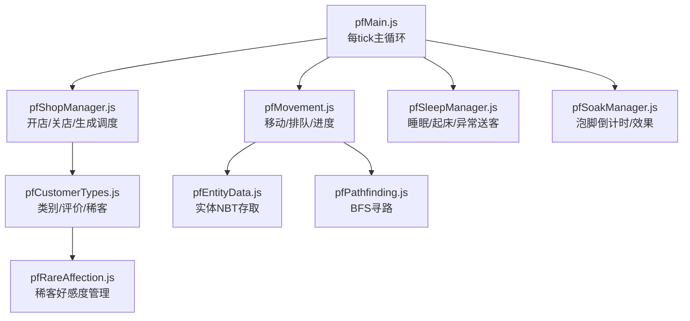
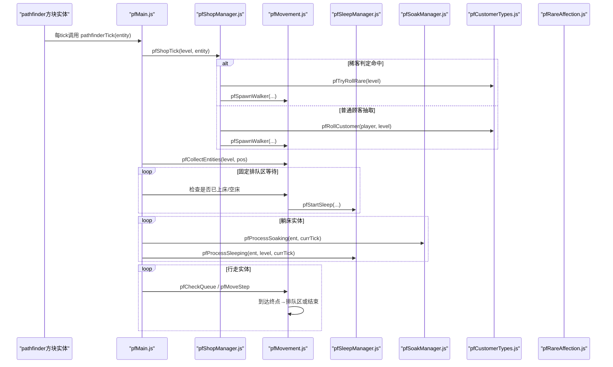
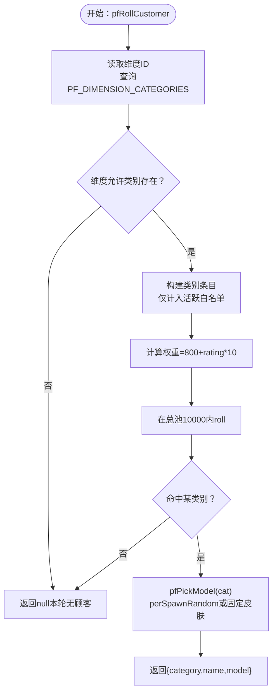
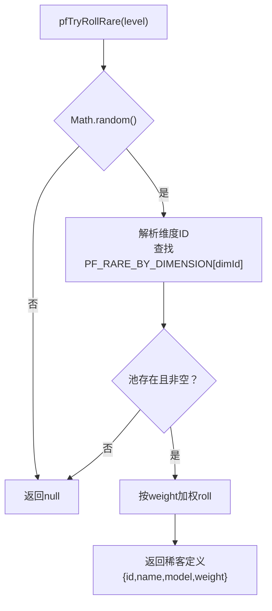
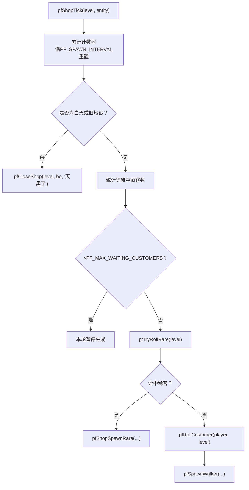
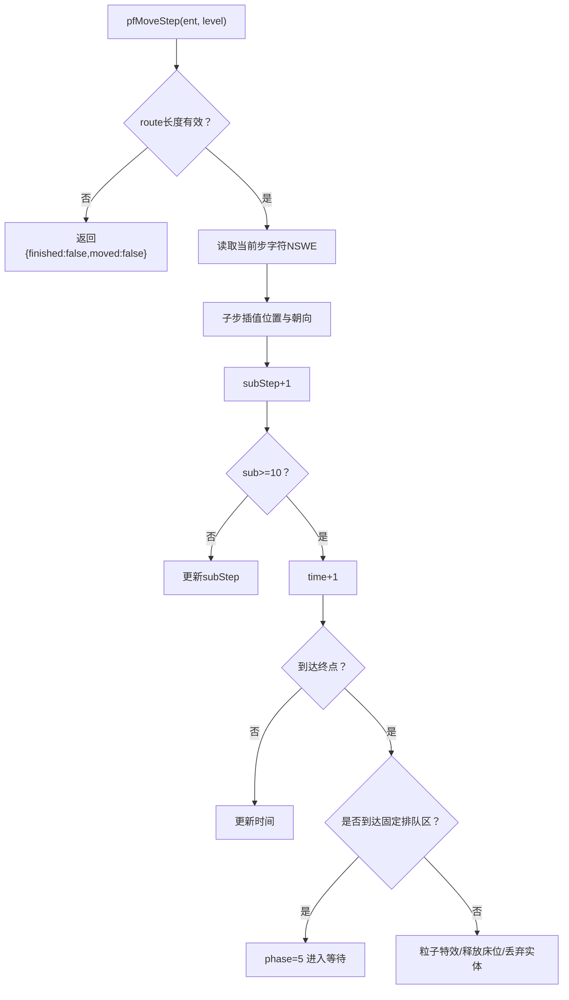
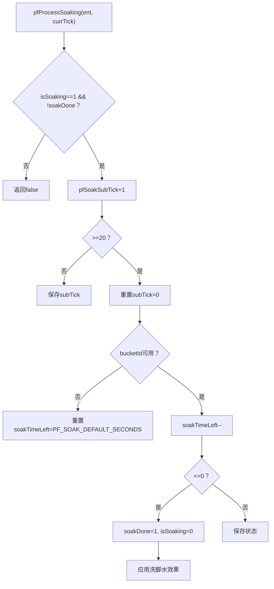
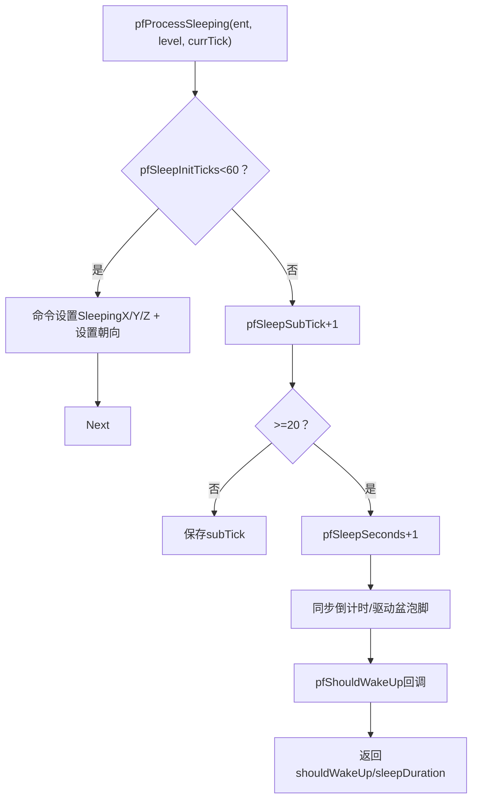
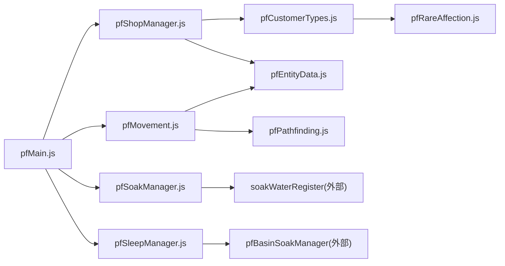

# 寻路顾客等级系统

<cite>
**本文引用的文件**   
- [pfCustomerTypes.js](file://kubejs/server_scripts/pathfinder/pfCustomerTypes.js)
- [pfMain.js](file://kubejs/server_scripts/pathfinder/pfMain.js)
- [pfPathfinding.js](file://kubejs/server_scripts/pathfinder/pfPathfinding.js)
- [pfEntityData.js](file://kubejs/server_scripts/pathfinder/pfEntityData.js)
- [pfShopManager.js](file://kubejs/server_scripts/pathfinder/pfShopManager.js)
- [pfMovement.js](file://kubejs/server_scripts/pathfinder/pfMovement.js)
- [pfSoakManager.js](file://kubejs/server_scripts/pathfinder/pfSoakManager.js)
- [pfSleepManager.js](file://kubejs/server_scripts/pathfinder/pfSleepManager.js)
- [pfRareAffection.js](file://kubejs/server_scripts/pathfinder/pfRareAffection.js)
</cite>

## 更新摘要
**变更内容**   
- 移除了独立的pfCustomerLevel.js文件，顾客等级管理功能已简化并整合到pfCustomerTypes.js中
- 评价系统直接集成在顾客类型模块中，不再需要单独的等级管理文件
- 稀客好感度系统独立为pfRareAffection.js模块，提供更完善的好感度管理

## 目录
1. [简介](#简介)
2. [项目结构](#项目结构)
3. [核心组件](#核心组件)
4. [架构总览](#架构总览)
5. [详细组件分析](#详细组件分析)
6. [依赖关系分析](#依赖关系分析)
7. [性能与扩展性](#性能与扩展性)
8. [故障排查指南](#故障排查指南)
9. [结论](#结论)

## 简介
本文件围绕"寻路顾客等级系统"展开，聚焦于 KubeJS 服务端脚本中"pathfinder"模块的顾客生成、移动、泡脚、睡眠与评价/稀有度机制。该系统以方块实体为触发源，每 tick 驱动开店判定、顾客寻路与状态推进，并通过玩家持久化数据维护"种族评价"，从而动态影响不同维度下顾客的生成概率。同时，系统包含稀客（稀有顾客）好感度与掉落体系，以及泡脚倒计时与洗脚水效果联动。

**更新** 顾客等级管理功能已从独立的pfCustomerLevel.js文件迁移并简化，现整合在pfCustomerTypes.js中，提供更好的模块化设计。

## 项目结构
pathfinder 模块采用按职责拆分的脚本组织方式：
- 主循环入口：pfMain.js
- 开店与调度：pfShopManager.js
- 顾客类别与权重、评价与稀客配置：pfCustomerTypes.js
- 实体数据封装：pfEntityData.js
- 移动与排队：pfMovement.js
- 寻路算法：pfPathfinding.js
- 泡脚管理：pfSoakManager.js
- 睡眠管理：pfSleepManager.js
- 稀客好感度管理：pfRareAffection.js

**图表来源**
- [pfMain.js:11-210](file://kubejs/server_scripts/pathfinder/pfMain.js#L11-L210)
- [pfShopManager.js:413-479](file://kubejs/server_scripts/pathfinder/pfShopManager.js#L413-L479)
- [pfMovement.js:8-205](file://kubejs/server_scripts/pathfinder/pfMovement.js#L8-L205)
- [pfPathfinding.js:46-83](file://kubejs/server_scripts/pathfinder/pfPathfinding.js#L46-L83)
- [pfEntityData.js:11-228](file://kubejs/server_scripts/pathfinder/pfEntityData.js#L11-L228)
- [pfSoakManager.js:92-186](file://kubejs/server_scripts/pathfinder/pfSoakManager.js#L92-L186)
- [pfSleepManager.js:48-345](file://kubejs/server_scripts/pathfinder/pfSleepManager.js#L48-L345)
- [pfRareAffection.js:1-250](file://kubejs/server_scripts/pathfinder/pfRareAffection.js#L1-L250)

**章节来源**
- [pfMain.js:1-214](file://kubejs/server_scripts/pathfinder/pfMain.js#L1-L214)

## 核心组件
- 顾客类别与评价系统：定义人类、妖精、鬼族、月球等类别，按维度过滤与活跃白名单控制生成；通过玩家 persistentData 存储评价值，影响生成权重。
- 稀客系统：每个维度独立池，自然生成时按概率替换普通顾客；具备好感度、爱心显示、掉落表与专属名称标签。
- 开店管理：基于方块实体 NBT 的状态机，定时判定、白天自动关店、等待顾客上限控制、床位扫描与占用释放。
- 移动与排队：按路径字符串步进，子步插值动画，同 tick 防重复处理，排队避让逻辑。
- 泡脚管理：手持物品 NBT 驱动倒计时，支持自定义洗脚水类型与效果回调。
- 睡眠管理：秒级驱动，床破坏检测，起床后恢复路径进度并释放床位。
- 稀客好感度管理：独立模块处理稀客好感度的持久化、结算与界面展示。

**章节来源**
- [pfCustomerTypes.js:16-215](file://kubejs/server_scripts/pathfinder/pfCustomerTypes.js#L16-L215)
- [pfCustomerTypes.js:278-382](file://kubejs/server_scripts/pathfinder/pfCustomerTypes.js#L278-L382)
- [pfCustomerTypes.js:404-747](file://kubejs/server_scripts/pathfinder/pfCustomerTypes.js#L404-L747)
- [pfShopManager.js:19-26](file://kubejs/server_scripts/pathfinder/pfShopManager.js#L19-L26)
- [pfShopManager.js:270-294](file://kubejs/server_scripts/pathfinder/pfShopManager.js#L270-L294)
- [pfShopManager.js:413-479](file://kubejs/server_scripts/pathfinder/pfShopManager.js#L413-L479)
- [pfMovement.js:8-205](file://kubejs/server_scripts/pathfinder/pfMovement.js#L8-L205)
- [pfSoakManager.js:92-186](file://kubejs/server_scripts/pathfinder/pfSoakManager.js#L92-L186)
- [pfSleepManager.js:48-345](file://kubejs/server_scripts/pathfinder/pfSleepManager.js#L48-L345)
- [pfRareAffection.js:1-250](file://kubejs/server_scripts/pathfinder/pfRareAffection.js#L1-L250)

## 架构总览
系统以 pathfinder_block 方块实体为锚点，每 tick 执行以下流程：
1. 调用 pfShopManager.pfShopTick 进行开店判定与顾客生成。
2. 收集区域内实体并按阶段分类（行走/躺床/等待/固定排队区）。
3. 对固定排队区等待实体尝试上床；对躺床实体驱动泡脚与睡眠。
4. 对行走实体执行移动步进、排队检查与到达终点后的行为（进入排队区或结束服务）。

**图表来源**
- [pfMain.js:11-210](file://kubejs/server_scripts/pathfinder/pfMain.js#L11-L210)
- [pfShopManager.js:413-479](file://kubejs/server_scripts/pathfinder/pfShopManager.js#L413-L479)
- [pfMovement.js:8-205](file://kubejs/server_scripts/pathfinder/pfMovement.js#L8-L205)
- [pfSoakManager.js:92-186](file://kubejs/server_scripts/pathfinder/pfSoakManager.js#L92-L186)
- [pfSleepManager.js:48-345](file://kubejs/server_scripts/pathfinder/pfSleepManager.js#L48-L345)
- [pfCustomerTypes.js:631-651](file://kubejs/server_scripts/pathfinder/pfCustomerTypes.js#L631-L651)

## 详细组件分析

### 顾客类别与等级（评价）系统
- 类别定义：人类、妖精、妖、神、鬼族、月球等，每个类别有名称、模型池与 perSpawnRandom 标志。
- 维度过滤：PF_DIMENSION_CATEGORIES 指定各维度允许生成的类别；未列入维度不会生成顾客。
- 活跃白名单：PF_ACTIVE_CATEGORIES 控制当前参与生成的类别集合。
- 评价系统：
  - 玩家 persistentData 存储 pfRating_类别 数值（0-100），基础权重 800，每点+10权重，总池 10000。
  - pfRollCustomer 先取维度允许类别，再与活跃白名单交集计算权重，随机抽取类别与模型。
- 需求范围：PF_DEMAND_DEFAULT_RANGES 与 PF_RACE_DEMAND_RANGES 控制各部位需求数量范围。

**更新** 评价系统现已完全整合到pfCustomerTypes.js中，不再需要独立的等级管理文件。

**图表来源**
- [pfCustomerTypes.js:349-382](file://kubejs/server_scripts/pathfinder/pfCustomerTypes.js#L349-L382)
- [pfCustomerTypes.js:251-270](file://kubejs/server_scripts/pathfinder/pfCustomerTypes.js#L251-L270)

**章节来源**
- [pfCustomerTypes.js:16-215](file://kubejs/server_scripts/pathfinder/pfCustomerTypes.js#L16-L215)
- [pfCustomerTypes.js:278-382](file://kubejs/server_scripts/pathfinder/pfCustomerTypes.js#L278-L382)
- [pfEntityData.js:11-26](file://kubejs/server_scripts/pathfinder/pfEntityData.js#L11-L26)

### 稀客系统（稀有顾客）
- 触发概率：PF_RARE_SPAWN_CHANCE（默认 0.10），自然生成时优先判定稀客。
- 维度池：PF_RARE_BY_DIMENSION 为每个维度维护独立稀客池，含 id/name/model/weight/drops。
- 好感度：PF_RARE_HEART_THRESHOLDS 决定爱心数（0-3），影响掉落档位与头顶爱心显示。
- 掉落：优先使用稀客自身 drops，否则回退到全局默认表 PF_RARE_DEFAULT_DROPS。
- 名称标签：pfApplyRareNameTag 显示爱心与"★稀客 <名字>"。

**更新** 稀客好感度管理已独立为pfRareAffection.js模块，提供更完善的系统。

**图表来源**
- [pfCustomerTypes.js:631-651](file://kubejs/server_scripts/pathfinder/pfCustomerTypes.js#L631-L651)
- [pfCustomerTypes.js:404-424](file://kubejs/server_scripts/pathfinder/pfCustomerTypes.js#L404-L424)
- [pfCustomerTypes.js:657-724](file://kubejs/server_scripts/pathfinder/pfCustomerTypes.js#L657-L724)

**章节来源**
- [pfCustomerTypes.js:404-747](file://kubejs/server_scripts/pathfinder/pfCustomerTypes.js#L404-L747)
- [pfShopManager.js:359-407](file://kubejs/server_scripts/pathfinder/pfShopManager.js#L359-L407)
- [pfRareAffection.js:1-250](file://kubejs/server_scripts/pathfinder/pfRareAffection.js#L1-L250)

### 开店管理与生成调度
- 状态持久化：pfShopIsOpen、pfShopTickCounter、pfShopPlayerUuid、pfShopRouteStr、pfShopBaseX/Y/Z、pfShopQueueX/Z、pfShopSpawnedUuids、pfShopBedList、pfShopBedCount。
- 计时与昼夜：PF_SPAWN_INTERVAL=100 tick（5秒）判定一次；非旧地狱维度日落后自动关店。
- 等待上限：PF_MAX_WAITING_CUSTOMERS=5，超过则暂停生成新顾客。
- 床位管理：扫描路径旁合法床位，记录占用者与 ownerUuid，支持锁定与释放。

**图表来源**
- [pfShopManager.js:413-479](file://kubejs/server_scripts/pathfinder/pfShopManager.js#L413-L479)
- [pfShopManager.js:270-294](file://kubejs/server_scripts/pathfinder/pfShopManager.js#L270-L294)
- [pfShopManager.js:250-265](file://kubejs/server_scripts/pathfinder/pfShopManager.js#L250-L265)

**章节来源**
- [pfShopManager.js:19-26](file://kubejs/server_scripts/pathfinder/pfShopManager.js#L19-L26)
- [pfShopManager.js:270-294](file://kubejs/server_scripts/pathfinder/pfShopManager.js#L270-L294)
- [pfShopManager.js:413-479](file://kubejs/server_scripts/pathfinder/pfShopManager.js#L413-L479)

### 移动与排队
- 实体收集：按 phase 分类（2行走/3躺床/4等待/5固定排队区等待）。
- 排队检查：同 tick 内比较 progress（time*10+subStep）与 ID，避免重叠。
- 移动步进：按路径字符 NSWE 推进，子步插值动画；到达终点后判断是否进入固定排队区或结束服务。
- 固定排队区：若终点即排队区，则进入 phase=5 等待上床。

**图表来源**
- [pfMovement.js:102-181](file://kubejs/server_scripts/pathfinder/pfMovement.js#L102-L181)

**章节来源**
- [pfMovement.js:8-205](file://kubejs/server_scripts/pathfinder/pfMovement.js#L8-L205)

### 泡脚管理
- 状态存储：手持物品 NBT 中的 pfIsSoaking、pfSoakDone、pfSoakTimeLeft、pfSoakWaterType。
- 秒驱动：实体 persistentData 中 pfSoakSubTick（0~19），每 20 tick 触发一次秒事件。
- 洗脚水可用性：支持 minecraft:water_bucket 与注册表中的自定义洗脚水。
- 完成回调：倒计时结束后应用洗脚水效果（global.pfSoakWaterEffects）。

**图表来源**
- [pfSoakManager.js:92-186](file://kubejs/server_scripts/pathfinder/pfSoakManager.js#L92-L186)

**章节来源**
- [pfSoakManager.js:16-186](file://kubejs/server_scripts/pathfinder/pfSoakManager.js#L16-L186)

### 睡眠管理
- 秒驱动：pfSleepSubTick（0~19）→ pfSleepSeconds（累计秒数），前 60 tick 设置睡姿与朝向。
- 床破坏检测：每 tick 检查床是否完整，失效则异常送客（不结算）。
- 起床逻辑：停止睡眠、清理 SleepingX/Y/Z NBT，根据 fromQueueWait 选择下床位置，恢复路径进度并释放床位。

**图表来源**
- [pfSleepManager.js:87-165](file://kubejs/server_scripts/pathfinder/pfSleepManager.js#L87-L165)

**章节来源**
- [pfSleepManager.js:48-345](file://kubejs/server_scripts/pathfinder/pfSleepManager.js#L48-L345)

### 稀客好感度管理系统
- 好感度持久化：按稀客 id 存储在"寻路方块"BlockEntity 的 persistentData（键 pfRareAff_<rareId>，int，最小 0，无上限）。
- 爱心文本 / 头顶名牌：两行显示，上一行爱心，下一行"★稀客 名字"。
- 结算机制：按"更新前好感度"决定爱心档位并掉落对应物品，随后把 (满意度 - 偏移) 累加到方块好感度。
- 配置界面视图：供配置界面读取某方块在某维度下所有稀客的好感度视图。

**新增** 这是从pfCustomerTypes.js中分离出来的独立模块，提供更专业的稀客好感度管理功能。

**章节来源**
- [pfRareAffection.js:1-250](file://kubejs/server_scripts/pathfinder/pfRareAffection.js#L1-L250)

## 依赖关系分析
- pfMain.js 作为入口，依赖 pfShopManager、pfMovement、pfSleepManager、pfSoakManager。
- pfShopManager 依赖 pfCustomerTypes（类别/稀客）、pfEntityData（实体NBT）、pfBedManager（床位扫描/序列化）。
- pfMovement 依赖 pfEntityData（路径/时间/阶段）、pfPathfinding（BFS）。
- pfSoakManager 依赖 global.soakWaterRegister（洗脚水注册表）与 pfSoakWaterEffects（效果回调）。
- pfSleepManager 依赖 pfBedManager（床完整性检测）与 pfBasinSoakManager（盆泡脚联动）。
- pfCustomerTypes 依赖 pfRareAffection（稀客好感度管理）。

**图表来源**
- [pfMain.js:11-210](file://kubejs/server_scripts/pathfinder/pfMain.js#L11-L210)
- [pfShopManager.js:413-479](file://kubejs/server_scripts/pathfinder/pfShopManager.js#L413-L479)
- [pfMovement.js:8-205](file://kubejs/server_scripts/pathfinder/pfMovement.js#L8-L205)
- [pfSoakManager.js:92-186](file://kubejs/server_scripts/pathfinder/pfSoakManager.js#L92-L186)
- [pfSleepManager.js:87-165](file://kubejs/server_scripts/pathfinder/pfSleepManager.js#L87-L165)
- [pfRareAffection.js:1-250](file://kubejs/server_scripts/pathfinder/pfRareAffection.js#L1-L250)

**章节来源**
- [pfMain.js:11-210](file://kubejs/server_scripts/pathfinder/pfMain.js#L11-L210)
- [pfShopManager.js:413-479](file://kubejs/server_scripts/pathfinder/pfShopManager.js#L413-L479)
- [pfMovement.js:8-205](file://kubejs/server_scripts/pathfinder/pfMovement.js#L8-L205)
- [pfSoakManager.js:92-186](file://kubejs/server_scripts/pathfinder/pfSoakManager.js#L92-L186)
- [pfSleepManager.js:87-165](file://kubejs/server_scripts/pathfinder/pfSleepManager.js#L87-L165)

## 性能与扩展性
- 每 tick 全量收集实体并按阶段分类，建议关注服务器 TPS 与实体数量，必要时调整搜索范围或降低生成频率。
- BFS 寻路复杂度与网格大小相关，GRID_W 与 GRID_HALF 影响寻路区域；应避免过大地图导致队列膨胀。
- 评价系统与稀客池均为数组遍历与随机 roll，建议在新增大量类别或稀客时评估权重计算开销。
- 泡脚与睡眠均使用秒级驱动，避免依赖 server.getTickCount() 差值，提升跨重启稳定性。
- 模块化设计使得各系统可独立优化，如稀客好感度系统的独立处理减少了主循环的耦合度。

[本节为通用指导，不直接分析具体文件]

## 故障排查指南
- 顾客未生成：
  - 检查维度是否在 PF_DIMENSION_CATEGORIES 中配置。
  - 检查 PF_ACTIVE_CATEGORIES 是否包含目标类别。
  - 查看 pfRollCustomer 日志输出，确认是否命中类别。
- 稀客未出现：
  - 检查 PF_RARE_SPAWN_CHANCE 概率与维度池 PF_RARE_BY_DIMENSION 是否存在。
  - 确认 pfTryRollRare 返回值与 pfShopHasRareOnRoute 去重逻辑。
- 顾客卡住或重复：
  - 检查 pfEntityData.pfGetLastTick 防重复处理逻辑。
  - 确认 pfMovement.pfCheckQueue 与 pfMoveStep 的 subStep/time 更新。
- 泡脚无效：
  - 检查手持物品 NBT 中 pfIsSoaking、pfSoakDone、pfSoakTimeLeft。
  - 确认 bucketId 是否在 soakWaterRegister 中注册。
- 睡眠异常：
  - 检查床是否被破坏（TNT/活塞），pfDismissBrokenBedCustomer 会异常送客。
  - 确认 pfSleepSubTick 与 pfSleepSeconds 计数是否正确。
- 稀客好感度问题：
  - 检查 pfRareAffection 模块是否正确加载。
  - 确认好感度持久化键名 pfRareAff_<rareId> 是否正确。
  - 验证爱心阈值配置 PF_RARE_HEART_THRESHOLDS 是否合理。

**章节来源**
- [pfCustomerTypes.js:349-382](file://kubejs/server_scripts/pathfinder/pfCustomerTypes.js#L349-L382)
- [pfCustomerTypes.js:631-651](file://kubejs/server_scripts/pathfinder/pfCustomerTypes.js#L631-L651)
- [pfMovement.js:152-181](file://kubejs/server_scripts/pathfinder/pfMovement.js#L152-L181)
- [pfSoakManager.js:92-186](file://kubejs/server_scripts/pathfinder/pfSoakManager.js#L92-L186)
- [pfSleepManager.js:272-335](file://kubejs/server_scripts/pathfinder/pfSleepManager.js#L272-L335)
- [pfRareAffection.js:1-250](file://kubejs/server_scripts/pathfinder/pfRareAffection.js#L1-L250)

## 结论
寻路顾客等级系统通过模块化脚本实现了顾客生成、移动、泡脚、睡眠与评价/稀有度的完整闭环。其设计强调：
- 维度与类别双重过滤，确保不同世界体验差异化。
- 玩家评价驱动生成权重，鼓励多样化服务。
- 稀客系统提供额外挑战与奖励，增强玩法深度。
- 秒级驱动与持久化状态保证跨重启稳定。
- 模块化架构提升了代码的可维护性和扩展性。

**更新** 通过将顾客等级管理功能简化并整合到pfCustomerTypes.js中，同时独立出pfRareAffection.js模块，系统获得了更好的架构设计和更清晰的职责分离。未来可扩展方向包括：更多维度映射、更丰富的洗脚水效果、稀客掉落平衡调整与性能优化（如批量实体处理与寻路缓存）。

[本节为总结性内容，不直接分析具体文件]