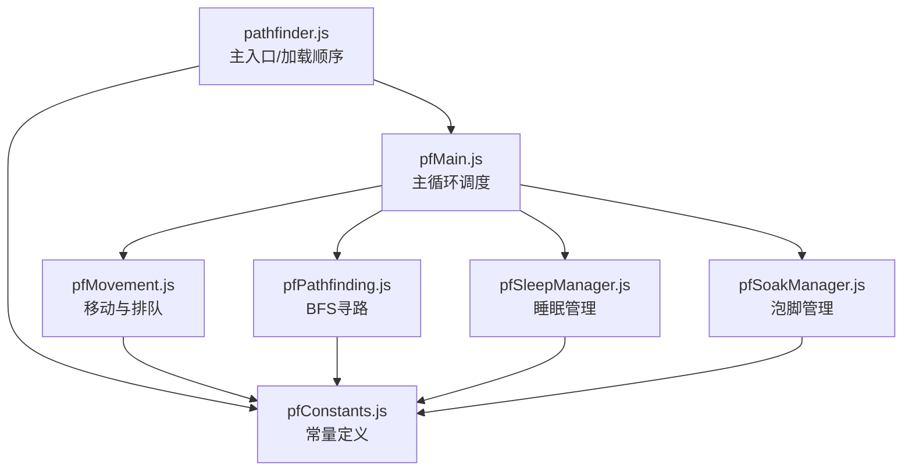
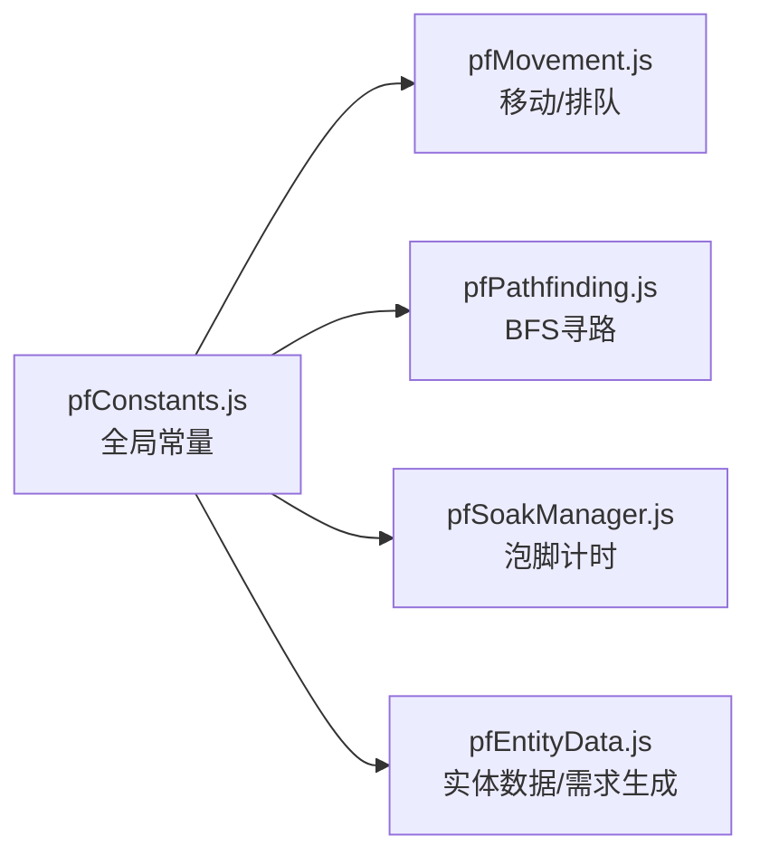
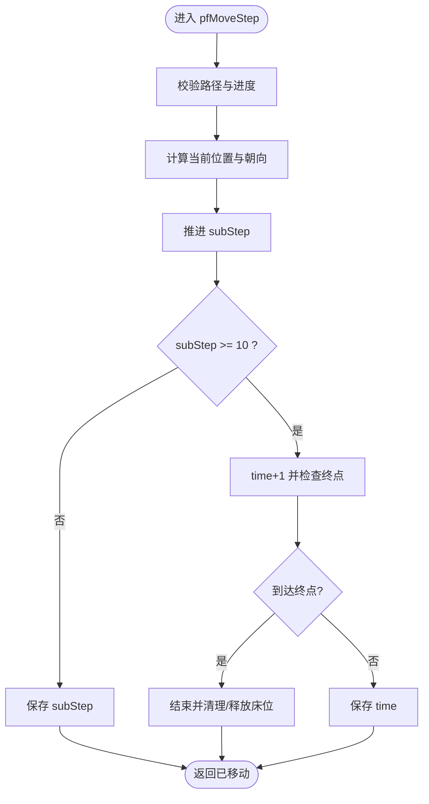
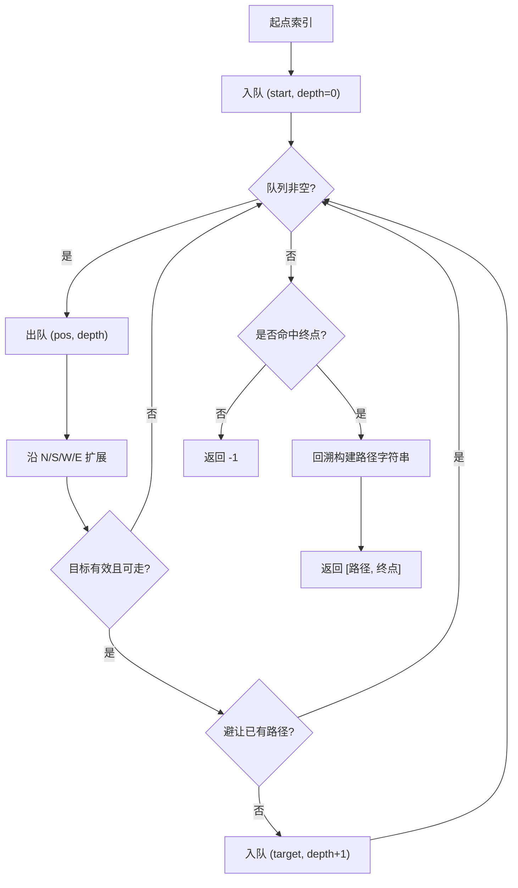
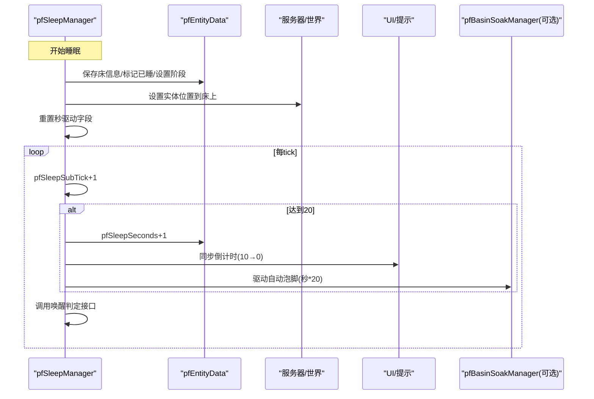
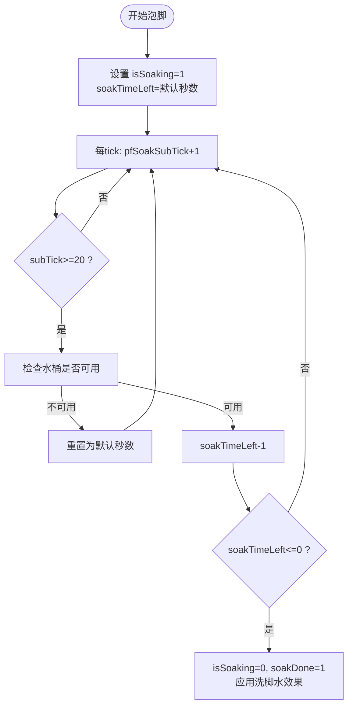
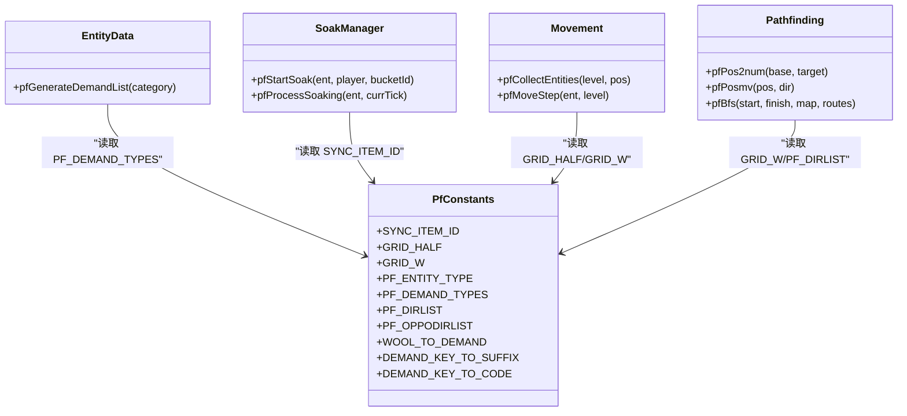
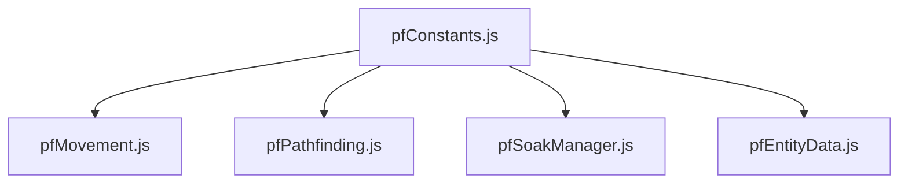

# 常量配置

<cite>
**本文引用的文件**   
- [pfConstants.js](file://kubejs/server_scripts/pathfinder/pfConstants.js)
- [pathfinder.js](file://kubejs/server_scripts/pathfinder/pathfinder.js)
- [pfMovement.js](file://kubejs/server_scripts/pathfinder/pfMovement.js)
- [pfPathfinding.js](file://kubejs/server_scripts/pathfinder/pfPathfinding.js)
- [pfSleepManager.js](file://kubejs/server_scripts/pathfinder/pfSleepManager.js)
- [pfSoakManager.js](file://kubejs/server_scripts/pathfinder/pfSoakManager.js)
- [pfEntityData.js](file://kubejs/server_scripts/pathfinder/pfEntityData.js)
</cite>

## 目录
1. [简介](#简介)
2. [项目结构](#项目结构)
3. [核心组件](#核心组件)
4. [架构总览](#架构总览)
5. [详细组件分析](#详细组件分析)
6. [依赖关系分析](#依赖关系分析)
7. [性能与扩展性](#性能与扩展性)
8. [故障排查](#故障排查)
9. [结论](#结论)
10. [附录：安全修改与回滚指南](#附录安全修改与回滚指南)

## 简介
本文件聚焦于 pfConstants 模块及其在 pathfinder（寻路与服务流程）系统中的角色，系统性解释系统常量、配置参数的作用范围、取值范围与影响效果。文档同时覆盖移动速度、睡眠时间、泡脚时长等关键数值的行为机制，并提供安全的参数修改方法、动态调整思路、验证策略与回滚方案。

pfConstants 是 pathfinder 子系统的“单一事实来源”，集中定义网格尺寸、实体类型、需求部位映射、方向列表等基础常量，并被移动、寻路、睡眠、泡脚等多个模块读取使用。理解这些常量，有助于在不破坏系统行为的前提下进行调参与扩展。

## 项目结构
pathfinder 子系统采用模块化组织，pfConstants 作为基础常量层被上层模块依赖。主入口 pathfinder.js 负责加载顺序与网络事件初始化；pfMain.js 提供主循环；其他模块分别承担移动、寻路、睡眠、泡脚等功能。

图示来源
- [pathfinder.js:1-30](file://kubejs/server_scripts/pathfinder/pathfinder.js#L1-L30)
- [pfConstants.js:1-69](file://kubejs/server_scripts/pathfinder/pfConstants.js#L1-L69)

章节来源
- [pathfinder.js:1-30](file://kubejs/server_scripts/pathfinder/pathfinder.js#L1-L30)
- [pfConstants.js:1-69](file://kubejs/server_scripts/pathfinder/pfConstants.js#L1-L69)

## 核心组件
本节梳理 pfConstants 中定义的常量及其在各模块中的使用方式，并说明其作用范围与影响面。

- 同步物品 ID（SYNC_ITEM_ID）
  - 作用：用于服务端与客户端之间同步泡脚状态的手持物品标识。
  - 使用位置：泡脚模块通过该 ID 判断是否可读写 NBT 状态。
  - 影响：若更改，需确保所有相关脚本与资源一致，否则无法正确同步泡脚进度。

- 网格参数（GRID_HALF, GRID_W）
  - 含义：以方块为中心向四周延伸的半宽 GRID_HALF，网格宽度 GRID_W = GRID_HALF * 2 + 1。
  - 使用位置：移动模块搜索范围、寻路模块坐标转换与边界计算。
  - 影响：增大将扩大寻路与碰撞检测范围，提升计算量；减小可能限制路径规划能力。

- 可生成实体类型（PF_ENTITY_TYPE）
  - 含义：系统生成的顾客实体类型。
  - 使用位置：实体生成与数据绑定逻辑。
  - 影响：更换为不兼容的实体类型可能导致行为异常或渲染问题。

- 需求部位（PF_DEMAND_TYPES）
  - 含义：脚掌、脚后跟、脚趾、脚心四个部位。
  - 使用位置：需求生成、NBT 键名、UI 显示、效果应用。
  - 影响：增减部位会联动多处映射表与 UI 文案，需谨慎维护一致性。

- 方向列表（PF_DIRLIST, PF_OPPODIRLIST）
  - 含义：北南西东四方向与其反向序列。
  - 使用位置：寻路 BFS 扩展方向、路径字符串编码。
  - 影响：顺序决定路径字符集与回溯方向，不应随意改动。

- 羊毛/手物品到需求部位的映射（WOOL_TO_DEMAND）
  - 含义：不同羊毛颜色与自定义手工具对应到具体需求部位。
  - 使用位置：交互判定、部位选择。
  - 影响：新增物品需在此补充映射，否则无法识别。

- 需求键值到后缀/代码的映射（DEMAND_KEY_TO_SUFFIX, DEMAND_KEY_TO_CODE）
  - 含义：部位键值到 NBT 后缀与整型代码的映射。
  - 使用位置：持久化存储、网络同步、UI 展示。
  - 影响：修改需保持唯一性与顺序稳定，避免存档损坏或显示错乱。

章节来源
- [pfConstants.js:7-68](file://kubejs/server_scripts/pathfinder/pfConstants.js#L7-L68)
- [pfMovement.js:8-12](file://kubejs/server_scripts/pathfinder/pfMovement.js#L8-L12)
- [pfPathfinding.js:13-35](file://kubejs/server_scripts/pathfinder/pfPathfinding.js#L13-L35)
- [pfSoakManager.js:19-54](file://kubejs/server_scripts/pathfinder/pfSoakManager.js#L19-L54)
- [pfEntityData.js:11-25](file://kubejs/server_scripts/pathfinder/pfEntityData.js#L11-L25)

## 架构总览
pfConstants 作为常量中心，被多个子系统直接引用。下图展示常量在各模块中的引用关系。

图示来源
- [pfConstants.js:57-68](file://kubejs/server_scripts/pathfinder/pfConstants.js#L57-L68)
- [pfMovement.js:8-12](file://kubejs/server_scripts/pathfinder/pfMovement.js#L8-L12)
- [pfPathfinding.js:13-35](file://kubejs/server_scripts/pathfinder/pfPathfinding.js#L13-L35)
- [pfSoakManager.js:19-54](file://kubejs/server_scripts/pathfinder/pfSoakManager.js#L19-L54)
- [pfEntityData.js:11-25](file://kubejs/server_scripts/pathfinder/pfEntityData.js#L11-L25)

## 详细组件分析

### 移动速度与时间步进
- 移动步进粒度
  - 每个格子分为 10 个子步（subStep 0~9），每 tick 推进一个 subStep。
  - 当 subStep 达到 10 时，time+1，移动到下一格。
  - 这意味着“每秒”约推进 20/10=2 个格子（假设 1 秒=20 tick）。
- 移动速度可调点
  - 当前未暴露显式速度常量；可通过改变 subStep 步进逻辑或外部调度频率间接影响。
  - 建议：如需统一速度控制，可在 pfMoveStep 中引入速度系数，或在主循环中按帧率缩放 time/subStep 增量。

图示来源
- [pfMovement.js:102-190](file://kubejs/server_scripts/pathfinder/pfMovement.js#L102-L190)

章节来源
- [pfMovement.js:102-190](file://kubejs/server_scripts/pathfinder/pfMovement.js#L102-L190)

### 寻路算法与网格
- 网格尺寸
  - GRID_HALF 决定以触发方块为中心的搜索半径；GRID_W 为网格宽度。
  - 坐标转数字索引与边界移动均依赖 GRID_W。
- 寻路避让
  - BFS 过程中会避开已有路径的相邻节点，减少交叉与拥堵。
- 方向与路径编码
  - 使用 PF_DIRLIST 的方向字符（N/S/W/E）编码路径，PF_OPPODIRLIST 用于回溯。

图示来源
- [pfPathfinding.js:46-83](file://kubejs/server_scripts/pathfinder/pfPathfinding.js#L46-L83)
- [pfPathfinding.js:13-35](file://kubejs/server_scripts/pathfinder/pfPathfinding.js#L13-L35)
- [pfConstants.js:20-22](file://kubejs/server_scripts/pathfinder/pfConstants.js#L20-L22)

章节来源
- [pfPathfinding.js:13-83](file://kubejs/server_scripts/pathfinder/pfPathfinding.js#L13-L83)
- [pfConstants.js:10-22](file://kubejs/server_scripts/pathfinder/pfConstants.js#L10-L22)

### 睡眠管理与倒计时
- 时间驱动模型
  - 使用独立计数器 pfSleepSubTick（0~19）每 tick+1，达到 20 触发一次“秒事件”。
  - pfSleepSeconds 累计秒数，用于 UI 倒计时与自动泡脚驱动。
- 初始姿势设置
  - 前 60 tick 内写入 SleepingX/Y/Z 并设置朝向，保证躺姿与床朝向一致。
- 起床逻辑
  - 清除睡眠相关 NBT，恢复行走阶段，并根据下床位置更新路径进度。

图示来源
- [pfSleepManager.js:16-61](file://kubejs/server_scripts/pathfinder/pfSleepManager.js#L16-L61)
- [pfSleepManager.js:63-128](file://kubejs/server_scripts/pathfinder/pfSleepManager.js#L63-L128)
- [pfSleepManager.js:130-233](file://kubejs/server_scripts/pathfinder/pfSleepManager.js#L130-L233)

章节来源
- [pfSleepManager.js:16-233](file://kubejs/server_scripts/pathfinder/pfSleepManager.js#L16-L233)

### 泡脚管理与默认时长
- 默认泡脚时长
  - PF_SOAK_DEFAULT_SECONDS 为默认泡脚倒计时（秒），无可用洗脚水时会重置为该值。
- 状态同步
  - 通过手持物品 NBT 同步 isSoaking、soakDone、soakTimeLeft 与 waterType。
- 计时机制
  - 使用 pfSoakSubTick（0~19）每 tick+1，达到 20 触发一次“秒事件”，对剩余秒数递减或重置。
- 洗脚水可用性
  - minecraft:water_bucket 始终可用；其它桶需在 soakWaterRegister 中注册。

图示来源
- [pfSoakManager.js:16-18](file://kubejs/server_scripts/pathfinder/pfSoakManager.js#L16-L18)
- [pfSoakManager.js:90-145](file://kubejs/server_scripts/pathfinder/pfSoakManager.js#L90-L145)
- [pfSoakManager.js:147-186](file://kubejs/server_scripts/pathfinder/pfSoakManager.js#L147-L186)

章节来源
- [pfSoakManager.js:16-186](file://kubejs/server_scripts/pathfinder/pfSoakManager.js#L16-L186)

### 需求部位与映射
- 部位集合
  - PF_DEMAND_TYPES 固定为四个部位，影响需求生成、NBT 键名与 UI 展示。
- 映射表
  - WOOL_TO_DEMAND 将羊毛/手工具映射到部位键值。
  - DEMAND_KEY_TO_SUFFIX/DEMAND_KEY_TO_CODE 提供 NBT 后缀与整型代码。
- 随机需求生成
  - 根据种族配置或默认范围随机生成各部位需求次数。

图示来源
- [pfConstants.js:7-68](file://kubejs/server_scripts/pathfinder/pfConstants.js#L7-L68)
- [pfEntityData.js:11-25](file://kubejs/server_scripts/pathfinder/pfEntityData.js#L11-L25)
- [pfSoakManager.js:19-54](file://kubejs/server_scripts/pathfinder/pfSoakManager.js#L19-L54)
- [pfMovement.js:8-12](file://kubejs/server_scripts/pathfinder/pfMovement.js#L8-L12)
- [pfPathfinding.js:13-35](file://kubejs/server_scripts/pathfinder/pfPathfinding.js#L13-L35)

章节来源
- [pfConstants.js:7-68](file://kubejs/server_scripts/pathfinder/pfConstants.js#L7-L68)
- [pfEntityData.js:11-25](file://kubejs/server_scripts/pathfinder/pfEntityData.js#L11-L25)
- [pfSoakManager.js:19-54](file://kubejs/server_scripts/pathfinder/pfSoakManager.js#L19-L54)
- [pfMovement.js:8-12](file://kubejs/server_scripts/pathfinder/pfMovement.js#L8-L12)
- [pfPathfinding.js:13-35](file://kubejs/server_scripts/pathfinder/pfPathfinding.js#L13-L35)

## 依赖关系分析
- 耦合度
  - pfConstants 被多个模块直接依赖，属于低内聚但高复用的基础层。
- 直接依赖
  - pfMovement 依赖 GRID_HALF/GRID_W 控制搜索范围与移动。
  - pfPathfinding 依赖 GRID_W 与 PF_DIRLIST 进行坐标变换与方向扩展。
  - pfSoakManager 依赖 SYNC_ITEM_ID 进行状态同步。
  - pfEntityData 依赖 PF_DEMAND_TYPES 生成需求。
- 潜在风险
  - 修改 pfConstants 会影响多模块，需进行回归测试。
  - 新增部位或物品需同步更新所有映射表。

图示来源
- [pfConstants.js:57-68](file://kubejs/server_scripts/pathfinder/pfConstants.js#L57-L68)
- [pfMovement.js:8-12](file://kubejs/server_scripts/pathfinder/pfMovement.js#L8-L12)
- [pfPathfinding.js:13-35](file://kubejs/server_scripts/pathfinder/pfPathfinding.js#L13-L35)
- [pfSoakManager.js:19-54](file://kubejs/server_scripts/pathfinder/pfSoakManager.js#L19-L54)
- [pfEntityData.js:11-25](file://kubejs/server_scripts/pathfinder/pfEntityData.js#L11-L25)

章节来源
- [pfConstants.js:57-68](file://kubejs/server_scripts/pathfinder/pfConstants.js#L57-L68)
- [pfMovement.js:8-12](file://kubejs/server_scripts/pathfinder/pfMovement.js#L8-L12)
- [pfPathfinding.js:13-35](file://kubejs/server_scripts/pathfinder/pfPathfinding.js#L13-L35)
- [pfSoakManager.js:19-54](file://kubejs/server_scripts/pathfinder/pfSoakManager.js#L19-L54)
- [pfEntityData.js:11-25](file://kubejs/server_scripts/pathfinder/pfEntityData.js#L11-L25)

## 性能与扩展性
- 网格规模
  - 增大 GRID_HALF 会显著增加 BFS 的节点数量与内存占用，建议在复杂地图中适度缩小或优化避障逻辑。
- 移动步进
  - 当前 subStep 粒度固定为 10，如需平滑移动可考虑插值或提高步进精度，但会增加每 tick 的计算量。
- 泡脚与睡眠计时
  - 基于 tick 计数器的秒事件设计避免了跨重启失效，开销较低；注意避免频繁 NBT 写入。
- 可扩展点
  - 新增部位：需更新 PF_DEMAND_TYPES 及所有映射表。
  - 新增洗脚水：需在 soakWaterRegister 中注册，并在泡模块中处理名称与效果。
  - 新增物品映射：在 WOOL_TO_DEMAND 中添加条目。

[本节为通用性能讨论，不直接分析具体文件]

## 故障排查
- 泡脚状态不同步
  - 检查手持物品是否为 SYNC_ITEM_ID，NBT 字段是否存在。
  - 确认 soakWaterRegister 是否正确注册了所用桶。
- 寻路失败或卡顿
  - 检查 GRID_HALF 是否过大导致 BFS 耗时过长。
  - 检查地图障碍物与已有路径是否造成死锁。
- 睡眠倒计时异常
  - 检查 pfSleepSubTick 与 pfSleepSeconds 是否被意外清零。
  - 确认床旁红色地毯定位逻辑是否生效（从排队区等待后下床）。

章节来源
- [pfSoakManager.js:19-54](file://kubejs/server_scripts/pathfinder/pfSoakManager.js#L19-L54)
- [pfPathfinding.js:46-83](file://kubejs/server_scripts/pathfinder/pfPathfinding.js#L46-L83)
- [pfSleepManager.js:130-233](file://kubejs/server_scripts/pathfinder/pfSleepManager.js#L130-L233)

## 结论
pfConstants 为 pathfinder 子系统提供了稳定的基础常量，涵盖网格、方向、实体类型、需求部位与物品映射等关键配置。移动、寻路、睡眠、泡脚等模块均围绕这些常量工作。为保证系统稳定性，任何常量的修改都应遵循严格的验证与回滚策略，并评估其对性能与功能的影响。

[本节为总结性内容，不直接分析具体文件]

## 附录：安全修改与回滚指南

### 参数修改清单与建议
- 移动速度
  - 现状：未暴露显式速度常量，由 subStep 步进与 tick 驱动决定。
  - 建议：在 pfMoveStep 中引入速度系数，或在主循环中按帧率缩放增量；先在小范围地图测试。
  - 验证：观察实体移动平滑度与 CPU 占用，避免过高的步进频率。

- 网格尺寸（GRID_HALF, GRID_W）
  - 现状：GRID_W 由 GRID_HALF 推导。
  - 建议：逐步调整 GRID_HALF，记录 BFS 耗时与内存峰值。
  - 验证：在复杂地形中运行寻路，检查是否出现路径断裂或性能下降。

- 泡脚时长（PF_SOAK_DEFAULT_SECONDS）
  - 现状：默认 10 秒，无可用洗脚水时重置为该值。
  - 建议：根据玩法节奏调整，注意与 UI 倒计时保持一致。
  - 验证：模拟多种洗脚水场景，确认倒计时与完成状态正确。

- 需求部位（PF_DEMAND_TYPES）
  - 现状：固定四个部位。
  - 建议：如需扩展，新增部位并同步更新所有映射表与 UI。
  - 验证：生成随机需求，检查 NBT 键名与代码映射是否一致。

### 动态调整机制
- 运行时读取
  - 多数常量在模块加载时确定，运行时动态修改需谨慎，避免部分模块已缓存旧值。
- 推荐做法
  - 在启动脚本中集中配置，并通过全局对象注入；或在模块内部提供 setter 函数，统一刷新依赖方。

### 参数验证方法
- 范围校验
  - GRID_HALF > 0，GRID_W = GRID_HALF * 2 + 1。
  - PF_SOAK_DEFAULT_SECONDS > 0。
  - PF_DEMAND_TYPES 长度与映射表长度一致。
- 存在性校验
  - SYNC_ITEM_ID 对应的物品存在且可持有。
  - 洗脚水桶在 soakWaterRegister 中存在。
- 一致性校验
  - DEMAND_KEY_TO_SUFFIX 与 DEMAND_KEY_TO_CODE 一一对应。
  - WOOL_TO_DEMAND 中所有键均为合法物品 ID。

### 回滚策略
- 版本快照
  - 修改前备份 pfConstants.js 及相关映射表。
- 热切换
  - 提供开关变量，允许在运行时切换新旧配置，便于快速回滚。
- 数据修复
  - 若 NBT 键名变更，提供迁移脚本将旧数据转换为新格式。
- 日志与告警
  - 在关键路径输出调试日志，便于定位回滚原因。

[本节为通用指导，不直接分析具体文件]