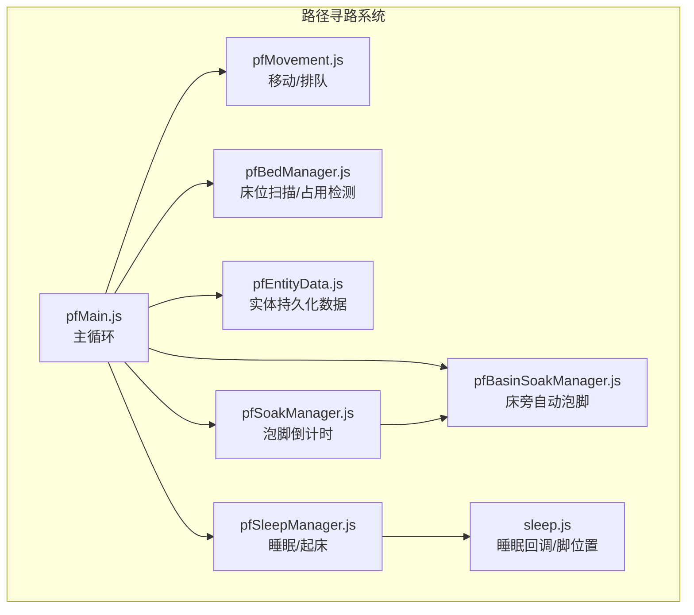
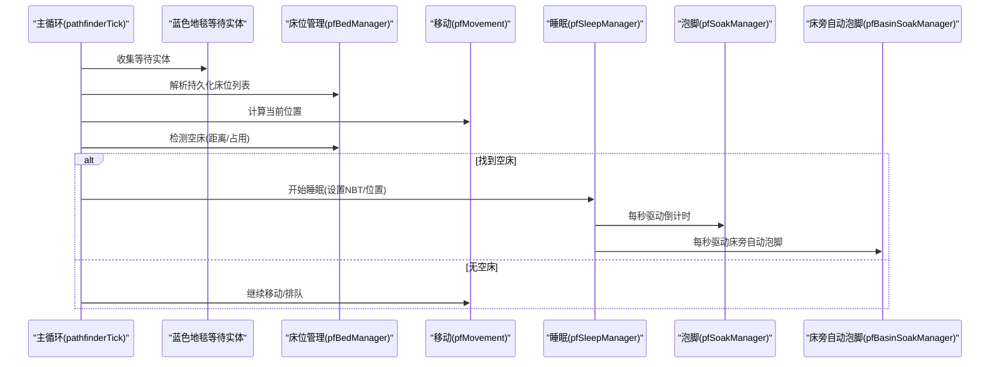
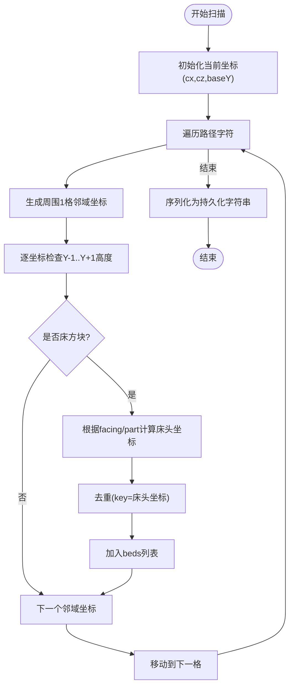
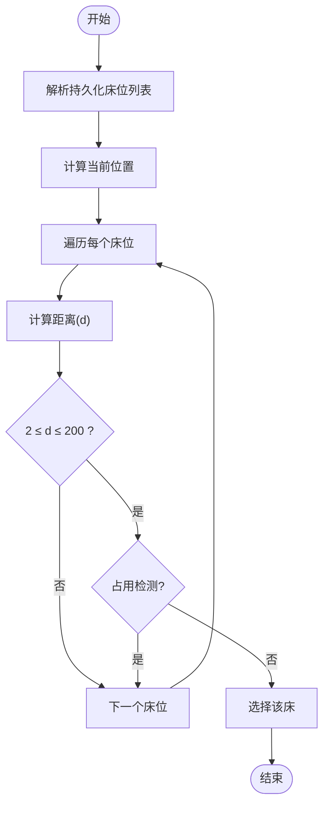
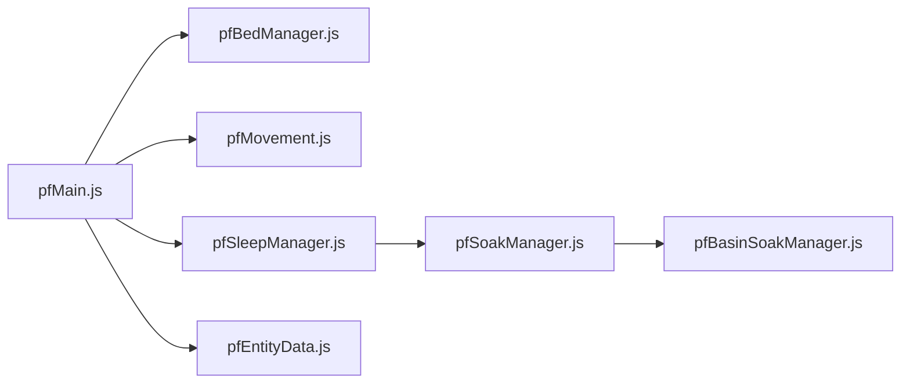

# 床位管理

<cite>
**本文引用的文件**
- [pfBedManager.js](file://kubejs/server_scripts/pathfinder/pfBedManager.js)
- [pfEntityData.js](file://kubejs/server_scripts/pathfinder/pfEntityData.js)
- [pfMain.js](file://kubejs/server_scripts/pathfinder/pfMain.js)
- [pfMovement.js](file://kubejs/server_scripts/pathfinder/pfMovement.js)
- [pfSleepManager.js](file://kubejs/server_scripts/pathfinder/pfSleepManager.js)
- [pfSoakManager.js](file://kubejs/server_scripts/pathfinder/pfSoakManager.js)
- [pfBasinSoakManager.js](file://kubejs/server_scripts/pathfinder/pfBasinSoakManager.js)
- [sleep.js](file://kubejs/server_scripts/sleep.js)
</cite>

## 目录
1. [简介](#简介)
2. [项目结构](#项目结构)
3. [核心组件](#核心组件)
4. [架构总览](#架构总览)
5. [详细组件分析](#详细组件分析)
6. [依赖关系分析](#依赖关系分析)
7. [性能考量](#性能考量)
8. [故障排查指南](#故障排查指南)
9. [结论](#结论)
10. [附录](#附录)

## 简介
本文档聚焦于路径寻路系统中的床位管理模块（pfBedManager），系统性阐述其床位分配与占用管理机制，包括：
- 床位列表解析与序列化
- 空床查找算法与距离检测
- 床位占用状态检查
- 床位数据存储格式与位置计算
- 与实体移动、睡眠、泡脚等子系统的协调机制
- 床位分配策略与冲突解决方法
- 扩展床位功能的方法（新增床位类型与自定义分配规则）

## 项目结构
床位管理模块位于路径寻路子系统中，主要涉及以下文件：
- pfBedManager.js：床位扫描、序列化、占用检测
- pfEntityData.js：实体持久化数据封装（含床位信息）
- pfMain.js：主循环，协调蓝色地毯等待、睡眠、移动等阶段
- pfMovement.js：实体移动与排队
- pfSleepManager.js：睡眠/起床流程
- pfSoakManager.js：泡脚倒计时与状态
- pfBasinSoakManager.js：床旁工作盆自动泡脚
- sleep.js：睡眠回调与脚位置计算

图表来源
- [pfMain.js:11-177](file://kubejs/server_scripts/pathfinder/pfMain.js#L11-L177)
- [pfMovement.js:1-186](file://kubejs/server_scripts/pathfinder/pfMovement.js#L1-L186)
- [pfBedManager.js:10-128](file://kubejs/server_scripts/pathfinder/pfBedManager.js#L10-L128)
- [pfEntityData.js:67-82](file://kubejs/server_scripts/pathfinder/pfEntityData.js#L67-L82)
- [pfSleepManager.js:24-61](file://kubejs/server_scripts/pathfinder/pfSleepManager.js#L24-L61)
- [pfSoakManager.js:92-145](file://kubejs/server_scripts/pathfinder/pfSoakManager.js#L92-L145)
- [pfBasinSoakManager.js:329-408](file://kubejs/server_scripts/pathfinder/pfBasinSoakManager.js#L329-L408)
- [sleep.js:57-66](file://kubejs/server_scripts/sleep.js#L57-L66)

章节来源
- [pfMain.js:11-177](file://kubejs/server_scripts/pathfinder/pfMain.js#L11-L177)
- [pfBedManager.js:10-128](file://kubejs/server_scripts/pathfinder/pfBedManager.js#L10-L128)
- [pfEntityData.js:67-82](file://kubejs/server_scripts/pathfinder/pfEntityData.js#L67-L82)

## 核心组件
- 床位扫描与解析
  - 沿路径扫描每一格周边的床，去重并计算床头坐标与朝向，序列化/反序列化为持久化数据
- 占用检测
  - 基于床周围范围与实体pfPhase判断，检测是否已有睡眠中的实体
- 分配与协调
  - 蓝色地毯等待阶段：在路径后方范围内寻找空床，满足距离与占用条件后进入睡眠
  - 睡眠阶段：按秒驱动，支持床旁自动泡脚与自定义起床条件
  - 起床阶段：根据来源与床旁红毯定位下床位置，恢复行走

章节来源
- [pfBedManager.js:10-128](file://kubejs/server_scripts/pathfinder/pfBedManager.js#L10-L128)
- [pfMain.js:52-92](file://kubejs/server_scripts/pathfinder/pfMain.js#L52-L92)
- [pfSleepManager.js:65-128](file://kubejs/server_scripts/pathfinder/pfSleepManager.js#L65-L128)

## 架构总览
床位管理贯穿“等待→移动→分配→睡眠→起床”的完整流程，关键交互如下：
- 主循环在每个tick收集实体并按阶段分类
- 蓝色地毯等待阶段：解析持久化床位列表，计算当前位置，按距离与占用筛选空床
- 占用检测：以床为中心的立方体范围内检查pfPhase=3的实体
- 睡眠阶段：设置睡眠NBT、按秒驱动倒计时，支持床旁自动泡脚
- 起床阶段：查找床旁红毯或回退到睡眠前位置，更新路径进度

图表来源
- [pfMain.js:30-92](file://kubejs/server_scripts/pathfinder/pfMain.js#L30-L92)
- [pfBedManager.js:92-120](file://kubejs/server_scripts/pathfinder/pfBedManager.js#L92-L120)
- [pfMovement.js:82-162](file://kubejs/server_scripts/pathfinder/pfMovement.js#L82-L162)
- [pfSleepManager.js:65-128](file://kubejs/server_scripts/pathfinder/pfSleepManager.js#L65-L128)
- [pfSoakManager.js:92-145](file://kubejs/server_scripts/pathfinder/pfSoakManager.js#L92-L145)
- [pfBasinSoakManager.js:329-408](file://kubejs/server_scripts/pathfinder/pfBasinSoakManager.js#L329-L408)

## 详细组件分析

### 床位扫描与解析
- 扫描策略
  - 沿路径每一格，检查周围1格范围内的三高度层（Y-1,Y,Y+1），识别床方块
  - 通过属性facing与part区分床头方向，计算床头坐标
  - 使用集合去重，避免重复记录同一张床
- 数据结构
  - 床位对象包含blockX/blockY/blockZ/yaw，并派生出中心点x/z用于距离计算
- 序列化/反序列化
  - 以分号分隔的多条记录，每条逗号分隔的字段为blockX,blockY,blockZ,yaw
  - 反序列化时补全x/z为床中心点

图表来源
- [pfBedManager.js:10-77](file://kubejs/server_scripts/pathfinder/pfBedManager.js#L10-L77)
- [pfBedManager.js:81-107](file://kubejs/server_scripts/pathfinder/pfBedManager.js#L81-L107)

章节来源
- [pfBedManager.js:10-77](file://kubejs/server_scripts/pathfinder/pfBedManager.js#L10-L77)
- [pfBedManager.js:81-107](file://kubejs/server_scripts/pathfinder/pfBedManager.js#L81-L107)

### 占用状态检查与空床查找
- 占用检测
  - 以床坐标为中心构建1×1×1的立方体区域，查询区域内实体
  - 排除自身实体，若发现pfPhase=3的实体则判定为占用
- 空床查找
  - 从持久化床位列表中按顺序遍历
  - 计算床中心点与当前位置的距离，要求距离在[2,200]范围内
  - 通过占用检测确认空闲后，选择该床进行睡眠

图表来源
- [pfMain.js:52-68](file://kubejs/server_scripts/pathfinder/pfMain.js#L52-L68)
- [pfBedManager.js:110-120](file://kubejs/server_scripts/pathfinder/pfBedManager.js#L110-L120)

章节来源
- [pfMain.js:52-68](file://kubejs/server_scripts/pathfinder/pfMain.js#L52-L68)
- [pfBedManager.js:110-120](file://kubejs/server_scripts/pathfinder/pfBedManager.js#L110-L120)

### 床位数据存储格式与位置计算
- 存储格式
  - 持久化字符串：多条记录，分号分隔；每条记录逗号分隔：blockX,blockY,blockZ,yaw
  - 读取时补全x=z=床中心点（blockX+0.5, blockZ+0.5）
- 位置计算
  - 床头坐标：依据facing与part推导
  - 朝向yaw：北=180°，南=0°，西=90°，东=-90°
  - 脚位置：与头朝向相反方向前进一格，结合中心点偏移

章节来源
- [pfBedManager.js:81-107](file://kubejs/server_scripts/pathfinder/pfBedManager.js#L81-L107)
- [sleep.js:23-46](file://kubejs/server_scripts/sleep.js#L23-L46)

### 与实体移动的协调机制
- 蓝色地毯等待
  - 到达蓝色地毯后，实体进入等待状态（pfPhase=5），记录等待位置
  - 主循环每tick检查是否可分配空床，满足条件后进入睡眠
- 排队与移动
  - 行走阶段按进度与相对位置进行排队判定，避免拥堵
  - 移动采用子步插值，每10个子步推进一格

章节来源
- [pfMain.js:155-172](file://kubejs/server_scripts/pathfinder/pfMain.js#L155-L172)
- [pfMovement.js:55-79](file://kubejs/server_scripts/pathfinder/pfMovement.js#L55-L79)
- [pfMovement.js:101-162](file://kubejs/server_scripts/pathfinder/pfMovement.js#L101-L162)

### 床位分配策略与冲突解决
- 分配策略
  - 优先选择路径后方、距离适中且未被占用的床
  - 以床中心点距离当前位置为排序依据，按顺序尝试
- 冲突解决
  - 占用检测排除同床中的pfPhase=3实体
  - 距离阈值限制（≥2且≤200）避免远距离误选
  - 若无空床，实体回到移动阶段继续排队

章节来源
- [pfMain.js:57-68](file://kubejs/server_scripts/pathfinder/pfMain.js#L57-L68)
- [pfBedManager.js:110-120](file://kubejs/server_scripts/pathfinder/pfBedManager.js#L110-L120)

### 睡眠与起床流程
- 开始睡眠
  - 保存睡眠前位置与开始tick，设置pfPhase=3，写入床信息
  - 重置睡眠秒驱动字段，设置实体位置到床中心
- 睡眠过程
  - 每秒驱动倒计时，同步倒计时UI
  - 床旁自动泡脚：每秒检查Basin流体，合法则开启自动倒计时
- 起床
  - 若来自蓝色地毯等待，优先查找床旁红毯作为下床位置
  - 否则回退到睡眠前位置，更新路径进度并恢复行走

章节来源
- [pfSleepManager.js:24-61](file://kubejs/server_scripts/pathfinder/pfSleepManager.js#L24-L61)
- [pfSleepManager.js:65-128](file://kubejs/server_scripts/pathfinder/pfSleepManager.js#L65-L128)
- [pfSleepManager.js:131-223](file://kubejs/server_scripts/pathfinder/pfSleepManager.js#L131-L223)
- [pfBasinSoakManager.js:329-408](file://kubejs/server_scripts/pathfinder/pfBasinSoakManager.js#L329-L408)

### 扩展床位功能的方法
- 新增床位类型支持
  - 通过床方块属性facing与part自动识别床头方向，支持标准床类型
  - 若存在自定义床方块，需确保其facing与part属性可被正确读取
- 自定义分配规则
  - 修改空床查找逻辑：调整距离阈值、权重因子或引入优先级
  - 扩展占用检测：增加更多pfPhase或NBT字段的判断
- 与床旁自动泡脚联动
  - 通过Basin位置计算与流体检测，实现床旁自动泡脚
  - 可扩展为支持多种床型或床旁设备

章节来源
- [pfBedManager.js:38-64](file://kubejs/server_scripts/pathfinder/pfBedManager.js#L38-L64)
- [pfBasinSoakManager.js:47-66](file://kubejs/server_scripts/pathfinder/pfBasinSoakManager.js#L47-L66)
- [pfBasinSoakManager.js:329-408](file://kubejs/server_scripts/pathfinder/pfBasinSoakManager.js#L329-L408)

## 依赖关系分析
- 模块间依赖
  - pfMain依赖pfBedManager解析床位、pfMovement计算位置、pfSleepManager处理睡眠
  - pfSleepManager依赖pfSoakManager与pfBasinSoakManager实现床旁自动泡脚
  - pfEntityData提供持久化数据读写，承载床位信息与睡眠状态
- 外部接口
  - 通过全局对象导出函数，供其他模块调用
  - 与Create Basin的流体能力交互，支持自动泡脚

图表来源
- [pfMain.js:11-177](file://kubejs/server_scripts/pathfinder/pfMain.js#L11-L177)
- [pfBedManager.js:123-128](file://kubejs/server_scripts/pathfinder/pfBedManager.js#L123-L128)
- [pfMovement.js:178-185](file://kubejs/server_scripts/pathfinder/pfMovement.js#L178-L185)
- [pfSleepManager.js:226-231](file://kubejs/server_scripts/pathfinder/pfSleepManager.js#L226-L231)
- [pfSoakManager.js:189-196](file://kubejs/server_scripts/pathfinder/pfSoakManager.js#L189-L196)
- [pfBasinSoakManager.js:410-417](file://kubejs/server_scripts/pathfinder/pfBasinSoakManager.js#L410-L417)
- [pfEntityData.js:185-217](file://kubejs/server_scripts/pathfinder/pfEntityData.js#L185-L217)

章节来源
- [pfMain.js:11-177](file://kubejs/server_scripts/pathfinder/pfMain.js#L11-L177)
- [pfBedManager.js:123-128](file://kubejs/server_scripts/pathfinder/pfBedManager.js#L123-L128)
- [pfMovement.js:178-185](file://kubejs/server_scripts/pathfinder/pfMovement.js#L178-L185)
- [pfSleepManager.js:226-231](file://kubejs/server_scripts/pathfinder/pfSleepManager.js#L226-L231)
- [pfSoakManager.js:189-196](file://kubejs/server_scripts/pathfinder/pfSoakManager.js#L189-L196)
- [pfBasinSoakManager.js:410-417](file://kubejs/server_scripts/pathfinder/pfBasinSoakManager.js#L410-L417)
- [pfEntityData.js:185-217](file://kubejs/server_scripts/pathfinder/pfEntityData.js#L185-L217)

## 性能考量
- 扫描复杂度
  - 沿路径扫描时对每个格子检查周围邻域与三高度层，整体复杂度与路径长度线性相关
- 查询优化
  - 占用检测使用AABB包围盒快速查询，建议保持查询半径合理以避免大范围扫描
- 并发与重复处理
  - 主循环中使用lastTick防重复处理，避免同一tick内多次分配或处理

[本节为通用性能讨论，不直接分析具体文件]

## 故障排查指南
- 床位未被识别
  - 检查床方块属性facing与part是否正确，确认扫描范围与高度层设置
- 占用检测异常
  - 确认实体pfPhase=3的设置与清理，避免残留状态导致误判
- 分配距离不合理
  - 调整距离阈值（≥2且≤200），确保路径后方优先
- 起床位置异常
  - 检查床旁红毯是否存在，否则回退到睡眠前位置

章节来源
- [pfBedManager.js:110-120](file://kubejs/server_scripts/pathfinder/pfBedManager.js#L110-L120)
- [pfMain.js:165-172](file://kubejs/server_scripts/pathfinder/pfMain.js#L165-L172)
- [pfSleepManager.js:150-177](file://kubejs/server_scripts/pathfinder/pfSleepManager.js#L150-L177)

## 结论
pfBedManager模块通过“扫描→解析→占用检测→分配→睡眠”的闭环流程，实现了路径寻路系统中的床位管理。其设计强调：
- 明确的数据结构与序列化格式
- 基于距离与占用的简单而有效的分配策略
- 与移动、睡眠、泡脚等模块的紧密协作
- 可扩展性：支持新床型与自定义分配规则

[本节为总结性内容，不直接分析具体文件]

## 附录
- 实体持久化数据
  - 床位信息：blockX, blockY, blockZ, yaw
  - 睡眠状态：睡眠开始tick、睡眠前位置、是否已上过床、来自蓝色地毯等待标记
- 睡眠回调
  - 开始睡眠回调：记录床头与脚位置
  - 起床条件：需求清单清零、满意度阈值等

章节来源
- [pfEntityData.js:67-82](file://kubejs/server_scripts/pathfinder/pfEntityData.js#L67-L82)
- [pfEntityData.js:108-122](file://kubejs/server_scripts/pathfinder/pfEntityData.js#L108-L122)
- [sleep.js:57-66](file://kubejs/server_scripts/sleep.js#L57-L66)
- [sleep.js:79-312](file://kubejs/server_scripts/sleep.js#L79-L312)