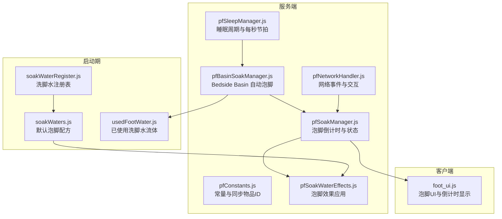
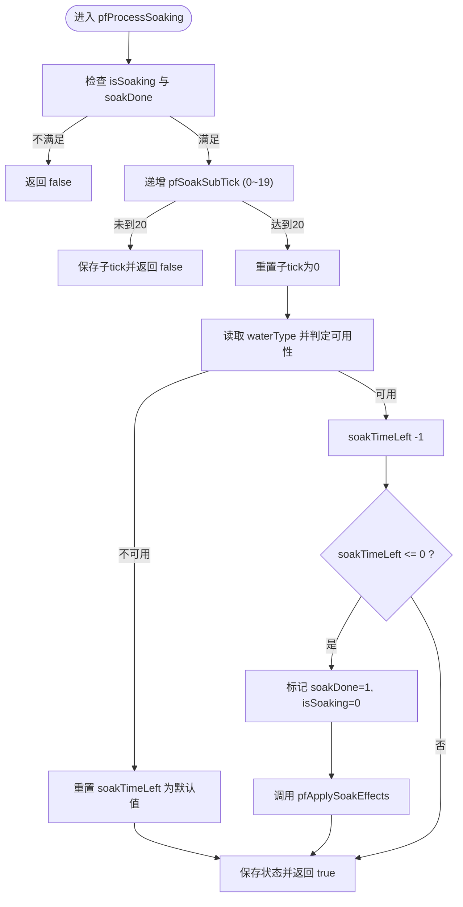
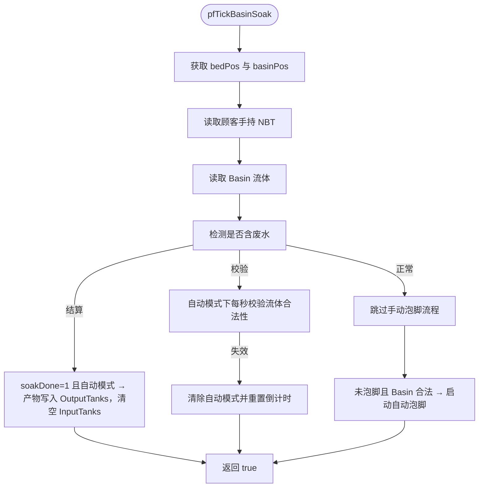
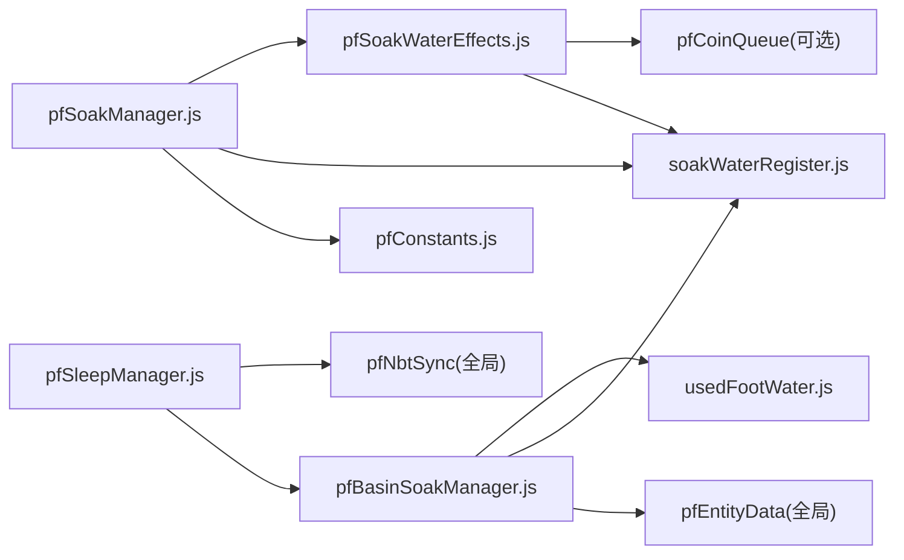

# 泡脚管理

<cite>
**本文引用的文件**   
- [pfSoakManager.js](file://kubejs/server_scripts/pathfinder/pfSoakManager.js)
- [pfBasinSoakManager.js](file://kubejs/server_scripts/pathfinder/pfBasinSoakManager.js)
- [pfSleepManager.js](file://kubejs/server_scripts/pathfinder/pfSleepManager.js)
- [pfSoakWaterEffects.js](file://kubejs/server_scripts/pathfinder/pfSoakWaterEffects.js)
- [pfConstants.js](file://kubejs/server_scripts/pathfinder/pfConstants.js)
- [soakWaterRegister.js](file://kubejs/startup_scripts/fluid/soakwater/soakWaterRegister.js)
- [soakWaters.js](file://kubejs/startup_scripts/fluid/soakwater/soakWaters.js)
- [usedFootWater.js](file://kubejs/startup_scripts/fluid/soakwater/usedFootWater.js)
- [pfNetworkHandler.js](file://kubejs/server_scripts/pathfinder/pfNetworkHandler.js)
- [foot_ui.js](file://kubejs/client_scripts/ui/foot_ui.js)
</cite>

## 目录
1. [引言](#引言)
2. [项目结构](#项目结构)
3. [核心组件](#核心组件)
4. [架构总览](#架构总览)
5. [详细组件分析](#详细组件分析)
6. [依赖关系分析](#依赖关系分析)
7. [性能与稳定性](#性能与稳定性)
8. [故障排查指南](#故障排查指南)
9. [扩展指南：新增泡脚配方与自定义效果](#扩展指南新增泡脚配方与自定义效果)
10. [结论](#结论)

## 引言
本模块围绕“泡脚”这一服务流程，提供两套驱动方式：
- 手动泡脚：玩家手持洗脚水桶右键顾客，触发倒计时、状态同步与效果结算。
- 自动泡脚：顾客在床上睡眠时，床旁 Create 工作盆（Basin）若存在足够量的已注册泡脚水，则自动启动泡脚倒计时，并在完成后将材料槽中的泡脚水转换为产物槽的“洗脚水”。

核心目标是：
- 明确 pfSoakManager 与 pfBasinSoakManager 的职责边界与协作方式。
- 解释泡脚倒计时、效果应用、状态同步策略。
- 说明与睡眠管理的协作机制、泡脚位置检测与效果范围控制。
- 给出扩展新泡脚配方与自定义效果的实践路径。

## 项目结构
泡脚相关代码主要分布在以下区域：
- 服务端逻辑：pathfinder 下的泡脚管理器、睡眠管理器、网络处理器、常量定义。
- 流体与配方：startup_scripts 下的洗脚水注册表、默认配方、已使用洗脚水流体。
- 客户端 UI：foot_ui.js 负责显示泡脚进度条与倒计时。

**图示来源**
- [pfSoakManager.js:1-197](file://kubejs/server_scripts/pathfinder/pfSoakManager.js#L1-L197)
- [pfBasinSoakManager.js:1-485](file://kubejs/server_scripts/pathfinder/pfBasinSoakManager.js#L1-L485)
- [pfSleepManager.js:1-313](file://kubejs/server_scripts/pathfinder/pfSleepManager.js#L1-L313)
- [pfSoakWaterEffects.js:1-233](file://kubejs/server_scripts/pathfinder/pfSoakWaterEffects.js#L1-L233)
- [pfConstants.js:1-69](file://kubejs/server_scripts/pathfinder/pfConstants.js#L1-L69)
- [soakWaterRegister.js:26-45](file://kubejs/startup_scripts/fluid/soakwater/soakWaterRegister.js#L26-L45)
- [soakWaters.js:1-61](file://kubejs/startup_scripts/fluid/soakwater/soakWaters.js#L1-L61)
- [usedFootWater.js:1-31](file://kubejs/startup_scripts/fluid/soakwater/usedFootWater.js#L1-L31)
- [pfNetworkHandler.js:260-287](file://kubejs/server_scripts/pathfinder/pfNetworkHandler.js#L260-L287)
- [foot_ui.js:407-439](file://kubejs/client_scripts/ui/foot_ui.js#L407-L439)

**章节来源**
- [pfSoakManager.js:1-197](file://kubejs/server_scripts/pathfinder/pfSoakManager.js#L1-L197)
- [pfBasinSoakManager.js:1-485](file://kubejs/server_scripts/pathfinder/pfBasinSoakManager.js#L1-L485)
- [pfSleepManager.js:1-313](file://kubejs/server_scripts/pathfinder/pfSleepManager.js#L1-L313)
- [pfSoakWaterEffects.js:1-233](file://kubejs/server_scripts/pathfinder/pfSoakWaterEffects.js#L1-L233)
- [pfConstants.js:1-69](file://kubejs/server_scripts/pathfinder/pfConstants.js#L1-L69)
- [soakWaterRegister.js:26-45](file://kubejs/startup_scripts/fluid/soakwater/soakWaterRegister.js#L26-L45)
- [soakWaters.js:1-61](file://kubejs/startup_scripts/fluid/soakwater/soakWaters.js#L1-L61)
- [usedFootWater.js:1-31](file://kubejs/startup_scripts/fluid/soakwater/usedFootWater.js#L1-L31)
- [pfNetworkHandler.js:260-287](file://kubejs/server_scripts/pathfinder/pfNetworkHandler.js#L260-L287)
- [foot_ui.js:407-439](file://kubejs/client_scripts/ui/foot_ui.js#L407-L439)

## 核心组件
- pfSoakManager：负责泡脚的通用倒计时、状态读写、洗脚水可用性判定、效果应用入口。
- pfBasinSoakManager：负责床旁 Basin 自动泡脚的启动、校验、结算；通过命令写入 Basin NBT 实现流体消耗与产物生成。
- pfSleepManager：负责睡眠生命周期，每秒回调中驱动 Basin 自动泡脚并同步倒计时 UI。
- pfSoakWaterEffects：在泡脚完成瞬间根据桶 id 查找水配置，应用需求增量、满意度、掉钱、皴加成、药水效果与自定义回调。
- soakWaterRegister / soakWaters：注册洗脚水元数据与默认配方，提供 getBucketId/getFluidId 等查询接口。
- usedFootWater：注册“已使用洗脚水”流体（普通与富魔），作为 Basin 产物标记。
- pfNetworkHandler：处理客户端点击泡脚的网络事件，校验手持桶并调用 pfStartSoak。
- foot_ui.js：客户端渲染泡脚进度条与倒计时文本，与服务端 NBT 同步。

**章节来源**
- [pfSoakManager.js:1-197](file://kubejs/server_scripts/pathfinder/pfSoakManager.js#L1-L197)
- [pfBasinSoakManager.js:1-485](file://kubejs/server_scripts/pathfinder/pfBasinSoakManager.js#L1-L485)
- [pfSleepManager.js:1-313](file://kubejs/server_scripts/pathfinder/pfSleepManager.js#L1-L313)
- [pfSoakWaterEffects.js:1-233](file://kubejs/server_scripts/pathfinder/pfSoakWaterEffects.js#L1-L233)
- [soakWaterRegister.js:26-45](file://kubejs/startup_scripts/fluid/soakwater/soakWaterRegister.js#L26-L45)
- [soakWaters.js:1-61](file://kubejs/startup_scripts/fluid/soakwater/soakWaters.js#L1-L61)
- [usedFootWater.js:1-31](file://kubejs/startup_scripts/fluid/soakwater/usedFootWater.js#L1-L31)
- [pfNetworkHandler.js:260-287](file://kubejs/server_scripts/pathfinder/pfNetworkHandler.js#L260-L287)
- [foot_ui.js:407-439](file://kubejs/client_scripts/ui/foot_ui.js#L407-L439)

## 架构总览
泡脚系统采用“服务端状态 + 客户端 UI”的分层设计：
- 服务端以实体手持纸（SYNC_ITEM_ID）NBT 字段承载泡脚状态，跨重启稳定。
- 计时器基于“秒”驱动，使用实体 persistentData 中的子 tick 计数器（0~19）累计到 20 触发一次秒事件。
- 手动泡脚由网络事件触发，自动泡脚由睡眠管理器每秒回调驱动。
- 效果应用在泡脚完成瞬间统一进入 pfSoakWaterEffects。

```mermaid
sequenceDiagram
participant Client as "客户端"
participant Net as "pfNetworkHandler.js"
participant Soak as "pfSoakManager.js"
participant Sleep as "pfSleepManager.js"
participant Basin as "pfBasinSoakManager.js"
participant Effects as "pfSoakWaterEffects.js"
Note over Client,Net : 手动泡脚
Client->>Net : 发送 foot_click_soak
Net->>Soak : pfStartSoak(ent, player, bucketId)
Soak-->>Client : 设置倒计时与状态
Note over Sleep,Basin : 自动泡脚
Sleep->>Basin : pfTickBasinSoak(ent, level, sleepDuration)
Basin->>Basin : 计算 Basin 位置/读取流体/校验废水
Basin->>Soak : 写入泡脚状态自动模式
Soak->>Effects : 倒计时结束应用效果
Note over Soak,Effects : 效果应用
Soak->>Effects : pfApplySoakEffects(ent, bucketId)
Effects-->>Soak : 更新需求/满意度/掉钱/皴加成/药水
```

**图示来源**
- [pfNetworkHandler.js:260-287](file://kubejs/server_scripts/pathfinder/pfNetworkHandler.js#L260-L287)
- [pfSoakManager.js:147-186](file://kubejs/server_scripts/pathfinder/pfSoakManager.js#L147-L186)
- [pfSleepManager.js:101-117](file://kubejs/server_scripts/pathfinder/pfSleepManager.js#L101-L117)
- [pfBasinSoakManager.js:381-475](file://kubejs/server_scripts/pathfinder/pfBasinSoakManager.js#L381-L475)
- [pfSoakWaterEffects.js:107-226](file://kubejs/server_scripts/pathfinder/pfSoakWaterEffects.js#L107-L226)

## 详细组件分析

### pfSoakManager：泡脚倒计时与状态管理
职责要点：
- 从手持物品 NBT 读取/写入泡脚状态：isSoaking、soakDone、soakTimeLeft、waterType。
- 判定洗脚水可用性：支持 minecraft:water_bucket 兜底，或 global.soakWaterRegister.getByBucketId。
- 按秒驱动倒计时：每 20 tick 触发一次秒事件，减少剩余秒数；无可用洗脚水时重置为默认时长。
- 倒计时结束时：标记 soakDone=1，调用 pfSoakWaterEffects.pfApplySoakEffects 应用效果。
- 对外导出：pfIsSoaking、pfIsSoakDone、pfGetSoakTimeLeft、pfGetSoakWaterType、pfProcessSoaking、pfStartSoak。

关键流程（倒计时处理）：

**图示来源**
- [pfSoakManager.js:90-145](file://kubejs/server_scripts/pathfinder/pfSoakManager.js#L90-L145)

**章节来源**
- [pfSoakManager.js:16-186](file://kubejs/server_scripts/pathfinder/pfSoakManager.js#L16-L186)

### pfBasinSoakManager：床旁 Basin 自动泡脚
职责要点：
- 计算 Basin 位置：依据 bedPos 与 yaw 方向映射，定位床尾再外移一格。
- 读取 Basin 流体：优先 Forge Capability API，失败回退 entityData 正则解析。
- 废水检测：只要任一 tank 含 kubejs:foot_water 或 kubejs:fuma_foot_water，即视为废水。
- 自动泡脚三阶段：
  - 启动：未泡脚且 Basin 合法 → 写入泡脚状态（自动模式）。
  - 校验：每秒重查流体合法性；若失效或出现废水 → 终止并清理状态。
  - 结算：soakDone=1 且自动模式 → 消耗 InputTanks 中 1000mb 泡脚水，OutputTanks 产出对应洗脚水（妖怪/妖精顾客产出富魔洗脚水）。
- 写入 Basin NBT：通过 /data modify 命令直接修改 BlockEntity NBT，确保视觉液位与真实流体一致。

关键流程（每秒驱动）：

**图示来源**
- [pfBasinSoakManager.js:381-475](file://kubejs/server_scripts/pathfinder/pfBasinSoakManager.js#L381-L475)

**章节来源**
- [pfBasinSoakManager.js:21-485](file://kubejs/server_scripts/pathfinder/pfBasinSoakManager.js#L21-L485)

### pfSleepManager：睡眠管理与 Basin 协作
职责要点：
- 睡眠开始：记录 bedPos、时间、路径进度，设置躺姿与朝向。
- 睡眠中每秒：
  - 维护 pfSleepSubTick 与 pfSleepSeconds，触发秒事件。
  - 同步倒计时 UI（10 秒倒计时）。
  - 调用 pfBasinSoakManager.pfTickBasinSoak 驱动自动泡脚。
- 起床：移除 SleepingX/Y/Z，释放床位，恢复路线与时间。

协作点：
- 睡眠管理器是 Basin 自动泡脚的“节拍器”，每秒回调一次。
- 倒计时 UI 通过 pfNbtSync 同步，与泡脚 UI 共用同一套 NBT 字段。

**章节来源**
- [pfSleepManager.js:16-128](file://kubejs/server_scripts/pathfinder/pfSleepManager.js#L16-L128)

### pfSoakWaterEffects：泡脚效果应用
职责要点：
- 根据桶 id 查找水配置（global.soakWaterRegister.getByBucketId）。
- 应用效果：
  - 部位需求增量：demandBonusPerPart 或 demandBonus。
  - 满意度提升：satisfactionBonus。
  - 皴加成：cunBonusPerClick（独立累加）。
  - 即时掉钱：贪心拆分硬币面额掉落。
  - 玩家/实体药水效果：effect give 命令。
  - 自定义 onFinish 回调。
- 通知玩家：汇总本次泡脚完成的效果摘要。

**章节来源**
- [pfSoakWaterEffects.js:16-226](file://kubejs/server_scripts/pathfinder/pfSoakWaterEffects.js#L16-L226)

### 客户端 UI：foot_ui.js
职责要点：
- 显示泡脚进度条与倒计时文本。
- 当实体处于睡眠且未完成泡脚时，创建并更新泡脚窗口。
- 根据 isSoaking 与 timeLeft 计算进度百分比（基于 10 秒总时长）。

**章节来源**
- [foot_ui.js:407-439](file://kubejs/client_scripts/ui/foot_ui.js#L407-L439)
- [foot_ui.js:837-893](file://kubejs/client_scripts/ui/foot_ui.js#L837-L893)

## 依赖关系分析
泡脚系统的依赖关系如下：
- pfSoakManager 依赖：
  - global.pfConstants.SYNC_ITEM_ID（同步物品 ID）。
  - global.soakWaterRegister（洗脚水注册表）。
  - global.pfSoakWaterEffects（效果应用）。
- pfBasinSoakManager 依赖：
  - global.pfEntityData（床信息）。
  - global.soakWaterRegister（流体→水定义映射）。
  - usedFootWater 流体（废水标记）。
- pfSleepManager 依赖：
  - global.pfBasinSoakManager（自动泡脚驱动）。
  - global.pfNbtSync（倒计时同步）。
- pfSoakWaterEffects 依赖：
  - global.soakWaterRegister（水配置）。
  - global.pfCoinQueue（可选，硬币掉落调度）。

**图示来源**
- [pfSoakManager.js:188-196](file://kubejs/server_scripts/pathfinder/pfSoakManager.js#L188-L196)
- [pfBasinSoakManager.js:477-484](file://kubejs/server_scripts/pathfinder/pfBasinSoakManager.js#L477-L484)
- [pfSleepManager.js:306-312](file://kubejs/server_scripts/pathfinder/pfSleepManager.js#L306-L312)
- [pfSoakWaterEffects.js:228-232](file://kubejs/server_scripts/pathfinder/pfSoakWaterEffects.js#L228-L232)

**章节来源**
- [pfSoakManager.js:188-196](file://kubejs/server_scripts/pathfinder/pfSoakManager.js#L188-L196)
- [pfBasinSoakManager.js:477-484](file://kubejs/server_scripts/pathfinder/pfBasinSoakManager.js#L477-L484)
- [pfSleepManager.js:306-312](file://kubejs/server_scripts/pathfinder/pfSleepManager.js#L306-L312)
- [pfSoakWaterEffects.js:228-232](file://kubejs/server_scripts/pathfinder/pfSoakWaterEffects.js#L228-L232)

## 性能与稳定性
- 时间驱动：所有计时均基于“秒”与 persistentData 子 tick 计数器，避免 server.getTickCount() 差值导致的跨重启失效。
- 网络带宽：泡脚子 tick 仅存于实体 persistentData，不同步客户端，节省带宽。
- Basin 流体写入：优先 Capability API，失败回退命令写入；命令写入会触发 BlockEntity.load()/setChanged()/sendBlockUpdated()，保证视觉与逻辑一致。
- 错误处理：多处 try/catch 包裹外部依赖调用，异常日志输出但不中断主流程。

[本节为通用指导，不直接分析具体文件]

## 故障排查指南
常见问题与定位建议：
- 泡脚倒计时不减少：
  - 检查 pfProcessSoaking 是否被调用（是否在 global.pathfinderTick 中）。
  - 检查 pfSoakSubTick 是否正确递增到 20。
  - 检查 pfIsSoakWaterAvailable 是否返回 false（bucketId 是否注册）。
- Basin 自动泡脚未启动：
  - 检查 bedPos 与 basinPos 计算是否正确（yaw 映射）。
  - 检查 Basin 流体是否 >= REQUIRED_AMOUNT（1000mb）。
  - 检查是否检测到废水（kubejs:foot_water/fuma_foot_water）。
- 泡脚效果未应用：
  - 检查 pfSoakWaterType 是否正确写入。
  - 检查 global.soakWaterRegister.getByBucketId 是否能找到水定义。
  - 查看 pfApplySoakEffects 日志输出。
- 客户端 UI 不显示：
  - 检查 foot_ui.js 是否创建泡脚窗口。
  - 检查 isSoaking 与 timeLeft 是否与服务器 NBT 同步。

**章节来源**
- [pfSoakManager.js:90-145](file://kubejs/server_scripts/pathfinder/pfSoakManager.js#L90-L145)
- [pfBasinSoakManager.js:381-475](file://kubejs/server_scripts/pathfinder/pfBasinSoakManager.js#L381-L475)
- [pfSoakWaterEffects.js:107-226](file://kubejs/server_scripts/pathfinder/pfSoakWaterEffects.js#L107-L226)
- [foot_ui.js:407-439](file://kubejs/client_scripts/ui/foot_ui.js#L407-L439)

## 扩展指南：新增泡脚配方与自定义效果
目标：
- 新增一种泡脚配方（例如“薄荷水”），具备自定义需求增量、满意度、掉钱、皴加成与药水效果。
- 支持自定义 onFinish 回调，实现额外业务逻辑（如广播、成就、任务进度）。

步骤：
1. 注册洗脚水定义：
   - 在 soakWaters.js 中新增 global.soakWaterRegister.register 调用。
   - 设置 name、nameZH、color、description、ingredients、extraFluids。
   - 设置效果参数：demandBonus/demandBonusPerPart、satisfactionBonus、moneyDrop、cunBonusPerClick、playerEffects/entityEffects。
   - 可选：onFinish(player, entity, water)。

2. 验证桶与流体映射：
   - 确保 soakWaterRegister.getByBucketId 能返回新水定义。
   - 若使用额外流体（如牛奶），确认合成与流体注册正确。

3. 测试手动泡脚：
   - 手持新配方水桶右键顾客，观察倒计时、UI 与效果应用。
   - 检查日志输出：SOAK-WATER 需求增量、满意度、掉钱、皴加成。

4. 测试自动泡脚：
   - 在床旁 Basin 注入 1000mb 新配方泡脚水。
   - 等待睡眠周期触发自动泡脚，观察产物槽是否生成对应洗脚水。
   - 检查废水类型（普通/富魔）是否符合顾客类别。

5. 自定义 onFinish：
   - 在水定义中添加 onFinish 函数。
   - 在函数内实现自定义逻辑（如调用其他模块、触发事件）。

参考路径：
- 洗脚水注册表接口与注释：[soakWaterRegister.js:26-45](file://kubejs/startup_scripts/fluid/soakwater/soakWaterRegister.js#L26-L45)
- 默认配方示例：[soakWaters.js:16-60](file://kubejs/startup_scripts/fluid/soakwater/soakWaters.js#L16-L60)
- 效果应用入口：[pfSoakWaterEffects.js:107-226](file://kubejs/server_scripts/pathfinder/pfSoakWaterEffects.js#L107-L226)

**章节来源**
- [soakWaterRegister.js:26-45](file://kubejs/startup_scripts/fluid/soakwater/soakWaterRegister.js#L26-L45)
- [soakWaters.js:16-60](file://kubejs/startup_scripts/fluid/soakwater/soakWaters.js#L16-L60)
- [pfSoakWaterEffects.js:107-226](file://kubejs/server_scripts/pathfinder/pfSoakWaterEffects.js#L107-L226)

## 结论
泡脚管理模块通过 pfSoakManager 与 pfBasinSoakManager 分别承担手动与自动泡脚的核心逻辑，配合 pfSleepManager 的睡眠节拍与 pfSoakWaterEffects 的统一效果应用，形成完整的服务闭环。系统采用持久化 NBT 与秒级驱动，确保跨重启稳定；通过注册表机制支持扩展新配方与自定义效果。在实际使用中，应重点关注洗脚水注册、Basin 流体检测与效果参数配置，以确保泡脚体验的一致性与可玩性。

[本节为总结性内容，不直接分析具体文件]