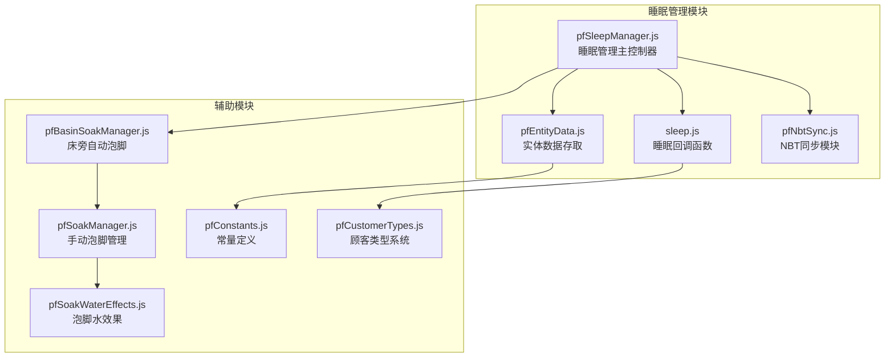
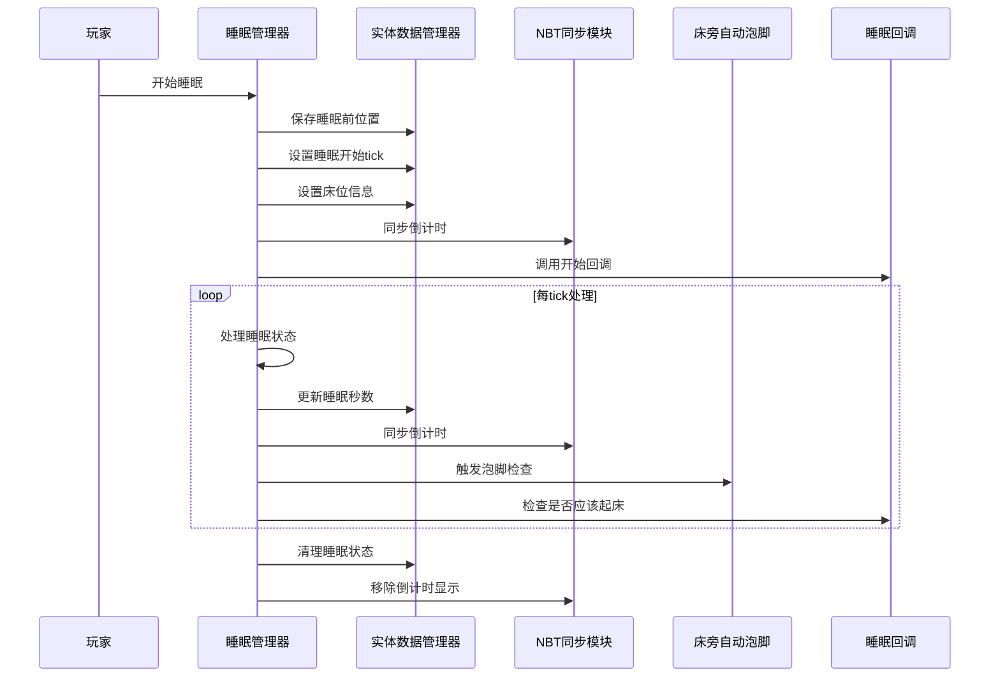
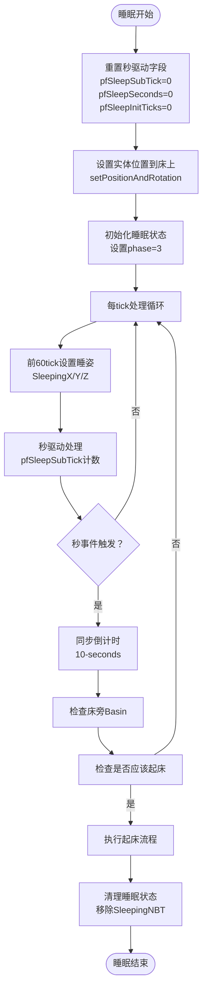
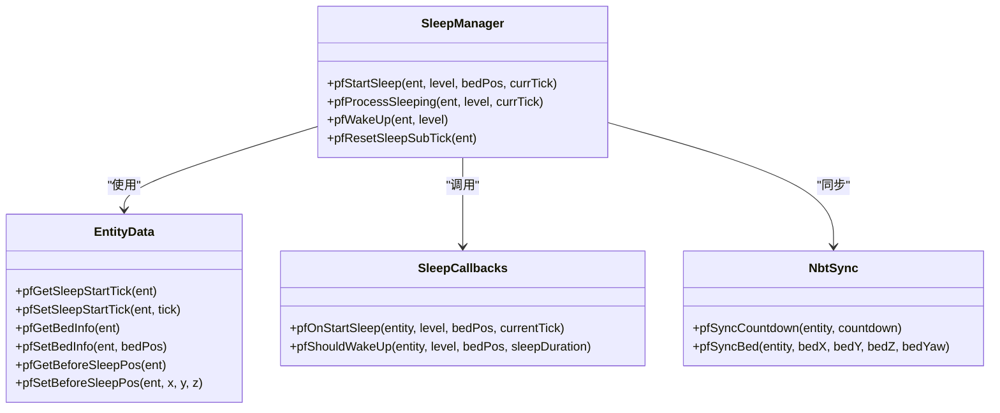
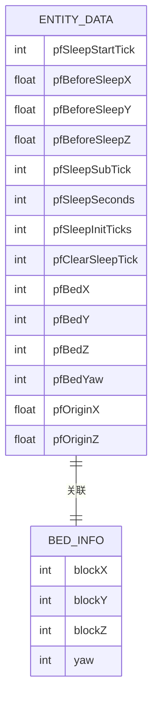
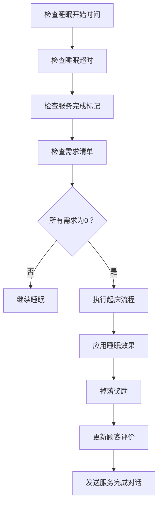
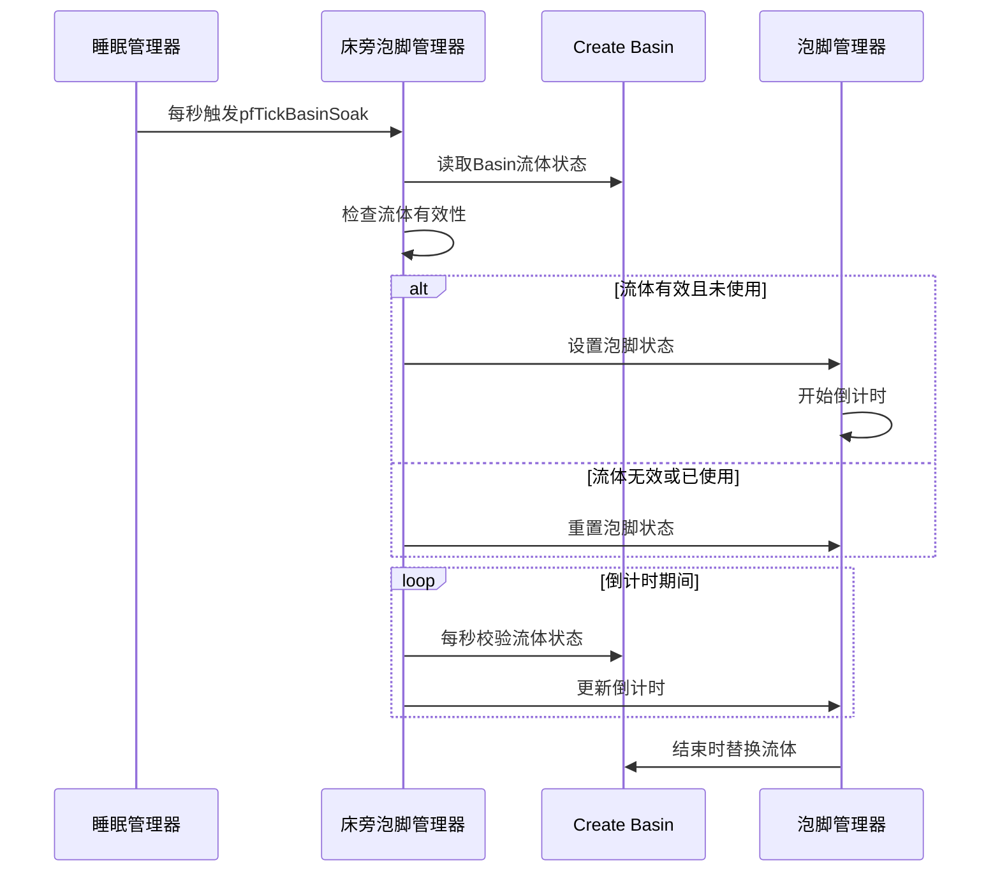
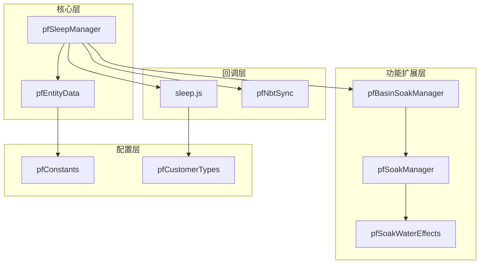

# 睡眠管理

<cite>
**本文档引用的文件**
- [pfSleepManager.js](file://kubejs/server_scripts/pathfinder/pfSleepManager.js)
- [pfEntityData.js](file://kubejs/server_scripts/pathfinder/pfEntityData.js)
- [sleep.js](file://kubejs/server_scripts/sleep.js)
- [pfNbtSync.js](file://kubejs/server_scripts/pathfinder/pfNbtSync.js)
- [pfBasinSoakManager.js](file://kubejs/server_scripts/pathfinder/pfBasinSoakManager.js)
- [pfConstants.js](file://kubejs/server_scripts/pathfinder/pfConstants.js)
- [pfSoakManager.js](file://kubejs/server_scripts/pathfinder/pfSoakManager.js)
- [pfSoakWaterEffects.js](file://kubejs/server_scripts/pathfinder/pfSoakWaterEffects.js)
- [pfCustomerTypes.js](file://kubejs/server_scripts/pathfinder/pfCustomerTypes.js)
</cite>

## 目录
1. [简介](#简介)
2. [项目结构](#项目结构)
3. [核心组件](#核心组件)
4. [架构概览](#架构概览)
5. [详细组件分析](#详细组件分析)
6. [依赖关系分析](#依赖关系分析)
7. [性能考虑](#性能考虑)
8. [故障排除指南](#故障排除指南)
9. [结论](#结论)
10. [附录](#附录)

## 简介

睡眠管理模块是Minecraft KubeJS项目中Pathfinder系统的核心功能之一，负责管理实体的睡眠状态、睡眠进度跟踪和睡眠结束判断。该模块实现了完整的睡眠生命周期管理，包括睡眠开始检测、睡眠进度跟踪、睡眠结束判断、睡眠质量评估和睡眠效果应用。

该系统采用"秒/计数"驱动的时间管理模式，完全基于实体的persistentData存储睡眠状态，避免了依赖服务器tick计数器可能带来的跨重启失效问题。系统还集成了床旁Create Basin自动泡脚功能，为睡眠体验提供了额外的沉浸感。

## 项目结构

睡眠管理模块位于KubeJS项目的pathfinder子目录中，主要包含以下文件：



**图表来源**
- [pfSleepManager.js:1-232](file://kubejs/server_scripts/pathfinder/pfSleepManager.js#L1-L232)
- [pfEntityData.js:1-218](file://kubejs/server_scripts/pathfinder/pfEntityData.js#L1-L218)
- [sleep.js:1-313](file://kubejs/server_scripts/sleep.js#L1-L313)

**章节来源**
- [pfSleepManager.js:1-232](file://kubejs/server_scripts/pathfinder/pfSleepManager.js#L1-L232)
- [pfEntityData.js:1-218](file://kubejs/server_scripts/pathfinder/pfEntityData.js#L1-L218)
- [sleep.js:1-313](file://kubejs/server_scripts/sleep.js#L1-L313)

## 核心组件

睡眠管理模块由以下几个核心组件构成：

### 1. 睡眠管理器 (pfSleepManager)
负责睡眠状态的完整生命周期管理，包括睡眠开始、睡眠过程处理和睡眠结束。

### 2. 实体数据管理器 (pfEntityData)
封装所有实体persistentData的存取操作，提供统一的数据访问接口。

### 3. 睡眠回调系统 (sleep.js)
定义睡眠相关的回调函数，包括睡眠开始回调和睡眠结束判断逻辑。

### 4. NBT同步模块 (pfNbtSync)
管理实体手持物品NBT的同步，确保客户端能够实时显示睡眠状态。

### 5. 床旁自动泡脚 (pfBasinSoakManager)
集成Create Basin自动泡脚功能，在睡眠过程中提供额外的沉浸体验。

**章节来源**
- [pfSleepManager.js:226-231](file://kubejs/server_scripts/pathfinder/pfSleepManager.js#L226-L231)
- [pfEntityData.js:185-217](file://kubejs/server_scripts/pathfinder/pfEntityData.js#L185-L217)
- [sleep.js:57-312](file://kubejs/server_scripts/sleep.js#L57-L312)

## 架构概览

睡眠管理系统的整体架构采用模块化设计，各个组件职责明确，通过清晰的接口进行交互：



**图表来源**
- [pfSleepManager.js:24-61](file://kubejs/server_scripts/pathfinder/pfSleepManager.js#L24-L61)
- [pfSleepManager.js:65-128](file://kubejs/server_scripts/pathfinder/pfSleepManager.js#L65-L128)
- [pfSleepManager.js:131-223](file://kubejs/server_scripts/pathfinder/pfSleepManager.js#L131-L223)

## 详细组件分析

### 睡眠管理器 (pfSleepManager)

#### 睡眠状态管理机制

睡眠管理器采用"秒/计数"驱动的时间管理模式，完全独立于服务器tick计数器：



**图表来源**
- [pfSleepManager.js:17-21](file://kubejs/server_scripts/pathfinder/pfSleepManager.js#L17-L21)
- [pfSleepManager.js:65-128](file://kubejs/server_scripts/pathfinder/pfSleepManager.js#L65-L128)
- [pfSleepManager.js:131-223](file://kubejs/server_scripts/pathfinder/pfSleepManager.js#L131-L223)

#### 睡眠开始检测

睡眠开始检测通过检查实体的睡眠状态和床位信息来确定：

1. **睡眠前位置保存**：记录实体在进入睡眠前的位置坐标
2. **睡眠开始时间记录**：保存当前游戏tick数
3. **床位信息设置**：记录床的坐标和朝向
4. **睡眠状态初始化**：设置实体的睡眠阶段和相关标志

#### 睡眠进度跟踪

系统采用三重时间计数器来精确跟踪睡眠进度：

- **pfSleepSubTick**：每tick递增的秒内计数器（0-19）
- **pfSleepSeconds**：累计睡眠秒数，每20tick递增
- **pfSleepInitTicks**：前60tick的睡姿设置计数器

#### 睡眠结束判断

睡眠结束通过回调函数进行判断，系统提供了灵活的扩展机制：



**图表来源**
- [pfSleepManager.js:226-231](file://kubejs/server_scripts/pathfinder/pfSleepManager.js#L226-L231)
- [pfEntityData.js:185-217](file://kubejs/server_scripts/pathfinder/pfEntityData.js#L185-L217)
- [sleep.js:57-312](file://kubejs/server_scripts/sleep.js#L57-L312)

**章节来源**
- [pfSleepManager.js:24-61](file://kubejs/server_scripts/pathfinder/pfSleepManager.js#L24-L61)
- [pfSleepManager.js:65-128](file://kubejs/server_scripts/pathfinder/pfSleepManager.js#L65-L128)
- [pfSleepManager.js:131-223](file://kubejs/server_scripts/pathfinder/pfSleepManager.js#L131-L223)

### 实体数据管理器 (pfEntityData)

实体数据管理器提供了统一的persistentData存取接口，确保所有睡眠相关数据的一致性：

#### 睡眠相关数据字段

| 字段名 | 类型 | 描述 | 跨重启保留 |
|--------|------|------|------------|
| pfSleepStartTick | int | 睡眠开始时的游戏tick | ✓ |
| pfBeforeSleepX/Y/Z | float | 睡眠前位置坐标 | ✓ |
| pfSleepSubTick | int | 秒内tick计数器 | ✓ |
| pfSleepSeconds | int | 累计睡眠秒数 | ✓ |
| pfSleepInitTicks | int | 睡姿设置计数器 | ✓ |
| pfClearSleepTick | int | 清理睡眠NBT的计数器 | ✓ |

#### 床位信息管理



**图表来源**
- [pfEntityData.js:86-122](file://kubejs/server_scripts/pathfinder/pfEntityData.js#L86-L122)
- [pfEntityData.js:67-82](file://kubejs/server_scripts/pathfinder/pfEntityData.js#L67-L82)

**章节来源**
- [pfEntityData.js:86-172](file://kubejs/server_scripts/pathfinder/pfEntityData.js#L86-L172)

### 睡眠回调系统 (sleep.js)

睡眠回调系统提供了灵活的扩展机制，允许开发者自定义睡眠行为：

#### 睡眠开始回调 (pfOnStartSleep)

当实体开始睡眠时调用，主要用于：
- 记录睡眠开始的日志信息
- 计算床脚位置用于调试输出
- 触发客户端UI的创建（通过foot_ui.js）

#### 睡眠结束判断回调 (pfShouldWakeUp)

这是最核心的回调函数，决定了实体何时应该起床：



**图表来源**
- [sleep.js:79-312](file://kubejs/server_scripts/sleep.js#L79-L312)

#### 睡眠质量评估

系统实现了完整的睡眠质量评估体系：

| 评估维度 | 评分标准 | 影响范围 |
|----------|----------|----------|
| 需求满足度 | 4部位需求清零 | 基础奖励和满意度 |
| 满意度 | 0-100分 | 奖励倍数和特殊效果 |
| 服务效率 | 睡眠时长和效果 | 金钱收入和评价 |
| 服务质量 | 多维度综合表现 | 顾客类别权重 |

**章节来源**
- [sleep.js:79-312](file://kubejs/server_scripts/sleep.js#L79-L312)

### NBT同步模块 (pfNbtSync)

NBT同步模块确保客户端能够实时显示睡眠状态，通过实体手持物品的NBT实现数据同步：

#### 同步字段设计

| 字段名 | 类型 | 描述 | 同步范围 |
|--------|------|------|----------|
| pfCountdown | int | 睡眠倒计时（0-10） | 客户端UI |
| pfBedX/Y/Z/Yaw | int | 床位坐标和朝向 | 客户端显示 |
| pfPhase | int | 服务阶段状态 | 客户端界面 |
| pfDemandJiaozhang | int | 脚掌需求量 | 需求显示 |
| pfSatisfaction | int | 满意度评分 | 评价显示 |

**章节来源**
- [pfNbtSync.js:31-75](file://kubejs/server_scripts/pathfinder/pfNbtSync.js#L31-L75)

### 床旁自动泡脚 (pfBasinSoakManager)

床旁自动泡脚功能为睡眠体验提供了额外的沉浸感，与手动泡脚完全兼容：

#### 自动泡脚触发机制



**图表来源**
- [pfBasinSoakManager.js:329-408](file://kubejs/server_scripts/pathfinder/pfBasinSoakManager.js#L329-L408)
- [pfSoakManager.js:92-145](file://kubejs/server_scripts/pathfinder/pfSoakManager.js#L92-L145)

**章节来源**
- [pfBasinSoakManager.js:1-418](file://kubejs/server_scripts/pathfinder/pfBasinSoakManager.js#L1-L418)

## 依赖关系分析

睡眠管理模块的依赖关系呈现清晰的层次结构：



**图表来源**
- [pfSleepManager.js:226-231](file://kubejs/server_scripts/pathfinder/pfSleepManager.js#L226-L231)
- [pfEntityData.js:185-217](file://kubejs/server_scripts/pathfinder/pfEntityData.js#L185-L217)
- [sleep.js:57-312](file://kubejs/server_scripts/sleep.js#L57-L312)

**章节来源**
- [pfSleepManager.js:226-231](file://kubejs/server_scripts/pathfinder/pfSleepManager.js#L226-L231)
- [pfEntityData.js:185-217](file://kubejs/server_scripts/pathfinder/pfEntityData.js#L185-L217)

## 性能考虑

睡眠管理模块在设计时充分考虑了性能优化：

### 时间驱动优化
- 使用persistentData存储时间状态，避免频繁的服务器tick查询
- 采用"秒/计数"驱动，减少tick级别的计算开销
- 跨重启友好的数据存储机制

### 内存管理
- 最小化全局变量的使用，避免内存泄漏
- 及时清理不再需要的NBT数据
- 合理的回调函数调用频率控制

### 网络同步优化
- 仅同步必要的UI相关数据到客户端
- 使用批量NBT更新减少网络通信
- 避免不必要的客户端-服务器数据往返

## 故障排除指南

### 常见问题及解决方案

#### 睡眠状态异常
**问题**：实体无法正常开始或结束睡眠
**排查步骤**：
1. 检查床位坐标是否正确设置
2. 验证pfSleepStartTick是否正确更新
3. 确认回调函数是否存在且可访问

#### 倒计时显示错误
**问题**：客户端倒计时显示不正确
**排查步骤**：
1. 检查pfNbtSync.pfSyncCountdown调用
2. 验证手持物品NBT数据完整性
3. 确认客户端UI脚本正常运行

#### 自动泡脚功能失效
**问题**：床旁Basin无法自动触发泡脚
**排查步骤**：
1. 检查Basin流体状态和容量
2. 验证泡脚水类型的有效性
3. 确认pfBasinSoakManager权限和配置

**章节来源**
- [pfSleepManager.js:55-60](file://kubejs/server_scripts/pathfinder/pfSleepManager.js#L55-L60)
- [pfBasinSoakManager.js:329-408](file://kubejs/server_scripts/pathfinder/pfBasinSoakManager.js#L329-L408)

## 结论

睡眠管理模块展现了优秀的软件工程实践，通过模块化设计、清晰的接口定义和完善的扩展机制，为Minecraft游戏提供了丰富而沉浸的睡眠体验。

该系统的主要优势包括：
- **可靠性**：基于persistentData的跨重启友好设计
- **可扩展性**：灵活的回调函数机制支持自定义逻辑
- **用户体验**：完整的UI同步和沉浸式效果
- **性能优化**：高效的时钟驱动和内存管理

通过合理的架构设计和详细的实现细节，睡眠管理模块为整个Pathfinder系统奠定了坚实的基础。

## 附录

### 代码示例：扩展睡眠功能

#### 添加新的睡眠效果
```javascript
// 在sleep.js中添加自定义睡眠效果
global.pfCustomSleepEffect = function(entity, level, bedPos, sleepDuration) {
    // 自定义效果逻辑
    let satisfaction = entity.getMainHandItem().nbt.getInt('pfSatisfaction') || 0;
    
    if (satisfaction > 80) {
        // 高满意度效果
        entity.addEffect('minecraft:regeneration', 60, 1);
        return true; // 立即结束睡眠
    }
    
    return false; // 继续睡眠
};
```

#### 自定义睡眠条件
```javascript
// 在sleep.js中添加自定义睡眠条件
global.pfCustomSleepCondition = function(entity, level, bedPos, sleepDuration) {
    // 检查特定环境条件
    let worldTime = level.getDayTime();
    let weather = level.getWeather();
    
    // 只在特定天气条件下结束睡眠
    if (weather === 'clear' && (worldTime > 12000 && worldTime < 24000)) {
        return true;
    }
    
    return false;
};
```

#### 新增睡眠质量评估指标
```javascript
// 在sleep.js中扩展满意度计算
global.pfEnhancedSatisfactionCalculation = function(entity, baseSatisfaction) {
    let extraPoints = 0;
    
    // 基于床的品质加分
    let bedQuality = entity.getMainHandItem().nbt.getInt('pfBedQuality') || 0;
    extraPoints += bedQuality * 2;
    
    // 基于泡脚水类型加分
    let waterType = entity.getMainHandItem().nbt.getString('pfSoakWaterType');
    if (waterType === 'special_water') {
        extraPoints += 15;
    }
    
    return Math.min(100, baseSatisfaction + extraPoints);
};
```

这些示例展示了如何利用现有的回调机制来扩展睡眠功能，包括新的睡眠效果、自定义睡眠条件和增强的睡眠质量评估。