# 睡眠管理

<cite>
**本文档引用的文件**
- [pfSleepManager.js](file://kubejs/server_scripts/pathfinder/pfSleepManager.js)
- [pfEntityData.js](file://kubejs/server_scripts/pathfinder/pfEntityData.js)
- [sleep.js](file://kubejs/server_scripts/pathfinder/sleep.js)
- [pfNbtSync.js](file://kubejs/server_scripts/pathfinder/pfNbtSync.js)
- [pfBasinSoakManager.js](file://kubejs/server_scripts/pathfinder/pfBasinSoakManager.js)
- [pfConstants.js](file://kubejs/server_scripts/pathfinder/pfConstants.js)
- [pfSoakManager.js](file://kubejs/server_scripts/pathfinder/pfSoakManager.js)
- [pfSoakWaterEffects.js](file://kubejs/server_scripts/pathfinder/pfSoakWaterEffects.js)
- [pfCustomerTypes.js](file://kubejs/server_scripts/pathfinder/pfCustomerTypes.js)
- [pfBedBreakHandler.js](file://kubejs/server_scripts/pathfinder/pfBedBreakHandler.js)
- [pfBedManager.js](file://kubejs/server_scripts/pathfinder/pfBedManager.js)
- [pfMaidService.js](file://kubejs/server_scripts/pathfinder/pfMaidService.js)
- [pfCoinDropScheduler.js](file://kubejs/server_scripts/pathfinder/pfCoinDropScheduler.js)
</cite>

## 更新摘要
**变更内容**   
- 新增女仆服务系统结算功能，在顾客起床时处理女仆收益
- 实现女仆独立账本系统，记录每位女仆的服务贡献和收益
- 添加女仆满意度与玩家满意度的分离计算机制
- 集成硬币掉落调度器，优化女仆收益的掉落体验
- 增强睡眠质量评估体系，支持多维度满意度计算

## 目录
1. [简介](#简介)
2. [项目结构](#项目结构)
3. [核心组件](#核心组件)
4. [架构概览](#架构概览)
5. [详细组件分析](#详细组件分析)
6. [女仆服务结算系统](#女仆服务结算系统)
7. [床完整性检查与顾客解雇机制](#床完整性检查与顾客解雇机制)
8. [依赖关系分析](#依赖关系分析)
9. [性能考虑](#性能考虑)
10. [故障排除指南](#故障排除指南)
11. [结论](#结论)
12. [附录](#附录)

## 简介

睡眠管理模块是Minecraft KubeJS项目中Pathfinder系统的核心功能之一，负责管理实体的睡眠状态、睡眠进度跟踪和睡眠结束判断。该模块实现了完整的睡眠生命周期管理，包括睡眠开始检测、睡眠进度跟踪、睡眠结束判断、睡眠质量评估和睡眠效果应用。

**更新** 系统现已集成女仆服务结算功能，当顾客起床时会处理女仆的收益分配。同时集成了床结构完整性检查机制，能够实时检测床的物理结构变化，并在床结构失效时自动解雇顾客，同时向附近玩家发送通知。该系统采用"秒/计数"驱动的时间管理模式，完全基于实体的persistentData存储睡眠状态，避免了依赖服务器tick计数器可能带来的跨重启失效问题。系统还集成了床旁Create Basin自动泡脚功能，为睡眠体验提供了额外的沉浸感。

## 项目结构

睡眠管理模块位于KubeJS项目的pathfinder子目录中，主要包含以下文件：

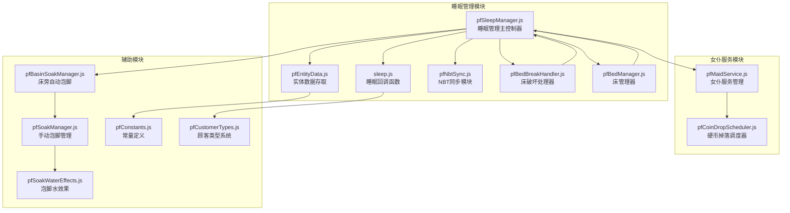

**图表来源**
- [pfSleepManager.js:1-345](file://kubejs/server_scripts/pathfinder/pfSleepManager.js#L1-L345)
- [pfMaidService.js:1-766](file://kubejs/server_scripts/pathfinder/pfMaidService.js#L1-L766)
- [pfBedBreakHandler.js:1-196](file://kubejs/server_scripts/pathfinder/pfBedBreakHandler.js#L1-L196)
- [pfBedManager.js:1-268](file://kubejs/server_scripts/pathfinder/pfBedManager.js#L1-L268)

**章节来源**
- [pfSleepManager.js:1-345](file://kubejs/server_scripts/pathfinder/pfSleepManager.js#L1-L345)
- [pfMaidService.js:1-766](file://kubejs/server_scripts/pathfinder/pfMaidService.js#L1-L766)
- [pfBedBreakHandler.js:1-196](file://kubejs/server_scripts/pathfinder/pfBedBreakHandler.js#L1-L196)
- [pfBedManager.js:1-268](file://kubejs/server_scripts/pathfinder/pfBedManager.js#L1-L268)

## 核心组件

睡眠管理模块由以下几个核心组件构成：

### 1. 睡眠管理器 (pfSleepManager)
负责睡眠状态的完整生命周期管理，包括睡眠开始、睡眠过程处理和睡眠结束。现已集成床完整性检查和顾客自动解雇功能。

### 2. 实体数据管理器 (pfEntityData)
封装所有实体persistentData的存取操作，提供统一的数据访问接口。

### 3. 睡眠回调系统 (sleep.js)
定义睡眠相关的回调函数，包括睡眠开始回调和睡眠结束判断逻辑。**更新** 现已集成女仆服务结算功能。

### 4. NBT同步模块 (pfNbtSync)
管理实体手持物品NBT的同步，确保客户端能够实时显示睡眠状态。

### 5. 床破坏处理器 (pfBedBreakHandler)
处理玩家破坏床的即时反馈，协调顾客解雇和玩家通知。

### 6. 床管理器 (pfBedManager)
提供床结构完整性检查功能，检测床的物理结构是否有效。

### 7. 女仆服务管理器 (pfMaidService)
**新增** 管理女仆搓脚工作模式，处理女仆服务流程和收益结算。

### 8. 硬币掉落调度器 (pfCoinDropScheduler)
**新增** 优化硬币掉落体验，将一次性掉落改为逐枚弹出。

### 9. 床旁自动泡脚 (pfBasinSoakManager)
集成Create Basin自动泡脚功能，在睡眠过程中提供额外的沉浸体验。

**章节来源**
- [pfSleepManager.js:338-344](file://kubejs/server_scripts/pathfinder/pfSleepManager.js#L338-L344)
- [pfMaidService.js:762-765](file://kubejs/server_scripts/pathfinder/pfMaidService.js#L762-L765)
- [pfBedBreakHandler.js:189-196](file://kubejs/server_scripts/pathfinder/pfBedBreakHandler.js#L189-L196)
- [pfBedManager.js:256-267](file://kubejs/server_scripts/pathfinder/pfBedManager.js#L256-L267)

## 架构概览

睡眠管理系统的整体架构采用模块化设计，各个组件职责明确，通过清晰的接口进行交互：

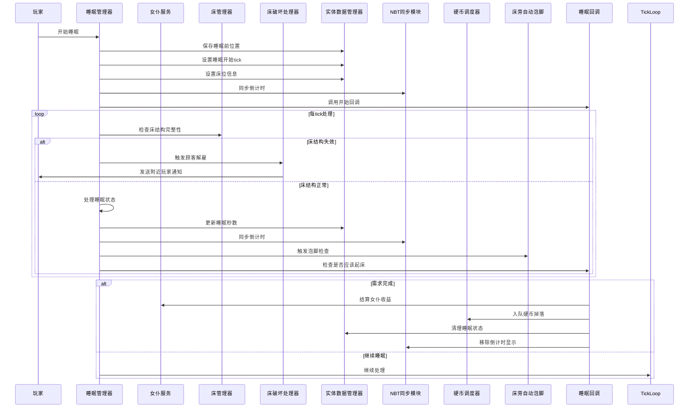

**图表来源**
- [pfSleepManager.js:87-165](file://kubejs/server_scripts/pathfinder/pfSleepManager.js#L87-L165)
- [sleep.js:93-379](file://kubejs/server_scripts/pathfinder/sleep.js#L93-L379)
- [pfMaidService.js:607-654](file://kubejs/server_scripts/pathfinder/pfMaidService.js#L607-L654)
- [pfBedBreakHandler.js:79-187](file://kubejs/server_scripts/pathfinder/pfBedBreakHandler.js#L79-L187)
- [pfBedManager.js:124-162](file://kubejs/server_scripts/pathfinder/pfBedManager.js#L124-L162)

## 详细组件分析

### 睡眠管理器 (pfSleepManager)

#### 睡眠状态管理机制

睡眠管理器采用"秒/计数"驱动的时间管理模式，完全独立于服务器tick计数器：

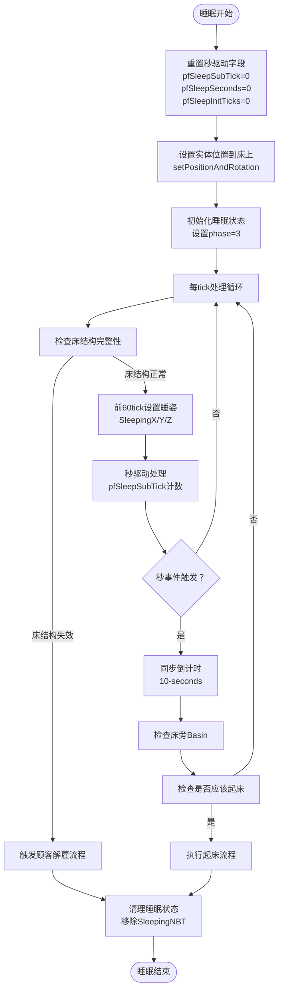

**图表来源**
- [pfSleepManager.js:17-21](file://kubejs/server_scripts/pathfinder/pfSleepManager.js#L17-L21)
- [pfSleepManager.js:87-165](file://kubejs/server_scripts/pathfinder/pfSleepManager.js#L87-L165)
- [pfSleepManager.js:272-335](file://kubejs/server_scripts/pathfinder/pfSleepManager.js#L272-L335)

#### 床结构完整性检查

系统在每tick处理睡眠状态时都会检查床的结构完整性：

1. **床完整性验证**：使用`pfIsBedIntact`函数检查床的床头和床尾方块是否存在且朝向正确
2. **外部修改检测**：支持检测TNT、活塞等外部模组对床方块的修改
3. **自动响应**：当检测到床结构失效时，立即触发顾客解雇流程

#### 顾客自动解雇机制

当床结构失效时，系统会执行完整的顾客解雇流程：

1. **防重复处理**：通过`pfBrokenBedDismissed`标记防止同一顾客被重复解雇
2. **资源清理**：释放店铺床位占用，移除失效床位记录
3. **状态重置**：清除所有睡眠相关的数据字段
4. **粒子效果**：生成poof粒子效果表示顾客离场
5. **实体销毁**：直接删除顾客实体，不进行正常结算

#### 附近玩家通知系统

系统会向店铺范围内的玩家发送床被破坏的通知：

1. **范围检测**：基于店铺基座坐标计算通知范围
2. **消息格式**：显示"床位被破坏，X位顾客已离场，本次服务未结算"
3. **距离过滤**：仅通知距离店铺一定范围内的玩家

**章节来源**
- [pfSleepManager.js:31-45](file://kubejs/server_scripts/pathfinder/pfSleepManager.js#L31-L45)
- [pfSleepManager.js:99-110](file://kubejs/server_scripts/pathfinder/pfSleepManager.js#L99-L110)
- [pfSleepManager.js:272-335](file://kubejs/server_scripts/pathfinder/pfSleepManager.js#L272-L335)

### 床破坏处理器 (pfBedBreakHandler)

床破坏处理器专门处理玩家主动破坏床的情况，提供即时反馈：

#### 破坏检测流程

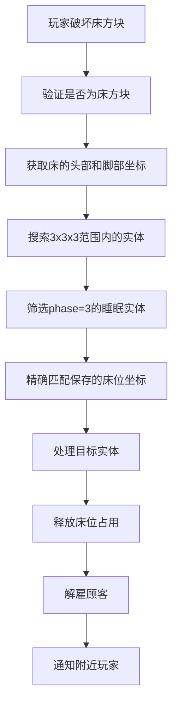

**图表来源**
- [pfBedBreakHandler.js:79-187](file://kubejs/server_scripts/pathfinder/pfBedBreakHandler.js#L79-L187)

#### 精确匹配机制

系统使用精确的床位坐标匹配，避免相邻床位的误判：

1. **坐标验证**：检查实体保存的床位坐标是否与破坏的床完全匹配
2. **范围限制**：仅在破坏点周围的3x3x3空间内搜索候选实体
3. **阶段过滤**：只处理当前正在睡觉的实体（pfPhase=3）

**章节来源**
- [pfBedBreakHandler.js:13-54](file://kubejs/server_scripts/pathfinder/pfBedBreakHandler.js#L13-L54)
- [pfBedBreakHandler.js:79-187](file://kubejs/server_scripts/pathfinder/pfBedBreakHandler.js#L79-L187)

### 床管理器 (pfBedManager)

床管理器提供床结构完整性检查的核心功能：

#### 床完整性检查算法

`pfIsBedIntact`函数实现了完整的床结构验证：

1. **朝向计算**：根据床的yaw值计算预期的床尾位置
2. **床头验证**：检查床头方块是否存在且part属性为"head"
3. **床尾验证**：检查床尾方块是否存在且part属性为"foot"
4. **朝向一致性**：确保床头和床尾的facing属性一致且符合预期

#### 多方向支持

系统支持四种床朝向：
- **北向南**：床头在北，床尾在南
- **南向北**：床头在南，床尾在北  
- **东向西**：床头在东，床尾在西
- **西向东**：床头在西，床尾在东

**章节来源**
- [pfBedManager.js:124-162](file://kubejs/server_scripts/pathfinder/pfBedManager.js#L124-L162)

### 实体数据管理器 (pfEntityData)

实体数据管理器提供了统一的persistentData存取接口，确保所有睡眠相关数据的一致性：

#### 睡眠相关数据字段

| 字段名 | 类型 | 描述 | 跨重启保留 |
|--------|------|------|------------|
| pfSleepStartTick | int | 睡眠开始时的游戏tick | ✓ |
| pfBeforeSleepX/Y/Z | float | 睡眠前位置坐标 | ✓ |
| pfSleepSubTick | int | 秒内tick计数器 | ✓ |
| pfSleepSeconds | int | 累计睡眠秒数 | ✓ |
| pfSleepInitTicks | int | 睡姿设置计数器 | ✓ |
| pfClearSleepTick | int | 清理睡眠NBT的计数器 | ✓ |
| pfBrokenBedDismissed | int | 床破坏解雇标记 | ✓ |

#### 床位信息管理

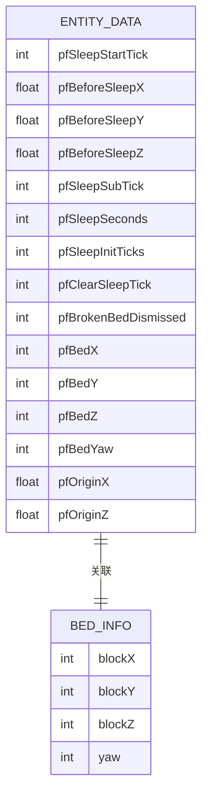

**图表来源**
- [pfEntityData.js:86-122](file://kubejs/server_scripts/pathfinder/pfEntityData.js#L86-L122)
- [pfEntityData.js:67-82](file://kubejs/server_scripts/pathfinder/pfEntityData.js#L67-L82)

**章节来源**
- [pfEntityData.js:86-172](file://kubejs/server_scripts/pathfinder/pfEntityData.js#L86-L172)

### 睡眠回调系统 (sleep.js)

睡眠回调系统提供了灵活的扩展机制，允许开发者自定义睡眠行为：

#### 睡眠开始回调 (pfOnStartSleep)

当实体开始睡眠时调用，主要用于：
- 记录睡眠开始的日志信息
- 计算床脚位置用于调试输出
- 触发客户端UI的创建（通过foot_ui.js）

#### 睡眠结束判断回调 (pfShouldWakeUp)

这是最核心的回调函数，决定了实体何时应该起床：**更新** 现已集成女仆服务结算功能。

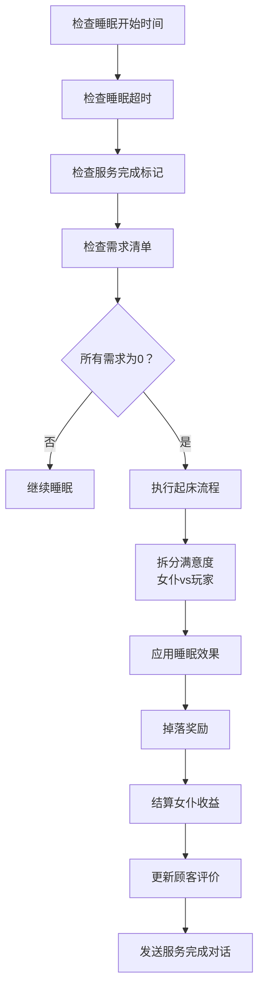

**图表来源**
- [sleep.js:93-379](file://kubejs/server_scripts/pathfinder/sleep.js#L93-L379)

#### 女仆服务结算流程

**新增** 当顾客需求全部完成时，系统会执行女仆服务结算：

1. **满意度拆分**：从总满意度中分离出女仆贡献的部分（pfMaidSat）
2. **女仆收益计算**：根据女仆的服务贡献计算金钱和满意度
3. **硬币掉落**：通过硬币掉落调度器优化掉落体验
4. **下界之星奖励**：女仆满意度超过60%时掉落下界之星
5. **主人通知**：向女仆主人发送收益通知

#### 睡眠质量评估

系统实现了完整的睡眠质量评估体系：

| 评估维度 | 评分标准 | 影响范围 |
|----------|----------|----------|
| 需求满足度 | 4部位需求清零 | 基础奖励和满意度 |
| 满意度 | 0-100分 | 奖励倍数和特殊效果 |
| 服务效率 | 睡眠时长和效果 | 金钱收入和评价 |
| 服务质量 | 多维度综合表现 | 顾客类别权重 |
| 女仆贡献 | pfMaidSat字段 | 女仆独立收益 |

**章节来源**
- [sleep.js:93-379](file://kubejs/server_scripts/pathfinder/sleep.js#L93-L379)

### NBT同步模块 (pfNbtSync)

NBT同步模块确保客户端能够实时显示睡眠状态，通过实体手持物品的NBT实现数据同步：

#### 同步字段设计

| 字段名 | 类型 | 描述 | 同步范围 |
|--------|------|------|----------|
| pfCountdown | int | 睡眠倒计时（0-10） | 客户端UI |
| pfBedX/Y/Z/Yaw | int | 床位坐标和朝向 | 客户端显示 |
| pfPhase | int | 服务阶段状态 | 客户端界面 |
| pfDemandJiaozhang | int | 脚掌需求量 | 需求显示 |
| pfSatisfaction | int | 满意度评分 | 评价显示 |
| pfMaidSat | int | 女仆满意度 | 女仆收益 |

**章节来源**
- [pfNbtSync.js:31-75](file://kubejs/server_scripts/pathfinder/pfNbtSync.js#L31-L75)

### 女仆服务管理器 (pfMaidService)

**新增** 女仆服务管理器负责管理女仆的搓脚工作模式和收益结算：

#### 女仆工作流程

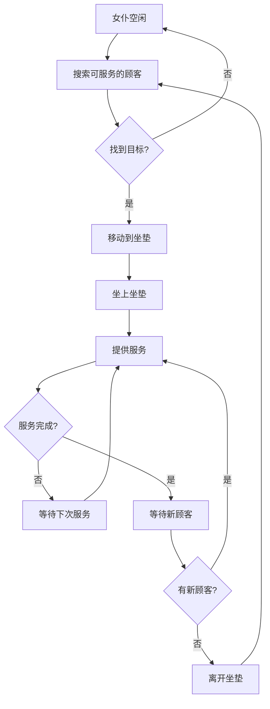

**图表来源**
- [pfMaidService.js:185-226](file://kubejs/server_scripts/pathfinder/pfMaidService.js#L185-L226)
- [pfMaidService.js:741-759](file://kubejs/server_scripts/pathfinder/pfMaidService.js#L741-L759)

#### 收益记录机制

女仆服务收益通过独立的账本系统进行记录：

1. **按女仆UUID分组**：每个女仆有独立的收益记录
2. **实时更新**：每次服务后更新金钱和满意度
3. **持久化存储**：存储在顾客手持物品的NBT中
4. **结算时清空**：顾客起床后清空已结算的收益

**章节来源**
- [pfMaidService.js:478-654](file://kubejs/server_scripts/pathfinder/pfMaidService.js#L478-L654)

### 硬币掉落调度器 (pfCoinDropScheduler)

**新增** 硬币掉落调度器优化了硬币掉落的用户体验：

#### 掉落机制

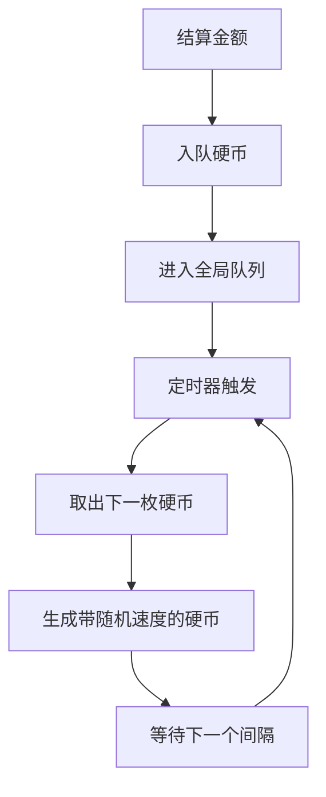

**图表来源**
- [pfCoinDropScheduler.js:38-65](file://kubejs/server_scripts/pathfinder/pfCoinDropScheduler.js#L38-L65)
- [pfCoinDropScheduler.js:76-97](file://kubejs/server_scripts/pathfinder/pfCoinDropScheduler.js#L76-L97)

#### 优化特性

1. **逐枚掉落**：每2 tick掉落一枚硬币，避免大量实体同时生成
2. **随机速度**：为每枚硬币赋予随机的运动速度，增加视觉效果
3. **面额拆分**：自动将总金额拆分为不同面额的硬币
4. **内存管理**：及时清理已掉落的硬币队列项

**章节来源**
- [pfCoinDropScheduler.js:1-100](file://kubejs/server_scripts/pathfinder/pfCoinDropScheduler.js#L1-L100)

### 床旁自动泡脚 (pfBasinSoakManager)

床旁自动泡脚功能为睡眠体验提供了额外的沉浸感，与手动泡脚完全兼容：

#### 自动泡脚触发机制

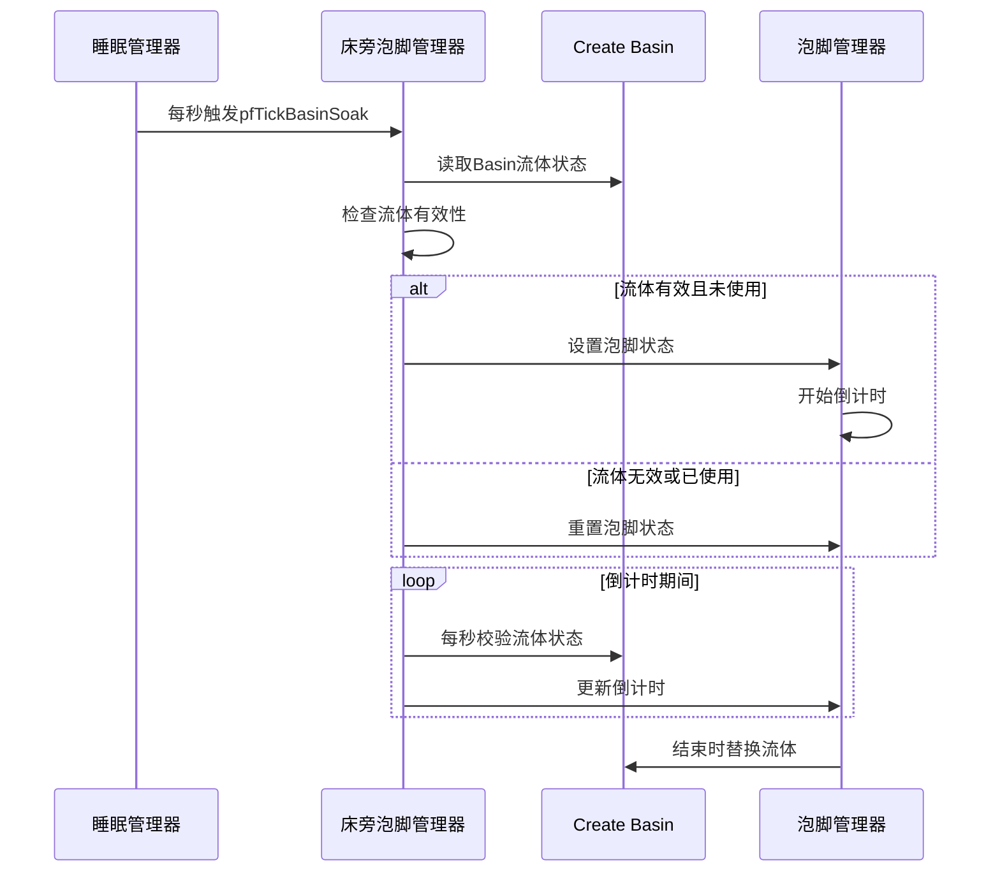

**图表来源**
- [pfBasinSoakManager.js:329-408](file://kubejs/server_scripts/pathfinder/pfBasinSoakManager.js#L329-L408)
- [pfSoakManager.js:92-145](file://kubejs/server_scripts/pathfinder/pfSoakManager.js#L92-L145)

**章节来源**
- [pfBasinSoakManager.js:1-418](file://kubejs/server_scripts/pathfinder/pfBasinSoakManager.js#L1-L418)

## 女仆服务结算系统

**新增** 本节详细介绍女仆服务结算系统的实现机制。

### 满意度分离机制

系统实现了女仆满意度与玩家满意度的分离计算：

#### 满意度拆分逻辑

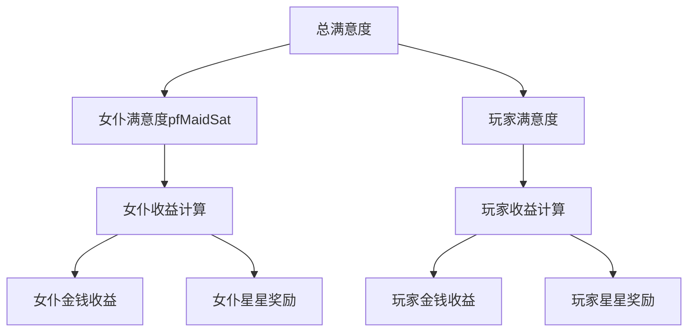

**图表来源**
- [sleep.js:192-196](file://kubejs/server_scripts/pathfinder/sleep.js#L192-L196)

#### 计算规则

1. **女仆满意度**：直接从NBT中的`pfMaidSat`字段读取
2. **玩家满意度**：总满意度减去女仆满意度
3. **独立结算**：女仆和玩家的收益分别计算和发放

### 女仆收益记录系统

女仆服务收益通过独立的账本系统进行管理：

#### 收益数据结构

```javascript
{
    uuid: "女仆UUID",
    name: "女仆名称", 
    owner: "主人UUID",
    money: 累计金钱,
    sat: 累计满意度
}
```

#### 收益更新流程

1. **服务时累加**：每次女仆服务后累加金钱和满意度
2. **JSON序列化**：将收益数组序列化为字符串存储在NBT中
3. **结算时读取**：顾客起床时读取并处理所有女仆的收益
4. **清空已结算**：结算完成后清空收益记录，防止重复结算

### 硬币掉落优化

通过硬币掉落调度器优化女仆收益的掉落体验：

#### 掉落流程

1. **金额转换**：将女仆的金钱收益转换为硬币数量
2. **队列入队**：将硬币加入全局掉落队列
3. **定时弹出**：每2 tick弹出一枚硬币
4. **随机效果**：为每枚硬币赋予随机运动速度

#### 星星奖励机制

当女仆的累计满意度超过60%时，会在女仆脚下掉落一个下界之星作为额外奖励。

**章节来源**
- [pfMaidService.js:478-654](file://kubejs/server_scripts/pathfinder/pfMaidService.js#L478-L654)
- [sleep.js:367-372](file://kubejs/server_scripts/pathfinder/sleep.js#L367-L372)
- [pfCoinDropScheduler.js:38-65](file://kubejs/server_scripts/pathfinder/pfCoinDropScheduler.js#L38-L65)

## 床完整性检查与顾客解雇机制

本节详细介绍床完整性检查和顾客自动解雇机制。

### 床结构完整性检查

系统实现了多层次的床结构验证机制：

#### 实时检测机制

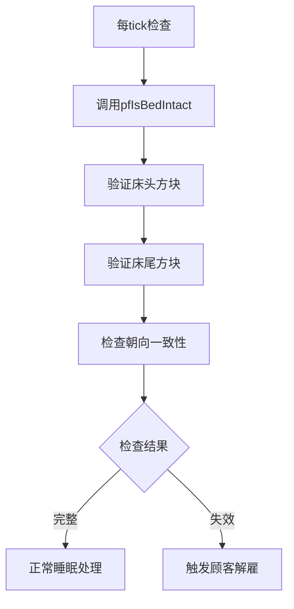

**图表来源**
- [pfSleepManager.js:99-110](file://kubejs/server_scripts/pathfinder/pfSleepManager.js#L99-L110)
- [pfBedManager.js:124-162](file://kubejs/server_scripts/pathfinder/pfBedManager.js#L124-L162)

#### 支持的破坏场景

系统能够检测多种床结构破坏情况：

1. **玩家主动破坏**：通过BlockEvents.broken事件处理
2. **TNT爆炸**：由于没有专门的破坏事件，通过每tick检查检测
3. **活塞推动**：同样通过每tick检查检测
4. **命令修改**：任何改变床方块属性的命令都会被检测
5. **其他模组干扰**：第三方模组对床方块的修改也会被识别

### 顾客自动解雇流程

当检测到床结构失效时，系统执行完整的解雇流程：

#### 解雇流程详解

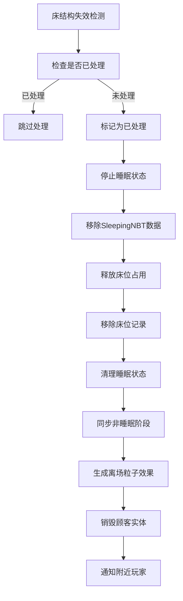

**图表来源**
- [pfSleepManager.js:272-335](file://kubejs/server_scripts/pathfinder/pfSleepManager.js#L272-L335)

#### 防重复处理机制

系统使用`pfBrokenBedDismissed`标记防止同一顾客被重复解雇：

1. **标记检查**：在处理前先检查标记是否已设置
2. **原子操作**：设置标记后立即执行后续操作
3. **状态持久化**：标记存储在persistentData中，跨重启保留

### 玩家通知系统

系统实现了智能的玩家通知机制：

#### 通知范围计算

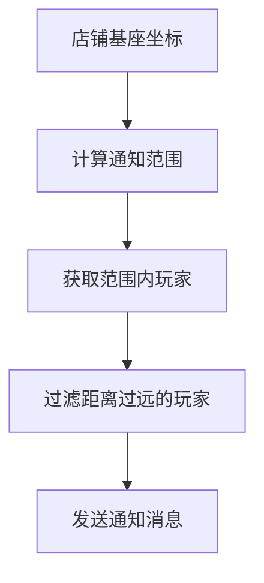

**图表来源**
- [pfSleepManager.js:31-45](file://kubejs/server_scripts/pathfinder/pfSleepManager.js#L31-L45)

#### 通知消息格式

系统使用标准化的消息格式：
- **中文提示**："床位被破坏，X位顾客已离场，本次服务未结算"
- **颜色编码**：使用红色（§c）突出显示警告信息
- **数量统计**：准确显示被解雇的顾客数量

**章节来源**
- [pfSleepManager.js:31-45](file://kubejs/server_scripts/pathfinder/pfSleepManager.js#L31-L45)
- [pfSleepManager.js:99-110](file://kubejs/server_scripts/pathfinder/pfSleepManager.js#L99-L110)
- [pfSleepManager.js:272-335](file://kubejs/server_scripts/pathfinder/pfSleepManager.js#L272-L335)

## 依赖关系分析

睡眠管理模块的依赖关系呈现清晰的层次结构：

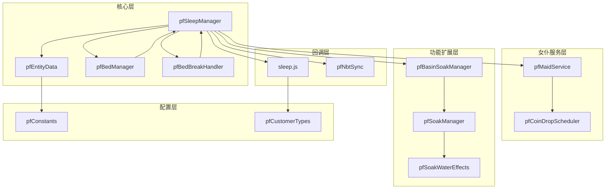

**图表来源**
- [pfSleepManager.js:338-344](file://kubejs/server_scripts/pathfinder/pfSleepManager.js#L338-L344)
- [pfMaidService.js:762-765](file://kubejs/server_scripts/pathfinder/pfMaidService.js#L762-L765)
- [pfBedBreakHandler.js:189-196](file://kubejs/server_scripts/pathfinder/pfBedBreakHandler.js#L189-L196)
- [pfBedManager.js:256-267](file://kubejs/server_scripts/pathfinder/pfBedManager.js#L256-L267)

**章节来源**
- [pfSleepManager.js:338-344](file://kubejs/server_scripts/pathfinder/pfSleepManager.js#L338-L344)
- [pfMaidService.js:762-765](file://kubejs/server_scripts/pathfinder/pfMaidService.js#L762-L765)
- [pfBedBreakHandler.js:189-196](file://kubejs/server_scripts/pathfinder/pfBedBreakHandler.js#L189-L196)

## 性能考虑

睡眠管理模块在设计时充分考虑了性能优化：

### 时间驱动优化
- 使用persistentData存储时间状态，避免频繁的服务器tick查询
- 采用"秒/计数"驱动，减少tick级别的计算开销
- 跨重启友好的数据存储机制

### 床检查优化
- **增量检查**：仅在需要时检查床结构完整性
- **缓存机制**：避免重复的方块查询操作
- **批量处理**：多个顾客的床检查合并处理

### 女仆服务优化
- **服务缓存**：缓存可用的坐垫和顾客信息，减少重复查询
- **延迟结算**：女仆收益累积到顾客起床时统一结算
- **异步掉落**：通过硬币掉落调度器异步处理硬币生成

### 内存管理
- 最小化全局变量的使用，避免内存泄漏
- 及时清理不再需要的NBT数据
- 合理的回调函数调用频率控制

### 网络同步优化
- 仅同步必要的UI相关数据到客户端
- 使用批量NBT更新减少网络通信
- 避免不必要的客户端-服务器数据往返

## 故障排除指南

### 常见问题及解决方案

#### 床完整性检查失效
**问题**：床结构被破坏但顾客没有被解雇
**排查步骤**：
1. 检查pfBedManager.pfIsBedIntact函数是否正确加载
2. 验证床的朝向和part属性是否符合预期
3. 确认睡眠处理逻辑是否正常调用床检查

#### 顾客重复解雇
**问题**：同一顾客被多次解雇
**排查步骤**：
1. 检查pfBrokenBedDismissed标记是否正确设置
2. 验证解雇流程的防重复机制
3. 确认persistentData存储是否正常

#### 女仆收益不结算
**问题**：女仆服务后没有获得应有的收益
**排查步骤**：
1. 检查pfMaidService.settle函数是否被正确调用
2. 验证女仆收益记录是否正确存储
3. 确认硬币掉落调度器是否正常工作

#### 玩家通知不显示
**问题**：附近玩家没有收到床破坏通知
**排查步骤**：
1. 检查店铺基座坐标是否正确设置
2. 验证玩家距离计算逻辑
3. 确认通知消息发送权限

#### 倒计时显示错误
**问题**：客户端倒计时显示不正确
**排查步骤**：
1. 检查pfNbtSync.pfSyncCountdown调用
2. 验证手持物品NBT数据完整性
3. 确认客户端UI脚本正常运行

**章节来源**
- [pfSleepManager.js:99-110](file://kubejs/server_scripts/pathfinder/pfSleepManager.js#L99-L110)
- [pfSleepManager.js:272-335](file://kubejs/server_scripts/pathfinder/pfSleepManager.js#L272-L335)
- [pfBedBreakHandler.js:79-187](file://kubejs/server_scripts/pathfinder/pfBedBreakHandler.js#L79-L187)
- [pfMaidService.js:607-654](file://kubejs/server_scripts/pathfinder/pfMaidService.js#L607-L654)

## 结论

睡眠管理模块展现了优秀的软件工程实践，通过模块化设计、清晰的接口定义和完善的扩展机制，为Minecraft游戏提供了丰富而沉浸的睡眠体验。

**更新** 最新的女仆服务结算功能和床完整性检查机制进一步增强了系统的健壮性和用户体验。该系统的主要优势包括：
- **可靠性**：基于persistentData的跨重启友好设计
- **可扩展性**：灵活的回调函数机制支持自定义逻辑
- **用户体验**：完整的UI同步和沉浸式效果
- **性能优化**：高效的时钟驱动和内存管理
- **容错能力**：完善的床结构检测和异常处理机制
- **经济系统**：独立的女仆收益结算和优化的掉落体验

通过合理的架构设计和详细的实现细节，睡眠管理模块为整个Pathfinder系统奠定了坚实的基础，并持续为用户提供稳定可靠的睡眠服务体验。

## 附录

### 代码示例：扩展睡眠功能

#### 添加新的睡眠效果
```javascript
// 在sleep.js中添加自定义睡眠效果
global.pfCustomSleepEffect = function(entity, level, bedPos, sleepDuration) {
    // 自定义效果逻辑
    let satisfaction = entity.getMainHandItem().nbt.getInt('pfSatisfaction') || 0;
    
    if (satisfaction > 80) {
        // 高满意度效果
        entity.addEffect('minecraft:regeneration', 60, 1);
        return true; // 立即结束睡眠
    }
    
    return false; // 继续睡眠
};
```

#### 自定义睡眠条件
```javascript
// 在sleep.js中添加自定义睡眠条件
global.pfCustomSleepCondition = function(entity, level, bedPos, sleepDuration) {
    // 检查特定环境条件
    let worldTime = level.getDayTime();
    let weather = level.getWeather();
    
    // 只在特定天气条件下结束睡眠
    if (weather === 'clear' && (worldTime > 12000 && worldTime < 24000)) {
        return true;
    }
    
    return false;
};
```

#### 新增睡眠质量评估指标
```javascript
// 在sleep.js中扩展满意度计算
global.pfEnhancedSatisfactionCalculation = function(entity, baseSatisfaction) {
    let extraPoints = 0;
    
    // 基于床的品质加分
    let bedQuality = entity.getMainHandItem().nbt.getInt('pfBedQuality') || 0;
    extraPoints += bedQuality * 2;
    
    // 基于泡脚水类型加分
    let waterType = entity.getMainHandItem().nbt.getString('pfSoakWaterType');
    if (waterType === 'special_water') {
        extraPoints += 15;
    }
    
    return Math.min(100, baseSatisfaction + extraPoints);
};
```

#### 自定义床完整性检查
```javascript
// 在pfBedManager.js中添加自定义床检查逻辑
global.pfCustomBedIntegrityCheck = function(level, bed) {
    // 检查床周围是否有危险方块
    let headX = bed.blockX, headY = bed.blockY, headZ = bed.blockZ;
    let footX = bed.footX, footY = bed.blockY, footZ = bed.footZ;
    
    // 检查床头周围是否有岩浆
    let lavaBlock = level.getBlock(headX + 1, headY, headZ);
    if (lavaBlock.id === 'minecraft:lava') {
        return false; // 床不安全
    }
    
    return true; // 床安全
};
```

#### 扩展女仆服务结算
```javascript
// 在pfMaidService.js中添加自定义女仆收益计算
global.pfCustomMaidEarningsCalculation = function(maid, customer, nbt) {
    let baseMoney = 10;
    let baseSat = 5;
    
    // 基于女仆等级加成
    let maidLevel = maid.persistentData.getInt('pfMaidLevel') || 1;
    baseMoney *= (1 + maidLevel * 0.1);
    baseSat *= (1 + maidLevel * 0.05);
    
    return {
        money: Math.floor(baseMoney),
        sat: Math.floor(baseSat)
    };
};
```

这些示例展示了如何利用现有的回调机制来扩展睡眠功能，包括新的睡眠效果、自定义睡眠条件和增强的睡眠质量评估。新增的女仆服务结算机制和床完整性检查机制也为开发者提供了更多自定义的可能性。