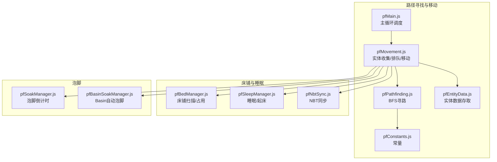
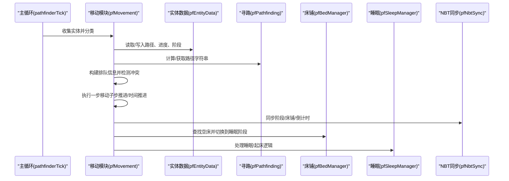
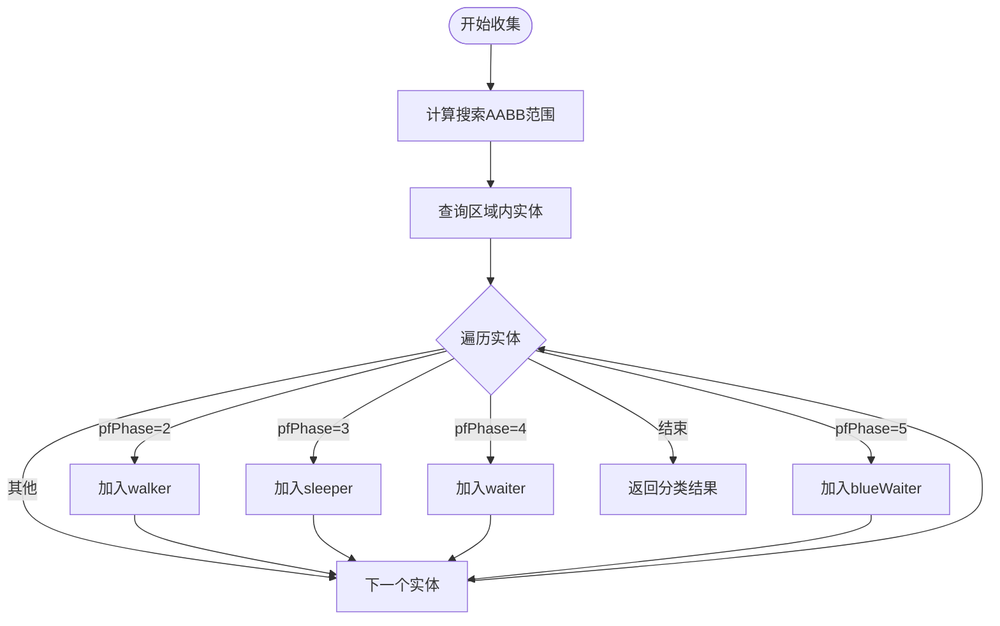
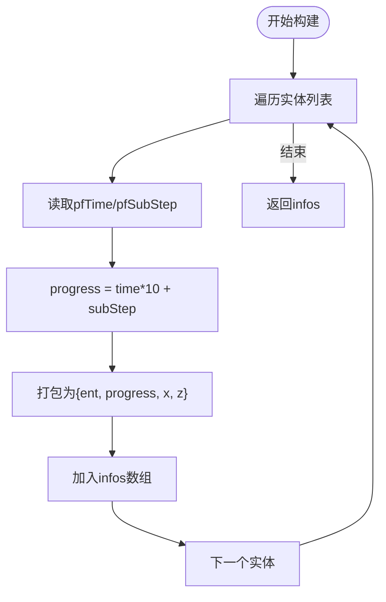
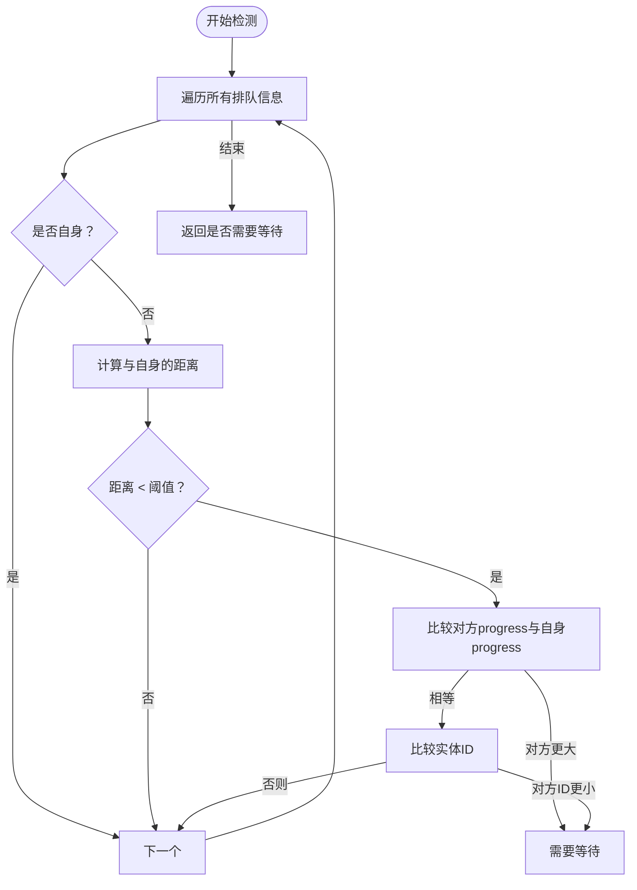
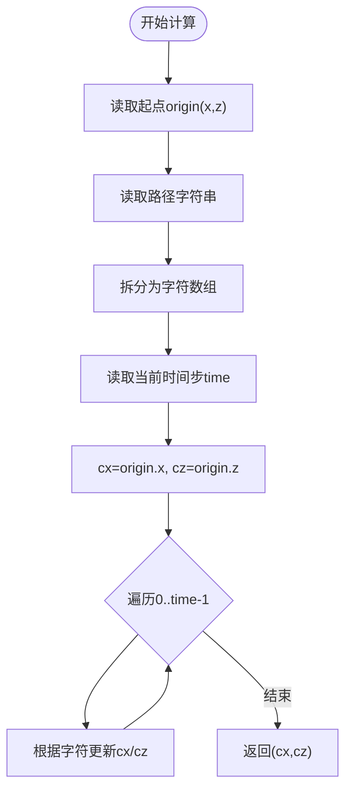
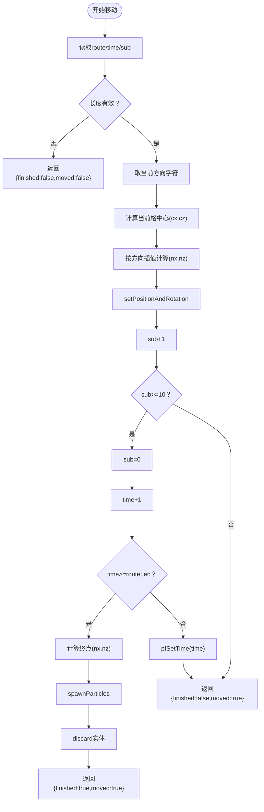
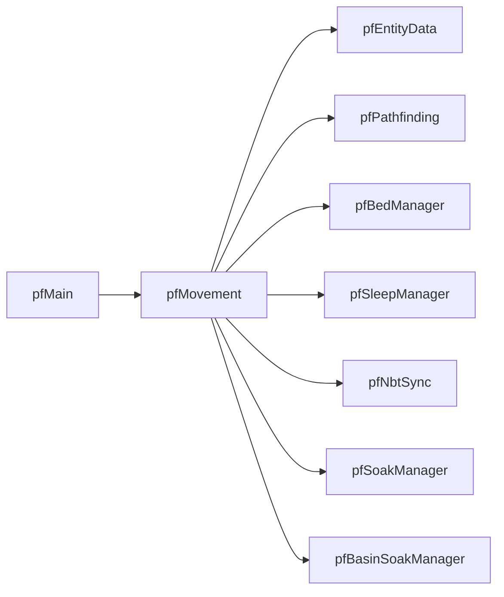

# 移动管理

<cite>
**本文引用的文件**
- [pfMovement.js](file://kubejs/server_scripts/pathfinder/pfMovement.js)
- [pfMain.js](file://kubejs/server_scripts/pathfinder/pfMain.js)
- [pfPathfinding.js](file://kubejs/server_scripts/pathfinder/pfPathfinding.js)
- [pfConstants.js](file://kubejs/server_scripts/pathfinder/pfConstants.js)
- [pfEntityData.js](file://kubejs/server_scripts/pathfinder/pfEntityData.js)
- [pfBedManager.js](file://kubejs/server_scripts/pathfinder/pfBedManager.js)
- [pfSleepManager.js](file://kubejs/server_scripts/pathfinder/pfSleepManager.js)
- [pfNbtSync.js](file://kubejs/server_scripts/pathfinder/pfNbtSync.js)
- [pfSoakManager.js](file://kubejs/server_scripts/pathfinder/pfSoakManager.js)
- [pfBasinSoakManager.js](file://kubejs/server_scripts/pathfinder/pfBasinSoakManager.js)
</cite>

## 目录
1. [简介](#简介)
2. [项目结构](#项目结构)
3. [核心组件](#核心组件)
4. [架构总览](#架构总览)
5. [详细组件分析](#详细组件分析)
6. [依赖关系分析](#依赖关系分析)
7. [性能考量](#性能考量)
8. [故障排查指南](#故障排查指南)
9. [结论](#结论)
10. [附录](#附录)

## 简介
本文件聚焦于移动管理模块（pfMovement），系统性阐述其核心功能与实现细节，包括：
- 实体收集与分类（按阶段）
- 排队信息构建与冲突检测
- 路径进度与当前位置计算
- 移动步进算法与子步插值
- 碰撞检测与位置同步策略
- 自定义移动行为的扩展方式（新增路径类型与移动参数）

通过逐层解析源码与模块交互，帮助开发者快速掌握移动系统的运行机制，并提供实践建议与排障指引。

## 项目结构
移动管理模块位于 kubejs/server_scripts/pathfinder 目录，围绕 pfMovement.js 展开，与主循环、寻路、实体数据、床铺、睡眠、NBT 同步等模块协同工作。

图表来源
- [pfMovement.js:1-186](file://kubejs/server_scripts/pathfinder/pfMovement.js#L1-L186)
- [pfMain.js:1-177](file://kubejs/server_scripts/pathfinder/pfMain.js#L1-L177)
- [pfPathfinding.js:1-91](file://kubejs/server_scripts/pathfinder/pfPathfinding.js#L1-L91)
- [pfConstants.js:1-65](file://kubejs/server_scripts/pathfinder/pfConstants.js#L1-L65)
- [pfEntityData.js:1-218](file://kubejs/server_scripts/pathfinder/pfEntityData.js#L1-L218)
- [pfBedManager.js:1-129](file://kubejs/server_scripts/pathfinder/pfBedManager.js#L1-L129)
- [pfSleepManager.js:1-232](file://kubejs/server_scripts/pathfinder/pfSleepManager.js#L1-L232)
- [pfNbtSync.js:1-94](file://kubejs/server_scripts/pathfinder/pfNbtSync.js#L1-L94)
- [pfSoakManager.js:1-197](file://kubejs/server_scripts/pathfinder/pfSoakManager.js#L1-L197)
- [pfBasinSoakManager.js:1-418](file://kubejs/server_scripts/pathfinder/pfBasinSoakManager.js#L1-L418)

章节来源
- [pfMovement.js:1-186](file://kubejs/server_scripts/pathfinder/pfMovement.js#L1-L186)
- [pfMain.js:1-177](file://kubejs/server_scripts/pathfinder/pfMain.js#L1-L177)

## 核心组件
- 实体收集与分类：按阶段筛选 walker/sleeper/waiter/blueWaiter 四类实体，用于后续排队与移动处理。
- 排队信息构建：将实体的进度（时间×10+子步）与二维位置打包，便于比较与冲突检测。
- 排队冲突检测：基于邻近距离阈值与进度/ID排序规则判断是否需要等待。
- 路径进度与当前位置：依据路径字符串与当前时间步，计算实体所在格子中心坐标。
- 移动步进算法：按方向字符进行格内插值，推进子步，必要时推进时间步并处理终点。
- 碰撞检测与位置同步：通过 NBT 同步阶段、床铺、倒计时等状态，确保客户端与服务端一致。

章节来源
- [pfMovement.js:8-34](file://kubejs/server_scripts/pathfinder/pfMovement.js#L8-L34)
- [pfMovement.js:37-52](file://kubejs/server_scripts/pathfinder/pfMovement.js#L37-L52)
- [pfMovement.js:55-79](file://kubejs/server_scripts/pathfinder/pfMovement.js#L55-L79)
- [pfMovement.js:82-98](file://kubejs/server_scripts/pathfinder/pfMovement.js#L82-L98)
- [pfMovement.js:101-162](file://kubejs/server_scripts/pathfinder/pfMovement.js#L101-L162)

## 架构总览
移动管理模块在主循环中被调用，负责对当前区域内的实体进行收集、排队、移动与状态切换。路径计算由寻路模块提供，实体数据模块统一存取持久化状态，床铺与睡眠模块负责床边行为，NBT 同步模块保障 UI 与状态一致性。

图表来源
- [pfMain.js:11-174](file://kubejs/server_scripts/pathfinder/pfMain.js#L11-L174)
- [pfMovement.js:101-162](file://kubejs/server_scripts/pathfinder/pfMovement.js#L101-L162)
- [pfEntityData.js:32-54](file://kubejs/server_scripts/pathfinder/pfEntityData.js#L32-L54)
- [pfPathfinding.js:46-83](file://kubejs/server_scripts/pathfinder/pfPathfinding.js#L46-L83)
- [pfBedManager.js:10-77](file://kubejs/server_scripts/pathfinder/pfBedManager.js#L10-L77)
- [pfSleepManager.js:65-128](file://kubejs/server_scripts/pathfinder/pfSleepManager.js#L65-L128)
- [pfNbtSync.js:8-41](file://kubejs/server_scripts/pathfinder/pfNbtSync.js#L8-L41)

## 详细组件分析

### 实体收集与分类（pfCollectEntities）
- 功能：在以触发方块为中心的区域内收集实体，按阶段分类为 walker、sleeper、waiter、blueWaiter。
- 关键点：
  - 使用 AABB 区域查询，范围覆盖网格半径及周边。
  - 通过实体持久化数据中的 pfPhase 判断阶段。
- 输出：返回包含四类实体数组的对象，供后续排队与移动处理。

图表来源
- [pfMovement.js:8-34](file://kubejs/server_scripts/pathfinder/pfMovement.js#L8-L34)

章节来源
- [pfMovement.js:8-34](file://kubejs/server_scripts/pathfinder/pfMovement.js#L8-L34)

### 排队信息构建（pfBuildWalkerInfos）
- 功能：将实体的进度（time×10 + subStep）与当前位置打包为排队信息，便于比较。
- 关键点：
  - 进度值用于冲突判定，确保同格内按进度与实体ID公平排序。
  - 位置来源于实体当前坐标，用于邻近距离判断。

图表来源
- [pfMovement.js:37-52](file://kubejs/server_scripts/pathfinder/pfMovement.js#L37-L52)

章节来源
- [pfMovement.js:37-52](file://kubejs/server_scripts/pathfinder/pfMovement.js#L37-L52)

### 排队冲突检测（pfCheckQueue）
- 功能：判断当前实体是否需要因邻近实体而等待。
- 冲突规则：
  - 邻近距离小于阈值（例如 1.5 格）时，比较对方进度；
  - 若进度相同，比较实体ID，ID较小者优先。
- 返回：布尔值，true 表示需要等待。

图表来源
- [pfMovement.js:55-79](file://kubejs/server_scripts/pathfinder/pfMovement.js#L55-L79)

章节来源
- [pfMovement.js:55-79](file://kubejs/server_scripts/pathfinder/pfMovement.js#L55-L79)

### 路径进度与当前位置（pfCalcCurrentPos）
- 功能：根据起点、路径字符串与当前时间步，计算实体所在格子中心坐标。
- 实现：沿路径字符累加，得到当前格子的 x/z 偏移，从而确定当前位置。

图表来源
- [pfMovement.js:82-98](file://kubejs/server_scripts/pathfinder/pfMovement.js#L82-L98)

章节来源
- [pfMovement.js:82-98](file://kubejs/server_scripts/pathfinder/pfMovement.js#L82-L98)

### 移动步进算法（pfMoveStep）
- 功能：执行一步移动，推进子步；当子步达到阈值（10）时推进时间步；到达终点时清理并丢弃实体。
- 关键步骤：
  - 读取路径、当前时间步与子步；
  - 计算当前格中心坐标；
  - 按方向字符进行格内插值（t=sub/10），更新实体位置与朝向；
  - 子步+1，满10则归零并推进时间步；
  - 若时间步越界，计算终点坐标并播放粒子、丢弃实体。

图表来源
- [pfMovement.js:101-162](file://kubejs/server_scripts/pathfinder/pfMovement.js#L101-L162)

章节来源
- [pfMovement.js:101-162](file://kubejs/server_scripts/pathfinder/pfMovement.js#L101-L162)

### 蓝色地毯等待与床铺切换
- 主循环在处理蓝色地毯等待阶段实体时：
  - 检查是否已上过床；
  - 计算当前位置，查找路径旁空床；
  - 若找到空床，保存睡眠前位置与开始时间，切换到睡眠阶段；
  - 设置床铺信息与来自蓝色等待标记，重置睡眠子秒计数；
  - 将实体位置移动到床头并触发回调。
- 行走阶段实体在子步为0时检查是否到达蓝色地毯，若满足条件则进入等待状态。

章节来源
- [pfMain.js:29-93](file://kubejs/server_scripts/pathfinder/pfMain.js#L29-L93)
- [pfMain.js:153-173](file://kubejs/server_scripts/pathfinder/pfMain.js#L153-L173)

### 睡眠与起床流程
- 睡眠开始：计算当前位置，保存睡眠前位置与开始时间，设置床铺信息，重置睡眠子秒计数，设置实体位置到床头并触发回调。
- 睡眠处理：按秒驱动更新倒计时与 Basin 泡脚，支持自定义是否起床的回调。
- 起床：移除 SleepingX/Y/Z NBT，根据是否来自蓝色等待选择下床位置，更新路径进度并回到行走阶段。

章节来源
- [pfSleepManager.js:24-61](file://kubejs/server_scripts/pathfinder/pfSleepManager.js#L24-L61)
- [pfSleepManager.js:65-128](file://kubejs/server_scripts/pathfinder/pfSleepManager.js#L65-L128)
- [pfSleepManager.js:131-223](file://kubejs/server_scripts/pathfinder/pfSleepManager.js#L131-L223)

### NBT 同步与位置同步策略
- 使用实体主手物品的 NBT 存储关键状态（阶段、床铺、倒计时、需求清单等），自动同步至客户端。
- 移动过程中通过 NBT 同步阶段与床铺信息，确保 UI 与状态一致。
- 起床后清理残留睡眠 NBT，避免状态污染。

章节来源
- [pfNbtSync.js:8-41](file://kubejs/server_scripts/pathfinder/pfNbtSync.js#L8-L41)
- [pfMovement.js:165-175](file://kubejs/server_scripts/pathfinder/pfMovement.js#L165-L175)

## 依赖关系分析
- pfMovement 依赖：
  - pfEntityData：读写路径、进度、阶段、床铺、倒计时等持久化数据；
  - pfPathfinding：提供路径字符串（由寻路模块生成）；
  - pfBedManager：扫描路径旁床铺并检测占用；
  - pfSleepManager：处理睡眠/起床逻辑；
  - pfNbtSync：同步阶段与床铺信息；
  - pfSoakManager：处理泡脚倒计时；
  - pfBasinSoakManager：Bedside Basin 自动泡脚。
- 主循环 pfMain 调用 pfMovement 的收集、排队与移动函数，并协调各模块的状态切换。

图表来源
- [pfMovement.js:178-185](file://kubejs/server_scripts/pathfinder/pfMovement.js#L178-L185)
- [pfMain.js:22-27](file://kubejs/server_scripts/pathfinder/pfMain.js#L22-L27)

章节来源
- [pfMovement.js:178-185](file://kubejs/server_scripts/pathfinder/pfMovement.js#L178-L185)
- [pfMain.js:22-27](file://kubejs/server_scripts/pathfinder/pfMain.js#L22-L27)

## 性能考量
- 实体收集与 AABB 查询：搜索范围固定，复杂度与区域内实体数量线性相关。
- 排队冲突检测：对每个 walker 检查所有排队信息，复杂度 O(N^2)，建议在大范围移动时控制实体密度。
- 路径进度计算：按时间步线性累加，复杂度 O(T)，其中 T 为路径长度。
- 移动步进：每次 tick 常数时间操作，子步推进与必要时的时间步推进，整体高效。
- NBT 同步：仅在状态变化时写入，避免频繁 I/O。

## 故障排查指南
- 实体未移动：
  - 检查 pfPhase 是否为行走阶段；
  - 确认排队冲突导致等待；
  - 核对路径字符串与时间步是否越界。
- 蓝色地毯等待无效：
  - 确认实体到达蓝色地毯且未上过床；
  - 检查路径旁是否存在空床；
  - 核对床铺占用检测逻辑。
- 睡眠状态异常：
  - 检查睡眠开始/结束回调是否正确触发；
  - 确认 Basin 泡脚流体状态与 NBT 标记；
  - 核对起床后路径进度更新逻辑。
- 位置同步问题：
  - 检查 NBT 同步项是否正确写入；
  - 确认主手物品 ID 与同步策略一致。

章节来源
- [pfMovement.js:165-175](file://kubejs/server_scripts/pathfinder/pfMovement.js#L165-L175)
- [pfSleepManager.js:131-223](file://kubejs/server_scripts/pathfinder/pfSleepManager.js#L131-L223)
- [pfNbtSync.js:8-41](file://kubejs/server_scripts/pathfinder/pfNbtSync.js#L8-L41)

## 结论
pfMovement 模块通过清晰的阶段划分、排队冲突检测与高效的移动步进算法，实现了稳定的实体移动与状态切换。结合寻路、床铺、睡眠与 NBT 同步模块，形成了完整的路径引导与体验闭环。开发者可在现有框架基础上扩展新的路径类型与移动参数，以满足更多场景需求。

## 附录

### 自定义移动行为示例（路径类型与参数调整）
以下为可参考的扩展思路（以路径类型为例）：
- 新增路径类型：
  - 在寻路模块中扩展方向集或权重策略，生成新的路径字符串；
  - 在实体数据模块中增加新状态字段以支持新类型；
  - 在移动模块中扩展方向字符解析与插值逻辑。
- 移动参数调整：
  - 子步阈值（当前为 10）可在移动步进算法中调整，以改变移动平滑度与速度；
  - 排队冲突阈值（当前为 1.5 格）可在排队检测中调整，以优化拥挤场景下的公平性；
  - 蓝色地毯等待与床铺切换的触发条件可按业务需求修改。

章节来源
- [pfPathfinding.js:46-83](file://kubejs/server_scripts/pathfinder/pfPathfinding.js#L46-L83)
- [pfMovement.js:101-162](file://kubejs/server_scripts/pathfinder/pfMovement.js#L101-L162)
- [pfMovement.js:55-79](file://kubejs/server_scripts/pathfinder/pfMovement.js#L55-L79)