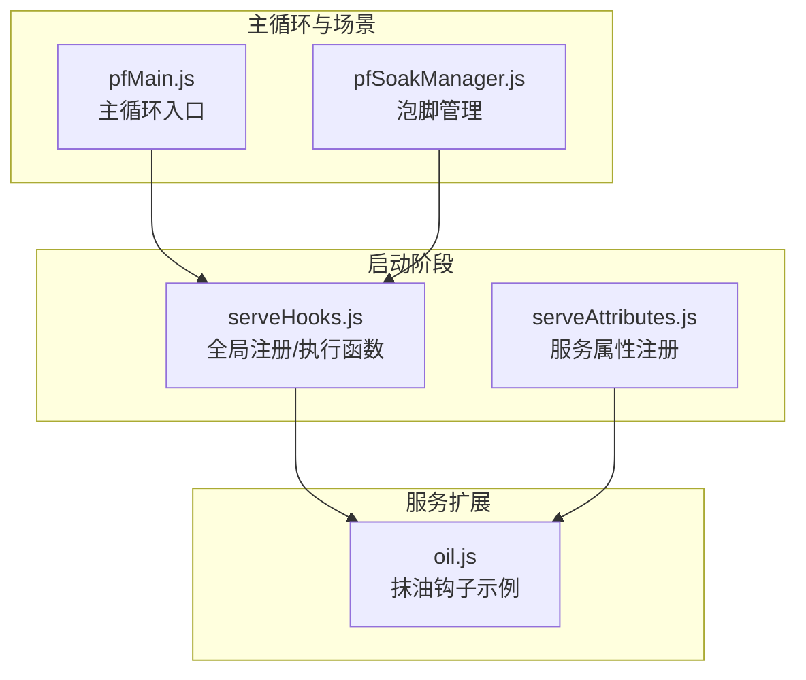
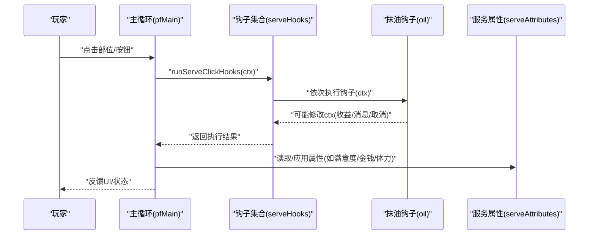
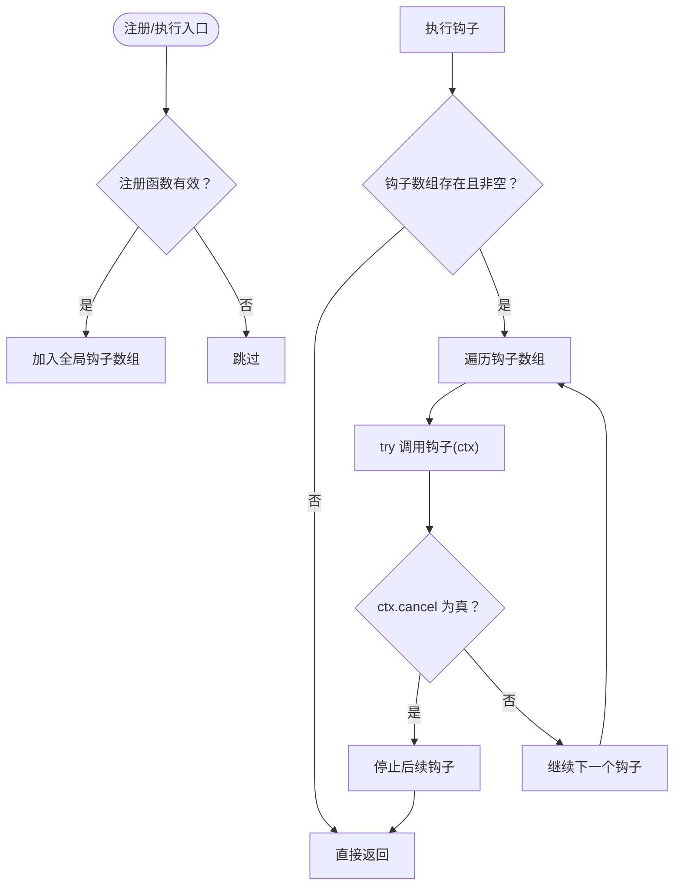
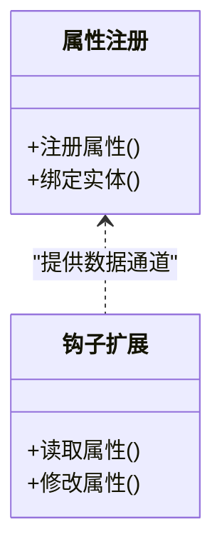
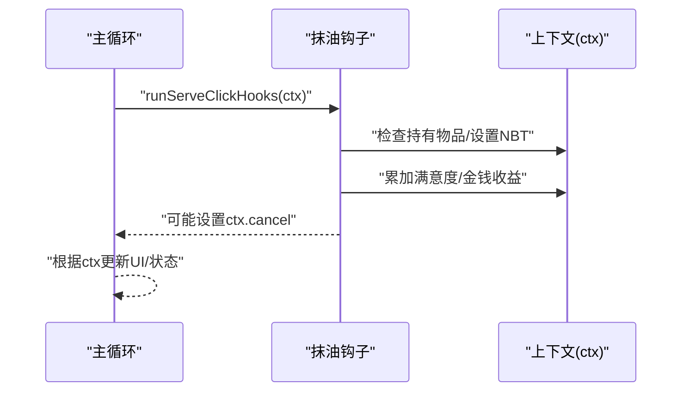
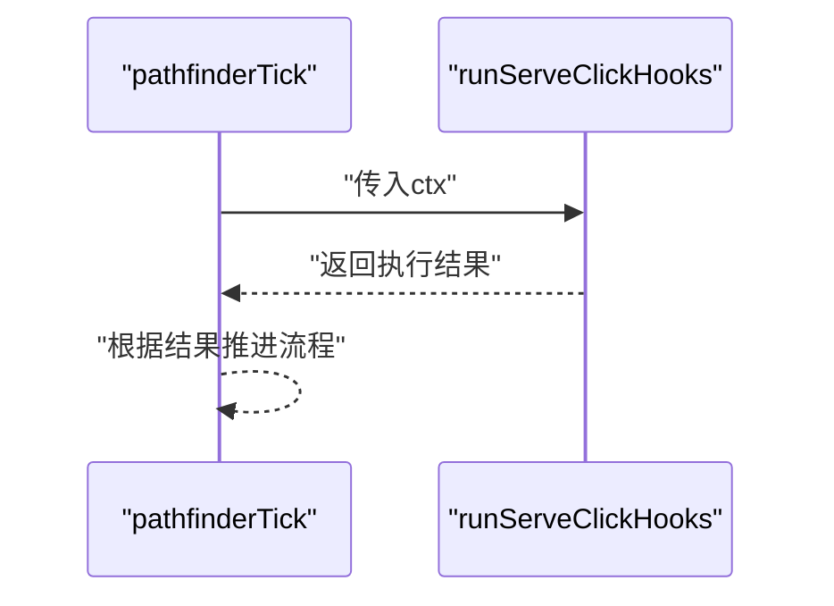
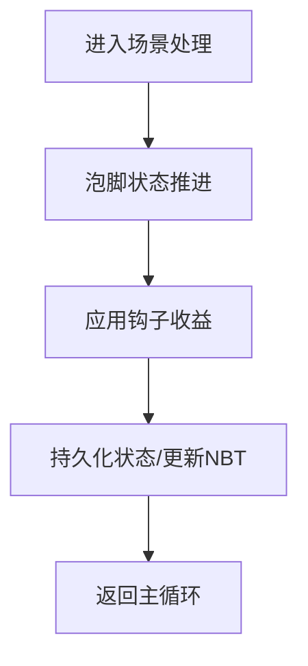
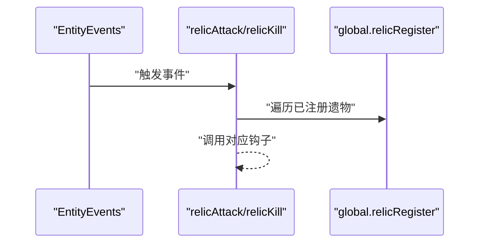
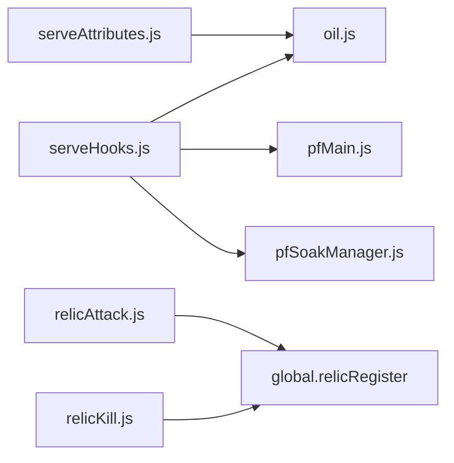

# 服务钩子系统

<cite>
**本文档引用的文件**
- [serveHooks.js](file://kubejs/startup_scripts/serveHooks.js)
- [serveAttributes.js](file://kubejs/startup_scripts/attributes/serveAttributes.js)
- [oil.js](file://kubejs/server_scripts/serve/oil.js)
- [pfMain.js](file://kubejs/server_scripts/pathfinder/pfMain.js)
- [pfSoakManager.js](file://kubejs/server_scripts/pathfinder/pfSoakManager.js)
- [relicAttack.js](file://kubejs/server_scripts/backpack/relic/relicAttack.js)
- [relicKill.js](file://kubejs/server_scripts/backpack/relic/relicKill.js)
</cite>

## 目录
1. [简介](#简介)
2. [项目结构](#项目结构)
3. [核心组件](#核心组件)
4. [架构总览](#架构总览)
5. [详细组件分析](#详细组件分析)
6. [依赖关系分析](#依赖关系分析)
7. [性能考量](#性能考量)
8. [故障排查指南](#故障排查指南)
9. [结论](#结论)
10. [附录](#附录)

## 简介
本文件系统性阐述 KubeJS 项目中的“服务钩子系统”。该系统通过统一的钩子注册与执行框架，将“额外功能”（如抹油、连击奖励等）从主流程中解耦，使业务扩展无需改动核心代码。本文重点解析 serveHooks.js 的设计与实现，覆盖钩子注册、事件触发、回调执行、生命周期管理、错误处理与性能优化，并提供可直接落地的扩展实践。

## 项目结构
服务钩子系统主要分布在以下目录与文件：
- 启动阶段钩子框架与全局注册/执行函数：[serveHooks.js](file://kubejs/startup_scripts/serveHooks.js)
- 服务属性注册（供钩子扩展读取/影响收益）：[serveAttributes.js](file://kubejs/startup_scripts/attributes/serveAttributes.js)
- 典型钩子扩展示例（抹油）：[oil.js](file://kubejs/server_scripts/serve/oil.js)
- 主循环入口（调用钩子的关键节点）：[pfMain.js](file://kubejs/server_scripts/pathfinder/pfMain.js)
- 泡脚管理（与钩子交互的典型场景之一）：[pfSoakManager.js](file://kubejs/server_scripts/pathfinder/pfSoakManager.js)
- 其他事件型钩子示例（基于事件的扩展模式）：[relicAttack.js](file://kubejs/server_scripts/backpack/relic/relicAttack.js)、[relicKill.js](file://kubejs/server_scripts/backpack/relic/relicKill.js)

图表来源
- [serveHooks.js:11-31](file://kubejs/startup_scripts/serveHooks.js#L11-L31)
- [serveAttributes.js:27-53](file://kubejs/startup_scripts/attributes/serveAttributes.js#L27-L53)
- [oil.js:28-56](file://kubejs/server_scripts/serve/oil.js#L28-L56)
- [pfMain.js:11-177](file://kubejs/server_scripts/pathfinder/pfMain.js#L11-L177)
- [pfSoakManager.js:92-145](file://kubejs/server_scripts/pathfinder/pfSoakManager.js#L92-L145)

章节来源
- [serveHooks.js:1-31](file://kubejs/startup_scripts/serveHooks.js#L1-L31)
- [serveAttributes.js:1-53](file://kubejs/startup_scripts/attributes/serveAttributes.js#L1-L53)
- [oil.js:1-56](file://kubejs/server_scripts/serve/oil.js#L1-L56)
- [pfMain.js:1-177](file://kubejs/server_scripts/pathfinder/pfMain.js#L1-L177)
- [pfSoakManager.js:1-197](file://kubejs/server_scripts/pathfinder/pfSoakManager.js#L1-L197)
- [relicAttack.js:1-33](file://kubejs/server_scripts/backpack/relic/relicAttack.js#L1-L33)
- [relicKill.js:1-33](file://kubejs/server_scripts/backpack/relic/relicKill.js#L1-L33)

## 核心组件
- 全局钩子容器与执行引擎
  - 全局数组用于存放注册的钩子函数
  - 提供注册与执行接口，支持在执行过程中通过上下文取消后续钩子
- 服务属性体系
  - 通过 Forge 事件注册与绑定服务相关属性，为钩子扩展提供统一的数据通道
- 典型钩子扩展
  - 抹油钩子：在点击结算节点对上下文进行增强或取消后续流程
- 主循环与场景集成
  - 主循环在关键节点调用钩子执行，确保扩展点稳定可靠
  - 场景模块（如泡脚）与钩子协作，实现收益与状态的动态叠加

章节来源
- [serveHooks.js:11-31](file://kubejs/startup_scripts/serveHooks.js#L11-L31)
- [serveAttributes.js:27-53](file://kubejs/startup_scripts/attributes/serveAttributes.js#L27-L53)
- [oil.js:28-56](file://kubejs/server_scripts/serve/oil.js#L28-L56)
- [pfMain.js:11-177](file://kubejs/server_scripts/pathfinder/pfMain.js#L11-L177)
- [pfSoakManager.js:92-145](file://kubejs/server_scripts/pathfinder/pfSoakManager.js#L92-L145)

## 架构总览
服务钩子系统采用“启动阶段注册 + 主循环触发”的双层架构：
- 启动阶段：注册钩子函数到全局容器，同时注册服务属性供扩展读取
- 运行阶段：主循环在关键节点遍历并执行钩子，钩子通过上下文参数影响收益、状态或流程控制

图表来源
- [pfMain.js:11-177](file://kubejs/server_scripts/pathfinder/pfMain.js#L11-L177)
- [serveHooks.js:19-30](file://kubejs/startup_scripts/serveHooks.js#L19-L30)
- [oil.js:28-56](file://kubejs/server_scripts/serve/oil.js#L28-L56)
- [serveAttributes.js:27-53](file://kubejs/startup_scripts/attributes/serveAttributes.js#L27-L53)

## 详细组件分析

### 组件A：钩子注册与执行引擎（serveHooks.js）
- 设计要点
  - 使用全局数组保存钩子函数，保证跨模块共享
  - 注册函数仅在函数存在时加入容器
  - 执行函数遍历容器，按顺序调用钩子，支持通过上下文取消后续钩子
  - 异常捕获，避免单个钩子错误影响整体流程
- 数据结构与复杂度
  - 容器为数组，注册/执行均为 O(n) 线性复杂度
  - 上下文为对象引用，便于扩展字段
- 生命周期与集成
  - 启动阶段注册钩子
  - 主循环在点击结算节点集中触发
- 错误处理
  - 执行阶段 try/catch 包裹，记录错误日志并继续执行
- 性能建议
  - 控制钩子数量与复杂度
  - 避免在钩子中进行重型计算或频繁 IO

图表来源
- [serveHooks.js:11-31](file://kubejs/startup_scripts/serveHooks.js#L11-L31)

章节来源
- [serveHooks.js:11-31](file://kubejs/startup_scripts/serveHooks.js#L11-L31)

### 组件B：服务属性体系（serveAttributes.js）
- 设计要点
  - 通过 Forge 事件注册服务相关属性，确保客户端可同步数值
  - 为钩子扩展提供统一的属性读取/修改入口
- 与钩子的关系
  - 钩子可通过上下文或属性系统共同影响最终收益
- 扩展性
  - 新增属性只需在注册阶段声明，无需修改主流程

图表来源
- [serveAttributes.js:27-53](file://kubejs/startup_scripts/attributes/serveAttributes.js#L27-L53)

章节来源
- [serveAttributes.js:1-53](file://kubejs/startup_scripts/attributes/serveAttributes.js#L1-L53)

### 组件C：典型钩子扩展（抹油钩子 oil.js）
- 功能目标
  - 玩家手持特定物品点击按钮时，标记“抹油”状态并在后续若干次有效点击中给予额外收益
- 关键流程
  - 注册阶段：向全局注册钩子函数
  - 触发阶段：在上下文中判断持有物品、修改 NBT、累加收益、必要时取消后续流程
- 与主循环集成
  - 主循环在点击结算节点调用钩子执行，钩子通过上下文影响最终结算结果

图表来源
- [oil.js:28-56](file://kubejs/server_scripts/serve/oil.js#L28-L56)
- [serveHooks.js:19-30](file://kubejs/startup_scripts/serveHooks.js#L19-L30)

章节来源
- [oil.js:1-56](file://kubejs/server_scripts/serve/oil.js#L1-L56)

### 组件D：主循环与钩子集成（pfMain.js）
- 设计要点
  - 主循环负责收集实体、推进状态机、在关键节点调用钩子
  - 通过统一的钩子执行接口，确保扩展点稳定
- 与钩子的关系
  - 主循环在点击结算等关键节点触发钩子执行，钩子可修改上下文以影响后续处理

图表来源
- [pfMain.js:11-177](file://kubejs/server_scripts/pathfinder/pfMain.js#L11-L177)
- [serveHooks.js:19-30](file://kubejs/startup_scripts/serveHooks.js#L19-L30)

章节来源
- [pfMain.js:1-177](file://kubejs/server_scripts/pathfinder/pfMain.js#L1-L177)

### 组件E：场景模块与钩子协作（pfSoakManager.js）
- 设计要点
  - 场景模块独立管理自身状态与计时，钩子在结算阶段参与收益计算
- 协作方式
  - 钩子通过上下文影响收益字段，场景模块负责状态持久化与 UI 反馈

图表来源
- [pfSoakManager.js:92-145](file://kubejs/server_scripts/pathfinder/pfSoakManager.js#L92-L145)
- [serveHooks.js:19-30](file://kubejs/startup_scripts/serveHooks.js#L19-L30)

章节来源
- [pfSoakManager.js:1-197](file://kubejs/server_scripts/pathfinder/pfSoakManager.js#L1-L197)

### 组件F：事件型钩子示例（relicAttack.js、relicKill.js）
- 设计要点
  - 基于事件监听器，在特定事件发生时遍历全局注册表并调用对应钩子
  - 体现“事件驱动 + 钩子扩展”的另一种集成范式
- 与服务钩子的区别
  - 服务钩子聚焦“点击结算”这一确定性节点
  - 事件型钩子更灵活，适用于战斗、死亡等异步事件

图表来源
- [relicAttack.js:3-33](file://kubejs/server_scripts/backpack/relic/relicAttack.js#L3-L33)
- [relicKill.js:3-33](file://kubejs/server_scripts/backpack/relic/relicKill.js#L3-L33)

章节来源
- [relicAttack.js:1-33](file://kubejs/server_scripts/backpack/relic/relicAttack.js#L1-L33)
- [relicKill.js:1-33](file://kubejs/server_scripts/backpack/relic/relicKill.js#L1-L33)

## 依赖关系分析
- 组件耦合
  - serveHooks.js 与各扩展之间为弱耦合：扩展仅依赖注册接口，不依赖内部实现
  - 主循环与钩子为弱耦合：通过统一接口触发，扩展无需修改主循环
- 外部依赖
  - 服务属性依赖 Forge 事件系统进行注册与绑定
  - 事件型钩子依赖 KubeJS 事件 API
- 潜在风险
  - 钩子执行顺序与上下文一致性需在扩展间约定
  - 异常处理策略需统一，避免日志污染与流程中断

图表来源
- [serveHooks.js:11-31](file://kubejs/startup_scripts/serveHooks.js#L11-L31)
- [oil.js:28-56](file://kubejs/server_scripts/serve/oil.js#L28-L56)
- [pfMain.js:11-177](file://kubejs/server_scripts/pathfinder/pfMain.js#L11-L177)
- [pfSoakManager.js:92-145](file://kubejs/server_scripts/pathfinder/pfSoakManager.js#L92-L145)
- [serveAttributes.js:27-53](file://kubejs/startup_scripts/attributes/serveAttributes.js#L27-L53)
- [relicAttack.js:3-33](file://kubejs/server_scripts/backpack/relic/relicAttack.js#L3-L33)
- [relicKill.js:3-33](file://kubejs/server_scripts/backpack/relic/relicKill.js#L3-L33)

章节来源
- [serveHooks.js:11-31](file://kubejs/startup_scripts/serveHooks.js#L11-L31)
- [oil.js:28-56](file://kubejs/server_scripts/serve/oil.js#L28-L56)
- [pfMain.js:11-177](file://kubejs/server_scripts/pathfinder/pfMain.js#L11-L177)
- [pfSoakManager.js:92-145](file://kubejs/server_scripts/pathfinder/pfSoakManager.js#L92-L145)
- [serveAttributes.js:27-53](file://kubejs/startup_scripts/attributes/serveAttributes.js#L27-L53)
- [relicAttack.js:3-33](file://kubejs/server_scripts/backpack/relic/relicAttack.js#L3-L33)
- [relicKill.js:3-33](file://kubejs/server_scripts/backpack/relic/relicKill.js#L3-L33)

## 性能考量
- 钩子数量与复杂度
  - 控制钩子数量，避免线性遍历带来的时间开销
  - 将重型计算移至后台或延迟执行
- 上下文传递
  - 使用对象引用传递上下文，减少拷贝成本
- 异常与日志
  - try/catch 包裹钩子执行，避免异常扩散
  - 合理使用日志级别，避免高频输出造成性能损耗
- 状态持久化
  - 场景模块使用实体持久化数据，减少跨 tick 依赖

## 故障排查指南
- 常见问题
  - 钩子未生效：确认钩子已在启动阶段注册并加入全局数组
  - 上下文字段缺失：检查主循环是否正确构造并传递上下文
  - 钩子抛错导致流程中断：查看日志中“钩子错误”记录，定位具体钩子
- 排查步骤
  - 在注册阶段打印钩子数量与内容
  - 在执行阶段打印上下文关键字段
  - 对每个钩子增加 try/catch 并记录详细错误信息
- 建议
  - 为钩子提供最小可复现示例，便于隔离问题
  - 对关键钩子增加单元测试或手动验证流程

章节来源
- [serveHooks.js:23-29](file://kubejs/startup_scripts/serveHooks.js#L23-L29)
- [oil.js:28-56](file://kubejs/server_scripts/serve/oil.js#L28-L56)

## 结论
服务钩子系统通过“启动阶段注册 + 主循环触发”的架构，实现了功能的模块化与可扩展性。扩展开发者仅需关注钩子注册与上下文处理，即可在不修改核心代码的前提下新增服务功能。配合服务属性体系与事件型钩子，系统形成了统一而灵活的扩展生态。

## 附录

### 使用示例：添加新的服务功能
- 步骤
  - 在启动阶段注册钩子函数
  - 在主循环的关键节点调用钩子执行
  - 通过上下文传递与修改收益、状态或流程控制
- 参考路径
  - 注册钩子：[serveHooks.js:13-17](file://kubejs/startup_scripts/serveHooks.js#L13-L17)
  - 执行钩子：[serveHooks.js:19-30](file://kubejs/startup_scripts/serveHooks.js#L19-L30)
  - 主循环触发：[pfMain.js:11-177](file://kubejs/server_scripts/pathfinder/pfMain.js#L11-L177)
  - 示例钩子：[oil.js:28-56](file://kubejs/server_scripts/serve/oil.js#L28-L56)

### 生命周期管理
- 注册期：钩子函数被加入全局数组
- 运行期：主循环在关键节点遍历并执行钩子
- 清理期：钩子可自行清理状态（如抹油奖励次数耗尽）

### 错误处理机制
- 执行阶段捕获异常并记录日志
- 通过上下文取消后续钩子，避免连锁反应