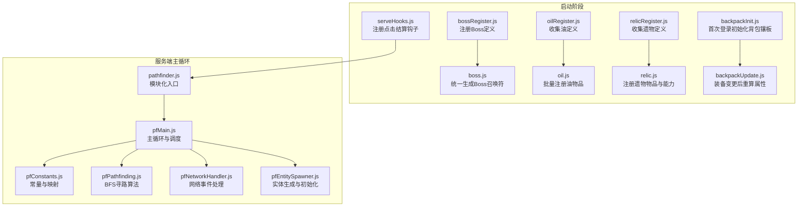
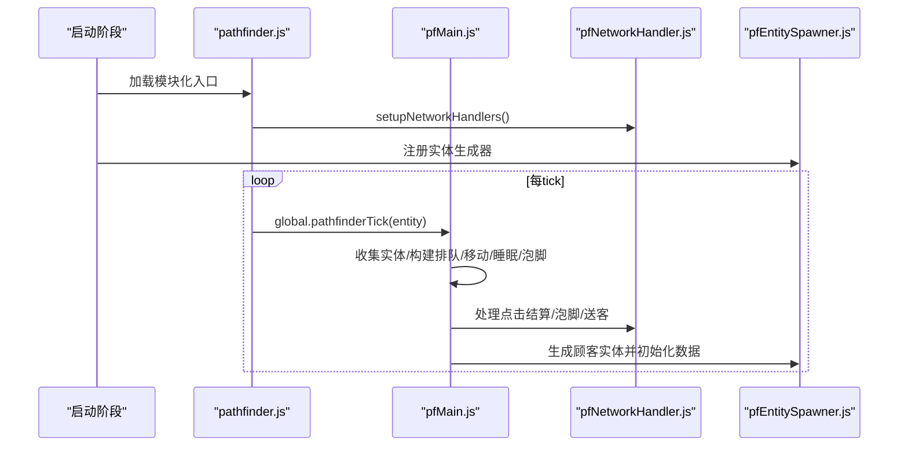
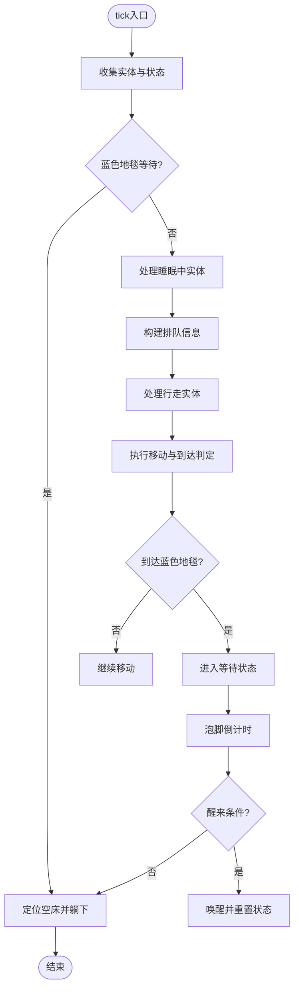
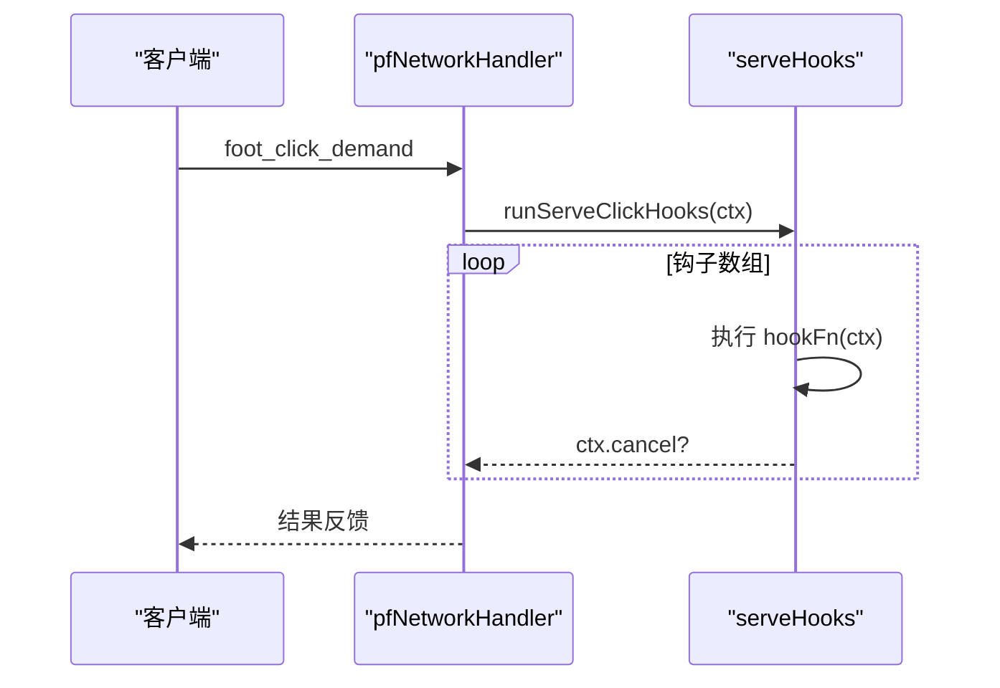
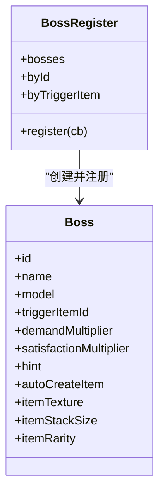
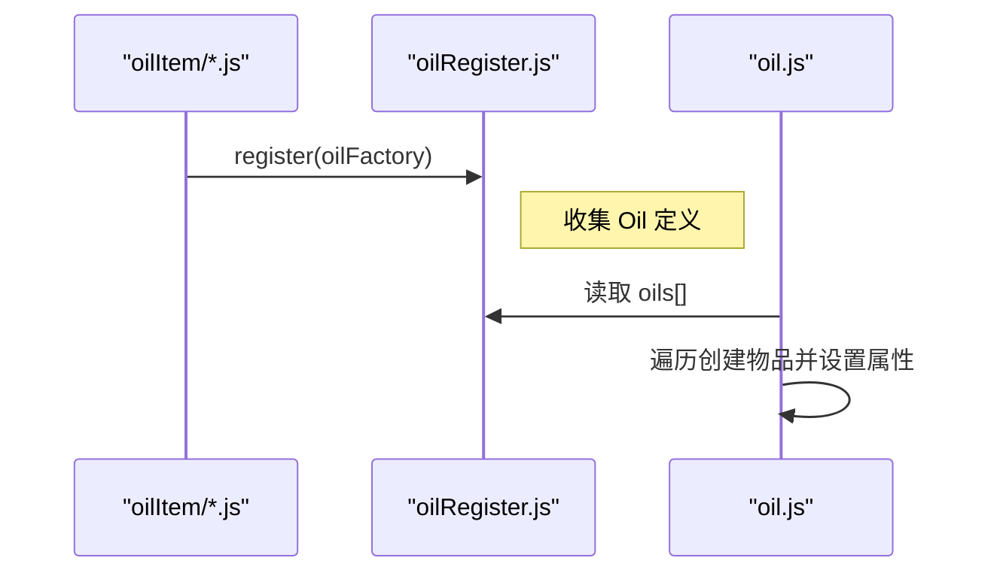
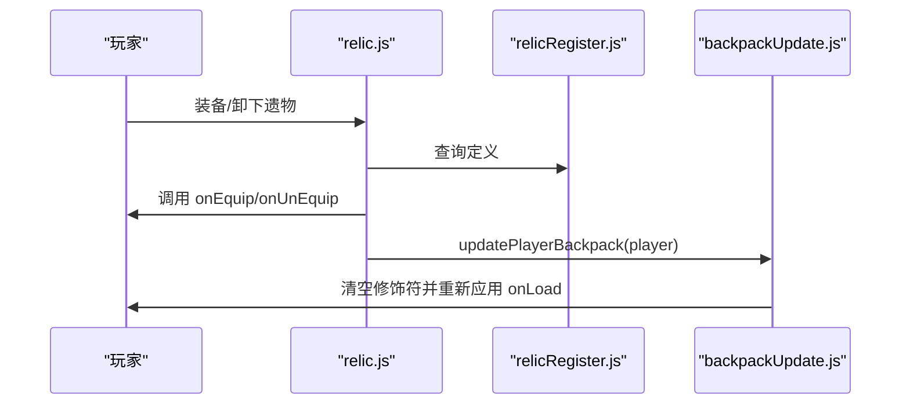
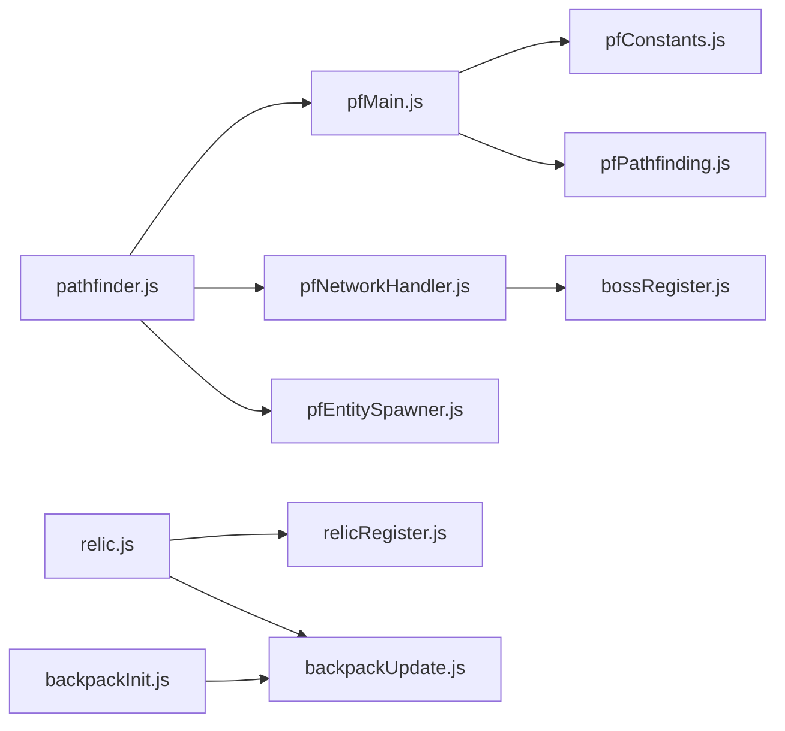

# 核心模块

<cite>
**本文引用的文件**
- [kubejs/server_scripts/pathfinder.js](file://kubejs/server_scripts/pathfinder.js)
- [kubejs/server_scripts/pathfinder/pfMain.js](file://kubejs/server_scripts/pathfinder/pfMain.js)
- [kubejs/server_scripts/pathfinder/pfConstants.js](file://kubejs/server_scripts/pathfinder/pfConstants.js)
- [kubejs/server_scripts/pathfinder/pfPathfinding.js](file://kubejs/server_scripts/pathfinder/pfPathfinding.js)
- [kubejs/server_scripts/pathfinder/pfNetworkHandler.js](file://kubejs/server_scripts/pathfinder/pfNetworkHandler.js)
- [kubejs/server_scripts/pathfinder/pfEntitySpawner.js](file://kubejs/server_scripts/pathfinder/pfEntitySpawner.js)
- [kubejs/startup_scripts/serveHooks.js](file://kubejs/startup_scripts/serveHooks.js)
- [kubejs/startup_scripts/boss/bossRegister.js](file://kubejs/startup_scripts/boss/bossRegister.js)
- [kubejs/startup_scripts/boss/boss.js](file://kubejs/startup_scripts/boss/boss.js)
- [kubejs/startup_scripts/oil/oilRegister.js](file://kubejs/startup_scripts/oil/oilRegister.js)
- [kubejs/startup_scripts/oil/oil.js](file://kubejs/startup_scripts/oil/oil.js)
- [kubejs/startup_scripts/relic/relicRegister.js](file://kubejs/startup_scripts/relic/relicRegister.js)
- [kubejs/startup_scripts/relic/relic.js](file://kubejs/startup_scripts/relic/relic.js)
- [kubejs/server_scripts/backpack/backpackInit.js](file://kubejs/server_scripts/backpack/backpackInit.js)
- [kubejs/server_scripts/backpack/backpackUpdate.js](file://kubejs/server_scripts/backpack/backpackUpdate.js)
</cite>

## 目录
1. [简介](#简介)
2. [项目结构](#项目结构)
3. [核心组件](#核心组件)
4. [架构总览](#架构总览)
5. [详细组件分析](#详细组件分析)
6. [依赖关系分析](#依赖关系分析)
7. [性能考量](#性能考量)
8. [故障排查指南](#故障排查指南)
9. [结论](#结论)
10. [附录](#附录)

## 简介
本文件聚焦于项目中最关键的功能模块：寻路系统、服务钩子系统、Boss系统、油品系统与遗物系统。文档从设计目标、实现原理、接口规范与使用方法入手，结合模块间协作关系、数据传递机制与事件处理流程，帮助开发者快速理解并扩展这些核心功能。文中所有技术细节均基于仓库中的实际源码进行梳理与总结。

## 项目结构
本项目采用“启动阶段注册 + 服务端主循环”的分层组织方式：
- 启动阶段（StartupEvents）：负责收集定义、注册物品与能力、初始化全局注册表。
- 服务端主循环（ServerTick）：由寻路方块实体驱动，按 tick 分派各类子系统处理。
- 事件层（NetworkEvents/PlayerEvents）：承接客户端交互与玩家生命周期事件。

**图表来源**
- [kubejs/server_scripts/pathfinder.js:1-30](file://kubejs/server_scripts/pathfinder.js#L1-L30)
- [kubejs/server_scripts/pathfinder/pfMain.js:1-177](file://kubejs/server_scripts/pathfinder/pfMain.js#L1-L177)
- [kubejs/server_scripts/pathfinder/pfConstants.js:1-65](file://kubejs/server_scripts/pathfinder/pfConstants.js#L1-L65)
- [kubejs/server_scripts/pathfinder/pfPathfinding.js:1-91](file://kubejs/server_scripts/pathfinder/pfPathfinding.js#L1-L91)
- [kubejs/server_scripts/pathfinder/pfNetworkHandler.js:1-317](file://kubejs/server_scripts/pathfinder/pfNetworkHandler.js#L1-L317)
- [kubejs/server_scripts/pathfinder/pfEntitySpawner.js:1-141](file://kubejs/server_scripts/pathfinder/pfEntitySpawner.js#L1-L141)
- [kubejs/startup_scripts/serveHooks.js:1-31](file://kubejs/startup_scripts/serveHooks.js#L1-L31)
- [kubejs/startup_scripts/boss/bossRegister.js:1-103](file://kubejs/startup_scripts/boss/bossRegister.js#L1-L103)
- [kubejs/startup_scripts/boss/boss.js:1-37](file://kubejs/startup_scripts/boss/boss.js#L1-L37)
- [kubejs/startup_scripts/oil/oilRegister.js:1-61](file://kubejs/startup_scripts/oil/oilRegister.js#L1-L61)
- [kubejs/startup_scripts/oil/oil.js:1-28](file://kubejs/startup_scripts/oil/oil.js#L1-L28)
- [kubejs/startup_scripts/relic/relicRegister.js:1-178](file://kubejs/startup_scripts/relic/relicRegister.js#L1-L178)
- [kubejs/startup_scripts/relic/relic.js:1-81](file://kubejs/startup_scripts/relic/relic.js#L1-L81)
- [kubejs/server_scripts/backpack/backpackInit.js:1-67](file://kubejs/server_scripts/backpack/backpackInit.js#L1-L67)
- [kubejs/server_scripts/backpack/backpackUpdate.js:1-73](file://kubejs/server_scripts/backpack/backpackUpdate.js#L1-L73)

**章节来源**
- [kubejs/server_scripts/pathfinder.js:1-30](file://kubejs/server_scripts/pathfinder.js#L1-L30)
- [kubejs/server_scripts/pathfinder/pfMain.js:1-177](file://kubejs/server_scripts/pathfinder/pfMain.js#L1-L177)

## 核心组件
- 寻路系统：以方块实体为 tick 触发器，整合常量、寻路算法、实体生成、网络事件与主循环调度，形成完整的顾客寻路与服务流程。
- 服务钩子系统：在点击结算的关键节点集中调用多个独立钩子，实现“额外功能（如抹油、连击奖励等）”的模块化接入。
- Boss系统：通过注册器收集 Boss 定义，支持需求倍率、满意度倍率、自动召唤符生成等特性，并在点击结算时应用倍率。
- 油品系统：注册器收集油定义，统一生成物品 ID、显示名、耐久与标签，最终在启动阶段批量注册。
- 遗物系统：注册器收集遗物定义，统一生成物品 ID、贴图、标签与 Curios 能力；装备/卸下时触发回调并重算玩家属性。

**章节来源**
- [kubejs/server_scripts/pathfinder/pfConstants.js:1-65](file://kubejs/server_scripts/pathfinder/pfConstants.js#L1-L65)
- [kubejs/server_scripts/pathfinder/pfPathfinding.js:1-91](file://kubejs/server_scripts/pathfinder/pfPathfinding.js#L1-L91)
- [kubejs/server_scripts/pathfinder/pfEntitySpawner.js:1-141](file://kubejs/server_scripts/pathfinder/pfEntitySpawner.js#L1-L141)
- [kubejs/server_scripts/pathfinder/pfNetworkHandler.js:1-317](file://kubejs/server_scripts/pathfinder/pfNetworkHandler.js#L1-L317)
- [kubejs/startup_scripts/serveHooks.js:1-31](file://kubejs/startup_scripts/serveHooks.js#L1-L31)
- [kubejs/startup_scripts/boss/bossRegister.js:1-103](file://kubejs/startup_scripts/boss/bossRegister.js#L1-L103)
- [kubejs/startup_scripts/boss/boss.js:1-37](file://kubejs/startup_scripts/boss/boss.js#L1-L37)
- [kubejs/startup_scripts/oil/oilRegister.js:1-61](file://kubejs/startup_scripts/oil/oilRegister.js#L1-L61)
- [kubejs/startup_scripts/oil/oil.js:1-28](file://kubejs/startup_scripts/oil/oil.js#L1-L28)
- [kubejs/startup_scripts/relic/relicRegister.js:1-178](file://kubejs/startup_scripts/relic/relicRegister.js#L1-L178)
- [kubejs/startup_scripts/relic/relic.js:1-81](file://kubejs/startup_scripts/relic/relic.js#L1-L81)
- [kubejs/server_scripts/backpack/backpackInit.js:1-67](file://kubejs/server_scripts/backpack/backpackInit.js#L1-L67)
- [kubejs/server_scripts/backpack/backpackUpdate.js:1-73](file://kubejs/server_scripts/backpack/backpackUpdate.js#L1-L73)

## 架构总览
下图展示了从启动到服务端主循环的整体协作关系与数据流：

**图表来源**
- [kubejs/server_scripts/pathfinder.js:25-30](file://kubejs/server_scripts/pathfinder.js#L25-L30)
- [kubejs/server_scripts/pathfinder/pfMain.js:11-174](file://kubejs/server_scripts/pathfinder/pfMain.js#L11-L174)
- [kubejs/server_scripts/pathfinder/pfNetworkHandler.js:37-311](file://kubejs/server_scripts/pathfinder/pfNetworkHandler.js#L37-L311)
- [kubejs/server_scripts/pathfinder/pfEntitySpawner.js:8-135](file://kubejs/server_scripts/pathfinder/pfEntitySpawner.js#L8-L135)

## 详细组件分析

### 寻路系统
- 设计目的：为顾客实体提供路径规划、排队、移动、睡眠与泡脚的完整生命周期管理。
- 实现原理：
  - 常量与映射：定义网格尺寸、方向列表、部位键值映射等。
  - BFS 寻路：将世界坐标映射到网格索引，使用广度优先搜索生成路径字符串。
  - 主循环：按阶段推进实体状态，处理蓝色地毯等待、睡眠、行走与到达判定。
  - 网络事件：接收客户端点击，按部位与属性计算体力消耗、满意度与金钱收益，应用 Boss 满意度倍率并记录步码。
  - 实体生成：生成女仆实体，写入持久化数据（店铺坐标、玩家 UUID、路线、床位预扫描、需求清单等）。
- 接口规范：
  - 全局入口：global.pathfinderTick(entity)
  - 导出模块：global.pfConstants、global.pfPathfinding、global.pfNetworkHandler、global.pfEntitySpawner
- 使用方法：
  - 在启动阶段加载模块化入口与子模块。
  - 通过 pfNetworkHandler.setupNetworkHandlers() 注册网络事件。
  - 在 pfMain.js 中按 tick 调用 global.pathfinderTick(entity)。

**图表来源**
- [kubejs/server_scripts/pathfinder/pfMain.js:22-173](file://kubejs/server_scripts/pathfinder/pfMain.js#L22-L173)
- [kubejs/server_scripts/pathfinder/pfNetworkHandler.js:39-311](file://kubejs/server_scripts/pathfinder/pfNetworkHandler.js#L39-L311)

**章节来源**
- [kubejs/server_scripts/pathfinder/pfConstants.js:1-65](file://kubejs/server_scripts/pathfinder/pfConstants.js#L1-L65)
- [kubejs/server_scripts/pathfinder/pfPathfinding.js:1-91](file://kubejs/server_scripts/pathfinder/pfPathfinding.js#L1-L91)
- [kubejs/server_scripts/pathfinder/pfMain.js:1-177](file://kubejs/server_scripts/pathfinder/pfMain.js#L1-L177)
- [kubejs/server_scripts/pathfinder/pfNetworkHandler.js:1-317](file://kubejs/server_scripts/pathfinder/pfNetworkHandler.js#L1-L317)
- [kubejs/server_scripts/pathfinder/pfEntitySpawner.js:1-141](file://kubejs/server_scripts/pathfinder/pfEntitySpawner.js#L1-L141)

### 服务钩子系统
- 设计目的：将“额外功能（如抹油、连击奖励等）”从主流程中解耦，通过注册钩子的方式在关键节点集中执行。
- 实现原理：
  - 在启动阶段初始化全局钩子数组与注册函数。
  - 在点击结算的关键节点遍历并依次执行钩子，支持钩子内部取消后续执行。
  - 对钩子执行过程进行异常捕获，避免影响主流程。
- 接口规范：
  - global.registerServeClickHook(hookFn)
  - global.runServeClickHooks(ctx)
- 使用方法：
  - 在独立 server_scripts 文件中注册钩子函数。
  - 在点击结算流程中调用 global.runServeClickHooks(ctx)。

**图表来源**
- [kubejs/server_scripts/pathfinder/pfNetworkHandler.js:39-219](file://kubejs/server_scripts/pathfinder/pfNetworkHandler.js#L39-L219)
- [kubejs/startup_scripts/serveHooks.js:11-30](file://kubejs/startup_scripts/serveHooks.js#L11-L30)

**章节来源**
- [kubejs/startup_scripts/serveHooks.js:1-31](file://kubejs/startup_scripts/serveHooks.js#L1-L31)
- [kubejs/server_scripts/pathfinder/pfNetworkHandler.js:19-30](file://kubejs/server_scripts/pathfinder/pfNetworkHandler.js#L19-L30)

### Boss系统
- 设计目的：为特殊顾客（Boss）提供定制化的服务体验，包括需求倍率、满意度倍率与自动召唤符生成。
- 实现原理：
  - 注册器收集 Boss 定义，校验唯一性与完整性，支持自动触发物品生成。
  - 点击结算时读取实体 persistentData 中的 pfBossId，查表应用满意度倍率。
  - 在启动阶段统一生成 Boss 召唤符物品。
- 接口规范：
  - BossRegister.register(cb)：链式配置 Boss 字段。
  - global.bossRegister：包含 bosses、byId、byTriggerItem。
- 使用方法：
  - 在启动阶段注册多个 boss_*.js 文件，使用 register 回调配置字段。
  - 在点击结算流程中通过 pfApplyBossSatMul 应用倍率。

**图表来源**
- [kubejs/startup_scripts/boss/bossRegister.js:60-97](file://kubejs/startup_scripts/boss/bossRegister.js#L60-L97)
- [kubejs/startup_scripts/boss/boss.js:9-36](file://kubejs/startup_scripts/boss/boss.js#L9-L36)

**章节来源**
- [kubejs/startup_scripts/boss/bossRegister.js:1-103](file://kubejs/startup_scripts/boss/bossRegister.js#L1-L103)
- [kubejs/startup_scripts/boss/boss.js:1-37](file://kubejs/startup_scripts/boss/boss.js#L1-L37)
- [kubejs/server_scripts/pathfinder/pfNetworkHandler.js:19-34](file://kubejs/server_scripts/pathfinder/pfNetworkHandler.js#L19-L34)

### 油品系统
- 设计目的：统一收集与注册“油”类物品，支持名称、描述、标签与耐久等元数据。
- 实现原理：
  - 注册器收集 Oil 定义，提供链式 API。
  - 在启动阶段遍历注册表，使用 StartupEvents.registry 创建物品，设置显示名、不可堆叠与耐久等属性。
- 接口规范：
  - OilRegister.register(factory)：注册 Oil 定义。
  - Oil.getOilId()：生成物品 ID。
- 使用方法：
  - 在独立 oilItem/*.js 中调用 global.oilRegister.register(...) 完成定义。
  - 启动阶段由 oil.js 统一批量注册。

**图表来源**
- [kubejs/startup_scripts/oil/oilRegister.js:9-21](file://kubejs/startup_scripts/oil/oilRegister.js#L9-L21)
- [kubejs/startup_scripts/oil/oil.js:9-27](file://kubejs/startup_scripts/oil/oil.js#L9-L27)

**章节来源**
- [kubejs/startup_scripts/oil/oilRegister.js:1-61](file://kubejs/startup_scripts/oil/oilRegister.js#L1-L61)
- [kubejs/startup_scripts/oil/oil.js:1-28](file://kubejs/startup_scripts/oil/oil.js#L1-L28)

### 遗物系统
- 设计目的：为玩家提供可装备的“遗物”，支持贴图、标签、Curios 能力与多阶段外观。
- 实现原理：
  - 注册器收集 Relic 定义，支持稀有度、池类别、阶段、纹理与回调函数。
  - 在启动阶段注册物品，附加 Curios 能力，覆盖装备/卸下/可装备判断等回调。
  - 背包重算：在装备变更后清空既有修饰符并重新应用各遗物 onLoad 效果。
  - 首次登录：按预设矩阵为玩家初始化背包镶板。
- 接口规范：
  - RelicRegister.register(relicFactory)：注册 Relic 定义。
  - global.getRelicId(name)：生成物品 ID。
  - global.updatePlayerBackpack(player)：重算属性。
- 使用方法：
  - 在独立 relicItem/stage*/ 下调用 global.relicRegister.register(...) 完成定义。
  - 在装备/卸下回调中实现具体效果。

**图表来源**
- [kubejs/startup_scripts/relic/relic.js:7-79](file://kubejs/startup_scripts/relic/relic.js#L7-L79)
- [kubejs/startup_scripts/relic/relicRegister.js:1-178](file://kubejs/startup_scripts/relic/relicRegister.js#L1-L178)
- [kubejs/server_scripts/backpack/backpackUpdate.js:39-72](file://kubejs/server_scripts/backpack/backpackUpdate.js#L39-L72)

**章节来源**
- [kubejs/startup_scripts/relic/relicRegister.js:1-178](file://kubejs/startup_scripts/relic/relicRegister.js#L1-L178)
- [kubejs/startup_scripts/relic/relic.js:1-81](file://kubejs/startup_scripts/relic/relic.js#L1-L81)
- [kubejs/server_scripts/backpack/backpackInit.js:1-67](file://kubejs/server_scripts/backpack/backpackInit.js#L1-L67)
- [kubejs/server_scripts/backpack/backpackUpdate.js:1-73](file://kubejs/server_scripts/backpack/backpackUpdate.js#L1-L73)

## 依赖关系分析
- 模块耦合：
  - 寻路系统依赖常量、网络事件、实体生成与主循环调度。
  - Boss 系统通过注册表被点击结算流程间接使用。
  - 遗物系统通过 Curios 能力与背包重算影响玩家属性。
- 外部依赖：
  - Curios API：用于装配与槽位管理。
  - Minecraft 属性系统：用于服务部位的满意度、金钱与体力消耗。
  - KubeJS 事件系统：StartupEvents、NetworkEvents、PlayerEvents。

**图表来源**
- [kubejs/server_scripts/pathfinder.js:1-30](file://kubejs/server_scripts/pathfinder.js#L1-L30)
- [kubejs/server_scripts/pathfinder/pfMain.js:1-177](file://kubejs/server_scripts/pathfinder/pfMain.js#L1-L177)
- [kubejs/server_scripts/pathfinder/pfConstants.js:1-65](file://kubejs/server_scripts/pathfinder/pfConstants.js#L1-L65)
- [kubejs/server_scripts/pathfinder/pfPathfinding.js:1-91](file://kubejs/server_scripts/pathfinder/pfPathfinding.js#L1-L91)
- [kubejs/server_scripts/pathfinder/pfNetworkHandler.js:1-317](file://kubejs/server_scripts/pathfinder/pfNetworkHandler.js#L1-L317)
- [kubejs/server_scripts/pathfinder/pfEntitySpawner.js:1-141](file://kubejs/server_scripts/pathfinder/pfEntitySpawner.js#L1-L141)
- [kubejs/startup_scripts/boss/bossRegister.js:1-103](file://kubejs/startup_scripts/boss/bossRegister.js#L1-L103)
- [kubejs/startup_scripts/relic/relicRegister.js:1-178](file://kubejs/startup_scripts/relic/relicRegister.js#L1-L178)
- [kubejs/startup_scripts/relic/relic.js:1-81](file://kubejs/startup_scripts/relic/relic.js#L1-L81)
- [kubejs/server_scripts/backpack/backpackInit.js:1-67](file://kubejs/server_scripts/backpack/backpackInit.js#L1-L67)
- [kubejs/server_scripts/backpack/backpackUpdate.js:1-73](file://kubejs/server_scripts/backpack/backpackUpdate.js#L1-L73)

**章节来源**
- [kubejs/server_scripts/pathfinder.js:1-30](file://kubejs/server_scripts/pathfinder.js#L1-L30)
- [kubejs/server_scripts/pathfinder/pfMain.js:1-177](file://kubejs/server_scripts/pathfinder/pfMain.js#L1-L177)
- [kubejs/server_scripts/pathfinder/pfNetworkHandler.js:1-317](file://kubejs/server_scripts/pathfinder/pfNetworkHandler.js#L1-L317)
- [kubejs/server_scripts/pathfinder/pfEntitySpawner.js:1-141](file://kubejs/server_scripts/pathfinder/pfEntitySpawner.js#L1-L141)
- [kubejs/startup_scripts/boss/bossRegister.js:1-103](file://kubejs/startup_scripts/boss/bossRegister.js#L1-L103)
- [kubejs/startup_scripts/relic/relicRegister.js:1-178](file://kubejs/startup_scripts/relic/relicRegister.js#L1-L178)
- [kubejs/server_scripts/backpack/backpackUpdate.js:1-73](file://kubejs/server_scripts/backpack/backpackUpdate.js#L1-L73)

## 性能考量
- 寻路网格与BFS：
  - 网格半径与宽度决定搜索空间大小，应根据地图规模合理设置。
  - BFS队列与访问标记在大范围搜索时可能产生内存压力，建议限制搜索半径或引入启发式优化。
- 主循环开销：
  - 每 tick 需要遍历实体、构建排队、执行移动与睡眠逻辑，建议对实体数量与处理频率进行节流。
  - 网络事件处理需避免阻塞，确保异步与异常安全。
- 遗物重算：
  - 背包重算会清空并重建大量属性修饰符，建议在高频切换时合并触发或延迟执行。

## 故障排查指南
- 点击结算无效：
  - 检查网络事件是否注册：global.pfNetworkHandler.setupNetworkHandlers 是否被调用。
  - 核对实体 UUID 与部位键值是否匹配，确认手持物品为同步项且包含有效 NBT。
- 满意度倍率未生效：
  - 确认实体 persistentData 中存在 pfBossId，且 bossRegister.byTriggerItem 能正确解析。
- 泡脚无法开始：
  - 确认玩家手持水桶或已注册的洗脚水桶，检查 pfSoakManager.pfStartSoak 是否返回成功。
- 遗物效果不生效：
  - 检查 Curios 能力是否正确附加，确认 updatePlayerBackpack 是否被调用。
  - 核对 onLoad 回调是否实现并正确应用修饰符。

**章节来源**
- [kubejs/server_scripts/pathfinder/pfNetworkHandler.js:37-311](file://kubejs/server_scripts/pathfinder/pfNetworkHandler.js#L37-L311)
- [kubejs/server_scripts/backpack/backpackUpdate.js:39-72](file://kubejs/server_scripts/backpack/backpackUpdate.js#L39-L72)

## 结论
本项目通过模块化设计将寻路、服务钩子、Boss、油品与遗物等核心功能解耦，既保证了可维护性，也为扩展提供了清晰的接口。开发者可在不侵入主流程的前提下，通过注册器与钩子机制快速接入新功能；同时，借助统一的网络事件与属性系统，能够稳定地实现复杂的交互与状态管理。

## 附录
- 关键全局变量与函数（示例）
  - global.pathfinderTick(entity)：主循环入口
  - global.registerServeClickHook(hookFn)/global.runServeClickHooks(ctx)：服务钩子框架
  - global.bossRegister：Boss 注册表
  - global.oilRegister/global.relicRegister：注册器
  - global.updatePlayerBackpack(player)：背包重算
  - global.pfConstants/global.pfPathfinding/global.pfNetworkHandler/global.pfEntitySpawner：模块导出