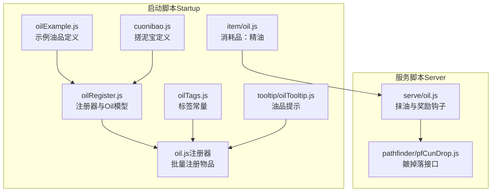
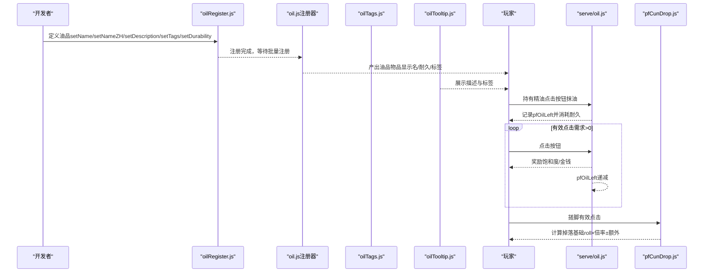
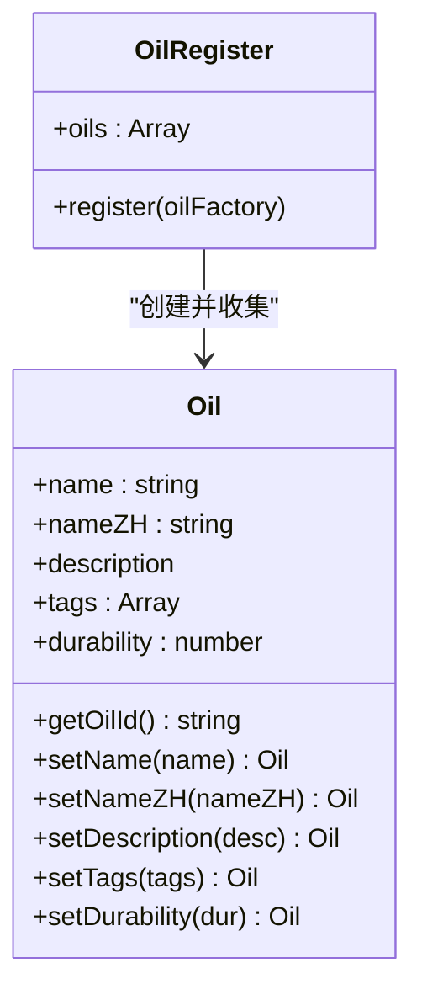
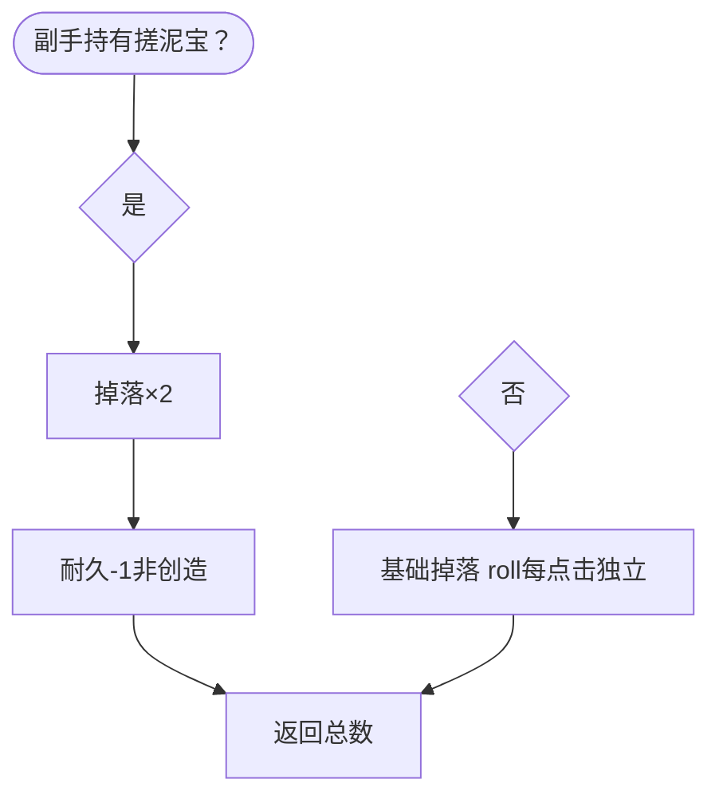
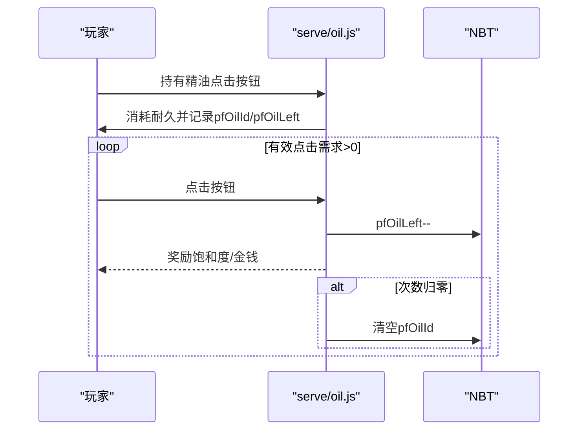
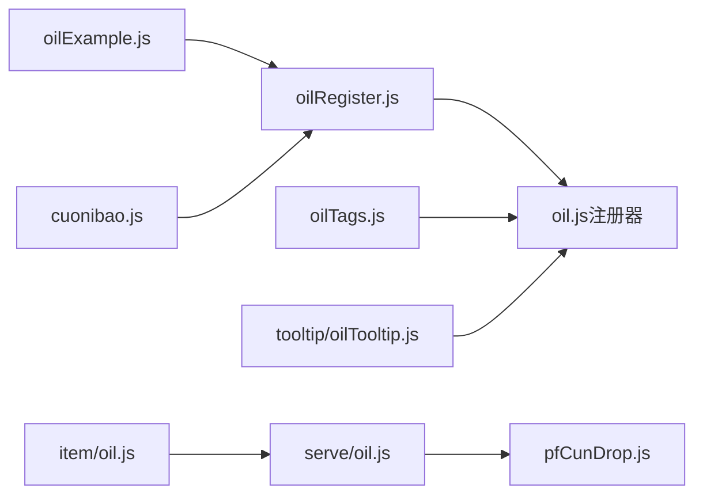

# 油品实现

<cite>
**本文引用的文件**
- [oilRegister.js](file://kubejs/startup_scripts/oil/oilRegister.js)
- [oilTags.js](file://kubejs/startup_scripts/oil/oilTags.js)
- [oil.js（注册器）](file://kubejs/startup_scripts/oil/oil.js)
- [oilExample.js（示例油品）](file://kubejs/startup_scripts/oil/oilItem/oilExample.js)
- [cuonibao.js（搓泥宝）](file://kubejs/startup_scripts/oil/oilItem/cuonibao.js)
- [oil.js（服务扩展）](file://kubejs/server_scripts/serve/oil.js)
- [pfCunDrop.js（皴掉落接口）](file://kubejs/server_scripts/pathfinder/pfCunDrop.js)
- [oilTooltip.js（油品提示）](file://kubejs/client_scripts/tooltip/oilTooltip.js)
- [oil.js（消耗品注册）](file://kubejs/startup_scripts/item/oil.js)
</cite>

## 目录
1. [简介](#简介)
2. [项目结构](#项目结构)
3. [核心组件](#核心组件)
4. [架构总览](#架构总览)
5. [详细组件分析](#详细组件分析)
6. [依赖关系分析](#依赖关系分析)
7. [性能考量](#性能考量)
8. [故障排查指南](#故障排查指南)
9. [结论](#结论)
10. [附录](#附录)

## 简介
本文件系统性梳理了 KubeJS 项目中“油品实现”子系统的完整设计与实现，覆盖以下要点：
- 基础油品系统：通过注册器统一收集油品定义，再由注册器批量生成物品。
- 通用属性与行为：名称、中文名、描述、标签、耐久、显示名等。
- Cuonibao（搓泥宝）的独特机制：副手持有时，搓脚掉落“皴”的数量翻倍，并消耗耐久。
- 示例油品模板：oilExample.js 提供新油品开发的最小可行模板。
- 使用方式与效果持续机制：通过“抹油”触发，随后若干次有效点击获得奖励，奖励次数递减直至清空。
- 触发条件、持续时间与强度计算：基于 Serve 点击钩子与 NBT 计数，结合 pfCunDrop 的掉落计算。
- 最佳实践与性能优化建议：避免重复注册、合理设置耐久、利用标签系统统一管理。

## 项目结构
油品相关代码分布在启动脚本与服务脚本两个层面：
- 启动脚本层：负责收集油品定义、批量注册物品、提供标签常量与工具函数。
- 服务脚本层：负责在点击事件中应用油品效果，以及在“皴”掉落计算中体现油品加成。

图表来源
- [oilRegister.js:1-61](file://kubejs/startup_scripts/oil/oilRegister.js#L1-L61)
- [oilTags.js:1-19](file://kubejs/startup_scripts/oil/oilTags.js#L1-L19)
- [oil.js（注册器）:1-28](file://kubejs/startup_scripts/oil/oil.js#L1-L28)
- [oilExample.js（示例油品）:1-16](file://kubejs/startup_scripts/oil/oilItem/oilExample.js#L1-L16)
- [cuonibao.js（搓泥宝）:1-17](file://kubejs/startup_scripts/oil/oilItem/cuonibao.js#L1-L17)
- [oil.js（消耗品注册）:1-10](file://kubejs/startup_scripts/item/oil.js#L1-L10)
- [oilTooltip.js:1-46](file://kubejs/client_scripts/tooltip/oilTooltip.js#L1-L46)
- [oil.js（服务扩展）:1-56](file://kubejs/server_scripts/serve/oil.js#L1-L56)
- [pfCunDrop.js:1-100](file://kubejs/server_scripts/pathfinder/pfCunDrop.js#L1-L100)

章节来源
- [oilRegister.js:1-61](file://kubejs/startup_scripts/oil/oilRegister.js#L1-L61)
- [oilTags.js:1-19](file://kubejs/startup_scripts/oil/oilTags.js#L1-L19)
- [oil.js（注册器）:1-28](file://kubejs/startup_scripts/oil/oil.js#L1-L28)
- [oilExample.js（示例油品）:1-16](file://kubejs/startup_scripts/oil/oilItem/oilExample.js#L1-L16)
- [cuonibao.js（搓泥宝）:1-17](file://kubejs/startup_scripts/oil/oilItem/cuonibao.js#L1-L17)
- [oil.js（消耗品注册）:1-10](file://kubejs/startup_scripts/item/oil.js#L1-L10)
- [oilTooltip.js:1-46](file://kubejs/client_scripts/tooltip/oilTooltip.js#L1-L46)
- [oil.js（服务扩展）:1-56](file://kubejs/server_scripts/serve/oil.js#L1-L56)
- [pfCunDrop.js:1-100](file://kubejs/server_scripts/pathfinder/pfCunDrop.js#L1-L100)

## 核心组件
- 注册器 OilRegister 与模型 Oil
  - OilRegister 维护 oils 数组，提供 register(oilFactory) 收集定义。
  - Oil 定义包含 name、nameZH、description、tags、durability、getOilId 等属性与链式 setter。
- 标签系统 oilTags
  - 提供统一的标签常量（如 marguerite:tag_oil），并导出 getOilId 工具函数。
- 批量注册器 oil.js
  - 在 StartupEvents.registry('item') 中遍历 global.oilRegister.oils，创建物品、设置显示名、不可堆叠、最大耐久与标签。
- 消耗品“精油”注册
  - 单独注册基础物品 marguerite:oil，作为“抹油”使用的通用油品。
- 油品提示 oilTooltip.js
  - 为每个油品显示描述与标签文本，颜色随标签色值变化。
- 服务扩展 serve/oil.js
  - 当玩家手持 marguerite:oil 点击任意按钮时判定为“抹油”，消耗耐久并记录 NBT 计数。
  - 对后续若干次“有效点击”（需求>0）给予奖励（饱和度与金钱加成），计数递减至 0 清理 UI 字段。
- “皴”掉落接口 pfCunDrop.js
  - 每次有效点击独立 roll 3-5，累加得到基础总数。
  - 若副手持有 cuonibao（marguerite:cuonibao），总数翻倍并扣耐久。
  - 可叠加顾客物品上的 pfCunBonusPerClick（每次点击额外数量）。

章节来源
- [oilRegister.js:9-61](file://kubejs/startup_scripts/oil/oilRegister.js#L9-L61)
- [oilTags.js:8-19](file://kubejs/startup_scripts/oil/oilTags.js#L8-L19)
- [oil.js（注册器）:9-27](file://kubejs/startup_scripts/oil/oil.js#L9-L27)
- [oil.js（消耗品注册）:5-10](file://kubejs/startup_scripts/item/oil.js#L5-L10)
- [oilTooltip.js:1-46](file://kubejs/client_scripts/tooltip/oilTooltip.js#L1-L46)
- [oil.js（服务扩展）:15-55](file://kubejs/server_scripts/serve/oil.js#L15-L55)
- [pfCunDrop.js:12-99](file://kubejs/server_scripts/pathfinder/pfCunDrop.js#L12-L99)

## 架构总览
下图展示了从“油品定义”到“物品注册”再到“服务效果”的完整流程。

图表来源
- [oilRegister.js:16-20](file://kubejs/startup_scripts/oil/oilRegister.js#L16-L20)
- [oil.js（注册器）:9-27](file://kubejs/startup_scripts/oil/oil.js#L9-L27)
- [oilTags.js:8-14](file://kubejs/startup_scripts/oil/oilTags.js#L8-L14)
- [oilTooltip.js:1-46](file://kubejs/client_scripts/tooltip/oilTooltip.js#L1-L46)
- [oil.js（服务扩展）:28-55](file://kubejs/server_scripts/serve/oil.js#L28-L55)
- [pfCunDrop.js:66-96](file://kubejs/server_scripts/pathfinder/pfCunDrop.js#L66-L96)

## 详细组件分析

### 油品注册器与模型（OilRegister/Oil）
- 设计要点
  - OilRegister 提供 register(oilFactory) 将工厂函数注入 Oil 实例，收集到 oils 数组。
  - Oil 提供链式 setter 与 getOilId，确保命名空间一致（marguerite:）。
  - 默认描述为“无效果”，默认耐久为 16，便于快速定义。
- 复杂度与性能
  - 注册阶段为 O(n)，n 为油品数量；运行期无额外开销。
  - 建议在启动阶段一次性完成注册，避免重复注册。

图表来源
- [oilRegister.js:9-61](file://kubejs/startup_scripts/oil/oilRegister.js#L9-L61)

章节来源
- [oilRegister.js:9-61](file://kubejs/startup_scripts/oil/oilRegister.js#L9-L61)

### 标签系统（oilTags.js）
- 作用
  - 提供统一标签常量（如 marguerite:tag_oil），减少硬编码。
  - 提供 getOilId(name) 工具函数，统一 ID 命名规范。
- 使用建议
  - 新油品定义时优先引用 global.oilTags.xxx，保证一致性。

章节来源
- [oilTags.js:8-19](file://kubejs/startup_scripts/oil/oilTags.js#L8-L19)

### 批量注册器（oil.js）
- 行为
  - 遍历 global.oilRegister.oils，为每个油品创建物品：
    - 设置显示名为中文名或英文名。
    - 不可堆叠。
    - 最大耐久为定义的 durability。
    - 逐个添加标签（null 标签会输出警告）。
- 注意事项
  - 确保每个油品都正确 setTags 并提供 id。
  - 耐久过低可能导致频繁损坏，过高则浪费资源。

章节来源
- [oil.js（注册器）:9-27](file://kubejs/startup_scripts/oil/oil.js#L9-L27)

### 消耗品“精油”（marguerite:oil）
- 定义
  - 单独注册基础物品 marguerite:oil，不可堆叠，最大耐久 16。
- 用途
  - 作为“抹油”使用的通用油品，触发服务扩展效果。

章节来源
- [oil.js（消耗品注册）:5-10](file://kubejs/startup_scripts/item/oil.js#L5-L10)

### 油品提示（oilTooltip.js）
- 行为
  - 为每个油品显示 description 与标签列表，颜色随标签色值变化。
- 交互
  - 通过 ItemEvents.tooltip 动态添加，无需手动写入 JSON。

章节来源
- [oilTooltip.js:1-46](file://kubejs/client_scripts/tooltip/oilTooltip.js#L1-L46)

### 示例油品（oilExample.js）
- 作用
  - 提供最小化模板：设置英文名、中文名、描述、耐久与标签。
- 开发指引
  - 新油品只需复制该文件，修改对应参数即可完成注册。

章节来源
- [oilExample.js（示例油品）:9-15](file://kubejs/startup_scripts/oil/oilItem/oilExample.js#L9-L15)

### 搓泥宝（cuonibao.js）
- 效果机制
  - 副手持有时，每次有效点击“皴”掉落翻倍（×2），每次消耗 1 耐久（创意模式不消耗）。
  - 耐久耗尽后自动消失。
- 实现位置
  - 定义位于 oilItem/cuonibao.js，注册通过 oilRegister。
  - 掉落翻倍与耐久消耗逻辑位于 pfCunDrop.js 的 getDropCount 与 damageCuonibao。

图表来源
- [cuonibao.js:10-16](file://kubejs/startup_scripts/oil/oilItem/cuonibao.js#L10-L16)
- [pfCunDrop.js:66-96](file://kubejs/server_scripts/pathfinder/pfCunDrop.js#L66-L96)
- [pfCunDrop.js:46-55](file://kubejs/server_scripts/pathfinder/pfCunDrop.js#L46-L55)

章节来源
- [cuonibao.js:10-16](file://kubejs/startup_scripts/oil/oilItem/cuonibao.js#L10-L16)
- [pfCunDrop.js:12-99](file://kubejs/server_scripts/pathfinder/pfCunDrop.js#L12-L99)

### 服务扩展（serve/oil.js）
- 触发条件
  - 玩家手持 marguerite:oil 点击任意按钮即为“抹油”，不消耗需求且不开始泡脚。
- 持续机制
  - 抹油成功后，记录 NBT：pfOilId 与 pfOilLeft（次数）。
  - 后续每次“有效点击”（需求>0）获得奖励（饱和度与金钱），pfOilLeft 递减。
  - 次数耗尽后清理 UI 字段（pfOilId 置空）。
- 强度与持续时间
  - 次数固定为 OIL_CHARGES（常量定义处），奖励幅度为 OIL_SAT_BONUS 与 OIL_MONEY_BONUS。

图表来源
- [oil.js（服务扩展）:28-55](file://kubejs/server_scripts/serve/oil.js#L28-L55)

章节来源
- [oil.js（服务扩展）:1-56](file://kubejs/server_scripts/serve/oil.js#L1-L56)

### “皴”掉落接口（pfCunDrop.js）
- 基础掉落
  - 每次有效点击独立 roll minDropPerClick 到 maxDropPerClick（含端点），累加得到总掉落。
- 搓泥宝加成
  - 副手持有 cuonibao 时，总掉落乘以 cuonibaoMultiplier，并对副手物品进行耐久消耗。
- 其他加成
  - 可叠加顾客物品上的 pfCunBonusPerClick（每次点击额外数量），不影响倍率。
- 边界处理
  - 返回值非负，防止负数掉落。

章节来源
- [pfCunDrop.js:12-99](file://kubejs/server_scripts/pathfinder/pfCunDrop.js#L12-L99)

## 依赖关系分析
- 模块耦合
  - oilRegister.js 与 oil.js（注册器）强耦合：前者提供定义，后者负责落地。
  - oilTags.js 与各油品定义弱耦合：仅提供标签常量与工具函数。
  - serve/oil.js 与 pfCunDrop.js 松耦合：前者通过 NBT 控制奖励，后者负责掉落计算。
- 外部依赖
  - 依赖 KubeJS 的 StartupEvents.registry 与 ItemEvents.tooltip。
  - 依赖 Serve 系统的点击钩子与 NBT 存储。

图表来源
- [oilRegister.js:16-20](file://kubejs/startup_scripts/oil/oilRegister.js#L16-L20)
- [oil.js（注册器）:9-27](file://kubejs/startup_scripts/oil/oil.js#L9-L27)
- [oilTags.js:8-14](file://kubejs/startup_scripts/oil/oilTags.js#L8-L14)
- [oilExample.js（示例油品）:9-15](file://kubejs/startup_scripts/oil/oilItem/oilExample.js#L9-L15)
- [cuonibao.js（搓泥宝）:10-16](file://kubejs/startup_scripts/oil/oilItem/cuonibao.js#L10-L16)
- [oil.js（消耗品注册）:5-10](file://kubejs/startup_scripts/item/oil.js#L5-L10)
- [oilTooltip.js:1-46](file://kubejs/client_scripts/tooltip/oilTooltip.js#L1-L46)
- [oil.js（服务扩展）:28-55](file://kubejs/server_scripts/serve/oil.js#L28-L55)
- [pfCunDrop.js:66-96](file://kubejs/server_scripts/pathfinder/pfCunDrop.js#L66-L96)

章节来源
- [oilRegister.js:1-61](file://kubejs/startup_scripts/oil/oilRegister.js#L1-L61)
- [oilTags.js:1-19](file://kubejs/startup_scripts/oil/oilTags.js#L1-L19)
- [oil.js（注册器）:1-28](file://kubejs/startup_scripts/oil/oil.js#L1-L28)
- [oilExample.js（示例油品）:1-16](file://kubejs/startup_scripts/oil/oilItem/oilExample.js#L1-L16)
- [cuonibao.js（搓泥宝）:1-17](file://kubejs/startup_scripts/oil/oilItem/cuonibao.js#L1-L17)
- [oil.js（消耗品注册）:1-10](file://kubejs/startup_scripts/item/oil.js#L1-L10)
- [oilTooltip.js:1-46](file://kubejs/client_scripts/tooltip/oilTooltip.js#L1-L46)
- [oil.js（服务扩展）:1-56](file://kubejs/server_scripts/serve/oil.js#L1-L56)
- [pfCunDrop.js:1-100](file://kubejs/server_scripts/pathfinder/pfCunDrop.js#L1-L100)

## 性能考量
- 注册阶段
  - 批量注册为 O(n) 操作，n 为油品数量；建议控制油品数量与标签数量，避免过多循环。
- 运行期
  - 服务钩子仅在点击事件中执行，且只检查持有物品与 NBT 计数，开销极小。
  - pfCunDrop 的 roll 为简单随机，复杂度 O(c)，c 为有效点击次数。
- 建议
  - 将高频判断（如持有物品类型）放在服务钩子入口尽早返回，减少无效分支。
  - 避免在 tooltip 中进行重型计算，当前实现仅拼接字符串与颜色映射，性能良好。

## 故障排查指南
- 油品未显示标签
  - 检查 oil.js 是否正确遍历 tags 并调用 tag(id)；注意 null 标签会输出警告。
- 油品无法注册
  - 确认 oilRegister.register 已被调用，且 setName/setNameZH/setTags/setDurability 已设置。
- “抹油”无效
  - 确认玩家手持的是 marguerite:oil；检查 serve/oil.js 的 serveIsHoldingOil 与 serveDamageOil。
- 奖励未生效
  - 检查 ctx.isEffective 是否为真；确认 NBT 中 pfOilLeft 是否存在且大于 0。
- 搓泥宝不掉落数翻倍
  - 确认副手持有 marguerite:cuonibao；检查 pfCunDrop 的 getCuonibaoOffhand 与 damageCuonibao。
- 奖励次数耗尽但 UI 仍显示
  - 检查 serve/oil.js 在 left<=0 时是否合并清空 pfOilId。

章节来源
- [oil.js（注册器）:18-25](file://kubejs/startup_scripts/oil/oil.js#L18-L25)
- [oil.js（服务扩展）:15-26](file://kubejs/server_scripts/serve/oil.js#L15-L26)
- [oil.js（服务扩展）:42-54](file://kubejs/server_scripts/serve/oil.js#L42-L54)
- [pfCunDrop.js:34-55](file://kubejs/server_scripts/pathfinder/pfCunDrop.js#L34-L55)

## 结论
本油品实现体系通过“注册器 + 批量注册 + 服务钩子 + 掉落接口”的分层设计，实现了：
- 统一的油品定义与物品落地；
- 可扩展的标签系统与提示展示；
- 基于“抹油”的奖励持续机制；
- 副手持有特定油品的即时效果（如搓泥宝）。
该体系具备良好的可维护性与扩展性，适合进一步引入更多油品与效果。

## 附录
- 获取途径
  - 通过配方或任务奖励获得；消耗品“精油”（marguerite:oil）用于“抹油”。
- 使用方法
  - 持有目标油品点击任意按钮即可触发对应机制（如“抹油”或副手加成）。
- 效果持续机制
  - “抹油”后以 NBT 记录剩余次数，每次有效点击消耗一次，直至清空。
- 触发条件、持续时间与强度
  - 触发：手持指定油品点击按钮。
  - 持续：NBT 计数决定奖励次数。
  - 强度：奖励数值在服务扩展中固定配置，掉落倍率在掉落接口中固定配置。