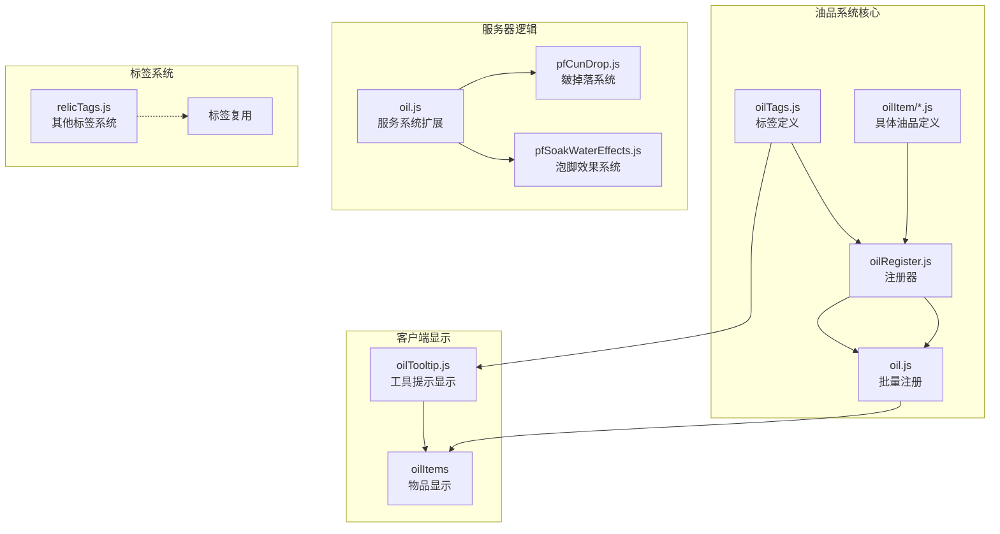
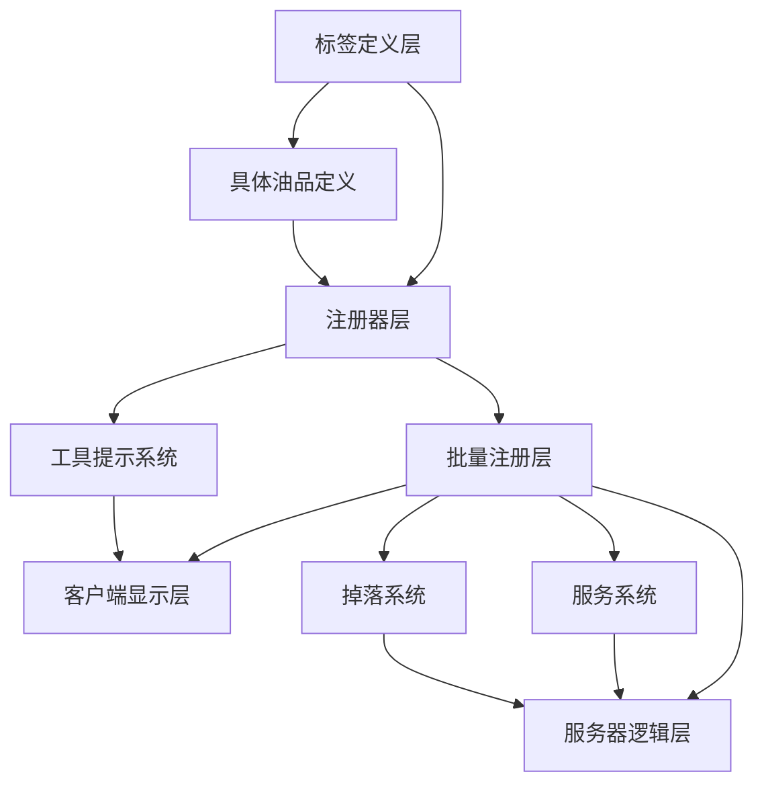
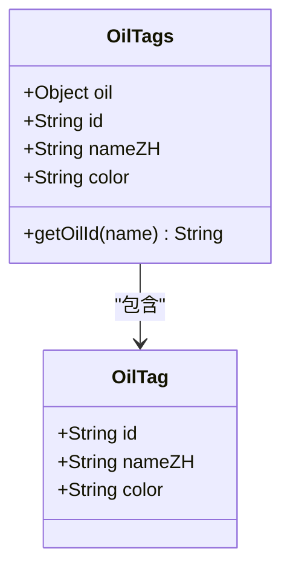
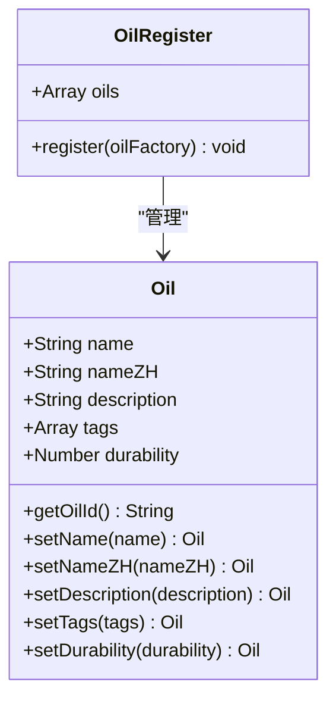
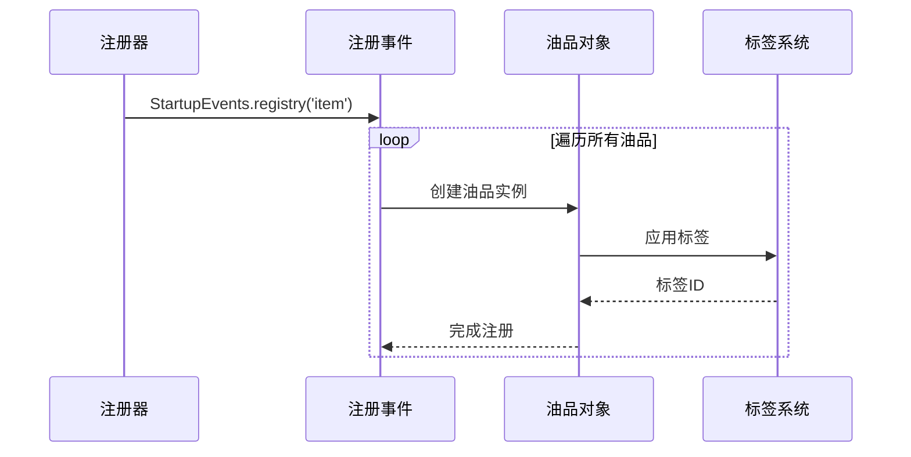
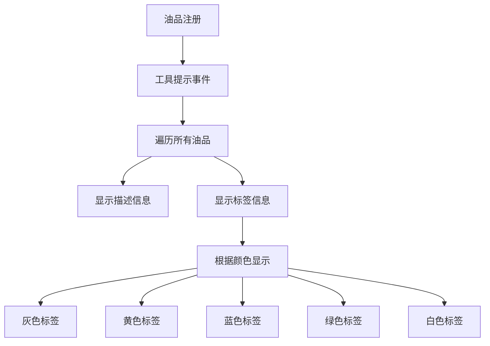
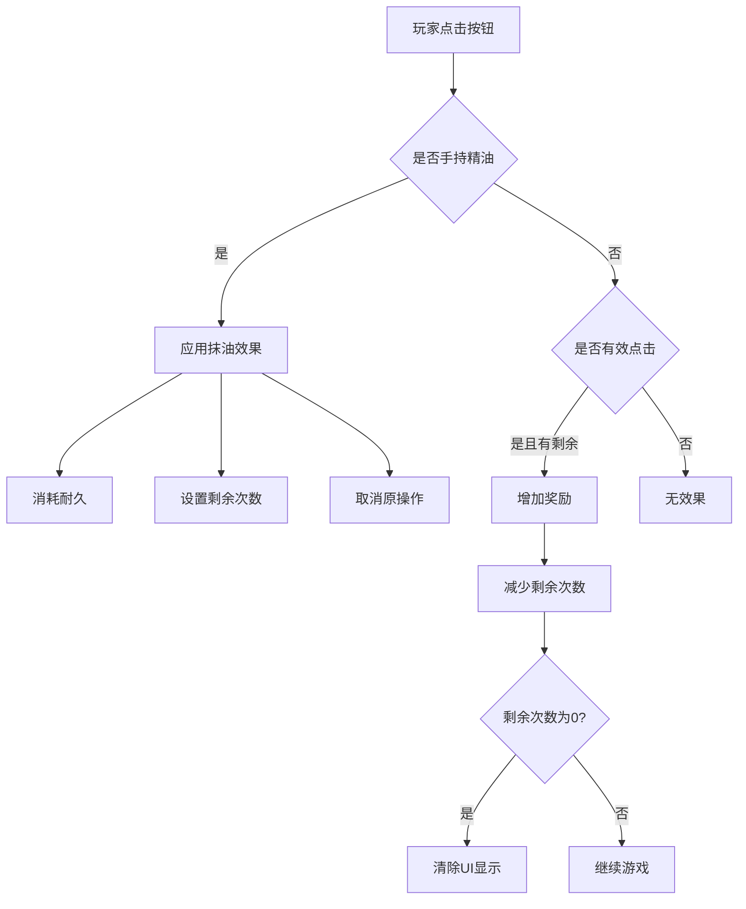
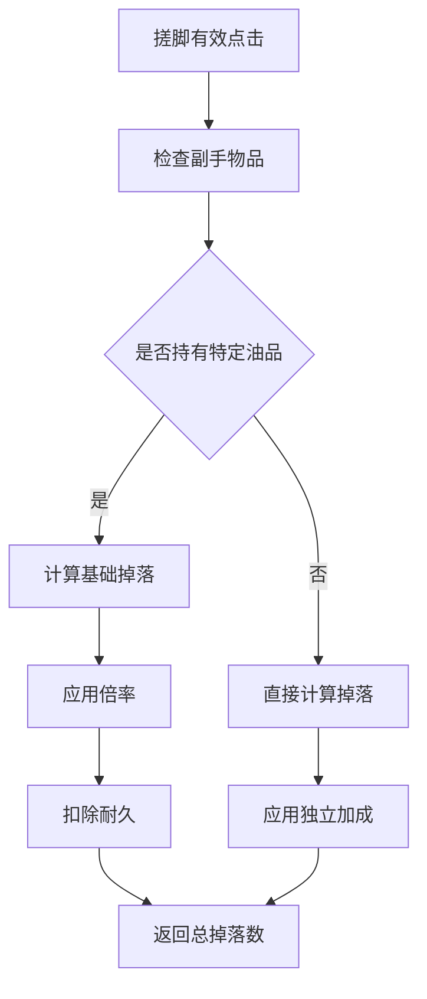
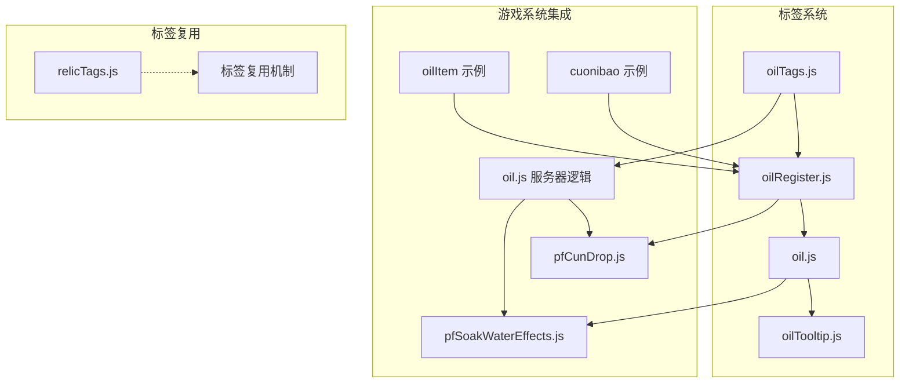

# 油品标签系统

<cite>
**本文档引用的文件**
- [oilTags.js](file://kubejs/startup_scripts/oil/oilTags.js)
- [oilRegister.js](file://kubejs/startup_scripts/oil/oilRegister.js)
- [oil.js](file://kubejs/startup_scripts/oil/oil.js)
- [oilExample.js](file://kubejs/startup_scripts/oil/oilItem/oilExample.js)
- [cuonibao.js](file://kubejs/startup_scripts/oil/oilItem/cuonibao.js)
- [oilTooltip.js](file://kubejs/client_scripts/tooltip/oilTooltip.js)
- [oil.js](file://kubejs/server_scripts/serve/oil.js)
- [pfCunDrop.js](file://kubejs/server_scripts/pathfinder/pfCunDrop.js)
- [pfSoakWaterEffects.js](file://kubejs/server_scripts/pathfinder/pfSoakWaterEffects.js)
- [relicTags.js](file://kubejs/startup_scripts/relic/relicTags.js)
</cite>

## 目录
1. [简介](#简介)
2. [项目结构](#项目结构)
3. [核心组件](#核心组件)
4. [架构概览](#架构概览)
5. [详细组件分析](#详细组件分析)
6. [依赖关系分析](#依赖关系分析)
7. [性能考虑](#性能考虑)
8. [故障排除指南](#故障排除指南)
9. [结论](#结论)
10. [附录](#附录)

## 简介

油品标签系统是《洗手》模组中的一个重要组成部分，它为游戏中的精油类物品提供了统一的标签管理和分类机制。该系统通过标签来实现油品的筛选、匹配和效果判定，为玩家提供了更加丰富和策略性的游戏体验。

系统的核心设计理念是通过标准化的标签机制，让不同类型的油品能够被有效地组织和管理，同时为游戏的其他系统提供统一的识别标准。标签不仅用于物品的外观显示，更重要的是为各种游戏机制提供逻辑判断依据。

## 项目结构

油品标签系统主要分布在以下目录结构中：

**图表来源**
- [oilTags.js:1-19](file://kubejs/startup_scripts/oil/oilTags.js#L1-L19)
- [oilRegister.js:1-61](file://kubejs/startup_scripts/oil/oilRegister.js#L1-L61)
- [oil.js:1-28](file://kubejs/startup_scripts/oil/oil.js#L1-L28)

**章节来源**
- [oilTags.js:1-19](file://kubejs/startup_scripts/oil/oilTags.js#L1-L19)
- [oilRegister.js:1-61](file://kubejs/startup_scripts/oil/oilRegister.js#L1-L61)
- [oil.js:1-28](file://kubejs/startup_scripts/oil/oil.js#L1-L28)

## 核心组件

### 标签定义系统

标签系统的核心是一个全局的标签对象，为所有油品提供统一的标识标准：

- **标签结构**：每个标签包含唯一ID、中文名称和颜色标识
- **命名规范**：采用 `marguerite:tag_类型` 的命名格式
- **颜色系统**：支持多种颜色标识，用于界面显示和分类

### 油品注册器

注册器提供了链式配置API，确保所有油品定义的一致性和可维护性：

- **链式调用**：支持连续的方法调用配置
- **统一管理**：集中收集所有油品定义信息
- **扩展性**：易于添加新的配置选项

### 批量注册机制

系统实现了自动化的物品注册流程，确保所有油品按照统一规则创建：

- **自动化处理**：减少重复代码编写
- **一致性保证**：所有油品遵循相同的属性设置
- **错误处理**：包含空标签的警告机制

**章节来源**
- [oilTags.js:8-14](file://kubejs/startup_scripts/oil/oilTags.js#L8-L14)
- [oilRegister.js:9-60](file://kubejs/startup_scripts/oil/oilRegister.js#L9-L60)
- [oil.js:9-27](file://kubejs/startup_scripts/oil/oil.js#L9-L27)

## 架构概览

油品标签系统的整体架构采用了分层设计，确保了系统的可维护性和扩展性：

**图表来源**
- [oilTags.js:8-14](file://kubejs/startup_scripts/oil/oilTags.js#L8-L14)
- [oilRegister.js:9-60](file://kubejs/startup_scripts/oil/oilRegister.js#L9-L60)
- [oil.js:9-27](file://kubejs/startup_scripts/oil/oil.js#L9-L27)

系统的核心优势在于其模块化设计，每个组件都有明确的职责分工，同时通过统一的接口进行交互。

## 详细组件分析

### 标签定义组件

标签定义组件是整个系统的基础，提供了标准化的标签常量：

**图表来源**
- [oilTags.js:8-14](file://kubejs/startup_scripts/oil/oilTags.js#L8-L14)

标签系统的设计体现了以下特点：
- **统一性**：所有油品使用相同的标签ID格式
- **可扩展性**：支持添加新的标签类型
- **一致性**：颜色和名称的标准化管理

**章节来源**
- [oilTags.js:1-19](file://kubejs/startup_scripts/oil/oilTags.js#L1-L19)

### 油品注册器组件

注册器组件提供了完整的油品生命周期管理：

**图表来源**
- [oilRegister.js:9-60](file://kubejs/startup_scripts/oil/oilRegister.js#L9-L60)

注册器的设计采用了工厂模式，确保了油品定义的一致性和可维护性。

**章节来源**
- [oilRegister.js:1-61](file://kubejs/startup_scripts/oil/oilRegister.js#L1-L61)

### 批量注册组件

批量注册组件实现了自动化的物品创建流程：

**图表来源**
- [oil.js:9-27](file://kubejs/startup_scripts/oil/oil.js#L9-L27)

**章节来源**
- [oil.js:1-28](file://kubejs/startup_scripts/oil/oil.js#L1-L28)

### 客户端显示组件

工具提示组件为油品提供了丰富的信息展示：

**图表来源**
- [oilTooltip.js:1-46](file://kubejs/client_scripts/tooltip/oilTooltip.js#L1-L46)

**章节来源**
- [oilTooltip.js:1-46](file://kubejs/client_scripts/tooltip/oilTooltip.js#L1-L46)

### 服务器逻辑组件

服务系统扩展了油品在游戏中的实际用途：

**图表来源**
- [oil.js:15-55](file://kubejs/server_scripts/serve/oil.js#L15-L55)

**章节来源**
- [oil.js:1-56](file://kubejs/server_scripts/serve/oil.js#L1-L56)

### 掉落系统组件

掉落系统利用油品标签来影响游戏机制：

**图表来源**
- [pfCunDrop.js:66-96](file://kubejs/server_scripts/pathfinder/pfCunDrop.js#L66-L96)

**章节来源**
- [pfCunDrop.js:1-100](file://kubejs/server_scripts/pathfinder/pfCunDrop.js#L1-L100)

## 依赖关系分析

油品标签系统与其他游戏组件的集成关系如下：

**图表来源**
- [oilTags.js:8-14](file://kubejs/startup_scripts/oil/oilTags.js#L8-L14)
- [oilRegister.js:9-60](file://kubejs/startup_scripts/oil/oilRegister.js#L9-L60)
- [oil.js:9-27](file://kubejs/startup_scripts/oil/oil.js#L9-L27)

系统的关键依赖关系体现了以下设计原则：
- **单向依赖**：标签定义向下依赖于注册器，但不反向依赖
- **松耦合**：客户端和服务器逻辑通过统一的接口交互
- **可扩展性**：新的油品定义只需遵循既定的接口规范

**章节来源**
- [oilTags.js:1-19](file://kubejs/startup_scripts/oil/oilTags.js#L1-L19)
- [oilRegister.js:1-61](file://kubejs/startup_scripts/oil/oilRegister.js#L1-L61)
- [oil.js:1-28](file://kubejs/startup_scripts/oil/oil.js#L1-L28)

## 性能考虑

油品标签系统在设计时充分考虑了性能优化：

### 内存使用优化
- **延迟加载**：标签定义在系统启动时一次性加载
- **对象复用**：标签对象在整个运行期间复用
- **最小化存储**：只存储必要的元数据信息

### 处理效率优化
- **批量操作**：注册过程采用批量处理减少循环开销
- **缓存机制**：常用的数据结构进行缓存避免重复计算
- **事件驱动**：通过事件系统减少不必要的轮询

### 扩展性考虑
- **模块化设计**：每个组件职责单一便于独立优化
- **接口抽象**：通过统一接口降低组件间耦合度
- **配置驱动**：大部分行为通过配置而非硬编码实现

## 故障排除指南

### 常见问题及解决方案

**问题1：油品无法正常注册**
- 检查油品定义文件是否正确引用标签
- 确认注册器是否正确收集油品定义
- 验证批量注册事件是否正常触发

**问题2：标签显示异常**
- 检查标签颜色配置是否正确
- 确认工具提示事件是否正常执行
- 验证油品ID格式是否符合规范

**问题3：服务器逻辑不生效**
- 检查服务钩子是否正确注册
- 确认油品耐久消耗逻辑是否正常
- 验证NBT数据更新是否成功

**问题4：掉落系统异常**
- 检查副手物品检测逻辑
- 确认倍率计算是否正确
- 验证耐久扣除是否正常

**章节来源**
- [oil.js:22-24](file://kubejs/startup_scripts/oil/oil.js#L22-L24)
- [oilTooltip.js:16-42](file://kubejs/client_scripts/tooltip/oilTooltip.js#L16-L42)

## 结论

油品标签系统通过其精心设计的架构和实现，为《洗手》模组提供了强大而灵活的油品管理能力。系统的核心优势体现在以下几个方面：

### 设计优势
- **标准化**：统一的标签格式和命名规范确保了系统的可预测性
- **可扩展性**：模块化设计使得添加新功能变得简单
- **易维护性**：清晰的职责分离降低了维护成本

### 实际价值
- **游戏体验提升**：为玩家提供了更多策略选择
- **开发效率提高**：标准化的流程减少了重复劳动
- **系统稳定性**：完善的错误处理机制保证了系统可靠性

### 发展前景
随着模组的不断发展，油品标签系统还可以进一步扩展：
- 支持更复杂的标签组合和继承关系
- 集成更多的游戏机制和效果系统
- 提供更强大的配置和自定义能力

## 附录

### 标签命名规范

| 类型 | 命名格式 | 示例 | 说明 |
|------|----------|------|------|
| 油品标签 | `marguerite:tag_oil` | `marguerite:tag_oil` | 标准油品标识 |
| 油品物品 | `marguerite:油品名称` | `marguerite:example_oil` | 油品物品ID |
| 标签颜色 | `yellow`/`blue`/`green`等 | `yellow` | 界面显示颜色 |

### 使用建议

**最佳实践**
- 始终使用全局标签对象进行标签引用
- 遵循链式调用的配置方式
- 为每个油品提供清晰的中文名称
- 合理设置耐久值以平衡游戏性

**注意事项**
- 避免在运行时动态修改标签定义
- 确保所有油品都正确应用标签
- 定期检查标签系统的兼容性
- 测试新油品对现有系统的兼容性

**章节来源**
- [oilTags.js:16-18](file://kubejs/startup_scripts/oil/oilTags.js#L16-L18)
- [oilRegister.js:34-57](file://kubejs/startup_scripts/oil/oilRegister.js#L34-L57)