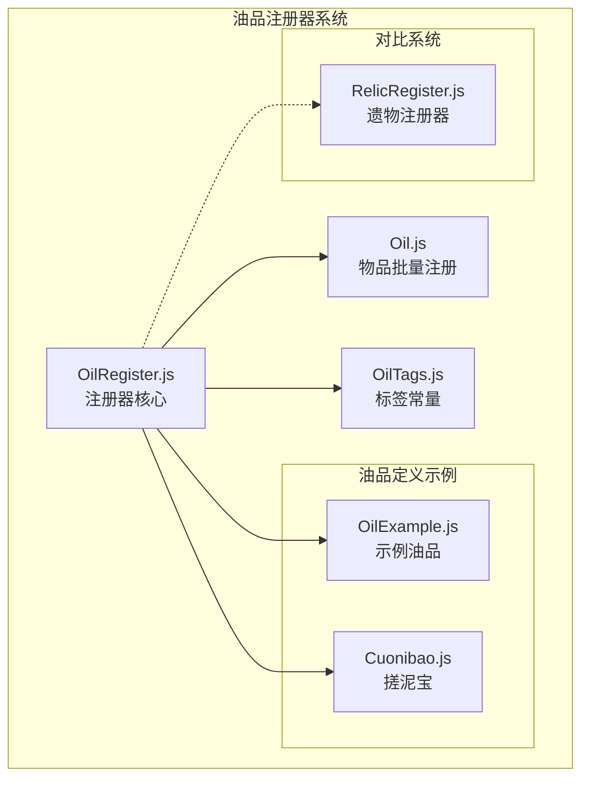
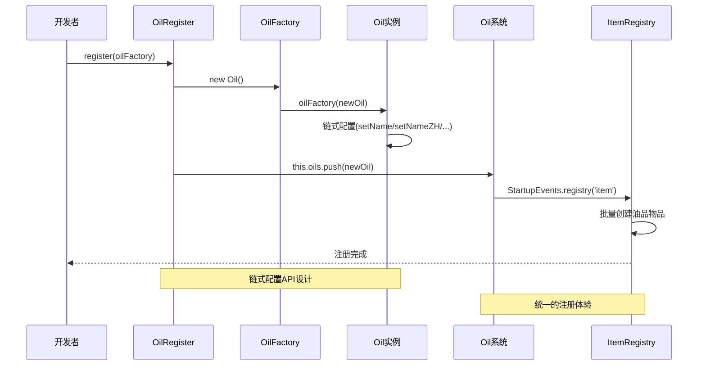
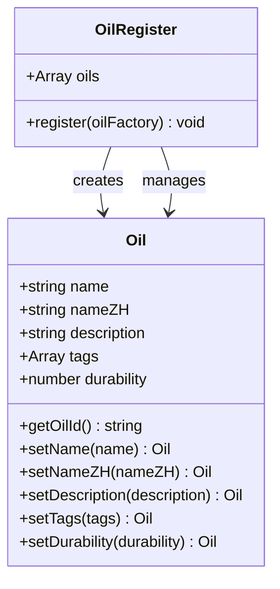
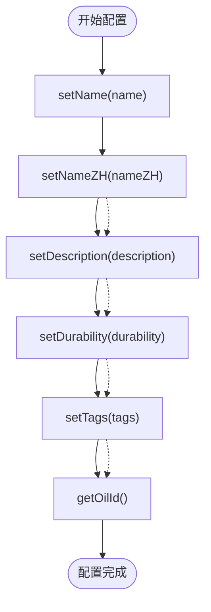
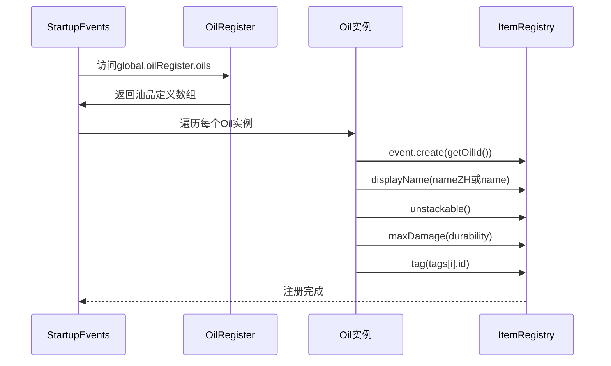
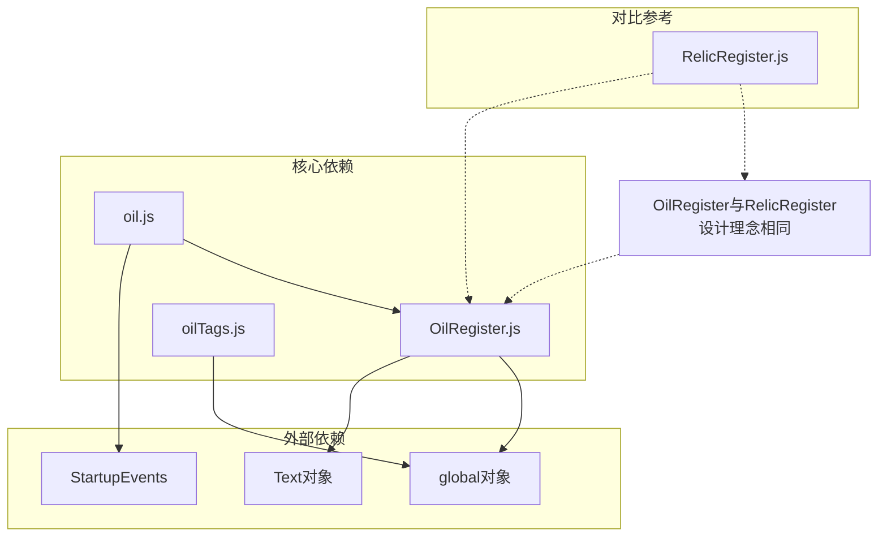

# 油品注册器

<cite>
**本文档引用的文件**
- [oilRegister.js](file://kubejs/startup_scripts/oil/oilRegister.js)
- [oil.js](file://kubejs/startup_scripts/oil/oil.js)
- [oilTags.js](file://kubejs/startup_scripts/oil/oilTags.js)
- [oilExample.js](file://kubejs/startup_scripts/oil/oilItem/oilExample.js)
- [cuonibao.js](file://kubejs/startup_scripts/oil/oilItem/cuonibao.js)
- [relicRegister.js](file://kubejs/startup_scripts/relic/relicRegister.js)
</cite>

## 目录
1. [简介](#简介)
2. [项目结构](#项目结构)
3. [核心组件](#核心组件)
4. [架构概览](#架构概览)
5. [详细组件分析](#详细组件分析)
6. [依赖关系分析](#依赖关系分析)
7. [性能考虑](#性能考虑)
8. [故障排除指南](#故障排除指南)
9. [结论](#结论)
10. [附录](#附录)

## 简介

油品注册器是KubeJS项目中用于管理系统内"油品"物品的核心架构组件。该系统采用统一的注册器模式，为油品定义提供了链式配置API，确保了与遗物注册器相似的设计理念和统一的开发体验。

该系统的主要目标包括：
- 统一收集所有"油"的定义数据（name、nameZH、durability、tags等）
- 提供链式配置API，保持与relicRegister.js相同的注册体验
- 支持油品的批量物品注册和标签管理
- 提供可扩展的油品定义框架

## 项目结构

油品注册器系统由以下核心文件组成：



**图表来源**
- [oilRegister.js:1-61](file://kubejs/startup_scripts/oil/oilRegister.js#L1-L61)
- [oil.js:1-28](file://kubejs/startup_scripts/oil/oil.js#L1-L28)
- [oilTags.js:1-19](file://kubejs/startup_scripts/oil/oilTags.js#L1-L19)

**章节来源**
- [oilRegister.js:1-61](file://kubejs/startup_scripts/oil/oilRegister.js#L1-L61)
- [oil.js:1-28](file://kubejs/startup_scripts/oil/oil.js#L1-L28)
- [oilTags.js:1-19](file://kubejs/startup_scripts/oil/oilTags.js#L1-L19)

## 核心组件

### OilRegister类

OilRegister是整个油品注册系统的核心控制器，负责收集和管理所有油品定义。

**主要职责：**
- 维护油品定义数组（this.oils）
- 提供register方法用于注册新的油品定义
- 与Oil类协作完成油品配置

**设计特点：**
- 使用工厂函数模式创建Oil实例
- 支持回调函数注入配置逻辑
- 采用单例模式确保全局唯一性

### Oil类

Oil类定义了油品的基本属性和配置方法，是所有油品定义的基础模板。

**核心属性：**
- name: 英文名称（用于生成物品ID）
- nameZH: 中文名称（显示名称优先使用）
- description: 描述文本，默认"无效果"
- tags: 标签数组，支持油品分类
- durability: 耐久度，默认16

**配置方法：**
- setName(): 设置英文名称
- setNameZH(): 设置中文名称  
- setDescription(): 设置描述
- setTags(): 设置标签数组
- setDurability(): 设置耐久度
- getOilId(): 生成标准物品ID

**章节来源**
- [oilRegister.js:9-21](file://kubejs/startup_scripts/oil/oilRegister.js#L9-L21)
- [oilRegister.js:23-58](file://kubejs/startup_scripts/oil/oilRegister.js#L23-L58)

## 架构概览

油品注册器采用了典型的注册器模式和工厂模式相结合的设计：



**图表来源**
- [oilRegister.js:16-20](file://kubejs/startup_scripts/oil/oilRegister.js#L16-L20)
- [oil.js:9-27](file://kubejs/startup_scripts/oil/oil.js#L9-L27)

## 详细组件分析

### OilRegister类深度解析

OilRegister类实现了完整的注册器模式，具有以下设计特征：



**图表来源**
- [oilRegister.js:9-21](file://kubejs/startup_scripts/oil/oilRegister.js#L9-L21)
- [oilRegister.js:23-58](file://kubejs/startup_scripts/oil/oilRegister.js#L23-L58)

**设计模式应用：**
- 工厂模式：通过register方法创建Oil实例
- 注册器模式：集中管理所有油品定义
- 流水线模式：支持链式配置调用

### Oil类属性体系

Oil类定义了完整的油品属性模型：

| 属性名 | 类型 | 默认值 | 用途 |
|--------|------|--------|------|
| name | string | "" | 英文标识符，用于生成物品ID |
| nameZH | string | "" | 中文显示名称 |
| description | string | "无效果" | 物品描述信息 |
| tags | Array | [] | 标签数组，用于分类和过滤 |
| durability | number | 16 | 物品耐久度，决定使用次数 |

**配置方法链式调用流程：**



**图表来源**
- [oilRegister.js:34-57](file://kubejs/startup_scripts/oil/oilRegister.js#L34-L57)

### 油品物品注册流程

oil.js文件负责将配置好的油品定义转换为实际的游戏物品：



**图表来源**
- [oil.js:9-27](file://kubejs/startup_scripts/oil/oil.js#L9-L27)

**章节来源**
- [oil.js:1-28](file://kubejs/startup_scripts/oil/oil.js#L1-L28)

### 标签系统设计

oilTags.js提供了统一的标签管理机制：

**标签常量结构：**
- id: 标准化的标签ID格式
- nameZH: 标签中文名称
- color: 标签颜色标识

**使用优势：**
- 避免硬编码字符串
- 提供类型安全的标签引用
- 支持统一的颜色和命名规范

**章节来源**
- [oilTags.js:8-14](file://kubejs/startup_scripts/oil/oilTags.js#L8-L14)

## 依赖关系分析

油品注册器系统与其他组件存在以下依赖关系：



**图表来源**
- [oilRegister.js:6](file://kubejs/startup_scripts/oil/oilRegister.js#L6)
- [oil.js:13](file://kubejs/startup_scripts/oil/oil.js#L13)

**依赖特点：**
- 内部耦合度低：各模块职责明确
- 外部依赖简单：仅依赖KubeJS核心API
- 设计一致性：与relicRegister.js保持相同模式

**章节来源**
- [oilRegister.js:6](file://kubejs/startup_scripts/oil/oilRegister.js#L6)
- [oil.js:13](file://kubejs/startup_scripts/oil/oil.js#L13)

## 性能考虑

### 内存使用优化
- Oil实例按需创建，避免重复分配
- 标签数组采用引用传递，减少内存占用
- 注册完成后不保留临时配置数据

### 执行效率
- 注册过程在启动事件中一次性执行
- 批量物品注册避免多次API调用
- 链式调用返回this，减少函数调用开销

### 扩展性考虑
- 支持动态添加新属性和方法
- 可扩展的标签系统
- 灵活的配置回调机制

## 故障排除指南

### 常见问题及解决方案

**问题1：油品未显示中文名称**
- 检查nameZH属性是否设置
- 确认displayName逻辑是否正确
- 验证语言包是否加载

**问题2：油品耐久度异常**
- 检查setDurability调用顺序
- 确认maxDamage参数是否正确
- 验证物品是否标记为unstackable

**问题3：标签未生效**
- 检查oilTags引用是否正确
- 确认标签ID格式是否标准
- 验证标签数组是否为空

**问题4：物品ID冲突**
- 检查name属性是否唯一
- 确认getOilId生成规则
- 验证命名空间是否正确

**章节来源**
- [oil.js:14](file://kubejs/startup_scripts/oil/oil.js#L14)
- [oil.js:22](file://kubejs/startup_scripts/oil/oil.js#L22)

## 结论

油品注册器系统展现了优秀的软件工程实践，通过以下设计原则实现了高质量的代码架构：

1. **统一的注册体验**：与relicRegister.js保持一致的设计模式
2. **链式配置API**：提供直观易用的配置接口
3. **模块化设计**：职责分离，便于维护和扩展
4. **类型安全**：通过标签常量避免字符串错误
5. **性能优化**：批量注册和延迟初始化策略

该系统为KubeJS项目中的油品管理提供了坚实的基础，其设计理念和实现模式可以作为其他注册器系统的参考模板。

## 附录

### 使用示例

#### 基础油品注册
```javascript
// 参考示例：oilExample.js
global.oilRegister.register(oil => {
    oil.setName("example_oil")
        .setNameZH("示例精油")
        .setDescription(Text.gray("这是一个示例油"))
        .setDurability(16)
        .setTags([global.oilTags.oil])
})
```

#### 高级油品配置
```javascript
// 参考示例：cuonibao.js
oil.setName("cuonibao")
    .setNameZH("搓泥宝")
    .setDescription(Text.gray("副手持有时，搓脚「皴」掉落数量 ×2"))
    .setDurability(32)
    .setTags([global.oilTags.oil])
```

### 最佳实践建议

1. **遵循命名规范**
   - 使用有意义的英文名称作为标识符
   - 中文名称应简洁明了
   - 遵循现有的命名约定

2. **合理设置耐久度**
   - 根据油品功能强度设置合适的耐久度
   - 考虑游戏平衡性因素
   - 避免过度强大的油品

3. **标签使用规范**
   - 优先使用预定义的标签常量
   - 避免创建重复的标签定义
   - 保持标签分类的一致性

4. **配置顺序重要性**
   - 确保setTags在最后调用
   - 遵循链式调用的最佳实践
   - 验证每个配置项的有效性

5. **扩展性考虑**
   - 为未来可能的属性扩展预留空间
   - 保持向后兼容性
   - 提供清晰的文档说明