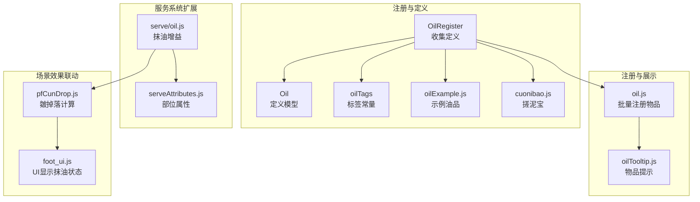
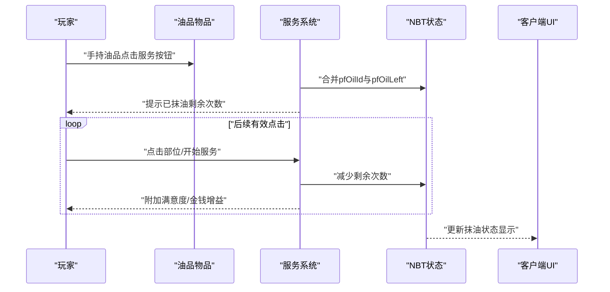
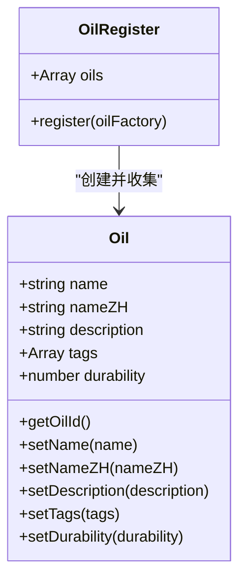
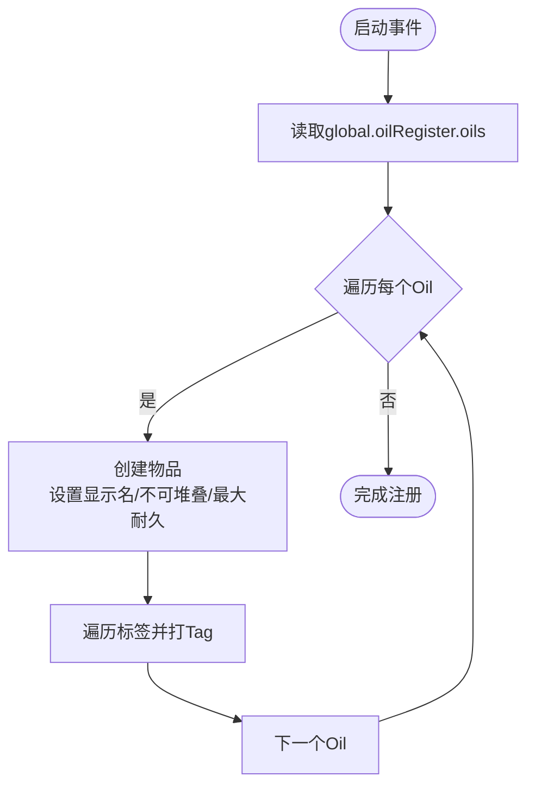
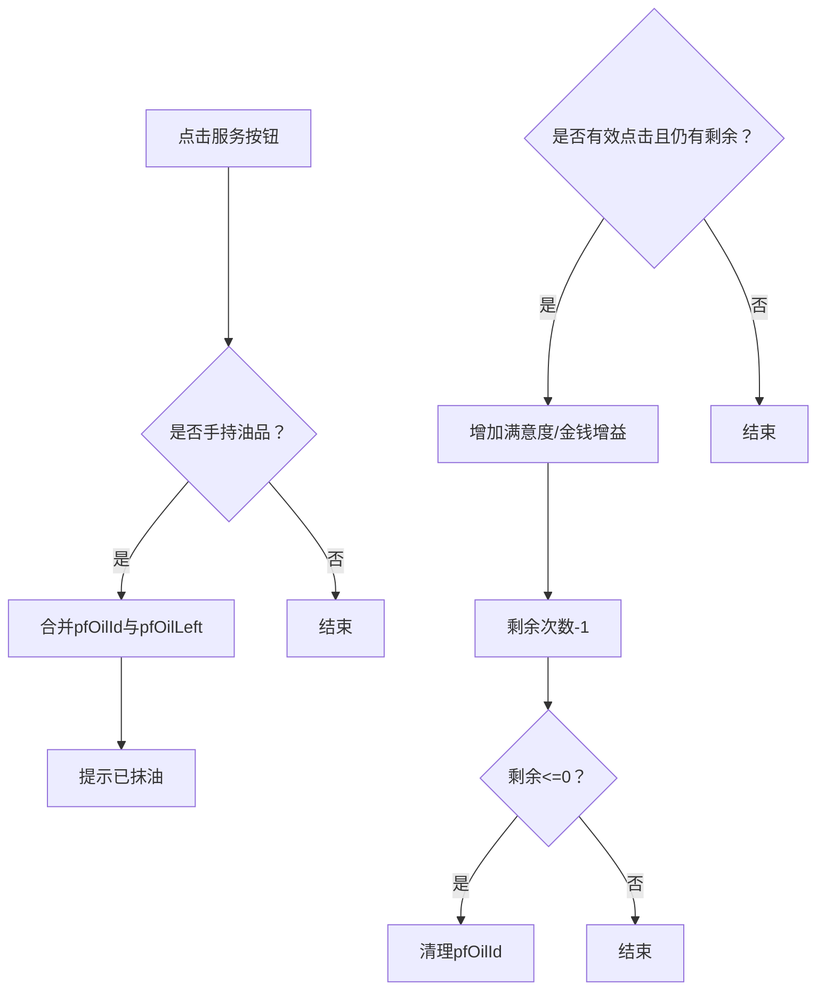
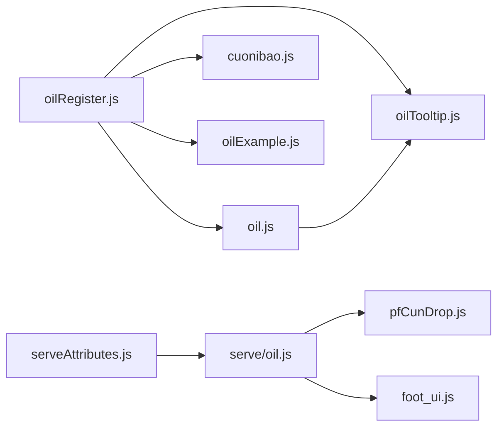

# 油品系统

<cite>
**本文档引用的文件**
- [oilRegister.js](file://kubejs/startup_scripts/oil/oilRegister.js)
- [oil.js](file://kubejs/startup_scripts/oil/oil.js)
- [oilTags.js](file://kubejs/startup_scripts/oil/oilTags.js)
- [cuonibao.js](file://kubejs/startup_scripts/oil/oilItem/cuonibao.js)
- [oilExample.js](file://kubejs/startup_scripts/oil/oilItem/oilExample.js)
- [oilTooltip.js](file://kubejs/client_scripts/tooltip/oilTooltip.js)
- [foot_ui.js](file://kubejs/client_scripts/ui/foot_ui.js)
- [pfCunDrop.js](file://kubejs/server_scripts/pathfinder/pfCunDrop.js)
- [oil.js（服务系统扩展）](file://kubejs/server_scripts/serve/oil.js)
- [serveAttributes.js](file://kubejs/startup_scripts/attributes/serveAttributes.js)
</cite>

## 目录
1. [简介](#简介)
2. [项目结构](#项目结构)
3. [核心组件](#核心组件)
4. [架构总览](#架构总览)
5. [详细组件分析](#详细组件分析)
6. [依赖关系分析](#依赖关系分析)
7. [性能考虑](#性能考虑)
8. [故障排除指南](#故障排除指南)
9. [结论](#结论)
10. [附录](#附录)

## 简介
本文件面向KubeJS油品系统，围绕oilRegister.js的注册器模式与统一管理架构展开，系统性阐述油品的特性与效果（以Cuonibao为例）、获取与使用流程、效果持续机制，并提供扩展新油品类型的指南、配置参数说明、平衡性调整建议与性能优化策略。同时解释油品与SPA（足浴/服务）系统的集成方式与数据传递机制。

## 项目结构
油品系统采用“注册器 + 批量注册 + 标签 + 客户端提示 + 服务系统扩展 + 场景效果联动”的分层组织方式：
- 注册器与模型：oilRegister.js定义OilRegister/Oil对象，提供链式API收集油品元数据。
- 物品注册：oil.js在启动阶段将注册器中的定义批量转换为游戏物品。
- 标签常量：oilTags.js提供统一标签常量，便于复用。
- 具体油品：oilItem目录下各油品定义文件通过global.oilRegister.register注册。
- 客户端提示：oilTooltip.js根据注册器中的描述与标签动态生成提示。
- SPA系统扩展：serve/oil.js扩展服务系统，实现“抹油”带来的临时增益。
- 场景效果联动：pfCunDrop.js在足部场景中应用油品效果（如Cuonibao的倍率）。
- 属性系统：serveAttributes.js为服务部位提供可调属性，支撑平衡性。



图表来源
- [oilRegister.js:1-61](file://kubejs/startup_scripts/oil/oilRegister.js#L1-L61)
- [oil.js:1-28](file://kubejs/startup_scripts/oil/oil.js#L1-L28)
- [oilTags.js:1-19](file://kubejs/startup_scripts/oil/oilTags.js#L1-L19)
- [oilExample.js:1-16](file://kubejs/startup_scripts/oil/oilItem/oilExample.js#L1-L16)
- [cuonibao.js:1-17](file://kubejs/startup_scripts/oil/oilItem/cuonibao.js#L1-L17)
- [oilTooltip.js:1-46](file://kubejs/client_scripts/tooltip/oilTooltip.js#L1-L46)
- [oil.js（服务系统扩展）:1-56](file://kubejs/server_scripts/serve/oil.js#L1-L56)
- [serveAttributes.js:1-53](file://kubejs/startup_scripts/attributes/serveAttributes.js#L1-L53)
- [pfCunDrop.js:1-100](file://kubejs/server_scripts/pathfinder/pfCunDrop.js#L1-L100)
- [foot_ui.js:740-939](file://kubejs/client_scripts/ui/foot_ui.js#L740-L939)

章节来源
- [oilRegister.js:1-61](file://kubejs/startup_scripts/oil/oilRegister.js#L1-L61)
- [oil.js:1-28](file://kubejs/startup_scripts/oil/oil.js#L1-L28)
- [oilTags.js:1-19](file://kubejs/startup_scripts/oil/oilTags.js#L1-L19)
- [oilExample.js:1-16](file://kubejs/startup_scripts/oil/oilItem/oilExample.js#L1-L16)
- [cuonibao.js:1-17](file://kubejs/startup_scripts/oil/oilItem/cuonibao.js#L1-L17)
- [oilTooltip.js:1-46](file://kubejs/client_scripts/tooltip/oilTooltip.js#L1-L46)
- [oil.js（服务系统扩展）:1-56](file://kubejs/server_scripts/serve/oil.js#L1-L56)
- [serveAttributes.js:1-53](file://kubejs/startup_scripts/attributes/serveAttributes.js#L1-L53)
- [pfCunDrop.js:1-100](file://kubejs/server_scripts/pathfinder/pfCunDrop.js#L1-L100)
- [foot_ui.js:740-939](file://kubejs/client_scripts/ui/foot_ui.js#L740-L939)

## 核心组件
- 注册器与模型
  - OilRegister：维护油品数组，提供register(oilFactory)收集定义。
  - Oil：定义name/nameZH/description/tags/durability等字段及链式setter与getOilId。
- 物品注册
  - 在StartupEvents.registry('item')中遍历global.oilRegister.oils，创建不可堆叠、带最大耐久的物品，并打上标签。
- 标签常量
  - 提供统一的oil标签id/nameZH/color，便于各油品复用。
- 具体油品
  - 通过global.oilRegister.register传入oil工厂函数，设置名称、中文名、描述、耐久与标签。
- 客户端提示
  - ItemEvents.tooltip基于注册器中的description与tags动态输出提示文本与颜色。
- 服务系统扩展（SPA）
  - serve/oil.js实现“抹油”逻辑：手持特定油品点击服务按钮即视为抹油，记录剩余次数与油品id；在有效点击时给予额外奖励，次数耗尽后清理状态。
- 场景效果联动（足部/皴掉落）
  - pfCunDrop.js在足部点击掉落计算中应用油品效果（如Cuonibao的倍率），并处理耐久消耗。
- 属性系统
  - serveAttributes.js注册部位相关属性（满意度/金钱/体力消耗），支持通过修饰符进行平衡性微调。

章节来源
- [oilRegister.js:9-61](file://kubejs/startup_scripts/oil/oilRegister.js#L9-L61)
- [oil.js:9-27](file://kubejs/startup_scripts/oil/oil.js#L9-L27)
- [oilTags.js:8-19](file://kubejs/startup_scripts/oil/oilTags.js#L8-L19)
- [oilExample.js:9-16](file://kubejs/startup_scripts/oil/oilItem/oilExample.js#L9-L16)
- [cuonibao.js:10-17](file://kubejs/startup_scripts/oil/oilItem/cuonibao.js#L10-L17)
- [oilTooltip.js:1-46](file://kubejs/client_scripts/tooltip/oilTooltip.js#L1-L46)
- [oil.js（服务系统扩展）:10-56](file://kubejs/server_scripts/serve/oil.js#L10-L56)
- [pfCunDrop.js:12-99](file://kubejs/server_scripts/pathfinder/pfCunDrop.js#L12-L99)
- [serveAttributes.js:27-53](file://kubejs/startup_scripts/attributes/serveAttributes.js#L27-L53)

## 架构总览
油品系统采用“定义-注册-展示-使用-联动”的分层架构：
- 定义层：各油品定义文件通过global.oilRegister.register注册，形成统一的定义集合。
- 注册层：oil.js在启动阶段将定义批量转换为物品，设置显示名、不可堆叠、最大耐久与标签。
- 展示层：oilTooltip.js读取定义的描述与标签，动态生成提示。
- 使用层：serve/oil.js在服务交互中实现“抹油”增益；pfCunDrop.js在足部场景中应用油品效果。
- 联动层：foot_ui.js在客户端UI中显示当前抹油状态；serveAttributes.js提供属性基础，支撑平衡性。



图表来源
- [oil.js（服务系统扩展）:28-55](file://kubejs/server_scripts/serve/oil.js#L28-L55)
- [foot_ui.js:743-774](file://kubejs/client_scripts/ui/foot_ui.js#L743-L774)

章节来源
- [oil.js（服务系统扩展）:1-56](file://kubejs/server_scripts/serve/oil.js#L1-L56)
- [foot_ui.js:740-939](file://kubejs/client_scripts/ui/foot_ui.js#L740-L939)

## 详细组件分析

### 注册器与模型（oilRegister.js）
- 设计要点
  - OilRegister提供register(oilFactory)方法，接收一个工厂函数，内部构造Oil实例并调用工厂函数完成配置，随后推入数组。
  - Oil提供链式setter（setName/setNameZH/setDescription/setTags/setDurability），以及getOilId用于生成标准物品ID。
- 复杂度与性能
  - 注册过程为O(n)遍历，n为已注册油品数量；链式setter为O(1)。
- 错误处理
  - 标签为空时会在注册阶段发出警告，避免无效标签导致的异常。
- 可扩展性
  - 可新增字段（如icon、音效、特殊行为标志）并在注册器与物品注册阶段统一处理。



图表来源
- [oilRegister.js:9-61](file://kubejs/startup_scripts/oil/oilRegister.js#L9-L61)

章节来源
- [oilRegister.js:1-61](file://kubejs/startup_scripts/oil/oilRegister.js#L1-L61)

### 物品批量注册（oil.js）
- 功能概述
  - 在StartupEvents.registry('item')回调中，遍历global.oilRegister.oils，为每个Oil创建对应物品，设置显示名、不可堆叠、最大耐久与标签。
- 数据流
  - 输入：Oil数组（由注册器收集）
  - 输出：游戏内物品注册表
- 性能与复杂度
  - 单次注册O(n)，n为油品数量；创建与打标签均为O(1)。



图表来源
- [oil.js:9-27](file://kubejs/startup_scripts/oil/oil.js#L9-L27)

章节来源
- [oil.js:1-28](file://kubejs/startup_scripts/oil/oil.js#L1-L28)

### 标签常量（oilTags.js）
- 作用
  - 提供统一的标签id/nameZH/color，供各油品定义复用，确保UI与筛选一致性。
- 使用方式
  - 在油品定义中通过global.oilTags.oil引用统一标签。

章节来源
- [oilTags.js:1-19](file://kubejs/startup_scripts/oil/oilTags.js#L1-L19)

### 具体油品定义示例（oilExample.js）
- 用途
  - 作为新增油品的模板，展示最小化配置：设置name/nameZH/description/durability/tags。
- 扩展建议
  - 可在此基础上增加自定义字段（如图标、音效、特殊行为标志），并在注册器与物品注册阶段统一处理。

章节来源
- [oilExample.js:1-16](file://kubejs/startup_scripts/oil/oilItem/oilExample.js#L1-L16)

### Cuonibao（搓泥宝）实现（cuonibao.js）
- 效果说明
  - 副手持有时，足部“皴”掉落翻倍；每次有效点击消耗1耐久（创意模式不消耗）。
- 关键实现
  - 注册：通过global.oilRegister.register设置name、中文名、描述、耐久与标签。
  - 掉落计算：pfCunDrop.js在getDropCount中检测副手是否持有Cuonibao，若持有则倍率×2并扣耐久。
- 平衡性
  - 耐久上限与掉落倍率需结合其他增益进行权衡，避免过度强化。

```mermaid
sequenceDiagram
participant P as "玩家"
participant Off as "副手物品"
participant C as "pfCunDrop"
participant E as "实体掉落"
P->>Off : "副手持有Cuonibao"
P->>C : "点击足部有效点击"
C->>C : "rollBase()生成基础掉落"
C->>Off : "检测是否持有Cuonibao"
alt "持有"
C->>C : "total *= cuonibaoMultiplier"
C->>Off : "damageCuonibao()扣耐久"
end
C-->>P : "返回最终掉落数量"
P->>E : "掉落皴"
```

图表来源
- [cuonibao.js:10-17](file://kubejs/startup_scripts/oil/oilItem/cuonibao.js#L10-L17)
- [pfCunDrop.js:66-96](file://kubejs/server_scripts/pathfinder/pfCunDrop.js#L66-L96)

章节来源
- [cuonibao.js:1-17](file://kubejs/startup_scripts/oil/oilItem/cuonibao.js#L1-L17)
- [pfCunDrop.js:12-99](file://kubejs/server_scripts/pathfinder/pfCunDrop.js#L12-L99)

### 客户端提示（oilTooltip.js）
- 功能
  - 读取global.oilRegister.oils，为每个油品物品添加描述与标签提示，按标签color输出不同颜色文本。
- 交互体验
  - 与注册器解耦，无需手动维护提示内容，随定义变更自动更新。

章节来源
- [oilTooltip.js:1-46](file://kubejs/client_scripts/tooltip/oilTooltip.js#L1-L46)

### 服务系统扩展（serve/oil.js）
- 规则
  - 玩家手持特定油品点击任意服务按钮视为“抹油”，不消耗需求、不开始泡脚；记录pfOilId与pfOilLeft。
  - 后续有效点击（需求>0）将获得额外奖励（满意度/金钱），次数耗尽后清理状态。
- 参数
  - OIL_ITEM_ID：油品物品ID
  - OIL_CHARGES：初始充能次数
  - OIL_SAT_BONUS/OIL_MONEY_BONUS：单次增益数值
- 数据流转
  - 服务点击钩子中合并NBT字段，随后在每次有效点击时累加奖励并递减剩余次数。



图表来源
- [oil.js（服务系统扩展）:28-55](file://kubejs/server_scripts/serve/oil.js#L28-L55)

章节来源
- [oil.js（服务系统扩展）:1-56](file://kubejs/server_scripts/serve/oil.js#L1-L56)

### 场景效果联动（pfCunDrop.js）
- 功能
  - 计算每次足部点击的“皴”掉落数量，支持基础随机范围、Cuonibao倍率、实体NBT附加增益等。
- 关键点
  - rollBase：基础掉落随机（含端点）
  - getCuonibaoOffhand：检测副手持有并返回栈
  - damageCuonibao：非创意模式扣耐久
  - getDropCount：综合计算并保证非负

章节来源
- [pfCunDrop.js:12-99](file://kubejs/server_scripts/pathfinder/pfCunDrop.js#L12-L99)

### 属性系统（serveAttributes.js）
- 作用
  - 注册部位相关属性（满意度/金钱/体力消耗），支持通过修饰符进行平衡性微调。
- 影响
  - 与油品系统配合，可通过属性修改器与油品效果共同塑造玩法体验。

章节来源
- [serveAttributes.js:27-53](file://kubejs/startup_scripts/attributes/serveAttributes.js#L27-L53)

### 客户端UI显示（foot_ui.js）
- 作用
  - 客户端Tick事件中读取实体NBT中的pfOilId与pfOilLeft，更新UI显示“抹油状态”。
- 交互
  - 与服务系统扩展联动，实时反馈当前油品剩余次数。

章节来源
- [foot_ui.js:743-774](file://kubejs/client_scripts/ui/foot_ui.js#L743-L774)

## 依赖关系分析
- 模块耦合
  - 注册器与物品注册：强耦合（注册器提供数据源，注册阶段消费）
  - 客户端提示：弱耦合（读取注册器数据，不参与业务逻辑）
  - 服务系统扩展：中等耦合（依赖固定NBT字段与物品ID）
  - 场景效果联动：中等耦合（依赖油品ID与耐久消耗）
- 外部依赖
  - KubeJS事件系统（StartupEvents/ItemEvents/ClientEvents）
  - Forge属性系统（EntityAttributeModificationEvent）



图表来源
- [oilRegister.js:1-61](file://kubejs/startup_scripts/oil/oilRegister.js#L1-L61)
- [oil.js:1-28](file://kubejs/startup_scripts/oil/oil.js#L1-L28)
- [oilTooltip.js:1-46](file://kubejs/client_scripts/tooltip/oilTooltip.js#L1-L46)
- [cuonibao.js:1-17](file://kubejs/startup_scripts/oil/oilItem/cuonibao.js#L1-L17)
- [oilExample.js:1-16](file://kubejs/startup_scripts/oil/oilItem/oilExample.js#L1-L16)
- [oil.js（服务系统扩展）:1-56](file://kubejs/server_scripts/serve/oil.js#L1-L56)
- [pfCunDrop.js:1-100](file://kubejs/server_scripts/pathfinder/pfCunDrop.js#L1-L100)
- [foot_ui.js:740-939](file://kubejs/client_scripts/ui/foot_ui.js#L740-L939)
- [serveAttributes.js:1-53](file://kubejs/startup_scripts/attributes/serveAttributes.js#L1-L53)

章节来源
- [oilRegister.js:1-61](file://kubejs/startup_scripts/oil/oilRegister.js#L1-L61)
- [oil.js:1-28](file://kubejs/startup_scripts/oil/oil.js#L1-L28)
- [oilTooltip.js:1-46](file://kubejs/client_scripts/tooltip/oilTooltip.js#L1-L46)
- [cuonibao.js:1-17](file://kubejs/startup_scripts/oil/oilItem/cuonibao.js#L1-L17)
- [oilExample.js:1-16](file://kubejs/startup_scripts/oil/oilItem/oilExample.js#L1-L16)
- [oil.js（服务系统扩展）:1-56](file://kubejs/server_scripts/serve/oil.js#L1-L56)
- [pfCunDrop.js:1-100](file://kubejs/server_scripts/pathfinder/pfCunDrop.js#L1-L100)
- [foot_ui.js:740-939](file://kubejs/client_scripts/ui/foot_ui.js#L740-L939)
- [serveAttributes.js:1-53](file://kubejs/startup_scripts/attributes/serveAttributes.js#L1-L53)

## 性能考虑
- 注册阶段
  - 油品数量有限，批量注册开销极小；建议避免在注册阶段执行重逻辑。
- 客户端提示
  - Tooltip遍历注册器中的油品，建议控制油品数量与标签数量，避免过多渲染。
- 服务系统
  - 每次有效点击仅做简单NBT读写与加法运算，性能开销可忽略。
- 场景效果
  - pfCunDrop的rollBase为O(1)随机，循环累加掉落时注意clicks过大导致的线性开销，必要时限制最大点击次数。

## 故障排除指南
- 油品未出现在物品栏
  - 检查oil.js是否正确遍历global.oilRegister.oils，确认注册器中存在该油品定义。
  - 检查标签是否为空，空标签会在注册阶段发出警告。
- 油品提示缺失
  - 检查oilTooltip.js是否正确读取注册器数据，确认description与tags字段已设置。
- “抹油”无效
  - 确认服务系统扩展中OIL_ITEM_ID与实际物品ID一致。
  - 检查NBT字段pfOilId/pfOilLeft是否被正确合并与更新。
- Cuonibao倍率不生效
  - 确认副手持有且物品ID匹配，检查damageCuonibao是否正常扣耐久。
- UI未显示抹油状态
  - 检查foot_ui.js中getOilInfo与updateOilDisplay逻辑，确认NBT字段读取与元素ID一致。

章节来源
- [oil.js:9-27](file://kubejs/startup_scripts/oil/oil.js#L9-L27)
- [oilTooltip.js:1-46](file://kubejs/client_scripts/tooltip/oilTooltip.js#L1-L46)
- [oil.js（服务系统扩展）:28-55](file://kubejs/server_scripts/serve/oil.js#L28-L55)
- [pfCunDrop.js:34-55](file://kubejs/server_scripts/pathfinder/pfCunDrop.js#L34-L55)
- [foot_ui.js:743-774](file://kubejs/client_scripts/ui/foot_ui.js#L743-L774)

## 结论
油品系统通过注册器模式实现了定义与注册的解耦、展示与使用的分离，配合服务系统扩展与场景效果联动，形成了完整的油品生态。其模块化设计便于扩展新油品与自定义效果，同时通过属性系统与平衡参数为玩法提供了可调空间。建议在新增油品时遵循现有模板，合理设置耐久、描述与标签，并在服务与场景层面进行充分测试与平衡性验证。

## 附录

### 如何添加新的油品类型与自定义效果
- 复制示例文件
  - 参考oilItem/oilExample.js，设置name/nameZH/description/durability/tags。
- 注册与展示
  - 通过global.oilRegister.register完成注册；oil.js自动批量注册；oilTooltip.js自动展示。
- 自定义效果
  - 若需在服务系统中生效，可在serve/oil.js中扩展逻辑（如新增NBT字段与增益计算）。
  - 若需在场景中生效，可在pfCunDrop.js或其他场景文件中加入检测与计算逻辑。
- 标签与UI
  - 使用oilTags.js提供的统一标签，确保UI颜色与分类一致。

章节来源
- [oilExample.js:1-16](file://kubejs/startup_scripts/oil/oilItem/oilExample.js#L1-L16)
- [oil.js:9-27](file://kubejs/startup_scripts/oil/oil.js#L9-L27)
- [oilTooltip.js:1-46](file://kubejs/client_scripts/tooltip/oilTooltip.js#L1-L46)
- [oil.js（服务系统扩展）:28-55](file://kubejs/server_scripts/serve/oil.js#L28-L55)
- [pfCunDrop.js:66-96](file://kubejs/server_scripts/pathfinder/pfCunDrop.js#L66-L96)

### 油品配置参数与平衡性建议
- 基础参数
  - name：英文标识，用于生成物品ID
  - nameZH：中文显示名
  - description：效果描述
  - durability：耐久上限
  - tags：标签数组（建议复用oilTags.oil）
- 平衡性建议
  - 耐久与收益成反比：高收益油品应设置较低耐久，避免无限使用。
  - 倍率与概率：如Cuonibao的倍率应与基础掉落范围相匹配，避免破坏经济。
  - 服务系统增益：OIL_CHARGES与OIL_SAT_BONUS/OIL_MONEY_BONUS需与整体收益曲线协调。
- 性能优化
  - 控制油品数量与标签数量，避免过多渲染。
  - 限制场景效果中的循环次数，防止大clicks导致的性能问题。

章节来源
- [oilRegister.js:23-58](file://kubejs/startup_scripts/oil/oilRegister.js#L23-L58)
- [oil.js:9-27](file://kubejs/startup_scripts/oil/oil.js#L9-L27)
- [oil.js（服务系统扩展）:10-13](file://kubejs/server_scripts/serve/oil.js#L10-L13)
- [pfCunDrop.js:13-29](file://kubejs/server_scripts/pathfinder/pfCunDrop.js#L13-L29)