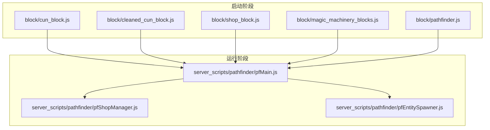
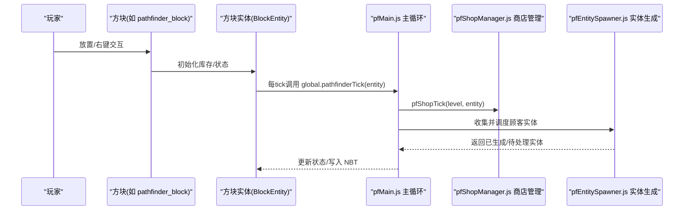
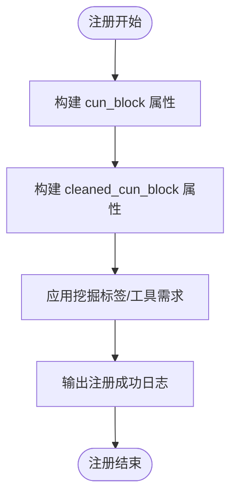
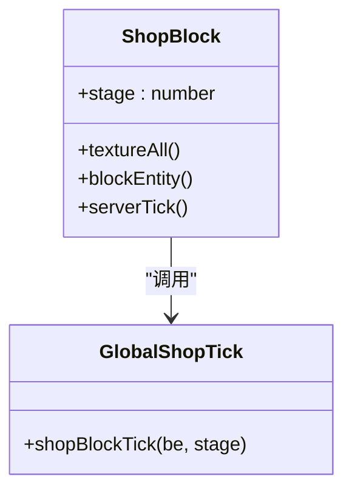
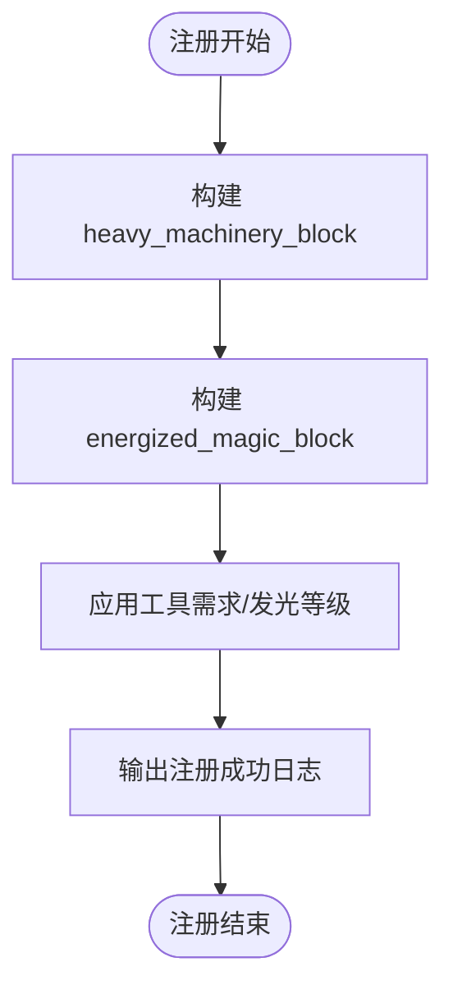
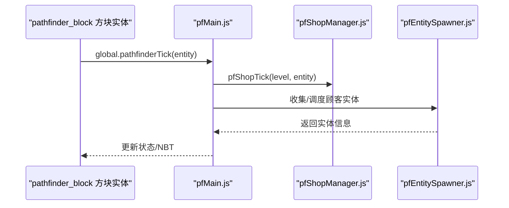
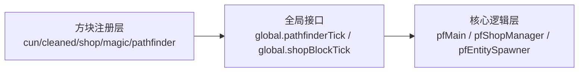

# 物品方块新增

<cite>
**本文引用的文件**   
- [README.md](file://README.md)
- [AGENTS.md](file://AGENTS.md)
- [cun_block.js](file://kubejs/startup_scripts/block/cun_block.js)
- [cleaned_cun_block.js](file://kubejs/startup_scripts/block/cleaned_cun_block.js)
- [shop_block.js](file://kubejs/startup_scripts/block/shop_block.js)
- [magic_machinery_blocks.js](file://kubejs/startup_scripts/block/magic_machinery_blocks.js)
- [pathfinder.js](file://kubejs/startup_scripts/block/pathfinder.js)
- [pfMain.js](file://kubejs/server_scripts/pathfinder/pfMain.js)
- [pfShopManager.js](file://kubejs/server_scripts/pathfinder/pfShopManager.js)
- [pfEntitySpawner.js](file://kubejs/server_scripts/pathfinder/pfEntitySpawner.js)
</cite>

## 目录
1. [引言](#引言)
2. [项目结构](#项目结构)
3. [核心组件](#核心组件)
4. [架构总览](#架构总览)
5. [详细组件分析](#详细组件分析)
6. [依赖关系分析](#依赖关系分析)
7. [性能与稳定性考虑](#性能与稳定性考虑)
8. [故障排查指南](#故障排查指南)
9. [结论](#结论)
10. [附录：新增物品方块的规范清单](#附录新增物品方块的规范清单)

## 引言
本文件聚焦“物品方块新增”这一主题，围绕 KubeJS 启动脚本中的方块注册、方块实体行为、以及与服务端寻路/商店系统的协作进行系统化说明。文档既适合刚接触该 Modpack 的开发者快速上手，也适合需要深入理解现有方块实现细节的维护者查阅。

本项目基于 Minecraft 1.20.1 + Forge + KubeJS，通过 `startup_scripts` 注册基础方块，并通过 `server_scripts` 扩展方块实体的 Tick 逻辑、商店生成、顾客寻路与结算等玩法。

**章节来源**
- [README.md:1-6](file://README.md#L1-L6)

## 项目结构
与“物品方块新增”直接相关的代码主要位于以下路径：
- 方块注册入口：`kubejs/startup_scripts/block/*`
- 方块实体 Tick 与业务逻辑：`kubejs/server_scripts/pathfinder/*`
- 系统级约定与调用约定：`AGENTS.md`

**图表来源**
- [cun_block.js:10-25](file://kubejs/startup_scripts/block/cun_block.js#L10-L25)
- [cleaned_cun_block.js:10-25](file://kubejs/startup_scripts/block/cleaned_cun_block.js#L10-L25)
- [shop_block.js:4-31](file://kubejs/startup_scripts/block/shop_block.js#L4-L31)
- [magic_machinery_blocks.js:17-52](file://kubejs/startup_scripts/block/magic_machinery_blocks.js#L17-L52)
- [pathfinder.js:11-26](file://kubejs/startup_scripts/block/pathfinder.js#L11-L26)
- [pfMain.js:11-36](file://kubejs/server_scripts/pathfinder/pfMain.js#L11-L36)

**章节来源**
- [AGENTS.md:170-185](file://AGENTS.md#L170-L185)

## 核心组件
本节梳理本次新增/使用的关键方块及其职责：

| 方块 | 命名空间ID | 用途与定位 | 关键属性 | 关联逻辑 |
|---|---|---|---|---|
| 皴块 | `marguerite:cun_block` | 由 9 个“皴”合成，可投入 Create 筛网产出金属颗粒 | 泥土材质、沙砾音效、硬度/抗性与铲子可采 | Create 筛网产出（配方） |
| 洗净的皴块 | `marguerite:cleaned_cun_block` | 皴块经水洗搅拌后的净化版本 | 同皴块基础属性 | Create 动力搅拌（不加热）产出皴水+洗净皴块 |
| 商店·阶段N | `shop_block_1~5` | 放置后自动变为草方块并在上方生成带随机遗物交易的 NPC 村民 | 每阶段不同贴图；绑定方块实体 Tick | 全局 `global.shopBlockTick` 驱动开店流程 |
| 重型机械方块 | `marguerite:heavy_machinery_block` | 第三章重工业门槛材料，车窑砖前置 | 金属材质、铁镐采集、较高硬度/抗性 | 合成链与车窑/工程块门槛 |
| 充能魔力块 | `marguerite:energized_magic_block` | 第三章终产物，最强磁铁定位，IE 高炉超高热值燃料 | 金属材质、钻石镐采集、微弱发光 | 烧制与燃料配方 |
| 寻路触发器 | `pathfinder_block` | 寻路系统主循环触发点，承载配置库存与状态持久化 | 不可破坏；9x3 库存；每 tick 回调 | 驱动顾客生成、排队、移动、睡觉、消费等全流程 |

**章节来源**
- [cun_block.js:1-26](file://kubejs/startup_scripts/block/cun_block.js#L1-L26)
- [cleaned_cun_block.js:1-26](file://kubejs/startup_scripts/block/cleaned_cun_block.js#L1-L26)
- [shop_block.js:1-32](file://kubejs/startup_scripts/block/shop_block.js#L1-L32)
- [magic_machinery_blocks.js:1-53](file://kubejs/startup_scripts/block/magic_machinery_blocks.js#L1-L53)
- [pathfinder.js:1-27](file://kubejs/startup_scripts/block/pathfinder.js#L1-L27)

## 架构总览
KubeJS 在启动阶段注册方块，运行期通过方块实体 Tick 驱动服务端逻辑。整体数据流如下：

**图表来源**
- [pathfinder.js:11-26](file://kubejs/startup_scripts/block/pathfinder.js#L11-L26)
- [pfMain.js:11-36](file://kubejs/server_scripts/pathfinder/pfMain.js#L11-L36)
- [pfShopManager.js:210-224](file://kubejs/server_scripts/pathfinder/pfShopManager.js#L210-L224)
- [pfEntitySpawner.js:29-58](file://kubejs/server_scripts/pathfinder/pfEntitySpawner.js#L29-L58)

## 详细组件分析

### 皴块与洗净的皴块
- 设计目标
  - 皴块作为基础资源压缩方块，提供 Create 筛网的稳定产出。
  - 洗净的皴块作为皴块的水洗升级态，增加煤炭产出，形成资源分支。
- 关键实现要点
  - 使用 `StartupEvents.registry("block", ...)` 注册。
  - 设置材质、音效、硬度、抗性、工具需求与可挖掘标签。
  - 贴图路径遵循 KubeJS 默认规则，位于对应 assets 下。
- 复杂度与性能
  - 纯注册型方块，无运行时逻辑，开销极低。
- 错误处理
  - 包裹 try/catch 输出注册失败日志，便于调试。

**图表来源**
- [cun_block.js:10-25](file://kubejs/startup_scripts/block/cun_block.js#L10-L25)
- [cleaned_cun_block.js:10-25](file://kubejs/startup_scripts/block/cleaned_cun_block.js#L10-L25)

**章节来源**
- [cun_block.js:1-26](file://kubejs/startup_scripts/block/cun_block.js#L1-L26)
- [cleaned_cun_block.js:1-26](file://kubejs/startup_scripts/block/cleaned_cun_block.js#L1-L26)

### 商店·阶段N 方块
- 设计目标
  - 放置后下一 tick 自动变为草方块，并在上方生成携带随机遗物交易的 NPC 村民。
  - 支持 5 个阶段，每个阶段拥有独立名称与贴图。
- 关键实现要点
  - 使用循环批量注册 5 个 `shop_block_N`。
  - 为每个方块绑定方块实体 Tick，调用全局 `global.shopBlockTick(be, stage)`。
- 运行时协作
  - 商店状态与生成逻辑在服务端统一管理，避免客户端不一致。
- 复杂度与性能
  - 仅做轻量 Tick 转发，实际逻辑集中在服务端管理器中。

**图表来源**
- [shop_block.js:4-31](file://kubejs/startup_scripts/block/shop_block.js#L4-L31)

**章节来源**
- [shop_block.js:1-32](file://kubejs/startup_scripts/block/shop_block.js#L1-L32)

### 重型机械方块与充能魔力块
- 设计目标
  - 重型机械方块：第三章重工业门槛材料，象征具备建造大型机械的能力。
  - 充能魔力块：第三章终产物，定位为最强磁铁，同时作为 IE 高炉超高热值燃料。
- 关键实现要点
  - 分别设置材质、音效、硬度、抗性、工具需求与挖掘标签。
  - 充能魔力块额外设置微弱发光等级。
- 复杂度与性能
  - 纯注册型方块，无运行时逻辑，开销极低。

**图表来源**
- [magic_machinery_blocks.js:17-52](file://kubejs/startup_scripts/block/magic_machinery_blocks.js#L17-L52)

**章节来源**
- [magic_machinery_blocks.js:1-53](file://kubejs/startup_scripts/block/magic_machinery_blocks.js#L1-L53)

### 寻路触发器与主循环
- 设计目标
  - 提供不可破坏的寻路触发方块，承载 9x3 配置库存与状态持久化。
  - 每 tick 调用全局 `global.pathfinderTick(entity)`，驱动顾客生成、排队、移动、睡觉、消费等全流程。
- 关键实现要点
  - 注册时声明方块实体库存与 serverTick 回调。
  - 主循环模块整合商店管理、实体收集与调度。
- 运行时协作
  - 商店管理负责开店状态、UUID 记录与白天判定。
  - 实体生成负责生成顾客并写入持久化数据（起点、路线、阶段、时间等）。

**图表来源**
- [pathfinder.js:11-26](file://kubejs/startup_scripts/block/pathfinder.js#L11-L26)
- [pfMain.js:11-36](file://kubejs/server_scripts/pathfinder/pfMain.js#L11-L36)
- [pfShopManager.js:210-224](file://kubejs/server_scripts/pathfinder/pfShopManager.js#L210-L224)
- [pfEntitySpawner.js:29-58](file://kubejs/server_scripts/pathfinder/pfEntitySpawner.js#L29-L58)

**章节来源**
- [pathfinder.js:1-27](file://kubejs/startup_scripts/block/pathfinder.js#L1-L27)
- [pfMain.js:1-36](file://kubejs/server_scripts/pathfinder/pfMain.js#L1-L36)
- [pfShopManager.js:200-244](file://kubejs/server_scripts/pathfinder/pfShopManager.js#L200-L244)
- [pfEntitySpawner.js:29-58](file://kubejs/server_scripts/pathfinder/pfEntitySpawner.js#L29-L58)

## 依赖关系分析
- 启动阶段依赖
  - 所有方块均通过 `StartupEvents.registry("block", ...)` 注册。
  - 贴图与模型遵循 KubeJS 默认资源加载规则。
- 运行阶段依赖
  - `pathfinder_block` 的方块实体 Tick 依赖 `global.pathfinderTick`。
  - `shop_block_N` 的方块实体 Tick 依赖 `global.shopBlockTick`。
  - 主循环依赖商店管理与实体生成模块。
- 耦合与内聚
  - 方块注册与运行时逻辑解耦：注册只关心外观与基础属性，运行时逻辑集中在服务端模块。
  - 通过全局函数接口降低模块间直接耦合，提高可测试性。

**图表来源**
- [cun_block.js:10-25](file://kubejs/startup_scripts/block/cun_block.js#L10-L25)
- [cleaned_cun_block.js:10-25](file://kubejs/startup_scripts/block/cleaned_cun_block.js#L10-L25)
- [shop_block.js:20-31](file://kubejs/startup_scripts/block/shop_block.js#L20-L31)
- [magic_machinery_blocks.js:17-52](file://kubejs/startup_scripts/block/magic_machinery_blocks.js#L17-L52)
- [pathfinder.js:11-26](file://kubejs/startup_scripts/block/pathfinder.js#L11-L26)
- [pfMain.js:11-36](file://kubejs/server_scripts/pathfinder/pfMain.js#L11-L36)

**章节来源**
- [AGENTS.md:170-185](file://AGENTS.md#L170-L185)

## 性能与稳定性考虑
- 注册阶段
  - 所有方块注册均为一次性操作，建议保持 try/catch 包裹以捕获异常并输出日志。
- 运行阶段
  - 寻路主循环每 tick 执行，应避免在回调中进行昂贵计算或频繁 IO。
  - 商店生成与顾客调度应使用批量化与去重策略，防止重复生成。
- 内存与持久化
  - 商店状态与顾客信息优先存储在方块实体 NBT 或实体 persistentData 中，确保跨重启一致性。
- 兼容性
  - 对第三方 Mod（如 Create、IE）的 API 调用需做兼容判断与降级处理，避免缺失依赖时报错。

[本节为通用指导，不直接分析具体文件]

## 故障排查指南
- 方块未显示或贴图缺失
  - 检查贴图路径是否符合 KubeJS 默认规则。
  - 确认 assets 目录下存在对应纹理文件。
- 方块注册失败
  - 查看控制台日志中 `[CUN]`、`[MAGIC-BLOCK]` 等前缀的错误信息。
  - 确认命名空间与 ID 拼写一致，避免大小写问题。
- 商店不生成或顾客不出现
  - 检查 `global.shopBlockTick` 是否被正确赋值。
  - 确认服务器端商店管理模块已加载且白天判定正常。
- 寻路系统无响应
  - 检查 `global.pathfinderTick` 是否被正确赋值。
  - 确认 `pathfinder_block` 的方块实体库存与 NBT 读写正常。

**章节来源**
- [cun_block.js:21-24](file://kubejs/startup_scripts/block/cun_block.js#L21-L24)
- [magic_machinery_blocks.js:31-51](file://kubejs/startup_scripts/block/magic_machinery_blocks.js#L31-L51)
- [pfMain.js:11-36](file://kubejs/server_scripts/pathfinder/pfMain.js#L11-L36)

## 结论
本项目通过 KubeJS 将“物品方块新增”拆分为清晰的注册层与运行层：注册层专注方块的外观与基础属性，运行层通过全局接口驱动复杂的商店与寻路逻辑。这种分层设计降低了耦合度，提升了可维护性与可扩展性。新增方块时，建议严格遵循现有模式，保持命名一致、日志完善、错误处理完备，并确保与 Create、IE 等第三方 Mod 的兼容。

[本节为总结性内容，不直接分析具体文件]

## 附录：新增物品方块的规范清单
- 命名与注册
  - 使用 `StartupEvents.registry("block", ...)` 注册。
  - 命名空间统一为 `marguerite:`（业务相关方块），或使用其他合理命名空间。
- 属性设置
  - 明确材质、音效、硬度、抗性、工具需求与挖掘标签。
  - 如需发光或特殊效果，显式设置（如 `lightLevel`）。
- 贴图与模型
  - 贴图路径遵循 KubeJS 默认规则，位于 `assets/<namespace>/textures/block/...`。
- 运行时逻辑
  - 若需 Tick 行为，使用 `blockEntity` 绑定 `serverTick`。
  - 通过全局函数（如 `global.pathfinderTick`、`global.shopBlockTick`）暴露接口，避免直接耦合。
- 错误处理与日志
  - 注册与 Tick 回调均包裹 try/catch，输出清晰的前缀日志。
- 兼容性
  - 对第三方 Mod API 调用做存在性判断与降级处理。
- 测试建议
  - 在单人世界验证方块放置、破坏、贴图显示。
  - 在服务端验证 Tick 行为、NBT 持久化与跨重启一致性。

[本节为通用规范，不直接分析具体文件]