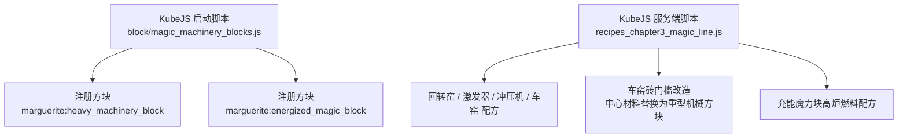
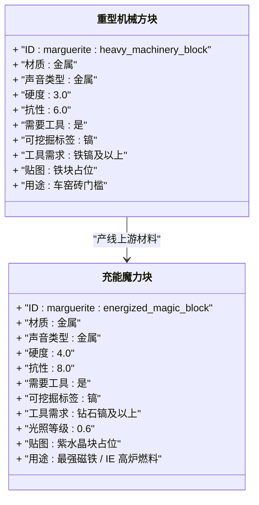
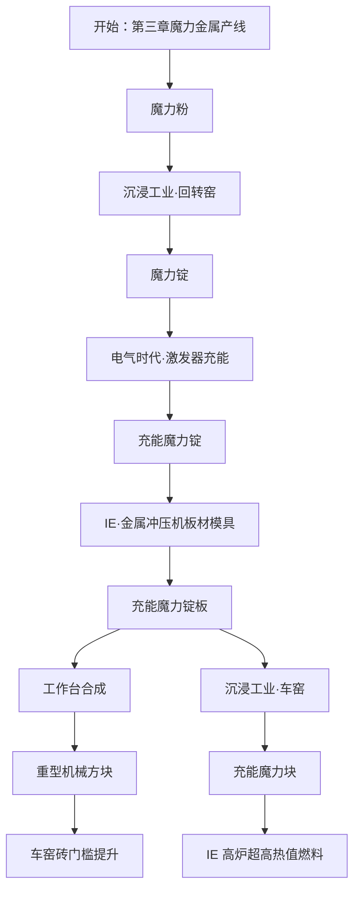
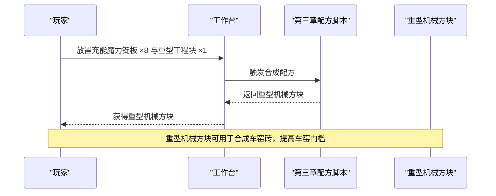
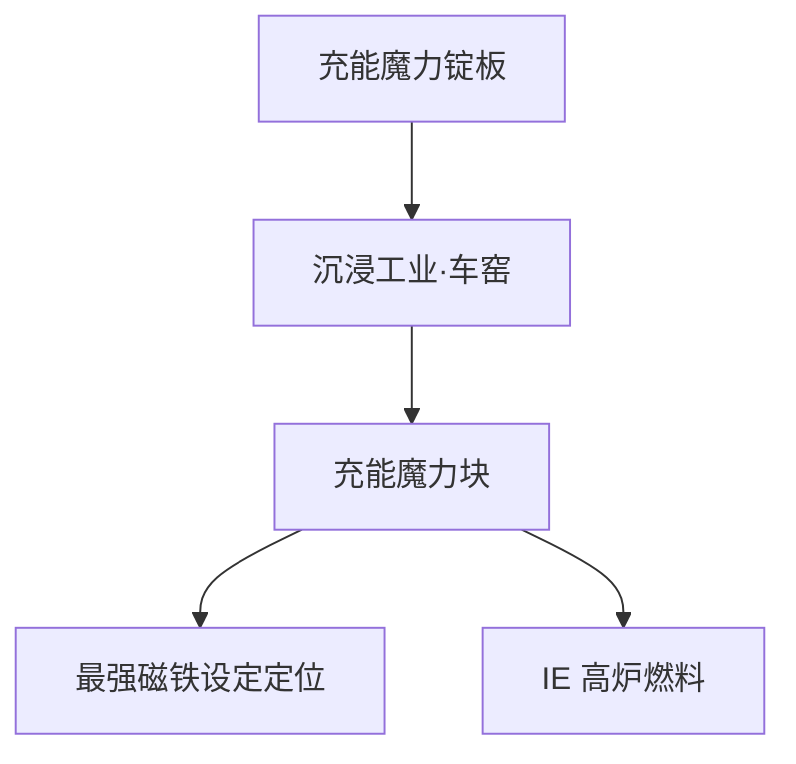
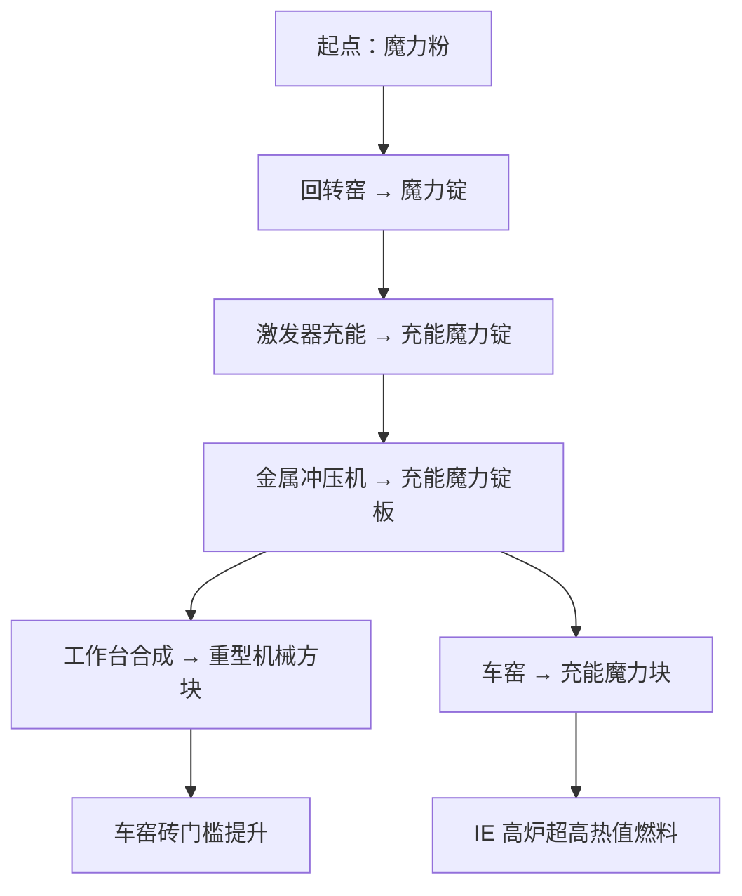
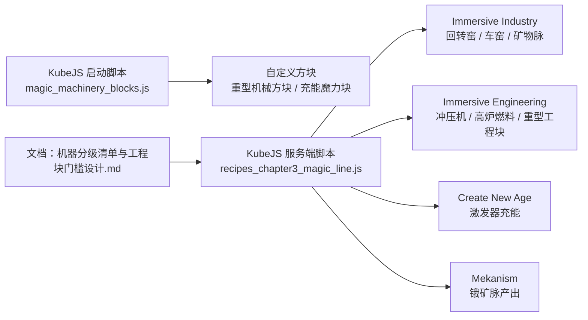

# 魔法机械方块

<cite>
**本文引用的文件**   
- [README.md](file://README.md)
- [项目总览.md](file://docs/00-项目总览.md)
- [机器分级清单与工程块门槛设计.md](file://docs/第二章-沉浸工程/08-机器分级清单与工程块门槛设计.md)
- [magic_machinery_blocks.js](file://kubejs/startup_scripts/block/magic_machinery_blocks.js)
- [recipes_chapter3_magic_line.js](file://kubejs/server_scripts/recipes/recipes_chapter3_magic_line.js)
</cite>

## 目录
1. [引言](#引言)
2. [项目结构定位](#项目结构定位)
3. [核心组件：魔法机械方块体系](#核心组件魔法机械方块体系)
4. [架构总览](#架构总览)
5. [详细组件分析](#详细组件分析)
6. [依赖关系分析](#依赖关系分析)
7. [性能与平衡性考量](#性能与平衡性考量)
8. [故障排查指南](#故障排查指南)
9. [结论](#结论)

## 引言
“魔法机械方块”是整合包第三章重工业科技线中的关键自定义方块族，承担两条职责：
- 作为重工业能力标志的「重型机械方块」，用于提高车窑砖等高级设备的合成门槛。
- 作为第三章魔力金属产线终产物「充能魔力块」，定位为最强磁铁，并作为沉浸工程高炉超高热值燃料。

该体系通过 KubeJS 在启动阶段注册方块、在服务端注册配方，并与 Create、Immersive Engineering、Immersive Industry、Create New Age 等模组形成跨模组协作。

**章节来源**
- [项目总览.md:5-18](file://docs/00-项目总览.md#L5-L18)

## 项目结构定位
魔法机械方块相关代码位于 KubeJS 脚本中，分为两类：
- 启动期方块注册：`kubejs/startup_scripts/block/magic_machinery_blocks.js`
- 服务端配方与门槛改造：`kubejs/server_scripts/recipes/recipes_chapter3_magic_line.js`

**图示来源**
- [magic_machinery_blocks.js:17-52](file://kubejs/startup_scripts/block/magic_machinery_blocks.js#L17-L52)
- [recipes_chapter3_magic_line.js:31-119](file://kubejs/server_scripts/recipes/recipes_chapter3_magic_line.js#L31-L119)
- [recipes_chapter3_magic_line.js:192-211](file://kubejs/server_scripts/recipes/recipes_chapter3_magic_line.js#L192-L211)

**章节来源**
- [magic_machinery_blocks.js:1-15](file://kubejs/startup_scripts/block/magic_machinery_blocks.js#L1-L15)
- [recipes_chapter3_magic_line.js:1-29](file://kubejs/server_scripts/recipes/recipes_chapter3_magic_line.js#L1-L29)

## 核心组件：魔法机械方块体系
魔法机械方块体系包含两个自定义方块和一条贯穿多模组的第三章魔力金属产线。

| 名称 | 资源 ID | 主要用途 | 获取方式 | 特性 |
|---|---|---|---|---|
| 重型机械方块 | `marguerite:heavy_machinery_block` | 车窑砖门槛材料；象征重工业能力 | 工作台合成：充能魔力锭板 + 重型工程块 | 铁质工具可开采，硬度中等，阻力较高 |
| 充能魔力块 | `marguerite:energized_magic_block` | 第三章终产物；最强磁铁；IE 高炉超高热值燃料 | 沉浸工业车窑烧制充能魔力锭板 | 钻石工具可开采，带微弱光源 |

**图示来源**
- [magic_machinery_blocks.js:17-52](file://kubejs/startup_scripts/block/magic_machinery_blocks.js#L17-L52)

**章节来源**
- [magic_machinery_blocks.js:17-52](file://kubejs/startup_scripts/block/magic_machinery_blocks.js#L17-L52)

## 架构总览
魔法机械方块不是孤立方块，而是第三章“魔力金属产线”的关键节点。其上游来自 Create、Create New Age、Immersive Engineering、Immersive Industry 等多个模组，下游则影响设备门槛与高炉燃料生态。

**图示来源**
- [recipes_chapter3_magic_line.js:5-20](file://kubejs/server_scripts/recipes/recipes_chapter3_magic_line.js#L5-L20)
- [recipes_chapter3_magic_line.js:31-119](file://kubejs/server_scripts/recipes/recipes_chapter3_magic_line.js#L31-L119)
- [recipes_chapter3_magic_line.js:192-211](file://kubejs/server_scripts/recipes/recipes_chapter3_magic_line.js#L192-L211)

**章节来源**
- [recipes_chapter3_magic_line.js:1-29](file://kubejs/server_scripts/recipes/recipes_chapter3_magic_line.js#L1-L29)

## 详细组件分析

### 重型机械方块
重型机械方块是第三章重工业能力的具象化材料，主要用于提高车窑砖的合成门槛，从而控制玩家进入更高级产线的节奏。

- 注册位置：启动期方块注册脚本。
- 合成路径：由充能魔力锭板与重型工程块在工作台合成。
- 门槛作用：车窑砖原配方中心材料被替换为重型机械方块，使车窑成为“重型机械方块门槛车窑”。
- 设计意图：延续“电子元件解锁难机器”的分级思路，将重工业能力与高阶设备绑定。

**图示来源**
- [recipes_chapter3_magic_line.js:76-89](file://kubejs/server_scripts/recipes/recipes_chapter3_magic_line.js#L76-L89)
- [recipes_chapter3_magic_line.js:192-211](file://kubejs/server_scripts/recipes/recipes_chapter3_magic_line.js#L192-L211)

**章节来源**
- [magic_machinery_blocks.js:17-33](file://kubejs/startup_scripts/block/magic_machinery_blocks.js#L17-L33)
- [recipes_chapter3_magic_line.js:76-89](file://kubejs/server_scripts/recipes/recipes_chapter3_magic_line.js#L76-L89)
- [recipes_chapter3_magic_line.js:192-211](file://kubejs/server_scripts/recipes/recipes_chapter3_magic_line.js#L192-L211)
- [机器分级清单与工程块门槛设计.md:87-118](file://docs/第二章-沉浸工程/08-机器分级清单与工程块门槛设计.md#L87-L118)

### 充能魔力块
充能魔力块是第三章魔力金属产线的终产物，承担双重角色：
- 最强磁铁：在设定上代表第三章魔导重工业的最高结晶。
- IE 高炉超高热值燃料：燃烧时间显著高于焦煤，用于支撑第三章高炉产能目标。

**图示来源**
- [recipes_chapter3_magic_line.js:91-119](file://kubejs/server_scripts/recipes/recipes_chapter3_magic_line.js#L91-L119)
- [magic_machinery_blocks.js:35-52](file://kubejs/startup_scripts/block/magic_machinery_blocks.js#L35-L52)

**章节来源**
- [recipes_chapter3_magic_line.js:91-119](file://kubejs/server_scripts/recipes/recipes_chapter3_magic_line.js#L91-L119)
- [magic_machinery_blocks.js:35-52](file://kubejs/startup_scripts/block/magic_machinery_blocks.js#L35-L52)

### 第三章魔力金属产线流程
第三章产线从魔力粉出发，依次经过回转窑、激发器、金属冲压机、工作台合成、车窑，最终产出重型机械方块与充能魔力块。

**图示来源**
- [recipes_chapter3_magic_line.js:5-20](file://kubejs/server_scripts/recipes/recipes_chapter3_magic_line.js#L5-L20)
- [recipes_chapter3_magic_line.js:31-119](file://kubejs/server_scripts/recipes/recipes_chapter3_magic_line.js#L31-L119)
- [recipes_chapter3_magic_line.js:192-211](file://kubejs/server_scripts/recipes/recipes_chapter3_magic_line.js#L192-L211)

**章节来源**
- [recipes_chapter3_magic_line.js:1-29](file://kubejs/server_scripts/recipes/recipes_chapter3_magic_line.js#L1-L29)
- [recipes_chapter3_magic_line.js:31-119](file://kubejs/server_scripts/recipes/recipes_chapter3_magic_line.js#L31-L119)

## 依赖关系分析
魔法机械方块的实现依赖多个外部模组与内部文档设计：

- 外部模组依赖
  - Immersive Industry：回转窑、车窑、矿物脉等配方类型。
  - Immersive Engineering：金属冲压机、高炉燃料、重型工程块。
  - Create New Age：激发器充能。
  - Mekanism：旧地狱锇矿脉产出，为第四章提前准备。
- 内部设计依赖
  - 机器分级清单与工程块门槛设计：提供“电子元件解锁难机器”的门限理念，并映射到第三章的车窑砖门槛改造。

**图示来源**
- [magic_machinery_blocks.js:17-52](file://kubejs/startup_scripts/block/magic_machinery_blocks.js#L17-L52)
- [recipes_chapter3_magic_line.js:22-28](file://kubejs/server_scripts/recipes/recipes_chapter3_magic_line.js#L22-L28)
- [recipes_chapter3_magic_line.js:121-145](file://kubejs/server_scripts/recipes/recipes_chapter3_magic_line.js#L121-L145)
- [机器分级清单与工程块门槛设计.md:87-118](file://docs/第二章-沉浸工程/08-机器分级清单与工程块门槛设计.md#L87-L118)

**章节来源**
- [recipes_chapter3_magic_line.js:22-28](file://kubejs/server_scripts/recipes/recipes_chapter3_magic_line.js#L22-L28)
- [recipes_chapter3_magic_line.js:121-145](file://kubejs/server_scripts/recipes/recipes_chapter3_magic_line.js#L121-L145)
- [机器分级清单与工程块门槛设计.md:87-118](file://docs/第二章-沉浸工程/08-机器分级清单与工程块门槛设计.md#L87-L118)

## 性能与平衡性考量
- 方块耐久与工具需求
  - 重型机械方块：铁镐可开采，硬度与抗性适中，适合中期重工业阶段。
  - 充能魔力块：钻石镐可开采，硬度更高且带微弱光源，体现终产物稀有性与价值。
- 配方能耗与时间
  - 回转窑、车窑、冲压机、激发器等配方均带有时间与能量参数，构成第三章产线的节奏阀门。
  - 充能魔力块作为高炉燃料，燃烧时间显著高于焦煤，用于支撑高炉产能目标。
- 门槛设计
  - 车窑砖核心材料替换为重型机械方块，避免玩家跳过重工业能力直接建造车窑。
  - 延续“电子元件解锁难机器”的理念，使第三章设备升级具备明确门槛。

[本节为通用指导，不直接分析具体代码行]

## 故障排查指南
常见问题与定位建议：

- 方块未注册或显示异常
  - 检查启动期方块注册是否成功，关注控制台日志中的 `[MAGIC-BLOCK]` 输出。
  - 确认方块 ID 与贴图路径是否正确。
- 合成配方无效
  - 检查第三章配方脚本是否加载，确认工作台合成配方 ID 未被其他数据包覆盖。
  - 确认重型工程块与充能魔力锭板是否存在。
- 车窑砖无法合成
  - 检查车窑砖配方是否已被移除并重建。
  - 确认重型机械方块已正确生成并可放入配方槽。
- 车窑无法生产充能魔力块
  - 检查车窑配方类型是否为 `immersiveindustry:car_kiln`。
  - 确认输入为充能魔力锭板，且车窑有足够能源与时间。
- 高炉燃料无效
  - 检查充能魔力块的高炉燃料配方是否注册成功。
  - 确认燃烧时间参数是否符合预期。

**章节来源**
- [magic_machinery_blocks.js:30-51](file://kubejs/startup_scripts/block/magic_machinery_blocks.js#L30-L51)
- [recipes_chapter3_magic_line.js:76-119](file://kubejs/server_scripts/recipes/recipes_chapter3_magic_line.js#L76-L119)
- [recipes_chapter3_magic_line.js:192-211](file://kubejs/server_scripts/recipes/recipes_chapter3_magic_line.js#L192-L211)

## 结论
魔法机械方块体系以“重型机械方块”和“充能魔力块”为核心，串联起第三章魔力金属产线与多模组协作。它既提升了车窑砖等设备的门槛，又提供了高炉超高热值燃料，使玩家在重工业阶段拥有明确的进度目标与资源循环。通过 KubeJS 的启动期注册与服务端配方管理，该体系与 Create、IE、II、Create New Age、Mekanism 等模组形成稳定集成，并为后续章节资源与设备扩展预留空间。

[本节为总结性内容，不直接分析具体代码行]