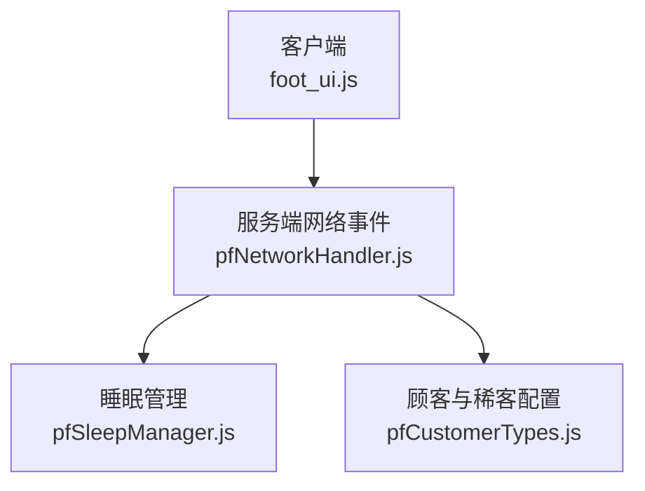
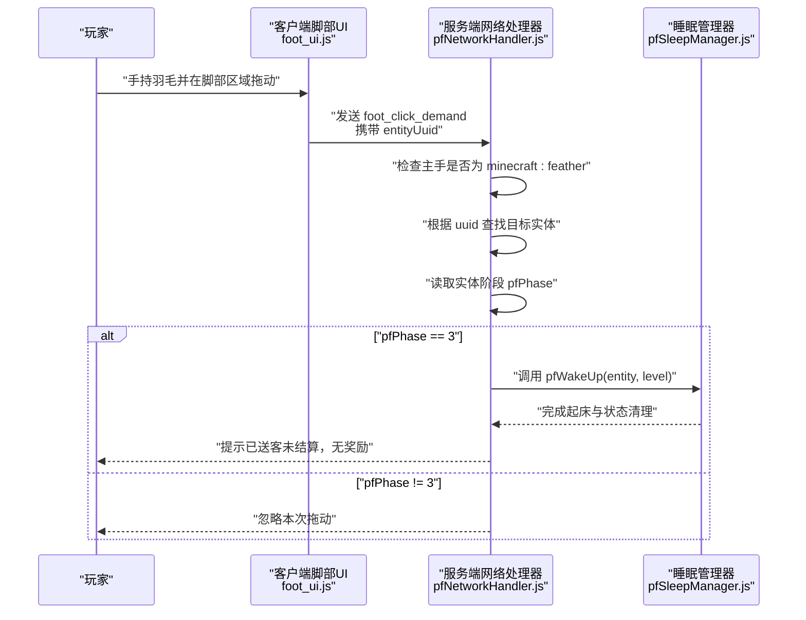
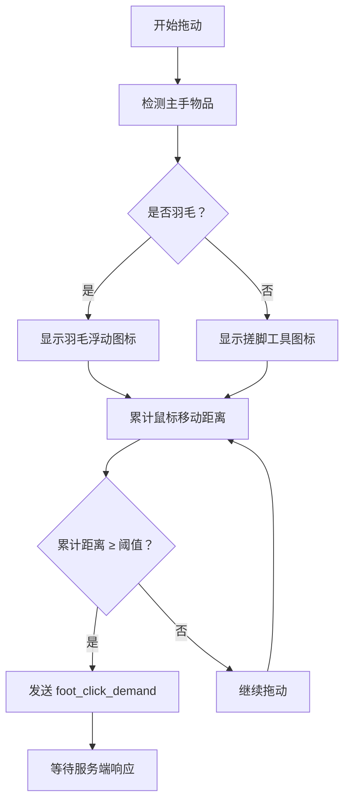
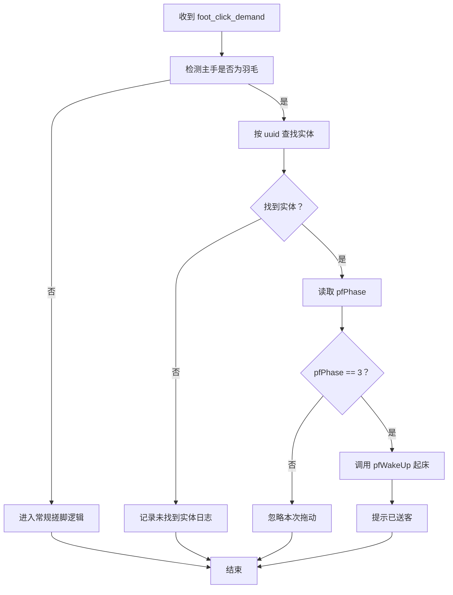
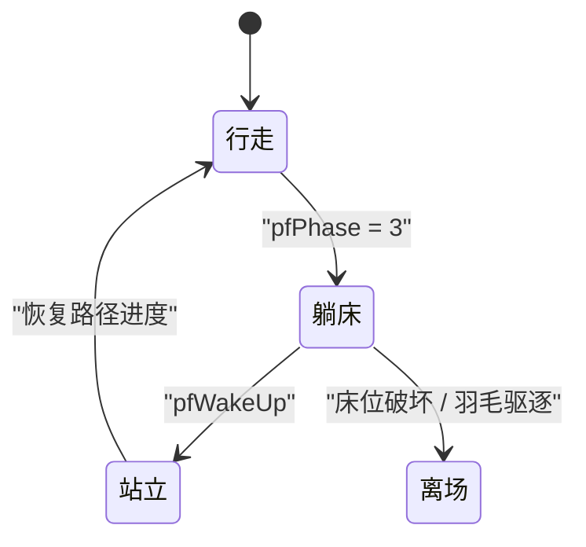
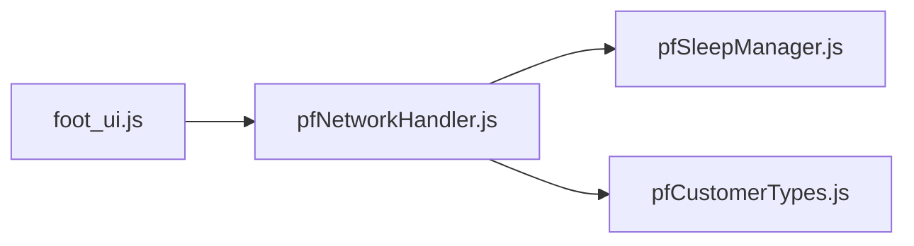

# 羽毛驱逐机制

<cite>
**本文引用的文件**   
- [pfNetworkHandler.js](file://kubejs/server_scripts/pathfinder/pfNetworkHandler.js)
- [foot_ui.js](file://kubejs/client_scripts/ui/foot_ui.js)
- [pfCustomerTypes.js](file://kubejs/server_scripts/pathfinder/pfCustomerTypes.js)
- [pfSleepManager.js](file://kubejs/server_scripts/pathfinder/pfSleepManager.js)
</cite>

## 目录
1. [引言](#引言)
2. [项目结构定位](#项目结构定位)
3. [核心组件与职责](#核心组件与职责)
4. [系统架构总览](#系统架构总览)
5. [详细机制分析](#详细机制分析)
6. [依赖关系分析](#依赖关系分析)
7. [性能与稳定性考虑](#性能与稳定性考虑)
8. [故障排查指南](#故障排查指南)
9. [结论](#结论)

## 引言
本文件聚焦于“羽毛驱逐机制”，即玩家手持羽毛对正在躺床的顾客执行“送客”的行为。该机制的核心目标是：  
- 允许玩家通过羽毛快速结束一次未结算的服务；  
- 避免误触发拖动搓脚逻辑；  
- 保证状态安全，只在顾客处于特定睡眠阶段时生效；  
- 与现有搓脚、泡脚、掉落、满意度等系统解耦，不污染正常服务结算流程。

## 项目结构定位
羽毛驱逐机制涉及客户端交互与服务端校验两部分，主要位于以下路径：
- 客户端 UI 与拖拽事件：`kubejs/client_scripts/ui/foot_ui.js`
- 服务端网络事件处理：`kubejs/server_scripts/pathfinder/pfNetworkHandler.js`
- 稀客掉落配置（羽毛作为掉落物）：`kubejs/server_scripts/pathfinder/pfCustomerTypes.js`
- 睡眠状态与起床逻辑：`kubejs/server_scripts/pathfinder/pfSleepManager.js`

**图表来源**  
- [foot_ui.js:180-258](file://kubejs/client_scripts/ui/foot_ui.js#L180-L258)  
- [pfNetworkHandler.js:50-89](file://kubejs/server_scripts/pathfinder/pfNetworkHandler.js#L50-L89)  
- [pfSleepManager.js:167-270](file://kubejs/server_scripts/pathfinder/pfSleepManager.js#L167-L270)  
- [pfCustomerTypes.js:497-505](file://kubejs/server_scripts/pathfinder/pfCustomerTypes.js#L497-L505)

**章节来源**  
- [foot_ui.js:1-81](file://kubejs/client_scripts/ui/foot_ui.js#L1-L81)  
- [pfNetworkHandler.js:1-89](file://kubejs/server_scripts/pathfinder/pfNetworkHandler.js#L1-L89)

## 核心组件与职责
| 组件 | 职责 | 关键行为 |
|---|---|---|
| 客户端脚部 UI | 显示顾客脚部需求、倒计时、满意度，并处理鼠标拖拽 | 将鼠标移动距离累计到阈值后发送 `foot_click_demand` 事件；识别羽毛图标 |
| 服务端网络处理器 | 接收客户端事件，校验手持物品、目标实体、需求键 | 检测到羽毛时执行“送客”分支；否则进入搓脚或一键满足逻辑 |
| 睡眠管理器 | 管理顾客躺床、倒计时、起床、床位破坏异常处理 | 提供 `pfWakeUp` 供羽毛驱逐调用 |
| 顾客与稀客类型 | 定义顾客类别、稀有顾客池、掉落表 | 稀客射命丸文掉落包含羽毛，体现羽毛在玩法中的资源意义 |

**章节来源**  
- [foot_ui.js:64-81](file://kubejs/client_scripts/ui/foot_ui.js#L64-L81)  
- [pfNetworkHandler.js:50-89](file://kubejs/server_scripts/pathfinder/pfNetworkHandler.js#L50-L89)  
- [pfSleepManager.js:167-270](file://kubejs/server_scripts/pathfinder/pfSleepManager.js#L167-L270)  
- [pfCustomerTypes.js:497-505](file://kubejs/server_scripts/pathfinder/pfCustomerTypes.js#L497-L505)

## 系统架构总览
羽毛驱逐机制是一个典型的“客户端输入 → 服务端校验 → 状态变更”流程。其整体时序如下：

**图表来源**  
- [foot_ui.js:180-258](file://kubejs/client_scripts/ui/foot_ui.js#L180-L258)  
- [pfNetworkHandler.js:50-89](file://kubejs/server_scripts/pathfinder/pfNetworkHandler.js#L50-L89)  
- [pfSleepManager.js:167-270](file://kubejs/server_scripts/pathfinder/pfSleepManager.js#L167-L270)

## 详细机制分析

### 客户端：羽毛图标与拖动触发
客户端在脚部 UI 中维护一个“手持物品 → 浮动图标”的映射，其中明确包含羽毛：
- 当玩家手持羽毛时，脚部区域会显示对应羽毛图标；
- 鼠标在脚部区域拖动时，累计移动距离；
- 达到阈值后，客户端向服务端发送 `foot_click_demand` 事件，携带 `entityUuid` 和请求序号；
- 注释明确指出：羽毛用于“送客”，服务端会在 `foot_click_demand` 中特判，执行起床离开、不结算、不发奖励。

**图表来源**  
- [foot_ui.js:64-81](file://kubejs/client_scripts/ui/foot_ui.js#L64-L81)  
- [foot_ui.js:180-258](file://kubejs/client_scripts/ui/foot_ui.js#L180-L258)

**章节来源**  
- [foot_ui.js:64-81](file://kubejs/client_scripts/ui/foot_ui.js#L64-L81)  
- [foot_ui.js:180-258](file://kubejs/client_scripts/ui/foot_ui.js#L180-L258)

### 服务端：羽毛驱逐判定流程
服务端在 `foot_click_demand` 事件中优先判断玩家主手是否为羽毛。若是，则执行以下流程：
1. 遍历当前世界实体，按 `uuid` 找到目标顾客；
2. 若找不到实体，记录日志并直接返回；
3. 读取顾客当前阶段，仅当阶段为 3（躺床）时才执行起床；
4. 调用睡眠管理器的 `pfWakeUp` 完成起床；
5. 给玩家提示“已送客（未结算，无奖励）”；
6. 记录成功日志并返回，不再进入后续搓脚逻辑。

**图表来源**  
- [pfNetworkHandler.js:50-89](file://kubejs/server_scripts/pathfinder/pfNetworkHandler.js#L50-L89)

**章节来源**  
- [pfNetworkHandler.js:50-89](file://kubejs/server_scripts/pathfinder/pfNetworkHandler.js#L50-L89)

### 睡眠状态约束：为什么只允许 phase=3
睡眠管理器负责顾客从躺床到起床的状态流转。羽毛驱逐机制要求顾客必须处于“躺床”阶段，原因包括：
- 防止拖动事件连续触发导致重复起床；
- 确保只有真正在服务中的顾客才能被羽毛驱逐；
- 与泡面、泡脚、评价、掉落等结算流程解耦。

睡眠管理器中，`pfWakeUp` 会：
- 停止睡眠；
- 清理躺姿 NBT；
- 计算下床位置；
- 更新路径进度；
- 释放店铺床位；
- 重置睡眠相关计数器。

**图表来源**  
- [pfSleepManager.js:167-270](file://kubejs/server_scripts/pathfinder/pfSleepManager.js#L167-L270)

**章节来源**  
- [pfSleepManager.js:167-270](file://kubejs/server_scripts/pathfinder/pfSleepManager.js#L167-L270)

### 羽毛的资源意义：稀客掉落
羽毛不仅是驱逐工具，也是稀客掉落的一部分。以稀客“射命丸文”为例，其掉落配置中包含纸张与羽毛，数量随好感度档位递增。这说明羽毛在本包中既是交互道具，也是可积累的资源。

| 稀客 | 掉落主题 | 羽毛相关行为 |
|---|---|---|
| 射命丸文 | 纸 + 羽毛 | 各好感档位均掉落羽毛，数量随好感提升 |

**章节来源**  
- [pfCustomerTypes.js:497-505](file://kubejs/server_scripts/pathfinder/pfCustomerTypes.js#L497-L505)

## 依赖关系分析
羽毛驱逐机制依赖以下模块：
- 客户端 UI 负责输入与视觉反馈；
- 服务端网络处理器负责权威校验；
- 睡眠管理器负责状态变更；
- 顾客与稀客配置提供羽毛作为掉落物的背景设定。

**图表来源**  
- [foot_ui.js:180-258](file://kubejs/client_scripts/ui/foot_ui.js#L180-L258)  
- [pfNetworkHandler.js:50-89](file://kubejs/server_scripts/pathfinder/pfNetworkHandler.js#L50-L89)  
- [pfSleepManager.js:167-270](file://kubejs/server_scripts/pathfinder/pfSleepManager.js#L167-L270)  
- [pfCustomerTypes.js:497-505](file://kubejs/server_scripts/pathfinder/pfCustomerTypes.js#L497-L505)

**章节来源**  
- [pfNetworkHandler.js:50-89](file://kubejs/server_scripts/pathfinder/pfNetworkHandler.js#L50-L89)

## 性能与稳定性考虑
- 客户端拖动采用距离阈值触发，避免每帧都发送网络请求；
- 服务端先校验实体存在性，再校验阶段，减少无效状态操作；
- 睡眠管理器使用独立计数器驱动秒级事件，跨重启友好；
- 羽毛驱逐仅在 phase=3 时生效，避免重复起床与状态混乱；
- 日志输出便于调试拖动、送客、实体查找等关键环节。

[本节为通用指导，不直接分析具体代码行]

## 故障排查指南
| 现象 | 可能原因 | 排查建议 |
|---|---|---|
| 持羽毛拖动无反应 | 顾客不在躺床阶段 | 检查顾客 pfPhase 是否为 3 |
| 持羽毛拖动提示未找到实体 | uuid 匹配失败或实体已消失 | 查看服务端日志中“未找到实体 uuid” |
| 持羽毛拖动触发了搓脚 | 服务端未识别羽毛或逻辑顺序异常 | 确认羽毛分支在搓脚逻辑之前执行 |
| 送客后仍结算奖励 | 非羽毛驱逐路径或状态异常 | 检查是否走了一键满足或普通搓脚分支 |
| 气泡或粒子异常 | 睡眠状态清理异常 | 检查 pfWakeUp 是否被正确调用 |

**章节来源**  
- [pfNetworkHandler.js:65-89](file://kubejs/server_scripts/pathfinder/pfNetworkHandler.js#L65-L89)  
- [pfSleepManager.js:167-270](file://kubejs/server_scripts/pathfinder/pfSleepManager.js#L167-L270)

## 结论
羽毛驱逐机制通过“客户端图标提示 + 服务端阶段校验 + 睡眠管理器状态变更”的组合，实现了安全、可控的顾客送客体验。它既避免了误触搓脚逻辑，又保证了服务结算不被污染，同时与稀客掉落体系形成资源闭环。对于扩展而言，未来可在该机制基础上增加驱逐冷却、驱逐次数限制、驱逐效果差异化等设计，但应保持当前“phase=3 才生效”的核心约束。

[本节为总结性内容，不直接分析具体代码行]