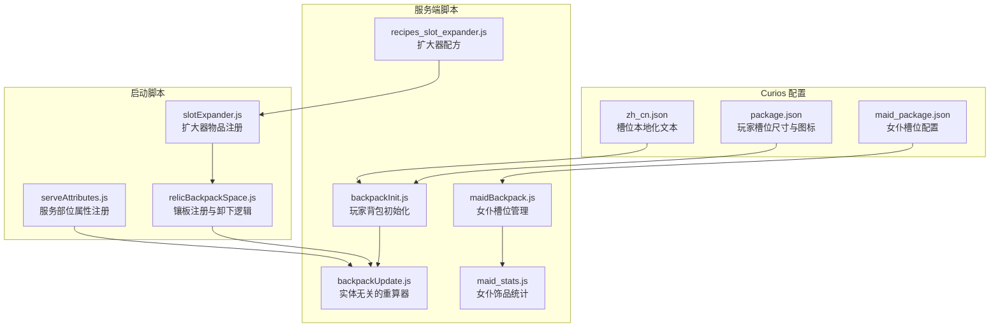
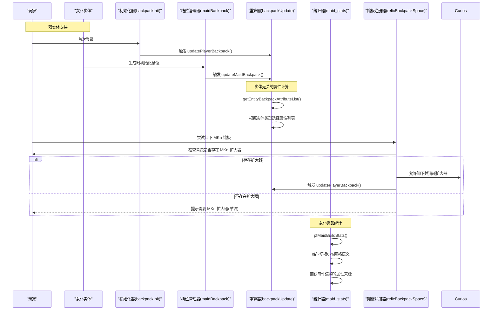
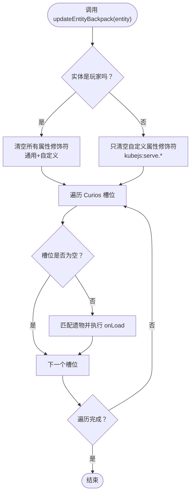
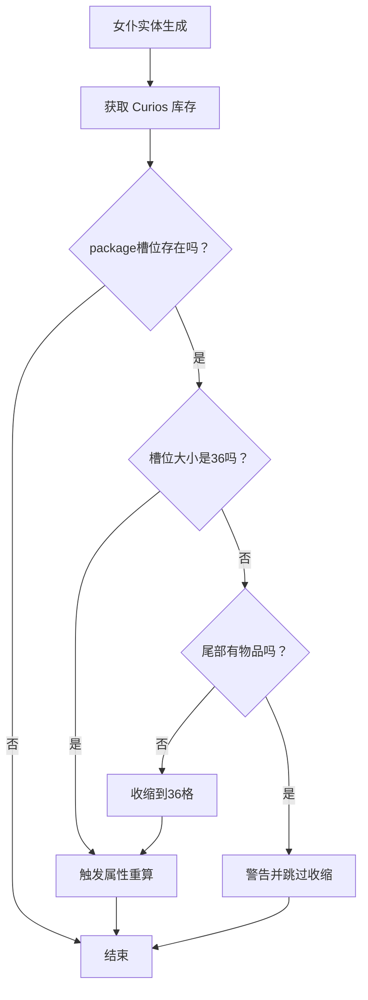
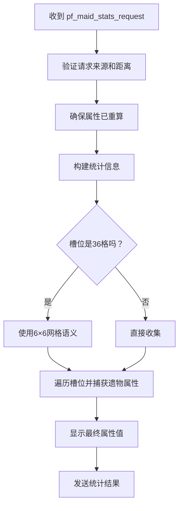
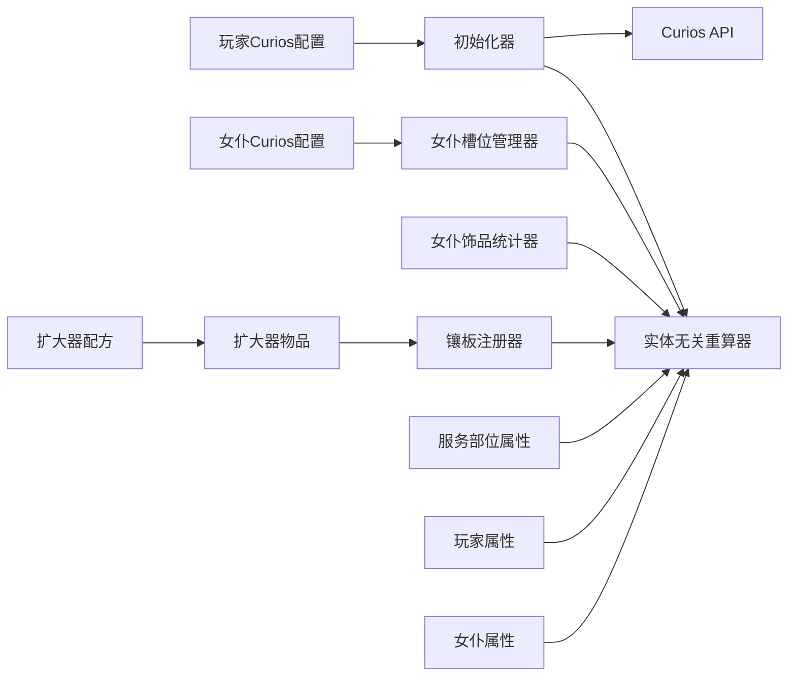

# 背包系统

<cite>
**本文引用的文件**
- [backpackInit.js](file://kubejs/server_scripts/backpack/backpackInit.js)
- [backpackUpdate.js](file://kubejs/server_scripts/backpack/backpackUpdate.js)
- [maidBackpack.js](file://kubejs/server_scripts/backpack/maidBackpack.js)
- [maid_stats.js](file://kubejs/server_scripts/backpack/maid_stats.js)
- [relicBackpackSpace.js](file://kubejs/startup_scripts/relic/relicItem/relicBackpackSpace.js)
- [recipes_slot_expander.js](file://kubejs/server_scripts/recipes/recipes_slot_expander.js)
- [slotExpander.js](file://kubejs/startup_scripts/item/slotExpander.js)
- [package.json](file://kubejs/data/curios/curios/slots/package.json)
- [maid_package.json](file://kubejs/data/touhou_little_maid/curios/entities/maid_package.json)
- [zh_cn.json](file://kubejs/assets/curios/lang/zh_cn.json)
- [serveAttributes.js](file://kubejs/startup_scripts/attributes/serveAttributes.js)
- [pfNetworkHandler.js](file://kubejs/server_scripts/pathfinder/pfNetworkHandler.js)
</cite>

## 更新摘要
**变更内容**
- 新增女仆实体背包支持，实现实体无关的属性计算机制
- 添加女仆特定的Curios槽位管理系统（6×6网格布局）
- 扩展服务部位属性以同时支持玩家和女仆实体
- 完善女仆饰品属性统计与UI展示系统
- 增强背包系统的多实体兼容性和扩展性

## 目录
1. [简介](#简介)
2. [项目结构](#项目结构)
3. [核心组件](#核心组件)
4. [架构总览](#架构总览)
5. [详细组件分析](#详细组件分析)
6. [依赖关系分析](#依赖关系分析)
7. [性能考量](#性能考量)
8. [故障排查指南](#故障排查指南)
9. [结论](#结论)
10. [附录](#附录)

## 简介
本文件系统化梳理了该仓库中的背包系统实现，重点覆盖以下方面：
- **双实体支持**：同时支持玩家和女仆实体的背包系统，通过实体无关的属性计算机制统一管理。
- **背包初始化流程**：首次登录时如何在 Curios 的"背包"槽位中填充"背包镶板"，以及如何防止重复初始化。
- **容量管理与空间扩展**：通过"背包镶板 MK1–MK5"占用槽位，配合"栏位扩大器 MK1–MK5"实现卸下与扩展。
- **与 Curios API 的集成**：槽位尺寸、标识符、修饰语提示文本的本地化，以及女仆特定的槽位配置。
- **背包空间来源**：镶板占用虚拟槽位，扩大器作为卸下凭证。
- **遗物系统联动**：卸下镶板时触发背包重算，重新加载所有遗物效果，避免修饰符重复叠加。
- **女仆饰品统计**：完整的饰品属性统计系统，支持按饰品逐件列出属性来源。
- **服务部位属性**：注册"满意度增量/金钱增量/体力消耗"的服务部位属性，确保可同步至客户端。
- **扩展指南**：如何新增镶板等级、扩大器配方与属性联动。
- **性能优化与兼容性**：批量清理修饰符、按需重算、避免频繁提示刷屏。
- **数据同步与交互**：通过 Forge 事件与属性系统实现服务部位属性的注册与同步。

## 项目结构
背包系统主要分布在以下位置：
- 初始化与重算：server_scripts/backpack 下的初始化与更新脚本
- 女仆背包管理：server_scripts/backpack 下的女仆特定逻辑
- 镶板与扩大器：startup_scripts/relic/relicItem 与 startup_scripts/item 下的注册
- 合成配方：server_scripts/recipes 下的栏位扩大器配方
- Curios 配置与本地化：data/curios 与 assets/curios 下的槽位与语言文件
- 女仆Curios配置：data/touhou_little_maid/curios/entities 下的女仆槽位定义
- 服务部位属性：startup_scripts/attributes 下的属性注册与同步

**图表来源**
- [backpackInit.js:1-66](file://kubejs/server_scripts/backpack/backpackInit.js#L1-L66)
- [backpackUpdate.js:1-98](file://kubejs/server_scripts/backpack/backpackUpdate.js#L1-L98)
- [maidBackpack.js:1-60](file://kubejs/server_scripts/backpack/maidBackpack.js#L1-L60)
- [maid_stats.js:1-460](file://kubejs/server_scripts/backpack/maid_stats.js#L1-L460)
- [relicBackpackSpace.js:1-64](file://kubejs/startup_scripts/relic/relicItem/relicBackpackSpace.js#L1-L64)
- [recipes_slot_expander.js:1-29](file://kubejs/server_scripts/recipes/recipes_slot_expander.js#L1-L29)
- [slotExpander.js:1-36](file://kubejs/startup_scripts/item/slotExpander.js#L1-L36)
- [package.json:1-5](file://kubejs/data/curios/curios/slots/package.json#L1-L5)
- [maid_package.json:1-9](file://kubejs/data/touhou_little_maid/curios/entities/maid_package.json#L1-L9)
- [zh_cn.json:1-4](file://kubejs/assets/curios/lang/zh_cn.json#L1-L4)
- [serveAttributes.js:1-78](file://kubejs/startup_scripts/attributes/serveAttributes.js#L1-L78)

**章节来源**
- [backpackInit.js:1-66](file://kubejs/server_scripts/backpack/backpackInit.js#L1-L66)
- [backpackUpdate.js:1-98](file://kubejs/server_scripts/backpack/backpackUpdate.js#L1-L98)
- [maidBackpack.js:1-60](file://kubejs/server_scripts/backpack/maidBackpack.js#L1-L60)
- [maid_stats.js:1-460](file://kubejs/server_scripts/backpack/maid_stats.js#L1-L460)
- [relicBackpackSpace.js:1-64](file://kubejs/startup_scripts/relic/relicItem/relicBackpackSpace.js#L1-L64)
- [recipes_slot_expander.js:1-29](file://kubejs/server_scripts/recipes/recipes_slot_expander.js#L1-L29)
- [slotExpander.js:1-36](file://kubejs/startup_scripts/item/slotExpander.js#L1-L36)
- [package.json:1-5](file://kubejs/data/curios/curios/slots/package.json#L1-L5)
- [maid_package.json:1-9](file://kubejs/data/touhou_little_maid/curios/entities/maid_package.json#L1-L9)
- [zh_cn.json:1-4](file://kubejs/assets/curios/lang/zh_cn.json#L1-L4)
- [serveAttributes.js:1-78](file://kubejs/startup_scripts/attributes/serveAttributes.js#L1-L78)

## 核心组件
- **背包初始化器**：在首次登录时根据预设矩阵向 Curios 的"背包"槽位填充镶板，防止重复初始化，并在完成后触发一次背包重算。
- **实体无关重算器**：统一的属性重算机制，支持玩家和女仆实体，通过`updateEntityBackpack`函数实现实体类型判断和差异化处理。
- **女仆槽位管理器**：为女仆实体设置独立的package槽位（6×6=36格），并自动收缩到标准大小。
- **女仆饰品统计器**：完整的饰品属性统计系统，支持按饰品逐件列出属性来源，提供最终属性值展示。
- **镶板注册器**：注册 MK1–MK5 镶板，设置卸下条件（需要对应等级扩大器）、卸下时消耗扩大器并触发重算。
- **栏位扩大器**：注册 MK1–MK5 扩大器物品，作为卸下镶板的消耗凭证；配方在服务端注册。
- **Curios 槽位配置**：定义"背包"槽位大小、是否添加装饰性槽位及槽位图标，以及女仆特定的槽位配置。
- **服务部位属性**：注册"满意度增量/金钱增量/体力消耗"的服务部位属性，并确保可同步至客户端，同时支持玩家和女仆实体。

**章节来源**
- [backpackInit.js:29-58](file://kubejs/server_scripts/backpack/backpackInit.js#L29-L58)
- [backpackUpdate.js:39-87](file://kubejs/server_scripts/backpack/backpackUpdate.js#L39-L87)
- [maidBackpack.js:23-55](file://kubejs/server_scripts/backpack/maidBackpack.js#L23-L55)
- [maid_stats.js:326-415](file://kubejs/server_scripts/backpack/maid_stats.js#L326-L415)
- [relicBackpackSpace.js:10-63](file://kubejs/startup_scripts/relic/relicItem/relicBackpackSpace.js#L10-L63)
- [slotExpander.js:19-35](file://kubejs/startup_scripts/item/slotExpander.js#L19-L35)
- [recipes_slot_expander.js:13-28](file://kubejs/server_scripts/recipes/recipes_slot_expander.js#L13-L28)
- [package.json:1-5](file://kubejs/data/curios/curios/slots/package.json#L1-L5)
- [maid_package.json:1-9](file://kubejs/data/touhou_little_maid/curios/entities/maid_package.json#L1-L9)
- [serveAttributes.js:27-78](file://kubejs/startup_scripts/attributes/serveAttributes.js#L27-L78)

## 架构总览
背包系统围绕 Curios 的"背包"槽位展开，通过实体无关的属性计算机制统一处理玩家和女仆实体，借助镶板占用虚拟槽位与扩大器作为卸下凭证，结合属性重算与遗物效果加载，实现容量管理与功能扩展。

**图表来源**
- [backpackInit.js:49-58](file://kubejs/server_scripts/backpack/backpackInit.js#L49-L58)
- [maidBackpack.js:57-59](file://kubejs/server_scripts/backpack/maidBackpack.js#L57-L59)
- [backpackUpdate.js:39-87](file://kubejs/server_scripts/backpack/backpackUpdate.js#L39-L87)
- [maid_stats.js:326-415](file://kubejs/server_scripts/backpack/maid_stats.js#L326-L415)
- [relicBackpackSpace.js:19-56](file://kubejs/startup_scripts/relic/relicItem/relicBackpackSpace.js#L19-L56)

## 详细组件分析

### 组件一：实体无关的属性重算器（统一处理玩家和女仆）
- **功能要点**
  - 通过`updateEntityBackpack`函数统一处理所有实体的背包重算。
  - `getEntityBackpackAttributeList`函数根据实体类型选择不同的属性列表：玩家清掉所有通用属性和自定义属性，女仆只清自定义搓脚属性。
  - 保留旧API `updatePlayerBackpack` 和 `updateMaidBackpack` 作为接口封装。
- **关键路径**
  - [实体无关重算主函数:51-78](file://kubejs/server_scripts/backpack/backpackUpdate.js#L51-L78)
  - [属性列表选择逻辑:39-49](file://kubejs/server_scripts/backpack/backpackUpdate.js#L39-L49)
  - [API封装函数:81-87](file://kubejs/server_scripts/backpack/backpackUpdate.js#L81-L87)

**图表来源**
- [backpackUpdate.js:51-78](file://kubejs/server_scripts/backpack/backpackUpdate.js#L51-L78)

**章节来源**
- [backpackUpdate.js:39-87](file://kubejs/server_scripts/backpack/backpackUpdate.js#L39-L87)

### 组件二：女仆槽位管理器（独立Curios槽位配置）
- **功能要点**
  - 为女仆实体添加独立的package槽位，大小为6×6=36格。
  - 自动检测并收缩现有槽位到标准大小，避免数据丢失。
  - 在槽位创建完成后立即触发属性重算。
- **关键路径**
  - [槽位检查和收缩逻辑:23-55](file://kubejs/server_scripts/backpack/maidBackpack.js#L23-L55)
  - [女仆生成事件绑定:57-59](file://kubejs/server_scripts/backpack/maidBackpack.js#L57-L59)

**图表来源**
- [maidBackpack.js:23-55](file://kubejs/server_scripts/backpack/maidBackpack.js#L23-L55)

**章节来源**
- [maidBackpack.js:23-55](file://kubejs/server_scripts/backpack/maidBackpack.js#L23-L55)

### 组件三：女仆饰品统计系统（完整属性追踪）
- **功能要点**
  - 支持6×6网格的位置判定，临时替换全局辅助函数以适配女仆布局。
  - 捕获每件遗物的属性修改来源，提供详细的属性分解。
  - 显示女仆的最终属性值（基础值 + 遗物modifier）。
  - 通过网络事件提供属性统计查询接口。
- **关键路径**
  - [6×6网格辅助函数:82-275](file://kubejs/server_scripts/backpack/maid_stats.js#L82-L275)
  - [属性捕获沙盘:302-322](file://kubejs/server_scripts/backpack/maid_stats.js#L302-L322)
  - [统计构建主函数:326-415](file://kubejs/server_scripts/backpack/maid_stats.js#L326-L415)
  - [网络事件处理:419-459](file://kubejs/server_scripts/backpack/maid_stats.js#L419-L459)

**图表来源**
- [maid_stats.js:326-459](file://kubejs/server_scripts/backpack/maid_stats.js#L326-L459)

**章节来源**
- [maid_stats.js:82-275](file://kubejs/server_scripts/backpack/maid_stats.js#L82-L275)
- [maid_stats.js:302-459](file://kubejs/server_scripts/backpack/maid_stats.js#L302-L459)

### 组件四：服务部位属性（双实体支持）
- **功能要点**
  - 注册五部位（脚趾、脚掌、脚心、脚跟、脚背）的三类属性：满意度增量、金钱增量、体力消耗。
  - 同时挂载到玩家和女仆实体类型，确保双方都能使用相同的搓脚属性系统。
  - 默认值按部位设定，确保客户端可同步读取。
- **关键路径**
  - [属性默认值与注册:18-40](file://kubejs/startup_scripts/attributes/serveAttributes.js#L18-L40)
  - [双实体类型挂载:48-78](file://kubejs/startup_scripts/attributes/serveAttributes.js#L48-L78)

**章节来源**
- [serveAttributes.js:18-40](file://kubejs/startup_scripts/attributes/serveAttributes.js#L18-L40)
- [serveAttributes.js:48-78](file://kubejs/startup_scripts/attributes/serveAttributes.js#L48-L78)

### 组件五：服务结算属性获取（智能fallback）
- **功能要点**
  - 提供`pfGetServiceAttributeValue`函数，智能处理玩家和女仆实体的属性获取。
  - 当目标为女仆时，使用玩家当前值加上女仆相对自身基础值的modifier，避免覆盖玩家的遗物效果。
- **关键路径**
  - [服务属性获取逻辑:21-32](file://kubejs/server_scripts/pathfinder/pfNetworkHandler.js#L21-L32)

**章节来源**
- [pfNetworkHandler.js:21-32](file://kubejs/server_scripts/pathfinder/pfNetworkHandler.js#L21-L32)

### 组件六：女仆Curios槽位配置（独立配置文件）
- **功能要点**
  - 通过独立的JSON配置文件为女仆实体添加package槽位。
  - 不覆盖TLM自带的curios.json，而是追加配置。
- **关键路径**
  - [女仆槽位配置:1-9](file://kubejs/data/touhou_little_maid/curios/entities/maid_package.json#L1-L9)

**章节来源**
- [maid_package.json:1-9](file://kubejs/data/touhou_little_maid/curios/entities/maid_package.json#L1-L9)

## 依赖关系分析
- 初始化器依赖 Curios API 获取已装备物品集合，并写入镶板。
- 实体无关重算器统一处理玩家和女仆实体的属性重算，通过实体类型判断选择不同策略。
- 女仆槽位管理器依赖Curios API为女仆实体设置独立的槽位配置。
- 女仆饰品统计器依赖全局重算器和属性系统，提供完整的属性追踪功能。
- 镶板注册器依赖全局重算器在卸下时刷新效果。
- 扩大器物品与配方共同构成卸下的前置条件。
- 服务部位属性同时挂载到玩家和女仆实体类型。

**图表来源**
- [backpackInit.js:17-49](file://kubejs/server_scripts/backpack/backpackInit.js#L17-L49)
- [backpackUpdate.js:51-87](file://kubejs/server_scripts/backpack/backpackUpdate.js#L51-L87)
- [maidBackpack.js:23-59](file://kubejs/server_scripts/backpack/maidBackpack.js#L23-L59)
- [maid_stats.js:326-459](file://kubejs/server_scripts/backpack/maid_stats.js#L326-L459)
- [relicBackpackSpace.js:12-31](file://kubejs/startup_scripts/relic/relicItem/relicBackpackSpace.js#L12-L31)
- [slotExpander.js:19-35](file://kubejs/startup_scripts/item/slotExpander.js#L19-L35)
- [recipes_slot_expander.js:13-28](file://kubejs/server_scripts/recipes/recipes_slot_expander.js#L13-L28)
- [serveAttributes.js:48-78](file://kubejs/startup_scripts/attributes/serveAttributes.js#L48-L78)
- [package.json:1-5](file://kubejs/data/curios/curios/slots/package.json#L1-L5)
- [maid_package.json:1-9](file://kubejs/data/touhou_little_maid/curios/entities/maid_package.json#L1-L9)

**章节来源**
- [backpackInit.js:17-49](file://kubejs/server_scripts/backpack/backpackInit.js#L17-L49)
- [backpackUpdate.js:51-87](file://kubejs/server_scripts/backpack/backpackUpdate.js#L51-L87)
- [maidBackpack.js:23-59](file://kubejs/server_scripts/backpack/maidBackpack.js#L23-L59)
- [maid_stats.js:326-459](file://kubejs/server_scripts/backpack/maid_stats.js#L326-L459)
- [relicBackpackSpace.js:12-31](file://kubejs/startup_scripts/relic/relicItem/relicBackpackSpace.js#L12-L31)
- [slotExpander.js:19-35](file://kubejs/startup_scripts/item/slotExpander.js#L19-L35)
- [recipes_slot_expander.js:13-28](file://kubejs/server_scripts/recipes/recipes_slot_expander.js#L13-L28)
- [serveAttributes.js:48-78](file://kubejs/startup_scripts/attributes/serveAttributes.js#L48-L78)
- [package.json:1-5](file://kubejs/data/curios/curios/slots/package.json#L1-L5)
- [maid_package.json:1-9](file://kubejs/data/touhou_little_maid/curios/entities/maid_package.json#L1-L9)

## 性能考量
- **批量修饰符清理**：在重算前一次性清空目标属性修饰符，避免逐项操作带来的多次开销。
- **实体类型优化**：女仆实体只清理自定义属性修饰符，避免误删其他模组的通用属性modifier。
- **按需重算**：仅在玩家更换 Curios、女仆生成或卸下镶板时触发，减少不必要的遍历。
- **提示节流**：卸下失败时按时间间隔限制提示频率，避免频繁消息刷屏。
- **属性范围控制**：服务部位属性采用 RangedAttribute 并设置合理上下限，降低异常波动风险。
- **客户端同步**：将属性标记为可同步，便于 UI 与外部模组读取，提升交互体验。
- **网格语义缓存**：女仆统计时使用临时网格语义，避免影响全局状态。

## 故障排查指南
- **镶板未生效**
  - 检查初始化标志是否被设置，确认首次登录流程是否执行。
  - 参考：[初始化标志检查与填充:51-58](file://kubejs/server_scripts/backpack/backpackInit.js#L51-L58)
- **女仆槽位异常**
  - 检查女仆Curios配置是否正确加载。
  - 确认槽位收缩逻辑是否正常工作。
  - 参考：[女仆槽位管理:23-55](file://kubejs/server_scripts/backpack/maidBackpack.js#L23-L55)
- **属性未更新**
  - 确认是否调用了正确的重算函数（updatePlayerBackpack vs updateMaidBackpack）。
  - 检查实体类型判断逻辑是否正确。
  - 参考：[实体无关重算:51-87](file://kubejs/server_scripts/backpack/backpackUpdate.js#L51-L87)
- **女仆饰品统计异常**
  - 检查6×6网格辅助函数是否正确工作。
  - 确认属性捕获沙盘是否正常捕获遗物效果。
  - 参考：[女仆统计构建:326-415](file://kubejs/server_scripts/backpack/maid_stats.js#L326-L415)
- **服务部位属性问题**
  - 确认属性是否同时挂载到玩家和女仆实体类型。
  - 检查属性获取逻辑是否正确处理双实体场景。
  - 参考：[双实体属性挂载:48-78](file://kubejs/startup_scripts/attributes/serveAttributes.js#L48-L78)

**章节来源**
- [backpackInit.js:51-58](file://kubejs/server_scripts/backpack/backpackInit.js#L51-L58)
- [maidBackpack.js:23-55](file://kubejs/server_scripts/backpack/maidBackpack.js#L23-L55)
- [backpackUpdate.js:51-87](file://kubejs/server_scripts/backpack/backpackUpdate.js#L51-L87)
- [maid_stats.js:326-415](file://kubejs/server_scripts/backpack/maid_stats.js#L326-L415)
- [serveAttributes.js:48-78](file://kubejs/startup_scripts/attributes/serveAttributes.js#L48-L78)

## 结论
该背包系统通过实体无关的属性计算机制实现了玩家和女仆实体的统一支持，通过 Curios 的"背包"槽位实现容量管理，借助镶板占用虚拟槽位与扩大器作为卸下凭证，结合属性重算与遗物效果加载，形成稳定且可扩展的机制。新增的女仆槽位管理系统提供了独立的6×6网格布局，完善的饰品统计系统支持详细的属性追踪，服务部位属性的双实体支持确保了玩法的一致性。整体设计具备良好的模块化与可维护性，适合进一步扩展新等级镶板与配方。

## 附录

### A. 背包初始化示例（路径参考）
- [初始化入口与标志检查:51-58](file://kubejs/server_scripts/backpack/backpackInit.js#L51-L58)
- [填充矩阵与槽位写入:29-49](file://kubejs/server_scripts/backpack/backpackInit.js#L29-L49)

### B. 实体无关重算示例（路径参考）
- [实体无关重算主函数:51-78](file://kubejs/server_scripts/backpack/backpackUpdate.js#L51-L78)
- [属性列表选择逻辑:39-49](file://kubejs/server_scripts/backpack/backpackUpdate.js#L39-L49)

### C. 女仆槽位管理示例（路径参考）
- [槽位检查和收缩逻辑:23-55](file://kubejs/server_scripts/backpack/maidBackpack.js#L23-L55)
- [女仆生成事件绑定:57-59](file://kubejs/server_scripts/backpack/maidBackpack.js#L57-L59)

### D. 女仆饰品统计示例（路径参考）
- [6×6网格辅助函数:82-275](file://kubejs/server_scripts/backpack/maid_stats.js#L82-L275)
- [统计构建主函数:326-415](file://kubejs/server_scripts/backpack/maid_stats.js#L326-L415)
- [网络事件处理:419-459](file://kubejs/server_scripts/backpack/maid_stats.js#L419-L459)

### E. 服务部位属性示例（路径参考）
- [双实体属性挂载:48-78](file://kubejs/startup_scripts/attributes/serveAttributes.js#L48-L78)
- [服务属性获取逻辑:21-32](file://kubejs/server_scripts/pathfinder/pfNetworkHandler.js#L21-L32)

### F. 空间管理与卸下示例（路径参考）
- [卸下判定与消耗逻辑:19-31](file://kubejs/startup_scripts/relic/relicItem/relicBackpackSpace.js#L19-L31)
- [卸下失败提示与节流:42-53](file://kubejs/startup_scripts/relic/relicItem/relicBackpackSpace.js#L42-L53)

### G. 扩大器配方与物品注册示例（路径参考）
- [MK1 合成配方注册:13-28](file://kubejs/server_scripts/recipes/recipes_slot_expander.js#L13-L28)
- [扩大器物品注册:19-35](file://kubejs/startup_scripts/item/slotExpander.js#L19-L35)

### H. Curios 槽位与本地化配置示例（路径参考）
- [玩家槽位尺寸与图标:1-5](file://kubejs/data/curios/curios/slots/package.json#L1-L5)
- [女仆槽位配置:1-9](file://kubejs/data/touhou_little_maid/curios/entities/maid_package.json#L1-L9)
- [槽位本地化文本:1-4](file://kubejs/assets/curios/lang/zh_cn.json#L1-L4)