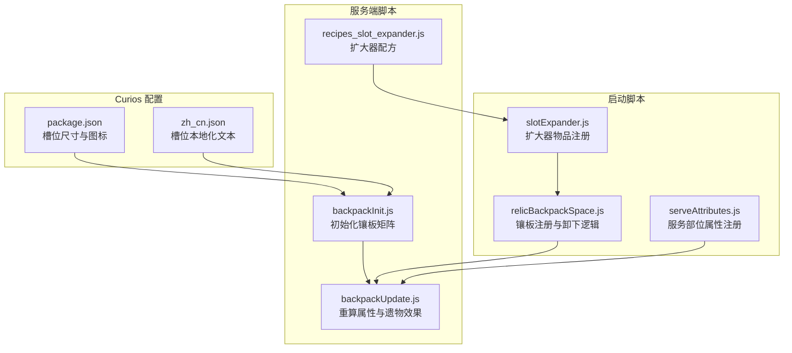
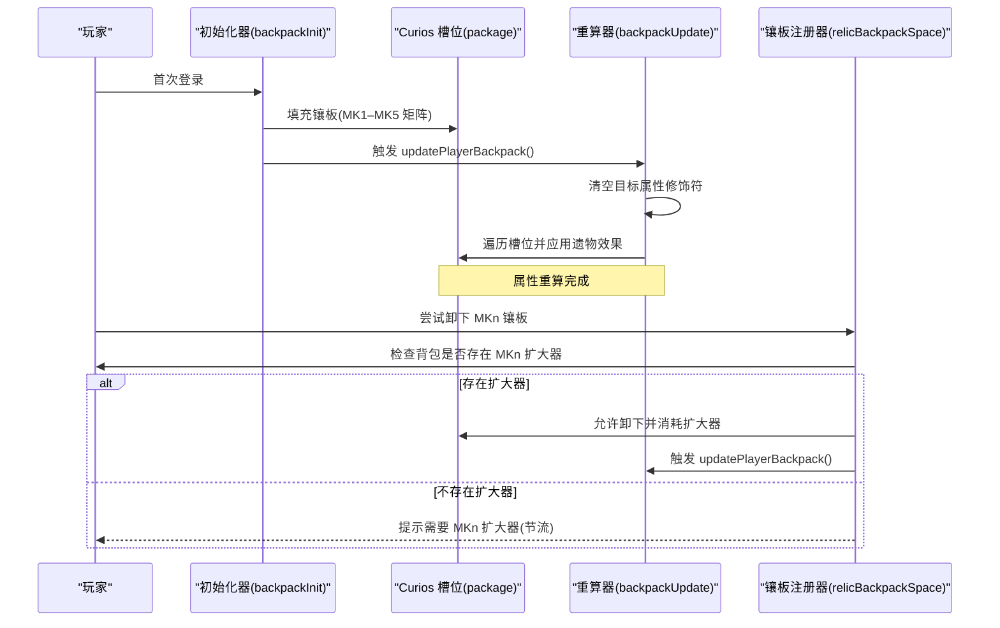
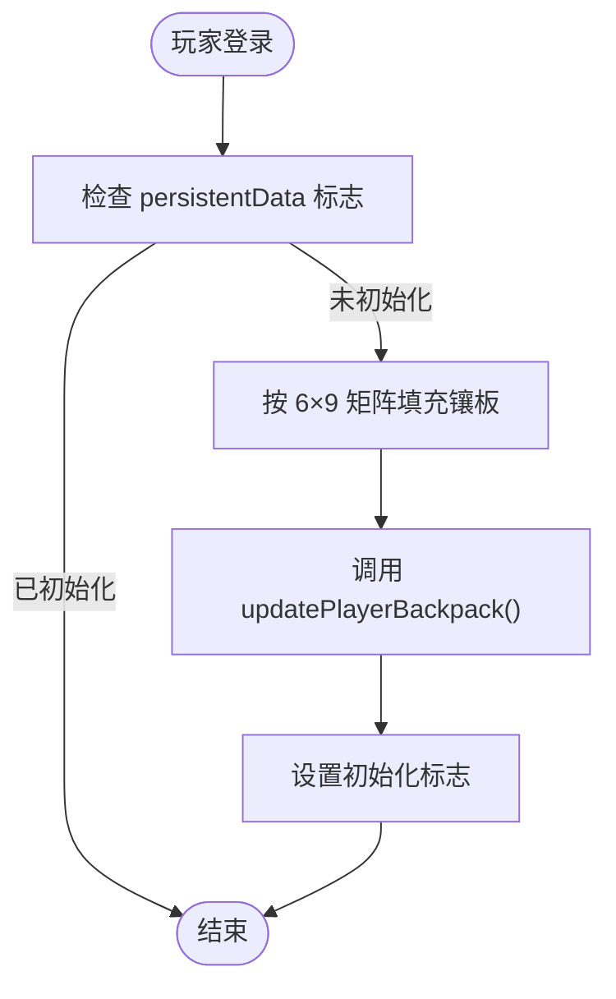
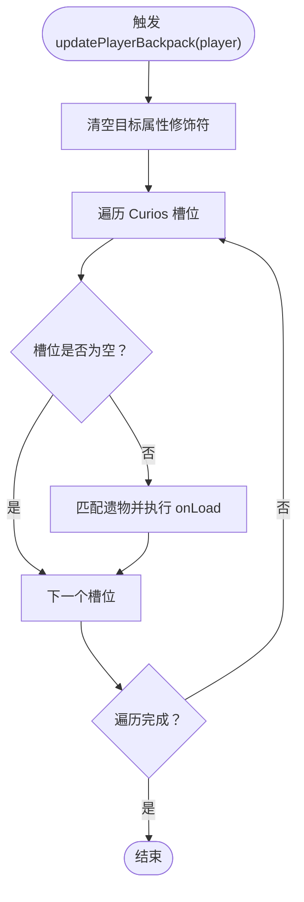
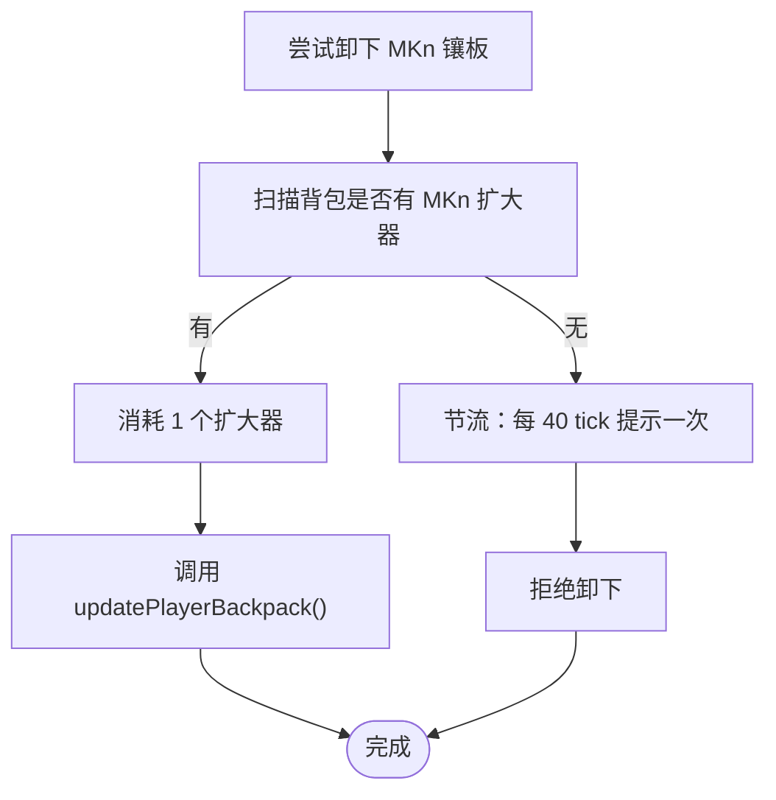
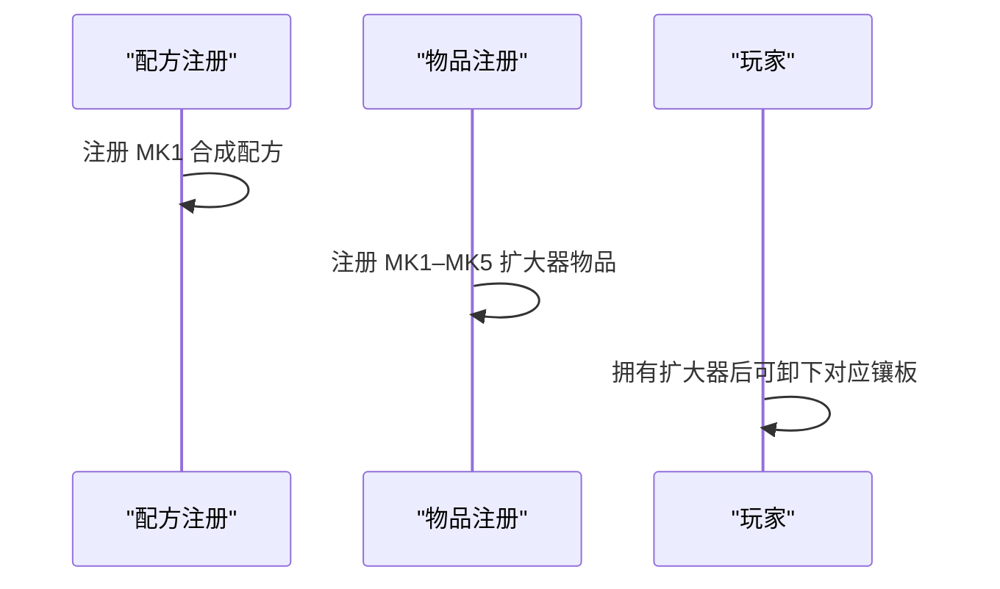
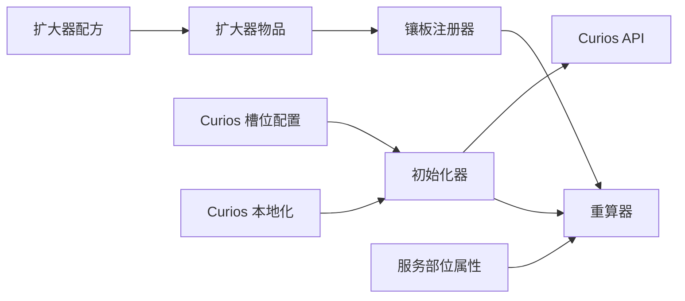

# 背包系统

<cite>
**本文引用的文件**
- [backpackInit.js](file://kubejs/server_scripts/backpack/backpackInit.js)
- [backpackUpdate.js](file://kubejs/server_scripts/backpack/backpackUpdate.js)
- [relicBackpackSpace.js](file://kubejs/startup_scripts/relic/relicItem/relicBackpackSpace.js)
- [recipes_slot_expander.js](file://kubejs/server_scripts/recipes/recipes_slot_expander.js)
- [slotExpander.js](file://kubejs/startup_scripts/item/slotExpander.js)
- [package.json](file://kubejs/data/curios/curios/slots/package.json)
- [zh_cn.json](file://kubejs/assets/curios/lang/zh_cn.json)
- [serveAttributes.js](file://kubejs/startup_scripts/attributes/serveAttributes.js)
</cite>

## 目录
1. [简介](#简介)
2. [项目结构](#项目结构)
3. [核心组件](#核心组件)
4. [架构总览](#架构总览)
5. [详细组件分析](#详细组件分析)
6. [依赖关系分析](#依赖关系分析)
7. [性能考量](#性能考量)
8. [故障排查指南](#故障排查指南)
9. [结论](#结论)
10. [附录](#附录)

## 简介
本文件系统化梳理了该仓库中的背包系统实现，重点覆盖以下方面：
- 背包初始化流程：首次登录时如何在 Curios 的“背包”槽位中填充“背包镶板”，以及如何防止重复初始化。
- 容量管理与空间扩展：通过“背包镶板 MK1–MK5”占用槽位，配合“栏位扩大器 MK1–MK5”实现卸下与扩展。
- 与 Curios API 的集成：槽位尺寸、标识符、修饰语提示文本的本地化。
- 背包空间来源：镶板占用虚拟槽位，扩大器作为卸下凭证。
- 遗物系统联动：卸下镶板时触发背包重算，重新加载所有遗物效果，避免修饰符重复叠加。
- 扩展指南：如何新增镶板等级、扩大器配方与属性联动。
- 性能优化与兼容性：批量清理修饰符、按需重算、避免频繁提示刷屏。
- 数据同步与交互：通过 Forge 事件与属性系统实现服务部位属性的注册与同步。

## 项目结构
背包系统主要分布在以下位置：
- 初始化与重算：server_scripts/backpack 下的初始化与更新脚本
- 镶板与扩大器：startup_scripts/relic/relicItem 与 startup_scripts/item 下的注册
- 合成配方：server_scripts/recipes 下的栏位扩大器配方
- Curios 配置与本地化：data/curios 与 assets/curios 下的槽位与语言文件
- 服务部位属性：startup_scripts/attributes 下的属性注册与同步

**图表来源**
- [backpackInit.js:1-67](file://kubejs/server_scripts/backpack/backpackInit.js#L1-L67)
- [backpackUpdate.js:1-73](file://kubejs/server_scripts/backpack/backpackUpdate.js#L1-L73)
- [relicBackpackSpace.js:1-64](file://kubejs/startup_scripts/relic/relicItem/relicBackpackSpace.js#L1-L64)
- [recipes_slot_expander.js:1-29](file://kubejs/server_scripts/recipes/recipes_slot_expander.js#L1-L29)
- [slotExpander.js:1-36](file://kubejs/startup_scripts/item/slotExpander.js#L1-L36)
- [package.json:1-5](file://kubejs/data/curios/curios/slots/package.json#L1-L5)
- [zh_cn.json:1-4](file://kubejs/assets/curios/lang/zh_cn.json#L1-L4)
- [serveAttributes.js:1-53](file://kubejs/startup_scripts/attributes/serveAttributes.js#L1-L53)

**章节来源**
- [backpackInit.js:1-67](file://kubejs/server_scripts/backpack/backpackInit.js#L1-L67)
- [backpackUpdate.js:1-73](file://kubejs/server_scripts/backpack/backpackUpdate.js#L1-L73)
- [relicBackpackSpace.js:1-64](file://kubejs/startup_scripts/relic/relicItem/relicBackpackSpace.js#L1-L64)
- [recipes_slot_expander.js:1-29](file://kubejs/server_scripts/recipes/recipes_slot_expander.js#L1-L29)
- [slotExpander.js:1-36](file://kubejs/startup_scripts/item/slotExpander.js#L1-L36)
- [package.json:1-5](file://kubejs/data/curios/curios/slots/package.json#L1-L5)
- [zh_cn.json:1-4](file://kubejs/assets/curios/lang/zh_cn.json#L1-L4)
- [serveAttributes.js:1-53](file://kubejs/startup_scripts/attributes/serveAttributes.js#L1-L53)

## 核心组件
- 背包初始化器：在首次登录时根据预设矩阵向 Curios 的“背包”槽位填充镶板，防止重复初始化，并在完成后触发一次背包重算。
- 背包重算器：在属性变更或镶板变化时，清空指定属性的所有修饰符，再遍历当前 Curios 槽位，重新应用所有遗物效果。
- 镶板注册器：注册 MK1–MK5 镶板，设置卸下条件（需要对应等级扩大器）、卸下时消耗扩大器并触发重算。
- 栏位扩大器：注册 MK1–MK5 扩大器物品，作为卸下镶板的消耗凭证；配方在服务端注册。
- Curios 槽位配置：定义“背包”槽位大小、是否添加装饰性槽位及槽位图标。
- 服务部位属性：注册“满意度增量/金钱增量/体力消耗”的服务部位属性，并确保可同步至客户端。

**章节来源**
- [backpackInit.js:29-58](file://kubejs/server_scripts/backpack/backpackInit.js#L29-L58)
- [backpackUpdate.js:39-72](file://kubejs/server_scripts/backpack/backpackUpdate.js#L39-L72)
- [relicBackpackSpace.js:10-63](file://kubejs/startup_scripts/relic/relicItem/relicBackpackSpace.js#L10-L63)
- [slotExpander.js:19-35](file://kubejs/startup_scripts/item/slotExpander.js#L19-L35)
- [recipes_slot_expander.js:13-28](file://kubejs/server_scripts/recipes/recipes_slot_expander.js#L13-L28)
- [package.json:1-5](file://kubejs/data/curios/curios/slots/package.json#L1-L5)
- [serveAttributes.js:27-52](file://kubejs/startup_scripts/attributes/serveAttributes.js#L27-L52)

## 架构总览
背包系统围绕 Curios 的“背包”槽位展开，通过镶板占用槽位、扩大器作为卸下凭证，结合属性重算与遗物效果加载，实现容量管理与功能扩展。

**图表来源**
- [backpackInit.js:49-58](file://kubejs/server_scripts/backpack/backpackInit.js#L49-L58)
- [backpackUpdate.js:39-72](file://kubejs/server_scripts/backpack/backpackUpdate.js#L39-L72)
- [relicBackpackSpace.js:19-56](file://kubejs/startup_scripts/relic/relicItem/relicBackpackSpace.js#L19-L56)

## 详细组件分析

### 组件一：背包初始化器（首次登录填充镶板）
- 功能要点
  - 使用固定矩阵布局（6 行 × 9 列）在 Curios “背包”槽位中放置镶板，0 表示留空。
  - 通过 persistentData 标记防止重复初始化。
  - 完成后调用全局重算函数以确保属性与效果正确。
- 关键路径
  - [初始化入口与标志检查:51-58](file://kubejs/server_scripts/backpack/backpackInit.js#L51-L58)
  - [填充矩阵与槽位写入:29-49](file://kubejs/server_scripts/backpack/backpackInit.js#L29-L49)

**图表来源**
- [backpackInit.js:51-58](file://kubejs/server_scripts/backpack/backpackInit.js#L51-L58)
- [backpackInit.js:29-49](file://kubejs/server_scripts/backpack/backpackInit.js#L29-L49)

**章节来源**
- [backpackInit.js:29-58](file://kubejs/server_scripts/backpack/backpackInit.js#L29-L58)

### 组件二：背包重算器（属性与遗物效果）
- 功能要点
  - 维护一份目标属性清单（含通用属性与服务部位属性），在重算前清空这些属性上的修饰符。
  - 遍历 Curios 槽位，对非空物品查找对应遗物并执行 onLoad，从而恢复效果。
  - 该机制避免重复叠加与遗漏，保证卸下或更换遗物后效果自动撤回。
- 关键路径
  - [属性清单与服务部位属性拼接:3-37](file://kubejs/server_scripts/backpack/backpackUpdate.js#L3-L37)
  - [清空修饰符与重算主循环:39-62](file://kubejs/server_scripts/backpack/backpackUpdate.js#L39-62)
  - [遍历槽位并调用遗物 onLoad:64-72](file://kubejs/server_scripts/backpack/backpackUpdate.js#L64-72)

**图表来源**
- [backpackUpdate.js:39-72](file://kubejs/server_scripts/backpack/backpackUpdate.js#L39-L72)

**章节来源**
- [backpackUpdate.js:3-37](file://kubejs/server_scripts/backpack/backpackUpdate.js#L3-L37)
- [backpackUpdate.js:39-72](file://kubejs/server_scripts/backpack/backpackUpdate.js#L39-L72)

### 组件三：镶板注册器（卸下条件与消耗）
- 功能要点
  - 注册 MK1–MK5 镶板，设置统一贴图与描述。
  - 卸下条件：必须拥有对应等级的“栏位扩大器”；否则禁止卸下并提示（带节流）。
  - 卸下时消耗 1 个对应等级扩大器，并触发一次背包重算。
- 关键路径
  - [注册与卸下回调:12-31](file://kubejs/startup_scripts/relic/relicItem/relicBackpackSpace.js#L12-L31)
  - [卸下判定与提示节流:32-56](file://kubejs/startup_scripts/relic/relicItem/relicBackpackSpace.js#L32-L56)

**图表来源**
- [relicBackpackSpace.js:19-56](file://kubejs/startup_scripts/relic/relicItem/relicBackpackSpace.js#L19-L56)

**章节来源**
- [relicBackpackSpace.js:10-63](file://kubejs/startup_scripts/relic/relicItem/relicBackpackSpace.js#L10-L63)

### 组件四：栏位扩大器（物品与配方）
- 功能要点
  - 注册 MK1–MK5 扩大器物品，作为卸下镶板的消耗凭证。
  - 提供 MK1 合成配方（Shaped），后续等级可按相同范式扩展。
- 关键路径
  - [物品注册与贴图映射:19-35](file://kubejs/startup_scripts/item/slotExpander.js#L19-L35)
  - [MK1 合成配方注册:13-28](file://kubejs/server_scripts/recipes/recipes_slot_expander.js#L13-L28)

**图表来源**
- [slotExpander.js:19-35](file://kubejs/startup_scripts/item/slotExpander.js#L19-L35)
- [recipes_slot_expander.js:13-28](file://kubejs/server_scripts/recipes/recipes_slot_expander.js#L13-L28)

**章节来源**
- [slotExpander.js:19-35](file://kubejs/startup_scripts/item/slotExpander.js#L19-L35)
- [recipes_slot_expander.js:13-28](file://kubejs/server_scripts/recipes/recipes_slot_expander.js#L13-L28)

### 组件五：Curios 槽位配置与本地化
- 功能要点
  - 定义“背包”槽位大小为 9，允许添加装饰性槽位，并设置槽位图标。
  - 提供中文本地化文本，说明槽位标识符与修饰语提示。
- 关键路径
  - [槽位尺寸与图标:1-5](file://kubejs/data/curios/curios/slots/package.json#L1-L5)
  - [槽位本地化文本:1-4](file://kubejs/assets/curios/lang/zh_cn.json#L1-L4)

**章节来源**
- [package.json:1-5](file://kubejs/data/curios/curios/slots/package.json#L1-L5)
- [zh_cn.json:1-4](file://kubejs/assets/curios/lang/zh_cn.json#L1-L4)

### 组件六：服务部位属性（注册与同步）
- 功能要点
  - 注册四部位（脚趾、脚掌、脚心、脚跟）的三类属性：满意度增量、金钱增量、体力消耗。
  - 默认值按部位设定，确保客户端可同步读取。
  - 通过 Forge 事件确保这些属性挂载到玩家实体。
- 关键路径
  - [属性默认值与注册:18-40](file://kubejs/startup_scripts/attributes/serveAttributes.js#L18-L40)
  - [Forge 事件挂载:42-52](file://kubejs/startup_scripts/attributes/serveAttributes.js#L42-L52)

**章节来源**
- [serveAttributes.js:18-40](file://kubejs/startup_scripts/attributes/serveAttributes.js#L18-L40)
- [serveAttributes.js:42-52](file://kubejs/startup_scripts/attributes/serveAttributes.js#L42-L52)

## 依赖关系分析
- 初始化器依赖 Curios API 获取已装备物品集合，并写入镶板。
- 镶板注册器依赖全局重算器在卸下时刷新效果。
- 扩大器物品与配方共同构成卸下的前置条件。
- 重算器依赖属性清单与遗物注册表，遍历 Curios 槽位并调用对应 onLoad。
- Curios 槽位配置与本地化影响 UI 显示与玩家理解。

**图表来源**
- [backpackInit.js:17-49](file://kubejs/server_scripts/backpack/backpackInit.js#L17-L49)
- [backpackUpdate.js:39-72](file://kubejs/server_scripts/backpack/backpackUpdate.js#L39-L72)
- [relicBackpackSpace.js:12-31](file://kubejs/startup_scripts/relic/relicItem/relicBackpackSpace.js#L12-L31)
- [slotExpander.js:19-35](file://kubejs/startup_scripts/item/slotExpander.js#L19-L35)
- [recipes_slot_expander.js:13-28](file://kubejs/server_scripts/recipes/recipes_slot_expander.js#L13-L28)
- [serveAttributes.js:27-52](file://kubejs/startup_scripts/attributes/serveAttributes.js#L27-L52)
- [package.json:1-5](file://kubejs/data/curios/curios/slots/package.json#L1-L5)
- [zh_cn.json:1-4](file://kubejs/assets/curios/lang/zh_cn.json#L1-L4)

**章节来源**
- [backpackInit.js:17-49](file://kubejs/server_scripts/backpack/backpackInit.js#L17-L49)
- [backpackUpdate.js:39-72](file://kubejs/server_scripts/backpack/backpackUpdate.js#L39-L72)
- [relicBackpackSpace.js:12-31](file://kubejs/startup_scripts/relic/relicItem/relicBackpackSpace.js#L12-L31)
- [slotExpander.js:19-35](file://kubejs/startup_scripts/item/slotExpander.js#L19-L35)
- [recipes_slot_expander.js:13-28](file://kubejs/server_scripts/recipes/recipes_slot_expander.js#L13-L28)
- [serveAttributes.js:27-52](file://kubejs/startup_scripts/attributes/serveAttributes.js#L27-L52)
- [package.json:1-5](file://kubejs/data/curios/curios/slots/package.json#L1-L5)
- [zh_cn.json:1-4](file://kubejs/assets/curios/lang/zh_cn.json#L1-L4)

## 性能考量
- 批量修饰符清理：在重算前一次性清空目标属性修饰符，避免逐项操作带来的多次开销。
- 按需重算：仅在玩家更换 Curios 或卸下镶板时触发，减少不必要的遍历。
- 提示节流：卸下失败时按时间间隔限制提示频率，避免频繁消息刷屏。
- 属性范围控制：服务部位属性采用 RangedAttribute 并设置合理上下限，降低异常波动风险。
- 客户端同步：将属性标记为可同步，便于 UI 与外部模组读取，提升交互体验。

[本节为通用性能建议，无需特定文件引用]

## 故障排查指南
- 镶板未生效
  - 检查初始化标志是否被设置，确认首次登录流程是否执行。
  - 参考：[初始化标志检查与填充:51-58](file://kubejs/server_scripts/backpack/backpackInit.js#L51-L58)
- 卸不下镶板
  - 确认背包中是否持有对应等级扩大器。
  - 查看卸下判定与提示节流逻辑。
  - 参考：[卸下判定与节流提示:32-56](file://kubejs/startup_scripts/relic/relicItem/relicBackpackSpace.js#L32-L56)
- 属性未更新
  - 确认是否调用了全局重算函数。
  - 检查属性清单是否包含目标属性，以及遍历槽位时是否正确匹配遗物。
  - 参考：[重算主流程:39-62](file://kubejs/server_scripts/backpack/backpackUpdate.js#L39-62)
- Curios 槽位显示异常
  - 检查槽位尺寸与图标配置，以及本地化文本是否正确。
  - 参考：[槽位配置:1-5](file://kubejs/data/curios/curios/slots/package.json#L1-L5)，[本地化:1-4](file://kubejs/assets/curios/lang/zh_cn.json#L1-L4)

**章节来源**
- [backpackInit.js:51-58](file://kubejs/server_scripts/backpack/backpackInit.js#L51-L58)
- [relicBackpackSpace.js:32-56](file://kubejs/startup_scripts/relic/relicItem/relicBackpackSpace.js#L32-L56)
- [backpackUpdate.js:39-62](file://kubejs/server_scripts/backpack/backpackUpdate.js#L39-L62)
- [package.json:1-5](file://kubejs/data/curios/curios/slots/package.json#L1-L5)
- [zh_cn.json:1-4](file://kubejs/assets/curios/lang/zh_cn.json#L1-L4)

## 结论
该背包系统通过 Curios 的“背包”槽位实现容量管理，借助镶板占用虚拟槽位与扩大器作为卸下凭证，结合属性重算与遗物效果加载，形成稳定且可扩展的机制。初始化器负责首次填充，重算器保障效果一致性，镶板与扩大器共同实现空间扩展与卸下控制。Curios 配置与本地化提升了用户体验，服务部位属性则为玩法提供了可量化的增益维度。整体设计具备良好的模块化与可维护性，适合进一步扩展新等级镶板与配方。

[本节为总结性内容，无需特定文件引用]

## 附录

### A. 背包初始化示例（路径参考）
- [初始化入口与标志检查:51-58](file://kubejs/server_scripts/backpack/backpackInit.js#L51-L58)
- [填充矩阵与槽位写入:29-49](file://kubejs/server_scripts/backpack/backpackInit.js#L29-L49)

### B. 空间管理与卸下示例（路径参考）
- [卸下判定与消耗逻辑:19-31](file://kubejs/startup_scripts/relic/relicItem/relicBackpackSpace.js#L19-L31)
- [卸下失败提示与节流:42-53](file://kubejs/startup_scripts/relic/relicItem/relicBackpackSpace.js#L42-L53)

### C. 属性重算与效果加载示例（路径参考）
- [属性清单与服务部位属性拼接:11-37](file://kubejs/server_scripts/backpack/backpackUpdate.js#L11-L37)
- [清空修饰符与重算主循环:44-62](file://kubejs/server_scripts/backpack/backpackUpdate.js#L44-L62)

### D. 扩大器配方与物品注册示例（路径参考）
- [MK1 合成配方注册:13-28](file://kubejs/server_scripts/recipes/recipes_slot_expander.js#L13-L28)
- [扩大器物品注册:19-35](file://kubejs/startup_scripts/item/slotExpander.js#L19-L35)

### E. Curios 槽位与本地化配置示例（路径参考）
- [槽位尺寸与图标:1-5](file://kubejs/data/curios/curios/slots/package.json#L1-L5)
- [槽位本地化文本:1-4](file://kubejs/assets/curios/lang/zh_cn.json#L1-L4)