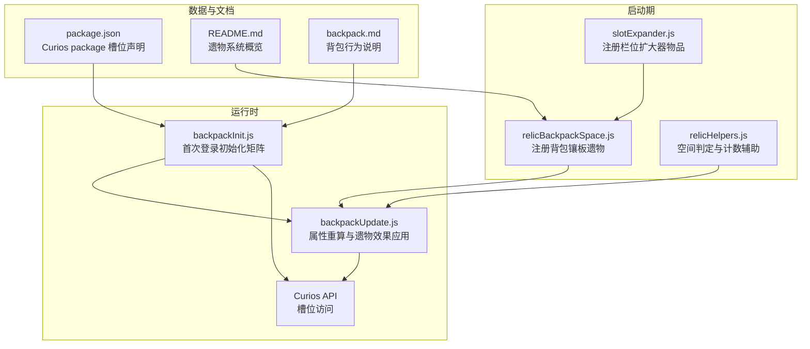
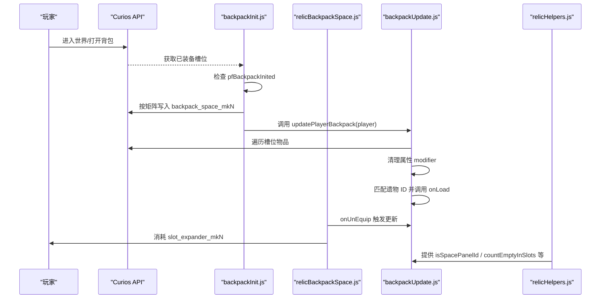
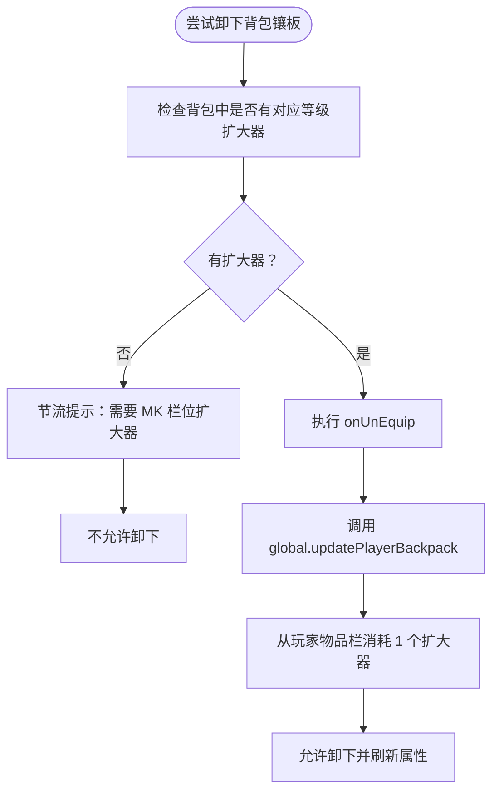
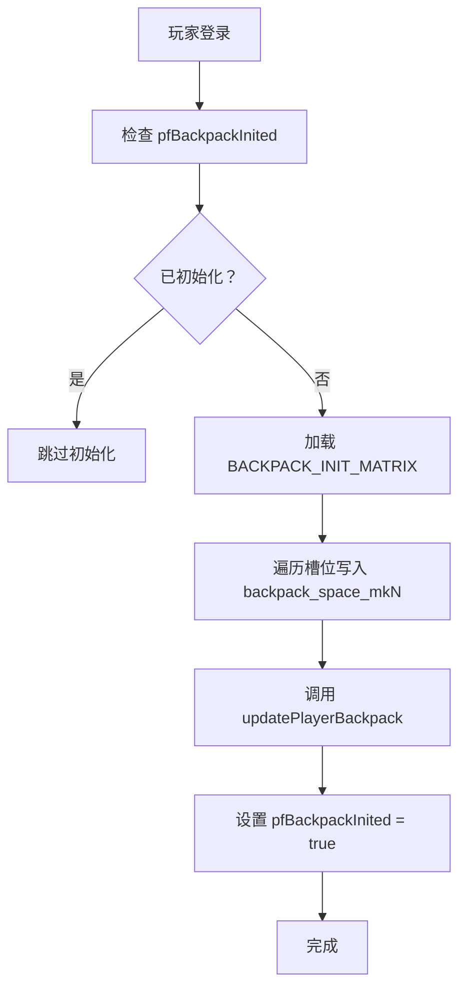
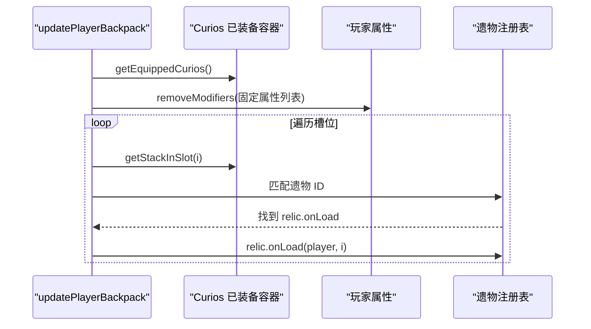
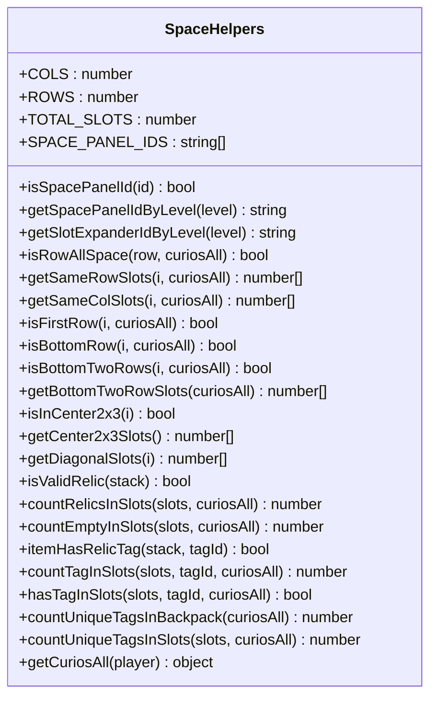
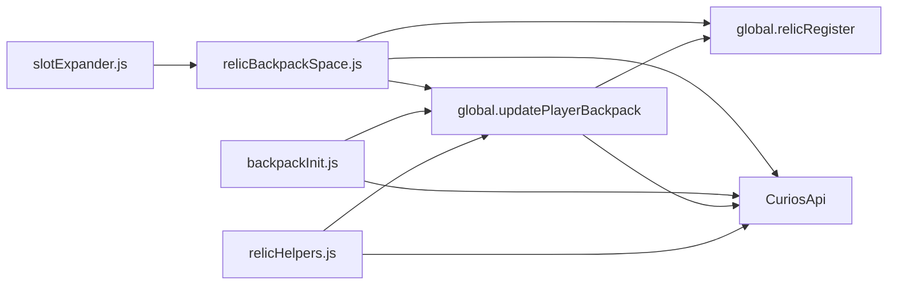

# 背包系统集成

<cite>
**本文引用的文件**   
- [relicBackpackSpace.js](file://kubejs/startup_scripts/relic/relicItem/relicBackpackSpace.js)
- [backpackInit.js](file://kubejs/server_scripts/backpack/backpackInit.js)
- [backpackUpdate.js](file://kubejs/server_scripts/backpack/backpackUpdate.js)
- [relicHelpers.js](file://kubejs/startup_scripts/relic/relicHelpers.js)
- [slotExpander.js](file://kubejs/startup_scripts/item/slotExpander.js)
- [package.json](file://kubejs/data/curios/curios/slots/package.json)
- [README.md](file://knowledge_base/relic/README.md)
- [backpack.md](file://knowledge_base/relic/backpack.md)
</cite>

## 目录
1. [引言](#引言)
2. [项目结构](#项目结构)
3. [核心组件](#核心组件)
4. [架构总览](#架构总览)
5. [详细组件分析](#详细组件分析)
6. [依赖关系分析](#依赖关系分析)
7. [性能与内存管理](#性能与内存管理)
8. [与其他系统的协调机制](#与其他系统的协调机制)
9. [配置示例与调优建议](#配置示例与调优建议)
10. [故障排查指南](#故障排查指南)
11. [结论](#结论)

## 引言
本文件面向“遗物与背包系统”的集成实现，重点解释以下目标：
- 遗物背包空间的管理机制与容量扩展系统。
- `relicBackpackSpace.js` 的功能实现，包括背包空间的动态计算和限制机制。
- 遗物与 Curios API 的集成方式与槽位管理。
- 背包空间配置、调优建议与性能优化策略。
- 背包空间与商店、交易等玩法系统的协调方式。

该系统的核心思想是：将玩家的可装备栏位建模为 Curios 的 `package` 槽位，并以 6×9 的逻辑网格表示；未解锁区域由“背包镶板”填充，形成“虚拟空白”，从而让其他逻辑可以统一按网格处理遗物位置、行/列/对角线等空间关系。

## 项目结构
与背包系统集成直接相关的代码主要分布在以下路径：
- 启动期注册与物品定义：`kubejs/startup_scripts/relic/relicItem/relicBackpackSpace.js`、`kubejs/startup_scripts/item/slotExpander.js`
- 服务器运行时初始化与重算：`kubejs/server_scripts/backpack/backpackInit.js`、`kubejs/server_scripts/backpack/backpackUpdate.js`
- 辅助函数与空间判定：`kubejs/startup_scripts/relic/relicHelpers.js`
- Curios 槽位元数据：`kubejs/data/curios/curios/slots/package.json`
- 知识文档：`knowledge_base/relic/README.md`、`knowledge_base/relic/backpack.md`

**图表来源**
- [relicBackpackSpace.js:1-64](file://kubejs/startup_scripts/relic/relicItem/relicBackpackSpace.js#L1-L64)
- [slotExpander.js:1-35](file://kubejs/startup_scripts/item/slotExpander.js#L1-L35)
- [relicHelpers.js:1-332](file://kubejs/startup_scripts/relic/relicHelpers.js#L1-L332)
- [backpackInit.js:1-67](file://kubejs/server_scripts/backpack/backpackInit.js#L1-L67)
- [backpackUpdate.js:1-73](file://kubejs/server_scripts/backpack/backpackUpdate.js#L1-L73)
- [package.json:1-5](file://kubejs/data/curios/curios/slots/package.json#L1-L5)
- [README.md:1-28](file://knowledge_base/relic/README.md#L1-L28)
- [backpack.md:1-99](file://knowledge_base/relic/backpack.md#L1-L99)

**章节来源**
- [README.md:1-28](file://knowledge_base/relic/README.md#L1-L28)
- [backpack.md:1-99](file://knowledge_base/relic/backpack.md#L1-L99)

## 核心组件
- 背包镶板系统：通过 `relicBackpackSpace.js` 注册 `backpack_space_mk1..mk5` 五个等级的“锁定空间”遗物，用于占据 Curios 槽位并表达“未解锁区域”。
- 栏位扩大器：通过 `slotExpander.js` 注册 `slot_expander_mk1..mk5` 作为消耗品凭证，用于卸下对应等级的背包镶板。
- 初始矩阵：通过 `backpackInit.js` 在玩家首次登录时向 6×9 逻辑网格写入镶板布局，并用持久数据键保护重复执行。
- 属性重算：通过 `backpackUpdate.js` 清理旧 modifier 并按当前已装备遗物重新应用效果，保证卸载后效果自动撤回。
- 空间辅助：通过 `relicHelpers.js` 提供行/列/对角线、中心区域、空位计数、标签统计等工具，统一把“背包镶板”视为不存在或锁定区域。

**章节来源**
- [relicBackpackSpace.js:1-64](file://kubejs/startup_scripts/relic/relicItem/relicBackpackSpace.js#L1-L64)
- [slotExpander.js:1-35](file://kubejs/startup_scripts/item/slotExpander.js#L1-L35)
- [backpackInit.js:1-67](file://kubejs/server_scripts/backpack/backpackInit.js#L1-L67)
- [backpackUpdate.js:1-73](file://kubejs/server_scripts/backpack/backpackUpdate.js#L1-L73)
- [relicHelpers.js:1-332](file://kubejs/startup_scripts/relic/relicHelpers.js#L1-L332)

## 架构总览
背包系统以 Curios 的 `package` 槽位为载体，用 KubeJS 脚本在启动期注册遗物与物品，在运行时根据玩家已装备状态动态计算属性与空间。

**图表来源**
- [backpackInit.js:17-66](file://kubejs/server_scripts/backpack/backpackInit.js#L17-L66)
- [relicBackpackSpace.js:19-58](file://kubejs/startup_scripts/relic/relicItem/relicBackpackSpace.js#L19-L58)
- [backpackUpdate.js:39-72](file://kubejs/server_scripts/backpack/backpackUpdate.js#L39-L72)
- [relicHelpers.js:18-31](file://kubejs/startup_scripts/relic/relicHelpers.js#L18-L31)

## 详细组件分析

### relicBackpackSpace.js：背包镶板与容量限制
该文件负责注册 `backpack_space_mk1..mk5` 五个等级的背包镶板，并将其放入 `global.relicPool.space` 池。每个镶板的核心行为如下：
- 名称与描述：显示为“背包镶板 MKN”，特殊描述提示需要使用对应等级的“栏位扩大器”才能取下。
- 贴图：沿用统一的 `backpack_space.png` 材质。
- 卸下条件（canUnEquip）：检查玩家背包中是否存在对应等级的 `marguerite:slot_expander_mkN`；若不存在，则每 40 tick 节流一次，向玩家 actionbar 提示需要扩大器。
- 卸下动作（onUnEquip）：先调用 `global.updatePlayerBackpack` 刷新属性，再从玩家物品栏中消耗一个对应等级的扩大器。

这种设计把“容量扩展”抽象为“解锁更多真实可用槽位”的过程：初始状态下，大量槽位被镶板占据；使用扩大器卸下镶板后，这些槽位变为可放置遗物的真实空间。

**图表来源**
- [relicBackpackSpace.js:19-58](file://kubejs/startup_scripts/relic/relicItem/relicBackpackSpace.js#L19-L58)

**章节来源**
- [relicBackpackSpace.js:1-64](file://kubejs/startup_scripts/relic/relicItem/relicBackpackSpace.js#L1-L64)

### backpackInit.js：首次登录初始化矩阵
该文件在玩家首次登录时，按预设的 6×9 矩阵向 Curios 槽位填入 `backpack_space_mkN` 镶板。关键点：
- 矩阵布局：外围高编号（MK5/MK4/MK3），中间低编号（MK1/MK2），中心留空（0）。
- 防重复：使用 `pfBackpackInited` 布尔值防止重复初始化。
- 同步重算：初始化完成后调用 `global.updatePlayerBackpack`，确保属性状态正确。
- 调试接口：暴露 `global.pfResetBackpackInit(player)`，可用于重置并重新应用矩阵。

**图表来源**
- [backpackInit.js:17-66](file://kubejs/server_scripts/backpack/backpackInit.js#L17-L66)

**章节来源**
- [backpackInit.js:1-67](file://kubejs/server_scripts/backpack/backpackInit.js#L1-L67)

### backpackUpdate.js：属性重算与遗物效果应用
该文件是运行时应用遗物效果的主路径，核心流程：
- 获取 Curios 已装备容器。
- 清理一组固定属性的所有 modifier，避免重复叠加。
- 遍历每个槽位物品，匹配已注册遗物 ID，调用其 `onLoad(player, slotIndex)`。
- 清理的属性包括原版通用属性、暴击率以及服务玩法相关属性（满意度、金钱、体力消耗）。

**图表来源**
- [backpackUpdate.js:3-72](file://kubejs/server_scripts/backpack/backpackUpdate.js#L3-L72)

**章节来源**
- [backpackUpdate.js:1-73](file://kubejs/server_scripts/backpack/backpackUpdate.js#L1-L73)

### relicHelpers.js：空间判定与容量计算
该文件定义了 6×9 网格常量与一系列空间辅助函数，关键能力：
- 识别背包镶板：`isSpacePanelId`、`getSpacePanelIdByLevel`。
- 行/列/对角线查询：`getSameRowSlots`、`getSameColSlots`、`getDiagonalSlots`。
- 边界判断：`isFirstRow`、`isBottomRow`、`isBottomTwoRows`。
- 区域查询：`getCenter2x3Slots`、`getBottomTwoRowSlots`。
- 有效遗物与空位计数：`isValidRelic`、`countRelicsInSlots`、`countEmptyInSlots`。
- 标签统计：`itemHasRelicTag`、`countTagInSlots`、`hasTagInSlots`、`countUniqueTagsInBackpack`。
- 便捷访问：`getCuriosAll` 封装 CuriosAPI 调用。

这些函数把“背包镶板”视为锁定区域或不存在，从而让上层逻辑可以统一按“真实可用槽位”进行计算。

**图表来源**
- [relicHelpers.js:5-332](file://kubejs/startup_scripts/relic/relicHelpers.js#L5-L332)

**章节来源**
- [relicHelpers.js:1-332](file://kubejs/startup_scripts/relic/relicHelpers.js#L1-L332)

### slotExpander.js：栏位扩大器物品
该文件注册 `slot_expander_mk1..mk5` 五种扩大器物品，作为卸下背包镶板的凭证。实际消耗逻辑在 `relicBackpackSpace.js` 的 `onUnEquip` 中实现。

**章节来源**
- [slotExpander.js:1-35](file://kubejs/startup_scripts/item/slotExpander.js#L1-L35)

### Curios 槽位配置
Curios 的 `package` 槽位声明位于 `package.json`，其中 size 为 9，add_cosmetic 为 true，图标为 `curios:slot/package_icon`。注意：代码按 6×9 逻辑网格编写，修改槽位数量前需确认运行时的 `curiosAll.getSlots()` 值。

**章节来源**
- [package.json:1-5](file://kubejs/data/curios/curios/slots/package.json#L1-L5)
- [backpack.md:15-25](file://knowledge_base/relic/backpack.md#L15-L25)

## 依赖关系分析
- `relicBackpackSpace.js` 依赖 `global.relicRegister.register` 注册遗物，依赖 `global.updatePlayerBackpack` 刷新属性，依赖 CuriosAPI 获取槽位上下文。
- `backpackInit.js` 依赖 CuriosAPI 写入槽位，并在初始化后调用 `global.updatePlayerBackpack`。
- `backpackUpdate.js` 依赖 CuriosAPI 读取已装备物品，依赖 `global.relicRegister.relics` 与 `global.getRelicId` 匹配遗物。
- `relicHelpers.js` 提供全局辅助函数，供其他模块统一处理空间与标签逻辑。
- `slotExpander.js` 仅注册物品，不直接参与运行时逻辑。

**图表来源**
- [relicBackpackSpace.js:5-58](file://kubejs/startup_scripts/relic/relicItem/relicBackpackSpace.js#L5-L58)
- [backpackInit.js:17-44](file://kubejs/server_scripts/backpack/backpackInit.js#L17-L44)
- [backpackUpdate.js:1-72](file://kubejs/server_scripts/backpack/backpackUpdate.js#L1-L72)
- [relicHelpers.js:327-331](file://kubejs/startup_scripts/relic/relicHelpers.js#L327-L331)
- [slotExpander.js:19-35](file://kubejs/startup_scripts/item/slotExpander.js#L19-L35)

**章节来源**
- [relicBackpackSpace.js:1-64](file://kubejs/startup_scripts/relic/relicItem/relicBackpackSpace.js#L1-L64)
- [backpackInit.js:1-67](file://kubejs/server_scripts/backpack/backpackInit.js#L1-L67)
- [backpackUpdate.js:1-73](file://kubejs/server_scripts/backpack/backpackUpdate.js#L1-L73)
- [relicHelpers.js:1-332](file://kubejs/startup_scripts/relic/relicHelpers.js#L1-L332)
- [slotExpander.js:1-35](file://kubejs/startup_scripts/item/slotExpander.js#L1-L35)

## 性能与内存管理
- 属性重算采用“先清后加”的策略：每次重算前先移除固定属性列表上的所有 modifier，再遍历槽位重新应用遗物效果。这避免了重复叠加导致的数值膨胀，也保证了卸载遗物后效果自然撤回。
- 节流提示：当缺少扩大器时，actionbar 提示每 40 tick 触发一次，避免频繁刷屏造成客户端渲染压力。
- 懒加载标签映射：`relicHelpers.js` 中的 `ensureRelicTagMap` 会缓存遗物标签映射，减少重复构建开销。
- 槽位遍历上限：代码按 6×9=54 格逻辑网格编写，但实际槽位数来自 Curios 的 `getSlots()`。建议在扩展槽位前先在运行环境中验证返回值，避免越界或无效遍历。
- 内存建议：
  - 避免在高频 tick 中重复创建大对象或字符串拼接过多。
  - 对玩家属性操作应集中在 `updatePlayerBackpack` 中，减少分散修改带来的额外开销。
  - 对于标签统计类操作，优先使用已有的 `countUniqueTagsInBackpack` 等封装函数，避免重复扫描。

[本节为通用性能指导，不直接分析具体代码片段]

## 与其他系统的协调机制
- 遗物系统与 Curious API：遗物物品通过 `curios:package` 标签进入 Curios 槽位，运行时通过 `CuriosApi.getCuriosHelper().getEquippedCurios(player)` 访问。
- 服务玩法属性：`backpackUpdate.js` 清理并重新应用服务玩法相关属性（满意度、金钱、体力消耗），这些属性由 `startup_scripts/attributes/serveAttributes.js` 注册。新增持久性部位（如 `jiaobei`）时需确认是否加入清理列表。
- 商店与寻路系统：虽然 `pfShopManager.js` 主要管理店铺状态、顾客生成与床位，但它与背包系统的间接关联在于：玩家通过遗物获得的服务属性会影响服务玩法的收益与消耗，而背包重算会确保这些属性始终基于当前已装备遗物。
- 交易与掉落：背包空间本身不直接参与交易逻辑，但遗物效果通过属性影响服务收益，从而间接影响交易结算与掉落档位。

**章节来源**
- [backpack.md:56-83](file://knowledge_base/relic/backpack.md#L56-L83)
- [backpackUpdate.js:11-36](file://kubejs/server_scripts/backpack/backpackUpdate.js#L11-L36)
- [pfShopManager.js:1-473](file://kubejs/server_scripts/pathfinder/pfShopManager.js#L1-L473)

## 配置示例与调优建议
- 初始矩阵调整：
  - 修改 `BACKPACK_INIT_MATRIX` 可改变玩家首次登录时的镶板分布。例如增加中心 MK1/MK2 区域面积，可让玩家更快解锁核心槽位。
  - 注意矩阵长度应与 Curios 实际槽位数一致，否则可能产生未覆盖或越界问题。
- 镶板等级与解锁难度：
  - 可通过调整 `relicBackpackSpace.js` 中 `registerSpacePanel(level)` 的行为，改变不同等级镶板的解锁门槛（例如提高扩大器合成成本或添加前置条件）。
- 属性重算范围：
  - 如需新增服务玩法部位（如 `jiaobei`），应在 `backpackUpdate.js` 的 `getAttributeList` 中加入对应属性，以确保重算时能正确清理与恢复。
- 性能调优：
  - 减少高频 tick 中的属性修改频率，尽量集中到 `updatePlayerBackpack`。
  - 对标签统计类操作使用已有封装函数，避免重复构建映射表。
  - 对 UI 提示类操作保持节流（如 40 tick），避免客户端消息风暴。

**章节来源**
- [backpackInit.js:19-27](file://kubejs/server_scripts/backpack/backpackInit.js#L19-L27)
- [relicBackpackSpace.js:10-58](file://kubejs/startup_scripts/relic/relicItem/relicBackpackSpace.js#L10-L58)
- [backpackUpdate.js:3-36](file://kubejs/server_scripts/backpack/backpackUpdate.js#L3-L36)

## 故障排查指南
- 无法卸下背包镶板：
  - 检查玩家物品栏中是否存在对应等级的 `slot_expander_mkN`。
  - 查看 actionbar 提示是否因节流而未及时出现（40 tick 间隔）。
- 属性未生效或数值异常：
  - 确认 `global.updatePlayerBackpack(player)` 是否在镶板变化后调用。
  - 检查 `getAttributeList` 是否包含需要清理的属性。
- 初始化失败：
  - 检查 `pfBackpackInited` 标志位是否被错误设置。
  - 使用 `global.pfResetBackpackInit(player)` 重置并重新初始化。
- 槽位数量不一致：
  - 在运行环境中打印 `curiosAll.getSlots()`，确认实际槽位数是否与 54 格假设一致。
  - 若模组或配置改变了槽位数量，需同步调整矩阵与遍历逻辑。

**章节来源**
- [relicBackpackSpace.js:32-56](file://kubejs/startup_scripts/relic/relicItem/relicBackpackSpace.js#L32-L56)
- [backpackInit.js:51-66](file://kubejs/server_scripts/backpack/backpackInit.js#L51-L66)
- [backpackUpdate.js:39-72](file://kubejs/server_scripts/backpack/backpackUpdate.js#L39-L72)

## 结论
背包系统集成以 Curios 槽位为基础，通过“背包镶板”与“栏位扩大器”的组合实现容量扩展与空间解锁。`relicBackpackSpace.js` 负责镶板遗物的注册与卸下逻辑，`backpackInit.js` 负责初始矩阵写入，`backpackUpdate.js` 负责属性重算，`relicHelpers.js` 提供统一的空间与标签辅助函数。该系统在保证可扩展性的同时，通过节流、懒加载与集中重算等策略控制性能与内存占用。在实际部署中，建议结合服务玩法属性与商店系统的需求，合理调整初始矩阵、镶板等级与属性清理范围，以获得更平衡的游戏体验。