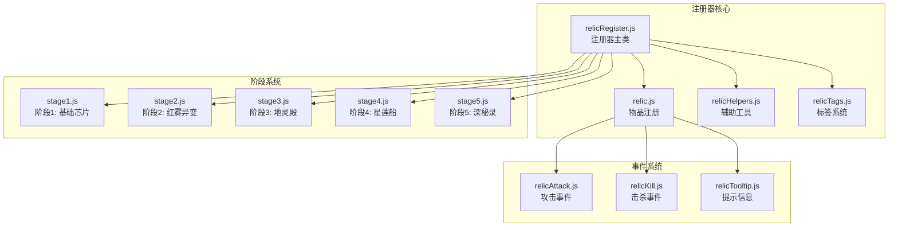
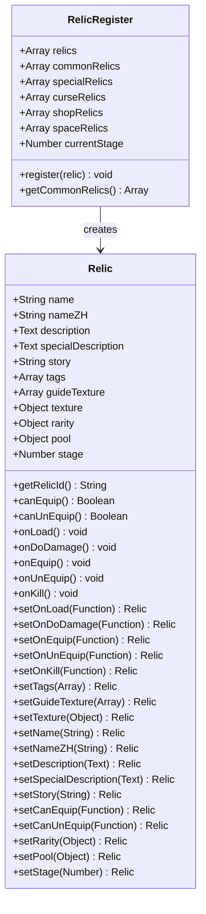
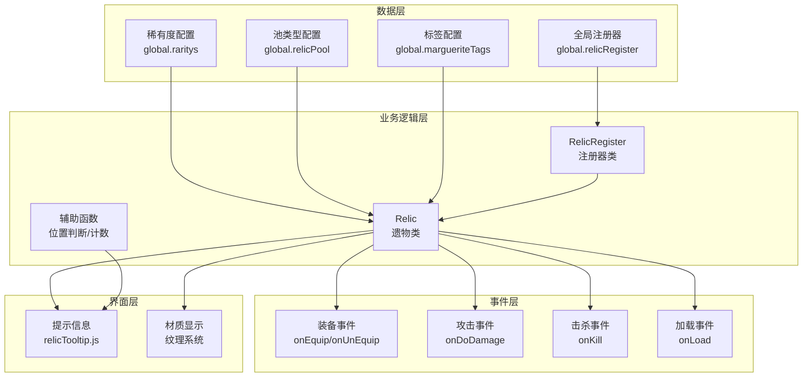
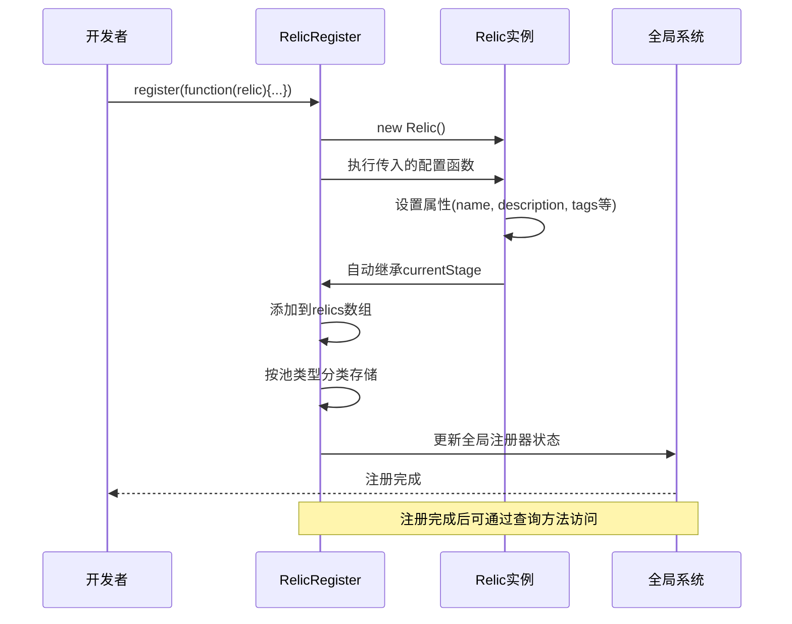
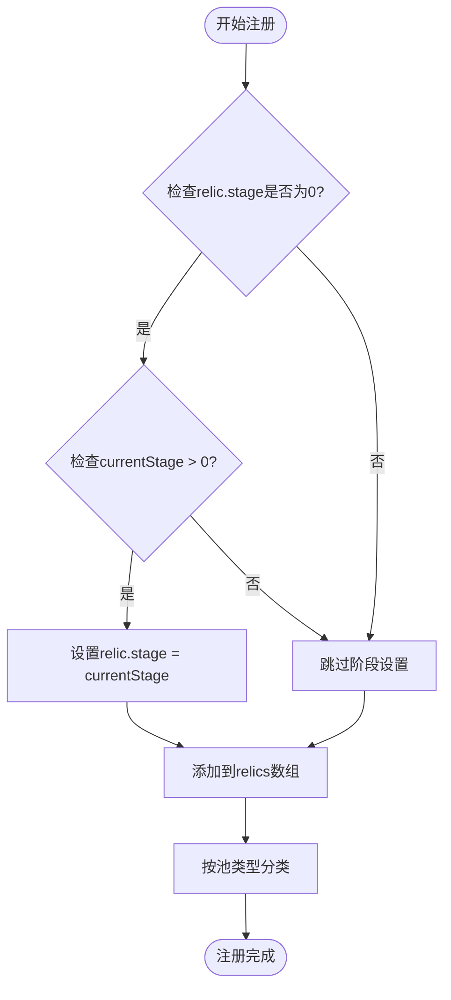
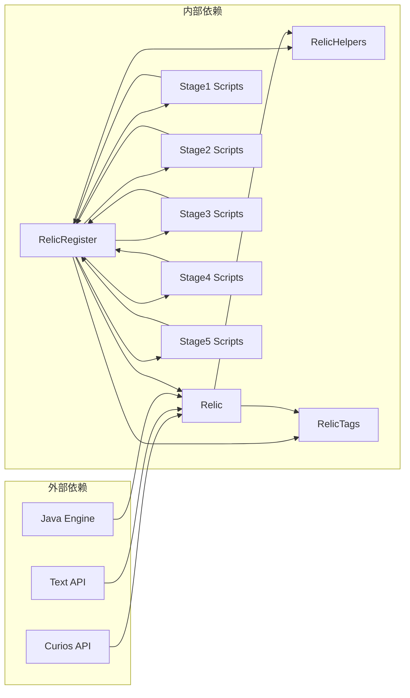

# 遗物注册器

<cite>
**本文档引用的文件**
- [relicRegister.js](file://kubejs/startup_scripts/relic/relicRegister.js)
- [relic.js](file://kubejs/startup_scripts/relic/relic.js)
- [relicHelpers.js](file://kubejs/startup_scripts/relic/relicHelpers.js)
- [relicTags.js](file://kubejs/startup_scripts/relic/relicTags.js)
- [stage1.js](file://kubejs/startup_scripts/relic/relicItem/stage1/stage1.js)
- [stage2.js](file://kubejs/startup_scripts/relic/relicItem/stage2/stage2.js)
- [stage3.js](file://kubejs/startup_scripts/relic/relicItem/stage3/stage3.js)
- [stage4.js](file://kubejs/startup_scripts/relic/relicItem/stage4/stage4.js)
- [stage5.js](file://kubejs/startup_scripts/relic/relicItem/stage5/stage5.js)
- [relicAttack.js](file://kubejs/server_scripts/backpack/relic/relicAttack.js)
- [relicKill.js](file://kubejs/server_scripts/backpack/relic/relicKill.js)
- [relicTooltip.js](file://kubejs/client_scripts/tooltip/relicTooltip.js)
</cite>

## 目录
1. [简介](#简介)
2. [项目结构](#项目结构)
3. [核心组件](#核心组件)
4. [架构概览](#架构概览)
5. [详细组件分析](#详细组件分析)
6. [依赖关系分析](#依赖关系分析)
7. [性能考虑](#性能考虑)
8. [故障排除指南](#故障排除指南)
9. [结论](#结论)

## 简介

遗物注册器是KubeJS项目中用于统一管理和注册游戏内"遗物"系统的完整解决方案。该系统实现了完整的注册器模式，提供了五级稀有度系统、四种池类型系统，以及强大的标签和回调机制。通过注册器模式，开发者可以以声明式的方式添加新的遗物，系统会自动处理遗物的生命周期管理、属性配置和事件回调。

## 项目结构

该项目采用模块化的组织方式，主要分为以下几个核心部分：

**图表来源**
- [relicRegister.js:1-178](file://kubejs/startup_scripts/relic/relicRegister.js#L1-L178)
- [relic.js:1-81](file://kubejs/startup_scripts/relic/relic.js#L1-L81)

**章节来源**
- [relicRegister.js:1-178](file://kubejs/startup_scripts/relic/relicRegister.js#L1-L178)
- [relic.js:1-81](file://kubejs/startup_scripts/relic/relic.js#L1-L81)

## 核心组件

### RelicRegister 注册器类

RelicRegister是整个系统的核心，实现了完整的注册器模式。它负责：

- **统一管理**：维护所有已注册遗物的数组和分类集合
- **自动继承**：支持阶段级别的自动属性继承
- **分类存储**：按池类型自动分类存储遗物
- **查询接口**：提供便捷的查询方法

**图表来源**
- [relicRegister.js:3-42](file://kubejs/startup_scripts/relic/relicRegister.js#L3-L42)
- [relicRegister.js:81-176](file://kubejs/startup_scripts/relic/relicRegister.js#L81-L176)

### 遗物等级系统

系统实现了完整的五级稀有度系统，从低到高的等级分别为：

| 等级 | 中文名称 | 颜色标识 | Tooltip显示 |
|------|----------|----------|-------------|
| common | 普通 | 白色 | `Text.white("普通")` |
| uncommon | 少见 | 黄色 | `Text.yellow("少见")` |
| rare | 稀有 | 蓝色 | `Text.blue("稀有")` |
| epic | 史诗 | 紫色 | `Text.lightPurple("史诗")` |

每个等级都对应不同的视觉表现和稀有度权重，影响玩家获取难度和游戏平衡。

### 池类型系统

系统定义了四种不同的遗物池类型：

| 池类型 | 中文名称 | 用途 | 特点 |
|--------|----------|------|------|
| common | 普通 | 主要掉落池 | 最常见，易于获取 |
| shop | 商店 | 商店购买 | 通过游戏货币购买 |
| special | 特殊 | 特殊渠道 | 通过特殊事件或任务获取 |
| curse | 诅咒 | 诅咒池 | 具有负面效果的特殊遗物 |
| space | 空白 | 空槽占位 | 背包扩展槽位 |

**章节来源**
- [relicRegister.js:44-78](file://kubejs/startup_scripts/relic/relicRegister.js#L44-L78)

## 架构概览

系统采用分层架构设计，确保了良好的可维护性和扩展性：

**图表来源**
- [relicRegister.js:1-178](file://kubejs/startup_scripts/relic/relicRegister.js#L1-L178)
- [relic.js:7-79](file://kubejs/startup_scripts/relic/relic.js#L7-L79)

## 详细组件分析

### 注册流程详解

注册器的注册流程遵循标准的注册器模式，包含以下关键步骤：

**图表来源**
- [relicRegister.js:14-31](file://kubejs/startup_scripts/relic/relicRegister.js#L14-L31)

### 遗物对象属性配置

每个遗物对象都具有丰富的属性配置选项：

#### 基础属性
- **name**: 英文唯一标识符
- **nameZH**: 中文显示名称
- **description**: 主要描述文本
- **specialDescription**: 特殊效果描述
- **story**: 背景故事
- **tags**: 标签数组，用于分类和效果触发

#### 外观属性
- **texture**: 自定义材质覆盖
- **guideTexture**: 指南纹理显示
- **rarity**: 稀有度配置
- **pool**: 池类型配置
- **stage**: 所属阶段

#### 行为属性
- **canEquip/canUnEquip**: 装备/卸下条件
- **onLoad**: 加载时回调
- **onDoDamage**: 攻击时回调
- **onEquip/onUnEquip**: 装备/卸下回调
- **onKill**: 击杀时回调

### 自动阶段继承机制

系统实现了智能的阶段继承机制，确保遗物能够正确继承所属阶段的属性：

**图表来源**
- [relicRegister.js:17-20](file://kubejs/startup_scripts/relic/relicRegister.js#L17-L20)

### 查询方法详解

系统提供了多种便捷的查询方法：

#### getCommonRelics() 方法
用于获取所有普通池类型的遗物：
- 返回类型：Array
- 过滤条件：`relic.pool.name == "普通"`
- 使用场景：UI显示、统计分析

#### 其他可用查询方法
- `getSpecialRelics()`: 获取特殊池遗物
- `getCurseRelics()`: 获取诅咒池遗物  
- `getShopRelics()`: 获取商店池遗物
- `getSpaceRelics()`: 获取空白池遗物

**章节来源**
- [relicRegister.js:32-40](file://kubejs/startup_scripts/relic/relicRegister.js#L32-L40)

### 标签系统

标签系统是遗物功能的核心机制之一，提供了强大的条件触发能力：

#### 标签类型
系统预定义了多种标签类型：
- **doll**: 人偶
- **fabric**: 布制品  
- **metal**: 金属制品
- **knife**: 小刀
- **perform**: 演奏
- **mushroom**: 蘑菇
- **wooden**: 木制
- **step**: 步
- **magic**: 魔法
- **artifact**: 人工制品
- **book**: 书
- **conductive**: 导电

#### 标签使用模式
标签通过`setTags()`方法设置，支持多个标签组合：
- 单标签：`[global.margueriteTags.metal]`
- 多标签：`[global.margueriteTags.metal, global.margueriteTags.magic]`
- 无标签：`[]`

**章节来源**
- [relicTags.js:3-64](file://kubejs/startup_scripts/relic/relicTags.js#L3-L64)

### 事件回调系统

系统实现了完整的事件驱动架构，支持多种游戏事件：

#### 装备事件
- **onEquip**: 装备时触发
- **onUnEquip**: 卸下时触发  
- **canEquip**: 装备条件检查
- **canUnEquip**: 卸下条件检查

#### 战斗事件
- **onDoDamage**: 攻击造成伤害时触发
- **onKill**: 击杀生物时触发

#### 生命周期事件
- **onLoad**: 遗物加载时触发
- **onUpdate**: 遗物更新时触发

**章节来源**
- [relic.js:15-58](file://kubejs/startup_scripts/relic/relic.js#L15-L58)
- [relicAttack.js:24-27](file://kubejs/server_scripts/backpack/relic/relicAttack.js#L24-L27)
- [relicKill.js:24-27](file://kubejs/server_scripts/backpack/relic/relicKill.js#L24-L27)

## 依赖关系分析

系统采用了松耦合的设计，各组件之间的依赖关系清晰明确：

**图表来源**
- [relic.js:1](file://kubejs/startup_scripts/relic/relic.js#L1)
- [relicRegister.js:1](file://kubejs/startup_scripts/relic/relicRegister.js#L1)

### 关键依赖说明

1. **Curios API**: 提供装备系统的基础功能
2. **Text API**: 用于国际化文本显示
3. **Java Engine**: 提供底层Java类访问能力
4. **全局命名空间**: 所有组件共享的全局变量

**章节来源**
- [relic.js:1-5](file://kubejs/startup_scripts/relic/relic.js#L1-L5)
- [relicRegister.js:44-78](file://kubejs/startup_scripts/relic/relicRegister.js#L44-L78)

## 性能考虑

系统在设计时充分考虑了性能优化：

### 数据结构优化
- 使用数组存储所有遗物，提供O(1)随机访问
- 分类数组避免重复过滤操作
- 懒加载标签映射表，按需构建

### 内存管理
- 遗物对象复用机制，减少内存分配
- 材质资源统一管理
- 标签映射表延迟初始化

### 计算优化
- 位置判断算法优化，避免重复计算
- 标签查询使用哈希表，O(1)查找
- 批量操作减少循环次数

## 故障排除指南

### 常见问题及解决方案

#### 遗物未显示在UI中
1. 检查`displayName`设置是否正确
2. 确认`maxStackSize`设置为1
3. 验证`curios:package`标签是否正确

#### 遗物效果不生效
1. 检查事件回调函数是否正确设置
2. 确认`onLoad`回调是否被执行
3. 验证`persistentData`访问权限

#### 标签系统异常
1. 检查标签ID格式是否正确
2. 确认标签定义是否存在
3. 验证标签颜色配置

**章节来源**
- [relic.js:7-79](file://kubejs/startup_scripts/relic/relic.js#L7-L79)
- [relicHelpers.js:242-252](file://kubejs/startup_scripts/relic/relicHelpers.js#L242-L252)

## 结论

遗物注册器系统是一个设计精良、功能完整的注册器模式实现。它通过以下特点展现了优秀的软件工程实践：

1. **清晰的架构设计**: 分层架构确保了良好的可维护性
2. **灵活的扩展机制**: 支持多种稀有度和池类型
3. **强大的事件系统**: 提供完整的生命周期管理
4. **高效的性能表现**: 优化的数据结构和算法
5. **完善的错误处理**: 全面的异常捕获和日志记录

该系统不仅满足了当前项目的需求，还为未来的功能扩展奠定了坚实的基础。通过标准化的注册流程和丰富的配置选项，开发者可以快速添加新的遗物类型，同时保持系统的稳定性和一致性。