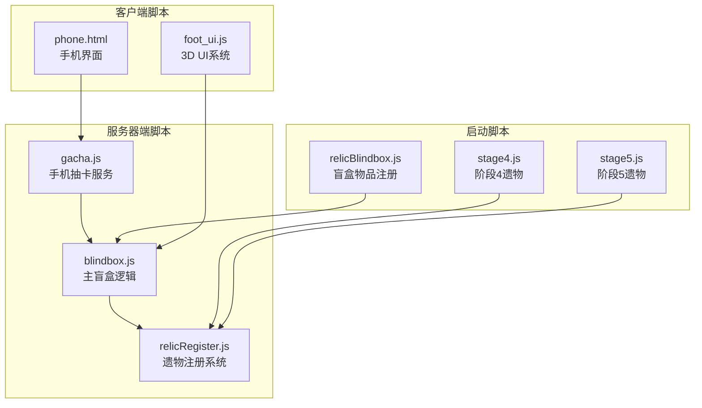
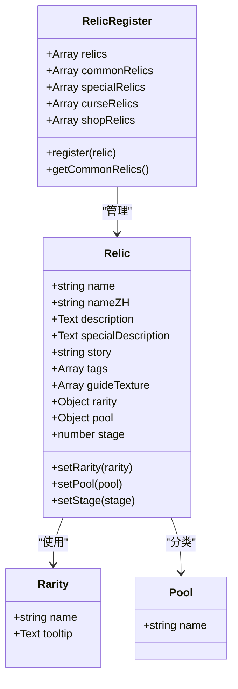
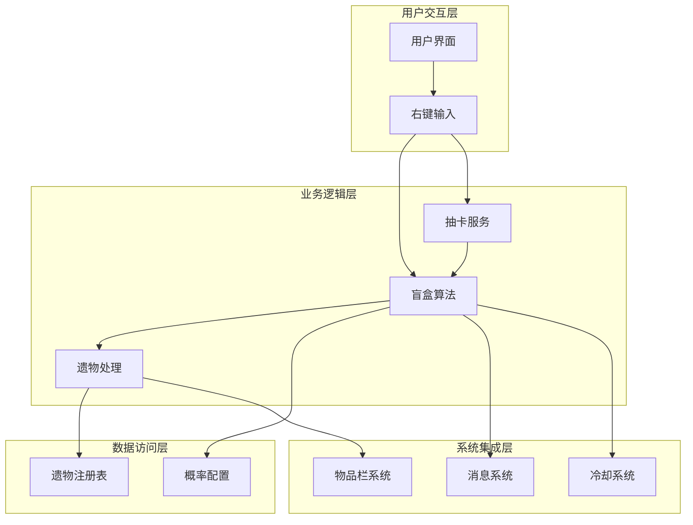
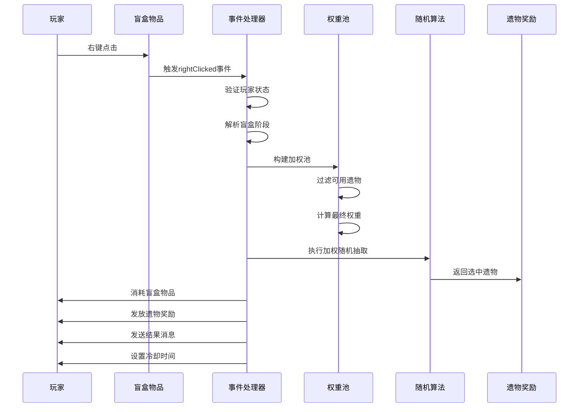
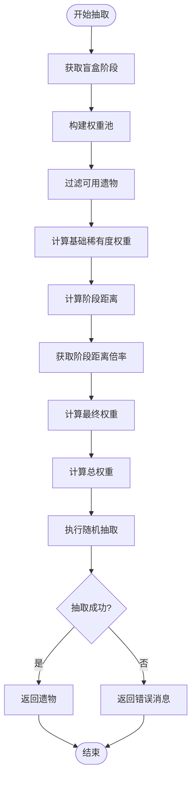
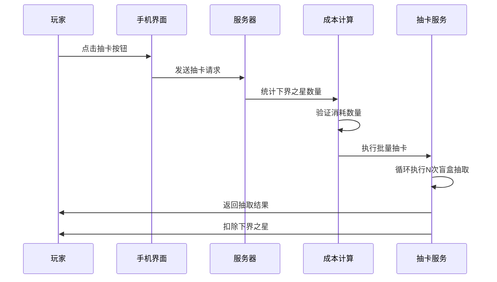
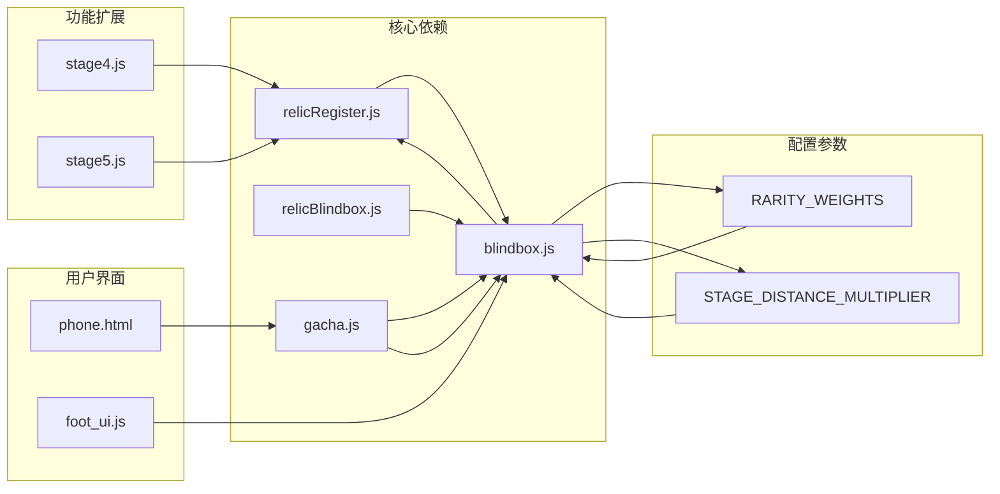

# 遗物盲盒系统

<cite>
**本文档引用的文件**
- [blindbox.js](file://kubejs/server_scripts/blindbox.js)
- [relicBlindbox.js](file://kubejs/startup_scripts/relic/relicBlindbox.js)
- [relicRegister.js](file://kubejs/startup_scripts/relic/relicRegister.js)
- [gacha.js](file://kubejs/server_scripts/gacha.js)
- [stage4.js](file://kubejs/startup_scripts/relic/relicItem/stage4/stage4.js)
- [stage5.js](file://kubejs/startup_scripts/relic/relicItem/stage5/stage5.js)
- [phone.html](file://apricity/kubejs/phone.html)
- [foot_ui.js](file://kubejs/client_scripts/ui/foot_ui.js)
</cite>

## 目录
1. [简介](#简介)
2. [项目结构](#项目结构)
3. [核心组件](#核心组件)
4. [架构概览](#架构概览)
5. [详细组件分析](#详细组件分析)
6. [依赖关系分析](#依赖关系分析)
7. [性能考虑](#性能考虑)
8. [故障排除指南](#故障排除指南)
9. [结论](#结论)
10. [附录](#附录)

## 简介

遗物盲盒系统是《洗手》版本中的一个核心收集玩法模块，基于KubeJS技术栈构建。该系统实现了完整的随机抽取机制，支持五个阶段的渐进式解锁，包含丰富的稀有度层次和概率分布策略。

系统的核心特色包括：
- **渐进式阶段解锁**：从阶段I到V，逐步开放更高级别的遗物
- **智能权重算法**：结合稀有度和阶段匹配度的双重加权机制
- **多维度概率控制**：支持基础稀有度权重、阶段距离倍率等参数调节
- **完整的UI体验**：包含3D世界UI和手机抽卡界面
- **经济系统集成**：与游戏内货币和资源系统深度整合

## 项目结构

遗物盲盒系统采用模块化架构设计，主要文件组织如下：

**图表来源**
- [blindbox.js:1-153](file://kubejs/server_scripts/blindbox.js#L1-L153)
- [relicBlindbox.js:1-25](file://kubejs/startup_scripts/relic/relicBlindbox.js#L1-L25)
- [relicRegister.js:1-178](file://kubejs/startup_scripts/relic/relicRegister.js#L1-L178)

**章节来源**
- [blindbox.js:1-153](file://kubejs/server_scripts/blindbox.js#L1-L153)
- [relicBlindbox.js:1-25](file://kubejs/startup_scripts/relic/relicBlindbox.js#L1-L25)
- [relicRegister.js:1-178](file://kubejs/startup_scripts/relic/relicRegister.js#L1-L178)

## 核心组件

### 盲盒算法引擎

系统的核心是基于加权随机算法的抽取机制，通过以下关键参数控制概率分布：

| 参数类别 | 名称 | 默认值 | 作用说明 |
|---------|------|--------|----------|
| 稀有度权重 | 普通 | 100 | 基础抽取权重 |
| 稀有度权重 | 少见 | 40 | 比普通稀有度低 |
| 稀有度权重 | 稀有 | 15 | 比少见稀有度低 |
| 稀有度权重 | 史诗 | 5 | 最低稀有度权重 |
| 阶段距离倍率 | 0阶(同阶段) | ×4.0 | 最佳匹配权重 |
| 阶段距离倍率 | 1阶 | ×2.5 | 接近匹配权重 |
| 阶段距离倍率 | 2阶 | ×1.5 | 一般匹配权重 |
| 阶段距离倍率 | 3阶 | ×1.0 | 基础匹配权重 |
| 阶段距离倍率 | 4+阶 | ×0.5 | 较差匹配权重 |

### 遗物注册系统

系统采用统一的遗物注册机制，支持多种遗物类型和属性：

**图表来源**
- [relicRegister.js:3-42](file://kubejs/startup_scripts/relic/relicRegister.js#L3-L42)
- [relicRegister.js:81-176](file://kubejs/startup_scripts/relic/relicRegister.js#L81-L176)

**章节来源**
- [relicRegister.js:44-78](file://kubejs/startup_scripts/relic/relicRegister.js#L44-L78)
- [relicRegister.js:14-31](file://kubejs/startup_scripts/relic/relicRegister.js#L14-L31)

## 架构概览

系统采用分层架构设计，确保功能模块的清晰分离和可维护性：

**图表来源**
- [blindbox.js:97-145](file://kubejs/server_scripts/blindbox.js#L97-L145)
- [gacha.js:15-37](file://kubejs/server_scripts/gacha.js#L15-L37)

系统的关键特性包括：
- **事件驱动架构**：通过右键点击事件触发盲盒开启
- **配置驱动算法**：所有概率参数均可通过配置文件调整
- **模块化设计**：各功能模块职责明确，便于扩展和维护
- **错误处理机制**：完善的边界条件检查和错误提示

## 详细组件分析

### 盲盒开启流程

盲盒的开启过程遵循严格的流程控制，确保用户体验的一致性和系统的稳定性：

**图表来源**
- [blindbox.js:97-145](file://kubejs/server_scripts/blindbox.js#L97-L145)
- [blindbox.js:41-87](file://kubejs/server_scripts/blindbox.js#L41-L87)

### 概率计算算法

系统采用复合权重算法，综合考虑稀有度和阶段匹配度两个维度：

**图表来源**
- [blindbox.js:11-26](file://kubejs/server_scripts/blindbox.js#L11-L26)
- [blindbox.js:28-34](file://kubejs/server_scripts/blindbox.js#L28-L34)
- [blindbox.js:41-62](file://kubejs/server_scripts/blindbox.js#L41-L62)

### 手机抽卡系统

手机抽卡功能提供了便捷的批量抽取体验，与主盲盒系统深度集成：

**图表来源**
- [gacha.js:1-37](file://kubejs/server_scripts/gacha.js#L1-L37)
- [phone.html:1048-1093](file://apricity/kubejs/phone.html#L1048-L1093)

**章节来源**
- [gacha.js:10-13](file://kubejs/server_scripts/gacha.js#L10-L13)
- [gacha.js:18-28](file://kubejs/server_scripts/gacha.js#L18-L28)

### UI界面设计

系统提供了多层次的用户界面体验：

#### 3D世界UI系统
- **位置定位**：基于床的位置和朝向自动计算显示位置
- **动态交互**：支持鼠标悬停和拖拽操作
- **粒子效果**：丰富的视觉反馈和动画效果
- **状态同步**：实时显示满意度、需求等状态信息

#### 手机抽卡界面
- **平滑动画**：抽卡弹窗的进入和退出动画
- **成本显示**：实时显示下界之星消耗情况
- **结果展示**：清晰的抽取结果反馈
- **音效配合**：配合视觉效果的音频反馈

**章节来源**
- [foot_ui.js:1-200](file://kubejs/client_scripts/ui/foot_ui.js#L1-L200)
- [phone.html:62-1093](file://apricity/kubejs/phone.html#L62-L1093)

## 依赖关系分析

系统各组件之间的依赖关系呈现清晰的层次结构：

**图表来源**
- [blindbox.js:11-17](file://kubejs/server_scripts/blindbox.js#L11-L17)
- [blindbox.js:19-26](file://kubejs/server_scripts/blindbox.js#L19-L26)

**章节来源**
- [stage4.js:329-342](file://kubejs/startup_scripts/relic/relicItem/stage4/stage4.js#L329-L342)
- [stage5.js:76-91](file://kubejs/startup_scripts/relic/relicItem/stage5/stage5.js#L76-L91)

## 性能考虑

系统在设计时充分考虑了性能优化：

### 算法复杂度
- **权重池构建**：O(n) 时间复杂度，n为可用遗物数量
- **随机抽取**：O(m) 时间复杂度，m为权重池大小
- **内存使用**：权重池占用空间与遗物数量线性相关

### 优化策略
- **延迟加载**：遗物列表仅在需要时构建
- **缓存机制**：重复查询的结果进行缓存
- **边界检查**：提前验证输入参数，避免无效计算
- **冷却机制**：防止频繁操作导致的性能问题

## 故障排除指南

### 常见问题及解决方案

| 问题类型 | 症状描述 | 可能原因 | 解决方案 |
|---------|----------|----------|----------|
| 无可用遗物 | 抽取失败并提示无可用遗物 | 当前阶段没有匹配的遗物 | 升级盲盒阶段或等待新遗物解锁 |
| 权重异常 | 某种稀有度出现频率过高 | 权重配置不当 | 调整RARITY_WEIGHTS参数 |
| 阶段不匹配 | 高级遗物无法抽取 | 阶段限制过严 | 提升盲盒阶段或调整阶段距离倍率 |
| 性能问题 | 抽取响应缓慢 | 遗物数量过多 | 优化权重池构建逻辑 |

### 调试方法
- **日志记录**：启用详细的调试日志输出
- **参数验证**：检查所有配置参数的有效性
- **内存监控**：监控权重池的内存使用情况
- **性能分析**：定期分析算法执行时间

**章节来源**
- [blindbox.js:114-123](file://kubejs/server_scripts/blindbox.js#L114-L123)
- [blindbox.js:143-145](file://kubejs/server_scripts/blindbox.js#L143-L145)

## 结论

遗物盲盒系统是一个设计精良的游戏机制模块，具有以下突出特点：

### 技术优势
- **算法严谨**：基于科学的概率理论设计，确保公平性和可预测性
- **扩展性强**：模块化架构支持功能的灵活扩展和定制
- **用户体验优秀**：多层次的界面设计提供沉浸式的交互体验
- **性能稳定**：经过优化的算法确保系统运行效率

### 设计亮点
- **渐进式解锁**：符合游戏节奏的阶段性内容解锁机制
- **智能权重**：平衡稀有度和难度的综合考量
- **经济集成**：与游戏内经济系统无缝衔接
- **可视化反馈**：丰富的UI效果增强玩家参与感

### 改进建议
- **动态平衡**：根据玩家进度动态调整概率参数
- **社交功能**：添加遗物分享和比较功能
- **成就系统**：引入收集成就和里程碑奖励
- **跨平台支持**：优化移动端的交互体验

## 附录

### 配置参数参考表

| 参数名称 | 类型 | 默认值 | 作用范围 | 调整建议 |
|---------|------|--------|----------|----------|
| RARITY_WEIGHTS.普通 | 数字 | 100 | 稀有度权重 | 保持相对最高权重 |
| RARITY_WEIGHTS.少见 | 数字 | 40 | 稀有度权重 | 控制稀有度比例 |
| RARITY_WEIGHTS.稀有 | 数字 | 15 | 稀有度权重 | 适度降低出现频率 |
| RARITY_WEIGHTS.史诗 | 数字 | 5 | 稀有度权重 | 严格控制顶级稀有度 |
| STAGE_DISTANCE_MULTIPLIER[0] | 数字 | 4.0 | 阶段匹配权重 | 最佳匹配的高权重 |
| STAGE_DISTANCE_MULTIPLIER[1] | 数字 | 2.5 | 阶段匹配权重 | 接近匹配的中等权重 |
| STAGE_DISTANCE_MULTIPLIER[2] | 数字 | 1.5 | 阶段匹配权重 | 一般匹配的基础权重 |
| STAGE_DISTANCE_MULTIPLIER[3] | 数字 | 1.0 | 阶段匹配权重 | 基础匹配权重 |
| STAGE_DISTANCE_MULTIPLIER[4+] | 数字 | 0.5 | 阶段匹配权重 | 远距离匹配的低权重 |
| GACHA_COST_PER_PULL | 数字 | 6 | 手机抽卡成本 | 平衡抽取成本和收益 |
| GACHA_POOL_STAGE | 数字 | 2 | 抽卡使用阶段 | 控制抽卡难度级别 |

### 开发最佳实践

1. **参数管理**：将所有可调参数集中管理，便于平衡性调整
2. **日志记录**：完善详细的日志输出，便于问题诊断
3. **单元测试**：为关键算法编写测试用例，确保稳定性
4. **性能监控**：建立性能指标监控，及时发现性能问题
5. **用户反馈**：收集玩家反馈，持续优化用户体验