# 遗物等级系统

<cite>
**本文档引用的文件**
- [relic.js](file://kubejs/startup_scripts/relic/relic.js)
- [relicRegister.js](file://kubejs/startup_scripts/relic/relicRegister.js)
- [relicHelpers.js](file://kubejs/startup_scripts/relic/relicHelpers.js)
- [relicTags.js](file://kubejs/startup_scripts/relic/relicTags.js)
- [stage1.js](file://kubejs/startup_scripts/relic/relicItem/stage1/stage1.js)
- [stage2.js](file://kubejs/startup_scripts/relic/relicItem/stage2/stage2.js)
- [stage3.js](file://kubejs/startup_scripts/relic/relicItem/stage3/stage3.js)
- [stage4.js](file://kubejs/startup_scripts/relic/relicItem/stage4/stage4.js)
- [stage5.js](file://kubejs/startup_scripts/relic/relicItem/stage5/stage5.js)
- [relicBackpackSpace.js](file://kubejs/startup_scripts/relic/relicItem/relicBackpackSpace.js)
- [relicTooltip.js](file://kubejs/client_scripts/tooltip/relicTooltip.js)
- [recipes_relic_stage1.js](file://kubejs/server_scripts/recipes/recipes_relic_stage1.js)
</cite>

## 目录
1. [简介](#简介)
2. [项目结构](#项目结构)
3. [核心组件](#核心组件)
4. [架构概览](#架构概览)
5. [详细组件分析](#详细组件分析)
6. [依赖关系分析](#依赖关系分析)
7. [性能考量](#性能考量)
8. [故障排除指南](#故障排除指南)
9. [结论](#结论)

## 简介

遗物等级系统是基于KubeJS的Minecraft模组中的一个核心玩法机制，通过五个渐进式阶段为玩家提供不同复杂度和强度的遗物效果。该系统不仅实现了从基础到高级的渐进式设计，还通过标签系统、位置检测和条件判断等机制，为玩家提供了深度的策略选择和丰富的游戏体验。

系统的核心设计理念是"代价与收益并存"，每个阶段的遗物都遵循相应的平衡性原则，确保玩家在追求更强效果的同时必须承担相应的代价或限制。

## 项目结构

遗物等级系统采用模块化的文件组织方式，按照功能和阶段进行分类：

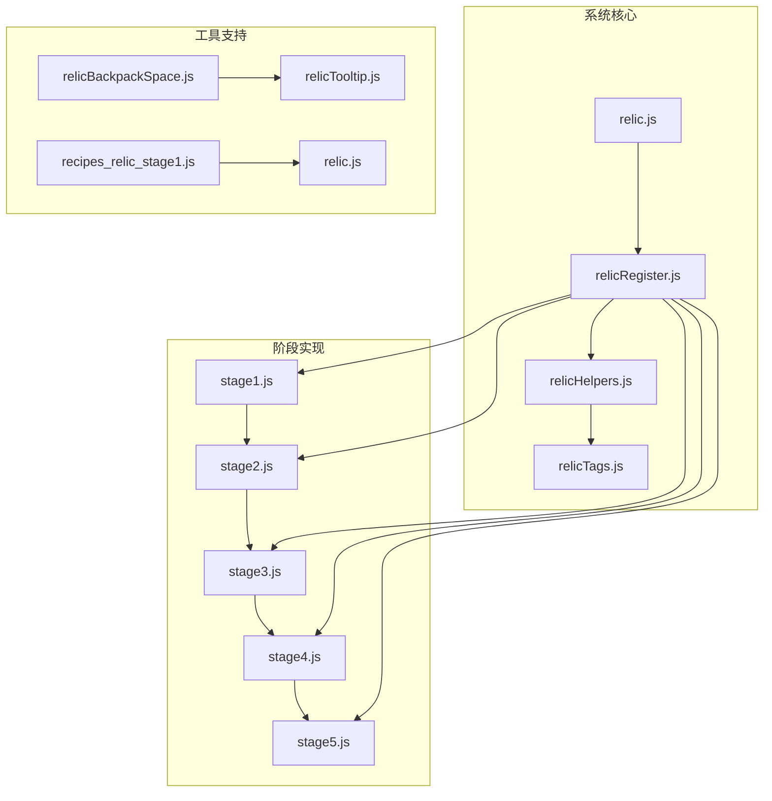

**图表来源**
- [relic.js:1-81](file://kubejs/startup_scripts/relic/relic.js#L1-L81)
- [relicRegister.js:1-178](file://kubejs/startup_scripts/relic/relicRegister.js#L1-L178)

**章节来源**
- [relic.js:1-81](file://kubejs/startup_scripts/relic/relic.js#L1-L81)
- [relicRegister.js:1-178](file://kubejs/startup_scripts/relic/relicRegister.js#L1-L178)

## 核心组件

### 遗物注册系统

遗物注册系统是整个系统的基础框架，负责管理所有遗物的生命周期和属性。

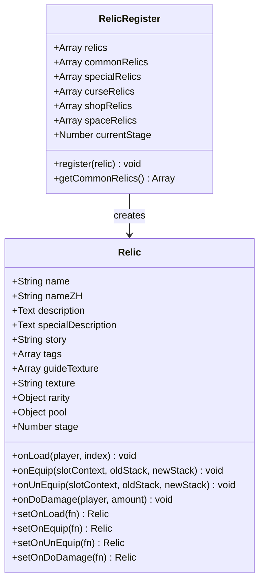

**图表来源**
- [relicRegister.js:81-176](file://kubejs/startup_scripts/relic/relicRegister.js#L81-L176)

### 遗物标签系统

标签系统为遗物提供了强大的关联和交互能力，支持基于标签的条件判断和效果触发。

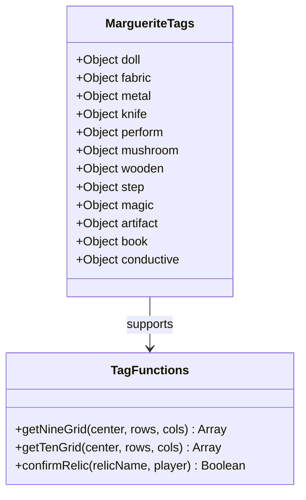

**图表来源**
- [relicTags.js:3-64](file://kubejs/startup_scripts/relic/relicTags.js#L3-L64)

**章节来源**
- [relicRegister.js:1-178](file://kubejs/startup_scripts/relic/relicRegister.js#L1-L178)
- [relicTags.js:1-192](file://kubejs/startup_scripts/relic/relicTags.js#L1-L192)

## 架构概览

遗物等级系统采用分层架构设计，从底层的数据结构到顶层的用户界面都有清晰的职责划分。

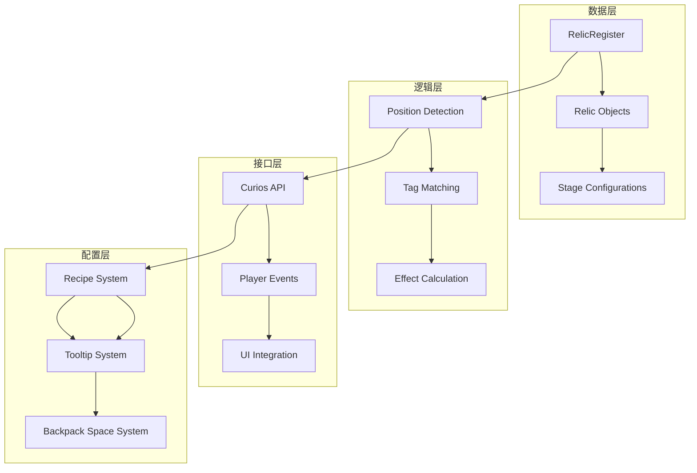

**图表来源**
- [relic.js:7-79](file://kubejs/startup_scripts/relic/relic.js#L7-L79)
- [relicHelpers.js:326-332](file://kubejs/startup_scripts/relic/relicHelpers.js#L326-L332)

## 详细组件分析

### 阶段1：基础芯片系统

阶段1是整个系统的入门阶段，包含12个基础芯片遗物，采用"所有部位"统一效果的设计理念。

#### 设计原则

阶段1遵循"加强金钱必须以降低满意度或提高体力消耗作为代价"的设计准则：

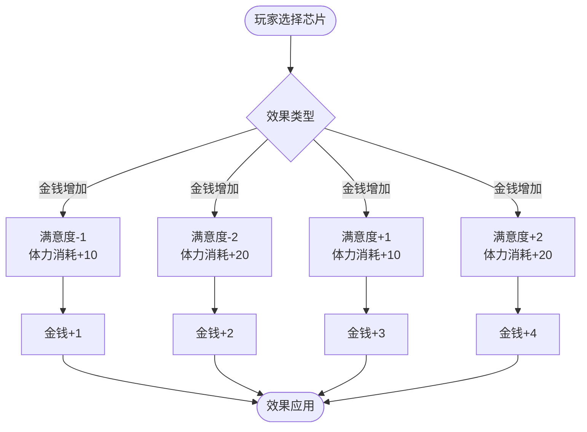

**图表来源**
- [stage1.js:27-224](file://kubejs/startup_scripts/relic/relicItem/stage1/stage1.js#L27-L224)

#### 效果强度分析

阶段1的遗物效果相对简单直接，主要体现在数值层面的增益和代价：

| 遗物类型 | 金钱增益 | 满意度变化 | 体力消耗 | 获取难度 |
|---------|---------|-----------|---------|----------|
| 基础芯片 | +1 | -1/-2 | +10/+20 | 普通（2精密构件） |
| 高级芯片 | +2 | -2 | +20 | 少见（4精密构件） |
| 稀有芯片 | +1/+3 | 无副作用 | 无 | 稀有（特殊渠道） |

**章节来源**
- [stage1.js:1-224](file://kubejs/startup_scripts/relic/relicItem/stage1/stage1.js#L1-L224)
- [recipes_relic_stage1.js:1-89](file://kubejs/server_scripts/recipes/recipes_relic_stage1.js#L1-L89)

### 阶段2：四部位体系

阶段2引入了"脚趾/脚掌/脚心/脚跟"四个部位的差异化设计，每个部位都有独特的金钱、满意度和体力消耗属性。

#### 部位系统设计

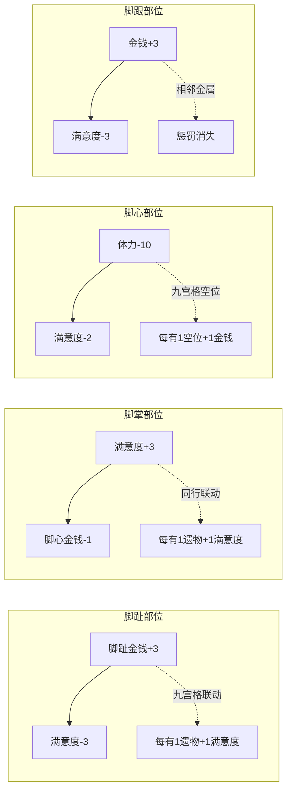

**图表来源**
- [stage2.js:8-36](file://kubejs/startup_scripts/relic/relicItem/stage2/stage2.js#L8-L36)

#### 标签系统集成

阶段2开始大量使用标签系统来实现复杂的条件判断：

| 标签类型 | 颜色 | 功能描述 | 示例遗物 |
|---------|------|----------|----------|
| 金属制品 | 白色 | 与金属物品共鸣，减轻负面效果 | 共振芯片、铁扇、锡杖 |
| 布制品 | 灰色 | 提供舒适感，增强满意度效果 | 抚慰芯片、按压芯片 |
| 魔法 | 紫色 | 与魔法能量互动，产生特殊效果 | 水晶球、反应炉、法轮 |
| 木制 | 金色 | 提供稳定性和平衡性 | 竹笛、平衡芯片、梦槌 |
| 导电 | 红色 | 传导能量，影响电力相关效果 | 压榨芯片、五色灯 |

**章节来源**
- [stage2.js:1-726](file://kubejs/startup_scripts/relic/relicItem/stage2/stage2.js#L1-L726)
- [relicTags.js:1-192](file://kubejs/startup_scripts/relic/relicTags.js#L1-L192)

### 阶段3：地灵殿之暗

阶段3将背包空间扩展到4×5的20格布局，引入了更复杂的联动机制和区域概念。

#### 区域联动系统

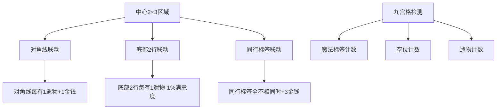

**图表来源**
- [stage3.js:163-170](file://kubejs/startup_scripts/relic/relicItem/stage3/stage3.js#L163-L170)

#### 新增机制

阶段3引入了以下新机制：

1. **中心区域效应**：位于中心2×3区域内的遗物会获得额外的金钱加成
2. **对角线共鸣**：对角线方向的遗物会产生相互增强的效果
3. **标签多样性**：鼓励玩家收集不同类型的遗物来最大化收益

**章节来源**
- [stage3.js:1-404](file://kubejs/startup_scripts/relic/relicItem/stage3/stage3.js#L1-L404)

### 阶段4：星莲船之航

阶段4达到30格的完整布局，引入了最复杂的联动和条件判断系统。

#### 复杂联动机制

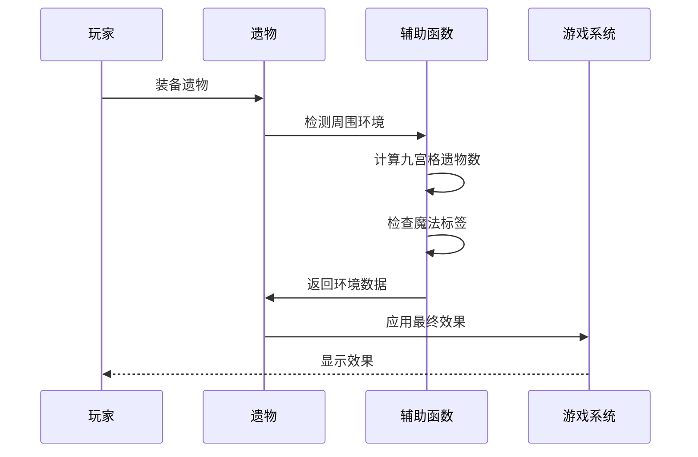

**图表来源**
- [stage4.js:112-121](file://kubejs/startup_scripts/relic/relicItem/stage4/stage4.js#L112-L121)

#### 特殊效果实现

阶段4的遗物开始出现完全创新的效果：

1. **满意度反转**：逆十字可以将所有满意度效果的正负性完全颠倒
2. **标签多样性奖励**：根据背包中不同标签的数量给予额外收益
3. **区域控制效果**：通过特定的排列模式来激活隐藏效果

**章节来源**
- [stage4.js:1-340](file://kubejs/startup_scripts/relic/relicItem/stage4/stage4.js#L1-L340)

### 阶段5：深秘录终章

阶段5达到54格的终极布局，实现了最复杂和最平衡的系统设计。

#### 终极联动系统

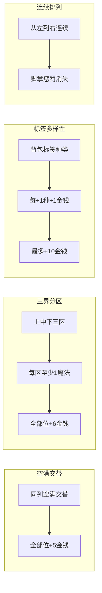

**图表来源**
- [stage5.js:113-133](file://kubejs/startup_scripts/relic/relicItem/stage5/stage5.js#L113-L133)

#### 平衡性设计

阶段5在保持高收益的同时，通过多重限制条件确保游戏平衡：

1. **多重条件限制**：通常需要满足2-3个独立条件才能获得最高收益
2. **区域控制要求**：需要精心规划背包布局才能激活效果
3. **标签多样性鼓励**：鼓励玩家收集各种不同类型的遗物

**章节来源**
- [stage5.js:1-343](file://kubejs/startup_scripts/relic/relicItem/stage5/stage5.js#L1-L343)

### 背包空间管理系统

随着阶段的推进，背包空间需求也在不断增加：

| 阶段 | 背包尺寸 | 遗物数量 | 镶板等级 |
|------|----------|----------|----------|
| 1    | 3×4=12格 | 12个遗物 | MK1-MK2 |
| 2    | 3×4=12格 | 26个遗物 | MK1-MK3 |
| 3    | 4×5=20格 | 14个遗物 | MK2-MK4 |
| 4    | 5×6=30格 | 11个遗物 | MK3-MK5 |
| 5    | 6×9=54格 | 10个遗物 | MK4-MK5 |

**章节来源**
- [relicBackpackSpace.js:1-64](file://kubejs/startup_scripts/relic/relicItem/relicBackpackSpace.js#L1-L64)

## 依赖关系分析

遗物等级系统具有清晰的依赖层次结构：

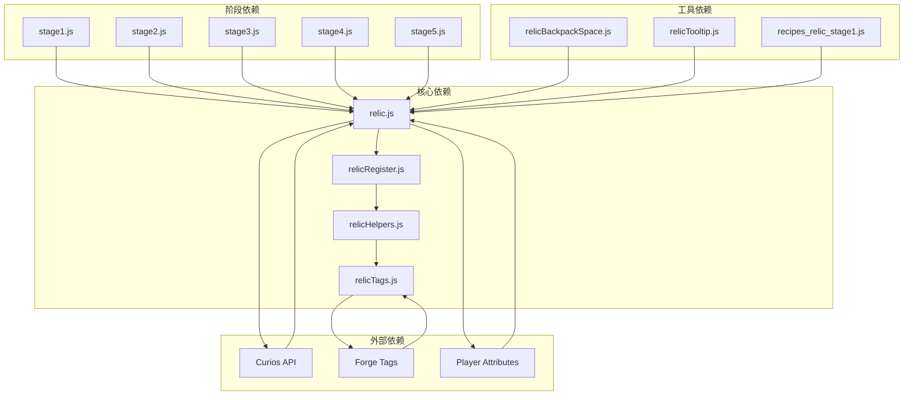

**图表来源**
- [relic.js:1-81](file://kubejs/startup_scripts/relic/relic.js#L1-L81)
- [relicRegister.js:1-178](file://kubejs/startup_scripts/relic/relicRegister.js#L1-L178)

**章节来源**
- [relic.js:1-81](file://kubejs/startup_scripts/relic/relic.js#L1-L81)
- [relicRegister.js:1-178](file://kubejs/startup_scripts/relic/relicRegister.js#L1-L178)

## 性能考量

### 计算复杂度优化

系统在设计时充分考虑了性能优化：

1. **懒加载机制**：标签映射表只在首次使用时构建
2. **缓存策略**：重复使用的计算结果进行缓存
3. **条件短路**：复杂的条件判断采用短路求值
4. **批量处理**：同类操作尽量批量执行

### 内存管理

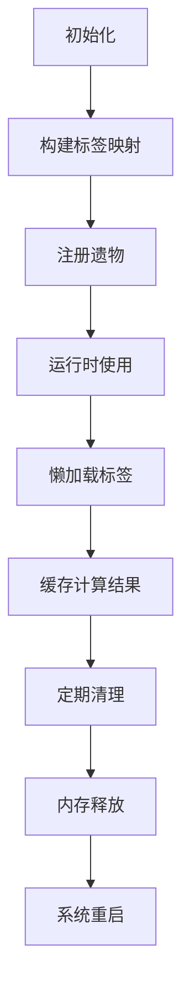

**图表来源**
- [relicHelpers.js:242-252](file://kubejs/startup_scripts/relic/relicHelpers.js#L242-L252)

## 故障排除指南

### 常见问题及解决方案

#### 遗物效果不生效

1. **检查阶段设置**：确认`currentStage`正确设置
2. **验证标签匹配**：检查遗物标签是否正确添加
3. **确认位置检测**：验证位置检测函数是否正常工作

#### 性能问题

1. **监控计算频率**：避免在高频事件中进行复杂计算
2. **使用节流机制**：对频繁调用的函数添加节流
3. **优化循环结构**：减少嵌套循环的深度

#### UI显示异常

1. **检查文本格式**：确认Text对象的正确使用
2. **验证颜色映射**：检查阶段颜色映射表
3. **测试提示信息**：验证客户端消息显示

**章节来源**
- [relic.js:15-41](file://kubejs/startup_scripts/relic/relic.js#L15-L41)
- [relicTooltip.js:1-79](file://kubejs/client_scripts/tooltip/relicTooltip.js#L1-L79)

## 结论

遗物等级系统通过五个渐进式阶段的设计，成功实现了从简单到复杂的完整游戏体验。每个阶段都有明确的目标和设计理念，既保持了游戏的挑战性，又确保了玩家的成就感。

系统的核心优势在于：

1. **渐进式学习曲线**：从简单的数值增益到复杂的条件联动
2. **深度策略性**：通过标签系统和位置检测创造丰富的策略选择
3. **平衡性设计**：每个效果都有相应的代价或限制
4. **可扩展性**：模块化的架构便于后续内容的添加

这种设计不仅提升了游戏的可玩性，也为玩家提供了持续的目标和挑战，是Minecraft模组开发中的优秀实践案例。