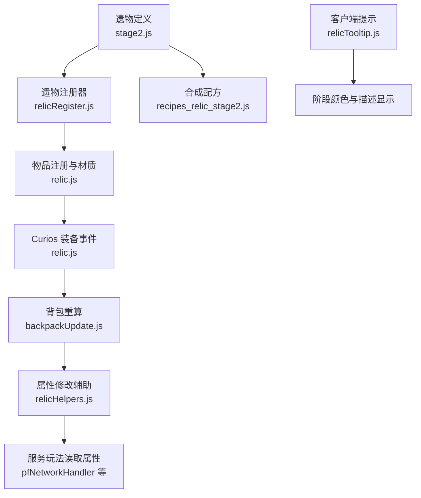
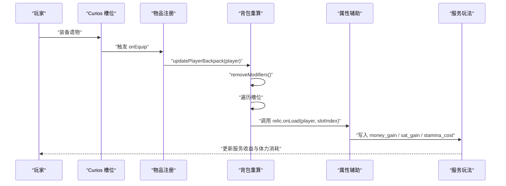
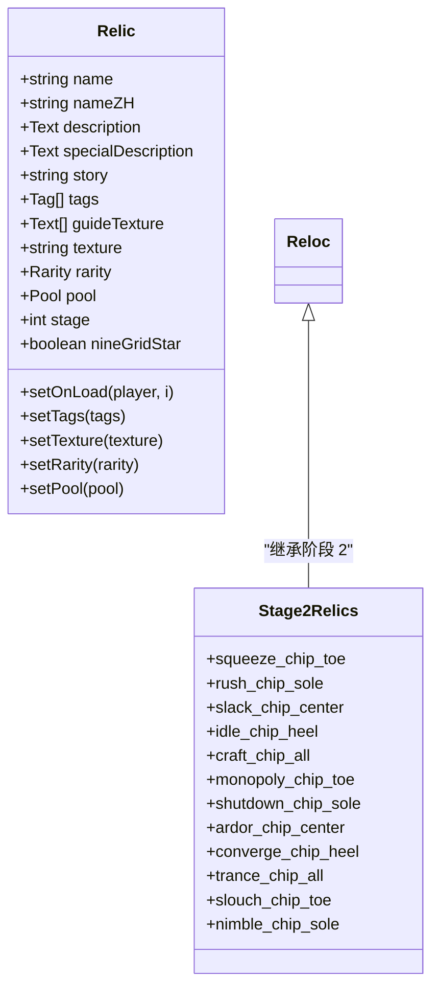
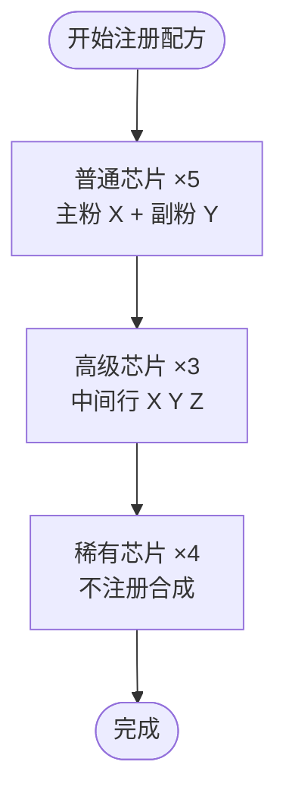
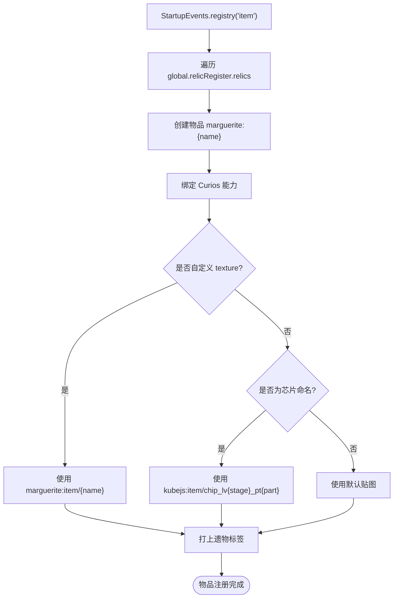
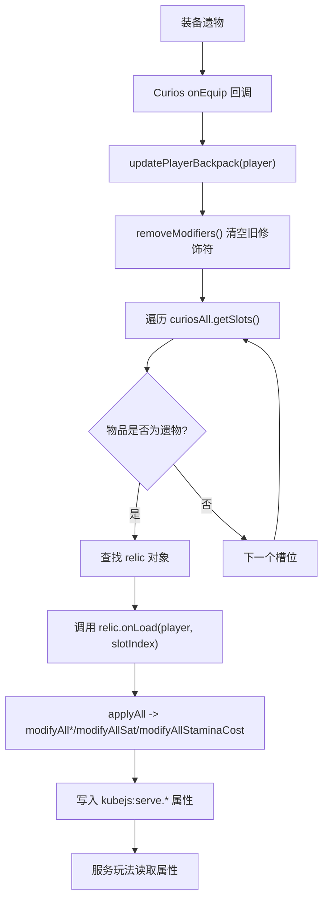
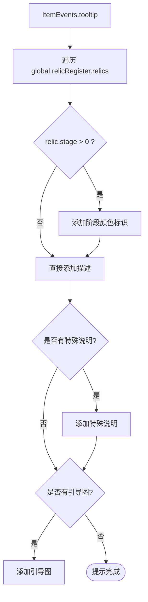
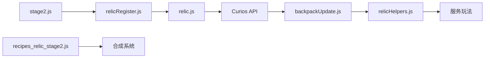

基于我对代码的分析，我现在了解了遗物第二阶段系统的重大重构。让我更新文档以反映这些变化：

# 遗物第二阶段系统

<cite>
**本文引用的文件**   
- [stage2.js](file://kubejs/startup_scripts/relic/relicItem/stage2/stage2.js)
- [recipes_relic_stage2.js](file://kubejs/server_scripts/recipes/recipes_relic_stage2.js)
- [relicRegister.js](file://kubejs/startup_scripts/relic/relicRegister.js)
- [relic.js](file://kubejs/startup_scripts/relic/relic.js)
- [backpackUpdate.js](file://kubejs/server_scripts/backpack/backpackUpdate.js)
- [relicHelpers.js](file://kubejs/startup_scripts/relic/relicHelpers.js)
- [relicTooltip.js](file://kubejs/client_scripts/tooltip/relicTooltip.js)
- [catalog.md](file://knowledge_base/relic/catalog.md)
- [README.md](file://knowledge_base/relic/README.md)
- [authoring-checklist.md](file://knowledge_base/relic/authoring-checklist.md)
- [attribute.json](file://kubejs/data/kubejs/l2tabs_config/attribute_entry/attribute.json)
</cite>

## 更新摘要
**变更内容**   
- 完全重构了第二阶段遗物定义，新增637行代码，删除120行旧代码
- 重新设计了12个进阶芯片遗物的ID命名模式和属性模型
- 更新了合成配方系统，采用新的材料映射和粉末组合机制
- 增强了位置联动功能，支持相邻标签检测和中心区域加成
- 改进了客户端提示系统，增加阶段标识和特殊说明显示

## 目录
1. [引言](#引言)
2. [项目结构定位](#项目结构定位)
3. [核心组件总览](#核心组件总览)
4. [架构概览](#架构概览)
5. [详细组件分析](#详细组件分析)
6. [依赖关系分析](#依赖关系分析)
7. [性能与稳定性特征](#性能与稳定性特征)
8. [排错指南](#排错指南)
9. [结论](#结论)

## 引言
本文件聚焦"遗物第二阶段系统"，即红雾异变主题下的进阶芯片遗物。该系统通过 KubeJS 在服务器端注册遗物定义、合成配方，并在玩家装备时通过 Curios 能力触发背包重算，最终把金钱、满意度、体力消耗三类属性写入玩家属性，供足浴店服务玩法读取。

**更新** 第二阶段经过重大重构，现在包含12个精心设计的进阶芯片遗物，分为普通×5、高级×3、稀有×4三个等级，每个遗物都遵循严格的三属性权衡设计原则。

第二阶段的核心设计原则是：所有遗物都围绕"所有部位"的金钱、满意度、体力消耗进行权衡；加强收益通常需要以满意度下降或体力消耗上升为代价；仅少数遗物引入相邻标签联动或位置加成。

## 项目结构定位
第二阶段遗物相关代码主要分布在以下路径：
- 遗物定义：`kubejs/startup_scripts/relic/relicItem/stage2/stage2.js`
- 合成配方：`kubejs/server_scripts/recipes/recipes_relic_stage2.js`
- 遗物框架与注册器：`kubejs/startup_scripts/relic/relicRegister.js`
- 物品注册与材质映射：`kubejs/startup_scripts/relic/relic.js`
- 背包重算与效果应用：`kubejs/server_scripts/backpack/backpackUpdate.js`
- 属性修改辅助函数：`kubejs/startup_scripts/relic/relicHelpers.js`
- 悬停提示阶段标识：`kubejs/client_scripts/tooltip/relicTooltip.js`
- 遗物目录索引：`knowledge_base/relic/catalog.md`
- 遗物系统说明：`knowledge_base/relic/README.md`
- 编写检查清单：`knowledge_base/relic/authoring-checklist.md`
- 服务属性配置：`kubejs/data/kubejs/l2tabs_config/attribute_entry/attribute.json`

**图表来源**
- [stage2.js:1-235](file://kubejs/startup_scripts/relic/relicItem/stage2/stage2.js#L1-L235)
- [relicRegister.js:1-188](file://kubejs/startup_scripts/relic/relicRegister.js#L1-L188)
- [relic.js:1-99](file://kubejs/startup_scripts/relic/relic.js#L1-L99)
- [recipes_relic_stage2.js:1-91](file://kubejs/server_scripts/recipes/recipes_relic_stage2.js#L1-L91)
- [backpackUpdate.js:1-73](file://kubejs/server_scripts/backpack/backpackUpdate.js#L1-L73)
- [relicHelpers.js:40-79](file://kubejs/startup_scripts/relic/relicHelpers.js#L40-L79)
- [relicTooltip.js:1-36](file://kubejs/client_scripts/tooltip/relicTooltip.js#L1-L36)

**章节来源**
- [stage2.js:1-235](file://kubejs/startup_scripts/relic/relicItem/stage2/stage2.js#L1-L235)
- [recipes_relic_stage2.js:1-91](file://kubejs/server_scripts/recipes/recipes_relic_stage2.js#L1-L91)
- [relicRegister.js:1-188](file://kubejs/startup_scripts/relic/relicRegister.js#L1-L188)
- [relic.js:1-99](file://kubejs/startup_scripts/relic/relic.js#L1-L99)
- [backpackUpdate.js:1-73](file://kubejs/server_scripts/backpack/backpackUpdate.js#L1-L73)
- [relicHelpers.js:40-79](file://kubejs/startup_scripts/relic/relicHelpers.js#L40-L79)
- [relicTooltip.js:1-36](file://kubejs/client_scripts/tooltip/relicTooltip.js#L1-L36)
- [catalog.md:22-37](file://knowledge_base/relic/catalog.md#L22-L37)
- [README.md:1-28](file://knowledge_base/relic/README.md#L1-L28)
- [authoring-checklist.md:1-42](file://knowledge_base/relic/authoring-checklist.md#L1-L42)
- [attribute.json:1-64](file://kubejs/data/kubejs/l2tabs_config/attribute_entry/attribute.json#L1-L64)

## 核心组件总览
第二阶段系统由五个关键部分组成：
1. **遗物定义层**：定义 12 个进阶芯片遗物的名称、稀有度、标签、描述、故事文本和 `onLoad` 效果。
2. **合成配方层**：定义普通与高级芯片的合成配方，稀有芯片不提供合成。
3. **注册与物品层**：将遗物对象注册为真实物品，并自动分配芯片贴图。
4. **背包重算层**：在装备/卸下时清空旧修饰符，再重新计算已装备遗物的属性效果。
5. **客户端提示层**：根据遗物阶段显示阶段标识、描述与特殊说明。

| 组件 | 职责 | 关键行为 |
|---|---|---|
| 遗物定义 | 声明第二阶段 12 个芯片遗物 | 设置名称、纹理、标签、稀有度、池、`onLoad` |
| 合成配方 | 提供可合成遗物的配方 | 普通 ×5、高级 ×3，稀有 ×4 不可合成 |
| 注册器 | 收集遗物对象并分类 | 按池类型分组，继承当前阶段 |
| 物品注册 | 创建物品、绑定 Curios 能力 | 自动贴图、打标签、挂载装备回调 |
| 背包重算 | 刷新玩家属性 | 清修饰符、遍历槽位、调用 `onLoad` |
| 客户端提示 | 显示阶段与描述 | 阶段颜色、描述、特殊说明、引导图 |

**章节来源**
- [stage2.js:1-235](file://kubejs/startup_scripts/relic/relicItem/stage2/stage2.js#L1-L235)
- [recipes_relic_stage2.js:1-91](file://kubejs/server_scripts/recipes/recipes_relic_stage2.js#L1-L91)
- [relicRegister.js:1-188](file://kubejs/startup_scripts/relic/relicRegister.js#L1-L188)
- [relic.js:1-99](file://kubejs/startup_scripts/relic/relic.js#L1-L99)
- [backpackUpdate.js:1-73](file://kubejs/server_scripts/backpack/backpackUpdate.js#L1-L73)
- [relicTooltip.js:1-36](file://kubejs/client_scripts/tooltip/relicTooltip.js#L1-L36)

## 架构概览
第二阶段遗物系统的运行流程如下：
- 启动阶段：各阶段脚本设置 `global.relicRegister.currentStage = 2`，然后调用 `register` 添加遗物对象。
- 注册阶段：`relicRegister` 收集遗物并按池分类；`StartupEvents.registry('item')` 将遗物注册为物品。
- 装备阶段：Curios 触发 `onEquip` / `onUnEquip`，调用 `updatePlayerBackpack`。
- 重算阶段：清空属性修饰符，遍历槽位，匹配遗物 ID，执行 `onLoad`。
- 玩法阶段：足浴店服务逻辑读取 `kubejs:serve.*` 属性，计算满意度、金钱与体力消耗。

**图表来源**
- [relic.js:13-49](file://kubejs/startup_scripts/relic/relic.js#L13-L49)
- [backpackUpdate.js:39-72](file://kubejs/server_scripts/backpack/backpackUpdate.js#L39-L72)
- [relicHelpers.js:40-65](file://kubejs/startup_scripts/relic/relicHelpers.js#L40-L65)

## 详细组件分析

### 第二阶段遗物定义
第二阶段定义了 12 个进阶芯片遗物，分为三类：
- 普通 ×5：可通过 2 个高级电子元件合成
- 高级 ×3：可通过 4 个高级电子元件合成
- 稀有 ×4：不可合成，仅通过特殊渠道获取

每个遗物都使用统一的三属性模型：
- 所有部位金钱
- 所有部位满意度
- 所有部位体力消耗

部分遗物具有位置或标签联动：
- 热忱：相邻存在"金属"标签遗物时，体力惩罚减半
- 游刃：位于中心 2×3 区域时，额外增加所有手法满意度

**更新** 新版本的遗物定义采用了更清晰的命名模式，包括 squeeze（压榨）、rush（赶工）、slack（偷懒）、idle（清闲）、craft（匠心）、monopoly（垄断）、shutdown（停摆）、ardor（热忱）、converge（聚能）、trance（忘我）、slouch（摸鱼）、nimble（游刃）等。

**图表来源**
- [relicRegister.js:81-186](file://kubejs/startup_scripts/relic/relicRegister.js#L81-L186)
- [stage2.js:1-235](file://kubejs/startup_scripts/relic/relicItem/stage2/stage2.js#L1-L235)

**章节来源**
- [stage2.js:1-235](file://kubejs/startup_scripts/relic/relicItem/stage2/stage2.js#L1-L235)
- [catalog.md:22-37](file://knowledge_base/relic/catalog.md#L22-L37)

### 合成配方系统
第二阶段合成配方遵循第一章骨架，但核心材料替换为：
- 精密构件 → 高级电子元件
- 黄铜板 → 钢板
- 粉末主题：满意度→金粉、金钱→铜粉、体力→铁粉

普通芯片采用 3×3 配方，中间行两个不同粉末组合唯一；高级芯片中间行三个粉末组合唯一；稀有芯片不注册合成。

**更新** 新版本采用了更系统化的配方设计，每个配方的粉末组合都是唯一的，确保玩家无法通过简单的排列组合来复制配方。

**图表来源**
- [recipes_relic_stage2.js:1-91](file://kubejs/server_scripts/recipes/recipes_relic_stage2.js#L1-L91)

**章节来源**
- [recipes_relic_stage2.js:1-91](file://kubejs/server_scripts/recipes/recipes_relic_stage2.js#L1-L91)

### 物品注册与材质映射
物品注册阶段负责：
- 将 `global.relicRegister.relics` 中的遗物对象转为真实物品
- 绑定 Curios 能力，挂载装备/卸下回调
- 自动为芯片类遗物分配贴图：`chip_lv{stage}_pt{part}`
- 为独特遗物使用自定义贴图路径
- 为遗物打上对应标签

**更新** 新版本改进了材质映射逻辑，支持更灵活的贴图路径格式，包括 ApricityUI 格式和 Minecraft 资源路径格式的自动转换。

**图表来源**
- [relic.js:7-97](file://kubejs/startup_scripts/relic/relic.js#L7-L97)

**章节来源**
- [relic.js:1-99](file://kubejs/startup_scripts/relic/relic.js#L1-L99)

### 背包重算与属性应用
背包重算是遗物效果生效的关键环节：
- 每次装备/卸下遗物时，先清空所有相关属性的修饰符
- 再遍历所有 Curios 槽位，匹配遗物 ID，调用 `onLoad`
- `onLoad` 中通过 `modifyAllMoney`、`modifyAllSat`、`modifyAllStaminaCost` 写入玩家属性
- 服务玩法从 `kubejs:serve.*` 属性读取数值，计算实际收益

**更新** 新版本增强了异常保护机制，确保单个遗物的错误不会影响整个事件总线，同时优化了属性重算的性能表现。

**图表来源**
- [backpackUpdate.js:39-72](file://kubejs/server_scripts/backpack/backpackUpdate.js#L39-L72)
- [relicHelpers.js:40-65](file://kubejs/startup_scripts/relic/relicHelpers.js#L40-L65)

**章节来源**
- [backpackUpdate.js:1-73](file://kubejs/server_scripts/backpack/backpackUpdate.js#L1-L73)
- [relicHelpers.js:40-79](file://kubejs/startup_scripts/relic/relicHelpers.js#L40-L79)
- [attribute.json:1-64](file://kubejs/data/kubejs/l2tabs_config/attribute_entry/attribute.json#L1-L64)

### 客户端提示与阶段标识
客户端提示系统根据遗物阶段显示不同颜色标识：
- 阶段 1：金色
- 阶段 2：橙色
- 阶段 3：红色
- 阶段 4：紫色
- 阶段 5：深紫色

同时显示遗物描述、特殊说明与引导图。

**更新** 新版本增加了更丰富的标签显示功能，支持不同颜色的标签名称显示，提升了用户体验。

**图表来源**
- [relicTooltip.js:1-36](file://kubejs/client_scripts/tooltip/relicTooltip.js#L1-L36)

**章节来源**
- [relicTooltip.js:1-36](file://kubejs/client_scripts/tooltip/relicTooltip.js#L1-L36)

## 依赖关系分析
第二阶段遗物系统依赖以下模块：
- **遗物注册器**：提供 `register` 方法，收集遗物对象并分类
- **物品注册**：将遗物对象转为 Minecraft 物品
- **Curios API**：提供槽位管理与装备事件
- **背包重算**：统一刷新玩家属性
- **属性辅助**：提供批量属性修改函数
- **服务玩法**：读取属性计算收益

**图表来源**
- [stage2.js:1-235](file://kubejs/startup_scripts/relic/relicItem/stage2/stage2.js#L1-L235)
- [relicRegister.js:1-188](file://kubejs/startup_scripts/relic/relicRegister.js#L1-L188)
- [relic.js:1-99](file://kubejs/startup_scripts/relic/relic.js#L1-L99)
- [backpackUpdate.js:1-73](file://kubejs/server_scripts/backpack/backpackUpdate.js#L1-L73)
- [relicHelpers.js:40-79](file://kubejs/startup_scripts/relic/relicHelpers.js#L40-L79)
- [recipes_relic_stage2.js:1-91](file://kubejs/server_scripts/recipes/recipes_relic_stage2.js#L1-L91)

**章节来源**
- [stage2.js:1-235](file://kubejs/startup_scripts/relic/relicItem/stage2/stage2.js#L1-L235)
- [relicRegister.js:1-188](file://kubejs/startup_scripts/relic/relicRegister.js#L1-L188)
- [relic.js:1-99](file://kubejs/startup_scripts/relic/relic.js#L1-L99)
- [backpackUpdate.js:1-73](file://kubejs/server_scripts/backpack/backpackUpdate.js#L1-L73)
- [relicHelpers.js:40-79](file://kubejs/startup_scripts/relic/relicHelpers.js#L40-L79)
- [recipes_relic_stage2.js:1-91](file://kubejs/server_scripts/recipes/recipes_relic_stage2.js#L1-L91)

## 性能与稳定性特征
- **属性重算机制**：通过先清空修饰符再重新应用的方式，避免重复叠加和状态不一致问题。
- **异常保护**：Curios 装备回调中使用 try-catch 包裹，防止单个遗物错误影响整个事件总线。
- **批量属性修改**：使用 `modifyAllMoney`、`modifyAllSat`、`modifyAllStaminaCost` 减少重复代码。
- **位置查询优化**：对需要位置判断的遗物（如游刃）使用专用辅助函数。
- **日志输出**：合成配方注册时输出成功/失败日志，便于调试。

**更新** 新版本进一步优化了性能表现，包括懒加载遗物标签映射表、优化大型背包网格的位置查询、以及改进异常处理机制。

潜在优化点：
- 对于频繁触发的属性修改，可考虑缓存计算结果
- 对大型背包网格的位置查询可增加边界检查
- 为稀有遗物的获取渠道增加更明确的日志提示

**章节来源**
- [relic.js:13-49](file://kubejs/startup_scripts/relic/relic.js#L13-L49)
- [backpackUpdate.js:39-72](file://kubejs/server_scripts/backpack/backpackUpdate.js#L39-L72)
- [relicHelpers.js:40-65](file://kubejs/startup_scripts/relic/relicHelpers.js#L40-L65)
- [recipes_relic_stage2.js:22-90](file://kubejs/server_scripts/recipes/recipes_relic_stage2.js#L22-L90)

## 排错指南
常见问题及解决方案：

| 问题 | 可能原因 | 排查步骤 | 解决方案 |
|---|---|---|---|
| 遗物效果未生效 | `onLoad` 未正确调用 | 检查装备回调和背包重算日志 | 确认 `updatePlayerBackpack` 被调用 |
| 属性值异常叠加 | 修饰符未清空 | 查看 `removeModifiers` 执行情况 | 确保重算前先清空修饰符 |
| 遗物贴图错误 | 命名不符合芯片规则 | 检查遗物名称后缀 | 使用 `_toe`、`_sole`、`_center`、`_heel`、`_all` |
| 合成配方失败 | 材料标签不匹配 | 查看控制台日志 | 确认使用正确的 Forge 标签 |
| 客户端提示缺失 | 阶段标识未设置 | 检查 `relic.stage` | 确保遗物设置了阶段 |
| 标签联动失效 | 标签映射未初始化 | 检查 `ensureRelicTagMap` 调用 | 确保在标签查询前初始化映射表 |

**更新** 新增了标签联动相关的排错指南，帮助开发者解决相邻标签检测的问题。

**章节来源**
- [relic.js:13-49](file://kubejs/startup_scripts/relic/relic.js#L13-L49)
- [backpackUpdate.js:39-72](file://kubejs/server_scripts/backpack/backpackUpdate.js#L39-L72)
- [recipes_relic_stage2.js:22-90](file://kubejs/server_scripts/recipes/recipes_relic_stage2.js#L22-L90)
- [relicTooltip.js:1-36](file://kubejs/client_scripts/tooltip/relicTooltip.js#L1-L36)

## 结论
遗物第二阶段系统是一个设计严谨、扩展性强的遗物框架实现。它通过数据驱动的遗物定义、统一的三属性模型、以及健壮的背包重算机制，为玩家提供了丰富的策略选择。系统设计遵循"收益必有代价"的原则，并通过标签联动和位置加成增加了深度。

**更新** 经过重大重构后，第二阶段系统现在拥有12个精心设计的进阶芯片遗物，每个都有独特的效果和策略价值。新的命名模式、增强的位置联动功能和改进的客户端提示系统使得整个系统更加完善和易用。

对于开发者而言，该系统提供了清晰的扩展点：新增遗物只需在 `stage2.js` 中添加定义，新增合成配方只需在 `recipes_relic_stage2.js` 中添加配方。系统的模块化设计和完善的错误处理使其易于维护和调试。

未来可以考虑的改进方向包括：
- 增加遗物之间的冲突检测
- 提供更丰富的位置联动模式
- 优化大型背包的性能表现
- 增加遗物效果的可视化预览
- 扩展标签系统以支持更多类型的遗物互动