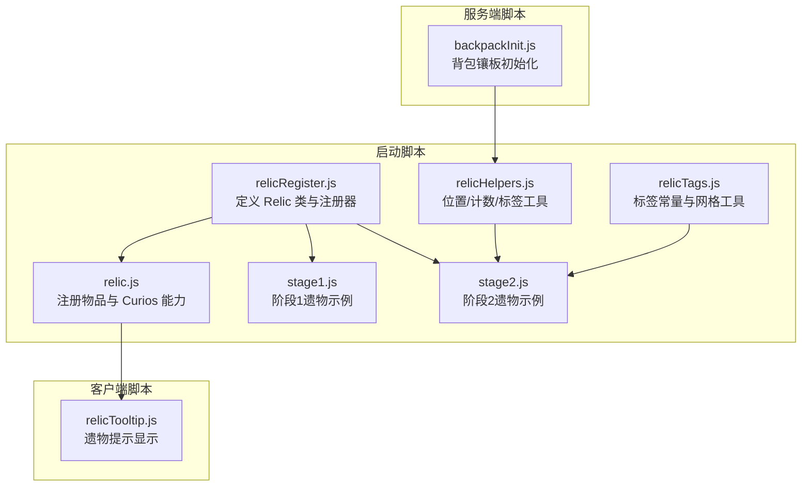
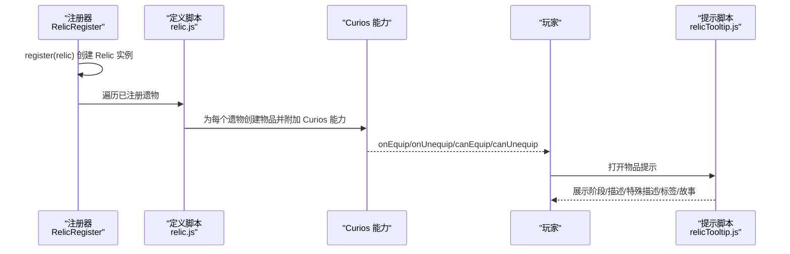
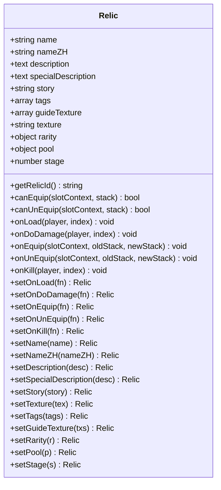
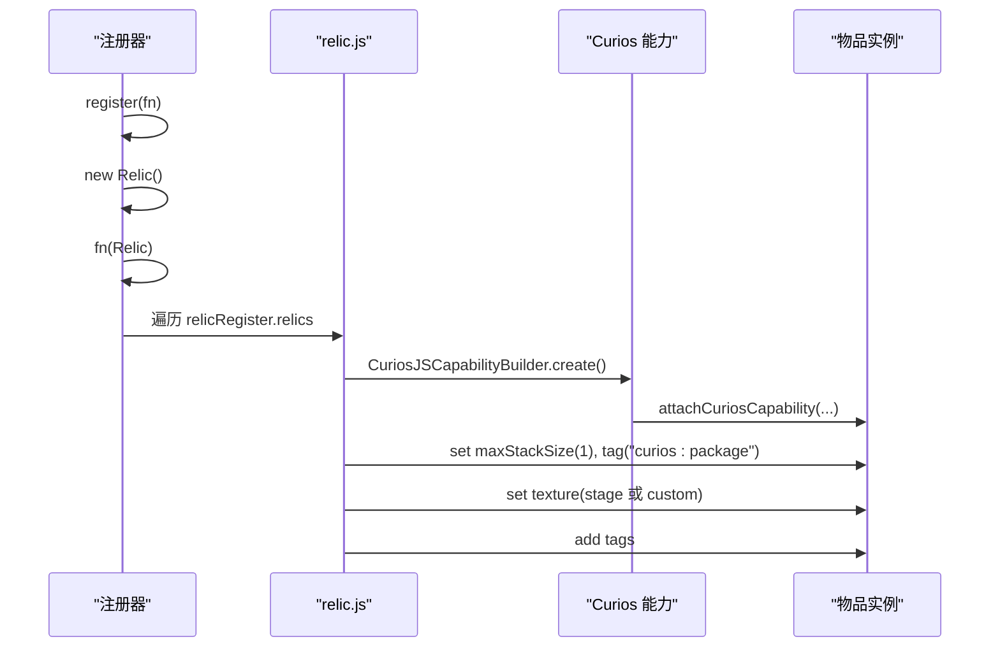
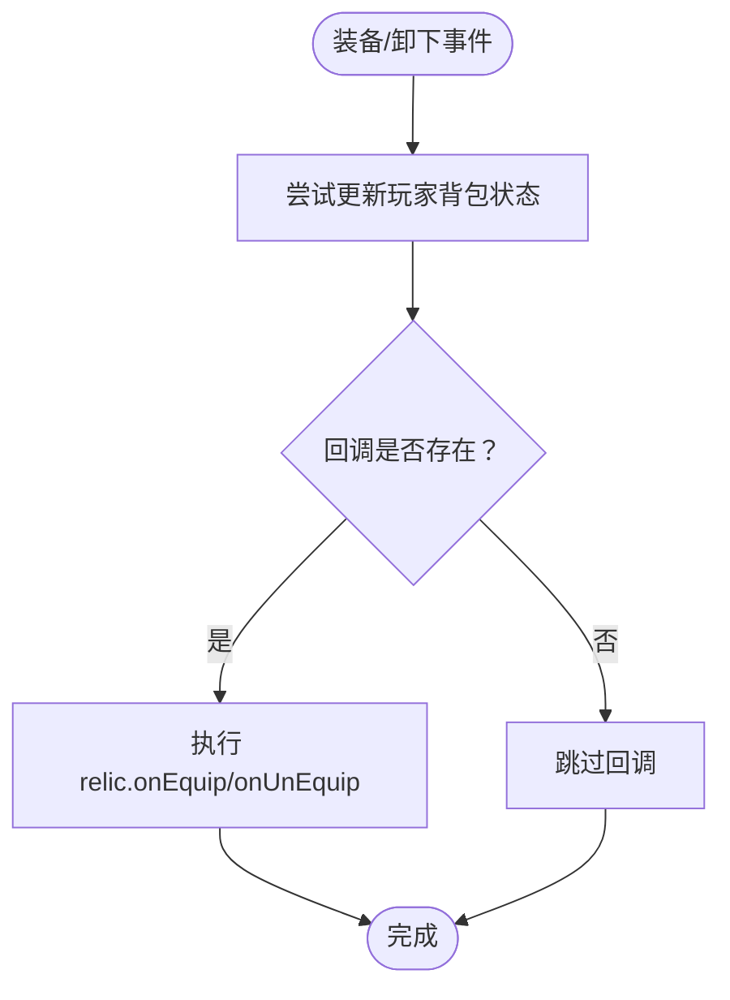
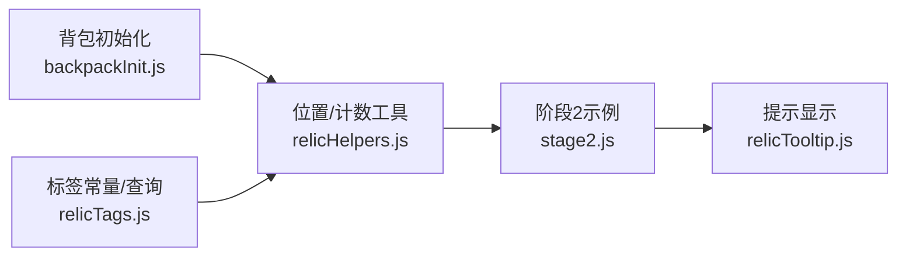
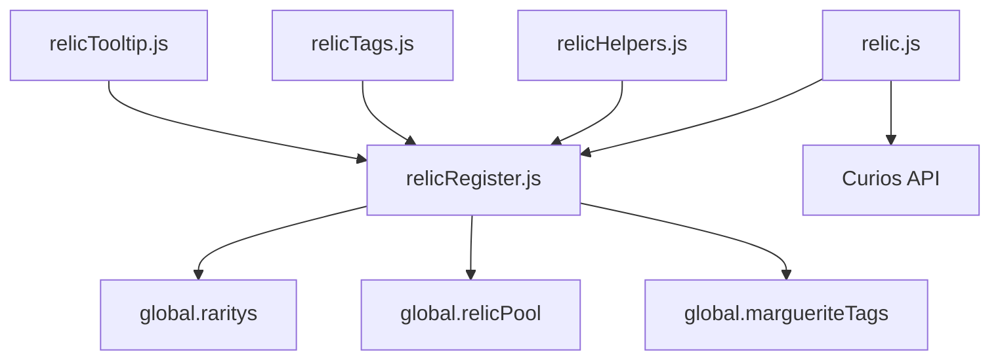

# 遗物类定义

<cite>
**本文引用的文件**
- [relic.js](file://kubejs/startup_scripts/relic/relic.js)
- [relicRegister.js](file://kubejs/startup_scripts/relic/relicRegister.js)
- [relicHelpers.js](file://kubejs/startup_scripts/relic/relicHelpers.js)
- [relicTags.js](file://kubejs/startup_scripts/relic/relicTags.js)
- [stage1.js](file://kubejs/startup_scripts/relic/relicItem/stage1/stage1.js)
- [stage2.js](file://kubejs/startup_scripts/relic/relicItem/stage2/stage2.js)
- [relicTooltip.js](file://kubejs/client_scripts/tooltip/relicTooltip.js)
- [backpackInit.js](file://kubejs/server_scripts/backpack/backpackInit.js)
</cite>

## 目录
1. [引言](#引言)
2. [项目结构](#项目结构)
3. [核心组件](#核心组件)
4. [架构总览](#架构总览)
5. [详细组件分析](#详细组件分析)
6. [依赖关系分析](#依赖关系分析)
7. [性能考量](#性能考量)
8. [故障排查指南](#故障排查指南)
9. [结论](#结论)
10. [附录](#附录)

## 引言
本文件系统性梳理并解释 KubeJS 项目中的“遗物”（Relic）类定义与使用体系，覆盖以下主题：
- Relic 构造函数与基础属性（名称、描述、故事背景、纹理配置等）
- 遗物效果回调函数系统（生命周期方法：onLoad、onEquip、onUnEquip、onDoDamage、onKill 等）
- 遗物稀有度与池类型配置
- 属性设置方法的链式调用示例（setName、setDescription、setRarity、setPool 等）
- 遗物 ID 生成规则与命名规范
- canEquip 与 canUnEquip 的装备限制机制
- 与 Curios 装备系统、背包空间、标签系统、UI 提示的集成关系

## 项目结构
与“遗物”相关的核心代码分布在以下位置：
- 启动脚本（注册与定义）：kubejs/startup_scripts/relic/
- 客户端脚本（提示显示）：kubejs/client_scripts/tooltip/relicTooltip.js
- 服务端脚本（背包初始化）：kubejs/server_scripts/backpack/backpackInit.js

**图表来源**
- [relicRegister.js:1-178](file://kubejs/startup_scripts/relic/relicRegister.js#L1-L178)
- [relic.js:1-81](file://kubejs/startup_scripts/relic/relic.js#L1-L81)
- [relicHelpers.js:1-332](file://kubejs/startup_scripts/relic/relicHelpers.js#L1-L332)
- [relicTags.js:1-192](file://kubejs/startup_scripts/relic/relicTags.js#L1-L192)
- [stage1.js:1-224](file://kubejs/startup_scripts/relic/relicItem/stage1/stage1.js#L1-L224)
- [stage2.js:1-726](file://kubejs/startup_scripts/relic/relicItem/stage2/stage2.js#L1-L726)
- [relicTooltip.js:1-79](file://kubejs/client_scripts/tooltip/relicTooltip.js#L1-L79)
- [backpackInit.js:1-67](file://kubejs/server_scripts/backpack/backpackInit.js#L1-L67)

**章节来源**
- [relicRegister.js:1-178](file://kubejs/startup_scripts/relic/relicRegister.js#L1-L178)
- [relic.js:1-81](file://kubejs/startup_scripts/relic/relic.js#L1-L81)
- [relicHelpers.js:1-332](file://kubejs/startup_scripts/relic/relicHelpers.js#L1-L332)
- [relicTags.js:1-192](file://kubejs/startup_scripts/relic/relicTags.js#L1-L192)
- [stage1.js:1-224](file://kubejs/startup_scripts/relic/relicItem/stage1/stage1.js#L1-L224)
- [stage2.js:1-726](file://kubejs/startup_scripts/relic/relicItem/stage2/stage2.js#L1-L726)
- [relicTooltip.js:1-79](file://kubejs/client_scripts/tooltip/relicTooltip.js#L1-L79)
- [backpackInit.js:1-67](file://kubejs/server_scripts/backpack/backpackInit.js#L1-L67)

## 核心组件
- Relic 类：定义遗物的基础属性与可链式设置的方法，以及生命周期回调。
- RelicRegister 注册器：集中管理所有遗物，按池类型分类，并支持自动继承阶段信息。
- Curios 能力绑定：在物品注册时附加 Curios 装备能力，注入 onEquip/onUnequip/canEquip/canUnequip 回调。
- 标签系统：提供标签常量与查询工具，用于判断相邻/行列/对角线等位置的同类遗物。
- UI 提示：在物品提示中展示阶段、描述、特殊描述、引导纹理、标签与故事背景。

**章节来源**
- [relicRegister.js:80-176](file://kubejs/startup_scripts/relic/relicRegister.js#L80-L176)
- [relic.js:7-79](file://kubejs/startup_scripts/relic/relic.js#L7-L79)
- [relicTags.js:3-64](file://kubejs/startup_scripts/relic/relicTags.js#L3-L64)
- [relicTooltip.js:4-78](file://kubejs/client_scripts/tooltip/relicTooltip.js#L4-L78)

## 架构总览
下图展示了从注册到生效的关键流程：注册器创建 Relic 实例，启动脚本将其注册为 Curios 物品，随后在装备/卸下时触发回调，同时 UI 提示与标签工具协同工作。

**图表来源**
- [relicRegister.js:14-31](file://kubejs/startup_scripts/relic/relicRegister.js#L14-L31)
- [relic.js:7-79](file://kubejs/startup_scripts/relic/relic.js#L7-L79)
- [relicTooltip.js:4-78](file://kubejs/client_scripts/tooltip/relicTooltip.js#L4-L78)

## 详细组件分析

### Relic 类与属性体系
- 基础属性
  - 名称与中文名：name、nameZH
  - 描述与特殊描述：description、specialDescription
  - 故事背景：story
  - 标签集合：tags（用于 UI 显示与逻辑判断）
  - 引导纹理：guideTexture（用于在提示中绘制九宫格/十格等布局示意）
  - 自定义纹理：texture（优先于阶段默认材质）
  - 稀有度：rarity（普通/少见/稀有/史诗）
  - 池类型：pool（普通/商店/诅咒/特殊/空白）
  - 阶段：stage（1~5），用于外观与合成配方
- 可链式设置方法
  - setName、setNameZH、setDescription、setSpecialDescription、setStory、setTexture、setTags、setGuideTexture、setRarity、setPool、setStage
- 生命周期回调
  - onLoad、onEquip、onUnEquip、onDoDamage、onKill
  - setOnLoad、setOnEquip、setOnUnEquip、setOnDoDamage、setOnKill
- 装备限制
  - canEquip、canUnEquip（默认返回 true）

**图表来源**
- [relicRegister.js:80-176](file://kubejs/startup_scripts/relic/relicRegister.js#L80-L176)

**章节来源**
- [relicRegister.js:80-176](file://kubejs/startup_scripts/relic/relicRegister.js#L80-L176)

### 遗物注册与 Curios 能力绑定
- 注册流程
  - 通过 RelicRegister.register 接收一个函数，内部创建 Relic 实例并调用其链式设置方法
  - 自动继承当前阶段 currentStage（若未显式设置）
  - 按池类型将遗物加入 common/special/curse/shop 等分类数组
- 物品注册
  - 使用 StartupEvents.registry('item', ...) 为每个遗物创建物品
  - 附加 Curios 能力，注入 onEquip/onUnequip/canEquip/canUnequip 回调
  - 设置最大堆叠为 1、打上 curios:package 标签
  - 根据阶段选择默认贴图或使用自定义 texture
  - 为每个标签添加对应标签 ID

**图表来源**
- [relicRegister.js:14-31](file://kubejs/startup_scripts/relic/relicRegister.js#L14-L31)
- [relic.js:7-79](file://kubejs/startup_scripts/relic/relic.js#L7-L79)

**章节来源**
- [relicRegister.js:14-31](file://kubejs/startup_scripts/relic/relicRegister.js#L14-L31)
- [relic.js:7-79](file://kubejs/startup_scripts/relic/relic.js#L7-L79)

### 遗物效果回调函数系统
- 生命周期方法
  - onLoad：物品加载时触发，通常用于一次性属性叠加
  - onEquip：装备成功时触发，可访问 slotContext、oldStack、newStack
  - onUnEquip：卸下时触发，同样可访问上下文
  - onDoDamage：伤害相关事件（具体触发点由外部系统决定）
  - onKill：击杀相关事件（具体触发点由外部系统决定）
- 回调注入与容错
  - onEquip/onUnequip 内部先尝试更新玩家背包状态，再调用 relic 对应回调
  - canEquip/canUnEquip 默认返回 true，若自定义回调抛错则记录错误并回退为允许

**图表来源**
- [relic.js:15-57](file://kubejs/startup_scripts/relic/relic.js#L15-L57)

**章节来源**
- [relic.js:15-57](file://kubejs/startup_scripts/relic/relic.js#L15-L57)

### 稀有度系统与池类型配置
- 稀有度
  - common（普通）、uncommon（少见）、rare（稀有）、epic（史诗）
  - 每种稀有度包含中文显示文本，用于 UI 提示
- 池类型
  - common、shop、curse、special、space
  - 注册器按池类型维护分类数组，便于后续抽卡/掉落/合成等逻辑

**章节来源**
- [relicRegister.js:44-61](file://kubejs/startup_scripts/relic/relicRegister.js#L44-L61)
- [relicRegister.js:72-78](file://kubejs/startup_scripts/relic/relicRegister.js#L72-L78)

### 遗物属性设置方法与链式调用示例
- 常用链式设置
  - setName、setNameZH、setDescription、setSpecialDescription、setStory
  - setTexture、setTags、setGuideTexture、setRarity、setPool、setStage
  - setOnLoad、setOnEquip、setOnUnEquip、setOnDoDamage、setOnKill
- 示例路径
  - 阶段1示例：[stage1.js:30-43](file://kubejs/startup_scripts/relic/relicItem/stage1/stage1.js#L30-L43)
  - 阶段2示例：[stage2.js:24-36](file://kubejs/startup_scripts/relic/relicItem/stage2/stage2.js#L24-L36)

**章节来源**
- [stage1.js:30-43](file://kubejs/startup_scripts/relic/relicItem/stage1/stage1.js#L30-L43)
- [stage2.js:24-36](file://kubejs/startup_scripts/relic/relicItem/stage2/stage2.js#L24-L36)

### 遗物 ID 生成规则与命名规范
- ID 生成
  - getRelicId(name) 返回 "marguerite:" + name
  - Relic 类内部也有同名方法，保持一致
- 命名规范
  - 建议使用英文小写 + 下划线的命名风格，确保与资源 ID 兼容
  - 与 Curios 标签 curios:package 保持一致的命名前缀

**章节来源**
- [relicRegister.js:93-95](file://kubejs/startup_scripts/relic/relicRegister.js#L93-L95)
- [relic.js:3-5](file://kubejs/startup_scripts/relic/relic.js#L3-L5)

### 装备限制机制：canEquip 与 canUnEquip
- 设计要点
  - canEquip/canUnEquip 默认返回 true
  - 若自定义回调抛错，将记录错误日志并回退为允许
- 使用场景
  - 限制某些遗物仅在特定条件（如位置、标签、阶段）下可装备/卸下
  - 与 UI 提示、背包空间、标签工具配合，形成完整的交互体验

**章节来源**
- [relic.js:42-57](file://kubejs/startup_scripts/relic/relic.js#L42-L57)
- [relicRegister.js:96-97](file://kubejs/startup_scripts/relic/relicRegister.js#L96-L97)

### 与背包空间、标签与 UI 的协作
- 背包空间
  - 通过 backpackInit 初始化镶板矩阵，占位 curios:package 槽位
  - 遗物位置查询与计数工具（行列/对角线/九宫格/十格）用于效果判定
- 标签系统
  - 提供标签常量与懒加载标签映射，支持按标签计数/查询
- UI 提示
  - 在物品提示中展示阶段、描述、特殊描述、引导纹理、标签与故事背景

**图表来源**
- [backpackInit.js:29-49](file://kubejs/server_scripts/backpack/backpackInit.js#L29-L49)
- [relicHelpers.js:67-184](file://kubejs/startup_scripts/relic/relicHelpers.js#L67-L184)
- [relicTags.js:3-64](file://kubejs/startup_scripts/relic/relicTags.js#L3-L64)
- [stage2.js:24-36](file://kubejs/startup_scripts/relic/relicItem/stage2/stage2.js#L24-L36)
- [relicTooltip.js:4-78](file://kubejs/client_scripts/tooltip/relicTooltip.js#L4-L78)

**章节来源**
- [backpackInit.js:29-49](file://kubejs/server_scripts/backpack/backpackInit.js#L29-L49)
- [relicHelpers.js:67-184](file://kubejs/startup_scripts/relic/relicHelpers.js#L67-L184)
- [relicTags.js:3-64](file://kubejs/startup_scripts/relic/relicTags.js#L3-L64)
- [stage2.js:24-36](file://kubejs/startup_scripts/relic/relicItem/stage2/stage2.js#L24-L36)
- [relicTooltip.js:4-78](file://kubejs/client_scripts/tooltip/relicTooltip.js#L4-L78)

## 依赖关系分析
- RelicRegister 依赖 global.raritys、global.relicPool、global.margueriteTags
- relic.js 依赖 CuriosJSCapabilityBuilder 与 Curios API，将回调注入到物品能力中
- relicHelpers 与 relicTags 为阶段2示例提供位置/计数/标签查询能力
- UI 提示依赖 global.relicRegister.relics 与 getRelicId

**图表来源**
- [relicRegister.js:44-78](file://kubejs/startup_scripts/relic/relicRegister.js#L44-L78)
- [relic.js:1-81](file://kubejs/startup_scripts/relic/relic.js#L1-L81)
- [relicHelpers.js:1-332](file://kubejs/startup_scripts/relic/relicHelpers.js#L1-L332)
- [relicTags.js:1-192](file://kubejs/startup_scripts/relic/relicTags.js#L1-L192)
- [relicTooltip.js:1-79](file://kubejs/client_scripts/tooltip/relicTooltip.js#L1-L79)

**章节来源**
- [relicRegister.js:44-78](file://kubejs/startup_scripts/relic/relicRegister.js#L44-L78)
- [relic.js:1-81](file://kubejs/startup_scripts/relic/relic.js#L1-L81)
- [relicHelpers.js:1-332](file://kubejs/startup_scripts/relic/relicHelpers.js#L1-L332)
- [relicTags.js:1-192](file://kubejs/startup_scripts/relic/relicTags.js#L1-L192)
- [relicTooltip.js:1-79](file://kubejs/client_scripts/tooltip/relicTooltip.js#L1-L79)

## 性能考量
- 回调容错：onEquip/onUnequip/canEquip/canUnEquip 均包裹 try/catch 并记录错误，避免中断 Curios 事件总线
- 标签懒加载：relicTagMap 仅在首次使用时构建，减少不必要的计算
- 位置查询：行列/对角线/九宫格/十格等工具采用循环与索引计算，复杂度与网格大小线性相关
- UI 提示：按需添加文本项，避免重复渲染

[本节为通用建议，不直接分析具体文件]

## 故障排查指南
- 装备异常
  - 现象：装备/卸下时报错或无效
  - 排查：检查 canEquip/canUnEquip 自定义回调是否抛错；确认 Curios 能力已正确附加
- 回调未触发
  - 现象：onLoad/onEquip/onUnEquip 不生效
  - 排查：确认 Relic 实例的 setOnXxx 方法已被调用；检查注册器是否正确收集
- 提示缺失
  - 现象：物品提示中缺少阶段/描述/标签
  - 排查：确认 relicTooltip.js 中的 relicRegister.relics 与 getRelicId 正常；检查标签 ID 是否正确
- 背包状态不同步
  - 现象：更换遗物后属性未更新
  - 排查：确认 onEquip/onUnEquip 中调用了更新背包状态的逻辑；检查 backpackInit 是否已初始化

**章节来源**
- [relic.js:15-57](file://kubejs/startup_scripts/relic/relic.js#L15-L57)
- [relicTooltip.js:4-78](file://kubejs/client_scripts/tooltip/relicTooltip.js#L4-L78)
- [backpackInit.js:29-49](file://kubejs/server_scripts/backpack/backpackInit.js#L29-L49)

## 结论
本系统通过 Relic 类与 RelicRegister 注册器，结合 Curios 装备能力与 UI 提示，实现了可扩展、可配置、可观察的“遗物”机制。其链式设置方法与生命周期回调为效果设计提供了灵活入口；稀有度与池类型配置便于后续抽卡/掉落/合成等玩法扩展；标签与位置工具则为复杂的邻接/行列/对角线效果提供了坚实基础。

[本节为总结性内容，不直接分析具体文件]

## 附录
- 阶段示例参考
  - 阶段1：[stage1.js:30-43](file://kubejs/startup_scripts/relic/relicItem/stage1/stage1.js#L30-L43)
  - 阶段2：[stage2.js:24-36](file://kubejs/startup_scripts/relic/relicItem/stage2/stage2.js#L24-L36)
- 标签常量参考
  - [relicTags.js:3-64](file://kubejs/startup_scripts/relic/relicTags.js#L3-L64)

**章节来源**
- [stage1.js:30-43](file://kubejs/startup_scripts/relic/relicItem/stage1/stage1.js#L30-L43)
- [stage2.js:24-36](file://kubejs/startup_scripts/relic/relicItem/stage2/stage2.js#L24-L36)
- [relicTags.js:3-64](file://kubejs/startup_scripts/relic/relicTags.js#L3-L64)