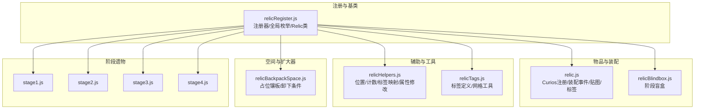
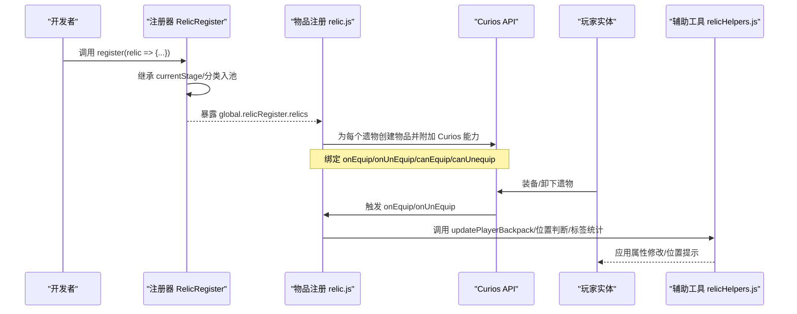
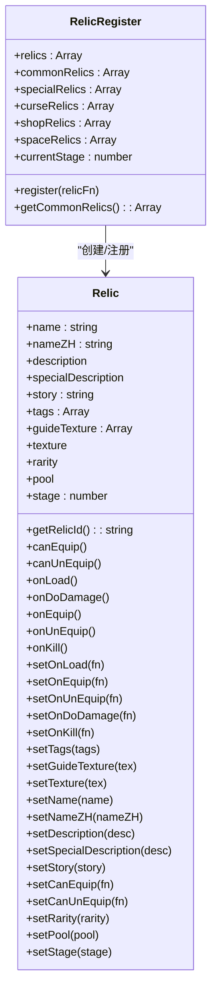
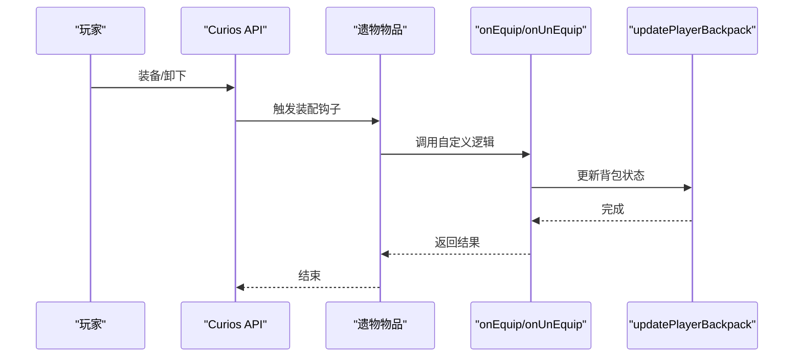
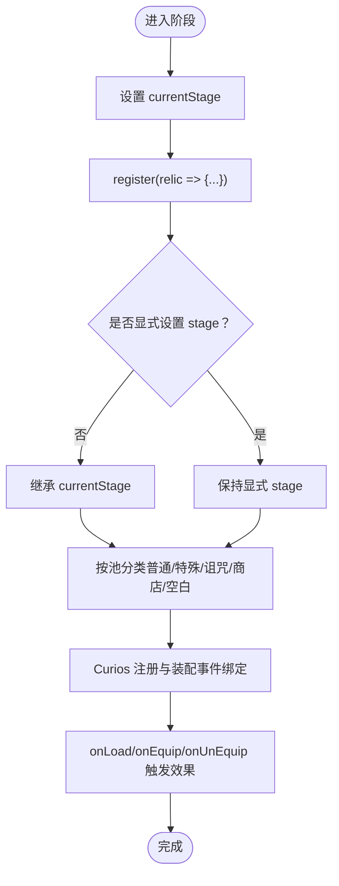
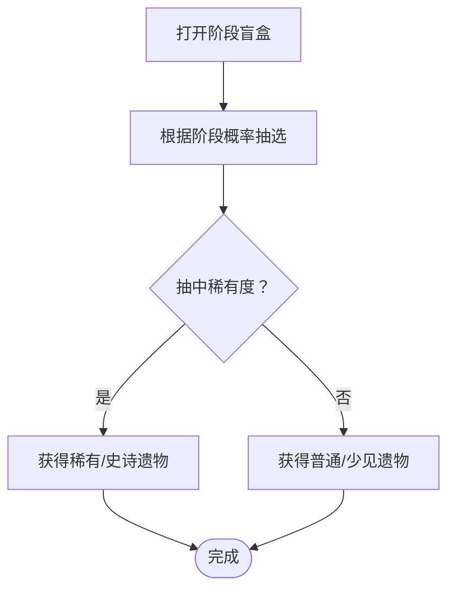
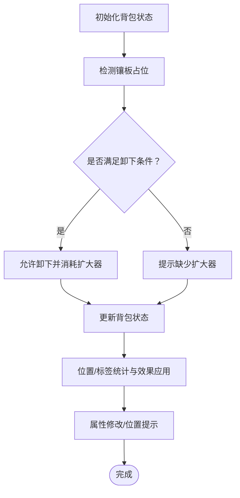
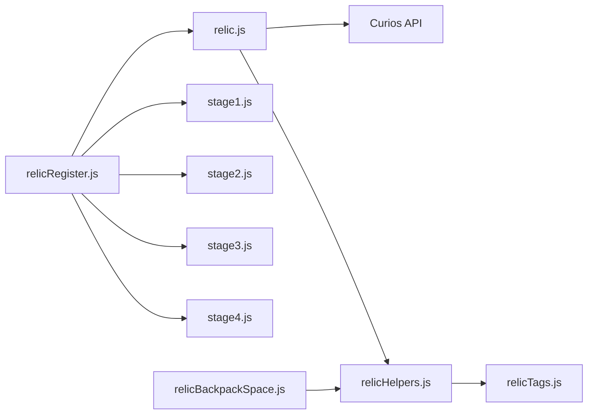

# 遗物系统

<cite>
**本文引用的文件**
- [relicRegister.js](file://kubejs/startup_scripts/relic/relicRegister.js)
- [relic.js](file://kubejs/startup_scripts/relic/relic.js)
- [relicBlindbox.js](file://kubejs/startup_scripts/relic/relicBlindbox.js)
- [relicHelpers.js](file://kubejs/startup_scripts/relic/relicHelpers.js)
- [relicTags.js](file://kubejs/startup_scripts/relic/relicTags.js)
- [relicBackpackSpace.js](file://kubejs/startup_scripts/relic/relicItem/relicBackpackSpace.js)
- [stage1.js](file://kubejs/startup_scripts/relic/relicItem/stage1/stage1.js)
- [stage2.js](file://kubejs/startup_scripts/relic/relicItem/stage2/stage2.js)
- [stage3.js](file://kubejs/startup_scripts/relic/relicItem/stage3/stage3.js)
- [stage4.js](file://kubejs/startup_scripts/relic/relicItem/stage4/stage4.js)
</cite>

## 目录
1. [简介](#简介)
2. [项目结构](#项目结构)
3. [核心组件](#核心组件)
4. [架构总览](#架构总览)
5. [详细组件分析](#详细组件分析)
6. [依赖关系分析](#依赖关系分析)
7. [性能考量](#性能考量)
8. [故障排查指南](#故障排查指南)
9. [结论](#结论)
10. [附录](#附录)

## 简介
本文件系统性梳理并解释“遗物系统”的设计与实现，重点覆盖以下方面：
- 注册器模式与统一管理：通过注册器集中注册、分池管理与阶段继承机制，确保遗物生命周期与可扩展性。
- 遗物五级体系：阶段一至五的差异化设计、标签联动与空间占用策略。
- 获取与效果机制：基于 Curios 的装配事件、属性叠加与位置/标签相关的动态效果。
- 盲盒随机生成：阶段化盲盒与外观区分，便于后续扩展概率分布。
- 扩展指南：如何添加新遗物、新阶段与新标签，以及平衡性与获取难度调节建议。
- 与背包系统的集成：空间面板、扩大器、位置判断与标签统计等。

## 项目结构
与“遗物系统”直接相关的文件组织如下：
- 注册与基类：relicRegister.js（注册器、全局枚举、基础 Relic 类）
- 物品注册与装配：relic.js（基于 Curios 的物品注册、装配/卸下事件、贴图与标签）
- 盲盒：relicBlindbox.js（按阶段生成盲盒物品）
- 辅助工具：relicHelpers.js（位置判断、计数、标签映射、属性修改快捷函数）
- 标签与网格：relicTags.js（标签定义、九宫格/十宫格/对角线等网格工具）
- 空间与扩大器：relicBackpackSpace.js（占位镶板与卸下条件）
- 各阶段遗物：stage1/stage2/stage3/stage4.js（各阶段具体遗物与效果）

**图表来源**
- [relicRegister.js:1-178](file://kubejs/startup_scripts/relic/relicRegister.js#L1-L178)
- [relic.js:1-81](file://kubejs/startup_scripts/relic/relic.js#L1-L81)
- [relicBlindbox.js:1-25](file://kubejs/startup_scripts/relic/relicBlindbox.js#L1-L25)
- [relicHelpers.js:1-332](file://kubejs/startup_scripts/relic/relicHelpers.js#L1-L332)
- [relicTags.js:1-192](file://kubejs/startup_scripts/relic/relicTags.js#L1-L192)
- [relicBackpackSpace.js:1-64](file://kubejs/startup_scripts/relic/relicItem/relicBackpackSpace.js#L1-L64)
- [stage1.js:1-224](file://kubejs/startup_scripts/relic/relicItem/stage1/stage1.js#L1-L224)
- [stage2.js:1-726](file://kubejs/startup_scripts/relic/relicItem/stage2/stage2.js#L1-L726)
- [stage3.js:1-404](file://kubejs/startup_scripts/relic/relicItem/stage3/stage3.js#L1-L404)
- [stage4.js:1-340](file://kubejs/startup_scripts/relic/relicItem/stage4/stage4.js#L1-L340)

**章节来源**
- [relicRegister.js:1-178](file://kubejs/startup_scripts/relic/relicRegister.js#L1-L178)
- [relic.js:1-81](file://kubejs/startup_scripts/relic/relic.js#L1-L81)
- [relicBlindbox.js:1-25](file://kubejs/startup_scripts/relic/relicBlindbox.js#L1-L25)
- [relicHelpers.js:1-332](file://kubejs/startup_scripts/relic/relicHelpers.js#L1-L332)
- [relicTags.js:1-192](file://kubejs/startup_scripts/relic/relicTags.js#L1-L192)
- [relicBackpackSpace.js:1-64](file://kubejs/startup_scripts/relic/relicItem/relicBackpackSpace.js#L1-L64)
- [stage1.js:1-224](file://kubejs/startup_scripts/relic/relicItem/stage1/stage1.js#L1-L224)
- [stage2.js:1-726](file://kubejs/startup_scripts/relic/relicItem/stage2/stage2.js#L1-L726)
- [stage3.js:1-404](file://kubejs/startup_scripts/relic/relicItem/stage3/stage3.js#L1-L404)
- [stage4.js:1-340](file://kubejs/startup_scripts/relic/relicItem/stage4/stage4.js#L1-L340)

## 核心组件
- 注册器 RelicRegister
  - 负责收集所有遗物、按池分类（普通/特殊/诅咒/商店/空白），并支持阶段继承。
  - 提供 getCommonRelics 等便捷查询。
- 基础 Relic 类
  - 定义名称、描述、故事、标签、纹理、稀有度、所属池、阶段等元数据。
  - 提供 onEquip/onUnEquip/onLoad/onDoDamage 等钩子，支持链式 setter。
- 全局枚举
  - 稀有度：普通/少见/稀有/史诗
  - 遗物池：普通/商店/诅咒/特殊/空白
  - 遗物类型：预留扩展点
- Curios 集成
  - 在 StartupEvents.registry 中创建物品，附加 Curios 能力，绑定装配/卸下事件。
  - 通过 onEquip/onUnEquip 触发 updatePlayerBackpack，保证背包状态同步。
- 盲盒
  - 按阶段生成不同外观的盲盒物品，用于阶段化获取。

**章节来源**
- [relicRegister.js:1-178](file://kubejs/startup_scripts/relic/relicRegister.js#L1-L178)
- [relic.js:1-81](file://kubejs/startup_scripts/relic/relic.js#L1-L81)
- [relicBlindbox.js:1-25](file://kubejs/startup_scripts/relic/relicBlindbox.js#L1-L25)

## 架构总览
下图展示了从注册到装配、再到效果生效的关键流程：

**图表来源**
- [relicRegister.js:1-178](file://kubejs/startup_scripts/relic/relicRegister.js#L1-L178)
- [relic.js:1-81](file://kubejs/startup_scripts/relic/relic.js#L1-L81)
- [relicHelpers.js:1-332](file://kubejs/startup_scripts/relic/relicHelpers.js#L1-L332)

## 详细组件分析

### 注册器与基础模型
- 注册器职责
  - 收集 Relic 实例，自动继承 currentStage，按池分类。
  - 提供 getCommonRelics 等查询方法，便于后续筛选与统计。
- Relic 类能力
  - 元数据：名称、中文名、描述、故事、标签、纹理、稀有度、池、阶段。
  - 生命周期钩子：onLoad/onEquip/onUnEquip/onDoDamage/onKill 等。
  - 链式 setter：setName/setNameZH/setDescription/setTags/setRarity/setPool/setStage 等。
- 全局枚举
  - 稀有度与池的命名统一，便于 UI 显示与逻辑判断。

**图表来源**
- [relicRegister.js:1-178](file://kubejs/startup_scripts/relic/relicRegister.js#L1-L178)

**章节来源**
- [relicRegister.js:1-178](file://kubejs/startup_scripts/relic/relicRegister.js#L1-L178)

### Curios 集成与装配事件
- 物品注册
  - 使用 StartupEvents.registry 创建每个遗物物品，设置显示名、最大堆叠、标签等。
  - 为每个物品附加 Curios 能力，绑定 onEquip/onUnEquip/canEquip/canUnequip。
- 装配事件处理
  - onEquip：先尝试更新背包状态，再调用遗物自定义 onEquip。
  - onUnEquip：先尝试更新背包状态，再调用遗物自定义 onUnEquip。
  - canEquip/canUnequip：包裹异常捕获，保证事件总线稳定。
- 贴图与阶段
  - 若自定义 texture 存在则优先使用；否则按阶段使用 Mekanism 控制电路贴图。

**图表来源**
- [relic.js:1-81](file://kubejs/startup_scripts/relic/relic.js#L1-L81)

**章节来源**
- [relic.js:1-81](file://kubejs/startup_scripts/relic/relic.js#L1-L81)

### 遗物五级体系与效果机制
- 阶段继承
  - 注册器维护 currentStage，若未显式设置 stage，则自动继承当前阶段。
- 阶段一（初入幻想乡）
  - 12 个基础芯片，强调“所有部位”效果与代价平衡（金钱/满意度/体力消耗）。
  - 示例：基础芯片“敛财”、“勤劳”、“懈怠”、“躺平”、“用心”，以及“奸商”、“佛系”、“热情”等。
- 阶段二（红雾异变）
  - 新增“脚趾/脚掌/脚心/脚跟”四部位体系，强调位置与标签联动。
  - 示例：增幅芯片、共鸣芯片、扎根芯片、知识芯片等，涉及九宫格、十宫格、对角线、首行/末行等位置判定。
- 阶段三（地灵殿之暗）
  - 引入“中心2×3区域”、“底部行/底部两行”等更复杂位置判定。
  - 示例：推车、经卷、羽笔、水晶球、扳手等，强调同行/对角线/奇偶等条件。
- 阶段四（星莲船之航）
  - 引入“逆十字”等反转类效果，“式神札”等标签全不相同触发。
  - 示例：锡杖、写真集、境界线、式神札、逆十字、万宝槌、秘术书、望远镜等。

**图表来源**
- [relicRegister.js:1-178](file://kubejs/startup_scripts/relic/relicRegister.js#L1-L178)
- [stage1.js:1-224](file://kubejs/startup_scripts/relic/relicItem/stage1/stage1.js#L1-L224)
- [stage2.js:1-726](file://kubejs/startup_scripts/relic/relicItem/stage2/stage2.js#L1-L726)
- [stage3.js:1-404](file://kubejs/startup_scripts/relic/relicItem/stage3/stage3.js#L1-L404)
- [stage4.js:1-340](file://kubejs/startup_scripts/relic/relicItem/stage4/stage4.js#L1-L340)

**章节来源**
- [stage1.js:1-224](file://kubejs/startup_scripts/relic/relicItem/stage1/stage1.js#L1-L224)
- [stage2.js:1-726](file://kubejs/startup_scripts/relic/relicItem/stage2/stage2.js#L1-L726)
- [stage3.js:1-404](file://kubejs/startup_scripts/relic/relicItem/stage3/stage3.js#L1-L404)
- [stage4.js:1-340](file://kubejs/startup_scripts/relic/relicItem/stage4/stage4.js#L1-L340)

### 盲盒与获取途径
- 盲盒注册
  - 每个阶段生成一个盲盒物品，使用不同贴图区分阶段。
- 获取方式
  - 盲盒作为阶段化获取入口，结合配方与任务系统进行发放。
- 随机生成与概率分布
  - 当前仓库未提供盲盒内部随机算法与概率表，建议在服务端逻辑中实现独立的概率分布模块，并通过事件回调注入。

**图表来源**
- [relicBlindbox.js:1-25](file://kubejs/startup_scripts/relic/relicBlindbox.js#L1-L25)

**章节来源**
- [relicBlindbox.js:1-25](file://kubejs/startup_scripts/relic/relicBlindbox.js#L1-L25)

### 背包系统集成与空间管理
- 背包布局
  - 固定 6 行 9 列（54 格），未解锁区域以“背包镶板”占位。
- 镶板与扩大器
  - 镶板（mk1~mk5）占位并提示卸下所需扩大器等级。
  - 卸下条件：玩家背包中存在对应等级扩大器，卸下时消耗 1 个。
- 位置判断与统计
  - 首行/末行/底部两行、中心2×3、九宫格/十宫格/对角线等网格工具。
  - 标签映射懒加载，支持按标签计数与唯一标签种类统计。
- 属性修改快捷函数
  - 对“所有部位金钱/满意度/体力消耗”进行批量修改，简化效果实现。

**图表来源**
- [relicBackpackSpace.js:1-64](file://kubejs/startup_scripts/relic/relicItem/relicBackpackSpace.js#L1-L64)
- [relicHelpers.js:1-332](file://kubejs/startup_scripts/relic/relicHelpers.js#L1-L332)

**章节来源**
- [relicBackpackSpace.js:1-64](file://kubejs/startup_scripts/relic/relicItem/relicBackpackSpace.js#L1-L64)
- [relicHelpers.js:1-332](file://kubejs/startup_scripts/relic/relicHelpers.js#L1-L332)

### 扩展指南：添加新遗物、新阶段与新标签
- 添加新遗物
  - 在对应阶段文件中调用 global.relicRegister.register(...)，设置元数据与效果钩子。
  - 使用 setOnLoad/setOnEquip/setOnUnEquip 等钩子实现效果逻辑。
  - 如需按标签联动，参考 relicTags.js 的标签定义与网格工具。
- 添加新阶段
  - 在新阶段文件顶部设置 global.relicRegister.currentStage = N。
  - 按阶段规则设计效果与代价，复用位置/标签工具。
- 添加新标签
  - 在 global.margueriteTags 中新增标签项，定义 id/nameZH/color。
  - 在遗物注册时通过 setTags([...]) 关联标签。
- 平衡性与获取难度调节
  - 稀有度与代价匹配：稀有/史诗通常伴随更强效果与更苛刻条件。
  - 获取难度：通过配方材料、任务奖励与盲盒概率共同控制。
  - 位置/标签联动：适度增加策略深度，避免过于依赖单一组合。

**章节来源**
- [relicRegister.js:1-178](file://kubejs/startup_scripts/relic/relicRegister.js#L1-L178)
- [relicTags.js:1-192](file://kubejs/startup_scripts/relic/relicTags.js#L1-L192)
- [stage2.js:1-726](file://kubejs/startup_scripts/relic/relicItem/stage2/stage2.js#L1-L726)

## 依赖关系分析
- 模块耦合
  - 注册器与各阶段文件：单向依赖，注册器集中管理。
  - 物品注册依赖注册器提供的 relic 列表与贴图/标签信息。
  - 辅助工具被装配事件与效果逻辑广泛调用，形成高内聚低耦合。
- 外部依赖
  - Curios API：提供装配事件与装备容器访问。
  - KubeJS 属性系统：通过 modifyAttribute 与 persistentData 实现效果持久化。

**图表来源**
- [relicRegister.js:1-178](file://kubejs/startup_scripts/relic/relicRegister.js#L1-L178)
- [relic.js:1-81](file://kubejs/startup_scripts/relic/relic.js#L1-L81)
- [relicHelpers.js:1-332](file://kubejs/startup_scripts/relic/relicHelpers.js#L1-L332)
- [relicTags.js:1-192](file://kubejs/startup_scripts/relic/relicTags.js#L1-L192)
- [relicBackpackSpace.js:1-64](file://kubejs/startup_scripts/relic/relicItem/relicBackpackSpace.js#L1-L64)
- [stage1.js:1-224](file://kubejs/startup_scripts/relic/relicItem/stage1/stage1.js#L1-L224)
- [stage2.js:1-726](file://kubejs/startup_scripts/relic/relicItem/stage2/stage2.js#L1-L726)
- [stage3.js:1-404](file://kubejs/startup_scripts/relic/relicItem/stage3/stage3.js#L1-L404)
- [stage4.js:1-340](file://kubejs/startup_scripts/relic/relicItem/stage4/stage4.js#L1-L340)

**章节来源**
- [relicRegister.js:1-178](file://kubejs/startup_scripts/relic/relicRegister.js#L1-L178)
- [relic.js:1-81](file://kubejs/startup_scripts/relic/relic.js#L1-L81)
- [relicHelpers.js:1-332](file://kubejs/startup_scripts/relic/relicHelpers.js#L1-L332)
- [relicTags.js:1-192](file://kubejs/startup_scripts/relic/relicTags.js#L1-L192)
- [relicBackpackSpace.js:1-64](file://kubejs/startup_scripts/relic/relicItem/relicBackpackSpace.js#L1-L64)
- [stage1.js:1-224](file://kubejs/startup_scripts/relic/relicItem/stage1/stage1.js#L1-L224)
- [stage2.js:1-726](file://kubejs/startup_scripts/relic/relicItem/stage2/stage2.js#L1-L726)
- [stage3.js:1-404](file://kubejs/startup_scripts/relic/relicItem/stage3/stage3.js#L1-L404)
- [stage4.js:1-340](file://kubejs/startup_scripts/relic/relicItem/stage4/stage4.js#L1-L340)

## 性能考量
- 标签映射懒加载：首次使用时构建 relicTagMap，避免重复扫描。
- 位置/计数工具：采用局部变量与循环优化，尽量减少跨帧调用频率。
- 装配事件异常捕获：防止单个遗物错误影响整体事件总线。
- 扩大器提示节流：通过 persistentData 记录时间戳，避免频繁刷屏。

## 故障排查指南
- 装配/卸下异常
  - 检查 onEquip/onUnEquip 中是否有未捕获异常，确保包裹 try/catch。
  - 确认 canEquip/canUnequip 返回值与条件一致。
- 镶板无法卸下
  - 检查玩家背包中是否存在对应等级扩大器，确认消耗逻辑。
  - 查看卸下提示是否被节流屏蔽。
- 效果未生效
  - 确认 onLoad 是否正确调用 modifyAllMoney/modifyAllSat/modifyAllStaminaCost。
  - 检查位置/标签工具传入索引与 curiosAll 是否正确。
- 盲盒未掉落
  - 检查阶段盲盒贴图与注册顺序，确认物品 ID 与配方一致。

**章节来源**
- [relic.js:1-81](file://kubejs/startup_scripts/relic/relic.js#L1-L81)
- [relicBackpackSpace.js:1-64](file://kubejs/startup_scripts/relic/relicItem/relicBackpackSpace.js#L1-L64)
- [relicHelpers.js:1-332](file://kubejs/startup_scripts/relic/relicHelpers.js#L1-L332)

## 结论
本系统以注册器为核心，结合 Curios 的装配事件与位置/标签工具，实现了高度可扩展的五级遗物体系。通过阶段化设计与多样化的联动效果，既保证了策略深度，又维持了平衡性。建议后续补充盲盒随机算法与概率表，并持续监控装配事件性能与标签映射的使用频率，以进一步优化体验。

## 附录
- 配置参数与键名
  - 遗物 ID 命名：marguerite:name
  - 属性键前缀：kubejs:serve.money_gain./sat_gain./stamina_cost.
  - 满意度反转标记：relic_sat_invert
- 常用工具函数
  - 位置判断：isFirstRow/isBottomRow/isBottomTwoRows/isInCenter2x3/getCenter2x3Slots
  - 标签统计：countUniqueTagsInBackpack/countUniqueTagsInSlots/countTagInSlots/hasTagInSlots
  - 属性修改：modifyAllMoney/modifyAllSat/modifyAllStaminaCost