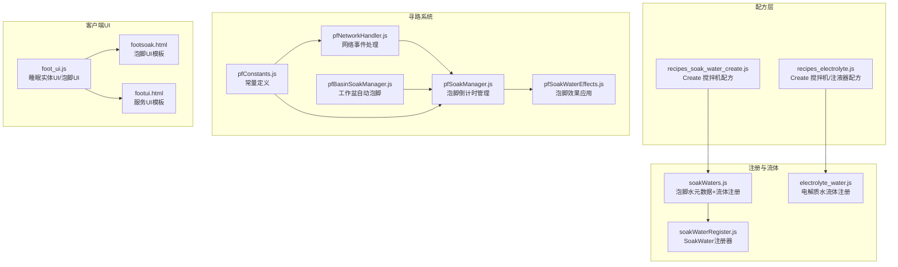
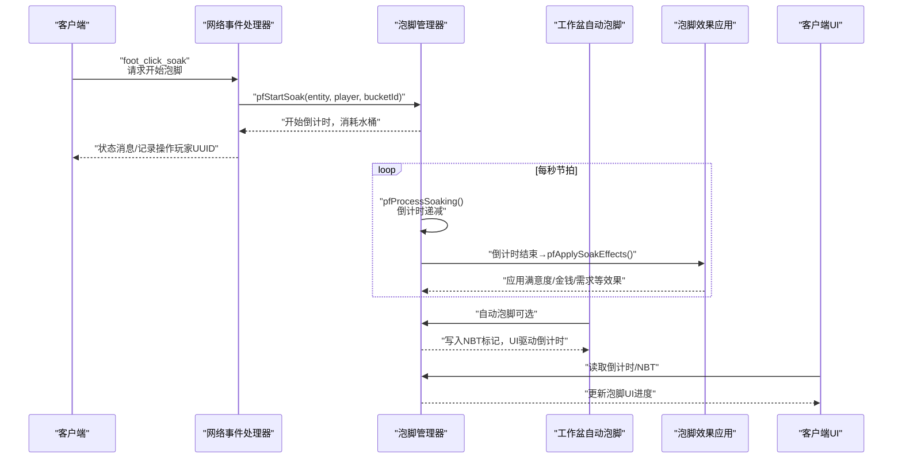
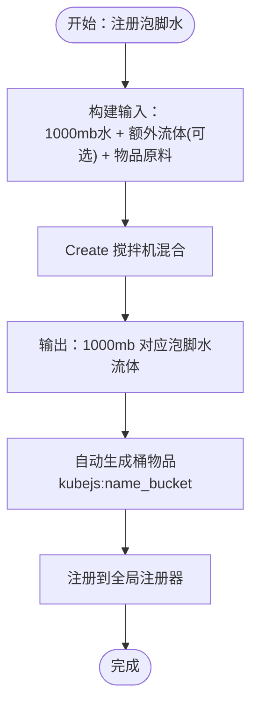
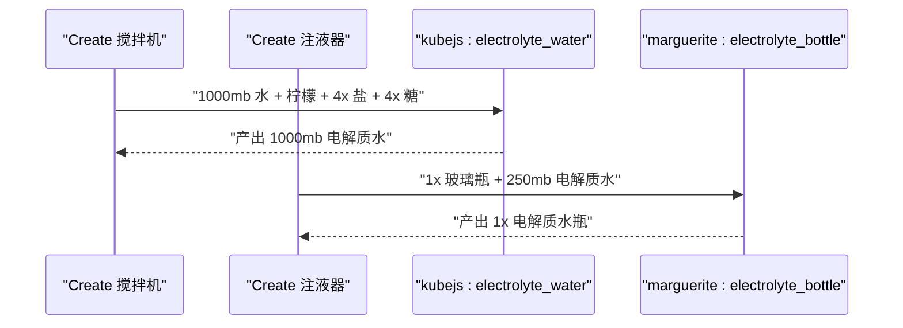
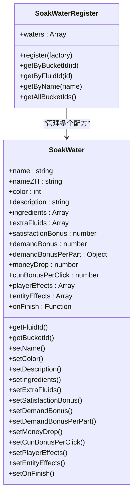
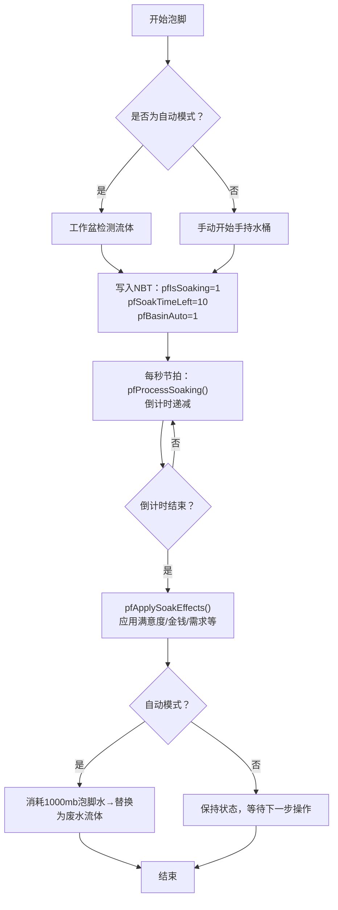
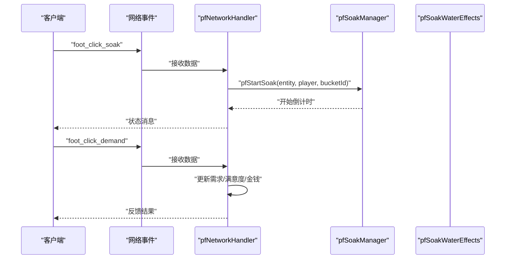
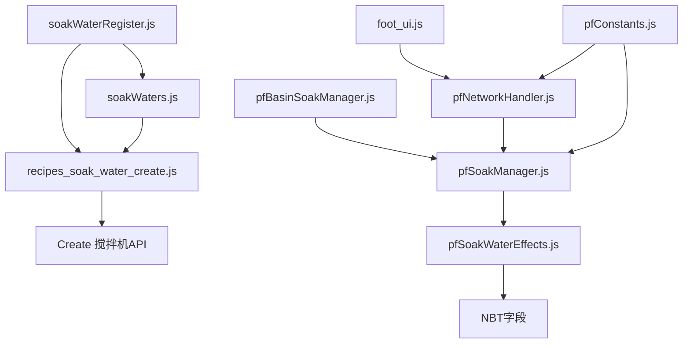

# SPA相关配方

<cite>
**本文引用的文件**
- [recipes_soak_water_create.js](file://kubejs/server_scripts/recipes/recipes_soak_water_create.js)
- [soakWaters.js](file://kubejs/startup_scripts/soakwater/soakWaters.js)
- [soakWaterRegister.js](file://kubejs/startup_scripts/soakwater/soakWaterRegister.js)
- [electrolyte_water.js](file://kubejs/startup_scripts/fluid/electrolyte_water.js)
- [recipes_electrolyte.js](file://kubejs/server_scripts/recipes/recipes_electrolyte.js)
- [pfSoakManager.js](file://kubejs/server_scripts/pathfinder/pfSoakManager.js)
- [pfSoakWaterEffects.js](file://kubejs/server_scripts/pathfinder/pfSoakWaterEffects.js)
- [pfBasinSoakManager.js](file://kubejs/server_scripts/pathfinder/pfBasinSoakManager.js)
- [pfNetworkHandler.js](file://kubejs/server_scripts/pathfinder/pfNetworkHandler.js)
- [foot_ui.js](file://kubejs/client_scripts/ui/foot_ui.js)
- [footsoak.html](file://apricity/kubejs/footsoak.html)
- [footui.html](file://apricity/kubejs/footui.html)
- [pfConstants.js](file://kubejs/server_scripts/pathfinder/pfConstants.js)
- [zh_cn.json](file://kubejs/assets/kubejs/lang/zh_cn.json)
</cite>

## 目录
1. [简介](#简介)
2. [项目结构](#项目结构)
3. [核心组件](#核心组件)
4. [架构总览](#架构总览)
5. [详细组件分析](#详细组件分析)
6. [依赖关系分析](#依赖关系分析)
7. [性能考量](#性能考量)
8. [故障排除指南](#故障排除指南)
9. [结论](#结论)
10. [附录](#附录)

## 简介
本文件系统性阐述Minecraft KubeJS项目中的SPA相关配方，重点涵盖两类内容：
- 泡脚水（Soak Water）合成配方设计：基于Create搅拌机的流体合成，以及与寻路系统（Pathfinder）和顾客服务系统的深度集成。
- 电解质饮料（Electrolyte Beverage）配方实现：通过Create搅拌机与注液器（Filling）将流体制成可携带的药水瓶。

文档将详细解释配方材料组合、反应机制、效果参数、与游戏内其他系统的数据传递与联动，并提供参数调优与扩展指南，帮助开发者快速定制新的SPA配方与治疗效果。

## 项目结构
SPA配方相关代码主要分布在以下模块：
- 配方注册：Create搅拌机与注液器配方
- 流体与桶注册：泡脚水与电解质水的流体注册
- 注册器与元数据：泡脚水配方的可扩展注册器
- 寻路系统集成：泡脚倒计时、效果应用、自动泡脚（工作盆）
- 客户端UI：泡脚与服务界面
- 网络事件：客户端与服务端的数据交互

**图表来源**
- [recipes_soak_water_create.js:14-53](file://kubejs/server_scripts/recipes/recipes_soak_water_create.js#L14-L53)
- [soakWaters.js:16-82](file://kubejs/startup_scripts/soakwater/soakWaters.js#L16-L82)
- [soakWaterRegister.js:40-121](file://kubejs/startup_scripts/soakwater/soakWaterRegister.js#L40-L121)
- [recipes_electrolyte.js:9-59](file://kubejs/server_scripts/recipes/recipes_electrolyte.js#L9-L59)
- [electrolyte_water.js:10-31](file://kubejs/startup_scripts/fluid/electrolyte_water.js#L10-L31)
- [pfSoakManager.js:90-145](file://kubejs/server_scripts/pathfinder/pfSoakManager.js#L90-L145)
- [pfSoakWaterEffects.js:107-226](file://kubejs/server_scripts/pathfinder/pfSoakWaterEffects.js#L107-L226)
- [pfBasinSoakManager.js:328-408](file://kubejs/server_scripts/pathfinder/pfBasinSoakManager.js#L328-L408)
- [pfNetworkHandler.js:221-272](file://kubejs/server_scripts/pathfinder/pfNetworkHandler.js#L221-L272)
- [foot_ui.js:332-430](file://kubejs/client_scripts/ui/foot_ui.js#L332-L430)
- [footsoak.html:1-155](file://apricity/kubejs/footsoak.html#L1-L155)
- [footui.html:1-356](file://apricity/kubejs/footui.html#L1-L356)
- [pfConstants.js:7-64](file://kubejs/server_scripts/pathfinder/pfConstants.js#L7-L64)

**章节来源**
- [recipes_soak_water_create.js:14-53](file://kubejs/server_scripts/recipes/recipes_soak_water_create.js#L14-L53)
- [soakWaters.js:16-82](file://kubejs/startup_scripts/soakwater/soakWaters.js#L16-L82)
- [soakWaterRegister.js:40-121](file://kubejs/startup_scripts/soakwater/soakWaterRegister.js#L40-L121)
- [recipes_electrolyte.js:9-59](file://kubejs/server_scripts/recipes/recipes_electrolyte.js#L9-L59)
- [electrolyte_water.js:10-31](file://kubejs/startup_scripts/fluid/electrolyte_water.js#L10-L31)
- [pfSoakManager.js:90-145](file://kubejs/server_scripts/pathfinder/pfSoakManager.js#L90-L145)
- [pfSoakWaterEffects.js:107-226](file://kubejs/server_scripts/pathfinder/pfSoakWaterEffects.js#L107-L226)
- [pfBasinSoakManager.js:328-408](file://kubejs/server_scripts/pathfinder/pfBasinSoakManager.js#L328-L408)
- [pfNetworkHandler.js:221-272](file://kubejs/server_scripts/pathfinder/pfNetworkHandler.js#L221-L272)
- [foot_ui.js:332-430](file://kubejs/client_scripts/ui/foot_ui.js#L332-L430)
- [footsoak.html:1-155](file://apricity/kubejs/footsoak.html#L1-L155)
- [footui.html:1-356](file://apricity/kubejs/footui.html#L1-L356)
- [pfConstants.js:7-64](file://kubejs/server_scripts/pathfinder/pfConstants.js#L7-L64)

## 核心组件
- 泡脚水合成配方（Create搅拌机）
  - 输入：1000mb水 + 额外流体（可选） + 物品原料列表
  - 输出：对应泡脚水流体1000mb（=1桶）
  - 适用范围：所有已注册的泡脚水配方
- 电解质饮料配方（Create）
  - 搅拌机：1000mb水 + 柠檬 + 4份盐 + 4份糖 → 1000mb电解质水
  - 注液器：1个玻璃瓶 + 250mb电解质水 → 1瓶电解质水瓶
- 泡脚水注册器（SoakWaterRegister）
  - 提供链式API扩展新配方，支持多维效果参数与自定义回调
- 效果应用与倒计时（Pathfinder）
  - 倒计时以秒为单位，自动/手动泡脚统一管理
  - 结束时根据水类型应用满意度、需求、金钱、药水等效果
- 客户端UI（Foot UI）
  - 展示泡脚倒计时与进度条，支持手动开始泡脚
  - 服务界面展示需求清单、满意度与步骤记录

**章节来源**
- [recipes_soak_water_create.js:21-52](file://kubejs/server_scripts/recipes/recipes_soak_water_create.js#L21-L52)
- [soakWaters.js:16-60](file://kubejs/startup_scripts/soakwater/soakWaters.js#L16-L60)
- [soakWaterRegister.js:40-118](file://kubejs/startup_scripts/soakwater/soakWaterRegister.js#L40-L118)
- [pfSoakManager.js:90-145](file://kubejs/server_scripts/pathfinder/pfSoakManager.js#L90-L145)
- [pfSoakWaterEffects.js:107-226](file://kubejs/server_scripts/pathfinder/pfSoakWaterEffects.js#L107-L226)
- [foot_ui.js:332-430](file://kubejs/client_scripts/ui/foot_ui.js#L332-L430)

## 架构总览
SPA配方与系统集成的关键流程如下：

**图表来源**
- [pfNetworkHandler.js:221-272](file://kubejs/server_scripts/pathfinder/pfNetworkHandler.js#L221-L272)
- [pfSoakManager.js:90-145](file://kubejs/server_scripts/pathfinder/pfSoakManager.js#L90-L145)
- [pfSoakWaterEffects.js:107-226](file://kubejs/server_scripts/pathfinder/pfSoakWaterEffects.js#L107-L226)
- [pfBasinSoakManager.js:328-408](file://kubejs/server_scripts/pathfinder/pfBasinSoakManager.js#L328-L408)
- [foot_ui.js:392-430](file://kubejs/client_scripts/ui/foot_ui.js#L392-L430)

## 详细组件分析

### 泡脚水合成配方设计
- 基础合成流程
  - 使用Create搅拌机，输入为1000mb水 + 额外流体（可选）+ 物品原料，输出对应泡脚水流体1000mb。
  - 通过全局注册器动态生成配方，确保配方与流体/桶一一对应。
- 材料组合与反应机制
  - 水为基础溶剂，额外流体（如牛奶）与物品原料共同决定最终流体的颜色、描述与效果。
  - 每个配方通过注册器设置名称、中文名、颜色、描述、原料列表与效果参数。
- 效果参数
  - 满意度加成、各部位需求随机增量、金钱掉落、搓脚皴加成、药水效果、自定义回调等。

**图表来源**
- [recipes_soak_water_create.js:21-52](file://kubejs/server_scripts/recipes/recipes_soak_water_create.js#L21-L52)
- [soakWaters.js:62-82](file://kubejs/startup_scripts/soakwater/soakWaters.js#L62-L82)
- [soakWaterRegister.js:40-118](file://kubejs/startup_scripts/soakwater/soakWaterRegister.js#L40-L118)

**章节来源**
- [recipes_soak_water_create.js:14-53](file://kubejs/server_scripts/recipes/recipes_soak_water_create.js#L14-L53)
- [soakWaters.js:16-82](file://kubejs/startup_scripts/soakwater/soakWaters.js#L16-L82)
- [soakWaterRegister.js:40-118](file://kubejs/startup_scripts/soakwater/soakWaterRegister.js#L40-L118)

### 电解质饮料配方实现
- 搅拌机配方
  - 1000mb水 + 柠檬 + 4份盐 + 4份糖 → 1000mb 电解质水
  - 用于恢复体力与补充能量的液体物品
- 注液器配方
  - 1个玻璃瓶 + 250mb电解质水 → 1瓶电解质水瓶
  - 便于携带与使用
- 流体注册
  - 电解质水流体注册时设置显示名、桶颜色、纹理等

**图表来源**
- [recipes_electrolyte.js:22-58](file://kubejs/server_scripts/recipes/recipes_electrolyte.js#L22-L58)
- [electrolyte_water.js:10-31](file://kubejs/startup_scripts/fluid/electrolyte_water.js#L10-L31)

**章节来源**
- [recipes_electrolyte.js:9-59](file://kubejs/server_scripts/recipes/recipes_electrolyte.js#L9-L59)
- [electrolyte_water.js:10-31](file://kubejs/startup_scripts/fluid/electrolyte_water.js#L10-L31)

### 泡脚水配方参数与效果
- 参数说明（来自注册器API）
  - 名称与显示名、颜色、描述
  - 原料列表（shapeless合成）、额外流体输入
  - 满意度加成、各部位需求随机增量（通用/精细控制）
  - 金钱掉落、搓脚皴加成、药水效果（玩家/实体）
  - 自定义回调（onFinish）
- 示例配方
  - 生姜水：基础需求特化
  - 草灰水：去角质，搓脚掉皴+1/次
  - 花椒水：财运特化，掉钱
  - 食盐水：皴加成特化
  - 牛奶水：泡脚完成立即掉钱

**图表来源**
- [soakWaterRegister.js:40-121](file://kubejs/startup_scripts/soakwater/soakWaterRegister.js#L40-L121)

**章节来源**
- [soakWaterRegister.js:22-118](file://kubejs/startup_scripts/soakwater/soakWaterRegister.js#L22-L118)
- [soakWaters.js:16-60](file://kubejs/startup_scripts/soakwater/soakWaters.js#L16-L60)

### 与寻路系统和顾客服务的集成
- 泡脚倒计时管理
  - 以秒为单位的倒计时，避免tick差值导致的状态失效
  - 手持物品NBT保存状态，UI读取同一套字段，原倒计时HUD自动生效
- 效果应用
  - 倒计时结束后根据水类型应用满意度、需求、金钱、药水等效果
  - 金钱掉落采用贪心硬币拆分，支持调度器队列
- 自动泡脚（工作盆）
  - 床边Create工作盆自动检测流体，合法时启动倒计时
  - 结算时消耗1000mb泡脚水并替换为废水流体
- 客户端UI
  - 泡脚UI展示倒计时与进度条，支持手动开始泡脚
  - 服务UI展示需求清单、满意度与步骤记录

**图表来源**
- [pfSoakManager.js:90-145](file://kubejs/server_scripts/pathfinder/pfSoakManager.js#L90-L145)
- [pfSoakWaterEffects.js:107-226](file://kubejs/server_scripts/pathfinder/pfSoakWaterEffects.js#L107-L226)
- [pfBasinSoakManager.js:328-408](file://kubejs/server_scripts/pathfinder/pfBasinSoakManager.js#L328-L408)

**章节来源**
- [pfSoakManager.js:90-145](file://kubejs/server_scripts/pathfinder/pfSoakManager.js#L90-L145)
- [pfSoakWaterEffects.js:107-226](file://kubejs/server_scripts/pathfinder/pfSoakWaterEffects.js#L107-L226)
- [pfBasinSoakManager.js:328-408](file://kubejs/server_scripts/pathfinder/pfBasinSoakManager.js#L328-L408)
- [foot_ui.js:332-430](file://kubejs/client_scripts/ui/foot_ui.js#L332-L430)

### 客户端UI与网络交互
- 泡脚UI
  - 展示标题、提示文字与倒计时进度条
  - 支持点击开始泡脚，发送网络事件到服务端
- 服务UI
  - 展示需求清单、满意度与步骤记录
  - 支持一键满足与搓脚操作
- 网络事件
  - foot_click_soak：开始泡脚
  - foot_click_demand：搓脚并更新需求/满意度/金钱
  - foot_dismiss_customer：送客（不结算）

**图表来源**
- [foot_ui.js:370-380](file://kubejs/client_scripts/ui/foot_ui.js#L370-L380)
- [pfNetworkHandler.js:221-272](file://kubejs/server_scripts/pathfinder/pfNetworkHandler.js#L221-L272)
- [pfSoakManager.js:147-186](file://kubejs/server_scripts/pathfinder/pfSoakManager.js#L147-L186)

**章节来源**
- [foot_ui.js:332-430](file://kubejs/client_scripts/ui/foot_ui.js#L332-L430)
- [pfNetworkHandler.js:221-272](file://kubejs/server_scripts/pathfinder/pfNetworkHandler.js#L221-L272)

## 依赖关系分析
- 组件耦合与内聚
  - 泡脚水注册器与Create配方注册紧密耦合，通过全局注册器集中管理
  - 效果应用模块与倒计时管理模块通过NBT字段解耦，便于扩展
  - 客户端UI与网络事件处理器通过事件名约定进行松耦合通信
- 外部依赖
  - Create模组：搅拌机与注液器API
  - Pathfinder常量：统一的NBT键名与部位映射
  - 硬币系统：coinsje硬币面额与掉落调度

**图表来源**
- [soakWaterRegister.js:40-121](file://kubejs/startup_scripts/soakwater/soakWaterRegister.js#L40-L121)
- [recipes_soak_water_create.js:21-52](file://kubejs/server_scripts/recipes/recipes_soak_water_create.js#L21-L52)
- [soakWaters.js:62-82](file://kubejs/startup_scripts/soakwater/soakWaters.js#L62-L82)
- [pfSoakWaterEffects.js:107-226](file://kubejs/server_scripts/pathfinder/pfSoakWaterEffects.js#L107-L226)
- [pfSoakManager.js:90-145](file://kubejs/server_scripts/pathfinder/pfSoakManager.js#L90-L145)
- [pfBasinSoakManager.js:328-408](file://kubejs/server_scripts/pathfinder/pfBasinSoakManager.js#L328-L408)
- [pfNetworkHandler.js:221-272](file://kubejs/server_scripts/pathfinder/pfNetworkHandler.js#L221-L272)
- [foot_ui.js:332-430](file://kubejs/client_scripts/ui/foot_ui.js#L332-L430)
- [pfConstants.js:7-64](file://kubejs/server_scripts/pathfinder/pfConstants.js#L7-L64)

**章节来源**
- [soakWaterRegister.js:40-121](file://kubejs/startup_scripts/soakwater/soakWaterRegister.js#L40-L121)
- [pfSoakWaterEffects.js:107-226](file://kubejs/server_scripts/pathfinder/pfSoakWaterEffects.js#L107-L226)
- [pfSoakManager.js:90-145](file://kubejs/server_scripts/pathfinder/pfSoakManager.js#L90-L145)
- [pfBasinSoakManager.js:328-408](file://kubejs/server_scripts/pathfinder/pfBasinSoakManager.js#L328-L408)
- [pfNetworkHandler.js:221-272](file://kubejs/server_scripts/pathfinder/pfNetworkHandler.js#L221-L272)
- [foot_ui.js:332-430](file://kubejs/client_scripts/ui/foot_ui.js#L332-L430)
- [pfConstants.js:7-64](file://kubejs/server_scripts/pathfinder/pfConstants.js#L7-L64)

## 性能考量
- 倒计时驱动策略
  - 以秒为单位的“节拍”驱动，避免频繁tick计算带来的开销
  - 每tick仅维护子tick计数器，达到20才触发一次秒事件
- NBT访问优化
  - 统一从手持物品NBT读取状态，减少跨实体查询
  - 效果应用集中在倒计时结束时批量执行
- 硬币掉落调度
  - 优先使用调度器队列，降低一次性大量掉落命令的开销
  - 降级方案使用分批命令，避免卡顿

[本节为通用性能建议，无需具体文件分析]

## 故障排除指南
- Create API不可用
  - 现象：配方注册日志提示未检测到Create API
  - 处理：确认Create模组已安装，或在条件检查中降级处理
- 泡脚水不可用
  - 现象：倒计时重置或无效果
  - 处理：检查水桶ID是否在注册表中，或是否为原版水桶兜底
- 工作盆流体异常
  - 现象：自动泡脚无法启动或中途中断
  - 处理：确认Basin中至少1个tank含≥1000mb合法流体，且无废水
- 效果应用异常
  - 现象：满意度/金钱未增加
  - 处理：检查NBT字段写入与回写，确认onFinish回调无异常

**章节来源**
- [recipes_soak_water_create.js:15-19](file://kubejs/server_scripts/recipes/recipes_soak_water_create.js#L15-L19)
- [pfSoakManager.js:110-117](file://kubejs/server_scripts/pathfinder/pfSoakManager.js#L110-L117)
- [pfBasinSoakManager.js:340-383](file://kubejs/server_scripts/pathfinder/pfBasinSoakManager.js#L340-L383)
- [pfSoakWaterEffects.js:133-142](file://kubejs/server_scripts/pathfinder/pfSoakWaterEffects.js#L133-L142)

## 结论
SPA相关配方通过Create模组实现了高度可扩展的流体合成体系，并与寻路系统、顾客服务系统无缝集成。泡脚水配方以注册器为核心，支持多维效果参数与自定义回调；电解质饮料配方则提供了便捷的恢复道具。整体架构在性能与可维护性之间取得良好平衡，为后续扩展新的SPA配方与治疗效果奠定了坚实基础。

[本节为总结性内容，无需具体文件分析]

## 附录

### 配方参数调优指南
- 效果强度
  - 满意度加成：建议1-20，结合Boss倍率与一键满足机制综合评估
  - 各部位需求增量：通用上限与精细控制二选一，避免过度堆叠
  - 金钱掉落：与硬币面额表配合，确保掉落分布合理
- 持续时间
  - 倒计时默认10秒，可根据配方效果强度适当调整
  - 自动泡脚模式下，建议与床边工作盆的流体容量匹配
- 使用限制
  - 仅允许使用Create搅拌机合成，确保配方一致性
  - 工作盆自动泡脚需满足≥1000mb合法流体与无废水条件

[本节为通用指导，无需具体文件分析]

### 扩展指南：新增SPA配方与自定义治疗效果
- 新增泡脚水配方
  - 在启动脚本中通过注册器链式API定义配方元数据
  - 如需额外流体输入，使用额外流体字段
  - 如需自定义效果，使用药水效果或自定义回调
- 新增电解质饮料配方
  - 在流体注册中定义新流体ID与属性
  - 在Create配方中注册搅拌机与注液器配方
- 数据传递与联动
  - 通过全局常量统一NBT键名与部位映射
  - 通过网络事件处理器与UI层保持前后端一致

**章节来源**
- [soakWaters.js:16-82](file://kubejs/startup_scripts/soakwater/soakWaters.js#L16-L82)
- [soakWaterRegister.js:40-118](file://kubejs/startup_scripts/soakwater/soakWaterRegister.js#L40-L118)
- [electrolyte_water.js:10-31](file://kubejs/startup_scripts/fluid/electrolyte_water.js#L10-L31)
- [recipes_electrolyte.js:9-59](file://kubejs/server_scripts/recipes/recipes_electrolyte.js#L9-L59)
- [pfConstants.js:7-64](file://kubejs/server_scripts/pathfinder/pfConstants.js#L7-L64)
- [pfNetworkHandler.js:221-272](file://kubejs/server_scripts/pathfinder/pfNetworkHandler.js#L221-L272)