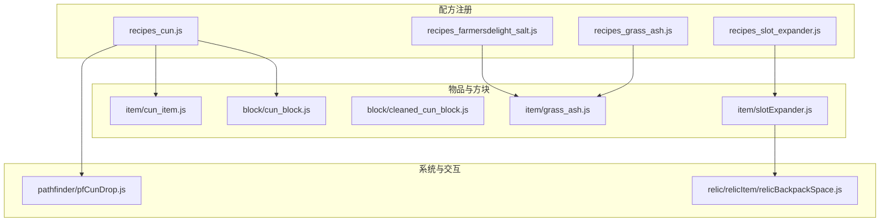
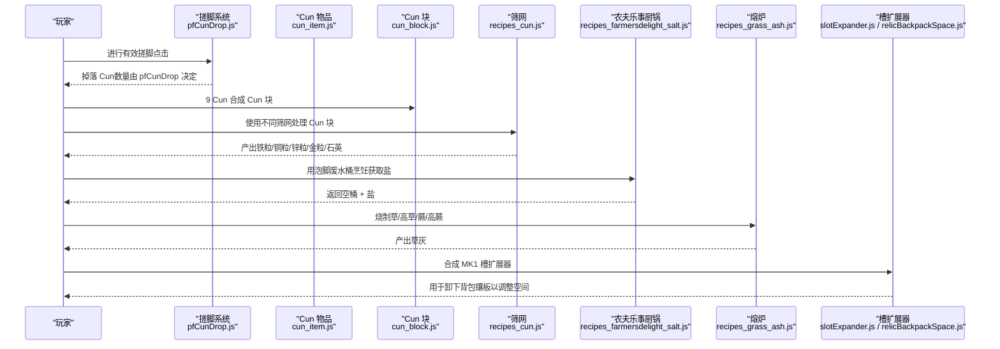
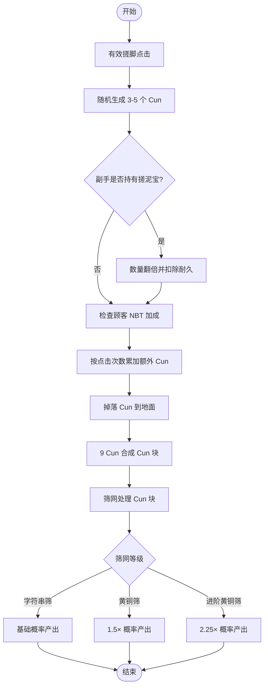
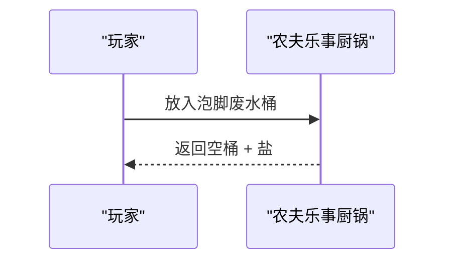
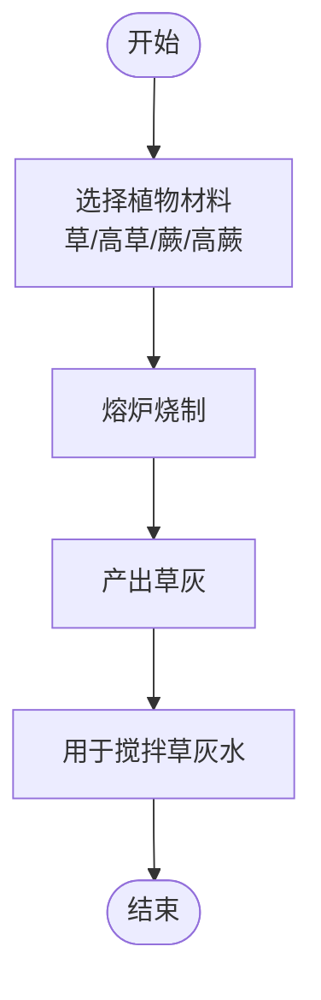
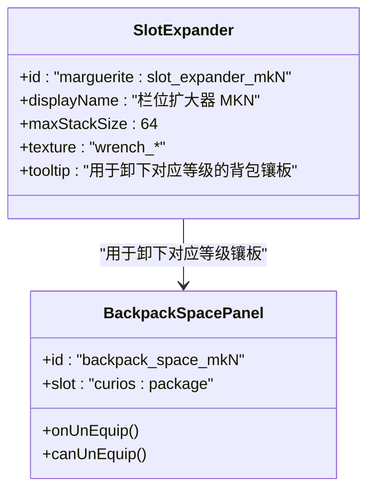
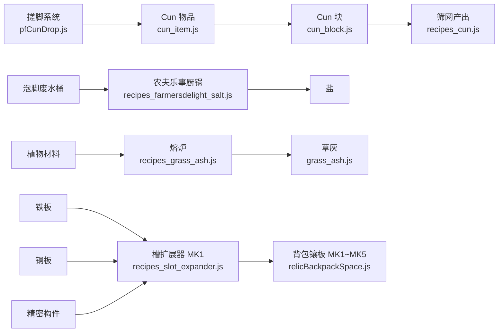

# 实用配方

<cite>
**本文引用的文件**   
- [recipes_cun.js](file://kubejs/server_scripts/recipes/recipes_cun.js)
- [cun_item.js](file://kubejs/startup_scripts/item/cun_item.js)
- [pfCunDrop.js](file://kubejs/server_scripts/pathfinder/pfCunDrop.js)
- [cun_block.js](file://kubejs/startup_scripts/block/cun_block.js)
- [cleaned_cun_block.js](file://kubejs/startup_scripts/block/cleaned_cun_block.js)
- [recipes_farmersdelight_salt.js](file://kubejs/server_scripts/recipes/recipes_farmersdelight_salt.js)
- [recipes_grass_ash.js](file://kubejs/server_scripts/recipes/recipes_grass_ash.js)
- [grass_ash.js](file://kubejs/startup_scripts/item/grass_ash.js)
- [recipes_slot_expander.js](file://kubejs/server_scripts/recipes/recipes_slot_expander.js)
- [slotExpander.js](file://kubejs/startup_scripts/item/slotExpander.js)
- [relicBackpackSpace.js](file://kubejs/startup_scripts/relic/relicItem/relicBackpackSpace.js)
</cite>

## 目录
1. [引言](#引言)
2. [项目结构](#项目结构)
3. [核心组件](#核心组件)
4. [架构总览](#架构总览)
5. [详细组件分析](#详细组件分析)
6. [依赖关系分析](#依赖关系分析)
7. [性能与平衡性评估](#性能与平衡性评估)
8. [故障排查指南](#故障排查指南)
9. [结论](#结论)
10. [附录：扩展指南](#附录扩展指南)

## 引言
本文件聚焦于“实用配方”体系，围绕以下四类关键内容展开：
- Cun（皴）物品及其衍生块、筛网产出链
- 盐类配方：通过农夫乐事厨锅将泡脚废水桶转化为盐
- 草木灰配方：通过熔炉烧制植物材料获得肥料原料
- 槽扩展器（栏位扩大器）：用于扩展背包空间并支持卸下对应等级的背包镶板

这些配方共同构成资源循环与背包管理的重要环节，既服务于生存推进，也服务于后期自动化与效率提升。

## 项目结构
本项目的配方与物品逻辑主要分布在 KubeJS 脚本中：
- server_scripts/recipes：服务器端合成与加工配方注册
- startup_scripts/item、block：物品与方块注册
- server_scripts/pathfinder：与搓脚系统相关的掉落计算等逻辑
- startup_scripts/relic：遗物与背包镶板相关逻辑

**图表来源**
- [recipes_cun.js:11-70](file://kubejs/server_scripts/recipes/recipes_cun.js#L11-L70)
- [recipes_farmersdelight_salt.js:17-36](file://kubejs/server_scripts/recipes/recipes_farmersdelight_salt.js#L17-L36)
- [recipes_grass_ash.js:9-28](file://kubejs/server_scripts/recipes/recipes_grass_ash.js#L9-L28)
- [recipes_slot_expander.js:13-28](file://kubejs/server_scripts/recipes/recipes_slot_expander.js#L13-L28)
- [cun_item.js:12-25](file://kubejs/startup_scripts/item/cun_item.js#L12-L25)
- [cun_block.js:10-25](file://kubejs/startup_scripts/block/cun_block.js#L10-L25)
- [cleaned_cun_block.js:10-25](file://kubejs/startup_scripts/block/cleaned_cun_block.js#L10-L25)
- [grass_ash.js:10-23](file://kubejs/startup_scripts/item/grass_ash.js#L10-L23)
- [slotExpander.js:19-35](file://kubejs/startup_scripts/item/slotExpander.js#L19-L35)
- [pfCunDrop.js:12-99](file://kubejs/server_scripts/pathfinder/pfCunDrop.js#L12-L99)
- [relicBackpackSpace.js:10-62](file://kubejs/startup_scripts/relic/relicItem/relicBackpackSpace.js#L10-L62)

**章节来源**
- [recipes_cun.js:11-70](file://kubejs/server_scripts/recipes/recipes_cun.js#L11-L70)
- [recipes_farmersdelight_salt.js:17-36](file://kubejs/server_scripts/recipes/recipes_farmersdelight_salt.js#L17-L36)
- [recipes_grass_ash.js:9-28](file://kubejs/server_scripts/recipes/recipes_grass_ash.js#L9-L28)
- [recipes_slot_expander.js:13-28](file://kubejs/server_scripts/recipes/recipes_slot_expander.js#L13-L28)
- [cun_item.js:12-25](file://kubejs/startup_scripts/item/cun_item.js#L12-L25)
- [cun_block.js:10-25](file://kubejs/startup_scripts/block/cun_block.js#L10-L25)
- [cleaned_cun_block.js:10-25](file://kubejs/startup_scripts/block/cleaned_cun_block.js#L10-L25)
- [grass_ash.js:10-23](file://kubejs/startup_scripts/item/grass_ash.js#L10-L23)
- [slotExpander.js:19-35](file://kubejs/startup_scripts/item/slotExpander.js#L19-L35)
- [pfCunDrop.js:12-99](file://kubejs/server_scripts/pathfinder/pfCunDrop.js#L12-L99)
- [relicBackpackSpace.js:10-62](file://kubejs/startup_scripts/relic/relicItem/relicBackpackSpace.js#L10-L62)

## 核心组件
本节概述四大实用配方的目标与价值：
- Cun（皴）：搓脚副产物，可压缩为块并通过筛网产出多种金属颗粒，是资源循环的关键节点
- 盐类：从泡脚废水桶中提取盐，打通洗脚系统与 Mekanik 盐资源的连接
- 草木灰：烧制常见植物材料得到草灰，作为后续搅拌液或肥料的原料
- 槽扩展器：提供背包空间扩展能力，配合背包镶板实现可逆的容量升级

**章节来源**
- [cun_item.js:12-25](file://kubejs/startup_scripts/item/cun_item.js#L12-L25)
- [recipes_cun.js:11-70](file://kubejs/server_scripts/recipes/recipes_cun.js#L11-L70)
- [recipes_farmersdelight_salt.js:17-36](file://kubejs/server_scripts/recipes/recipes_farmersdelight_salt.js#L17-L36)
- [recipes_grass_ash.js:9-28](file://kubejs/server_scripts/recipes/recipes_grass_ash.js#L9-L28)
- [recipes_slot_expander.js:13-28](file://kubejs/server_scripts/recipes/recipes_slot_expander.js#L13-L28)

## 架构总览
下图展示实用配方在系统中的整体交互：玩家行为触发资源产出，配方将其转化为可用材料，最终影响背包管理与自动化生产。

**图表来源**
- [pfCunDrop.js:12-99](file://kubejs/server_scripts/pathfinder/pfCunDrop.js#L12-L99)
- [cun_item.js:12-25](file://kubejs/startup_scripts/item/cun_item.js#L12-L25)
- [cun_block.js:10-25](file://kubejs/startup_scripts/block/cun_block.js#L10-L25)
- [recipes_cun.js:11-70](file://kubejs/server_scripts/recipes/recipes_cun.js#L11-L70)
- [recipes_farmersdelight_salt.js:17-36](file://kubejs/server_scripts/recipes/recipes_farmersdelight_salt.js#L17-L36)
- [recipes_grass_ash.js:9-28](file://kubejs/server_scripts/recipes/recipes_grass_ash.js#L9-L28)
- [recipes_slot_expander.js:13-28](file://kubejs/server_scripts/recipes/recipes_slot_expander.js#L13-L28)
- [slotExpander.js:19-35](file://kubejs/startup_scripts/item/slotExpander.js#L19-L35)
- [relicBackpackSpace.js:10-62](file://kubejs/startup_scripts/relic/relicItem/relicBackpackSpace.js#L10-L62)

## 详细组件分析

### Cun（皴）物品与块
- 物品定义：Cun 是搓脚系统的副产物，堆叠上限为 64，具备基础稀有度与说明文本
- 块定义：9 个 Cun 可合成 Cun 块；块材质属性接近泥土，声音类型类似沙砾，硬度与抗性较低，可用铲子开采
- 掉落机制：每次有效点击随机掉落 3-5 个 Cun；若副手持有“搓泥宝”，则翻倍耐久消耗；同时可叠加顾客 NBT 提供的每点击加成
- 筛网产出：Cun 块可通过 Create: Sifter 筛出铁粒、铜粒、锌粒、金粒与下界石英；不同筛网等级提高概率倍率（字符串筛 1×、黄铜筛 1.5×、进阶黄铜筛 2.25×）

**图表来源**
- [pfCunDrop.js:12-99](file://kubejs/server_scripts/pathfinder/pfCunDrop.js#L12-L99)
- [cun_item.js:12-25](file://kubejs/startup_scripts/item/cun_item.js#L12-L25)
- [cun_block.js:10-25](file://kubejs/startup_scripts/block/cun_block.js#L10-L25)
- [recipes_cun.js:11-70](file://kubejs/server_scripts/recipes/recipes_cun.js#L11-L70)

**章节来源**
- [cun_item.js:12-25](file://kubejs/startup_scripts/item/cun_item.js#L12-L25)
- [cun_block.js:10-25](file://kubejs/startup_scripts/block/cun_block.js#L10-L25)
- [pfCunDrop.js:12-99](file://kubejs/server_scripts/pathfinder/pfCunDrop.js#L12-L99)
- [recipes_cun.js:11-70](file://kubejs/server_scripts/recipes/recipes_cun.js#L11-L70)

### 盐类配方（农夫乐事厨锅）
- 输入：泡脚废水桶标签（包含普通与富魔两种水桶）
- 输出：mekanism:salt
- 容器返还：minecraft:bucket（使用后归还空桶）
- 经验与时间：经验 0.2，烹饪时间 200 tick（约 10 秒）

**图表来源**
- [recipes_farmersdelight_salt.js:17-36](file://kubejs/server_scripts/recipes/recipes_farmersdelight_salt.js#L17-L36)

**章节来源**
- [recipes_farmersdelight_salt.js:17-36](file://kubejs/server_scripts/recipes/recipes_farmersdelight_salt.js#L17-L36)

### 草木灰配方（熔炉）
- 输入：草、高草、蕨、高蕨（通过 tag 匹配）
- 输出：marguerite:grass_ash
- 经验与时间：经验 0.1，烹饪时间 200 tick（与原版一致）
- 用途：作为草灰水搅拌机原料

**图表来源**
- [recipes_grass_ash.js:9-28](file://kubejs/server_scripts/recipes/recipes_grass_ash.js#L9-L28)
- [grass_ash.js:10-23](file://kubejs/startup_scripts/item/grass_ash.js#L10-L23)

**章节来源**
- [recipes_grass_ash.js:9-28](file://kubejs/server_scripts/recipes/recipes_grass_ash.js#L9-L28)
- [grass_ash.js:10-23](file://kubejs/startup_scripts/item/grass_ash.js#L10-L23)

### 槽扩展器（栏位扩大器）
- 合成配方（MK1）：3×3 形状合成，使用铁板、铜板与精密构件
- 物品注册：MK1~MK5 均存在，分别对应不同纹理与等级
- 功能：作为“卸下背包镶板”的凭证消耗品；放入背包后可卸下对应等级的背包镶板，每次消耗 1 个
- 背包镶板逻辑：占据 curios:package 槽位形成“虚拟空白”，卸下时检查库存并扣减扩大器

**图表来源**
- [recipes_slot_expander.js:13-28](file://kubejs/server_scripts/recipes/recipes_slot_expander.js#L13-L28)
- [slotExpander.js:19-35](file://kubejs/startup_scripts/item/slotExpander.js#L19-L35)
- [relicBackpackSpace.js:10-62](file://kubejs/startup_scripts/relic/relicItem/relicBackpackSpace.js#L10-L62)

**章节来源**
- [recipes_slot_expander.js:13-28](file://kubejs/server_scripts/recipes/recipes_slot_expander.js#L13-L28)
- [slotExpander.js:19-35](file://kubejs/startup_scripts/item/slotExpander.js#L19-L35)
- [relicBackpackSpace.js:10-62](file://kubejs/startup_scripts/relic/relicItem/relicBackpackSpace.js#L10-L62)

## 依赖关系分析
- Cun 链：搓脚系统 → Cun 掉落 → Cun 块 → 筛网产出（铁/铜/锌/金/石英）
- 盐链：泡脚废水桶 → 农夫乐事厨锅 → 盐 + 空桶
- 草木灰链：植物材料 → 熔炉 → 草灰 → 草灰水（搅拌机）
- 槽扩展器链：铁板/铜板/精密构件 → MK1 扩大器 → 卸下背包镶板（MK1~MK5）

**图表来源**
- [pfCunDrop.js:12-99](file://kubejs/server_scripts/pathfinder/pfCunDrop.js#L12-L99)
- [cun_item.js:12-25](file://kubejs/startup_scripts/item/cun_item.js#L12-L25)
- [cun_block.js:10-25](file://kubejs/startup_scripts/block/cun_block.js#L10-L25)
- [recipes_cun.js:11-70](file://kubejs/server_scripts/recipes/recipes_cun.js#L11-L70)
- [recipes_farmersdelight_salt.js:17-36](file://kubejs/server_scripts/recipes/recipes_farmersdelight_salt.js#L17-L36)
- [recipes_grass_ash.js:9-28](file://kubejs/server_scripts/recipes/recipes_grass_ash.js#L9-L28)
- [grass_ash.js:10-23](file://kubejs/startup_scripts/item/grass_ash.js#L10-L23)
- [recipes_slot_expander.js:13-28](file://kubejs/server_scripts/recipes/recipes_slot_expander.js#L13-L28)
- [relicBackpackSpace.js:10-62](file://kubejs/startup_scripts/relic/relicItem/relicBackpackSpace.js#L10-L62)

**章节来源**
- [pfCunDrop.js:12-99](file://kubejs/server_scripts/pathfinder/pfCunDrop.js#L12-L99)
- [cun_item.js:12-25](file://kubejs/startup_scripts/item/cun_item.js#L12-L25)
- [cun_block.js:10-25](file://kubejs/startup_scripts/block/cun_block.js#L10-L25)
- [recipes_cun.js:11-70](file://kubejs/server_scripts/recipes/recipes_cun.js#L11-L70)
- [recipes_farmersdelight_salt.js:17-36](file://kubejs/server_scripts/recipes/recipes_farmersdelight_salt.js#L17-L36)
- [recipes_grass_ash.js:9-28](file://kubejs/server_scripts/recipes/recipes_grass_ash.js#L9-L28)
- [grass_ash.js:10-23](file://kubejs/startup_scripts/item/grass_ash.js#L10-L23)
- [recipes_slot_expander.js:13-28](file://kubejs/server_scripts/recipes/recipes_slot_expander.js#L13-L28)
- [relicBackpackSpace.js:10-62](file://kubejs/startup_scripts/relic/relicItem/relicBackpackSpace.js#L10-L62)

## 性能与平衡性评估
- Cun 筛网产出：
  - 基础概率：铁粒 40%、铜粒 40%、锌粒 40%、金粒 20%、石英 20%
  - 筛网倍率：字符串筛 1×、黄铜筛 1.5×、进阶黄铜筛 2.25×
  - 建议：根据服务器经济模型调整基础概率与倍率，避免过度产出导致资源通胀
- 盐类配方：
  - 成本：泡脚废水桶（需先进行洗脚流程）
  - 收益：盐 + 空桶返还
  - 建议：控制泡脚废水桶获取难度与产量，确保盐的价值与需求匹配
- 草木灰配方：
  - 成本：常见植物材料（易获取）
  - 收益：草灰（肥料/搅拌原料）
  - 建议：保持低门槛但限制单次产出量，鼓励规模化采集与批量烧制
- 槽扩展器：
  - 成本：铁板、铜板、精密构件（Create 模组高级材料）
  - 收益：可逆的背包空间扩展能力
  - 建议：MK1 作为入门级，后续等级应逐步提高材料与复杂度，形成清晰成长曲线

[本节为通用指导，不直接分析具体文件]

## 故障排查指南
- Cun 配方注册失败：
  - 检查 Create: Sifter 模组是否加载成功
  - 确认筛网物品 id 是否正确（string_mesh、brass_mesh、advanced_brass_mesh）
  - 查看控制台日志中的 “[CUN]” 前缀错误信息
- 盐类配方注册失败：
  - 确认农夫乐事模组已加载且事件接口可用
  - 检查泡脚废水桶标签是否存在
  - 查看控制台日志中的 “[SOAK-FD-SALT]” 前缀错误信息
- 草木灰配方注册失败：
  - 检查植物材料 tag 是否正确（grass_to_ash、tall_grass_to_ash、fern_to_ash、large_fern_to_ash）
  - 查看控制台日志中的 “[GRASS-ASH]” 前缀错误信息
- 槽扩展器注册失败：
  - 确认 Create 模组材料 id 正确（iron_sheet、copper_sheet、precision_mechanism）
  - 查看控制台日志中的 “[SLOT-EXPANDER]” 前缀错误信息

**章节来源**
- [recipes_cun.js:11-70](file://kubejs/server_scripts/recipes/recipes_cun.js#L11-L70)
- [recipes_farmersdelight_salt.js:17-36](file://kubejs/server_scripts/recipes/recipes_farmersdelight_salt.js#L17-L36)
- [recipes_grass_ash.js:9-28](file://kubejs/server_scripts/recipes/recipes_grass_ash.js#L9-L28)
- [recipes_slot_expander.js:13-28](file://kubejs/server_scripts/recipes/recipes_slot_expander.js#L13-L28)

## 结论
实用配方体系通过 Cun 资源循环、盐类提取、草木灰制备与槽扩展器管理，构建了从生存到自动化的完整路径。各配方之间既有独立性也有协同性，合理组合可显著提升游戏体验与效率。建议在后续更新中持续优化概率与材料成本，确保资源价值与玩家进度相匹配。

[本节为总结性内容，不直接分析具体文件]

## 附录：扩展指南
- 添加新的 Cun 相关配方：
  - 在 recipes_cun.js 中新增筛网产出或合成逻辑
  - 如需新增洗净的 Cun 块，参考 cleaned_cun_block.js 注册逻辑
- 添加新的盐类配方：
  - 在 recipes_farmersdelight_salt.js 中扩展其他废水桶或容器返还逻辑
- 添加新的草木灰配方：
  - 在 recipes_grass_ash.js 中增加新的植物材料 tag 与熔炼输出
- 添加新的槽扩展器等级：
  - 在 slotExpander.js 中扩展纹理映射与物品注册
  - 在 recipes_slot_expander.js 中新增 MK2~MK5 的合成配方
  - 在 relicBackpackSpace.js 中确保对应等级的卸下逻辑已注册

**章节来源**
- [recipes_cun.js:11-70](file://kubejs/server_scripts/recipes/recipes_cun.js#L11-L70)
- [cleaned_cun_block.js:10-25](file://kubejs/startup_scripts/block/cleaned_cun_block.js#L10-L25)
- [recipes_farmersdelight_salt.js:17-36](file://kubejs/server_scripts/recipes/recipes_farmersdelight_salt.js#L17-L36)
- [recipes_grass_ash.js:9-28](file://kubejs/server_scripts/recipes/recipes_grass_ash.js#L9-L28)
- [slotExpander.js:19-35](file://kubejs/startup_scripts/item/slotExpander.js#L19-L35)
- [recipes_slot_expander.js:13-28](file://kubejs/server_scripts/recipes/recipes_slot_expander.js#L13-L28)
- [relicBackpackSpace.js:10-62](file://kubejs/startup_scripts/relic/relicItem/relicBackpackSpace.js#L10-L62)