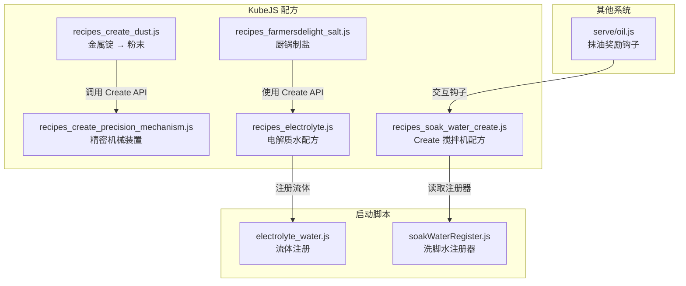
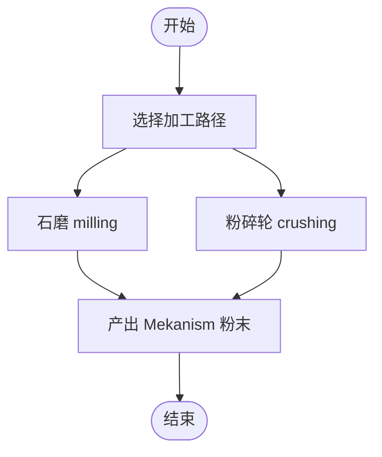
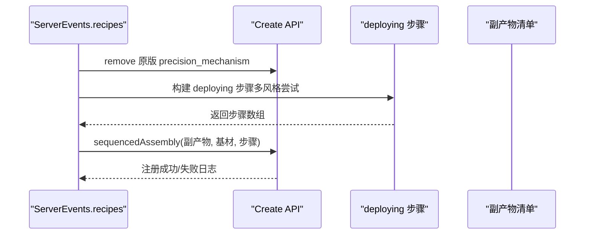
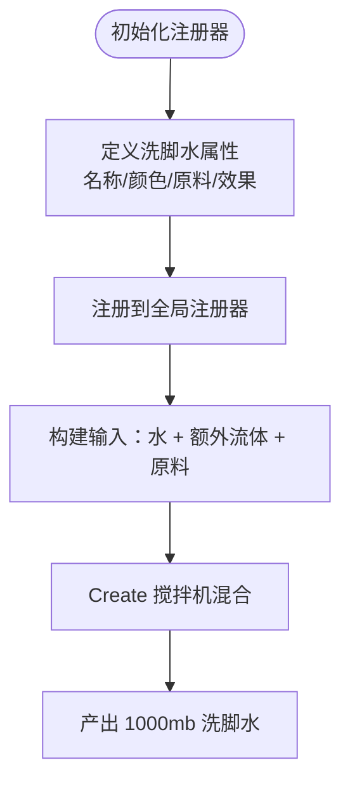
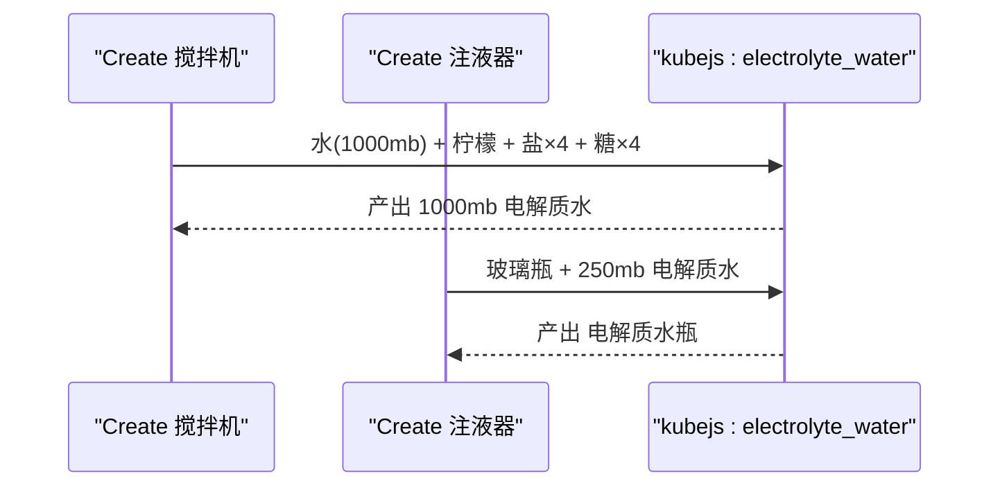
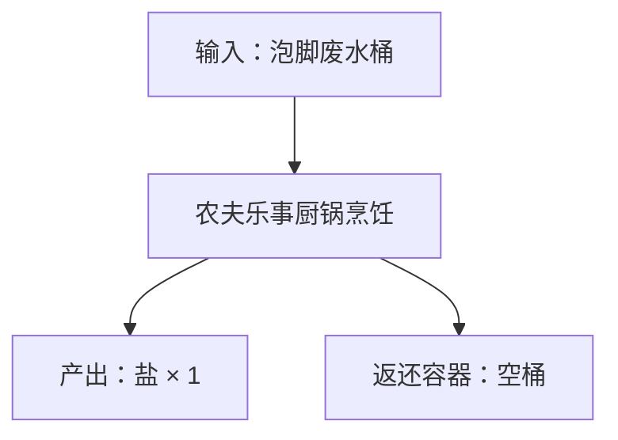
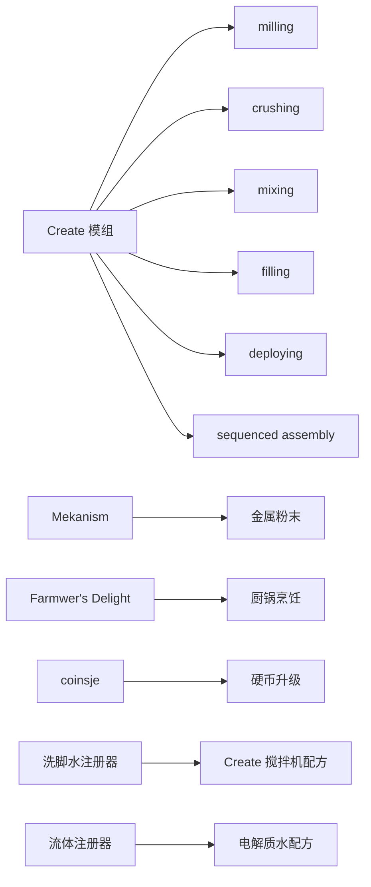

# 机械加工配方

<cite>
**本文引用的文件**
- [recipes_create_dust.js](file://kubejs/server_scripts/recipes/recipes_create_dust.js)
- [recipes_create_precision_mechanism.js](file://kubejs/server_scripts/recipes/recipes_create_precision_mechanism.js)
- [recipes_soak_water_create.js](file://kubejs/server_scripts/recipes/recipes_soak_water_create.js)
- [recipes_electrolyte.js](file://kubejs/server_scripts/recipes/recipes_electrolyte.js)
- [recipes_farmersdelight_salt.js](file://kubejs/server_scripts/recipes/recipes_farmersdelight_salt.js)
- [electrolyte_water.js](file://kubejs/startup_scripts/fluid/electrolyte_water.js)
- [soakWaterRegister.js](file://kubejs/startup_scripts/soakwater/soakWaterRegister.js)
- [oil.js](file://kubejs/server_scripts/serve/oil.js)
</cite>

## 目录
1. [简介](#简介)
2. [项目结构](#项目结构)
3. [核心组件](#核心组件)
4. [架构总览](#架构总览)
5. [详细组件分析](#详细组件分析)
6. [依赖关系分析](#依赖关系分析)
7. [性能考量](#性能考量)
8. [故障排查指南](#故障排查指南)
9. [结论](#结论)
10. [附录](#附录)

## 简介
本文件系统化梳理了基于 KubeJS 的机械加工配方体系，重点围绕 Create 模组的机械动力学集成，涵盖以下主题：
- 金属锭到金属粉的两种路径：石磨与粉碎轮
- 精密机械装置（Precision Mechanism）的合成配方与基材替换策略
- 洗脚水的 Create 搅拌机配方与可扩展注册器
- 电解质水的 Create 搅拌与注液配方
- 泡脚废水到盐的农夫乐事厨锅配方
- 机械动力学原理在配方中的应用与平衡建议
- 扩展指南：新增机械加工配方与自定义加工流程
- 与其他模组的兼容性与依赖关系

## 项目结构
本项目通过 KubeJS 的服务端脚本组织各类配方，核心位于 kubejs/server_scripts/recipes 下，流体与注册器分别位于 startup_scripts/fluid 与 startup_scripts/soakwater。



图表来源
- [recipes_create_dust.js:1-37](file://kubejs/server_scripts/recipes/recipes_create_dust.js#L1-L37)
- [recipes_create_precision_mechanism.js:1-131](file://kubejs/server_scripts/recipes/recipes_create_precision_mechanism.js#L1-L131)
- [recipes_soak_water_create.js:1-54](file://kubejs/server_scripts/recipes/recipes_soak_water_create.js#L1-L54)
- [recipes_electrolyte.js:1-60](file://kubejs/server_scripts/recipes/recipes_electrolyte.js#L1-L60)
- [recipes_farmersdelight_salt.js:1-37](file://kubejs/server_scripts/recipes/recipes_farmersdelight_salt.js#L1-L37)
- [electrolyte_water.js:1-31](file://kubejs/startup_scripts/fluid/electrolyte_water.js#L1-L31)
- [soakWaterRegister.js:1-121](file://kubejs/startup_scripts/soakwater/soakWaterRegister.js#L1-L121)
- [oil.js:1-56](file://kubejs/server_scripts/serve/oil.js#L1-L56)

章节来源
- [recipes_create_dust.js:1-37](file://kubejs/server_scripts/recipes/recipes_create_dust.js#L1-L37)
- [recipes_create_precision_mechanism.js:1-131](file://kubejs/server_scripts/recipes/recipes_create_precision_mechanism.js#L1-L131)
- [recipes_soak_water_create.js:1-54](file://kubejs/server_scripts/recipes/recipes_soak_water_create.js#L1-L54)
- [recipes_electrolyte.js:1-60](file://kubejs/server_scripts/recipes/recipes_electrolyte.js#L1-L60)
- [recipes_farmersdelight_salt.js:1-37](file://kubejs/server_scripts/recipes/recipes_farmersdelight_salt.js#L1-L37)
- [electrolyte_water.js:1-31](file://kubejs/startup_scripts/fluid/electrolyte_water.js#L1-L31)
- [soakWaterRegister.js:1-121](file://kubejs/startup_scripts/soakwater/soakWaterRegister.js#L1-L121)
- [oil.js:1-56](file://kubejs/server_scripts/serve/oil.js#L1-L56)

## 核心组件
- 金属粉提取配方：提供石磨与粉碎轮两条路径，产物为 Mekanism 粉末。
- 精密机械装置配方：覆盖原版 Sequenced Assembly，使用黄铜板作为基材，并调整副产物。
- 洗脚水 Create 搅拌机配方：通过注册器动态生成多款洗脚水配方。
- 电解质水配方：Create 搅拌机混合 + 注液器装瓶。
- 泡脚废水到盐：农夫乐事厨锅烹饪，返回桶容器。
- 流体与注册器：统一管理洗脚水流体与配方参数。
- 抹油奖励钩子：与 Create/泡脚系统联动，提供额外收益。

章节来源
- [recipes_create_dust.js:1-37](file://kubejs/server_scripts/recipes/recipes_create_dust.js#L1-L37)
- [recipes_create_precision_mechanism.js:1-131](file://kubejs/server_scripts/recipes/recipes_create_precision_mechanism.js#L1-L131)
- [recipes_soak_water_create.js:1-54](file://kubejs/server_scripts/recipes/recipes_soak_water_create.js#L1-L54)
- [recipes_electrolyte.js:1-60](file://kubejs/server_scripts/recipes/recipes_electrolyte.js#L1-L60)
- [recipes_farmersdelight_salt.js:1-37](file://kubejs/server_scripts/recipes/recipes_farmersdelight_salt.js#L1-L37)
- [electrolyte_water.js:1-31](file://kubejs/startup_scripts/fluid/electrolyte_water.js#L1-L31)
- [soakWaterRegister.js:1-121](file://kubejs/startup_scripts/soakwater/soakWaterRegister.js#L1-L121)
- [oil.js:1-56](file://kubejs/server_scripts/serve/oil.js#L1-L56)

## 架构总览
整体架构以 KubeJS 事件驱动为核心，通过 Create 模组提供的机械加工 API 实现配方注册；流体与配方参数通过启动脚本集中管理；其他模组（如 Farmwer’s Delight、coinsje）通过标准 API 协同。

```mermaid
sequenceDiagram
participant Player as "玩家"
participant KubeJS as "KubeJS 事件"
participant Create as "Create 机械API"
participant FluidReg as "流体注册器"
participant Reg as "洗脚水注册器"
Player->>KubeJS : 启动世界
KubeJS->>FluidReg : 注册 kubejs : electrolyte_water
KubeJS->>Reg : 初始化 soakWaterRegister
KubeJS->>Create : 注册金属粉配方milling/crushing
KubeJS->>Create : 注册精密机械装置sequenced assembly
KubeJS->>Create : 注册洗脚水搅拌配方基于注册器
KubeJS->>Create : 注册电解质水混合/装瓶配方
KubeJS->>Create : 注册厨锅制盐配方
Player->>Create : 使用 Basin/Mixer/机械装置进行加工
```

图表来源
- [recipes_create_dust.js:10-36](file://kubejs/server_scripts/recipes/recipes_create_dust.js#L10-L36)
- [recipes_create_precision_mechanism.js:60-130](file://kubejs/server_scripts/recipes/recipes_create_precision_mechanism.js#L60-L130)
- [recipes_soak_water_create.js:14-53](file://kubejs/server_scripts/recipes/recipes_soak_water_create.js#L14-L53)
- [recipes_electrolyte.js:9-59](file://kubejs/server_scripts/recipes/recipes_electrolyte.js#L9-L59)
- [electrolyte_water.js:10-23](file://kubejs/startup_scripts/fluid/electrolyte_water.js#L10-L23)
- [soakWaterRegister.js:40-83](file://kubejs/startup_scripts/soakwater/soakWaterRegister.js#L40-L83)

## 详细组件分析

### 金属粉提取配方（石磨与粉碎轮）
- 设计要点
  - 输入：铁/铜/金 金属锭
  - 两条路径：石磨（milling）与粉碎轮（crushing）
  - 产物：Mekanism 对应金属粉末
- 机械动力学意义
  - 石磨适合早期、低能耗、低效率场景
  - 粉碎轮适合中后期、高吞吐、高能耗场景
- 配方参数
  - 输入/产物数量：1:1
  - 时间与能耗：由 Create 机制决定（KubeJS 仅注册配方）
- 扩展建议
  - 新增金属：在数组中添加条目，自动注册两条路径
  - 自定义产物：修改 dust 字段映射



图表来源
- [recipes_create_dust.js:10-36](file://kubejs/server_scripts/recipes/recipes_create_dust.js#L10-L36)

章节来源
- [recipes_create_dust.js:1-37](file://kubejs/server_scripts/recipes/recipes_create_dust.js#L1-L37)

### 精密机械装置（Precision Mechanism）配方
- 设计要点
  - 覆盖原版 Sequenced Assembly 配方
  - 基材替换：金板 → 黄铜板
  - 副产物调整：金板/金粒等替换为黄铜板与黄铜相关产物
  - loops 参数：5
- 机械装配流程
  - 通过多种 deploying API 风格尝试，确保兼容性
  - 逐步叠加齿轮、大齿轮、金粒、红石等部件
- 配方参数
  - transitionalItem：create:incomplete_precision_mechanism
  - loops：5
  - scrap：包含精密机械装置、黄铜板、安山合金、齿轮、传动轴、金矿砂、金粒、铁锭、时钟等
- 扩展建议
  - 更换基材或副产物：修改 buildScrap 与 base
  - 调整装配步骤：修改 buildSteps 返回的 deploying 列表



图表来源
- [recipes_create_precision_mechanism.js:60-130](file://kubejs/server_scripts/recipes/recipes_create_precision_mechanism.js#L60-L130)

章节来源
- [recipes_create_precision_mechanism.js:1-131](file://kubejs/server_scripts/recipes/recipes_create_precision_mechanism.js#L1-L131)

### 洗脚水 Create 搅拌机配方
- 设计要点
  - 模式：水 1000mb + 额外流体（可选）+ 物品原料 → 1000mb 对应洗脚水
  - 无需加热，使用 Create 搅拌机
  - 通过注册器集中管理配方参数（名称、颜色、原料、效果等）
- 机械动力学意义
  - 体现 Create 搅拌机的多输入流体与物品混合能力
  - 通过注册器实现配方的模块化与可扩展
- 配方参数
  - 输入：水 1000mb + 额外流体（可选）+ 原料列表
  - 输出：对应洗脚水 1000mb（1 桶）
- 扩展建议
  - 新增洗脚水：通过注册器链式 API 设置属性并注册
  - 动态扩展：注册器内部维护 waters 列表，遍历注册



图表来源
- [recipes_soak_water_create.js:14-53](file://kubejs/server_scripts/recipes/recipes_soak_water_create.js#L14-L53)
- [soakWaterRegister.js:40-118](file://kubejs/startup_scripts/soakwater/soakWaterRegister.js#L40-L118)

章节来源
- [recipes_soak_water_create.js:1-54](file://kubejs/server_scripts/recipes/recipes_soak_water_create.js#L1-L54)
- [soakWaterRegister.js:1-121](file://kubejs/startup_scripts/soakwater/soakWaterRegister.js#L1-L121)

### 电解质水配方（Create 搅拌与注液）
- 设计要点
  - 搅拌机：水 1000mb + 柠檬 + 盐×4 + 糖×4 → 1000mb 电解质水
  - 注液器：玻璃瓶 + 250mb 电解质水 → 电解质水瓶
- 机械动力学意义
  - 体现 Create 搅拌机对多流体与多物品的混合能力
  - 体现注液器对流体装瓶的自动化
- 配方参数
  - 搅拌：固定比例的水、柠檬、盐、糖
  - 注液：250mb 流体装入标准瓶
- 扩展建议
  - 更换流体 ID：修改流体注册与配方引用
  - 调整配方比例：修改输入数组与数量



图表来源
- [recipes_electrolyte.js:9-59](file://kubejs/server_scripts/recipes/recipes_electrolyte.js#L9-L59)
- [electrolyte_water.js:10-31](file://kubejs/startup_scripts/fluid/electrolyte_water.js#L10-L31)

章节来源
- [recipes_electrolyte.js:1-60](file://kubejs/server_scripts/recipes/recipes_electrolyte.js#L1-L60)
- [electrolyte_water.js:1-31](file://kubejs/startup_scripts/fluid/electrolyte_water.js#L1-L31)

### 泡脚废水到盐（农夫乐事厨锅）
- 设计要点
  - 输入：kubejs:foot_water_bucket（已使用泡脚废水桶）
  - 产出：mekanism:salt × 1
  - 容器返还：空桶
- 机械动力学意义
  - 体现厨锅烹饪的返还容器机制，减少资源浪费
- 配方参数
  - 经验：0.2
  - 烹饪时间：200 tick（10s）
- 扩展建议
  - 更换输入/产出：修改 ingredients 与 output
  - 调整经验与时间：修改 exp 与 cookTime



图表来源
- [recipes_farmersdelight_salt.js:17-36](file://kubejs/server_scripts/recipes/recipes_farmersdelight_salt.js#L17-L36)

章节来源
- [recipes_farmersdelight_salt.js:1-37](file://kubejs/server_scripts/recipes/recipes_farmersdelight_salt.js#L1-L37)

### 抹油奖励钩子（与 Create/泡脚系统联动）
- 设计要点
  - 持有精油点击按钮时触发“抹油”，不消耗需求、不开始泡脚
  - 成功后若干次“有效点击”获得额外奖励（饱食度与金钱）
  - 奖励次数耗尽后清除 UI 字段
- 机械动力学意义
  - 通过交互钩子增强玩家体验，间接提升泡脚/按摩流程的收益
- 扩展建议
  - 调整奖励数值：修改常量 OIL_SAT_BONUS/OIL_MONEY_BONUS
  - 控制耐久损耗：修改 serveDamageOil 的破坏逻辑

章节来源
- [oil.js:1-56](file://kubejs/server_scripts/serve/oil.js#L1-L56)

## 依赖关系分析
- 模组依赖
  - Create：机械加工 API（milling/crushing/mixing/filling/deploying/sequencedAssembly）
  - Mekanism：金属粉末产物
  - Farmwer’s Delight：厨锅烹饪
  - coinsje：硬币升级配方（独立于 Create）
- 文件耦合
  - 洗脚水配方依赖注册器（soakWaterRegister.js）
  - 电解质水配方依赖流体注册（electrolyte_water.js）
  - 精密机械装置配方依赖 Create API 的多种风格兼容



图表来源
- [recipes_create_dust.js:10-36](file://kubejs/server_scripts/recipes/recipes_create_dust.js#L10-L36)
- [recipes_create_precision_mechanism.js:60-130](file://kubejs/server_scripts/recipes/recipes_create_precision_mechanism.js#L60-L130)
- [recipes_soak_water_create.js:14-53](file://kubejs/server_scripts/recipes/recipes_soak_water_create.js#L14-L53)
- [recipes_electrolyte.js:9-59](file://kubejs/server_scripts/recipes/recipes_electrolyte.js#L9-L59)
- [soakWaterRegister.js:40-118](file://kubejs/startup_scripts/soakwater/soakWaterRegister.js#L40-L118)
- [electrolyte_water.js:10-31](file://kubejs/startup_scripts/fluid/electrolyte_water.js#L10-L31)

章节来源
- [recipes_create_dust.js:1-37](file://kubejs/server_scripts/recipes/recipes_create_dust.js#L1-L37)
- [recipes_create_precision_mechanism.js:1-131](file://kubejs/server_scripts/recipes/recipes_create_precision_mechanism.js#L1-L131)
- [recipes_soak_water_create.js:1-54](file://kubejs/server_scripts/recipes/recipes_soak_water_create.js#L1-L54)
- [recipes_electrolyte.js:1-60](file://kubejs/server_scripts/recipes/recipes_electrolyte.js#L1-L60)
- [soakWaterRegister.js:1-121](file://kubejs/startup_scripts/soakwater/soakWaterRegister.js#L1-L121)
- [electrolyte_water.js:1-31](file://kubejs/startup_scripts/fluid/electrolyte_water.js#L1-L31)

## 性能考量
- 加工路径选择
  - 早期：石磨低能耗、低效率，适合探索与过渡
  - 中后期：粉碎轮高吞吐、高能耗，适合规模化生产
- 精密机械装置
  - loops=5 表示重复装配 5 次，建议在高自动化流水线中启用
  - 副产物概率分布需结合仓储与回收策略
- 搅拌与注液
  - 搅拌机可并行处理多批次，注液器可配合传送带自动化装瓶
- 资源平衡
  - 金属粉与黄铜板的供需平衡，避免瓶颈
  - 流体与容器的循环利用（如空桶返还）

## 故障排查指南
- Create API 不可用
  - 现象：配方注册失败或日志提示 API 不可用
  - 处理：确认 Create 模组已安装且版本兼容；检查 API 名称大小写与风格（如 create.sequencedAssembly 与 createSequencedAssembly）
- 精密机械装置未覆盖
  - 现象：原版配方仍然生效
  - 处理：检查 remove 是否成功；确认 deploying 步骤构建成功；尝试不同 API 风格
- 洗脚水配方未注册
  - 现象：未检测到 Create mixing API 或配方未注册
  - 处理：确认注册器已初始化；检查 waters 列表是否为空；核对输入流体/物品是否存在
- 电解质水流体未注册
  - 现象：注液器无法识别流体
  - 处理：确认流体注册成功；核对流体 ID 与配方引用一致
- 厨锅制盐失败
  - 现象：配方注册失败
  - 处理：确认输入桶 ID 与产出物品存在；检查 Farmwer’s Delight 是否启用

章节来源
- [recipes_create_precision_mechanism.js:60-130](file://kubejs/server_scripts/recipes/recipes_create_precision_mechanism.js#L60-L130)
- [recipes_soak_water_create.js:14-53](file://kubejs/server_scripts/recipes/recipes_soak_water_create.js#L14-L53)
- [recipes_electrolyte.js:9-59](file://kubejs/server_scripts/recipes/recipes_electrolyte.js#L9-L59)
- [recipes_farmersdelight_salt.js:17-36](file://kubejs/server_scripts/recipes/recipes_farmersdelight_salt.js#L17-L36)
- [electrolyte_water.js:10-31](file://kubejs/startup_scripts/fluid/electrolyte_water.js#L10-L31)

## 结论
本配方体系以 Create 机械动力学为核心，结合 Mekanism、Farmwer’s Delight 等模组，实现了从金属粉提取、精密机械装置合成，到洗脚水与电解质水的完整加工链路。通过注册器与启动脚本，配方具备良好的可扩展性与可维护性。建议在实际部署中根据服务器规模与玩家进度，合理选择加工路径与自动化程度，以达到能耗与产出的最佳平衡。

## 附录
- 扩展指南
  - 新增金属粉：在金属列表中添加新条目，自动注册石磨与粉碎轮配方
  - 新增洗脚水：使用注册器链式 API 设置属性并注册
  - 新增电解质水变种：注册新流体并在注液器中适配
  - 新增精密机械装置变种：调整基材、副产物与装配步骤
- 兼容性与依赖
  - 必需：Create 模组
  - 可选：Mekanism（产物）、Farmwer’s Delight（厨锅）、coinsje（硬币升级）
  - 注意：不同 KubeJS 版本对 Create API 的命名风格可能存在差异，需按日志提示调整