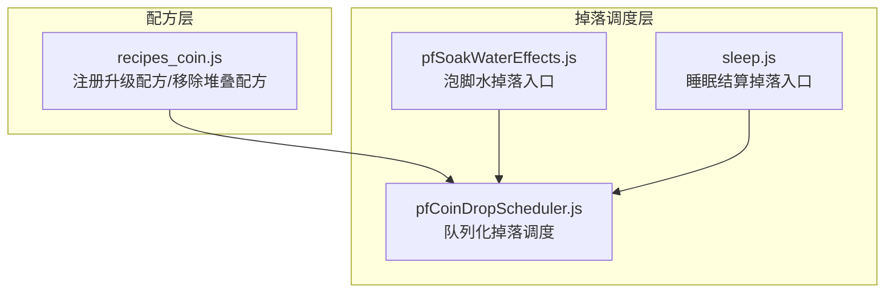
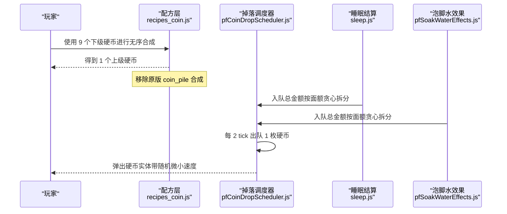
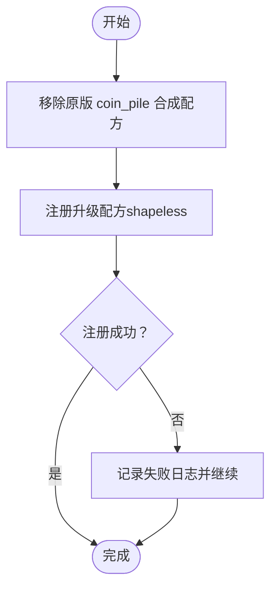
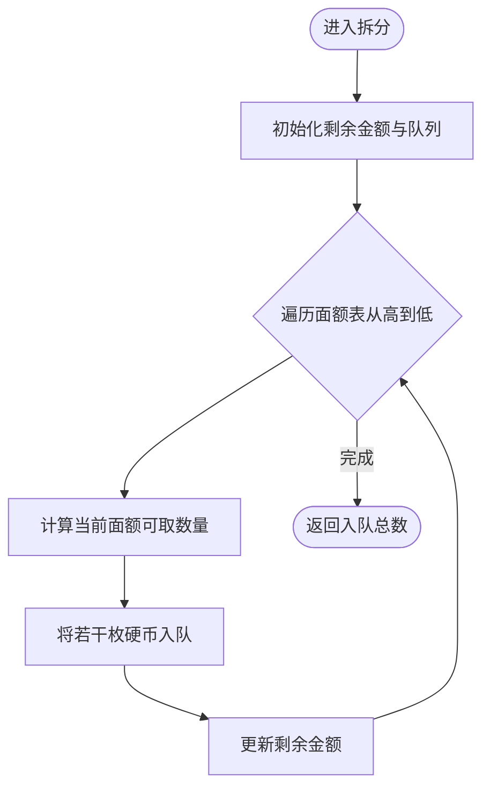
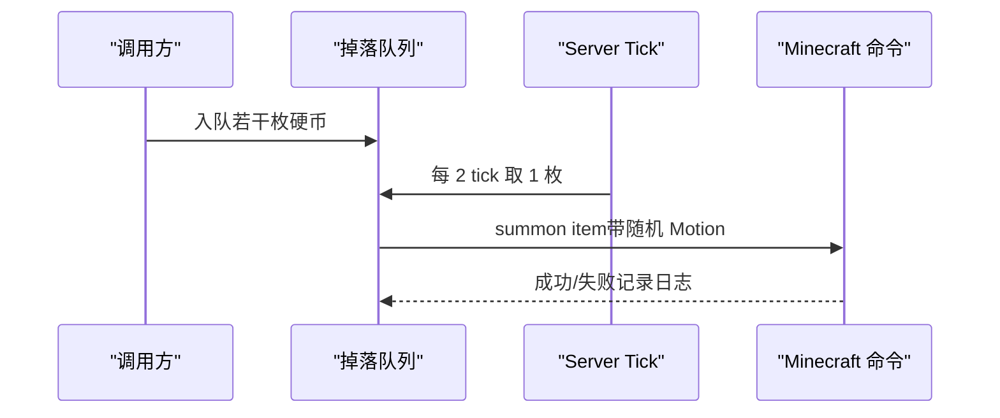
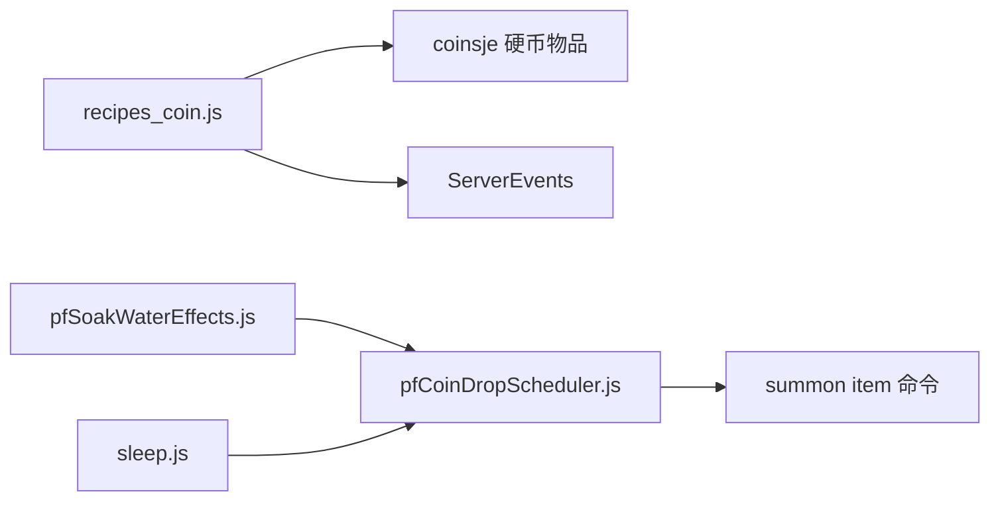

# 硬币升级配方

<cite>
**本文引用的文件**
- [recipes_coin.js](file://kubejs/server_scripts/recipes/recipes_coin.js)
- [pfCoinDropScheduler.js](file://kubejs/server_scripts/pathfinder/pfCoinDropScheduler.js)
- [pfSoakWaterEffects.js](file://kubejs/server_scripts/pathfinder/pfSoakWaterEffects.js)
- [sleep.js](file://kubejs/server_scripts/sleep.js)
</cite>

## 目录
1. [简介](#简介)
2. [项目结构](#项目结构)
3. [核心组件](#核心组件)
4. [架构总览](#架构总览)
5. [详细组件分析](#详细组件分析)
6. [依赖分析](#依赖分析)
7. [性能考虑](#性能考虑)
8. [故障排除指南](#故障排除指南)
9. [结论](#结论)
10. [附录](#附录)

## 简介
本文件系统性阐述硬币从铜币到下界合金的完整升级配方设计与实现，重点涵盖以下内容：
- 9 个下级硬币无序合成 1 个上级硬币的升级规则
- 配方移除策略：移除原版 coinsje 的堆叠配方以避免冲突
- 完整升级序列：copper → iron → gold → diamond → netherite
- 面额递进关系与贪心拆分机制
- 配方注册实现、shapeless 合成与 ID 命名规范
- 日志记录与错误处理策略
- 扩展指南：新增硬币等级或修改升级条件的方法

## 项目结构
硬币升级配方相关逻辑分布在以下模块：
- 配方注册：recipes_coin.js
- 硬币掉落调度器：pfCoinDropScheduler.js
- 泡脚水效果与掉落：pfSoakWaterEffects.js
- 睡眠结算与掉落：sleep.js

图表来源
- [recipes_coin.js:15-56](file://kubejs/server_scripts/recipes/recipes_coin.js#L15-L56)
- [pfCoinDropScheduler.js:19-100](file://kubejs/server_scripts/pathfinder/pfCoinDropScheduler.js#L19-L100)
- [pfSoakWaterEffects.js:55-79](file://kubejs/server_scripts/pathfinder/pfSoakWaterEffects.js#L55-L79)
- [sleep.js:111-152](file://kubejs/server_scripts/sleep.js#L111-L152)

章节来源
- [recipes_coin.js:1-56](file://kubejs/server_scripts/recipes/recipes_coin.js#L1-L56)
- [pfCoinDropScheduler.js:1-100](file://kubejs/server_scripts/pathfinder/pfCoinDropScheduler.js#L1-L100)
- [pfSoakWaterEffects.js:1-233](file://kubejs/server_scripts/pathfinder/pfSoakWaterEffects.js#L1-L233)
- [sleep.js:100-299](file://kubejs/server_scripts/sleep.js#L100-L299)

## 核心组件
- 升级配方注册与冲突规避
  - 移除原版 coinsje 的堆叠配方（coin_pile），避免与升级链条争抢素材
  - 使用 shapeless 合成，9 个下级硬币合成 1 个上级硬币
  - 为每条升级配方设置明确的 ID，便于调试与定位
- 硬币面额体系与贪心拆分
  - 面额比例：copper=1, iron=9, gold=81, diamond=729, netherite=6561
  - 从最高面额向下贪心拆分，确保掉落数量最少且符合体验
- 掉落调度器
  - 将一次性掉落改为“每 2 tick 弹出一枚”的队列化调度
  - 每枚掉落带有随机微小速度，增强真实感与颗粒感

章节来源
- [recipes_coin.js:4-12](file://kubejs/server_scripts/recipes/recipes_coin.js#L4-L12)
- [recipes_coin.js:35-55](file://kubejs/server_scripts/recipes/recipes_coin.js#L35-L55)
- [pfCoinDropScheduler.js:19-65](file://kubejs/server_scripts/pathfinder/pfCoinDropScheduler.js#L19-L65)
- [sleep.js:111-152](file://kubejs/server_scripts/sleep.js#L111-L152)

## 架构总览
硬币升级配方的运行流程如下：
- 配方层负责注册升级配方并移除原版堆叠配方
- 上层业务（睡眠结算、泡脚水效果）将总金额按面额体系贪心拆分
- 掉落调度器接收拆分后的队列，按固定间隔弹出硬币实体

图表来源
- [recipes_coin.js:15-56](file://kubejs/server_scripts/recipes/recipes_coin.js#L15-L56)
- [pfCoinDropScheduler.js:74-97](file://kubejs/server_scripts/pathfinder/pfCoinDropScheduler.js#L74-L97)
- [sleep.js:118-152](file://kubejs/server_scripts/sleep.js#L118-L152)
- [pfSoakWaterEffects.js:55-79](file://kubejs/server_scripts/pathfinder/pfSoakWaterEffects.js#L55-L79)

## 详细组件分析

### 组件一：升级配方注册与冲突规避
- 设计要点
  - 升级规则：9 个下级硬币无序合成 1 个上级硬币
  - 面额体系参考睡眠结算分支，采用 1:9 的递进关系
  - 移除原版 coin_pile 合成配方，避免与升级链条冲突
- 实现细节
  - 使用 shapeless 合成，输入为 9 个相同硬币，输出为 1 个上级硬币
  - 为每条升级配方设置唯一 ID，便于日志追踪与问题定位
- 错误处理
  - 移除与注册均包裹 try/catch，并输出详细日志

图表来源
- [recipes_coin.js:15-56](file://kubejs/server_scripts/recipes/recipes_coin.js#L15-L56)

章节来源
- [recipes_coin.js:15-56](file://kubejs/server_scripts/recipes/recipes_coin.js#L15-L56)

### 组件二：硬币面额体系与贪心拆分
- 面额比例
  - netherite: 6561
  - diamond: 729
  - gold: 81
  - iron: 9
  - copper: 1
- 拆分策略
  - 从最高面额开始，按“最大可取数量 × 面额”逐步扣减剩余金额
  - 将拆分结果入队至掉落调度器，保证掉落节奏与颗粒感

图表来源
- [pfCoinDropScheduler.js:38-65](file://kubejs/server_scripts/pathfinder/pfCoinDropScheduler.js#L38-L65)
- [sleep.js:130-151](file://kubejs/server_scripts/sleep.js#L130-L151)
- [pfSoakWaterEffects.js:56-79](file://kubejs/server_scripts/pathfinder/pfSoakWaterEffects.js#L56-L79)

章节来源
- [pfCoinDropScheduler.js:19-65](file://kubejs/server_scripts/pathfinder/pfCoinDropScheduler.js#L19-L65)
- [sleep.js:111-152](file://kubejs/server_scripts/sleep.js#L111-L152)
- [pfSoakWaterEffects.js:16-79](file://kubejs/server_scripts/pathfinder/pfSoakWaterEffects.js#L16-L79)

### 组件三：掉落调度器（队列化弹出）
- 调度参数
  - 间隔：每 2 tick 弹出 1 枚硬币
  - 弹出速度：水平 ±0.15 块/tick，垂直 0.25 ~ 0.45 块/tick
- 行为特征
  - 将入队的硬币逐枚以随机微小速度弹出，模拟真实掉落
  - 若调度器不可用，则回退到一次性 summon 方案

图表来源
- [pfCoinDropScheduler.js:74-97](file://kubejs/server_scripts/pathfinder/pfCoinDropScheduler.js#L74-L97)

章节来源
- [pfCoinDropScheduler.js:74-97](file://kubejs/server_scripts/pathfinder/pfCoinDropScheduler.js#L74-L97)

### 组件四：升级序列与面额递进
- 升级序列
  - copper → iron（9:1）
  - iron → gold（9:1）
  - gold → diamond（9:1）
  - diamond → netherite（9:1）
- 面额递进
  - 以 copper 为基准（1），每级乘以 9，形成几何级增长
  - 与睡眠结算与泡脚水掉落的面额体系保持一致

章节来源
- [recipes_coin.js:4-9](file://kubejs/server_scripts/recipes/recipes_coin.js#L4-L9)
- [sleep.js:111-114](file://kubejs/server_scripts/sleep.js#L111-L114)
- [pfSoakWaterEffects.js:16-23](file://kubejs/server_scripts/pathfinder/pfSoakWaterEffects.js#L16-L23)

## 依赖分析
- 配方层依赖
  - coinsje 硬币物品 ID（如 coinsje:copper_coin 等）
  - KubeJS ServerEvents 事件系统
- 掉落调度器依赖
  - 全局队列对象（enqueueCoins、size、clear）
  - Minecraft 服务器命令（summon item）
- 上层业务依赖
  - 睡眠结算与泡脚水效果模块将总金额按面额体系拆分后交由调度器

图表来源
- [recipes_coin.js:15-56](file://kubejs/server_scripts/recipes/recipes_coin.js#L15-L56)
- [pfSoakWaterEffects.js:55-79](file://kubejs/server_scripts/pathfinder/pfSoakWaterEffects.js#L55-L79)
- [sleep.js:118-152](file://kubejs/server_scripts/sleep.js#L118-L152)
- [pfCoinDropScheduler.js:74-97](file://kubejs/server_scripts/pathfinder/pfCoinDropScheduler.js#L74-L97)

章节来源
- [recipes_coin.js:15-56](file://kubejs/server_scripts/recipes/recipes_coin.js#L15-L56)
- [pfSoakWaterEffects.js:55-79](file://kubejs/server_scripts/pathfinder/pfSoakWaterEffects.js#L55-L79)
- [sleep.js:118-152](file://kubejs/server_scripts/sleep.js#L118-L152)
- [pfCoinDropScheduler.js:74-97](file://kubejs/server_scripts/pathfinder/pfCoinDropScheduler.js#L74-L97)

## 性能考虑
- 队列化掉落的优势
  - 将一次性大量掉落拆分为高频少量弹出，降低单次命令压力
  - 通过固定间隔弹出，避免 UI 与物理引擎瞬时负载峰值
- 贪心拆分的时间复杂度
  - 面额表长度固定（5），拆分过程为 O(1)，开销极低
- 建议
  - 如需进一步优化，可在入队阶段批量提交，减少命令调用次数
  - 控制掉落范围与密度，避免极端场景下的性能抖动

## 故障排除指南
- 合成配方未生效
  - 检查是否正确移除了原版 coin_pile 配方
  - 确认 shapeless 输入与输出 ID 是否匹配
  - 查看控制台日志中“配方注册失败”的具体信息
- 掉落异常
  - 检查掉落调度器是否可用（全局队列对象是否存在）
  - 若调度器不可用，系统会回退到一次性 summon，确认命令执行权限
- 面额不一致
  - 确认睡眠结算与泡脚水模块的面额表与升级配方一致
  - 核面对额比例是否被意外修改

章节来源
- [recipes_coin.js:24-33](file://kubejs/server_scripts/recipes/recipes_coin.js#L24-L33)
- [recipes_coin.js:45-54](file://kubejs/server_scripts/recipes/recipes_coin.js#L45-L54)
- [pfCoinDropScheduler.js:74-97](file://kubejs/server_scripts/pathfinder/pfCoinDropScheduler.js#L74-L97)
- [sleep.js:118-152](file://kubejs/server_scripts/sleep.js#L118-L152)

## 结论
本系统通过“9:1 升级规则 + 面额贪心拆分 + 队列化掉落”的组合，实现了稳定、可扩展且体验友好的硬币升级与掉落体系。配方层负责规则与冲突规避，调度层负责掉落节奏与颗粒感，上层业务模块负责金额计算与拆分。整体设计清晰、日志完备、易于扩展。

## 附录

### A. 配方注册实现与 ID 命名规范
- 合成方式：shapeless
- 输入：9 个下级硬币
- 输出：1 个上级硬币
- ID 命名规范：kubejs:coin_<from>_to_<to>
  - 示例：kubejs:coin_copper_to_iron
  - 示例：kubejs:coin_diamond_to_netherite

章节来源
- [recipes_coin.js:35-55](file://kubejs/server_scripts/recipes/recipes_coin.js#L35-L55)

### B. 扩展指南：新增硬币等级或修改升级条件
- 新增硬币等级
  - 在配方层增加一条升级项（from/to/id）
  - 在面额表中添加新等级及其面额
  - 确保上层业务（睡眠结算/泡脚水）的面额表同步更新
- 修改升级条件
  - 若需调整升级比例（非 9:1），请同步修改配方与面额表
  - 若需改变合成方式，统一替换为新的合成 API 并更新 ID 命名
- 注意事项
  - 保持面额体系一致性，避免出现“无法拆分”的金额
  - 为新增配方设置唯一 ID，便于日志与调试

章节来源
- [recipes_coin.js:35-41](file://kubejs/server_scripts/recipes/recipes_coin.js#L35-L41)
- [pfCoinDropScheduler.js:19-26](file://kubejs/server_scripts/pathfinder/pfCoinDropScheduler.js#L19-L26)
- [sleep.js:130-136](file://kubejs/server_scripts/sleep.js#L130-L136)
- [pfSoakWaterEffects.js:16-23](file://kubejs/server_scripts/pathfinder/pfSoakWaterEffects.js#L16-L23)