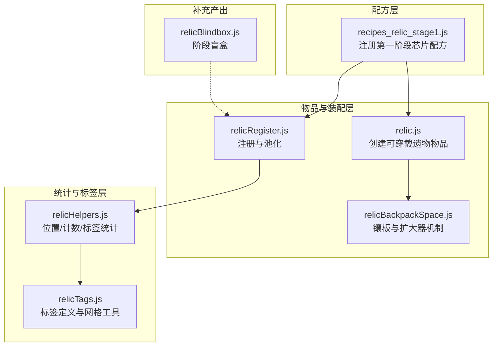
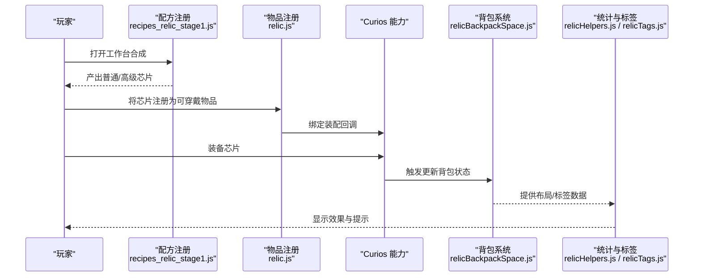
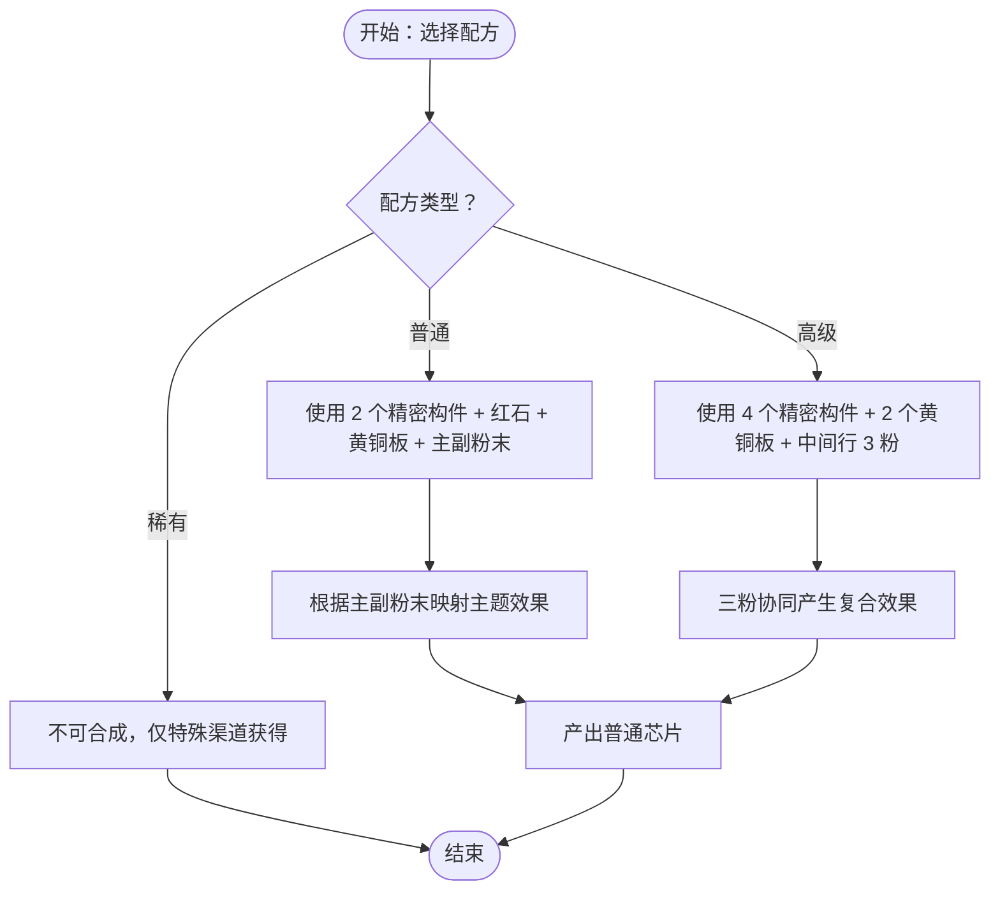
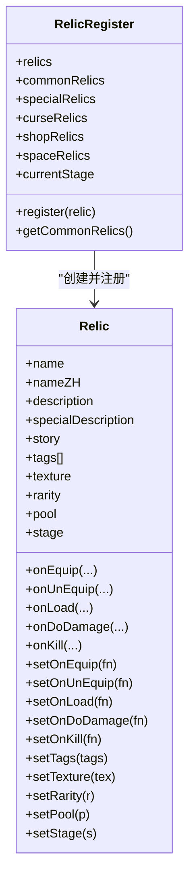
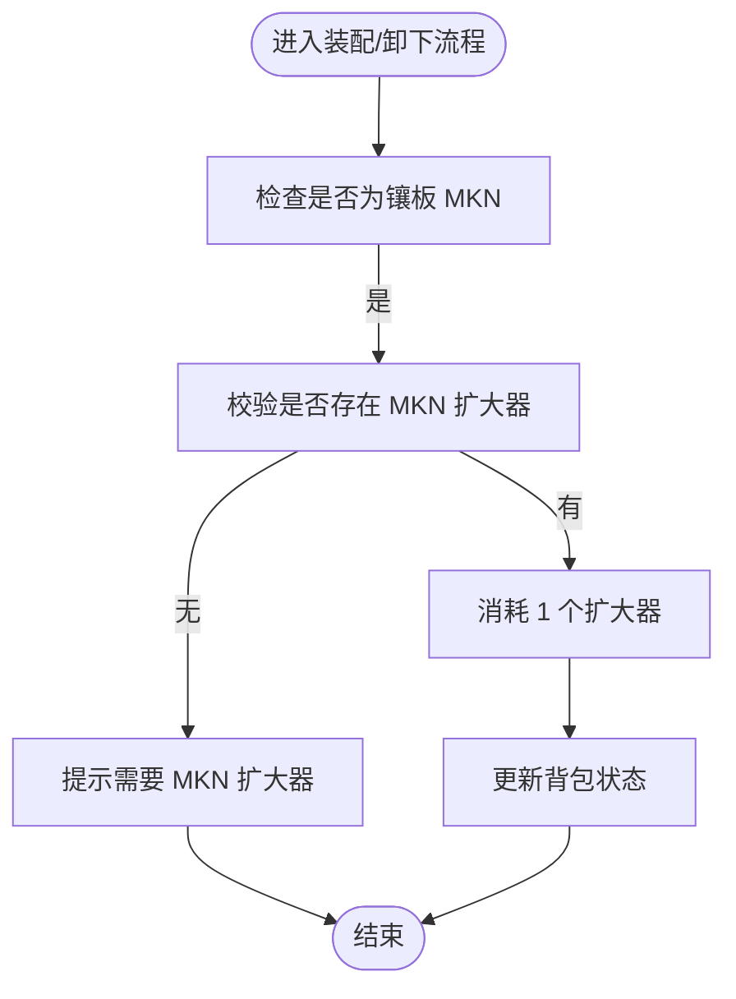
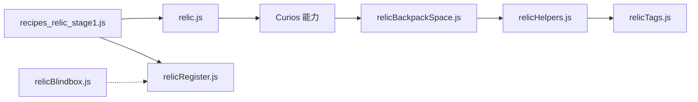

# 遗物制作配方

<cite>
**本文引用的文件**
- [recipes_relic_stage1.js](file://kubejs/server_scripts/recipes/recipes_relic_stage1.js)
- [relic.js](file://kubejs/startup_scripts/relic/relic.js)
- [relicRegister.js](file://kubejs/startup_scripts/relic/relicRegister.js)
- [relicHelpers.js](file://kubejs/startup_scripts/relic/relicHelpers.js)
- [relicTags.js](file://kubejs/startup_scripts/relic/relicTags.js)
- [relicBackpackSpace.js](file://kubejs/startup_scripts/relic/relicItem/relicBackpackSpace.js)
- [relicBlindbox.js](file://kubejs/startup_scripts/relic/relicBlindbox.js)
</cite>

## 目录
1. [引言](#引言)
2. [项目结构](#项目结构)
3. [核心组件](#核心组件)
4. [架构总览](#架构总览)
5. [详细组件分析](#详细组件分析)
6. [依赖关系分析](#依赖关系分析)
7. [性能考量](#性能考量)
8. [故障排查指南](#故障排查指南)
9. [结论](#结论)
10. [附录：扩展与平衡设计](#附录扩展与平衡设计)

## 引言
本文件围绕“遗物制作配方”展开，聚焦第一阶段（初级）芯片的合成配方设计与实现，解释材料构成、工艺步骤、配方如何影响产物属性与稀有度，并梳理配方与背包系统的集成关系（材料消耗、进度与空间管理）。同时给出配方平衡设计的考虑点、扩展新阶段与复杂流程的建议，以及该系统在游戏经济中的定位与价值。

## 项目结构
与“遗物制作配方”直接相关的关键模块如下：
- 配方注册：第一阶段芯片合成配方集中于服务器脚本的配方文件中，定义了普通与高级两类配方及其材料组合。
- 物品与装配：遗物物品在启动脚本中注册为可穿戴物品，绑定 Curios 能力，支持装备/卸下回调与外观贴图。
- 背包与空间：提供背包布局、镶板（虚拟空白槽）、扩大器等机制，用于空间占用与卸下条件控制。
- 标签与统计：提供标签体系与统计函数，便于按区域、标签进行效果联动与平衡分析。
- 盲盒：为各阶段提供随机掉落/获取途径，补充合成之外的产出方式。

图表来源
- [recipes_relic_stage1.js:1-89](file://kubejs/server_scripts/recipes/recipes_relic_stage1.js#L1-L89)
- [relic.js:1-81](file://kubejs/startup_scripts/relic/relic.js#L1-L81)
- [relicRegister.js:1-178](file://kubejs/startup_scripts/relic/relicRegister.js#L1-L178)
- [relicHelpers.js:1-332](file://kubejs/startup_scripts/relic/relicHelpers.js#L1-L332)
- [relicTags.js:1-192](file://kubejs/startup_scripts/relic/relicTags.js#L1-L192)
- [relicBackpackSpace.js:1-64](file://kubejs/startup_scripts/relic/relicItem/relicBackpackSpace.js#L1-L64)
- [relicBlindbox.js:1-25](file://kubejs/startup_scripts/relic/relicBlindbox.js#L1-L25)

章节来源
- [recipes_relic_stage1.js:1-89](file://kubejs/server_scripts/recipes/recipes_relic_stage1.js#L1-L89)
- [relic.js:1-81](file://kubejs/startup_scripts/relic/relic.js#L1-L81)
- [relicRegister.js:1-178](file://kubejs/startup_scripts/relic/relicRegister.js#L1-L178)
- [relicHelpers.js:1-332](file://kubejs/startup_scripts/relic/relicHelpers.js#L1-L332)
- [relicTags.js:1-192](file://kubejs/startup_scripts/relic/relicTags.js#L1-L192)
- [relicBackpackSpace.js:1-64](file://kubejs/startup_scripts/relic/relicItem/relicBackpackSpace.js#L1-L64)
- [relicBlindbox.js:1-25](file://kubejs/startup_scripts/relic/relicBlindbox.js#L1-L25)

## 核心组件
- 配方注册与材料约束
  - 普通芯片：使用红石、黄铜板、精密构件与两份粉末（主/副），形成独特的主副效果组合。
  - 高级芯片：使用更多精密构件与黄铜板，中间行放置三种不同粉末，形成更复杂的协同效果。
  - 稀有芯片：不提供合成配方，仅通过特殊渠道获得。
- 物品与装配
  - 遗物作为可穿戴物品注册，绑定 Curios 能力；装备/卸下时触发回调，更新背包状态。
  - 不同阶段使用统一外观贴图（可通过自定义贴图覆盖）。
- 背包与空间
  - 固定 6 行 9 列（54 格）布局；通过镶板（虚拟空白槽）占位，扩大器作为卸下条件。
  - 提供行列/对角/中心区域等位置判断与统计函数，便于基于布局的联动效果。
- 标签与统计
  - 定义丰富的标签类别，提供按标签计数、唯一标签数统计、网格邻接关系等工具。
- 盲盒
  - 每阶段一个盲盒物品，提供额外的随机获取途径。

章节来源
- [recipes_relic_stage1.js:1-89](file://kubejs/server_scripts/recipes/recipes_relic_stage1.js#L1-L89)
- [relic.js:1-81](file://kubejs/startup_scripts/relic/relic.js#L1-L81)
- [relicRegister.js:1-178](file://kubejs/startup_scripts/relic/relicRegister.js#L1-L178)
- [relicHelpers.js:1-332](file://kubejs/startup_scripts/relic/relicHelpers.js#L1-L332)
- [relicTags.js:1-192](file://kubejs/startup_scripts/relic/relicTags.js#L1-L192)
- [relicBackpackSpace.js:1-64](file://kubejs/startup_scripts/relic/relicItem/relicBackpackSpace.js#L1-L64)
- [relicBlindbox.js:1-25](file://kubejs/startup_scripts/relic/relicBlindbox.js#L1-L25)

## 架构总览
配方系统以“配方注册 → 物品装配 → 背包空间 → 标签统计”的链路为核心，形成从材料到效果的闭环。

图表来源
- [recipes_relic_stage1.js:1-89](file://kubejs/server_scripts/recipes/recipes_relic_stage1.js#L1-L89)
- [relic.js:1-81](file://kubejs/startup_scripts/relic/relic.js#L1-L81)
- [relicBackpackSpace.js:1-64](file://kubejs/startup_scripts/relic/relicItem/relicBackpackSpace.js#L1-L64)
- [relicHelpers.js:1-332](file://kubejs/startup_scripts/relic/relicHelpers.js#L1-L332)
- [relicTags.js:1-192](file://kubejs/startup_scripts/relic/relicTags.js#L1-L192)

## 详细组件分析

### 配方系统（第一阶段）
- 材料与配方矩阵
  - 普通芯片：2 个精密构件、若干红石、黄铜板，以及两份不同粉末（主/副）。
  - 高级芯片：更多精密构件与黄铜板，中间行放置三份不同粉末。
  - 粉末主题映射：金钱（铜粉）、满意度（金粉）、体力（铁粉）。
- 稀有芯片
  - 不提供合成配方，仅通过特殊渠道获得，保持其稀有性与独特性。
- 配方 ID 与日志
  - 每个配方拥有唯一 ID，并在注册时输出日志，便于调试与追踪。

图表来源
- [recipes_relic_stage1.js:1-89](file://kubejs/server_scripts/recipes/recipes_relic_stage1.js#L1-L89)

章节来源
- [recipes_relic_stage1.js:1-89](file://kubejs/server_scripts/recipes/recipes_relic_stage1.js#L1-L89)

### 物品与装配（Curios 集成）
- 注册流程
  - 在启动阶段批量创建遗物物品，设置显示名、最大堆叠数、标签与贴图。
  - 为每个物品附加 Curios 能力，定义 onEquip/onUnEquip/canEquip/canUnEquip 回调。
- 回调行为
  - 装备/卸下时调用全局更新函数，刷新背包状态。
  - 可自定义具体效果逻辑（例如属性修改、标签联动等）。
- 外观与阶段
  - 未自定义贴图时，按阶段使用统一贴图；自定义贴图优先。

图表来源
- [relicRegister.js:1-178](file://kubejs/startup_scripts/relic/relicRegister.js#L1-L178)

章节来源
- [relic.js:1-81](file://kubejs/startup_scripts/relic/relic.js#L1-L81)
- [relicRegister.js:1-178](file://kubejs/startup_scripts/relic/relicRegister.js#L1-L178)

### 背包系统与空间管理
- 布局与占位
  - 固定 6 行 9 列（54 格）；通过“背包镶板”形成虚拟空白槽，实现空间占位。
  - 卸下镶板需消耗对应等级的“栏位扩大器”，防止无限扩容。
- 位置判断与统计
  - 提供行/列/对角/中心区域等判断函数，以及按标签计数、唯一标签数统计等工具。
- 与装配联动
  - 装备/卸下回调中调用全局更新函数，确保背包状态与布局一致。

图表来源
- [relicBackpackSpace.js:1-64](file://kubejs/startup_scripts/relic/relicItem/relicBackpackSpace.js#L1-L64)
- [relicHelpers.js:1-332](file://kubejs/startup_scripts/relic/relicHelpers.js#L1-L332)

章节来源
- [relicBackpackSpace.js:1-64](file://kubejs/startup_scripts/relic/relicItem/relicBackpackSpace.js#L1-L64)
- [relicHelpers.js:1-332](file://kubejs/startup_scripts/relic/relicHelpers.js#L1-L332)

### 标签系统与统计
- 标签定义
  - 提供多种标签类别（如人偶、布制品、金属制品、魔法等），用于分类与联动。
- 统计工具
  - 支持按区域统计标签数量、唯一标签种类数、网格邻接关系等。
- 实战应用
  - 可据此构建“相邻标签加成”、“中心区域增益”等机制，提升策略深度。

章节来源
- [relicTags.js:1-192](file://kubejs/startup_scripts/relic/relicTags.js#L1-L192)
- [relicHelpers.js:1-332](file://kubejs/startup_scripts/relic/relicHelpers.js#L1-L332)

### 盲盒与补充产出
- 盲盒设计
  - 每阶段一个盲盒物品，外观随阶段变化，提供随机获取途径。
- 与配方的关系
  - 盲盒作为合成外的补充来源，有助于降低获取门槛与提升多样性。

章节来源
- [relicBlindbox.js:1-25](file://kubejs/startup_scripts/relic/relicBlindbox.js#L1-L25)

## 依赖关系分析
- 配方依赖
  - 配方注册依赖于标准材料（红石、黄铜板、精密构件）与粉末主题映射。
- 物品依赖
  - 遗物物品依赖 Curios API 与全局注册器，装配回调依赖背包更新函数。
- 背包依赖
  - 镶板与扩大器机制依赖固定布局与全局状态；统计函数依赖 Curios 数据。
- 标签依赖
  - 标签统计依赖懒加载映射表与物品标签集合。

图表来源
- [recipes_relic_stage1.js:1-89](file://kubejs/server_scripts/recipes/recipes_relic_stage1.js#L1-L89)
- [relic.js:1-81](file://kubejs/startup_scripts/relic/relic.js#L1-L81)
- [relicRegister.js:1-178](file://kubejs/startup_scripts/relic/relicRegister.js#L1-L178)
- [relicBackpackSpace.js:1-64](file://kubejs/startup_scripts/relic/relicItem/relicBackpackSpace.js#L1-L64)
- [relicHelpers.js:1-332](file://kubejs/startup_scripts/relic/relicHelpers.js#L1-L332)
- [relicTags.js:1-192](file://kubejs/startup_scripts/relic/relicTags.js#L1-L192)
- [relicBlindbox.js:1-25](file://kubejs/startup_scripts/relic/relicBlindbox.js#L1-L25)

章节来源
- [recipes_relic_stage1.js:1-89](file://kubejs/server_scripts/recipes/recipes_relic_stage1.js#L1-L89)
- [relic.js:1-81](file://kubejs/startup_scripts/relic/relic.js#L1-L81)
- [relicRegister.js:1-178](file://kubejs/startup_scripts/relic/relicRegister.js#L1-L178)
- [relicBackpackSpace.js:1-64](file://kubejs/startup_scripts/relic/relicItem/relicBackpackSpace.js#L1-L64)
- [relicHelpers.js:1-332](file://kubejs/startup_scripts/relic/relicHelpers.js#L1-L332)
- [relicTags.js:1-192](file://kubejs/startup_scripts/relic/relicTags.js#L1-L192)
- [relicBlindbox.js:1-25](file://kubejs/startup_scripts/relic/relicBlindbox.js#L1-L25)

## 性能考量
- 配方注册
  - 使用循环批量注册，减少重复代码；异常捕获保证单个配方失败不影响整体注册。
- 背包统计
  - 统计函数采用懒加载标签映射，避免重复构建；对固定 54 格进行遍历，时间复杂度 O(N)。
- 装配回调
  - 回调中尽量避免重型操作，必要时使用节流（如镶板卸下提示）降低客户端刷屏风险。
- 扩展建议
  - 对大型统计（如唯一标签数）可引入缓存与增量更新，减少频繁扫描。

## 故障排查指南
- 合成失败
  - 检查配方矩阵与材料标签是否正确；查看注册日志确认配方 ID 与主题映射。
- 装备异常
  - 查看 onEquip/onUnEquip 回调日志，确认背包更新函数调用是否成功。
- 镶板无法卸下
  - 确认是否持有对应等级扩大器；若提示缺失，检查玩家背包中扩大器数量。
- 标签统计异常
  - 确认标签映射已初始化；检查物品是否有效（非空且非镶板）。

章节来源
- [recipes_relic_stage1.js:1-89](file://kubejs/server_scripts/recipes/recipes_relic_stage1.js#L1-L89)
- [relic.js:1-81](file://kubejs/startup_scripts/relic/relic.js#L1-L81)
- [relicBackpackSpace.js:1-64](file://kubejs/startup_scripts/relic/relicItem/relicBackpackSpace.js#L1-L64)
- [relicHelpers.js:1-332](file://kubejs/startup_scripts/relic/relicHelpers.js#L1-L332)

## 结论
第一阶段芯片配方通过明确的材料矩阵与主题映射，为后续高级配方与属性系统打下基础。结合 Curios 装配、背包空间管理与标签统计，形成了从“材料 → 合成 → 装备 → 统计”的完整闭环。稀有芯片的非合成设定维持了稀有度与策略价值，盲盒则提供了多样化的获取途径。整体设计兼顾可玩性与平衡性，为后续扩展高阶配方与更复杂的联动机制提供了清晰路径。

## 附录：扩展与平衡设计
- 新阶段配方扩展
  - 在服务器脚本中新增配方文件，遵循现有矩阵与主题映射规范；为新阶段定义专属贴图与外观。
  - 逐步提高材料成本（如增加精密构件数量、引入稀有材料），并调整配方难度与产出数量。
- 制作时间与进度
  - 可引入“制作进度条”或“多阶段合成”，在配方中加入时间维度；通过进度条 UI 与阶段性提示增强体验。
- 稀有度权重
  - 通过配方产出数量与获取途径控制稀有度权重；稀有芯片保持不可合成，仅通过盲盒或任务奖励获得。
- 材料成本与经济平衡
  - 平衡材料价格与收益，避免某一配方过度泛滥；对高价值材料设置获取门槛（如前置任务或特殊掉落）。
- 属性系统联动
  - 将配方中的主/副效果映射到属性修改函数（如金钱、满意度、体力消耗），并通过标签统计实现区域/邻接加成。
- 背包与布局策略
  - 利用镶板与扩大器机制限制背包容量，鼓励玩家进行布局优化；通过统计函数实现“中心区域”“相邻标签”等策略性加成。