# 配方系统

<cite>
**本文档引用的文件**
- [recipes_coin.js](file://kubejs/server_scripts/recipes/recipes_coin.js)
- [recipes_create_precision_mechanism.js](file://kubejs/server_scripts/recipes/recipes_create_precision_mechanism.js)
- [recipes_relic_stage1.js](file://kubejs/server_scripts/recipes/recipes_relic_stage1.js)
- [recipes_create_dust.js](file://kubejs/server_scripts/recipes/recipes_create_dust.js)
- [recipes_farmersdelight_salt.js](file://kubejs/server_scripts/recipes/recipes_farmersdelight_salt.js)
- [recipes_grass_ash.js](file://kubejs/server_scripts/recipes/recipes_grass_ash.js)
- [recipes_electrolyte.js](file://kubejs/server_scripts/recipes/recipes_electrolyte.js)
- [recipes_soak_water_create.js](file://kubejs/server_scripts/recipes/recipes_soak_water_create.js)
- [recipes_slot_expander.js](file://kubejs/server_scripts/recipes/recipes_slot_expander.js)
- [recipes_cun.js](file://kubejs/server_scripts/recipes/recipes_cun.js)
- [soakWaterRegister.js](file://kubejs/startup_scripts/soakwater/soakWaterRegister.js)
- [relicRegister.js](file://kubejs/startup_scripts/relic/relicRegister.js)
- [pfConstants.js](file://kubejs/server_scripts/pathfinder/pfConstants.js)
</cite>

## 目录
1. [简介](#简介)
2. [项目结构](#项目结构)
3. [核心组件](#核心组件)
4. [架构总览](#架构总览)
5. [详细组件分析](#详细组件分析)
6. [依赖关系分析](#依赖关系分析)
7. [性能考虑](#性能考虑)
8. [故障排除指南](#故障排除指南)
9. [结论](#结论)
10. [附录](#附录)

## 简介
本文件系统性梳理了该Minecraft KubeJS配方系统的实现与设计理念，涵盖硬币升级、精密机械装置、遗物制作、Create模组集成、Farmers Delight兼容配方、草木灰与盐类转换、电解质水加工流程、以及皴（Cun）相关机制。文档从架构、数据流、处理逻辑、集成点与错误处理等方面进行深入解析，并提供扩展指南与最佳实践，帮助开发者在不破坏现有平衡的前提下添加新配方与自定义加工流程。

## 项目结构
配方系统主要分布在以下目录：
- kubejs/server_scripts/recipes：各类配方注册脚本，按功能模块划分（硬币、Create、遗物、盐、草木灰、电解质、洗脚水、栏位扩展器、皴）
- kubejs/startup_scripts：全局注册器与常量定义，负责跨配方的数据共享与扩展接口
- kubejs/assets：资源文件（语言、纹理等），与配方产出的物品/流体展示相关

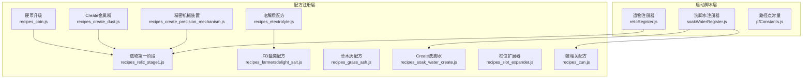

图表来源
- [recipes_coin.js:1-57](file://kubejs/server_scripts/recipes/recipes_coin.js#L1-L57)
- [recipes_create_precision_mechanism.js:1-131](file://kubejs/server_scripts/recipes/recipes_create_precision_mechanism.js#L1-L131)
- [recipes_relic_stage1.js:1-89](file://kubejs/server_scripts/recipes/recipes_relic_stage1.js#L1-L89)
- [recipes_create_dust.js:1-37](file://kubejs/server_scripts/recipes/recipes_create_dust.js#L1-L37)
- [recipes_farmersdelight_salt.js:1-37](file://kubejs/server_scripts/recipes/recipes_farmersdelight_salt.js#L1-L37)
- [recipes_grass_ash.js:1-29](file://kubejs/server_scripts/recipes/recipes_grass_ash.js#L1-L29)
- [recipes_electrolyte.js:1-60](file://kubejs/server_scripts/recipes/recipes_electrolyte.js#L1-L60)
- [recipes_soak_water_create.js:1-54](file://kubejs/server_scripts/recipes/recipes_soak_water_create.js#L1-L54)
- [recipes_slot_expander.js:1-29](file://kubejs/server_scripts/recipes/recipes_slot_expander.js#L1-L29)
- [recipes_cun.js:1-71](file://kubejs/server_scripts/recipes/recipes_cun.js#L1-L71)
- [soakWaterRegister.js:1-121](file://kubejs/startup_scripts/soakwater/soakWaterRegister.js#L1-L121)
- [relicRegister.js:1-178](file://kubejs/startup_scripts/relic/relicRegister.js#L1-L178)
- [pfConstants.js](file://kubejs/server_scripts/pathfinder/pfConstants.js)

章节来源
- [recipes_coin.js:1-57](file://kubejs/server_scripts/recipes/recipes_coin.js#L1-L57)
- [recipes_create_precision_mechanism.js:1-131](file://kubejs/server_scripts/recipes/recipes_create_precision_mechanism.js#L1-L131)
- [recipes_relic_stage1.js:1-89](file://kubejs/server_scripts/recipes/recipes_relic_stage1.js#L1-L89)
- [recipes_create_dust.js:1-37](file://kubejs/server_scripts/recipes/recipes_create_dust.js#L1-L37)
- [recipes_farmersdelight_salt.js:1-37](file://kubejs/server_scripts/recipes/recipes_farmersdelight_salt.js#L1-L37)
- [recipes_grass_ash.js:1-29](file://kubejs/server_scripts/recipes/recipes_grass_ash.js#L1-L29)
- [recipes_electrolyte.js:1-60](file://kubejs/server_scripts/recipes/recipes_electrolyte.js#L1-L60)
- [recipes_soak_water_create.js:1-54](file://kubejs/server_scripts/recipes/recipes_soak_water_create.js#L1-L54)
- [recipes_slot_expander.js:1-29](file://kubejs/server_scripts/recipes/recipes_slot_expander.js#L1-L29)
- [recipes_cun.js:1-71](file://kubejs/server_scripts/recipes/recipes_cun.js#L1-L71)
- [soakWaterRegister.js:1-121](file://kubejs/startup_scripts/soakwater/soakWaterRegister.js#L1-L121)
- [relicRegister.js:1-178](file://kubejs/startup_scripts/relic/relicRegister.js#L1-L178)
- [pfConstants.js](file://kubejs/server_scripts/pathfinder/pfConstants.js)

## 核心组件
- 硬币升级链：基于无序合成的9:1升阶机制，覆盖原版pile合成以避免冲突
- 精密机械装置：覆盖Create原版配方，将基材替换为黄铜板，调整副产物
- 遗物第一阶段：基于shaped合成的芯片配方，结合粉末主题与精密构件
- Create金属粉：提供石磨与粉碎轮双路径，便于不同阶段玩家选择
- Farmers Delight盐类：利用Cooking配方将泡脚废水桶转化为盐，并返还空桶
- 草木灰：熔炼草/高草/蕨/大蕨为草灰，提供基础化工原料
- 电解质水：Create混合与注液配方，整合柠檬、盐、糖与水
- 洗脚水：Create搅拌机配方，支持动态注册与多流体输入
- 栏位扩展器：基于shaped的MK1配方，使用精密构件与金属板
- 皴（Cun）：9个皴合成1块，配合筛网产出多种矿物粒

章节来源
- [recipes_coin.js:15-56](file://kubejs/server_scripts/recipes/recipes_coin.js#L15-L56)
- [recipes_create_precision_mechanism.js:12-130](file://kubejs/server_scripts/recipes/recipes_create_precision_mechanism.js#L12-L130)
- [recipes_relic_stage1.js:20-88](file://kubejs/server_scripts/recipes/recipes_relic_stage1.js#L20-L88)
- [recipes_create_dust.js:10-36](file://kubejs/server_scripts/recipes/recipes_create_dust.js#L10-L36)
- [recipes_farmersdelight_salt.js:17-36](file://kubejs/server_scripts/recipes/recipes_farmersdelight_salt.js#L17-L36)
- [recipes_grass_ash.js:9-28](file://kubejs/server_scripts/recipes/recipes_grass_ash.js#L9-L28)
- [recipes_electrolyte.js:9-59](file://kubejs/server_scripts/recipes/recipes_electrolyte.js#L9-L59)
- [recipes_soak_water_create.js:14-53](file://kubejs/server_scripts/recipes/recipes_soak_water_create.js#L14-L53)
- [recipes_slot_expander.js:13-28](file://kubejs/server_scripts/recipes/recipes_slot_expander.js#L13-L28)
- [recipes_cun.js:11-70](file://kubejs/server_scripts/recipes/recipes_cun.js#L11-L70)

## 架构总览
配方系统采用“启动脚本注册器 + 服务器配方脚本”的分层设计：
- 启动脚本层提供全局状态与扩展接口（如洗脚水注册器、遗物注册器）
- 服务器配方脚本通过KubeJS事件钩子注册各类配方，必要时调用Create/Farmers Delight等模组API
- 通过try-catch与日志记录保证配方注册的健壮性与可观测性

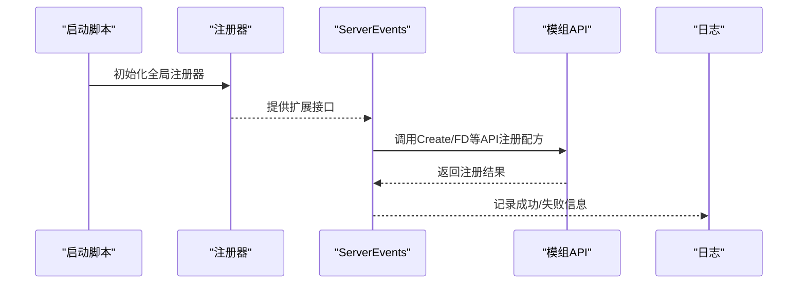

图表来源
- [soakWaterRegister.js:40-83](file://kubejs/startup_scripts/soakwater/soakWaterRegister.js#L40-L83)
- [relicRegister.js:3-42](file://kubejs/startup_scripts/relic/relicRegister.js#L3-L42)
- [recipes_create_precision_mechanism.js:12-130](file://kubejs/server_scripts/recipes/recipes_create_precision_mechanism.js#L12-L130)
- [recipes_farmersdelight_salt.js:17-36](file://kubejs/server_scripts/recipes/recipes_farmersdelight_salt.js#L17-L36)

## 详细组件分析

### 硬币升级配方（coinsje）
- 设计理念：9个下级硬币无序合成1个上级硬币，形成稳定的1:9递进面额体系，避免原版pile合成干扰
- 实现机制：遍历pile ID数组移除原版配方，随后注册9:1升阶的无序合成；使用shapeless确保顺序无关
- 材料平衡：通过覆盖pile配方避免重复产出，集中资源向高级硬币流动
- 生产效率：无序合成降低玩家操作成本，适合早期自动化

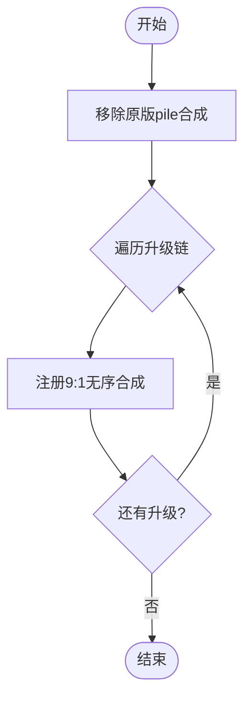

图表来源
- [recipes_coin.js:15-56](file://kubejs/server_scripts/recipes/recipes_coin.js#L15-L56)

章节来源
- [recipes_coin.js:15-56](file://kubejs/server_scripts/recipes/recipes_coin.js#L15-L56)

### 精密机械装置（Create覆盖）
- 设计理念：将Create原版精密构建的基材从金板替换为黄铜板，同时调整副产物，提升中后期材料利用率
- 实现机制：移除原版sequenced_assembly配方后，尝试多种deploying步骤与API风格（create.deploying/createDeploying等），最终以sequencedAssembly注册，设置过渡物品与循环次数
- 材料平衡：将金板与金粒纳入副产物，避免玩家绕过黄铜板获取金资源
- 生产效率：通过loops参数与过渡物品减少手工装配步骤，提升自动化效率

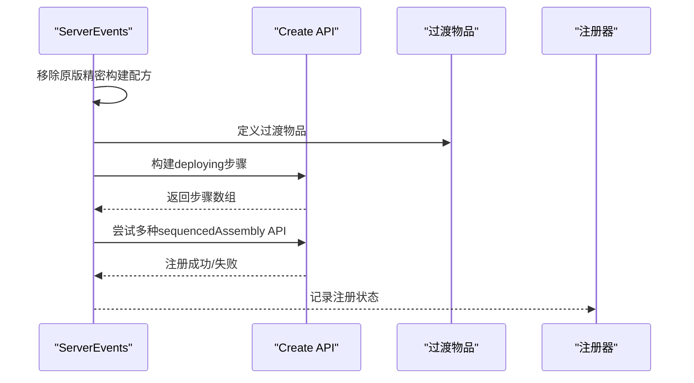

图表来源
- [recipes_create_precision_mechanism.js:12-130](file://kubejs/server_scripts/recipes/recipes_create_precision_mechanism.js#L12-L130)

章节来源
- [recipes_create_precision_mechanism.js:12-130](file://kubejs/server_scripts/recipes/recipes_create_precision_mechanism.js#L12-L130)

### 遗物第一阶段（芯片合成）
- 设计理念：基于shaped合成的芯片配方，结合三种主题粉末（金/铜/铁）与精密构件，形成主副效果组合
- 实现机制：普通×5配方使用3×3布局，主副效果粉位于中心行两端；高级×3配方在中心行放置三粉组合，要求4个精密构件与2个黄铜板
- 材料平衡：限制稀有芯片合成途径，保持稀有度与探索感
- 生产效率：通过唯一组合避免重复配方，鼓励多样化的效果搭配

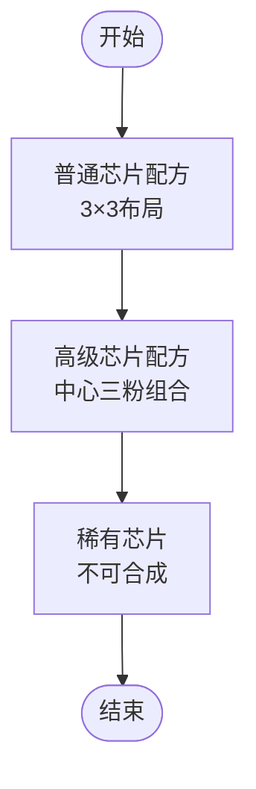

图表来源
- [recipes_relic_stage1.js:20-88](file://kubejs/server_scripts/recipes/recipes_relic_stage1.js#L20-L88)

章节来源
- [recipes_relic_stage1.js:20-88](file://kubejs/server_scripts/recipes/recipes_relic_stage1.js#L20-L88)

### Create金属粉（石磨与粉碎轮）
- 设计理念：提供两条处理路径，满足不同阶段玩家需求（石磨低门槛、粉碎轮批量）
- 实现机制：分别为铁、铜、金三种金属注册milling与crushing配方，产物为mekanism对应的dust
- 材料平衡：统一产物类型，便于下游化工与冶炼流程衔接
- 生产效率：双路径并行，可根据机械阶段灵活选择

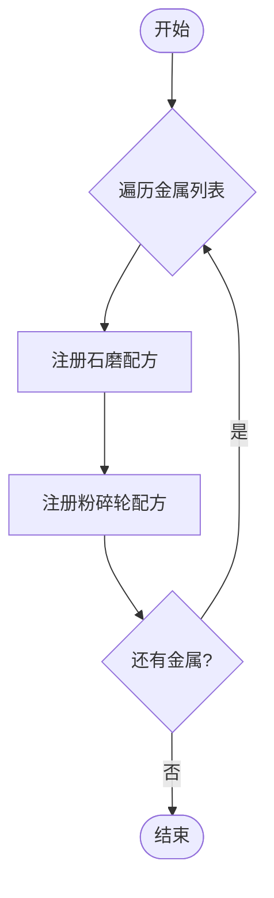

图表来源
- [recipes_create_dust.js:10-36](file://kubejs/server_scripts/recipes/recipes_create_dust.js#L10-L36)

章节来源
- [recipes_create_dust.js:10-36](file://kubejs/server_scripts/recipes/recipes_create_dust.js#L10-L36)

### Farmers Delight盐类（泡脚废水桶 → 盐）
- 设计理念：利用FD的cooking配方将特定桶物品（泡脚废水桶）转化为盐，并返还空桶
- 实现机制：指定ingredients、output、经验与烹饪时间，第5个参数container用于返还空桶
- 材料平衡：通过限定输入物品避免滥用，确保泡脚系统的价值
- 生产效率：单次烹饪产出稳定，便于自动化收集

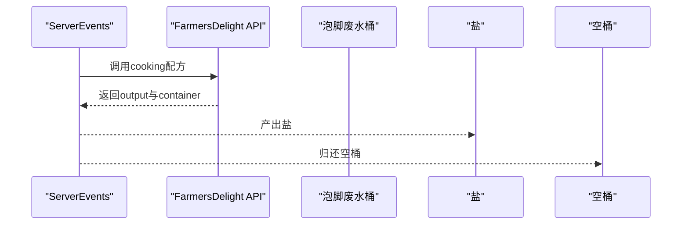

图表来源
- [recipes_farmersdelight_salt.js:17-36](file://kubejs/server_scripts/recipes/recipes_farmersdelight_salt.js#L17-L36)

章节来源
- [recipes_farmersdelight_salt.js:17-36](file://kubejs/server_scripts/recipes/recipes_farmersdelight_salt.js#L17-L36)

### 草木灰（熔炼配方）
- 设计理念：将草/高草/蕨/大蕨熔炼为草灰，作为基础化工原料
- 实现机制：遍历输入列表，注册smelting配方，设定经验与烹饪时间
- 材料平衡：与原版熔炼一致，便于玩家接受
- 生产效率：简单直接，适合早期自动化

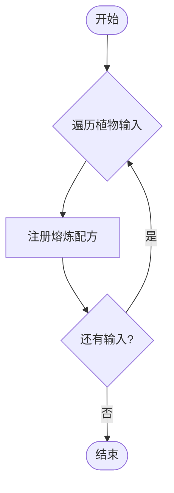

图表来源
- [recipes_grass_ash.js:9-28](file://kubejs/server_scripts/recipes/recipes_grass_ash.js#L9-L28)

章节来源
- [recipes_grass_ash.js:9-28](file://kubejs/server_scripts/recipes/recipes_grass_ash.js#L9-L28)

### 电解质水（Create混合与注液）
- 设计理念：整合水、柠檬、盐、糖通过Create混合生成电解质水，并用注液器装瓶
- 实现机制：先检查Create API可用性，再分别注册mixing与filling配方；注液器使用250mb流体装满一瓶
- 材料平衡：通过精确配比控制产物数量，避免浪费
- 生产效率：流水线化生产，适合大规模自动化

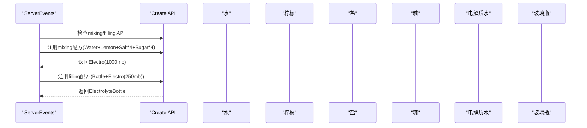

图表来源
- [recipes_electrolyte.js:9-59](file://kubejs/server_scripts/recipes/recipes_electrolyte.js#L9-L59)

章节来源
- [recipes_electrolyte.js:9-59](file://kubejs/server_scripts/recipes/recipes_electrolyte.js#L9-L59)

### 洗脚水（Create搅拌机）
- 设计理念：通过Create搅拌机将水与多种原料（含额外流体）混合生成对应洗脚水流体，唯一获取途径为机械
- 实现机制：读取全局注册器中的洗脚水定义，动态构建输入数组（水+额外流体+物品原料），注册mixing配方
- 材料平衡：强制使用Create设备，避免工作台合成泛滥
- 生产效率：支持多流体输入与批量配方，便于扩展

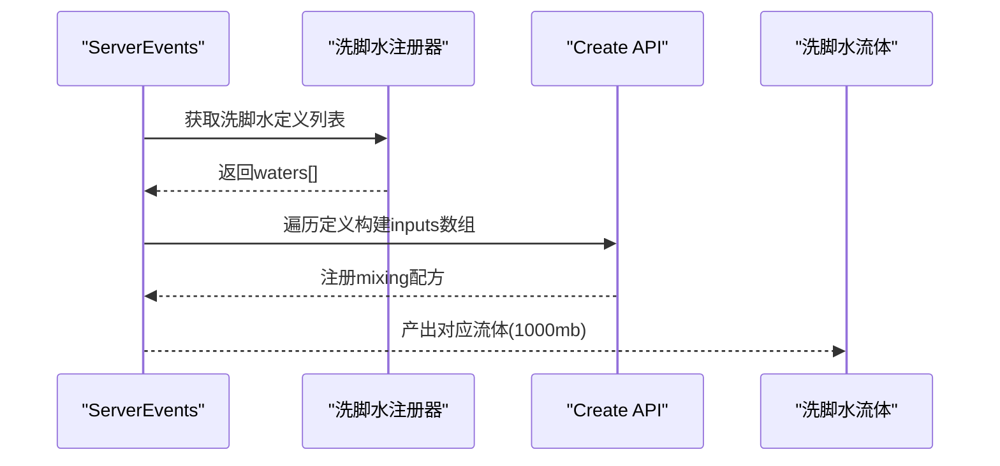

图表来源
- [recipes_soak_water_create.js:14-53](file://kubejs/server_scripts/recipes/recipes_soak_water_create.js#L14-L53)
- [soakWaterRegister.js:40-83](file://kubejs/startup_scripts/soakwater/soakWaterRegister.js#L40-L83)

章节来源
- [recipes_soak_water_create.js:14-53](file://kubejs/server_scripts/recipes/recipes_soak_water_create.js#L14-L53)
- [soakWaterRegister.js:40-83](file://kubejs/startup_scripts/soakwater/soakWaterRegister.js#L40-L83)

### 栏位扩展器（Slot Expander）
- 设计理念：MK1配方使用铁板、铜板与精密构件，作为后续MK2~MK5扩展的基础
- 实现机制：3×3 shaped配方，明确材料与产物
- 材料平衡：与精密构件联动，推动中后期机械进度
- 生产效率：简单配方，易于自动化

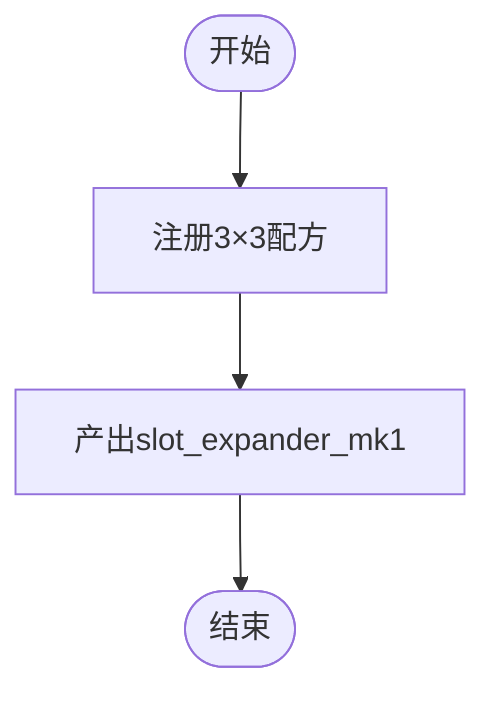

图表来源
- [recipes_slot_expander.js:13-28](file://kubejs/server_scripts/recipes/recipes_slot_expander.js#L13-L28)

章节来源
- [recipes_slot_expander.js:13-28](file://kubejs/server_scripts/recipes/recipes_slot_expander.js#L13-L28)

### 皴（Cun）相关机制
- 设计理念：9个皴合成1块，块状形式便于后续加工；配合筛网产出多种矿物粒
- 实现机制：移除createsifter自带沙砾筛选配方，注册9:1合成与筛网配方；筛网概率按网格等级倍率调整
- 材料平衡：通过移除捷径配方与倍率调整，维持资源获取的挑战性
- 生产效率：筛网可叠加倍率，适合后期高效提取

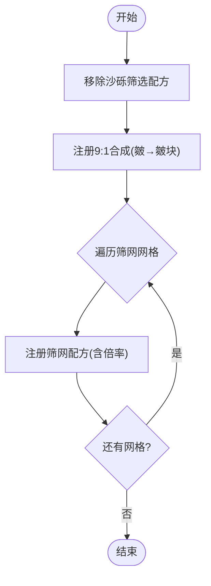

图表来源
- [recipes_cun.js:11-70](file://kubejs/server_scripts/recipes/recipes_cun.js#L11-L70)

章节来源
- [recipes_cun.js:11-70](file://kubejs/server_scripts/recipes/recipes_cun.js#L11-L70)

## 依赖关系分析
- 洗脚水配方依赖洗脚水注册器提供的动态定义（名称、颜色、额外流体、效果等）
- 遗物配方依赖Create精密构件与Forge标签（如dusts/gold等）
- 电解质配方依赖Create模组API可用性检测
- 精密机械装置配方覆盖Create原版配方，需确保API兼容性
- 硬币升级配方覆盖coinsje原版pile配方，避免冲突

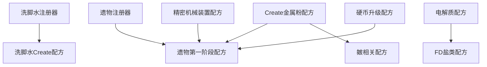

图表来源
- [soakWaterRegister.js:40-83](file://kubejs/startup_scripts/soakwater/soakWaterRegister.js#L40-L83)
- [relicRegister.js:3-42](file://kubejs/startup_scripts/relic/relicRegister.js#L3-L42)
- [recipes_create_precision_mechanism.js:12-130](file://kubejs/server_scripts/recipes/recipes_create_precision_mechanism.js#L12-L130)
- [recipes_relic_stage1.js:20-88](file://kubejs/server_scripts/recipes/recipes_relic_stage1.js#L20-L88)
- [recipes_create_dust.js:10-36](file://kubejs/server_scripts/recipes/recipes_create_dust.js#L10-L36)
- [recipes_coin.js:15-56](file://kubejs/server_scripts/recipes/recipes_coin.js#L15-L56)
- [recipes_electrolyte.js:9-59](file://kubejs/server_scripts/recipes/recipes_electrolyte.js#L9-L59)
- [recipes_farmersdelight_salt.js:17-36](file://kubejs/server_scripts/recipes/recipes_farmersdelight_salt.js#L17-L36)
- [recipes_cun.js:11-70](file://kubejs/server_scripts/recipes/recipes_cun.js#L11-L70)

章节来源
- [soakWaterRegister.js:40-83](file://kubejs/startup_scripts/soakwater/soakWaterRegister.js#L40-L83)
- [relicRegister.js:3-42](file://kubejs/startup_scripts/relic/relicRegister.js#L3-L42)
- [recipes_create_precision_mechanism.js:12-130](file://kubejs/server_scripts/recipes/recipes_create_precision_mechanism.js#L12-L130)
- [recipes_relic_stage1.js:20-88](file://kubejs/server_scripts/recipes/recipes_relic_stage1.js#L20-L88)
- [recipes_create_dust.js:10-36](file://kubejs/server_scripts/recipes/recipes_create_dust.js#L10-L36)
- [recipes_coin.js:15-56](file://kubejs/server_scripts/recipes/recipes_coin.js#L15-L56)
- [recipes_electrolyte.js:9-59](file://kubejs/server_scripts/recipes/recipes_electrolyte.js#L9-L59)
- [recipes_farmersdelight_salt.js:17-36](file://kubejs/server_scripts/recipes/recipes_farmersdelight_salt.js#L17-L36)
- [recipes_cun.js:11-70](file://kubejs/server_scripts/recipes/recipes_cun.js#L11-L70)

## 性能考虑
- API可用性检测：在注册前检查模组API可用性，避免因模组缺失导致的崩溃或冗余日志
- 多API风格回退：针对Create的多种API风格进行尝试，确保在不同版本KubeJS/模组环境下稳定运行
- 动态注册：通过全局注册器动态构建配方输入，减少硬编码，便于扩展
- 日志与错误处理：使用try-catch包裹注册过程并输出详细日志，便于定位问题

## 故障排除指南
- Create API不可用：检查模组是否加载，确认API方法名与版本兼容性
- 遗物/洗脚水未出现：确认注册器是否正确初始化，配方ID是否被其他脚本覆盖
- 精密构件缺失：确保前置配方（Create金属粉、硬币升级）已正确注册
- FD配方失败：核对输入物品ID与数量，确认容器参数是否正确
- 筛网配方异常：检查createsifter版本与网格ID，确认processingTime与chance范围

章节来源
- [recipes_create_precision_mechanism.js:12-130](file://kubejs/server_scripts/recipes/recipes_create_precision_mechanism.js#L12-L130)
- [recipes_farmersdelight_salt.js:17-36](file://kubejs/server_scripts/recipes/recipes_farmersdelight_salt.js#L17-L36)
- [recipes_cun.js:11-70](file://kubejs/server_scripts/recipes/recipes_cun.js#L11-L70)

## 结论
该配方系统通过清晰的分层设计与稳健的错误处理，实现了从硬币升级到精密机械、从Farmers Delight兼容到Create流水线的完整闭环。借助全局注册器与多API风格回退策略，系统具备良好的扩展性与兼容性。建议在新增配方时遵循现有模式：先检查API可用性，再注册并记录日志，最后通过注册器或常量文件维护全局状态。

## 附录
- 扩展指南
  - 新增Create配方：在对应脚本中添加注册逻辑，优先检查API可用性，使用合适的配方类型（milling/crushing/mixing/filling等）
  - 新增FD配方：使用cooking配方，注意第5个参数container的使用
  - 新增洗脚水：通过洗脚水注册器定义属性，配方脚本自动读取并注册
  - 新增遗物：通过遗物注册器定义属性与池类型，配方脚本按阶段注册
  - 参数配置：通过Forge标签与全局常量文件管理材料与数值平衡
  - 数据传递：通过global对象在启动脚本与配方脚本之间共享状态

- 最佳实践
  - 在注册前进行API可用性检测
  - 使用try-catch包裹注册逻辑并输出详细日志
  - 通过注册器集中管理可扩展数据，减少硬编码
  - 控制配方复杂度，避免过多依赖与循环引用
  - 保持材料平衡与产出价值，防止通货膨胀或资源枯竭