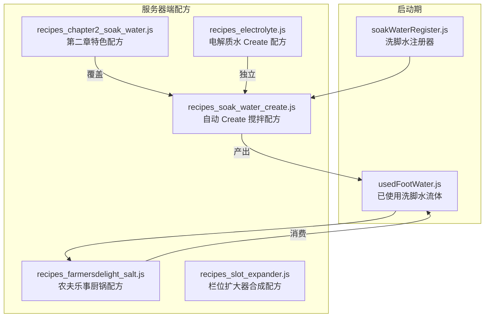
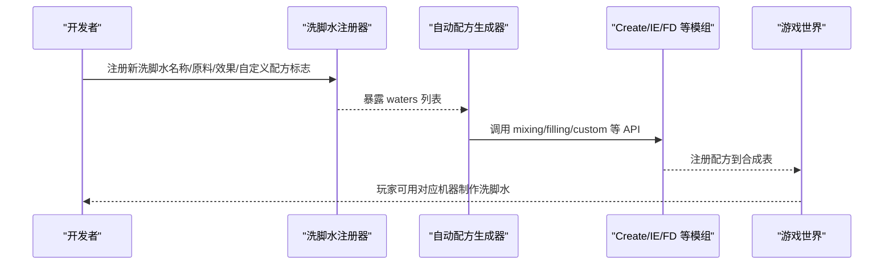
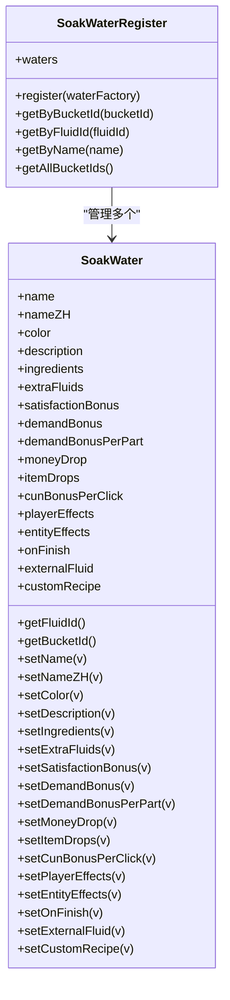
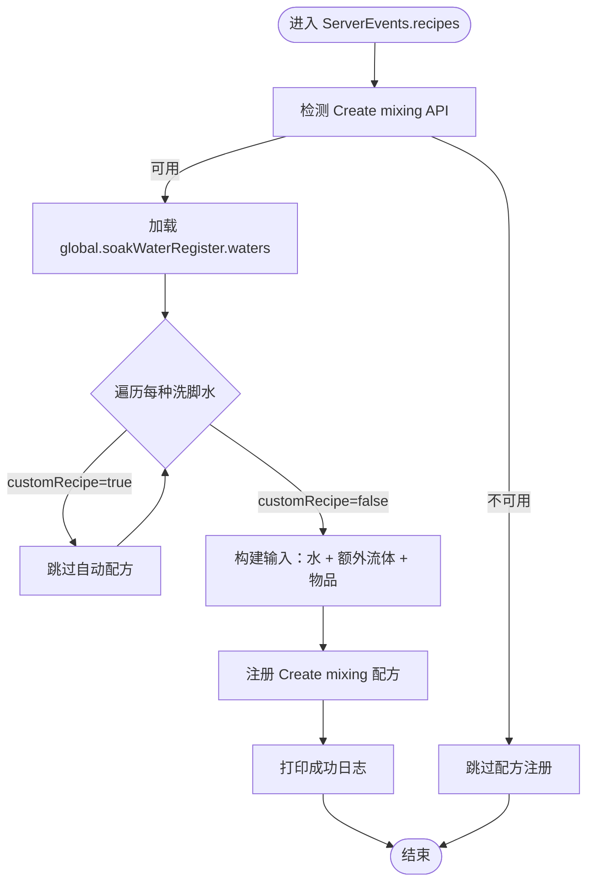
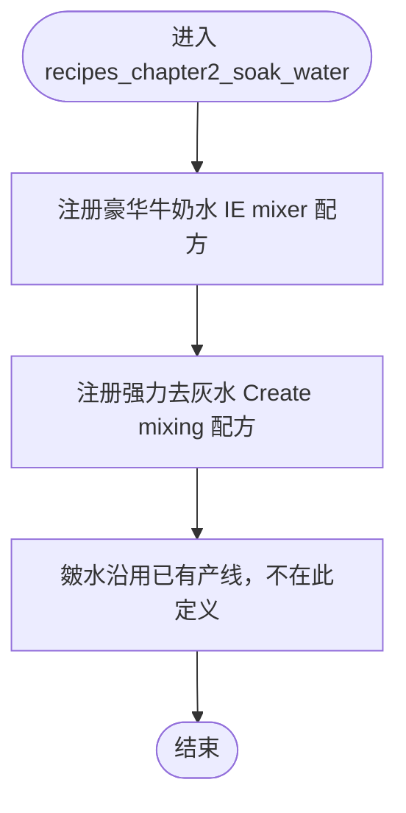
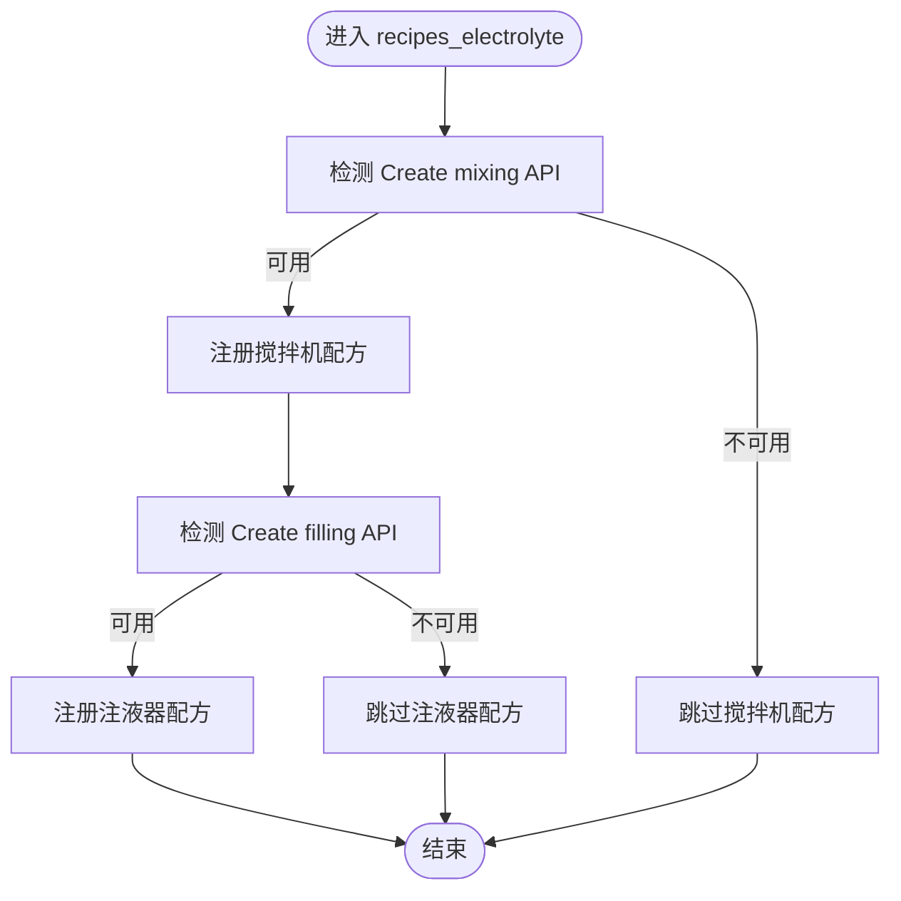
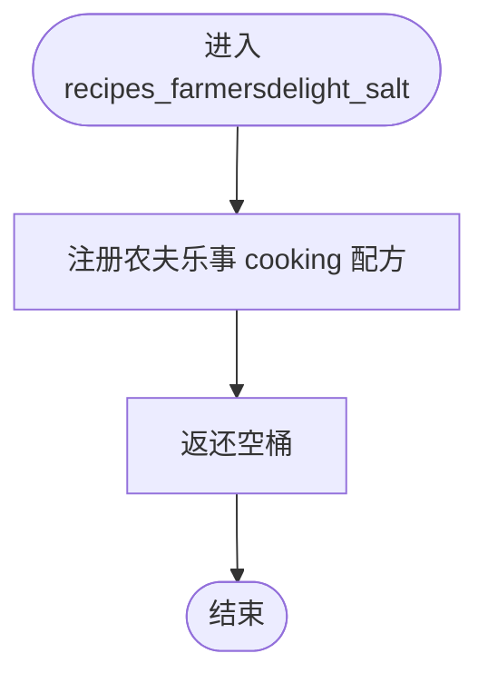
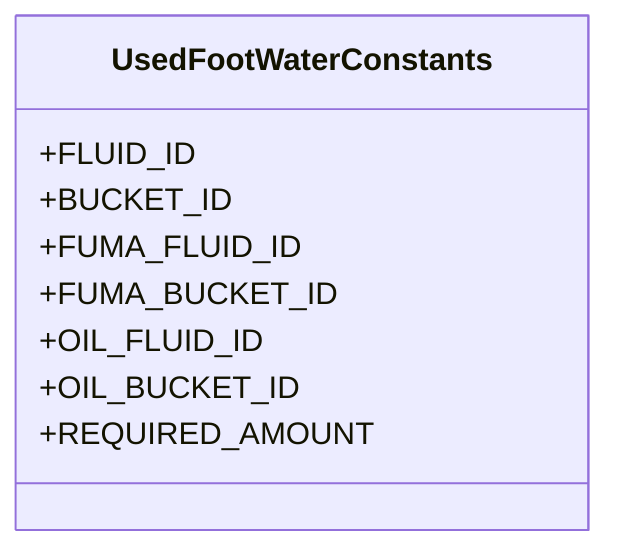
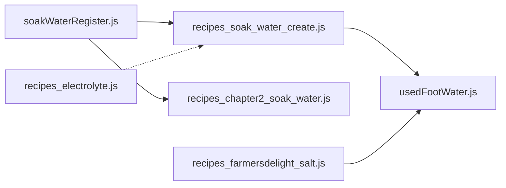

# 配方系统扩展

<cite>
**本文引用的文件**   
- [README.md](file://README.md)
- [项目总览.md](file://docs/00-项目总览.md)
- [soakWaterRegister.js](file://kubejs/startup_scripts/fluid/soakwater/soakWaterRegister.js)
- [usedFootWater.js](file://kubejs/startup_scripts/fluid/soakwater/usedFootWater.js)
- [recipes_soak_water_create.js](file://kubejs/server_scripts/recipes/recipes_soak_water_create.js)
- [recipes_chapter2_soak_water.js](file://kubejs/server_scripts/recipes/recipes_chapter2_soak_water.js)
- [recipes_electrolyte.js](file://kubejs/server_scripts/recipes/recipes_electrolyte.js)
- [recipes_farmersdelight_salt.js](file://kubejs/server_scripts/recipes/recipes_farmersdelight_salt.js)
- [recipes_slot_expander.js](file://kubejs/server_scripts/recipes/recipes_slot_expander.js)
</cite>

## 目录
1. [引言](#引言)
2. [项目结构](#项目结构)
3. [核心组件](#核心组件)
4. [架构总览](#架构总览)
5. [详细组件分析](#详细组件分析)
6. [依赖关系分析](#依赖关系分析)
7. [性能与可扩展性](#性能与可扩展性)
8. [故障排查指南](#故障排查指南)
9. [结论](#结论)
10. [附录：新增配方的操作清单](#附录新增配方的操作清单)

## 引言
本文件聚焦“配方系统扩展”，围绕整合包中基于 KubeJS 的配方注册机制，梳理洗脚水、电解质水、泡脚废水回收、章节特色配方等关键路径。目标是帮助开发者在不破坏现有循环的前提下，安全地扩展新的洗脚水、流体产物与加工配方。

该整合包以模拟经营空岛为核心，KubeJS 承担全部自定义玩法逻辑，包括顾客生成、寻路、搓脚、结算与配方；Create、Immersive Engineering、Mekanism、Farmers Delight 等模组通过 KubeJS 提供的 API 接入配方生态。

**章节来源**
- [README.md:1-6](file://README.md#L1-L6)
- [项目总览.md:1-62](file://docs/00-项目总览.md#L1-L62)

## 项目结构
配方相关代码主要分布在以下位置：
- 启动期流体与注册器：`kubejs/startup_scripts/fluid/soakwater/`
- 服务器端配方注册：`kubejs/server_scripts/recipes/`
- 其他辅助数据：标签、tag 定义位于 `kubejs/data/forge/tags/...`（用于桶与流体分类）

**图表来源**
- [soakWaterRegister.js:1-132](file://kubejs/startup_scripts/fluid/soakwater/soakWaterRegister.js#L1-L132)
- [usedFootWater.js:1-71](file://kubejs/startup_scripts/fluid/soakwater/usedFootWater.js#L1-L71)
- [recipes_soak_water_create.js:1-55](file://kubejs/server_scripts/recipes/recipes_soak_water_create.js#L1-L55)
- [recipes_chapter2_soak_water.js:1-52](file://kubejs/server_scripts/recipes/recipes_chapter2_soak_water.js#L1-L52)
- [recipes_electrolyte.js:1-59](file://kubejs/server_scripts/recipes/recipes_electrolyte.js#L1-L59)
- [recipes_farmersdelight_salt.js:1-36](file://kubejs/server_scripts/recipes/recipes_farmersdelight_salt.js#L1-L36)
- [recipes_slot_expander.js:1-28](file://kubejs/server_scripts/recipes/recipes_slot_expander.js#L1-L28)

**章节来源**
- [项目总览.md:45-56](file://docs/00-项目总览.md#L45-L56)

## 核心组件
- 洗脚水注册器：集中管理所有可被搓脚的洗脚水定义，提供链式配置接口，并导出全局查找方法。
- 已使用洗脚水：定义泡脚完成后产生的“废水”流体及桶，供后续回收或分馏。
- 自动配方生成器：遍历注册器中的洗脚水，为未标记 customRecipe 的类型自动生成 Create 搅拌机配方。
- 章节特色配方：对需要特殊机器或产线的洗脚水进行手动配方注册，跳过自动生成。
- 跨模组配方：电解质水、农夫乐事厨锅、栏位扩大器等，体现 KubeJS 对不同模组的统一接入方式。

**章节来源**
- [soakWaterRegister.js:1-132](file://kubejs/startup_scripts/fluid/soakwater/soakWaterRegister.js#L1-L132)
- [usedFootWater.js:1-71](file://kubejs/startup_scripts/fluid/soakwater/usedFootWater.js#L1-L71)
- [recipes_soak_water_create.js:1-55](file://kubejs/server_scripts/recipes/recipes_soak_water_create.js#L1-L55)
- [recipes_chapter2_soak_water.js:1-52](file://kubejs/server_scripts/recipes/recipes_chapter2_soak_water.js#L1-L52)
- [recipes_electrolyte.js:1-59](file://kubejs/server_scripts/recipes/recipes_electrolyte.js#L1-L59)
- [recipes_farmersdelight_salt.js:1-36](file://kubejs/server_scripts/recipes/recipes_farmersdelight_salt.js#L1-L36)
- [recipes_slot_expander.js:1-28](file://kubejs/server_scripts/recipes/recipes_slot_expander.js#L1-L28)

## 架构总览
配方系统的扩展点围绕“注册器 + 自动生成 + 手工覆盖”的模式展开：
- 启动期通过注册器声明洗脚水属性（名称、颜色、原料、效果、是否自定义配方等）。
- 服务器启动时，自动生成器读取注册器，批量创建 Create 搅拌机配方。
- 若某洗脚水需要 IE 搅拌机、Create 动力搅拌机或其他复杂流程，则设置 customRecipe=true，并在对应章节配方文件中手动注册。
- 泡脚完成后，洗脚水转换为“已使用洗脚水”，可通过农夫乐事厨锅等途径回收资源。

**图表来源**
- [soakWaterRegister.js:45-88](file://kubejs/startup_scripts/fluid/soakwater/soakWaterRegister.js#L45-L88)
- [recipes_soak_water_create.js:14-54](file://kubejs/server_scripts/recipes/recipes_soak_water_create.js#L14-L54)
- [recipes_chapter2_soak_water.js:15-51](file://kubejs/server_scripts/recipes/recipes_chapter2_soak_water.js#L15-L51)

## 详细组件分析

### 洗脚水注册器 SoakWaterRegister
- 职责：维护洗脚水定义数组，提供按桶 ID、流体 ID、名称查询的方法，以及获取所有桶 ID 的工具方法。
- 设计要点：
  - 每个洗脚水对象包含 name、nameZH、color、description、ingredients、extraFluids、satisfactionBonus、demandBonus、demandBonusPerPart、moneyDrop、itemDrops、cunBonusPerClick、playerEffects、entityEffects、onFinish、externalFluid、customRecipe 等字段。
  - 通过 setXxx 链式 API 配置，便于在多个注册文件中分散定义。
  - externalFluid=true 表示流体已在别处注册，避免重复注册。
  - customRecipe=true 表示跳过自动 Create mixing 生成，由章节配方文件手动处理。

**图表来源**
- [soakWaterRegister.js:45-129](file://kubejs/startup_scripts/fluid/soakwater/soakWaterRegister.js#L45-L129)

**章节来源**
- [soakWaterRegister.js:1-132](file://kubejs/startup_scripts/fluid/soakwater/soakWaterRegister.js#L1-L132)

### 自动 Create 搅拌机配方生成 recipes_soak_water_create.js
- 触发时机：ServerEvents.recipes。
- 前置检查：检测 event.recipes.create.mixing 是否存在，否则跳过。
- 遍历 global.soakWaterRegister.waters，对 customRecipe=false 的洗脚水生成标准搅拌配方：
  - 输入：水 1000mb + extraFluids（可选）+ ingredients（物品列表）。
  - 输出：对应洗脚水流体 1000mb。
- 日志：打印注册成功或失败信息，便于调试。

**图表来源**
- [recipes_soak_water_create.js:14-54](file://kubejs/server_scripts/recipes/recipes_soak_water_create.js#L14-L54)

**章节来源**
- [recipes_soak_water_create.js:1-55](file://kubejs/server_scripts/recipes/recipes_soak_water_create.js#L1-L55)

### 第二章特色配方 recipes_chapter2_soak_water.js
- 用途：为三种不走自动生成的洗脚水提供手工配方。
- 豪华牛奶水：使用 IE 工业搅拌机，输入牛奶水 tag 与金粉 tag，输出 kubejs:deluxe_milk_water。
- 强力去灰水：使用 Create 动力搅拌机，输入草灰水与赛特斯石英粉，输出 kubejs:strong_ash_water。
- 皴水：沿用已有产线，不在本文件定义。

**图表来源**
- [recipes_chapter2_soak_water.js:15-51](file://kubejs/server_scripts/recipes/recipes_chapter2_soak_water.js#L15-L51)

**章节来源**
- [recipes_chapter2_soak_water.js:1-52](file://kubejs/server_scripts/recipes/recipes_chapter2_soak_water.js#L1-L52)

### 电解质水配方 recipes_electrolyte.js
- 目标：提供电解质水的 Create 搅拌机与注液器配方。
- 搅拌机：水(1000mb) + 柠檬 + 盐 ×4 + 糖 ×4 → 电解质水(1000mb)。
- 注液器：玻璃瓶 + 电解质水(250mb) → 电解质水瓶。
- 兼容性：检测 Create API 可用性，不可用时跳过并记录日志。

**图表来源**
- [recipes_electrolyte.js:9-59](file://kubejs/server_scripts/recipes/recipes_electrolyte.js#L9-L59)

**章节来源**
- [recipes_electrolyte.js:1-59](file://kubejs/server_scripts/recipes/recipes_electrolyte.js#L1-L59)

### 农夫乐事厨锅配方 recipes_farmersdelight_salt.js
- 目标：将泡脚废水桶转化为盐，并返还空桶。
- 输入：#kubejs:foot_water_bucket（普通与富魔洗脚水桶）。
- 输出：mekanism:salt。
- 容器返还：minecraft:bucket。

**图表来源**
- [recipes_farmersdelight_salt.js:17-36](file://kubejs/server_scripts/recipes/recipes_farmersdelight_salt.js#L17-L36)

**章节来源**
- [recipes_farmersdelight_salt.js:1-36](file://kubejs/server_scripts/recipes/recipes_farmersdelight_salt.js#L1-L36)

### 已使用洗脚水 usedFootWater.js
- 目标：注册泡脚完成后产生的“已使用洗脚水”流体与桶。
- 类型：
  - 普通洗脚水：人类/神明顾客产出。
  - 富魔洗脚水：妖怪/妖精顾客产出。
  - 含油洗脚水：鬼族顾客产出，第三章石油线专用。
- 常量导出：pfUsedFootWater 提供流体与桶 ID 常量，供服务端脚本引用。

**图表来源**
- [usedFootWater.js:62-70](file://kubejs/startup_scripts/fluid/soakwater/usedFootWater.js#L62-L70)

**章节来源**
- [usedFootWater.js:1-71](file://kubejs/startup_scripts/fluid/soakwater/usedFootWater.js#L1-L71)

### 栏位扩大器配方 recipes_slot_expander.js
- 目标：注册 MK1 栏位扩大器的 3×3 合成配方。
- 材料：铁板、铜板、精密构件。
- 扩展性：预留 MK2~MK5 扩展范式。

**章节来源**
- [recipes_slot_expander.js:1-28](file://kubejs/server_scripts/recipes/recipes_slot_expander.js#L1-L28)

## 依赖关系分析
- 洗脚水注册器是配方扩展的核心入口，所有新增洗脚水都应通过其 register 方法声明。
- 自动配方生成器依赖注册器的 waters 列表，且尊重 customRecipe 标志。
- 章节特色配方文件用于覆盖自动生成，通常针对需要 IE 或特殊 Create 机器的配方。
- 已使用洗脚水与农夫乐事厨锅配方形成闭环：泡脚产生废水 → 回收为盐。

**图表来源**
- [soakWaterRegister.js:45-88](file://kubejs/startup_scripts/fluid/soakwater/soakWaterRegister.js#L45-L88)
- [recipes_soak_water_create.js:14-54](file://kubejs/server_scripts/recipes/recipes_soak_water_create.js#L14-L54)
- [recipes_chapter2_soak_water.js:15-51](file://kubejs/server_scripts/recipes/recipes_chapter2_soak_water.js#L15-L51)
- [recipes_farmersdelight_salt.js:17-36](file://kubejs/server_scripts/recipes/recipes_farmersdelight_salt.js#L17-L36)
- [recipes_electrolyte.js:9-59](file://kubejs/server_scripts/recipes/recipes_electrolyte.js#L9-L59)

**章节来源**
- [soakWaterRegister.js:1-132](file://kubejs/startup_scripts/fluid/soakwater/soakWaterRegister.js#L1-L132)
- [recipes_soak_water_create.js:1-55](file://kubejs/server_scripts/recipes/recipes_soak_water_create.js#L1-L55)
- [recipes_chapter2_soak_water.js:1-52](file://kubejs/server_scripts/recipes/recipes_chapter2_soak_water.js#L1-L52)
- [recipes_farmersdelight_salt.js:1-36](file://kubejs/server_scripts/recipes/recipes_farmersdelight_salt.js#L1-L36)
- [recipes_electrolyte.js:1-59](file://kubejs/server_scripts/recipes/recipes_electrolyte.js#L1-L59)

## 性能与可扩展性
- 注册器采用简单数组遍历，查找复杂度 O(n)，n 为洗脚水种类数量，当前规模下开销可忽略。
- 自动配方生成仅在服务器启动阶段执行一次，不会在游戏运行时造成持续开销。
- 扩展建议：
  - 新增洗脚水优先使用注册器，保持配置集中化。
  - 若需复杂机器或产线，设置 customRecipe=true 并在章节配方文件中手工注册。
  - 对于跨模组配方，遵循各模组 KubeJS 插件约定（如 Create mixing/filling、IE mixer、FD cooking）。

[本节为通用指导，不涉及具体文件分析]

## 故障排查指南
- Create API 不可用：
  - 现象：自动配方生成器打印“未检测到 Create mixing API”。
  - 排查：确认 Create 模组已安装且版本兼容；检查 KubeJS Create 插件是否启用。
  - 参考：[recipes_soak_water_create.js:14-19](file://kubejs/server_scripts/recipes/recipes_soak_water_create.js#L14-L19)
- 洗脚水未出现在合成表中：
  - 现象：注册器已添加但无自动配方。
  - 排查：确认 customRecipe 是否为 false；检查 ingredients 与 extraFluids 是否正确。
  - 参考：[recipes_soak_water_create.js:21-54](file://kubejs/server_scripts/recipes/recipes_soak_water_create.js#L21-L54)
- 章节特色配方注册失败：
  - 现象：控制台打印“配方注册失败”。
  - 排查：检查 IE/Create/FD 模组是否安装；核对 tag 与 fluid id 是否正确。
  - 参考：[recipes_chapter2_soak_water.js:18-50](file://kubejs/server_scripts/recipes/recipes_chapter2_soak_water.js#L18-L50)
- 电解质水配方缺失：
  - 现象：搅拌机或注液器无配方。
  - 排查：确认 Create API 可用；检查输入流体与物品 id。
  - 参考：[recipes_electrolyte.js:9-59](file://kubejs/server_scripts/recipes/recipes_electrolyte.js#L9-L59)
- 泡脚废水无法回收为盐：
  - 现象：农夫乐事厨锅无配方。
  - 排查：确认 #kubejs:foot_water_bucket 标签存在；检查容器返还设置。
  - 参考：[recipes_farmersdelight_salt.js:17-36](file://kubejs/server_scripts/recipes/recipes_farmersdelight_salt.js#L17-L36)

**章节来源**
- [recipes_soak_water_create.js:14-54](file://kubejs/server_scripts/recipes/recipes_soak_water_create.js#L14-L54)
- [recipes_chapter2_soak_water.js:18-50](file://kubejs/server_scripts/recipes/recipes_chapter2_soak_water.js#L18-L50)
- [recipes_electrolyte.js:9-59](file://kubejs/server_scripts/recipes/recipes_electrolyte.js#L9-L59)
- [recipes_farmersdelight_salt.js:17-36](file://kubejs/server_scripts/recipes/recipes_farmersdelight_salt.js#L17-L36)

## 结论
本配方系统以“注册器 + 自动生成 + 手工覆盖”为核心模式，既保证了新增洗脚水的便捷性，又保留了复杂配方的灵活性。通过统一的 KubeJS 扩展点，整合包能够稳定地接入 Create、IE、FD、Mekanism 等多个模组，形成从服务到资源再到科技的完整循环。

[本节为总结性内容，不涉及具体文件分析]

## 附录：新增配方的操作清单
- 新增基础洗脚水：
  - 在启动期注册器中添加 new SoakWater 实例，设置 name、nameZH、color、ingredients、extraFluids 等。
  - 若无需特殊机器，保持 customRecipe=false，自动配方生成器会为其创建 Create 搅拌机配方。
  - 参考：[soakWaterRegister.js:45-129](file://kubejs/startup_scripts/fluid/soakwater/soakWaterRegister.js#L45-L129)
- 新增复杂洗脚水：
  - 设置 customRecipe=true，并在章节配方文件中手工注册 IE/Create/FD 等配方。
  - 参考：[recipes_chapter2_soak_water.js:15-51](file://kubejs/server_scripts/recipes/recipes_chapter2_soak_water.js#L15-L51)
- 新增跨模组配方：
  - 遵循各模组 KubeJS 插件 API（mixing/filling/custom/cooking）。
  - 参考：[recipes_electrolyte.js:9-59](file://kubejs/server_scripts/recipes/recipes_electrolyte.js#L9-L59)、[recipes_farmersdelight_salt.js:17-36](file://kubejs/server_scripts/recipes/recipes_farmersdelight_salt.js#L17-L36)
- 新增废水回收配方：
  - 使用 #kubejs:foot_water_bucket 标签匹配普通与富魔洗脚水桶。
  - 参考：[recipes_farmersdelight_salt.js:17-36](file://kubejs/server_scripts/recipes/recipes_farmersdelight_salt.js#L17-L36)

**章节来源**
- [soakWaterRegister.js:45-129](file://kubejs/startup_scripts/fluid/soakwater/soakWaterRegister.js#L45-L129)
- [recipes_chapter2_soak_water.js:15-51](file://kubejs/server_scripts/recipes/recipes_chapter2_soak_water.js#L15-L51)
- [recipes_electrolyte.js:9-59](file://kubejs/server_scripts/recipes/recipes_electrolyte.js#L9-L59)
- [recipes_farmersdelight_salt.js:17-36](file://kubejs/server_scripts/recipes/recipes_farmersdelight_salt.js#L17-L36)