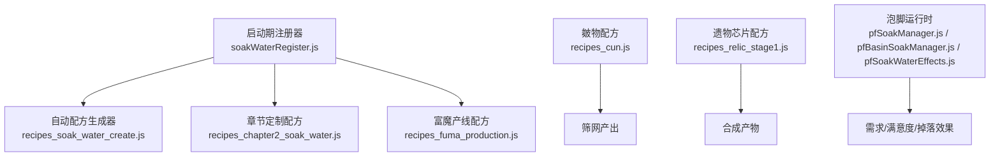
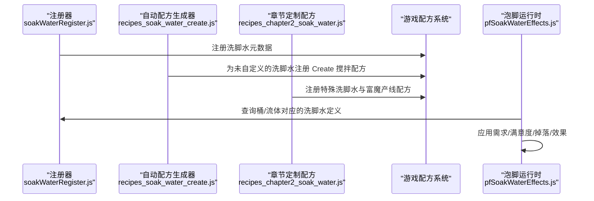
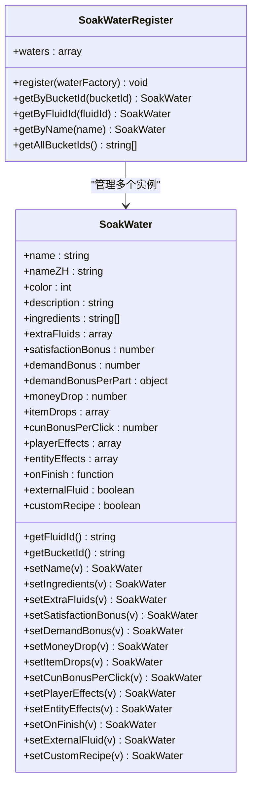
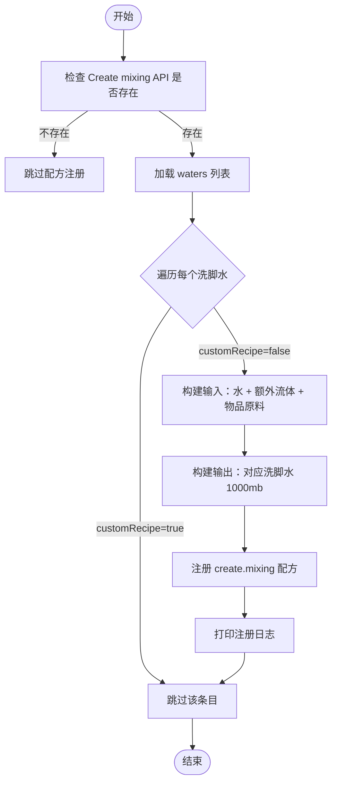
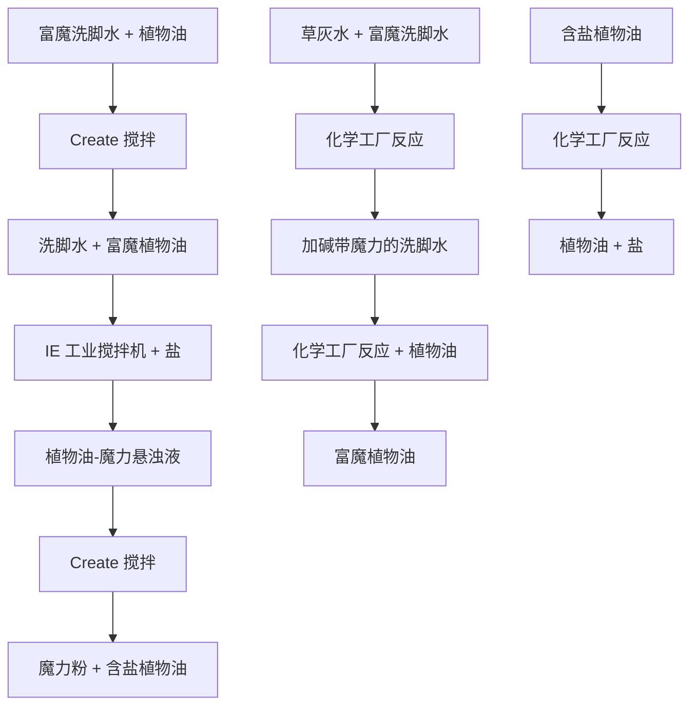
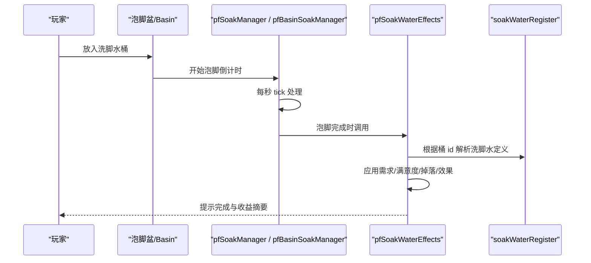
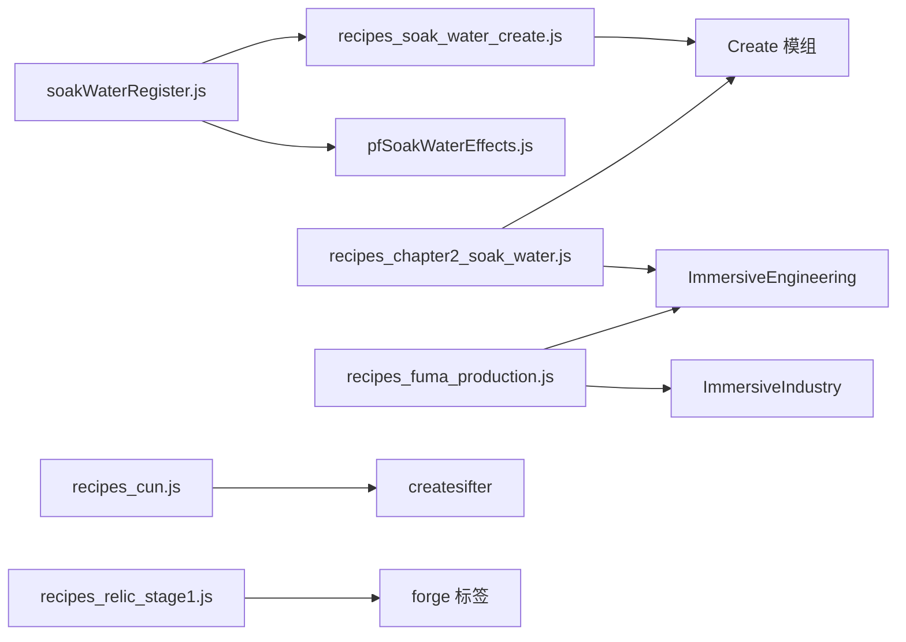

# 高级配方系统

<cite>
**本文引用的文件**   
- [README.md](file://README.md)
- [soakWaterRegister.js](file://kubejs/startup_scripts/fluid/soakwater/soakWaterRegister.js)
- [recipes_soak_water_create.js](file://kubejs/server_scripts/recipes/recipes_soak_water_create.js)
- [recipes_chapter2_soak_water.js](file://kubejs/server_scripts/recipes/recipes_chapter2_soak_water.js)
- [recipes_fuma_production.js](file://kubejs/server_scripts/recipes/recipes_fuma_production.js)
- [recipes_cun.js](file://kubejs/server_scripts/recipes/recipes_cun.js)
- [recipes_relic_stage1.js](file://kubejs/server_scripts/recipes/recipes_relic_stage1.js)
- [pfSoakManager.js](file://kubejs/server_scripts/pathfinder/pfSoakManager.js)
- [pfBasinSoakManager.js](file://kubejs/server_scripts/pathfinder/pfBasinSoakManager.js)
- [pfSoakWaterEffects.js](file://kubejs/server_scripts/pathfinder/pfSoakWaterEffects.js)
</cite>

## 目录
1. [引言](#引言)
2. [项目结构](#项目结构)
3. [核心组件](#核心组件)
4. [架构总览](#架构总览)
5. [详细组件分析](#详细组件分析)
6. [依赖关系分析](#依赖关系分析)
7. [性能与扩展性](#性能与扩展性)
8. [故障排查指南](#故障排查指南)
9. [结论](#结论)

## 引言
本文件聚焦“高级配方系统”，即围绕洗脚水、富魔产线、皴物处理与遗物芯片等核心玩法的 KubeJS 配方体系。该系统以“注册表 + 自动配方生成 + 章节定制配方”的分层设计，将数据定义与生产流程解耦，既保证可扩展性，又便于维护与调试。

## 项目结构
配方相关代码主要分布在以下位置：
- 启动期流体与数据注册：`kubejs/startup_scripts/fluid/soakwater/soakWaterRegister.js`
- 服务器端配方注册：`kubejs/server_scripts/recipes/*.js`
- 泡脚系统与配方联动：`kubejs/server_scripts/pathfinder/pfSoakManager.js`、`pfBasinSoakManager.js`、`pfSoakWaterEffects.js`

图表来源
- [soakWaterRegister.js:1-132](file://kubejs/startup_scripts/fluid/soakwater/soakWaterRegister.js#L1-L132)
- [recipes_soak_water_create.js:1-55](file://kubejs/server_scripts/recipes/recipes_soak_water_create.js#L1-L55)
- [recipes_chapter2_soak_water.js:1-52](file://kubejs/server_scripts/recipes/recipes_chapter2_soak_water.js#L1-L52)
- [recipes_fuma_production.js:1-105](file://kubejs/server_scripts/recipes/recipes_fuma_production.js#L1-L105)
- [recipes_cun.js:1-71](file://kubejs/server_scripts/recipes/recipes_cun.js#L1-L71)
- [recipes_relic_stage1.js:1-89](file://kubejs/server_scripts/recipes/recipes_relic_stage1.js#L1-L89)
- [pfSoakManager.js:69-105](file://kubejs/server_scripts/pathfinder/pfSoakManager.js#L69-L105)
- [pfBasinSoakManager.js:435-463](file://kubejs/server_scripts/pathfinder/pfBasinSoakManager.js#L435-L463)
- [pfSoakWaterEffects.js:123-276](file://kubejs/server_scripts/pathfinder/pfSoakWaterEffects.js#L123-L276)

章节来源
- [README.md:1-6](file://README.md#L1-L6)

## 核心组件
- 洗脚水注册器：集中管理洗脚水的名称、颜色、原料、额外流体、效果与配方开关，提供链式 API 与查询方法。
- 自动 Create 搅拌机配方生成器：遍历注册表，为未自定义配方的洗脚水自动生成“水 + 原料 → 洗脚水”的搅拌配方。
- 章节定制配方：对特殊洗脚水（如豪华牛奶水、强力去灰水）和富魔产线进行手工配方定义。
- 皴物与筛网配方：将皴块通过不同筛网等级产出多种矿物颗粒，并移除默认捷径配方。
- 遗物芯片配方：按主题粉末组合生成普通/高级芯片，稀有芯片仅通过非合成渠道获取。
- 泡脚运行时：读取洗脚水定义，应用需求增量、满意度、掉落、玩家/实体效果与自定义回调。

章节来源
- [soakWaterRegister.js:1-132](file://kubejs/startup_scripts/fluid/soakwater/soakWaterRegister.js#L1-L132)
- [recipes_soak_water_create.js:1-55](file://kubejs/server_scripts/recipes/recipes_soak_water_create.js#L1-L55)
- [recipes_chapter2_soak_water.js:1-52](file://kubejs/server_scripts/recipes/recipes_chapter2_soak_water.js#L1-L52)
- [recipes_fuma_production.js:1-105](file://kubejs/server_scripts/recipes/recipes_fuma_production.js#L1-L105)
- [recipes_cun.js:1-71](file://kubejs/server_scripts/recipes/recipes_cun.js#L1-L71)
- [recipes_relic_stage1.js:1-89](file://kubejs/server_scripts/recipes/recipes_relic_stage1.js#L1-L89)
- [pfSoakWaterEffects.js:123-276](file://kubejs/server_scripts/pathfinder/pfSoakWaterEffects.js#L123-L276)

## 架构总览
系统采用“数据驱动 + 插件式扩展”的设计：
- 启动期：注册洗脚水元数据，暴露全局查询接口。
- 配方期：根据元数据自动生成基础配方；章节内容覆盖或补充特殊配方。
- 运行期：泡脚逻辑读取注册表，应用效果并反馈给玩家与顾客实体。

图表来源
- [soakWaterRegister.js:45-131](file://kubejs/startup_scripts/fluid/soakwater/soakWaterRegister.js#L45-L131)
- [recipes_soak_water_create.js:14-54](file://kubejs/server_scripts/recipes/recipes_soak_water_create.js#L14-L54)
- [recipes_chapter2_soak_water.js:15-51](file://kubejs/server_scripts/recipes/recipes_chapter2_soak_water.js#L15-L51)
- [pfSoakWaterEffects.js:133-270](file://kubejs/server_scripts/pathfinder/pfSoakWaterEffects.js#L133-L270)

## 详细组件分析

### 洗脚水注册器
职责：
- 提供 SoakWaterRegister 与 SoakWater 两类对象，支持链式设置属性。
- 暴露 getByBucketId/getByFluidId/getByName 等查询方法。
- 控制是否跳过自动流体注册与自动配方生成。

关键设计点：
- externalFluid：允许外部模块自行注册流体，避免重复。
- customRecipe：标记该洗脚水不走自动 Create mixing 生成，交由章节定制或独立产线处理。
- 字段涵盖显示名、颜色、描述、原料、额外流体、满意度/需求加成、掉落、搓脚皴加成、玩家/实体效果与 onFinish 回调。

图表来源
- [soakWaterRegister.js:45-131](file://kubejs/startup_scripts/fluid/soakwater/soakWaterRegister.js#L45-L131)

章节来源
- [soakWaterRegister.js:1-132](file://kubejs/startup_scripts/fluid/soakwater/soakWaterRegister.js#L1-L132)

### 自动 Create 搅拌机配方生成器
职责：
- 检测 Create mixing API 可用性。
- 遍历 global.soakWaterRegister.waters，为每个未自定义配方的洗脚水生成“水(1000mb) + 额外流体 + 物品原料 → 洗脚水(1000mb)”的配方。
- 输出日志记录成功/失败信息。

流程图：

图表来源
- [recipes_soak_water_create.js:14-54](file://kubejs/server_scripts/recipes/recipes_soak_water_create.js#L14-L54)

章节来源
- [recipes_soak_water_create.js:1-55](file://kubejs/server_scripts/recipes/recipes_soak_water_create.js#L1-L55)

### 章节定制配方（第二章特色洗脚水）
职责：
- 为豪华牛奶水、强力去灰水分别定义 IE 工业搅拌机与 Create 动力搅拌机配方。
- 使用 tag 匹配流体与物品，确保跨模组兼容。

要点：
- 豪华牛奶水：IE mixer，牛奶水(tag) + 金粉(dusts/gold) → 豪华牛奶水。
- 强力去灰水：Create mixing，草灰水 + 赛特斯石英粉 → 强力去灰水。

章节来源
- [recipes_chapter2_soak_water.js:1-52](file://kubejs/server_scripts/recipes/recipes_chapter2_soak_water.js#L1-L52)

### 富魔产线配方
职责：
- 实现富魔洗脚水处理的多阶段产线，包括动力搅拌、IE 工业搅拌机、化学工厂反应与回收流程。

流程概览：
- 步骤一：富魔洗脚水 + 植物油 → 洗脚水 + 富魔植物油（Create mixing）。
- 步骤二：富魔植物油 + 盐 → 植物油-魔力悬浊液（IE mixer）。
- 步骤三：植物油-魔力悬浊液 → 魔力粉 + 含盐植物油（Create mixing）。
- 高效路径：草灰水 + 富魔洗脚水 → 加碱带魔力的洗脚水（ImmersiveIndustry chemical）。
- 高效路径：加碱带魔力的洗脚水 + 植物油 → 富魔植物油（ImmersiveIndustry chemical）。
- 回收路径：含盐植物油 → 植物油 + 盐（ImmersiveIndustry chemical）。

图表来源
- [recipes_fuma_production.js:22-101](file://kubejs/server_scripts/recipes/recipes_fuma_production.js#L22-L101)

章节来源
- [recipes_fuma_production.js:1-105](file://kubejs/server_scripts/recipes/recipes_fuma_production.js#L1-L105)

### 皴物与筛网配方
职责：
- 移除默认沙砾筛选捷径，防止白嫖矿物。
- 将 9 个皴合成 1 个皴块。
- 为三种筛网等级注册皴块筛选配方，概率随筛网倍率提升。

关键点：
- 筛网等级：string_mesh(1.0×)、brass_mesh(1.5×)、advanced_brass_mesh(2.25×)。
- 产出：铁粒、铜粒、锌粒、金粒、下界石英，数量与概率受筛网倍率影响。

章节来源
- [recipes_cun.js:1-71](file://kubejs/server_scripts/recipes/recipes_cun.js#L1-L71)

### 遗物芯片配方（第一阶段）
职责：
- 普通芯片：红石+黄铜板+精密构件+主副粉末组合，唯一组合对应唯一芯片。
- 高级芯片：四精密构件+两黄铜板+中间行三粉组合，唯一组合对应唯一芯片。
- 稀有芯片：不提供合成配方，仅通过特殊渠道获得。

主题映射：
- 满意度→金粉(G)、金钱→铜粉(C)、体力→铁粉(I)。

章节来源
- [recipes_relic_stage1.js:1-89](file://kubejs/server_scripts/recipes/recipes_relic_stage1.js#L1-L89)

### 泡脚运行时与配方联动
职责：
- 校验当前桶是否为可用洗脚水（清水兜底或注册表匹配）。
- 在泡脚倒计时中每秒触发事件，完成时应用效果。
- 应用效果包括：部位需求增量、满意度增减、即时掉钱、掉落物品、搓脚皴加成、玩家/实体药水效果与自定义回调。

交互序列：

图表来源
- [pfSoakManager.js:69-105](file://kubejs/server_scripts/pathfinder/pfSoakManager.js#L69-L105)
- [pfBasinSoakManager.js:435-463](file://kubejs/server_scripts/pathfinder/pfBasinSoakManager.js#L435-L463)
- [pfSoakWaterEffects.js:133-270](file://kubejs/server_scripts/pathfinder/pfSoakWaterEffects.js#L133-L270)

章节来源
- [pfSoakManager.js:69-105](file://kubejs/server_scripts/pathfinder/pfSoakManager.js#L69-L105)
- [pfBasinSoakManager.js:435-463](file://kubejs/server_scripts/pathfinder/pfBasinSoakManager.js#L435-L463)
- [pfSoakWaterEffects.js:123-276](file://kubejs/server_scripts/pathfinder/pfSoakWaterEffects.js#L123-L276)

## 依赖关系分析
- 启动期注册器被自动配方生成器与泡脚运行时共同依赖。
- 章节定制配方与富魔产线配方依赖 Create、ImmersiveEngineering、ImmersiveIndustry 等模组的配方类型。
- 皴物配方依赖 createsifter 与 marguerite 模组。
- 遗物芯片配方依赖 create 精密构件与 forge 粉末标签。

图表来源
- [soakWaterRegister.js:45-131](file://kubejs/startup_scripts/fluid/soakwater/soakWaterRegister.js#L45-L131)
- [recipes_soak_water_create.js:14-54](file://kubejs/server_scripts/recipes/recipes_soak_water_create.js#L14-L54)
- [recipes_chapter2_soak_water.js:15-51](file://kubejs/server_scripts/recipes/recipes_chapter2_soak_water.js#L15-L51)
- [recipes_fuma_production.js:22-101](file://kubejs/server_scripts/recipes/recipes_fuma_production.js#L22-L101)
- [recipes_cun.js:11-70](file://kubejs/server_scripts/recipes/recipes_cun.js#L11-L70)
- [recipes_relic_stage1.js:20-88](file://kubejs/server_scripts/recipes/recipes_relic_stage1.js#L20-L88)

章节来源
- [soakWaterRegister.js:1-132](file://kubejs/startup_scripts/fluid/soakwater/soakWaterRegister.js#L1-L132)
- [recipes_soak_water_create.js:1-55](file://kubejs/server_scripts/recipes/recipes_soak_water_create.js#L1-L55)
- [recipes_chapter2_soak_water.js:1-52](file://kubejs/server_scripts/recipes/recipes_chapter2_soak_water.js#L1-L52)
- [recipes_fuma_production.js:1-105](file://kubejs/server_scripts/recipes/recipes_fuma_production.js#L1-L105)
- [recipes_cun.js:1-71](file://kubejs/server_scripts/recipes/recipes_cun.js#L1-L71)
- [recipes_relic_stage1.js:1-89](file://kubejs/server_scripts/recipes/recipes_relic_stage1.js#L1-L89)

## 性能与扩展性
- 自动配方生成器仅在启动期执行一次，循环次数等于注册表中的洗脚水数量，开销可控。
- 使用 tag 与 Fluid.of/Item.of 减少硬编码，提高跨模组兼容性。
- 通过 customRecipe 与 externalFluid 标志位，允许复杂产线与外部流体注册，避免重复计算与冲突。
- 泡脚运行时对 NBT 操作有 try/catch 保护，异常不会中断整体流程。

[本节为通用指导，不直接分析具体文件]

## 故障排查指南
常见问题与定位建议：
- Create mixing API 不可用：检查模组加载顺序与版本，确认 event.recipes.create.mixing 存在。
- 洗脚水配方未注册：确认 soakWaterRegister.waters 已正确填充且 customRecipe=false。
- 泡脚效果未生效：检查 pfResolveSoakWater 是否能根据桶 id 找到定义，核对 syncItem 与 NBT 键值。
- 富魔产线中断：检查 IE/II 模组是否启用，确认流体 tag 与 fluid id 一致。
- 筛网无产出：确认 removes 与 custom 配方是否正确注册，筛网等级与概率倍率是否匹配。

章节来源
- [recipes_soak_water_create.js:14-54](file://kubejs/server_scripts/recipes/recipes_soak_water_create.js#L14-L54)
- [pfSoakWaterEffects.js:133-270](file://kubejs/server_scripts/pathfinder/pfSoakWaterEffects.js#L133-L270)
- [recipes_fuma_production.js:22-101](file://kubejs/server_scripts/recipes/recipes_fuma_production.js#L22-L101)
- [recipes_cun.js:11-70](file://kubejs/server_scripts/recipes/recipes_cun.js#L11-L70)

## 结论
本“高级配方系统”通过注册表驱动与分层配方组织，实现了洗脚水、富魔产线、皴物与遗物芯片的可扩展生产流程。自动配方生成器简化了基础流程，章节定制配方满足复杂需求，泡脚运行时则把配方产出转化为可感知的玩法收益。整体架构清晰、扩展性强，适合持续迭代与多模组集成。