# 食物服务系统

<cite>
**本文引用的文件**   
- [README.md](file://README.md)
- [项目总览.md](file://docs/00-项目总览.md)
- [pfMain.js](file://kubejs/server_scripts/pathfinder/pfMain.js)
- [pfCustomerTypes.js](file://kubejs/server_scripts/pathfinder/pfCustomerTypes.js)
- [pfEntitySpawner.js](file://kubejs/server_scripts/pathfinder/pfEntitySpawner.js)
- [pfPathfinding.js](file://kubejs/server_scripts/pathfinder/pfPathfinding.js)
- [pfSoakManager.js](file://kubejs/server_scripts/pathfinder/pfSoakManager.js)
- [pfMovement.js](file://kubejs/server_scripts/pathfinder/pfMovement.js)
- [pfSleepManager.js](file://kubejs/server_scripts/pathfinder/pfSleepManager.js)
- [pfShopManager.js](file://kubejs/server_scripts/pathfinder/pfShopManager.js)
- [pfEntityData.js](file://kubejs/server_scripts/pathfinder/pfEntityData.js)
- [pfNbtSync.js](file://kubejs/server_scripts/pathfinder/pfNbtSync.js)
</cite>

## 目录
1. [简介](#简介)
2. [项目结构](#项目结构)
3. [核心组件](#核心组件)
4. [架构总览](#架构总览)
5. [详细组件分析](#详细组件分析)
6. [依赖关系分析](#依赖关系分析)
7. [性能与稳定性](#性能与稳定性)
8. [故障排查指南](#故障排查指南)
9. [结论](#结论)

## 简介
本文件面向“洗手”整合包中的“食物服务系统”，即围绕“足浴店经营”的顾客生成、寻路排队、泡脚服务、睡眠休息、开店关店与稀客机制等完整流程的技术文档。该系统以 KubeJS 脚本为核心，通过服务端 tick 驱动主循环，结合实体 NBT 同步到客户端 UI，实现从“顾客光临 → 寻路上床 → 搓脚服务 → 结算奖励 → 资源产出”的模拟经营闭环。

- 安装方式与背景见根目录说明与项目总览文档。
- 核心玩法：玩家经营足浴店，服务东方Project角色顾客，赚取金钱与声誉，产出基础资源并推进科技线。

**章节来源**
- [README.md:1-6](file://README.md#L1-L6)
- [项目总览.md:1-62](file://docs/00-项目总览.md#L1-L62)

## 项目结构
该子系统位于 KubeJS 服务端脚本 pathfinder 目录下，按职责拆分为多个模块：
- 主循环与调度：pfMain.js
- 顾客类别与稀有顾客：pfCustomerTypes.js
- 实体生成与初始化：pfEntitySpawner.js
- 寻路算法：pfPathfinding.js
- 移动与排队：pfMovement.js
- 泡脚管理：pfSoakManager.js
- 睡眠管理：pfSleepManager.js
- 开店管理：pfShopManager.js
- 实体数据封装：pfEntityData.js
- NBT 同步：pfNbtSync.js

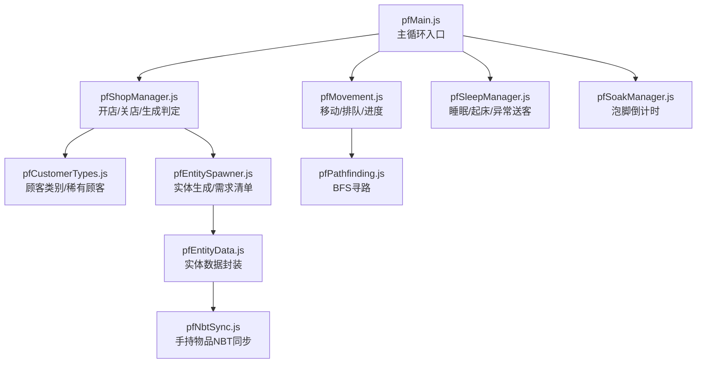

**图表来源**
- [pfMain.js:1-214](file://kubejs/server_scripts/pathfinder/pfMain.js#L1-L214)
- [pfShopManager.js:1-511](file://kubejs/server_scripts/pathfinder/pfShopManager.js#L1-L511)
- [pfMovement.js:1-205](file://kubejs/server_scripts/pathfinder/pfMovement.js#L1-L205)
- [pfSleepManager.js:1-345](file://kubejs/server_scripts/pathfinder/pfSleepManager.js#L1-L345)
- [pfSoakManager.js:1-197](file://kubejs/server_scripts/pathfinder/pfSoakManager.js#L1-L197)
- [pfCustomerTypes.js:1-839](file://kubejs/server_scripts/pathfinder/pfCustomerTypes.js#L1-L839)
- [pfEntitySpawner.js:1-164](file://kubejs/server_scripts/pathfinder/pfEntitySpawner.js#L1-L164)
- [pfPathfinding.js:1-91](file://kubejs/server_scripts/pathfinder/pfPathfinding.js#L1-L91)
- [pfEntityData.js:1-228](file://kubejs/server_scripts/pathfinder/pfEntityData.js#L1-L228)
- [pfNbtSync.js:1-94](file://kubejs/server_scripts/pathfinder/pfNbtSync.js#L1-L94)

**章节来源**
- [pfMain.js:1-214](file://kubejs/server_scripts/pathfinder/pfMain.js#L1-L214)
- [pfShopManager.js:1-511](file://kubejs/server_scripts/pathfinder/pfShopManager.js#L1-L511)

## 核心组件
- 主循环（pfMain）：每 tick 调用开店定时生成、收集实体并按阶段分类处理、执行移动与排队、触发泡脚与睡眠逻辑。
- 开店管理（pfShopManager）：持久化店铺状态、白天自动关店、等待顾客上限控制、普通顾客与稀有顾客生成、床位锁定与释放。
- 顾客类型（pfCustomerTypes）：种族权重、维度过滤、评价系统、稀有顾客池与掉落、好感度与爱心显示。
- 实体生成（pfEntitySpawner）：创建寻路实体、设置模型与初始 NBT、生成需求清单、广播话语。
- 寻路与移动（pfPathfinding + pfMovement）：BFS 路径规划、NSWE 方向步进、子步插值动画、终点检测与释放床位。
- 泡脚管理（pfSoakManager）：以秒为单位的倒计时、洗脚水可用性校验、结束回调应用附加效果。
- 睡眠管理（pfSleepManager）：躺床姿势设置、秒驱动累计、床破坏检测与异常送客、起床后恢复路线进度。
- 实体数据（pfEntityData）：统一读写 persistentData，包括位置、路径、阶段、床位、睡眠字段等。
- NBT 同步（pfNbtSync）：将阶段、床位、倒计时、需求清单写入手持物品 NBT，供客户端 UI 读取。

**章节来源**
- [pfMain.js:1-214](file://kubejs/server_scripts/pathfinder/pfMain.js#L1-L214)
- [pfShopManager.js:1-511](file://kubejs/server_scripts/pathfinder/pfShopManager.js#L1-L511)
- [pfCustomerTypes.js:1-839](file://kubejs/server_scripts/pathfinder/pfCustomerTypes.js#L1-L839)
- [pfEntitySpawner.js:1-164](file://kubejs/server_scripts/pathfinder/pfEntitySpawner.js#L1-L164)
- [pfPathfinding.js:1-91](file://kubejs/server_scripts/pathfinder/pfPathfinding.js#L1-L91)
- [pfMovement.js:1-205](file://kubejs/server_scripts/pathfinder/pfMovement.js#L1-L205)
- [pfSoakManager.js:1-197](file://kubejs/server_scripts/pathfinder/pfSoakManager.js#L1-L197)
- [pfSleepManager.js:1-345](file://kubejs/server_scripts/pathfinder/pfSleepManager.js#L1-L345)
- [pfEntityData.js:1-228](file://kubejs/server_scripts/pathfinder/pfEntityData.js#L1-L228)
- [pfNbtSync.js:1-94](file://kubejs/server_scripts/pathfinder/pfNbtSync.js#L1-L94)

## 架构总览
下图展示一次“顾客光临 → 服务 → 结算”的关键时序交互：

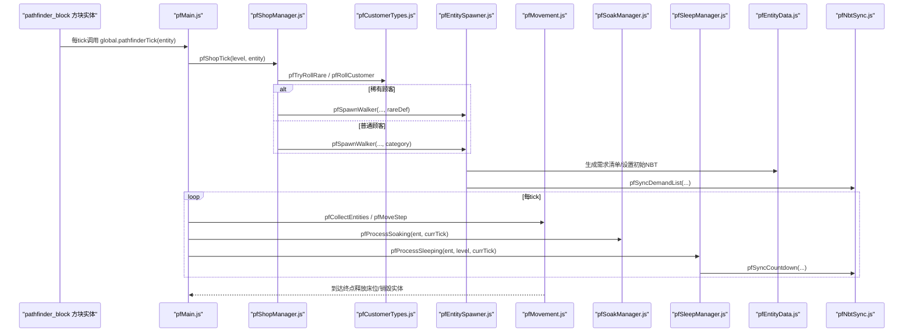

**图表来源**
- [pfMain.js:1-214](file://kubejs/server_scripts/pathfinder/pfMain.js#L1-L214)
- [pfShopManager.js:413-479](file://kubejs/server_scripts/pathfinder/pfShopManager.js#L413-L479)
- [pfCustomerTypes.js:631-651](file://kubejs/server_scripts/pathfinder/pfCustomerTypes.js#L631-L651)
- [pfEntitySpawner.js:10-157](file://kubejs/server_scripts/pathfinder/pfEntitySpawner.js#L10-L157)
- [pfMovement.js:8-205](file://kubejs/server_scripts/pathfinder/pfMovement.js#L8-L205)
- [pfSoakManager.js:92-145](file://kubejs/server_scripts/pathfinder/pfSoakManager.js#L92-L145)
- [pfSleepManager.js:89-165](file://kubejs/server_scripts/pathfinder/pfSleepManager.js#L89-L165)
- [pfEntityData.js:11-26](file://kubejs/server_scripts/pathfinder/pfEntityData.js#L11-L26)
- [pfNbtSync.js:45-75](file://kubejs/server_scripts/pathfinder/pfNbtSync.js#L45-L75)

## 详细组件分析

### 主循环与调度（pfMain）
- 每 tick 驱动开店定时生成、实体收集与分阶段处理、移动与排队、泡脚与睡眠逻辑。
- 关键流程：
  - 调用 pfShopManager.pfShopTick 进行开店生成判定。
  - 使用 pfMovement.pfCollectEntities 获取 walkers/sleepers/waiters/queueWaiters。
  - 对 queueWaiters 检查是否已上过床，若未上床则尝试锁床并进入睡眠。
  - 对 sleepers 调用泡脚与睡眠处理，必要时唤醒或移除实体。
  - 对 walkers 执行移动前排队检测与移动步进，到达固定排队区时进入等待状态。

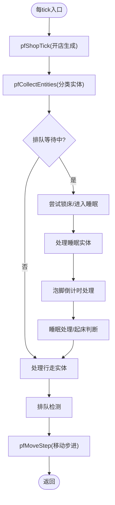

**图表来源**
- [pfMain.js:11-214](file://kubejs/server_scripts/pathfinder/pfMain.js#L11-L214)
- [pfMovement.js:8-205](file://kubejs/server_scripts/pathfinder/pfMovement.js#L8-L205)
- [pfSoakManager.js:92-145](file://kubejs/server_scripts/pathfinder/pfSoakManager.js#L92-L145)
- [pfSleepManager.js:89-165](file://kubejs/server_scripts/pathfinder/pfSleepManager.js#L89-L165)

**章节来源**
- [pfMain.js:1-214](file://kubejs/server_scripts/pathfinder/pfMain.js#L1-L214)

### 开店管理与生成（pfShopManager）
- 状态持久化在 pathfinder_block 方块实体的 persistentData 中，避免跨重启失效。
- 主要功能：
  - 开店/关店：设置开关、玩家 UUID、路径字符串、固定排队区、床位表、已生成实体 UUID 列表。
  - 白天自动关店（旧地狱维度除外），等待顾客超过上限暂停生成。
  - 稀有顾客概率替换与普通顾客抽取。
  - 床位锁定/释放/刷新/移除失效床位。
  - 提供查询接口给 voucher/boss 等模块。

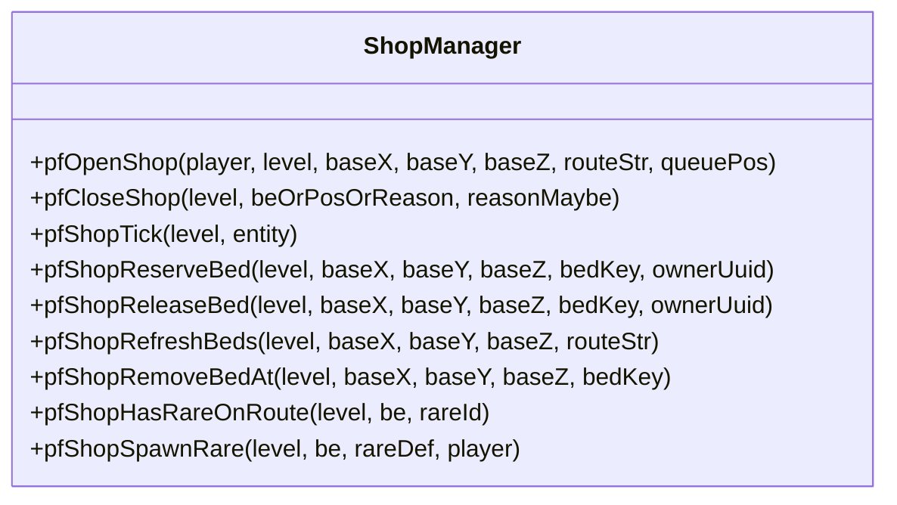

**图表来源**
- [pfShopManager.js:270-511](file://kubejs/server_scripts/pathfinder/pfShopManager.js#L270-L511)

**章节来源**
- [pfShopManager.js:1-511](file://kubejs/server_scripts/pathfinder/pfShopManager.js#L1-L511)

### 顾客类别与稀有顾客（pfCustomerTypes）
- 顾客类别：人类、妖精、妖、鬼族、月球人等，支持维度过滤与活跃白名单。
- 评价系统：基于玩家 persistentData 存储评价值，影响后续生成权重。
- 稀有顾客：
  - 自然生成时按概率替换为稀有顾客。
  - 每个维度独立稀有顾客池，含好感度阈值、爱心显示、掉落配置。
  - 稀有顾客需求倍率高于普通顾客。

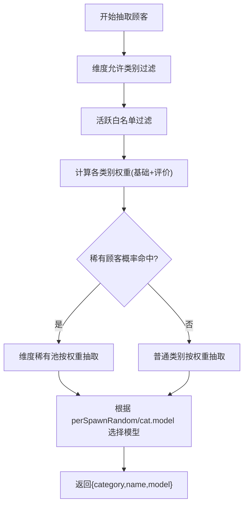

**图表来源**
- [pfCustomerTypes.js:349-382](file://kubejs/server_scripts/pathfinder/pfCustomerTypes.js#L349-L382)
- [pfCustomerTypes.js:631-651](file://kubejs/server_scripts/pathfinder/pfCustomerTypes.js#L631-L651)

**章节来源**
- [pfCustomerTypes.js:1-839](file://kubejs/server_scripts/pathfinder/pfCustomerTypes.js#L1-L839)

### 实体生成与需求清单（pfEntitySpawner）
- 创建寻路实体，设置 NoAI、不可摧毁、无重力等属性。
- 随机选择模型（可覆盖），写入初始 NBT（ModelId、持久化标记）。
- 初始化 persistentData：起点、路径、阶段、时间、子步、店铺坐标、排队区。
- 刷新床位表（优先店铺统一床位表，否则沿路径扫描）。
- 生成需求清单（按种族范围随机），Boss/稀有顾客需求倍率。
- 广播话语、提示玩家。

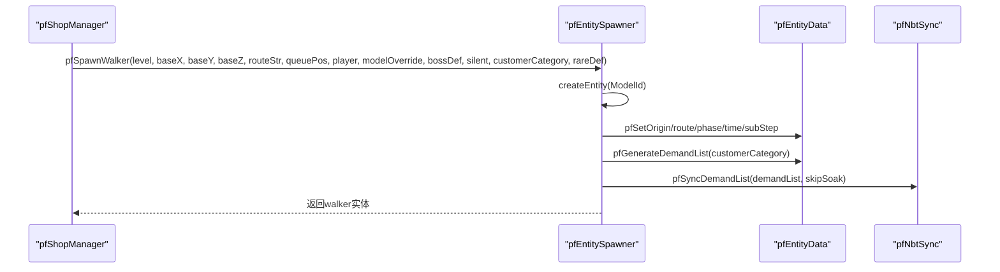

**图表来源**
- [pfEntitySpawner.js:10-157](file://kubejs/server_scripts/pathfinder/pfEntitySpawner.js#L10-L157)
- [pfEntityData.js:11-26](file://kubejs/server_scripts/pathfinder/pfEntityData.js#L11-L26)
- [pfNbtSync.js:45-75](file://kubejs/server_scripts/pathfinder/pfNbtSync.js#L45-L75)

**章节来源**
- [pfEntitySpawner.js:1-164](file://kubejs/server_scripts/pathfinder/pfEntitySpawner.js#L1-L164)

### 寻路与移动（pfPathfinding + pfMovement）
- 寻路算法：BFS 广度优先搜索，NSWE 方向移动，避让已有路径。
- 移动步进：按路径字符顺序移动，子步插值平滑动画；到达终点后释放床位并销毁实体。
- 排队检测：比较其他实体的进度与 ID，防止重叠。

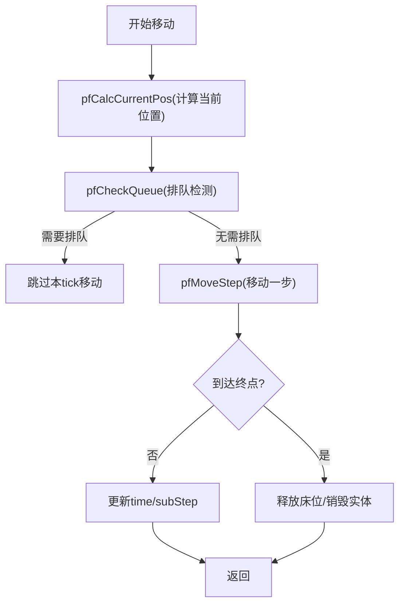

**图表来源**
- [pfPathfinding.js:46-83](file://kubejs/server_scripts/pathfinder/pfPathfinding.js#L46-L83)
- [pfMovement.js:83-181](file://kubejs/server_scripts/pathfinder/pfMovement.js#L83-L181)

**章节来源**
- [pfPathfinding.js:1-91](file://kubejs/server_scripts/pathfinder/pfPathfinding.js#L1-L91)
- [pfMovement.js:1-205](file://kubejs/server_scripts/pathfinder/pfMovement.js#L1-L205)

### 泡脚管理（pfSoakManager）
- 以“秒”为单位驱动，维护 pfSoakSubTick（0~19）作为秒内 tick 计数器。
- 洗脚水可用性校验：支持原版水桶与注册表自定义洗脚水。
- 倒计时结束：标记完成，应用洗脚水附加效果。
- 开始泡脚：消耗水桶为空桶，设置剩余时间与状态。

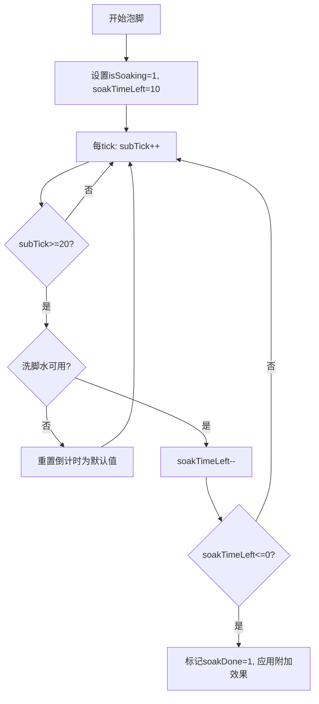

**图表来源**
- [pfSoakManager.js:92-145](file://kubejs/server_scripts/pathfinder/pfSoakManager.js#L92-L145)
- [pfSoakManager.js:149-186](file://kubejs/server_scripts/pathfinder/pfSoakManager.js#L149-L186)

**章节来源**
- [pfSoakManager.js:1-197](file://kubejs/server_scripts/pathfinder/pfSoakManager.js#L1-L197)

### 睡眠管理（pfSleepManager）
- 躺床姿势设置：前 60 tick 持续设置 SleepingX/Y/Z 与朝向。
- 秒驱动：pfSleepSubTick 计数至 20 触发“秒事件”，累计 pfSleepSeconds。
- 床破坏检测：外部方块改动（TNT/活塞）每 tick 检查，异常送客。
- 起床逻辑：停止睡眠、清理 NBT、定位下床点、恢复路线进度、释放床位。

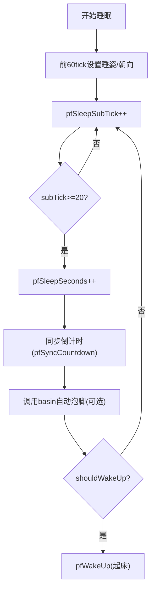

**图表来源**
- [pfSleepManager.js:48-85](file://kubejs/server_scripts/pathfinder/pfSleepManager.js#L48-L85)
- [pfSleepManager.js:89-165](file://kubejs/server_scripts/pathfinder/pfSleepManager.js#L89-L165)
- [pfSleepManager.js:168-270](file://kubejs/server_scripts/pathfinder/pfSleepManager.js#L168-L270)

**章节来源**
- [pfSleepManager.js:1-345](file://kubejs/server_scripts/pathfinder/pfSleepManager.js#L1-L345)

### 实体数据与 NBT 同步（pfEntityData + pfNbtSync）
- pfEntityData：统一封装 persistentData 存取，包括原点、路径、阶段、床位、睡眠字段、排队区、等待位置等。
- pfNbtSync：将阶段、床位、倒计时、需求清单写入手持物品 NBT，供客户端 UI 读取。

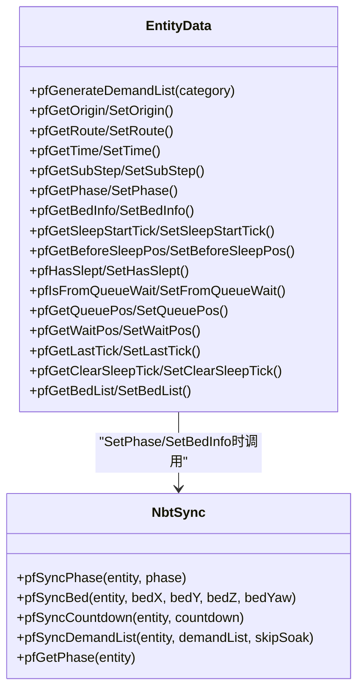

**图表来源**
- [pfEntityData.js:11-228](file://kubejs/server_scripts/pathfinder/pfEntityData.js#L11-L228)
- [pfNbtSync.js:8-94](file://kubejs/server_scripts/pathfinder/pfNbtSync.js#L8-L94)

**章节来源**
- [pfEntityData.js:1-228](file://kubejs/server_scripts/pathfinder/pfEntityData.js#L1-L228)
- [pfNbtSync.js:1-94](file://kubejs/server_scripts/pathfinder/pfNbtSync.js#L1-L94)

## 依赖关系分析
- 模块耦合：
  - pfMain 聚合所有子系统，承担调度职责。
  - pfShopManager 依赖 pfCustomerTypes（生成）、pfEntitySpawner（实体）、pfBedManager（床位，外部模块）、pfEntityData（数据）。
  - pfMovement 依赖 pfEntityData（路径/阶段）与 pfNbtSync（阶段同步）。
  - pfSleepManager 依赖 pfEntityData（睡眠字段）与 pfNbtSync（倒计时同步）。
  - pfSoakManager 依赖 pfNbtSync（泡脚状态同步）。
- 外部依赖：
  - 床位管理由外部模块提供（pfBedManager），本系统通过函数指针调用。
  - 洗脚水注册表（global.soakWaterRegister）用于校验洗脚水可用性。

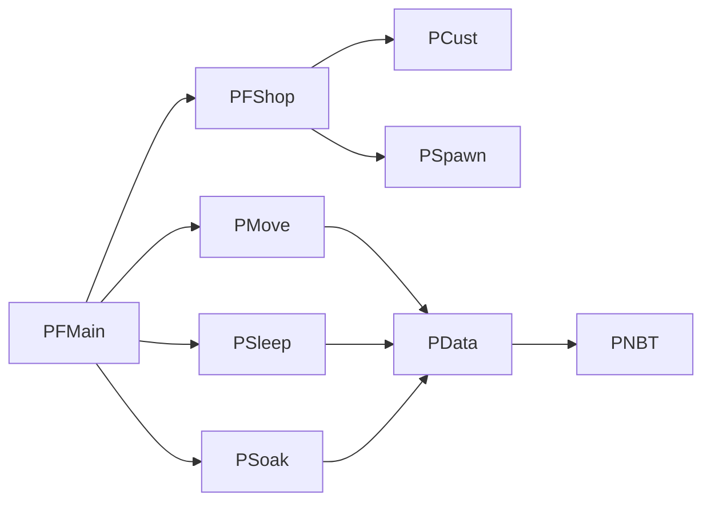

**图表来源**
- [pfMain.js:1-214](file://kubejs/server_scripts/pathfinder/pfMain.js#L1-L214)
- [pfShopManager.js:1-511](file://kubejs/server_scripts/pathfinder/pfShopManager.js#L1-L511)
- [pfMovement.js:1-205](file://kubejs/server_scripts/pathfinder/pfMovement.js#L1-L205)
- [pfSleepManager.js:1-345](file://kubejs/server_scripts/pathfinder/pfSleepManager.js#L1-L345)
- [pfSoakManager.js:1-197](file://kubejs/server_scripts/pathfinder/pfSoakManager.js#L1-L197)
- [pfEntityData.js:1-228](file://kubejs/server_scripts/pathfinder/pfEntityData.js#L1-L228)
- [pfNbtSync.js:1-94](file://kubejs/server_scripts/pathfinder/pfNbtSync.js#L1-L94)

**章节来源**
- [pfMain.js:1-214](file://kubejs/server_scripts/pathfinder/pfMain.js#L1-L214)
- [pfShopManager.js:1-511](file://kubejs/server_scripts/pathfinder/pfShopManager.js#L1-L511)

## 性能与稳定性
- 时间驱动设计：泡脚与睡眠均以“秒”为单位驱动，避免依赖 server.getTickCount() 差值，提升跨重启稳定性。
- 防重复处理：通过 pfLastTick 记录最后处理 tick，避免同 tick 重复处理同一实体。
- 实体收集范围限制：pfCollectEntities 限定 AABB 范围，减少全图扫描开销。
- 排队优化：仅对非睡眠实体进行排队检测，已上床实体不占用路线位置。
- 床位管理：店铺统一床位表与实体本地列表兼容，减少无效锁床冲突。

[本节为通用指导，不直接分析具体文件]

## 故障排查指南
- 顾客不生成：
  - 检查店铺是否处于白天（旧地狱维度除外）。
  - 检查等待顾客数量是否超过上限。
  - 检查维度与活跃白名单是否包含目标类别。
- 泡脚不计时：
  - 确认洗脚水是否可用（原版水桶或注册表定义）。
  - 检查 pfSoakSubTick 与 pfSoakTimeLeft 是否正确递增。
- 睡眠异常：
  - 检查床是否被破坏或移动，触发异常送客。
  - 确认 SleepingX/Y/Z 与朝向是否在前 60 tick 正确设置。
- 移动卡顿或重叠：
  - 检查排队检测逻辑，确保进度与 ID 比较正确。
  - 确认路径字符串与 NSWE 方向映射无误。

**章节来源**
- [pfShopManager.js:413-479](file://kubejs/server_scripts/pathfinder/pfShopManager.js#L413-L479)
- [pfSoakManager.js:92-145](file://kubejs/server_scripts/pathfinder/pfSoakManager.js#L92-L145)
- [pfSleepManager.js:89-165](file://kubejs/server_scripts/pathfinder/pfSleepManager.js#L89-L165)
- [pfMovement.js:54-81](file://kubejs/server_scripts/pathfinder/pfMovement.js#L54-L81)

## 结论
“食物服务系统”通过模块化设计实现了完整的足浴店经营流程，涵盖顾客生成、寻路排队、泡脚服务、睡眠休息、开店关店与稀有顾客机制。系统以 KubeJS 脚本为核心，采用 tick 驱动与持久化状态，确保跨重启稳定运行。未来可扩展更多顾客类别、稀有顾客掉落与科技产线联动，进一步提升模拟经营的深度与乐趣。

[本节为总结性内容，不直接分析具体文件]