# ApriCity UI框架集成

<cite>
**本文档引用的文件**
- [apricity/kubejs/footui.html](file://apricity/kubejs/footui.html)
- [apricity/kubejs/footsoak.html](file://apricity/kubejs/footsoak.html)
- [apricity/kubejs/phone.html](file://apricity/kubejs/phone.html)
- [apricity/kubejs/stamina_hud.html](file://apricity/kubejs/stamina_hud.html)
- [apricity/kubejs/cursor_fx.html](file://apricity/kubejs/cursor_fx.html)
- [kubejs/client_scripts/ui/foot_ui.js](file://kubejs/client_scripts/ui/foot_ui.js)
- [kubejs/client_scripts/ui/phone_ui.js](file://kubejs/client_scripts/ui/phone_ui.js)
- [kubejs/client_scripts/ui/stamina_hud.js](file://kubejs/client_scripts/ui/stamina_hud.js)
- [kubejs/assets/kubejs/apricity/footui.html](file://kubejs/assets/kubejs/apricity/footui.html)
- [kubejs/assets/kubejs/geo/alice.json](file://kubejs/assets/kubejs/geo/alice.json)
- [kubejs/data/kubejs/entity/alice.json](file://kubejs/data/kubejs/entity/alice.json)
</cite>

## 目录
1. [项目概述](#项目概述)
2. [项目结构](#项目结构)
3. [核心组件](#核心组件)
4. [架构概览](#架构概览)
5. [详细组件分析](#详细组件分析)
6. [依赖关系分析](#依赖关系分析)
7. [性能考虑](#性能考虑)
8. [故障排除指南](#故障排除指南)
9. [结论](#结论)

## 项目概述

本项目是一个基于ApriCity 3D界面框架的Minecraft模组UI集成方案，专门为"洗手"版本设计。该项目实现了完整的3D界面渲染系统，包括脚部按摩UI、手机界面、体力HUD等核心功能。

ApriCity框架提供了强大的3D UI渲染能力，支持：
- 3D模型渲染和纹理贴图
- 交互式UI组件
- 动画系统和粒子效果
- 跨平台兼容性
- 性能优化的渲染管道

## 项目结构

项目采用模块化架构，主要分为以下几个层次：

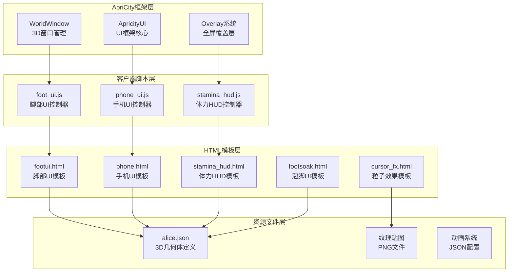

**图表来源**
- [apricity/kubejs/footui.html:1-356](file://apricity/kubejs/footui.html#L1-L356)
- [kubejs/client_scripts/ui/foot_ui.js:1-1026](file://kubejs/client_scripts/ui/foot_ui.js#L1-L1026)

**章节来源**
- [apricity/kubejs/footui.html:1-356](file://apricity/kubejs/footui.html#L1-L356)
- [apricity/kubejs/phone.html:1-800](file://apricity/kubejs/phone.html#L1-L800)
- [apricity/kubejs/stamina_hud.html:1-86](file://apricity/kubejs/stamina_hud.html#L1-L86)

## 核心组件

### 3D UI渲染引擎

ApriCity框架的核心是WorldWindow类，它提供了3D窗口管理系统：

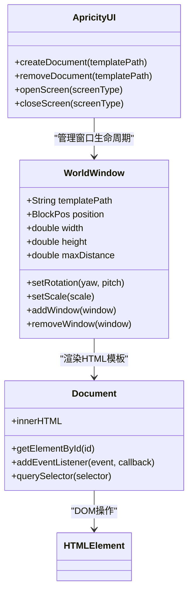

**图表来源**
- [kubejs/client_scripts/ui/foot_ui.js:13-15](file://kubejs/client_scripts/ui/foot_ui.js#L13-L15)
- [kubejs/client_scripts/ui/phone_ui.js:7-7](file://kubejs/client_scripts/ui/phone_ui.js#L7-L7)

### UI组件注册系统

系统采用事件驱动的组件注册机制：

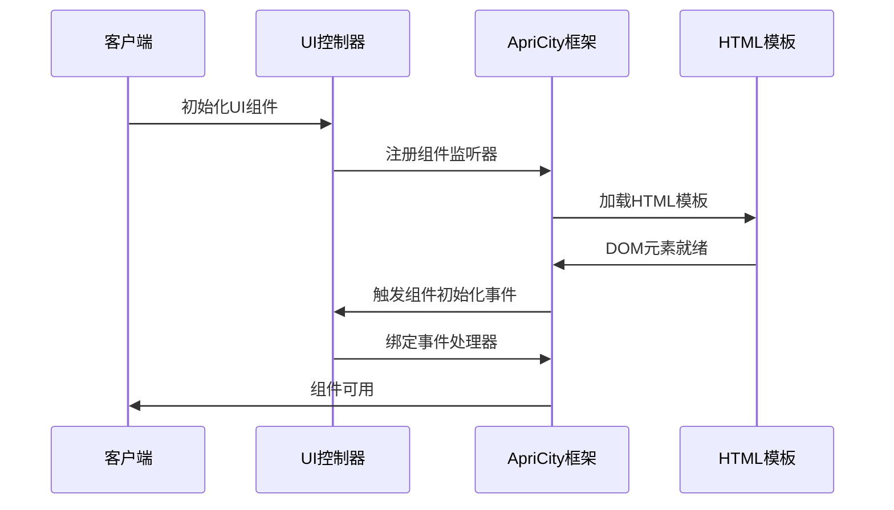

**图表来源**
- [kubejs/client_scripts/ui/foot_ui.js:87-300](file://kubejs/client_scripts/ui/foot_ui.js#L87-L300)
- [kubejs/client_scripts/ui/phone_ui.js:13-23](file://kubejs/client_scripts/ui/phone_ui.js#L13-L23)

**章节来源**
- [kubejs/client_scripts/ui/foot_ui.js:1-1026](file://kubejs/client_scripts/ui/foot_ui.js#L1-L1026)
- [kubejs/client_scripts/ui/phone_ui.js:1-56](file://kubejs/client_scripts/ui/phone_ui.js#L1-L56)
- [kubejs/client_scripts/ui/stamina_hud.js:1-101](file://kubejs/client_scripts/ui/stamina_hud.js#L1-L101)

## 架构概览

系统采用分层架构设计，确保了良好的模块化和可维护性：

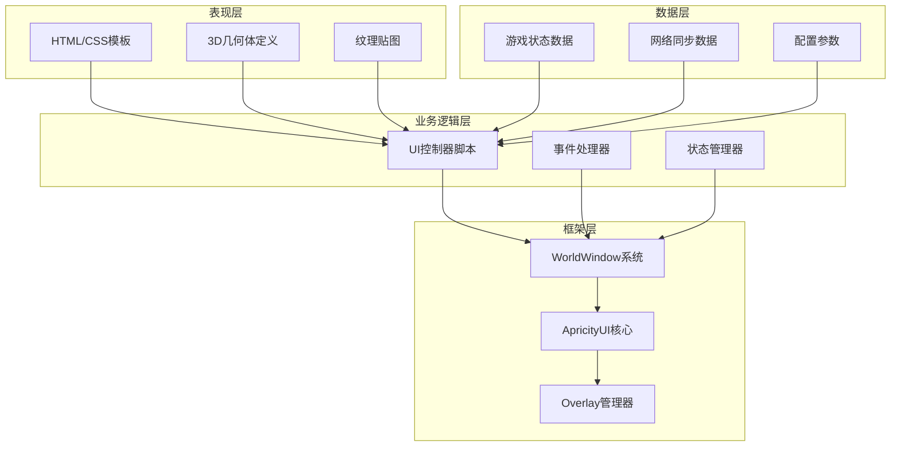

**图表来源**
- [kubejs/client_scripts/ui/foot_ui.js:30-36](file://kubejs/client_scripts/ui/foot_ui.js#L30-L36)
- [kubejs/client_scripts/ui/stamina_hud.js:12-16](file://kubejs/client_scripts/ui/stamina_hud.js#L12-L16)

## 详细组件分析

### 脚部按摩UI系统

脚部按摩UI是系统的核心功能之一，提供了完整的足部按摩体验：

#### UI模板结构

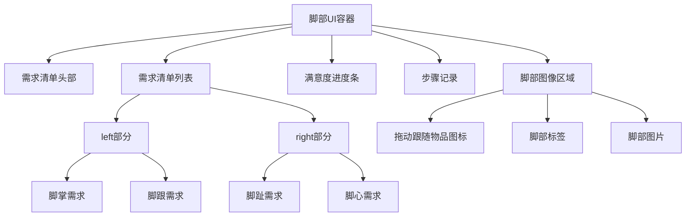

**图表来源**
- [apricity/kubejs/footui.html:2-62](file://apricity/kubejs/footui.html#L2-L62)

#### 交互事件处理

系统实现了复杂的鼠标交互处理机制：

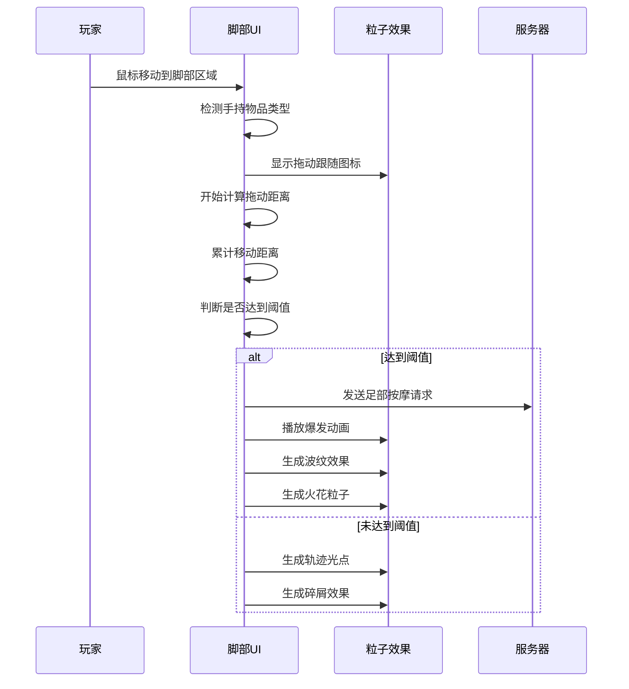

**图表来源**
- [kubejs/client_scripts/ui/foot_ui.js:157-273](file://kubejs/client_scripts/ui/foot_ui.js#L157-L273)

**章节来源**
- [apricity/kubejs/footui.html:1-356](file://apricity/kubejs/footui.html#L1-L356)
- [kubejs/client_scripts/ui/foot_ui.js:87-300](file://kubejs/client_scripts/ui/foot_ui.js#L87-L300)

### 手机UI系统

手机界面提供了丰富的功能菜单和应用管理：

#### 界面布局设计

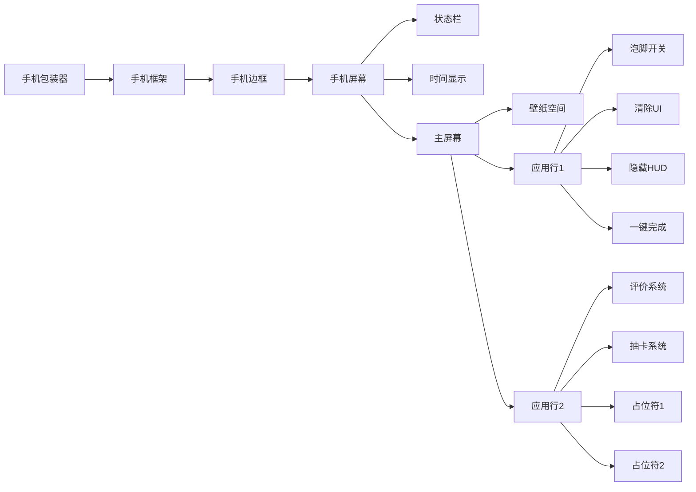

**图表来源**
- [apricity/kubejs/phone.html:102-175](file://apricity/kubejs/phone.html#L102-L175)

#### 数据同步机制

手机UI实现了双向数据同步：

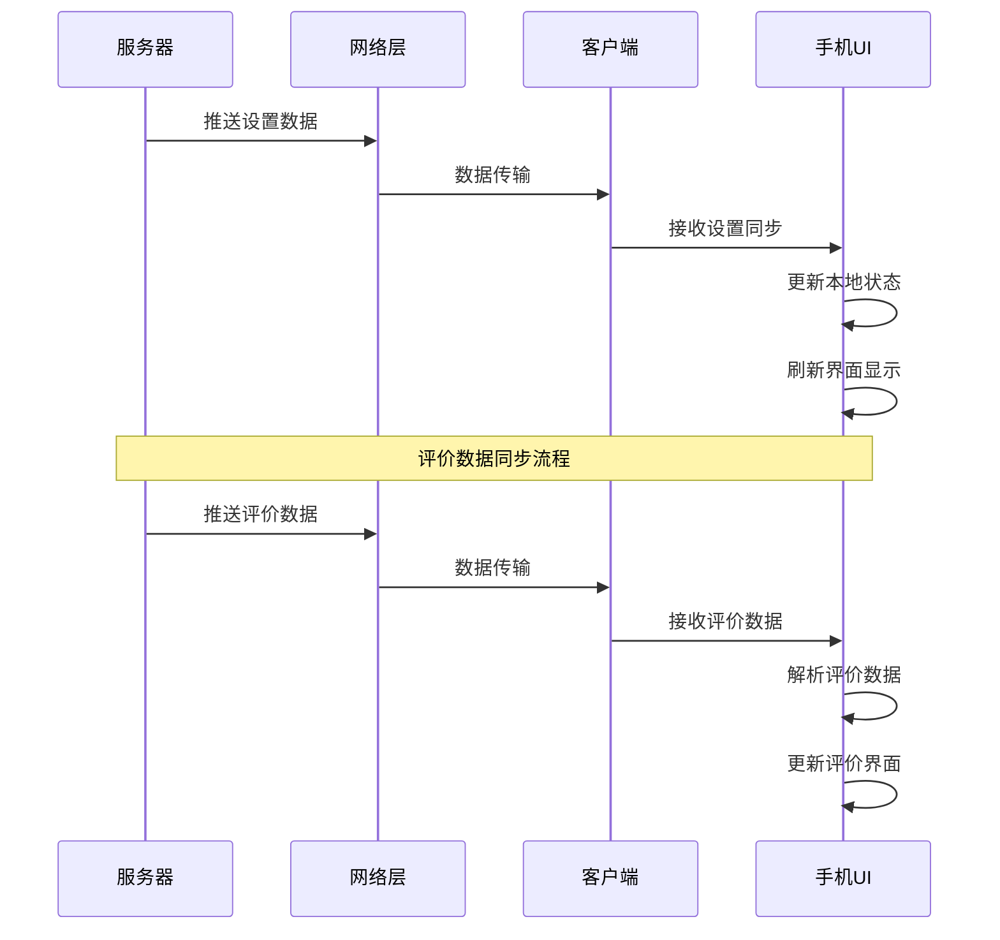

**图表来源**
- [kubejs/client_scripts/ui/phone_ui.js:13-47](file://kubejs/client_scripts/ui/phone_ui.js#L13-L47)

**章节来源**
- [apricity/kubejs/phone.html:1-800](file://apricity/kubejs/phone.html#L1-L800)
- [kubejs/client_scripts/ui/phone_ui.js:1-56](file://kubejs/client_scripts/ui/phone_ui.js#L1-L56)

### 体力HUD系统

体力HUD提供了直观的体力值显示：

#### HUD设计结构

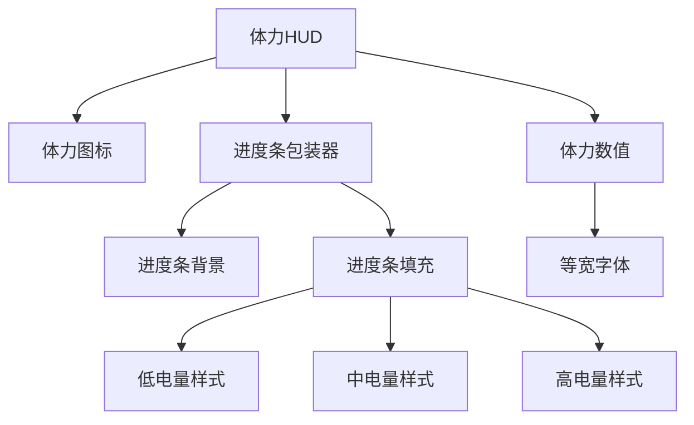

**图表来源**
- [apricity/kubejs/stamina_hud.html:21-85](file://apricity/kubejs/stamina_hud.html#L21-L85)

#### 状态管理机制

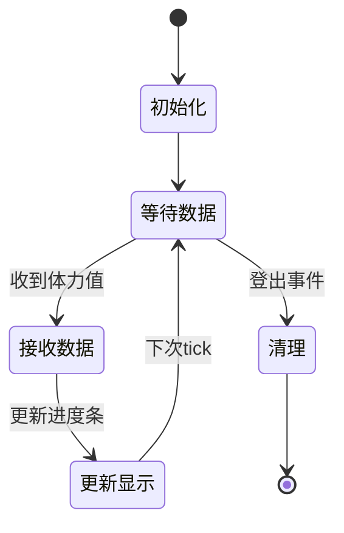

**图表来源**
- [kubejs/client_scripts/ui/stamina_hud.js:53-86](file://kubejs/client_scripts/ui/stamina_hud.js#L53-L86)

**章节来源**
- [apricity/kubejs/stamina_hud.html:1-86](file://apricity/kubejs/stamina_hud.html#L1-L86)
- [kubejs/client_scripts/ui/stamina_hud.js:1-101](file://kubejs/client_scripts/ui/stamina_hud.js#L1-L101)

### 3D模型渲染系统

系统集成了完整的3D模型渲染能力，支持复杂的几何体和纹理：

#### 几何体定义

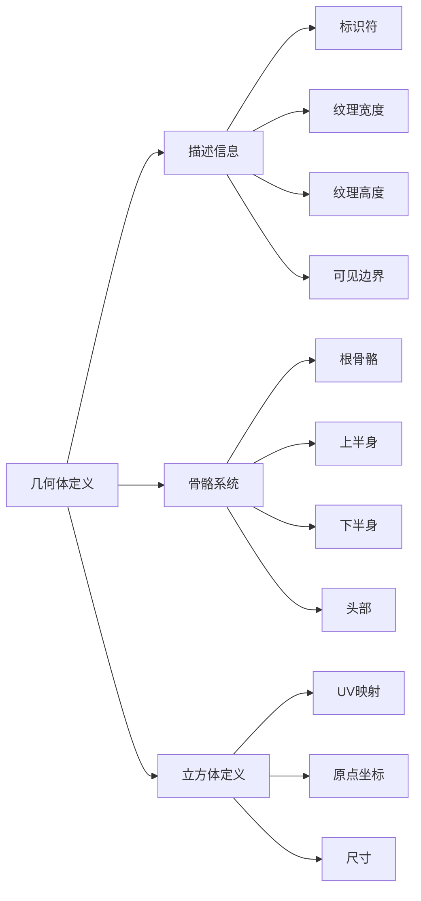

**图表来源**
- [kubejs/assets/kubejs/geo/alice.json:1-12](file://kubejs/assets/kubejs/geo/alice.json#L1-L12)

#### 纹理贴图系统

系统支持多种纹理格式和材质属性：

| 纹理类型 | 格式 | 尺寸 | 用途 |
|---------|------|------|------|
| 几何体纹理 | PNG | 128x128 | 主要表面纹理 |
| UI纹理 | PNG | 可变 | UI元素和图标 |
| 粒子纹理 | PNG | 3x3 | 特效粒子 |
| 背景纹理 | JPG | 1920x1080 | 手机壁纸 |

**章节来源**
- [kubejs/assets/kubejs/geo/alice.json:1-800](file://kubejs/assets/kubejs/geo/alice.json#L1-L800)
- [kubejs/data/kubejs/entity/alice.json:1-800](file://kubejs/data/kubejs/entity/alice.json#L1-L800)

### 动画系统

系统实现了完整的动画播放和控制机制：

#### 粒子效果系统

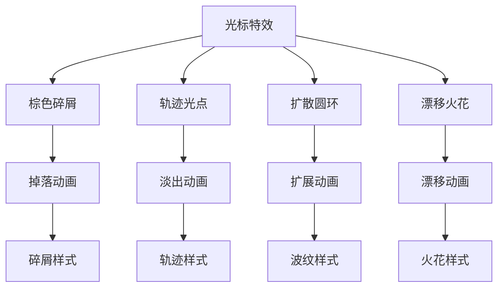

**图表来源**
- [apricity/kubejs/cursor_fx.html:26-92](file://apricity/kubejs/cursor_fx.html#L26-L92)

#### 动画配置

| 动画类型 | 持续时间 | 缓动函数 | 触发条件 |
|---------|----------|----------|----------|
| 碎屑掉落 | 0.5秒 | ease-out | 拖动过程中 |
| 轨迹淡出 | 0.45秒 | linear | 每移动5px |
| 波纹扩展 | 0.7秒 | ease-out | 达到阈值 |
| 火花漂移 | 0.85秒 | ease-out | 随机触发 |

**章节来源**
- [apricity/kubejs/cursor_fx.html:1-93](file://apricity/kubejs/cursor_fx.html#L1-L93)

## 依赖关系分析

系统采用了松耦合的设计，各组件间通过清晰的接口进行通信：

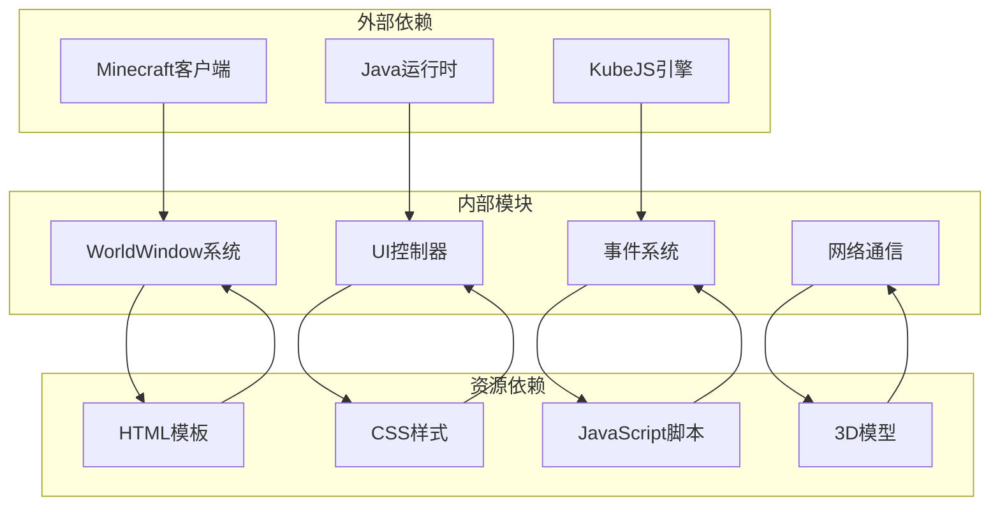

**图表来源**
- [kubejs/client_scripts/ui/foot_ui.js:13-15](file://kubejs/client_scripts/ui/foot_ui.js#L13-L15)
- [kubejs/client_scripts/ui/phone_ui.js:7-7](file://kubejs/client_scripts/ui/phone_ui.js#L7-L7)

**章节来源**
- [kubejs/client_scripts/ui/foot_ui.js:1-1026](file://kubejs/client_scripts/ui/foot_ui.js#L1-L1026)
- [kubejs/client_scripts/ui/phone_ui.js:1-56](file://kubejs/client_scripts/ui/phone_ui.js#L1-L56)
- [kubejs/client_scripts/ui/stamina_hud.js:1-101](file://kubejs/client_scripts/ui/stamina_hud.js#L1-L101)

## 性能考虑

系统在设计时充分考虑了性能优化：

### 渲染优化策略

1. **延迟加载**: UI模板按需加载，减少启动时间
2. **对象池**: 复用DOM元素和粒子对象
3. **批量更新**: 合并多个UI更新操作
4. **节流控制**: 限制高频事件的处理频率

### 内存管理

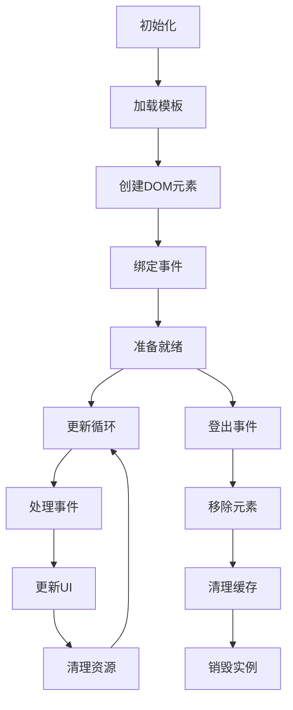

**图表来源**
- [kubejs/client_scripts/ui/stamina_hud.js:89-101](file://kubejs/client_scripts/ui/stamina_hud.js#L89-L101)

### 跨平台兼容性

系统通过以下方式确保跨平台兼容：

1. **统一API**: 使用ApriCity框架提供的抽象接口
2. **条件渲染**: 根据平台特性调整渲染策略
3. **降级处理**: 在不支持的平台上提供基础功能
4. **性能自适应**: 根据设备性能动态调整效果质量

## 故障排除指南

### 常见问题及解决方案

#### UI组件无法显示

**问题症状**: UI组件加载失败或显示异常

**可能原因**:
1. HTML模板路径错误
2. CSS样式冲突
3. JavaScript执行错误
4. 资源文件缺失

**解决步骤**:
1. 检查模板文件路径是否正确
2. 查看浏览器控制台错误信息
3. 验证CSS样式是否被其他样式覆盖
4. 确认相关资源文件是否存在

#### 交互事件失效

**问题症状**: UI元素无法响应鼠标或键盘事件

**可能原因**:
1. 事件监听器未正确绑定
2. DOM元素未完全加载
3. 事件冒泡被阻止
4. 权限问题

**解决步骤**:
1. 确认事件监听器的绑定时机
2. 检查DOM元素的可用性
3. 验证事件处理函数的正确性
4. 测试不同浏览器的兼容性

#### 性能问题

**问题症状**: UI响应缓慢或卡顿

**可能原因**:
1. 频繁的DOM操作
2. 大量的事件监听器
3. 复杂的CSS动画
4. 资源加载阻塞

**优化建议**:
1. 使用requestAnimationFrame优化动画
2. 合并DOM操作批次
3. 移除不必要的事件监听器
4. 延迟加载非关键资源

**章节来源**
- [kubejs/client_scripts/ui/foot_ui.js:777-800](file://kubejs/client_scripts/ui/foot_ui.js#L777-L800)
- [kubejs/client_scripts/ui/phone_ui.js:49-56](file://kubejs/client_scripts/ui/phone_ui.js#L49-L56)
- [kubejs/client_scripts/ui/stamina_hud.js:89-101](file://kubejs/client_scripts/ui/stamina_hud.js#L89-L101)

## 结论

本项目成功实现了ApriCity 3D UI框架在Minecraft环境中的完整集成，展现了现代Web技术在游戏场景中的强大能力。通过模块化的架构设计和完善的性能优化策略，系统不仅提供了丰富的用户体验，还确保了良好的可维护性和扩展性。

主要成就包括：

1. **完整的3D UI生态系统**: 从基础的HTML模板到复杂的3D渲染，形成了完整的UI解决方案
2. **高效的交互处理**: 实现了流畅的鼠标交互和触觉反馈
3. **强大的动画系统**: 提供了丰富的视觉效果和粒子动画
4. **优秀的性能表现**: 通过多种优化策略确保了系统的流畅运行
5. **良好的跨平台兼容性**: 支持多种平台和设备

未来可以进一步改进的方向包括：
- 增加更多的UI主题和自定义选项
- 优化移动端的触摸交互体验
- 扩展3D模型的复杂度和细节
- 增强网络同步的实时性
- 提供更丰富的动画和特效选项

这个项目为Minecraft模组开发提供了一个优秀的参考范例，展示了如何将现代Web技术与游戏开发相结合，创造出令人印象深刻的用户体验。