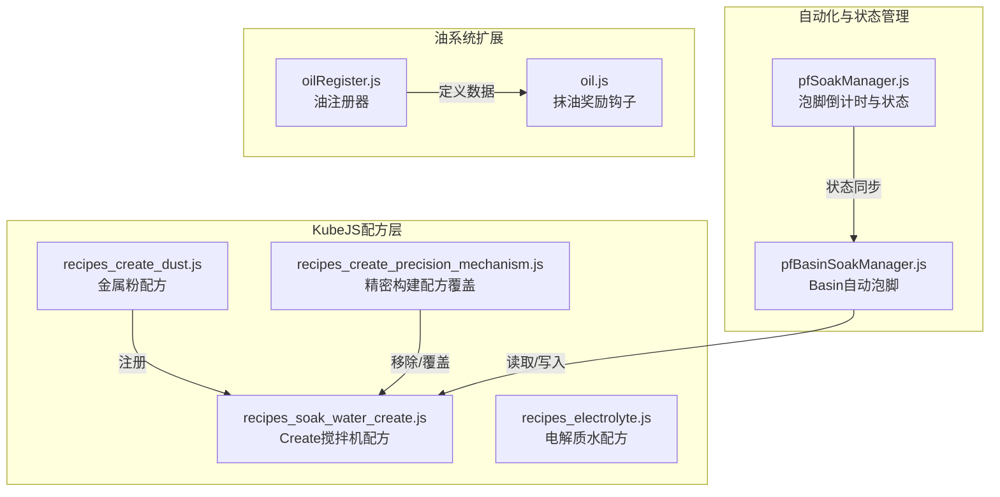
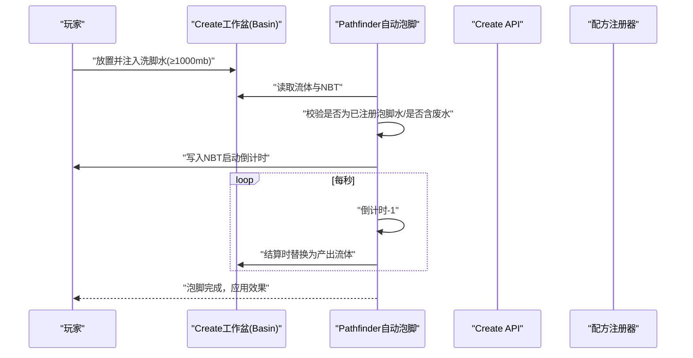
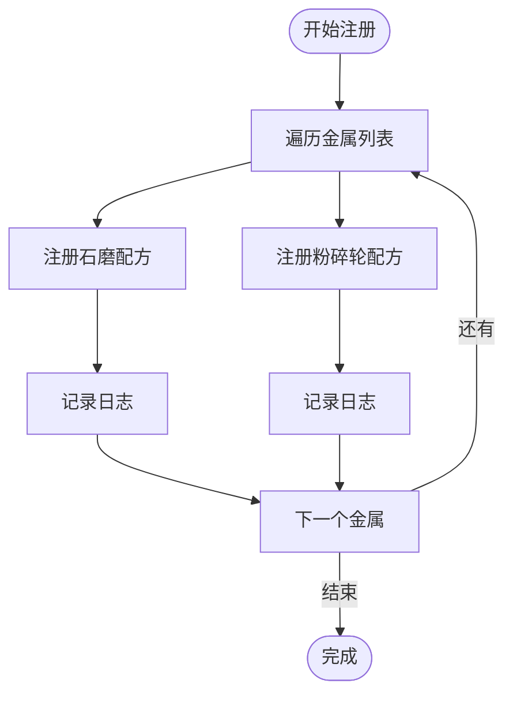
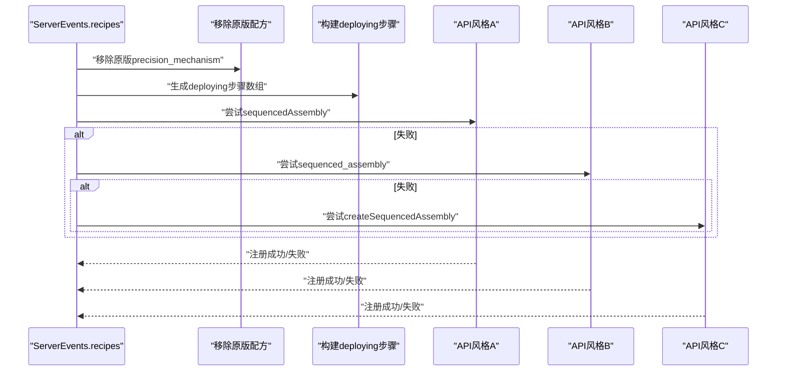
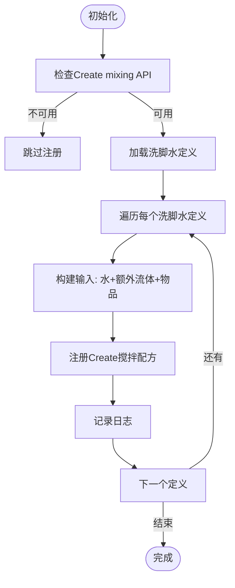
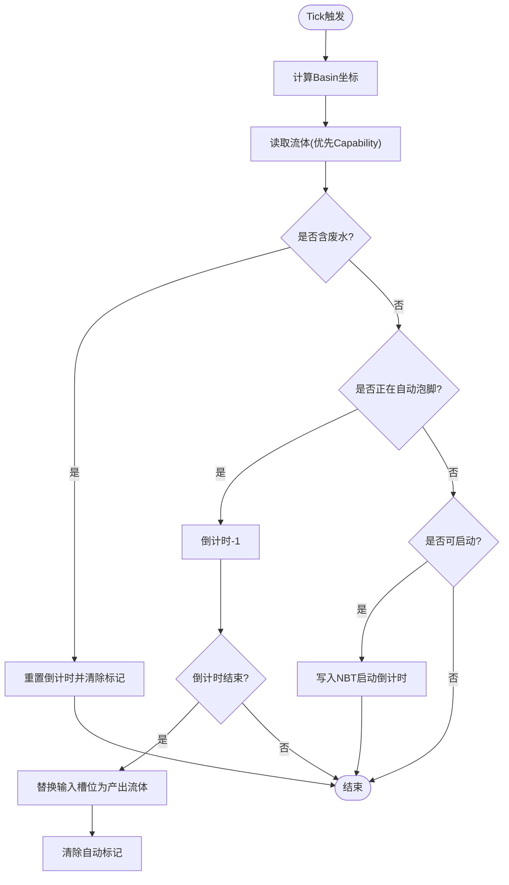
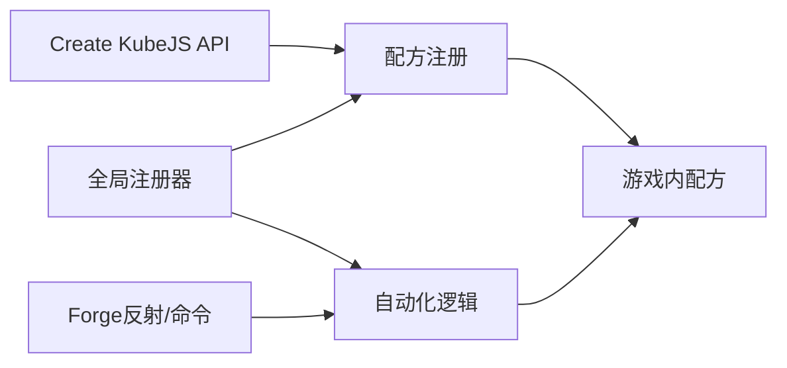

# Create模组集成

<cite>
**本文档引用的文件**
- [recipes_create_dust.js](file://kubejs/server_scripts/recipes/recipes_create_dust.js)
- [recipes_create_precision_mechanism.js](file://kubejs/server_scripts/recipes/recipes_create_precision_mechanism.js)
- [recipes_soak_water_create.js](file://kubejs/server_scripts/recipes/recipes_soak_water_create.js)
- [recipes_electrolyte.js](file://kubejs/server_scripts/recipes/recipes_electrolyte.js)
- [pfBasinSoakManager.js](file://kubejs/server_scripts/pathfinder/pfBasinSoakManager.js)
- [pfSoakManager.js](file://kubejs/server_scripts/pathfinder/pfSoakManager.js)
- [oilRegister.js](file://kubejs/startup_scripts/oil/oilRegister.js)
- [oil.js](file://kubejs/server_scripts/serve/oil.js)
</cite>

## 目录
1. [简介](#简介)
2. [项目结构](#项目结构)
3. [核心组件](#核心组件)
4. [架构总览](#架构总览)
5. [详细组件分析](#详细组件分析)
6. [依赖关系分析](#依赖关系分析)
7. [性能考虑](#性能考虑)
8. [故障排除指南](#故障排除指南)
9. [结论](#结论)
10. [附录](#附录)

## 简介
本文件系统性梳理了项目对Create模组的集成实现，涵盖配方系统、机械加工流程与精密部件制造，以及基于Create机器的资源转换机制。重点包括：
- 金属锭到金属粉的两种加工路径（石磨与粉碎轮）
- 精密构建（Precision Mechanism）配方覆盖与基材替换
- 搅拌机（Mixer）配方注册与自动化流程
- 基于Create工作盆（Basin）的自动泡脚管理
- 电解质水的Create配方（搅拌与注液）

通过KubeJS Create API与Forge反射能力，实现稳定的配方注册与运行时交互。

## 项目结构
围绕Create集成的相关文件主要位于以下位置：
- 配方注册：kubejs/server_scripts/recipes/
- 自动化逻辑：kubejs/server_scripts/pathfinder/
- 油系统注册与扩展：kubejs/startup_scripts/oil/ 与 kubejs/server_scripts/serve/

**图表来源**
- [recipes_create_dust.js:1-36](file://kubejs/server_scripts/recipes/recipes_create_dust.js#L1-L36)
- [recipes_create_precision_mechanism.js:1-130](file://kubejs/server_scripts/recipes/recipes_create_precision_mechanism.js#L1-L130)
- [recipes_soak_water_create.js:1-53](file://kubejs/server_scripts/recipes/recipes_soak_water_create.js#L1-L53)
- [pfBasinSoakManager.js:1-418](file://kubejs/server_scripts/pathfinder/pfBasinSoakManager.js#L1-L418)
- [pfSoakManager.js:1-197](file://kubejs/server_scripts/pathfinder/pfSoakManager.js#L1-L197)
- [oilRegister.js:1-61](file://kubejs/startup_scripts/oil/oilRegister.js#L1-L61)
- [oil.js:1-56](file://kubejs/server_scripts/serve/oil.js#L1-L56)

**章节来源**
- [recipes_create_dust.js:1-36](file://kubejs/server_scripts/recipes/recipes_create_dust.js#L1-L36)
- [recipes_create_precision_mechanism.js:1-130](file://kubejs/server_scripts/recipes/recipes_create_precision_mechanism.js#L1-L130)
- [recipes_soak_water_create.js:1-53](file://kubejs/server_scripts/recipes/recipes_soak_water_create.js#L1-L53)
- [pfBasinSoakManager.js:1-418](file://kubejs/server_scripts/pathfinder/pfBasinSoakManager.js#L1-L418)
- [pfSoakManager.js:1-197](file://kubejs/server_scripts/pathfinder/pfSoakManager.js#L1-L197)
- [oilRegister.js:1-61](file://kubejs/startup_scripts/oil/oilRegister.js#L1-L61)
- [oil.js:1-56](file://kubejs/server_scripts/serve/oil.js#L1-L56)

## 核心组件
- 金属粉配方注册：提供石磨与粉碎轮两条路径，产物为mekanism的金属粉。
- 精密构建配方覆盖：移除原版配方，采用黄铜板作为基材，通过多套API风格尝试注册序列装配步骤。
- 洗脚水Create配方：基于搅拌机，将水与各类原料合成对应洗脚水流体，输出1000mb。
- 自动化泡脚：通过工作盆（Basin）检测与NBT状态联动，实现自动倒计时与流体替换。
- 电解质水配方：水+柠檬+盐+糖经Create搅拌机生成电解质水，再用Create注液器装瓶。

**章节来源**
- [recipes_create_dust.js:1-36](file://kubejs/server_scripts/recipes/recipes_create_dust.js#L1-L36)
- [recipes_create_precision_mechanism.js:1-130](file://kubejs/server_scripts/recipes/recipes_create_precision_mechanism.js#L1-L130)
- [recipes_soak_water_create.js:1-53](file://kubejs/server_scripts/recipes/recipes_soak_water_create.js#L1-L53)
- [pfBasinSoakManager.js:1-418](file://kubejs/server_scripts/pathfinder/pfBasinSoakManager.js#L1-L418)
- [recipes_electrolyte.js:1-60](file://kubejs/server_scripts/recipes/recipes_electrolyte.js#L1-L60)

## 架构总览
Create集成采用“配方层 + 自动化层 + 数据层”的分层设计：
- 配方层：集中注册Create相关配方，统一入口在ServerEvents.recipes回调中。
- 自动化层：通过PF Tick机制与Create工作盆交互，实现流体检测、状态写入与倒计时推进。
- 数据层：全局注册器（如soakWaterRegister、oilRegister）提供统一的数据访问接口。

**图表来源**
- [pfBasinSoakManager.js:328-408](file://kubejs/server_scripts/pathfinder/pfBasinSoakManager.js#L328-L408)
- [pfSoakManager.js:90-145](file://kubejs/server_scripts/pathfinder/pfSoakManager.js#L90-L145)

## 详细组件分析

### 金属粉配方（石磨与粉碎轮）
- 功能：将铁、铜、金三种金属锭分别转化为mekanism对应的金属粉。
- 工艺路径：
  - 石磨（Milling）：低门槛、低速，适合早期过渡。
  - 粉碎轮（Crushing）：高门槛、批量，适合后期高效生产。
- 注册策略：遍历预设列表，逐条注册配方，并记录日志便于调试。

**图表来源**
- [recipes_create_dust.js:10-36](file://kubejs/server_scripts/recipes/recipes_create_dust.js#L10-L36)

**章节来源**
- [recipes_create_dust.js:1-36](file://kubejs/server_scripts/recipes/recipes_create_dust.js#L1-L36)

### 精密构建配方覆盖（Precision Mechanism）
- 目标：移除原版精密构建配方，替换基材为黄铜板，调整副产物构成。
- 实现要点：
  - 使用多种API风格尝试注册序列装配（sequencedAssembly/sequenced_assembly/createSequencedAssembly）。
  - 通过deploying步骤构建中间过渡物，逐步添加齿轮、红石等部件。
  - 统一设置循环次数与过渡物品，保证配方稳定性。
- 容错策略：多API风格兜底，失败记录日志并跳过。

**图表来源**
- [recipes_create_precision_mechanism.js:60-130](file://kubejs/server_scripts/recipes/recipes_create_precision_mechanism.js#L60-L130)

**章节来源**
- [recipes_create_precision_mechanism.js:1-130](file://kubejs/server_scripts/recipes/recipes_create_precision_mechanism.js#L1-L130)

### 洗脚水Create配方（Mixer）
- 目标：通过Create搅拌机将水与各类原料合成对应洗脚水流体，输出1000mb。
- 数据来源：从全局注册器读取所有已注册的洗脚水定义，动态生成配方。
- 输入组合：基础水1000mb + 可选额外流体 + 物品原料列表。
- 容错策略：先检查Create mixing API可用性，失败则跳过；逐项注册并记录日志。

**图表来源**
- [recipes_soak_water_create.js:14-53](file://kubejs/server_scripts/recipes/recipes_soak_water_create.js#L14-L53)

**章节来源**
- [recipes_soak_water_create.js:1-53](file://kubejs/server_scripts/recipes/recipes_soak_water_create.js#L1-L53)

### 自动化泡脚（Basin + NBT）
- 目标：在床边Create工作盆自动进行泡脚，无需玩家手动操作。
- 关键流程：
  - 位置计算：根据床朝向推导工作盆坐标。
  - 流体检测：优先使用Forge Capability API，失败回退到实体NBT正则解析。
  - 废水拦截：任一槽位含产出流体即判定为废水，禁止继续使用。
  - 状态写入：启动倒计时、标记自动模式、记录水桶类型。
  - 结算替换：倒计时结束后，将输入槽位替换为产出流体并清除标记。
- 与倒计时管理协同：通过pfSoakManager推进秒级倒计时，状态持久化于实体persistentData。

**图表来源**
- [pfBasinSoakManager.js:328-408](file://kubejs/server_scripts/pathfinder/pfBasinSoakManager.js#L328-L408)
- [pfSoakManager.js:90-145](file://kubejs/server_scripts/pathfinder/pfSoakManager.js#L90-L145)

**章节来源**
- [pfBasinSoakManager.js:1-418](file://kubejs/server_scripts/pathfinder/pfBasinSoakManager.js#L1-L418)
- [pfSoakManager.js:1-197](file://kubejs/server_scripts/pathfinder/pfSoakManager.js#L1-L197)

### 电解质水Create配方（Mixing + Filling）
- 目标：将水、柠檬、盐、糖混合生成电解质水，并用玻璃瓶装瓶。
- 工艺拆分：
  - 搅拌机：1000mb水 + 1个柠檬 + 4份盐 + 4份糖 → 1000mb电解质水。
  - 注液器：1个玻璃瓶 + 250mb电解质水 → 1瓶电解质水瓶。
- 容错策略：分别检查mixing与filling API可用性，失败则记录日志并跳过对应配方。

**章节来源**
- [recipes_electrolyte.js:1-60](file://kubejs/server_scripts/recipes/recipes_electrolyte.js#L1-L60)

### 油系统扩展（抹油奖励）
- 目标：当玩家手持特定油类物品点击有效目标时，标记“抹油”，并在后续若干次有效点击中给予奖励。
- 机制：
  - 注册器提供链式API，统一管理油定义（名称、描述、耐久等）。
  - 服务钩子捕获点击事件，判断是否持有油、是否有效点击，更新奖励计数。
  - 奖励结束后清理UI显示字段。

**章节来源**
- [oilRegister.js:1-61](file://kubejs/startup_scripts/oil/oilRegister.js#L1-L61)
- [oil.js:1-56](file://kubejs/server_scripts/serve/oil.js#L1-L56)

## 依赖关系分析
- 配方层依赖Create KubeJS API（milling/crushing/mixing/filling/sequencedAssembly等）。
- 自动化层依赖Forge反射类（BlockPos、ForgeCapabilities、FluidStack等）与命令修改BlockEntity NBT。
- 数据层依赖全局注册器（如soakWaterRegister、oilRegister）提供统一查询接口。
- 容错与兼容：多API风格注册、Capability回退、日志记录与错误捕获。

**图表来源**
- [recipes_create_precision_mechanism.js:76-130](file://kubejs/server_scripts/recipes/recipes_create_precision_mechanism.js#L76-L130)
- [pfBasinSoakManager.js:26-38](file://kubejs/server_scripts/pathfinder/pfBasinSoakManager.js#L26-L38)

**章节来源**
- [recipes_create_precision_mechanism.js:1-130](file://kubejs/server_scripts/recipes/recipes_create_precision_mechanism.js#L1-L130)
- [pfBasinSoakManager.js:1-418](file://kubejs/server_scripts/pathfinder/pfBasinSoakManager.js#L1-L418)

## 性能考虑
- API可用性检查：在注册前先检查对应API函数是否存在，避免因模组缺失导致报错。
- 日志与调试：大量使用console输出，便于定位注册失败原因与运行时状态。
- Forge反射与命令：在Capability不可用时回退到命令修改BlockEntity NBT，兼顾稳定性与兼容性。
- 循环与遍历：配方注册采用固定列表遍历，复杂度线性；自动化Tick中尽量减少重复读取，必要时缓存结果。

## 故障排除指南
- 未检测到Create API：确认Create模组已安装且版本兼容；检查API名称拼写（如mixing、filling、sequencedAssembly）。
- 精密构建配方未生效：检查是否成功移除原版配方；确认deploying步骤数组构建成功；尝试不同API风格。
- Basin流体读取失败：检查Forge反射类加载是否成功；若失败，确认实体NBT正则解析可用。
- 泡脚未启动：确认工作盆内流体≥1000mb且非废水；检查床朝向与坐标计算；核对NBT字段是否正确写入。
- 电解质水配方未注册：分别检查mixing与filling API可用性；核对输入物品与流体ID。

**章节来源**
- [recipes_create_precision_mechanism.js:60-130](file://kubejs/server_scripts/recipes/recipes_create_precision_mechanism.js#L60-L130)
- [pfBasinSoakManager.js:71-136](file://kubejs/server_scripts/pathfinder/pfBasinSoakManager.js#L71-L136)
- [recipes_electrolyte.js:22-58](file://kubejs/server_scripts/recipes/recipes_electrolyte.js#L22-L58)

## 结论
本项目通过KubeJS与Create API的深度集成，实现了从基础金属加工到精密部件制造、从资源合成到自动化生产的完整闭环。配方层提供稳定可扩展的注册机制，自动化层结合Forge反射与命令实现可靠的状态管理与交互。整体方案具备良好的容错性与可维护性，适合作为模组间集成的参考范例。

## 附录
- 配置建议：
  - 在启用Create相关配方前，确保Create版本与KubeJS版本兼容。
  - 对于序列装配配方，优先使用标准API风格，必要时启用多风格兜底。
  - 自动化模块建议保留日志输出以便排查问题。
- 性能调优：
  - 减少不必要的遍历与正则匹配；在自动化Tick中复用已获取的状态。
  - 合理设置循环次数与过渡物品，避免过度复杂的装配步骤。
- 故障排除清单：
  - API可用性检查、日志输出、回退策略（Capability/正则/命令）。
  - 核对输入输出ID、流体容量与数量、床朝向与坐标计算。