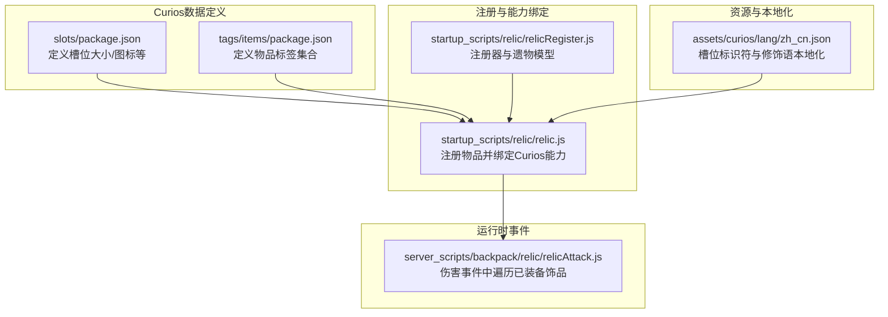
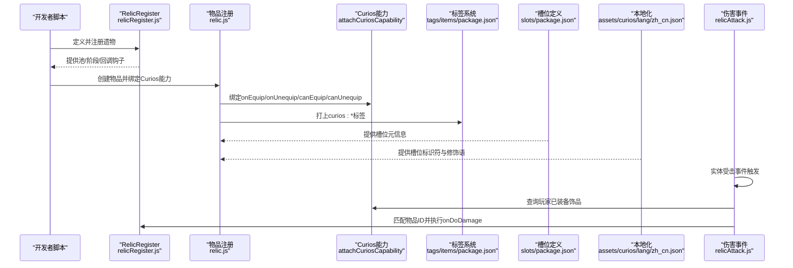
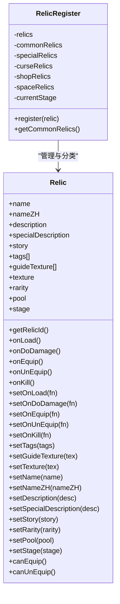
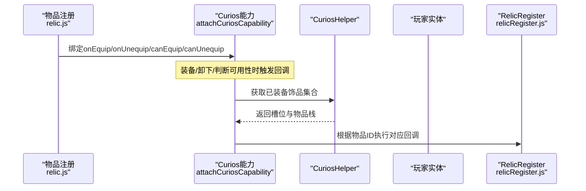
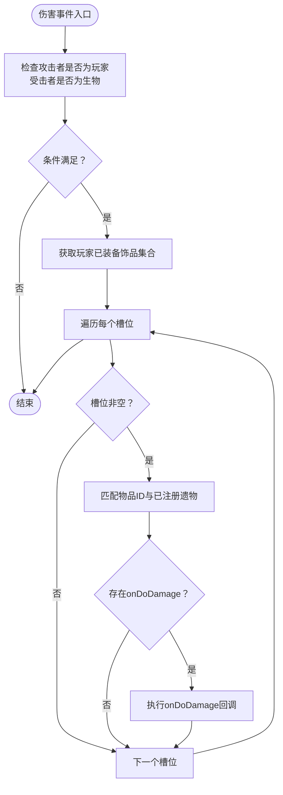
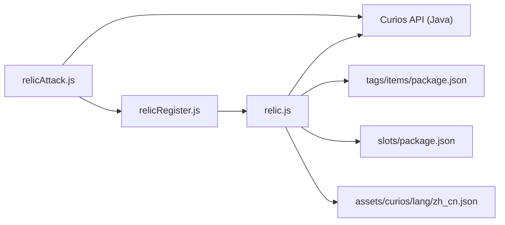

# Curios API集成

<cite>
**本文引用的文件**
- [package.json](file://kubejs/data/curios/curios/slots/package.json)
- [package.json](file://kubejs/data/curios/tags/items/package.json)
- [zh_cn.json](file://kubejs/assets/curios/lang/zh_cn.json)
- [relicRegister.js](file://kubejs/startup_scripts/relic/relicRegister.js)
- [relic.js](file://kubejs/startup_scripts/relic/relic.js)
- [relicAttack.js](file://kubejs/server_scripts/backpack/relic/relicAttack.js)
</cite>

## 目录
1. [简介](#简介)
2. [项目结构](#项目结构)
3. [核心组件](#核心组件)
4. [架构总览](#架构总览)
5. [详细组件分析](#详细组件分析)
6. [依赖关系分析](#依赖关系分析)
7. [性能考虑](#性能考虑)
8. [故障排查指南](#故障排查指南)
9. [结论](#结论)
10. [附录](#附录)

## 简介
本文件面向希望在项目中集成与使用Curios饰品系统的开发者，基于仓库内的KubeJS脚本与资源文件，系统化说明Curios槽位定义、饰品注册流程、装备管理机制、背包空间扩展、饰品属性配置与NBT数据管理、槽位标签系统、饰品限制规则以及兼容性处理策略，并提供最佳实践、性能优化建议与常见问题解决方案。

## 项目结构
与Curios集成直接相关的文件集中在以下位置：
- 数据定义：kubejs/data/curios/curios/slots 与 kubejs/data/curios/tags/items
- 资源本地化：kubejs/assets/curios/lang/zh_cn.json
- 注册与能力绑定：kubejs/startup_scripts/relic/relicRegister.js 与 kubejs/startup_scripts/relic/relic.js
- 装备触发逻辑：kubejs/server_scripts/backpack/relic/relicAttack.js

下图展示上述文件之间的关系与职责分工：

图表来源
- [package.json:1-5](file://kubejs/data/curios/curios/slots/package.json#L1-L5)
- [package.json:1-5](file://kubejs/data/curios/tags/items/package.json#L1-L5)
- [zh_cn.json:1-4](file://kubejs/assets/curios/lang/zh_cn.json#L1-L4)
- [relicRegister.js:1-178](file://kubejs/startup_scripts/relic/relicRegister.js#L1-L178)
- [relic.js:1-81](file://kubejs/startup_scripts/relic/relic.js#L1-L81)
- [relicAttack.js:1-33](file://kubejs/server_scripts/backpack/relic/relicAttack.js#L1-L33)

章节来源
- [package.json:1-5](file://kubejs/data/curios/curios/slots/package.json#L1-L5)
- [package.json:1-5](file://kubejs/data/curios/tags/items/package.json#L1-L5)
- [zh_cn.json:1-4](file://kubejs/assets/curios/lang/zh_cn.json#L1-L4)
- [relicRegister.js:1-178](file://kubejs/startup_scripts/relic/relicRegister.js#L1-L178)
- [relic.js:1-81](file://kubejs/startup_scripts/relic/relic.js#L1-L81)
- [relicAttack.js:1-33](file://kubejs/server_scripts/backpack/relic/relicAttack.js#L1-L33)

## 核心组件
- 槽位定义与图标
  - slots/package.json用于声明槽位数量、是否显示装饰槽、槽位图标等元信息。
- 物品标签系统
  - tags/items/package.json用于声明可被Curios识别的物品标签集合，支持追加或替换。
- 遗物注册器与模型
  - relicRegister.js定义了RelicRegister与Relic类，提供注册、分池（普通/特殊/诅咒/商店）、阶段（1~5）等能力；同时提供事件回调钩子（加载、装备、卸下、攻击、击杀等）。
- Curios能力绑定与限制规则
  - relic.js在注册物品时调用attachCuriosCapability，绑定onEquip/onUnequip/canEquip/canUnequip等回调，并将物品打上curios:package标签。
- 运行时事件处理
  - relicAttack.js在实体受击事件中查询玩家已装备的Curios饰品，按槽位遍历并根据物品ID匹配执行对应遗物的onDoDamage逻辑。

章节来源
- [package.json:1-5](file://kubejs/data/curios/curios/slots/package.json#L1-L5)
- [package.json:1-5](file://kubejs/data/curios/tags/items/package.json#L1-L5)
- [relicRegister.js:1-178](file://kubejs/startup_scripts/relic/relicRegister.js#L1-L178)
- [relic.js:1-81](file://kubejs/startup_scripts/relic/relic.js#L1-L81)
- [relicAttack.js:1-33](file://kubejs/server_scripts/backpack/relic/relicAttack.js#L1-L33)

## 架构总览
下图展示了从“注册饰品”到“运行时生效”的完整链路，包括槽位定义、标签系统、能力绑定与事件触发：

图表来源
- [relicRegister.js:1-178](file://kubejs/startup_scripts/relic/relicRegister.js#L1-L178)
- [relic.js:1-81](file://kubejs/startup_scripts/relic/relic.js#L1-L81)
- [package.json:1-5](file://kubejs/data/curios/tags/items/package.json#L1-L5)
- [package.json:1-5](file://kubejs/data/curios/curios/slots/package.json#L1-L5)
- [zh_cn.json:1-4](file://kubejs/assets/curios/lang/zh_cn.json#L1-L4)
- [relicAttack.js:1-33](file://kubejs/server_scripts/backpack/relic/relicAttack.js#L1-L33)

## 详细组件分析

### 槽位定义与图标
- 关键点
  - 槽位数量由slots/package.json中的size字段决定。
  - 是否显示装饰槽由add_cosmetic控制。
  - 图标由icon字段指定，格式为命名空间:路径。
- 影响范围
  - 决定UI界面中槽位数量与外观，影响玩家交互体验与视觉反馈。

章节来源
- [package.json:1-5](file://kubejs/data/curios/curios/slots/package.json#L1-L5)

### 物品标签系统
- 关键点
  - tags/items/package.json定义了可被Curios识别的物品标签集合。
  - replace字段控制是否替换默认标签集。
  - values数组列出具体标签值。
- 影响范围
  - 通过标签系统实现对饰品的分类、过滤与限制，例如将特定饰品归入curios:package槽位。

章节来源
- [package.json:1-5](file://kubejs/data/curios/tags/items/package.json#L1-L5)

### 遗物注册器与模型
- 关键点
  - RelicRegister负责收集与分类遗物（普通/特殊/诅咒/商店），并记录当前阶段。
  - Relic类提供名称、描述、故事、标签、纹理、稀有度、池、阶段等属性，以及多类事件回调钩子（onLoad/onEquip/onUnEquip/onDoDamage/onKill等）。
  - 支持通过set方法链式配置属性，便于模块化扩展。
- 影响范围
  - 作为饰品系统的核心数据模型，决定饰品的行为、外观与交互逻辑。

图表来源
- [relicRegister.js:1-178](file://kubejs/startup_scripts/relic/relicRegister.js#L1-L178)

章节来源
- [relicRegister.js:1-178](file://kubejs/startup_scripts/relic/relicRegister.js#L1-L178)

### Curios能力绑定与限制规则
- 关键点
  - 在物品注册时调用attachCuriosCapability，绑定onEquip/onUnequip/canEquip/canUnequip回调。
  - onEquip/onUnequip中可执行自定义逻辑（如更新玩家背包空间），并进行异常保护。
  - canEquip/canUnequip用于限制是否允许装备/卸下，异常时默认返回true以避免中断事件总线。
  - 将物品打上curios:package标签，使其归属到包装配饰槽位。
- 影响范围
  - 直接决定饰品的穿戴行为、可用性与UI表现。

图表来源
- [relic.js:1-81](file://kubejs/startup_scripts/relic/relic.js#L1-L81)
- [relicRegister.js:1-178](file://kubejs/startup_scripts/relic/relicRegister.js#L1-L178)

章节来源
- [relic.js:1-81](file://kubejs/startup_scripts/relic/relic.js#L1-L81)

### 运行时事件处理（伤害事件）
- 关键点
  - 在实体受击事件中，先确认攻击者为玩家且受击者为生物。
  - 使用CuriosApi获取玩家已装备的饰品集合，遍历槽位并匹配物品ID。
  - 若对应遗物定义了onDoDamage，则执行该回调。
- 影响范围
  - 将饰品效果与战斗行为解耦，按需触发，避免不必要的开销。

图表来源
- [relicAttack.js:1-33](file://kubejs/server_scripts/backpack/relic/relicAttack.js#L1-L33)

章节来源
- [relicAttack.js:1-33](file://kubejs/server_scripts/backpack/relic/relicAttack.js#L1-L33)

### 背包空间扩展与NBT数据管理
- 背包空间扩展
  - 在onEquip回调中调用updatePlayerBackpack以更新玩家背包容量，确保装备饰品后容量变化即时生效。
- NBT数据管理
  - 可通过Curios能力回调访问与修改物品栈，结合全局状态与事件触发实现持久化与同步。
- 注意事项
  - 回调中应做好异常保护，避免因单个饰品逻辑异常导致整体事件失败。
  - 对于频繁触发的事件（如伤害事件），建议在回调内做快速分支判断，减少无效计算。

章节来源
- [relic.js:1-81](file://kubejs/startup_scripts/relic/relic.js#L1-L81)

### 槽位标签系统与兼容性处理
- 槽位标签系统
  - 通过curios:package标签将物品归入包装配饰槽位，实现与Curios的对接。
- 兼容性处理
  - canEquip/canUnequip在异常时默认返回true，保证在极端情况下不阻断玩家操作。
  - onEquip/onUnequip中对实体存在性进行检查，避免空引用导致崩溃。

章节来源
- [relic.js:1-81](file://kubejs/startup_scripts/relic/relic.js#L1-L81)

## 依赖关系分析
- 组件耦合
  - RelicRegister与Relic构成高内聚的数据层，提供统一的属性与回调接口。
  - relic.js依赖CuriosApi与CuriosJSCapabilityBuilder，承担能力绑定与限制规则落地。
  - relicAttack.js依赖CuriosApi查询已装备饰品，形成事件驱动的副作用执行。
- 外部依赖
  - Curios API（Java层）：提供CuriosApi、CuriosHelper等核心能力。
  - KubeJS：提供注册事件、脚本生命周期与资源本地化支持。

图表来源
- [relicRegister.js:1-178](file://kubejs/startup_scripts/relic/relicRegister.js#L1-L178)
- [relic.js:1-81](file://kubejs/startup_scripts/relic/relic.js#L1-L81)
- [package.json:1-5](file://kubejs/data/curios/tags/items/package.json#L1-L5)
- [package.json:1-5](file://kubejs/data/curios/curios/slots/package.json#L1-L5)
- [zh_cn.json:1-4](file://kubejs/assets/curios/lang/zh_cn.json#L1-L4)
- [relicAttack.js:1-33](file://kubejs/server_scripts/backpack/relic/relicAttack.js#L1-L33)

章节来源
- [relicRegister.js:1-178](file://kubejs/startup_scripts/relic/relicRegister.js#L1-L178)
- [relic.js:1-81](file://kubejs/startup_scripts/relic/relic.js#L1-L81)
- [package.json:1-5](file://kubejs/data/curios/tags/items/package.json#L1-L5)
- [package.json:1-5](file://kubejs/data/curios/curios/slots/package.json#L1-L5)
- [zh_cn.json:1-4](file://kubejs/assets/curios/lang/zh_cn.json#L1-L4)
- [relicAttack.js:1-33](file://kubejs/server_scripts/backpack/relic/relicAttack.js#L1-L33)

## 性能考虑
- 事件触发频率控制
  - 仅在必要事件（如伤害事件）中进行遍历与匹配，避免在高频tick中执行昂贵操作。
- 快速分支与缓存
  - 在回调中尽早判定条件（如实体类型、物品ID），减少无效分支。
- 异常隔离
  - 回调内部使用try-catch保护，避免单个饰品异常影响整体事件流。
- 资源与纹理
  - 优先使用统一贴图（如按阶段选择通用材质），减少自定义纹理带来的资源压力。

## 故障排查指南
- 装备/卸下异常
  - 现象：装备或卸下饰品时报错导致无法穿戴。
  - 排查：检查onEquip/onUnequip回调中的异常日志，确认实体存在性与参数合法性。
- 判断可用性异常
  - 现象：canEquip/canUnequip抛错导致默认返回true但行为不符合预期。
  - 排查：在回调中增加显式返回值与日志输出，确保逻辑清晰可控。
- 事件未触发
  - 现象：onDoDamage未按预期执行。
  - 排查：确认物品ID与已注册遗物一致，检查槽位是否正确归属curios:package标签。
- 槽位数量或图标异常
  - 现象：UI显示槽位数或图标不正确。
  - 排查：核对slots/package.json中的size、add_cosmetic与icon字段。

章节来源
- [relic.js:1-81](file://kubejs/startup_scripts/relic/relic.js#L1-L81)
- [relicAttack.js:1-33](file://kubejs/server_scripts/backpack/relic/relicAttack.js#L1-L33)

## 结论
本项目通过KubeJS脚本与Curios API实现了完整的饰品系统集成：以RelicRegister为核心的数据模型承载属性与回调，借助attachCuriosCapability绑定穿戴与限制规则，并通过事件驱动在运行时激活饰品效果。配合槽位定义、标签系统与本地化资源，形成了可扩展、可维护且具备良好兼容性的Curios集成方案。建议在后续迭代中持续完善事件触发策略、增强异常防护与性能监控，以获得更稳定的玩家体验。

## 附录
- 最佳实践
  - 使用统一的标签体系管理饰品归属与分类。
  - 在回调中保持幂等与快速失败，避免阻塞事件总线。
  - 对高频事件进行轻量化处理，必要时引入节流或缓存。
- 常见问题
  - 装备后容量未更新：检查onEquip中updatePlayerBackpack调用是否成功。
  - 事件不触发：确认物品ID与注册一致、槽位标签正确。
  - UI显示异常：核对slots与lang资源文件配置。