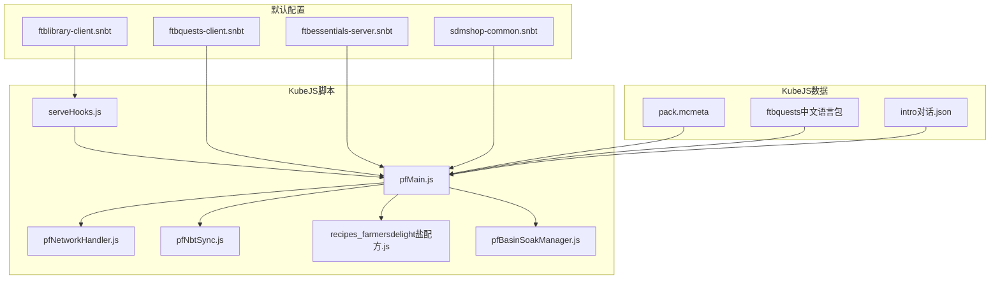
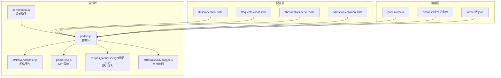
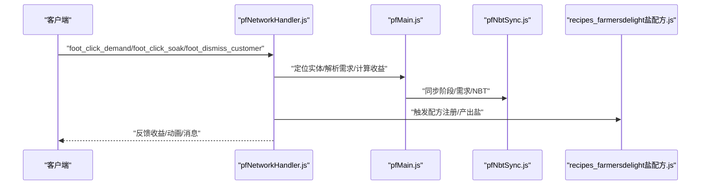
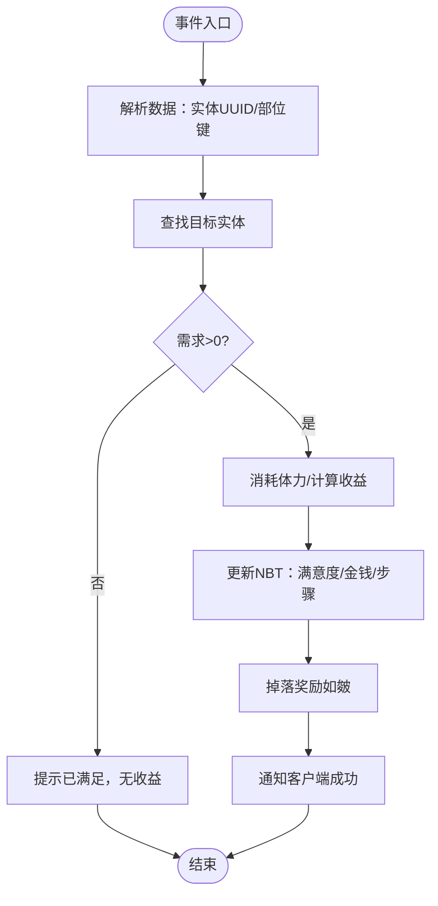
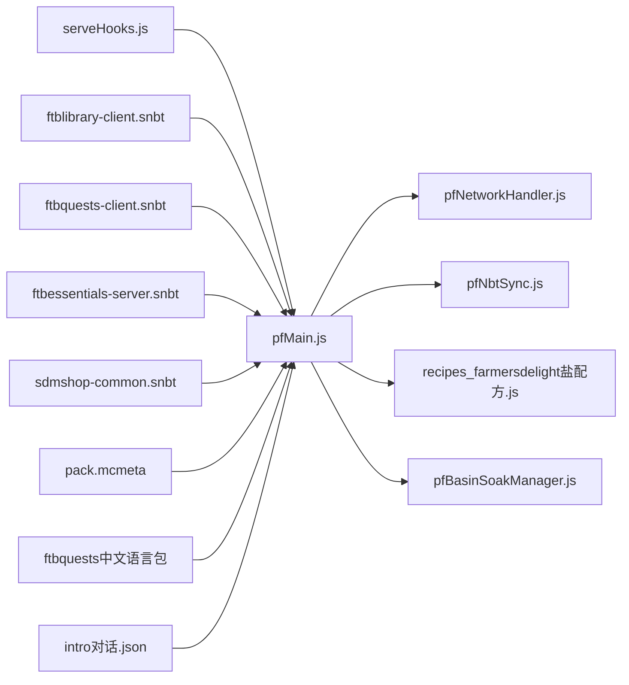

# FTB系列模组集成

<cite>
**本文引用的文件**
- [ftblibrary-client.snbt](file://defaultconfigs/ftblibrary/ftblibrary-client.snbt)
- [ftbquests-client.snbt](file://defaultconfigs/ftbquests/client-config.snbt)
- [ftbessentials-server.snbt](file://defaultconfigs/ftbessentials-server.snbt)
- [sdmshop-common.snbt](file://defaultconfigs/sdmshop/sdmshop-common.snbt)
- [pack.mcmeta](file://kubejs/data/ftb/pack.mcmeta)
- [ftbquests中文语言包](file://kubejs/data/ftb/assets/ftbquests/lang/zh_cn.json)
- [serveHooks.js](file://kubejs/startup_scripts/serveHooks.js)
- [pfMain.js](file://kubejs/server_scripts/pathfinder/pfMain.js)
- [pfNetworkHandler.js](file://kubejs/server_scripts/pathfinder/pfNetworkHandler.js)
- [pfNbtSync.js](file://kubejs/server_scripts/pathfinder/pfNbtSync.js)
- [intro对话.json](file://kubejs/data/marguerite/chatbox/dialogues/intro.json)
- [recipes_farmersdelight盐配方.js](file://kubejs/server_scripts/recipes/recipes_farmersdelight_salt.js)
- [pfBasinSoakManager.js](file://kubejs/server_scripts/pathfinder/pfBasinSoakManager.js)
</cite>

## 目录
1. [简介](#简介)
2. [项目结构](#项目结构)
3. [核心组件](#核心组件)
4. [架构总览](#架构总览)
5. [详细组件分析](#详细组件分析)
6. [依赖关系分析](#依赖关系分析)
7. [性能考量](#性能考量)
8. [故障排查指南](#故障排查指南)
9. [结论](#结论)
10. [附录](#附录)

## 简介
本文件面向FTB系列模组（FTB Library、FTB Quests、FTB Essentials等）在整合包中的集成实践，结合仓库内的默认配置与KubeJS脚本，系统阐述任务系统集成、图书馆功能扩展、团队协作机制、配置文件管理、客户端设置与服务器配置、FTB API使用方法、数据同步与权限管理、以及FTB集成的配置指南、自定义扩展与兼容性处理方案。文档同时为FTB模组开发者提供可复用的集成参考。

## 项目结构
本项目围绕KubeJS与默认配置展开，主要涉及以下区域：
- defaultconfigs：存放FTB系列模组的默认配置模板（SNBT），用于复制到本地或世界配置目录，便于覆盖默认行为
- kubejs/data/ftb：包含pack元数据与FTB Quests语言资源，支撑任务界面与本地化
- kubejs/server_scripts/pathfinder：寻路与服务系统的后端逻辑，包含网络事件处理、NBT同步、模块化管理
- kubejs/startup_scripts：启动期钩子框架，用于集中注册与执行扩展逻辑
- kubejs/data/marguerite：角色扮演/对话系统数据，与FTB任务界面联动
- kubejs/server_scripts/recipes：与FTB任务相关的配方扩展（如泡脚废水制盐）

**图表来源**
- [ftblibrary-client.snbt:1-5](file://defaultconfigs/ftblibrary/ftblibrary-client.snbt#L1-L5)
- [ftbquests-client.snbt:1-5](file://defaultconfigs/ftbquests/client-config.snbt#L1-L5)
- [ftbessentials-server.snbt:1-14](file://defaultconfigs/ftbessentials-server.snbt#L1-L14)
- [sdmshop-common.snbt:1-5](file://defaultconfigs/sdmshop/sdmshop-common.snbt#L1-L5)
- [pack.mcmeta:1-6](file://kubejs/data/ftb/pack.mcmeta#L1-L6)
- [ftbquests中文语言包:1-542](file://kubejs/data/ftb/assets/ftbquests/lang/zh_cn.json#L1-L542)
- [serveHooks.js:1-31](file://kubejs/startup_scripts/serveHooks.js#L1-L31)
- [pfMain.js:1-177](file://kubejs/server_scripts/pathfinder/pfMain.js#L1-L177)
- [pfNetworkHandler.js:1-317](file://kubejs/server_scripts/pathfinder/pfNetworkHandler.js#L1-L317)
- [pfNbtSync.js:1-94](file://kubejs/server_scripts/pathfinder/pfNbtSync.js#L1-L94)
- [recipes_farmersdelight盐配方.js:1-36](file://kubejs/server_scripts/recipes/recipes_farmersdelight_salt.js#L1-L36)
- [pfBasinSoakManager.js:140-197](file://kubejs/server_scripts/pathfinder/pfBasinSoakManager.js#L140-L197)

**章节来源**
- [ftblibrary-client.snbt:1-5](file://defaultconfigs/ftblibrary/ftblibrary-client.snbt#L1-L5)
- [ftbquests-client.snbt:1-5](file://defaultconfigs/ftbquests/client-config.snbt#L1-L5)
- [ftbessentials-server.snbt:1-14](file://defaultconfigs/ftbessentials-server.snbt#L1-L14)
- [sdmshop-common.snbt:1-5](file://defaultconfigs/sdmshop/sdmshop-common.snbt#L1-L5)
- [pack.mcmeta:1-6](file://kubejs/data/ftb/pack.mcmeta#L1-L6)
- [ftbquests中文语言包:1-542](file://kubejs/data/ftb/assets/ftbquests/lang/zh_cn.json#L1-L542)

## 核心组件
- 默认配置模板（SNBT）
  - ftblibrary-client.snbt：用于复制到本地客户端配置，覆盖FTB Library客户端行为
  - ftbquests-client.snbt：用于复制到本地客户端配置，覆盖FTB Quests客户端行为
  - ftbessentials-server.snbt：用于复制到世界服务器配置，覆盖FTB Essentials服务器行为
  - sdmshop-common.snbt：用于复制到Common配置，覆盖SDMShop通用行为
- KubeJS数据
  - pack.mcmeta：声明pack格式与描述，确保FTB Quests等模组正确识别整合包
  - ftbquests中文语言包：提供FTB Quests界面与提示的本地化文本
  - intro对话.json：角色扮演/对话系统数据，与任务界面联动
- KubeJS脚本
  - serveHooks.js：启动期钩子框架，集中注册扩展逻辑
  - pfMain.js：寻路系统主循环，协调各子模块
  - pfNetworkHandler.js：网络事件处理，接收客户端点击并执行业务逻辑
  - pfNbtSync.js：基于实体主手物品NBT的数据同步，实现前后端一致
  - recipes_farmersdelight盐配方.js：将泡脚废水转化为盐的配方，服务于任务链
  - pfBasinSoakManager.js：与Create Basin等流体容器交互，判断废水状态与槽位

**章节来源**
- [serveHooks.js:1-31](file://kubejs/startup_scripts/serveHooks.js#L1-L31)
- [pfMain.js:1-177](file://kubejs/server_scripts/pathfinder/pfMain.js#L1-L177)
- [pfNetworkHandler.js:1-317](file://kubejs/server_scripts/pathfinder/pfNetworkHandler.js#L1-L317)
- [pfNbtSync.js:1-94](file://kubejs/server_scripts/pathfinder/pfNbtSync.js#L1-L94)
- [recipes_farmersdelight盐配方.js:1-36](file://kubejs/server_scripts/recipes/recipes_farmersdelight_salt.js#L1-L36)
- [pfBasinSoakManager.js:140-197](file://kubejs/server_scripts/pathfinder/pfBasinSoakManager.js#L140-L197)

## 架构总览
FTB集成采用“默认配置模板 + KubeJS脚本”的双轨策略：
- 默认配置模板负责在首次运行时复制到本地/世界配置目录，作为用户覆盖的基础
- KubeJS脚本负责运行时逻辑编排，包括网络事件处理、数据同步、模块化扩展与配方注入

**图表来源**
- [pfMain.js:1-177](file://kubejs/server_scripts/pathfinder/pfMain.js#L1-L177)
- [pfNetworkHandler.js:1-317](file://kubejs/server_scripts/pathfinder/pfNetworkHandler.js#L1-L317)
- [pfNbtSync.js:1-94](file://kubejs/server_scripts/pathfinder/pfNbtSync.js#L1-L94)
- [serveHooks.js:1-31](file://kubejs/startup_scripts/serveHooks.js#L1-L31)
- [recipes_farmersdelight盐配方.js:1-36](file://kubejs/server_scripts/recipes/recipes_farmersdelight_salt.js#L1-L36)
- [pfBasinSoakManager.js:140-197](file://kubejs/server_scripts/pathfinder/pfBasinSoakManager.js#L140-L197)
- [ftblibrary-client.snbt:1-5](file://defaultconfigs/ftblibrary/ftblibrary-client.snbt#L1-L5)
- [ftbquests-client.snbt:1-5](file://defaultconfigs/ftbquests/client-config.snbt#L1-L5)
- [ftbessentials-server.snbt:1-14](file://defaultconfigs/ftbessentials-server.snbt#L1-L14)
- [sdmshop-common.snbt:1-5](file://defaultconfigs/sdmshop/sdmshop-common.snbt#L1-L5)
- [pack.mcmeta:1-6](file://kubejs/data/ftb/pack.mcmeta#L1-L6)
- [ftbquests中文语言包:1-542](file://kubejs/data/ftb/assets/ftbquests/lang/zh_cn.json#L1-L542)
- [intro对话.json:1-136](file://kubejs/data/marguerite/chatbox/dialogues/intro.json#L1-L136)

## 详细组件分析

### 任务系统集成（FTB Quests）
- 本地化与界面
  - 通过ftbquests中文语言包提供任务界面、任务项、奖励、命令反馈等完整本地化文本，确保多语言体验
  - pack.mcmeta声明pack格式，使任务系统正确识别整合包元数据
- 任务行为与权限
  - 团队奖励与屏蔽：支持团队奖励发放与屏蔽，可通过命令反馈接口进行管理
  - 推进模式与依赖：支持线性/灵活推进模式，任务依赖与可见性控制
  - 自动检测与延迟：物品自动检测最小间隔可调，平衡TPS与响应速度
- 与KubeJS联动
  - 通过recipes脚本注入与任务相关的配方（如泡脚废水制盐），形成任务闭环
  - 通过serveHooks与pfMain/pfNetworkHandler等模块协同，实现点击结算、泡脚、送客等交互

**图表来源**
- [pfNetworkHandler.js:36-311](file://kubejs/server_scripts/pathfinder/pfNetworkHandler.js#L36-L311)
- [pfMain.js:11-174](file://kubejs/server_scripts/pathfinder/pfMain.js#L11-L174)
- [pfNbtSync.js:8-93](file://kubejs/server_scripts/pathfinder/pfNbtSync.js#L8-L93)
- [recipes_farmersdelight盐配方.js:17-36](file://kubejs/server_scripts/recipes/recipes_farmersdelight_salt.js#L17-L36)

**章节来源**
- [ftbquests中文语言包:1-542](file://kubejs/data/ftb/assets/ftbquests/lang/zh_cn.json#L1-L542)
- [pack.mcmeta:1-6](file://kubejs/data/ftb/pack.mcmeta#L1-L6)
- [pfNetworkHandler.js:36-311](file://kubejs/server_scripts/pathfinder/pfNetworkHandler.js#L36-L311)
- [pfMain.js:11-174](file://kubejs/server_scripts/pathfinder/pfMain.js#L11-L174)
- [pfNbtSync.js:8-93](file://kubejs/server_scripts/pathfinder/pfNbtSync.js#L8-L93)
- [recipes_farmersdelight盐配方.js:17-36](file://kubejs/server_scripts/recipes/recipes_farmersdelight_salt.js#L17-L36)

### 图书馆功能扩展（FTB Library）
- 客户端配置
  - ftblibrary-client.snbt作为默认模板，复制到本地后可用于覆盖客户端行为（如UI、渲染、按键绑定等）
- 与任务系统联动
  - 通过pack.mcmeta与ftbquests中文语言包，确保任务界面在不同客户端配置下的稳定显示

**章节来源**
- [ftblibrary-client.snbt:1-5](file://defaultconfigs/ftblibrary/ftblibrary-client.snbt#L1-L5)
- [pack.mcmeta:1-6](file://kubejs/data/ftb/pack.mcmeta#L1-L6)
- [ftbquests中文语言包:1-542](file://kubejs/data/ftb/assets/ftbquests/lang/zh_cn.json#L1-L542)

### 团队协作机制
- 团队奖励与屏蔽
  - 任务奖励支持团队奖励模式，可通过命令反馈接口设置团队奖励屏蔽状态
- 权限与命令
  - 提供编辑模式、锁定/解锁任务、进度变更、奖励表导入导出等命令，便于管理员维护
- 与对话系统联动
  - intro对话.json提供角色扮演场景，可与任务进度联动，增强叙事体验

**章节来源**
- [ftbquests中文语言包:418-421](file://kubejs/data/ftb/assets/ftbquests/lang/zh_cn.json#L418-L421)
- [ftbquests中文语言包:501-530](file://kubejs/data/ftb/assets/ftbquests/lang/zh_cn.json#L501-L530)
- [intro对话.json:1-136](file://kubejs/data/marguerite/chatbox/dialogues/intro.json#L1-L136)

### 配置文件管理
- 默认配置复制
  - ftblibrary-client.snbt、ftbquests-client.snbt、ftbessentials-server.snbt、sdmshop-common.snbt均提供默认模板，首次运行时复制到本地/世界配置目录
- 覆盖策略
  - 在相应位置创建同名SNBT文件，将需要覆盖的键值写入，即可生效
- 示例
  - ftbessentials-server.snbt包含示例注释，展示如何覆盖特定子配置（如末影箱开关）

**章节来源**
- [ftblibrary-client.snbt:1-5](file://defaultconfigs/ftblibrary/ftblibrary-client.snbt#L1-L5)
- [ftbquests-client.snbt:1-5](file://defaultconfigs/ftbquests/client-config.snbt#L1-L5)
- [ftbessentials-server.snbt:1-14](file://defaultconfigs/ftbessentials-server.snbt#L1-L14)
- [sdmshop-common.snbt:1-5](file://defaultconfigs/sdmshop/sdmshop-common.snbt#L1-L5)

### 客户端设置与服务器配置
- 客户端
  - ftblibrary-client.snbt与ftbquests-client.snbt分别覆盖对应模组的客户端行为
- 服务器
  - ftbessentials-server.snbt覆盖FTB Essentials服务器行为，如末影箱开关等
- 一致性保障
  - 通过pack.mcmeta与语言包，确保界面与本地化在不同环境一致

**章节来源**
- [ftblibrary-client.snbt:1-5](file://defaultconfigs/ftblibrary/ftblibrary-client.snbt#L1-L5)
- [ftbquests-client.snbt:1-5](file://defaultconfigs/ftbquests/client-config.snbt#L1-L5)
- [ftbessentials-server.snbt:1-14](file://defaultconfigs/ftbessentials-server.snbt#L1-L14)
- [pack.mcmeta:1-6](file://kubejs/data/ftb/pack.mcmeta#L1-L6)

### FTB API使用方法
- 事件与网络
  - 使用NetworkEvents.dataReceived接收客户端点击事件，解析实体UUID与部位键，执行需求更新、泡脚、送客等逻辑
- 属性与倍率
  - 通过实体persistentData读取Boss ID，结合全局注册表应用满意度倍率
- NBT同步
  - 使用实体主手物品NBT存储阶段、需求、满意度、金钱等状态，实现前后端一致

**图表来源**
- [pfNetworkHandler.js:39-219](file://kubejs/server_scripts/pathfinder/pfNetworkHandler.js#L39-L219)

**章节来源**
- [pfNetworkHandler.js:39-219](file://kubejs/server_scripts/pathfinder/pfNetworkHandler.js#L39-L219)
- [pfNbtSync.js:8-93](file://kubejs/server_scripts/pathfinder/pfNbtSync.js#L8-L93)

### 数据同步与权限管理
- 数据同步
  - 以实体主手物品NBT为载体，自动同步到客户端，避免网络抖动导致的状态不一致
- 权限管理
  - 通过命令反馈接口设置团队奖励屏蔽、进度变更、奖励表导入导出等，确保权限可控

**章节来源**
- [pfNbtSync.js:8-93](file://kubejs/server_scripts/pathfinder/pfNbtSync.js#L8-L93)
- [ftbquests中文语言包:516-530](file://kubejs/data/ftb/assets/ftbquests/lang/zh_cn.json#L516-L530)

### FTB集成的配置指南、自定义扩展与兼容性处理
- 配置指南
  - 在defaultconfigs目录下创建对应SNBT文件，按需覆盖键值；ftbessentials-server.snbt提供示例注释
- 自定义扩展
  - 使用serveHooks.js集中注册扩展逻辑；通过pfMain.js的模块化结构接入新功能
- 兼容性处理
  - pfBasinSoakManager.js对Create Basin等容器进行Capability与NBT双重扫描，保证在不同版本下的稳定性

**章节来源**
- [ftbessentials-server.snbt:1-14](file://defaultconfigs/ftbessentials-server.snbt#L1-L14)
- [serveHooks.js:11-30](file://kubejs/startup_scripts/serveHooks.js#L11-L30)
- [pfMain.js:7-20](file://kubejs/server_scripts/pathfinder/pfMain.js#L7-L20)
- [pfBasinSoakManager.js:140-197](file://kubejs/server_scripts/pathfinder/pfBasinSoakManager.js#L140-L197)

## 依赖关系分析
- 组件耦合
  - pfMain.js作为中枢，依赖pfNetworkHandler.js与pfNbtSync.js；serveHooks.js在启动期为pfMain.js提供扩展钩子
  - recipes_farmersdelight盐配方.js与pfNetworkHandler.js共同服务于泡脚生态
- 外部依赖
  - FTB Library/Quests/Essentials等模组通过默认配置与语言包参与界面与行为
  - Create Basin等流体容器通过Capability与NBT扫描实现兼容

**图表来源**
- [serveHooks.js:11-30](file://kubejs/startup_scripts/serveHooks.js#L11-L30)
- [pfMain.js:11-174](file://kubejs/server_scripts/pathfinder/pfMain.js#L11-L174)
- [pfNetworkHandler.js:36-311](file://kubejs/server_scripts/pathfinder/pfNetworkHandler.js#L36-L311)
- [pfNbtSync.js:8-93](file://kubejs/server_scripts/pathfinder/pfNbtSync.js#L8-L93)
- [recipes_farmersdelight盐配方.js:17-36](file://kubejs/server_scripts/recipes/recipes_farmersdelight_salt.js#L17-L36)
- [pfBasinSoakManager.js:140-197](file://kubejs/server_scripts/pathfinder/pfBasinSoakManager.js#L140-L197)
- [ftblibrary-client.snbt:1-5](file://defaultconfigs/ftblibrary/ftblibrary-client.snbt#L1-L5)
- [ftbquests-client.snbt:1-5](file://defaultconfigs/ftbquests/client-config.snbt#L1-L5)
- [ftbessentials-server.snbt:1-14](file://defaultconfigs/ftbessentials-server.snbt#L1-L14)
- [sdmshop-common.snbt:1-5](file://defaultconfigs/sdmshop/sdmshop-common.snbt#L1-L5)
- [pack.mcmeta:1-6](file://kubejs/data/ftb/pack.mcmeta#L1-L6)
- [ftbquests中文语言包:1-542](file://kubejs/data/ftb/assets/ftbquests/lang/zh_cn.json#L1-L542)
- [intro对话.json:1-136](file://kubejs/data/marguerite/chatbox/dialogues/intro.json#L1-L136)

**章节来源**
- [pfMain.js:11-174](file://kubejs/server_scripts/pathfinder/pfMain.js#L11-L174)
- [pfNetworkHandler.js:36-311](file://kubejs/server_scripts/pathfinder/pfNetworkHandler.js#L36-L311)
- [pfNbtSync.js:8-93](file://kubejs/server_scripts/pathfinder/pfNbtSync.js#L8-L93)
- [serveHooks.js:11-30](file://kubejs/startup_scripts/serveHooks.js#L11-L30)
- [recipes_farmersdelight盐配方.js:17-36](file://kubejs/server_scripts/recipes/recipes_farmersdelight_salt.js#L17-L36)
- [pfBasinSoakManager.js:140-197](file://kubejs/server_scripts/pathfinder/pfBasinSoakManager.js#L140-L197)

## 性能考量
- TPS优化
  - ftbquests-client.snbt与ftbquests中文语言包提供“物品自动检测最小间隔”等参数，可在频繁物品栏变化场景中平衡响应与TPS
- 循环与重复处理
  - pfMain.js对同一tick内重复处理进行去重，避免重复计算
- 流体容器兼容
  - pfBasinSoakManager.js优先使用Capability扫描，回退到NBT扫描，兼顾性能与兼容性

**章节来源**
- [ftbquests中文语言包:112-114](file://kubejs/data/ftb/assets/ftbquests/lang/zh_cn.json#L112-L114)
- [pfMain.js:33-37](file://kubejs/server_scripts/pathfinder/pfMain.js#L33-L37)
- [pfBasinSoakManager.js:147-183](file://kubejs/server_scripts/pathfinder/pfBasinSoakManager.js#L147-L183)

## 故障排查指南
- 任务界面异常
  - 检查pack.mcmeta与ftbquests中文语言包是否正确加载
- 网络事件无响应
  - 确认NetworkEvents监听已注册，客户端发送的事件键与服务端解析一致
- 数据不同步
  - 检查pfNbtSync.js是否正确设置/读取NBT，实体主手物品是否为同步载体
- 配置未生效
  - 确认defaultconfigs中的SNBT已复制到目标位置，且键名与层级正确

**章节来源**
- [pack.mcmeta:1-6](file://kubejs/data/ftb/pack.mcmeta#L1-L6)
- [ftbquests中文语言包:1-542](file://kubejs/data/ftb/assets/ftbquests/lang/zh_cn.json#L1-L542)
- [pfNetworkHandler.js:36-311](file://kubejs/server_scripts/pathfinder/pfNetworkHandler.js#L36-L311)
- [pfNbtSync.js:8-93](file://kubejs/server_scripts/pathfinder/pfNbtSync.js#L8-L93)
- [ftblibrary-client.snbt:1-5](file://defaultconfigs/ftblibrary/ftblibrary-client.snbt#L1-L5)
- [ftbquests-client.snbt:1-5](file://defaultconfigs/ftbquests/client-config.snbt#L1-L5)
- [ftbessentials-server.snbt:1-14](file://defaultconfigs/ftbessentials-server.snbt#L1-L14)

## 结论
本项目通过默认配置模板与KubeJS脚本实现了FTB系列模组的深度集成：任务系统本地化与行为控制、图书馆功能扩展、团队协作与权限管理、数据同步与性能优化、以及与Create Basin等容器的兼容性处理。开发者可基于serveHooks.js与pfMain.js的模块化结构快速扩展新功能，并通过defaultconfigs与语言包实现稳定的跨平台体验。

## 附录
- 命令参考（节选）
  - 编辑模式、锁定/解锁任务、进度变更、奖励屏蔽、奖励表导入导出等命令反馈文本详见ftbquests中文语言包
- 术语
  - NBT：实体主手物品的命名空间标签，用于前后端状态同步
  - Capability：Forge能力系统，用于查询流体容器的槽位与流体
  - SNBT：可读的NBT序列化格式，用于配置文件

**章节来源**
- [ftbquests中文语言包:501-530](file://kubejs/data/ftb/assets/ftbquests/lang/zh_cn.json#L501-L530)