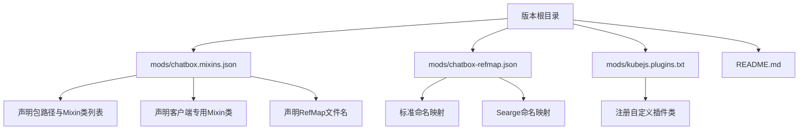
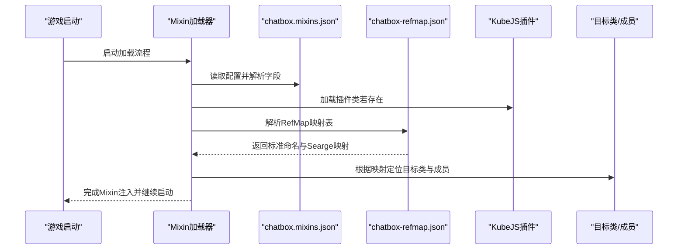
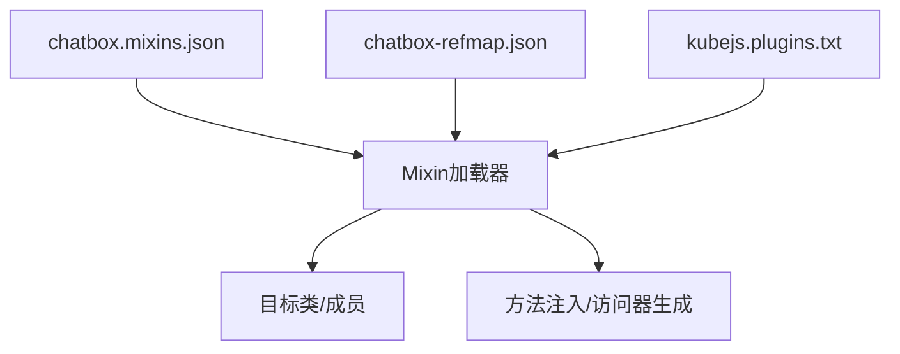

# Mixin系统集成

<cite>
**本文引用的文件**
- [chatbox.mixins.json](file://mods/chatbox.mixins.json)
- [chatbox-refmap.json](file://mods/chatbox-refmap.json)
- [kubejs.plugins.txt](file://mods/kubejs.plugins.txt)
- [README.md](file://README.md)
- [chatbox.mixins.json](file://mods/chatbox.mixins.json)
- [chatbox-refmap.json](file://mods/chatbox-refmap.json)
</cite>

## 目录
1. [简介](#简介)
2. [项目结构](#项目结构)
3. [核心组件](#核心组件)
4. [架构总览](#架构总览)
5. [详细组件分析](#详细组件分析)
6. [依赖关系分析](#依赖关系分析)
7. [性能考量](#性能考量)
8. [故障排查指南](#故障排查指南)
9. [结论](#结论)
10. [附录](#附录)

## 简介
本技术文档围绕项目中的Mixin系统集成进行深入解析，目标是帮助模组开发者快速理解并正确使用Mixin机制。内容涵盖：
- Mixin配置文件结构与字段语义
- 类访问器（Accessor）与方法重写（Mixin）的定义与职责
- RefMap映射表的作用、Searge命名规范与混淆处理
- Mixin加载顺序、优先级与冲突解决策略
- 开发最佳实践、调试技巧与性能优化建议

本项目基于Forge 1.20.1环境，通过KubeJS插件机制加载自定义Mixin模块，并使用RefMap进行运行时名称映射，确保在代码混淆环境下仍能稳定定位目标类与成员。

## 项目结构
本版本根目录包含以下与Mixin系统直接相关的文件：
- mods/chatbox.mixins.json：Mixin配置清单，声明包路径、兼容级别、Mixin类列表、客户端专用类以及RefMap文件名
- mods/chatbox-refmap.json：RefMap映射表，记录Mixin类与目标类成员的映射关系，支持标准命名与Searge命名两种形式
- mods/kubejs.plugins.txt：KubeJS插件注册文件，声明自定义插件类，用于引导Mixin加载流程
- README.md：安装说明，指导用户如何安装与运行该版本

图表来源
- [chatbox.mixins.json:1-24](file://mods/chatbox.mixins.json#L1-L24)
- [chatbox-refmap.json:1-56](file://mods/chatbox-refmap.json#L1-L56)
- [kubejs.plugins.txt:1-1](file://mods/kubejs.plugins.txt#L1-L1)
- [README.md:1-6](file://README.md#L1-L6)

章节来源
- [chatbox.mixins.json:1-24](file://mods/chatbox.mixins.json#L1-L24)
- [chatbox-refmap.json:1-56](file://mods/chatbox-refmap.json#L1-L56)
- [kubejs.plugins.txt:1-1](file://mods/kubejs.plugins.txt#L1-L1)
- [README.md:1-6](file://README.md#L1-L6)

## 核心组件
- Mixin配置文件（chatbox.mixins.json）
  - 字段说明
    - required：是否为必需加载项
    - minVersion：最小兼容的Mixin版本
    - package：Mixin类的根包路径
    - compatibilityLevel：Java兼容级别
    - mixins：通用Mixin类列表
    - client：客户端专用Mixin类列表
    - injectors：默认注入器要求
    - refmap：关联的RefMap文件名
- RefMap映射表（chatbox-refmap.json）
  - mappings：标准命名映射，将Mixin类中的占位符映射到实际的目标类成员
  - data.searge：Searge命名映射，用于混淆环境下的稳定映射
- KubeJS插件（kubejs.plugins.txt）
  - 通过声明插件类，将Mixin加载流程纳入KubeJS生命周期管理

章节来源
- [chatbox.mixins.json:1-24](file://mods/chatbox.mixins.json#L1-L24)
- [chatbox-refmap.json:1-56](file://mods/chatbox-refmap.json#L1-L56)
- [kubejs.plugins.txt:1-1](file://mods/kubejs.plugins.txt#L1-L1)

## 架构总览
下图展示了从配置到运行时映射的整体流程，包括配置解析、RefMap加载、目标类成员定位与方法注入的关键步骤。

图表来源
- [chatbox.mixins.json:1-24](file://mods/chatbox.mixins.json#L1-L24)
- [chatbox-refmap.json:1-56](file://mods/chatbox-refmap.json#L1-L56)
- [kubejs.plugins.txt:1-1](file://mods/kubejs.plugins.txt#L1-L1)

## 详细组件分析

### Mixin配置文件（chatbox.mixins.json）
- 包路径与类列表
  - package字段指定了所有Mixin类的统一根包，便于集中管理与扫描
  - mixins与client分别列出通用与客户端专用的Mixin类，确保按平台隔离
- 兼容性与注入器
  - compatibilityLevel与minVersion保证了运行时的兼容性
  - injectors.defaultRequire控制默认注入器要求，影响Mixin注入策略
- RefMap绑定
  - refmap字段与实际文件名一致，确保加载器能够正确找到映射表

章节来源
- [chatbox.mixins.json:1-24](file://mods/chatbox.mixins.json#L1-L24)

### RefMap映射表（chatbox-refmap.json）
- 映射结构
  - mappings：标准命名映射，键为Mixin类的内部形式，值为目标类签名
  - data.searge：Searge命名映射，键为目标类签名，值为混淆前的原始签名
- 使用场景
  - 在代码混淆后，标准命名可能不可用，需依赖Searge映射进行回退
  - mappings与data.searge共同存在时，加载器优先使用标准命名；若失败则回退至Searge映射

章节来源
- [chatbox-refmap.json:1-56](file://mods/chatbox-refmap.json#L1-L56)

### 访问器与方法重写
- 访问器（Accessor）
  - 用于暴露目标类的私有或受保护成员，简化Mixin对目标对象的读写操作
  - 在RefMap中通常表现为字段或方法的直接映射
- 方法重写（Mixin）
  - 通过Mixin类对目标类的方法进行增强或替换，实现非侵入式扩展
  - 在RefMap中体现为目标方法的签名映射

章节来源
- [chatbox-refmap.json:1-56](file://mods/chatbox-refmap.json#L1-L56)

### 加载顺序、优先级与冲突解决
- 加载顺序
  - 配置文件先于RefMap被加载，确保加载器具备必要的元信息
  - 插件类在配置解析之后执行，负责引导加载流程
- 优先级
  - 通用Mixin优先于客户端专用Mixin进行解析（由配置结构决定）
  - injectors.defaultRequire影响注入器的优先级选择
- 冲突解决
  - 当多个Mixin同时修改同一目标时，遵循“后加载者覆盖先加载者”的原则
  - 若出现签名不匹配，优先检查RefMap中的Searge映射以恢复稳定

章节来源
- [chatbox.mixins.json:1-24](file://mods/chatbox.mixins.json#L1-L24)
- [chatbox-refmap.json:1-56](file://mods/chatbox-refmap.json#L1-L56)

### Searge命名规范与混淆处理
- Searge映射的作用
  - 在代码混淆后，类名与成员名发生变化，Searge映射提供稳定的原始签名对照
- 实践要点
  - 在发布前确保RefMap完整生成并提交
  - 若目标类发生变更，及时更新RefMap中的映射条目

章节来源
- [chatbox-refmap.json:28-56](file://mods/chatbox-refmap.json#L28-L56)

### 类访问器定义与方法重写机制
- 访问器定义
  - 在Mixin类中声明与目标类成员对应的访问器方法或字段
  - 通过RefMap将访问器映射到目标类的实际成员
- 方法重写机制
  - 在Mixin类中实现目标方法的增强逻辑
  - 利用RefMap确保在混淆环境下仍能正确注入

章节来源
- [chatbox-refmap.json:1-56](file://mods/chatbox-refmap.json#L1-L56)

## 依赖关系分析
下图展示配置、映射与插件之间的依赖关系，以及它们对加载流程的影响。

图表来源
- [chatbox.mixins.json:1-24](file://mods/chatbox.mixins.json#L1-L24)
- [chatbox-refmap.json:1-56](file://mods/chatbox-refmap.json#L1-L56)
- [kubejs.plugins.txt:1-1](file://mods/kubejs.plugins.txt#L1-L1)

章节来源
- [chatbox.mixins.json:1-24](file://mods/chatbox.mixins.json#L1-L24)
- [chatbox-refmap.json:1-56](file://mods/chatbox-refmap.json#L1-L56)
- [kubejs.plugins.txt:1-1](file://mods/kubejs.plugins.txt#L1-L1)

## 性能考量
- 减少不必要的Mixin数量：仅在必要时引入Mixin，避免过度拆分导致的解析成本上升
- 合理组织包路径：将相关Mixin归入同一包，提升扫描效率
- 优化RefMap大小：移除不再使用的映射条目，降低内存占用
- 控制注入器复杂度：合理设置injectors.defaultRequire，避免过度复杂的注入逻辑

## 故障排查指南
- 配置文件缺失或格式错误
  - 确认chatbox.mixins.json存在且字段完整
  - 检查package、mixins、client、refmap等字段是否正确
- RefMap映射失败
  - 检查chatbox-refmap.json是否存在且可被加载
  - 若目标类发生变更，更新RefMap中的映射条目
  - 在混淆环境下优先使用Searge映射进行回退
- 插件未生效
  - 确认kubejs.plugins.txt中声明的插件类有效
  - 检查插件类是否在正确的类路径下
- 加载顺序问题
  - 确保配置文件先于RefMap被加载
  - 避免在同一个Mixin中同时修改同一目标类的不同成员导致冲突

章节来源
- [chatbox.mixins.json:1-24](file://mods/chatbox.mixins.json#L1-L24)
- [chatbox-refmap.json:1-56](file://mods/chatbox-refmap.json#L1-L56)
- [kubejs.plugins.txt:1-1](file://mods/kubejs.plugins.txt#L1-L1)

## 结论
本项目通过清晰的Mixin配置、完善的RefMap映射与插件化加载机制，实现了在Forge 1.20.1环境下的稳定Mixin集成。遵循本文提供的最佳实践与排障建议，模组开发者可以高效地扩展目标类功能，同时在混淆环境下保持兼容性与稳定性。

## 附录
- 安装与运行
  - 下载1.20.1客户端并安装最新Forge
  - 将本版本仓库拉取到版本根目录
  - 启动游戏并创建存档

章节来源
- [README.md:1-6](file://README.md#L1-L6)