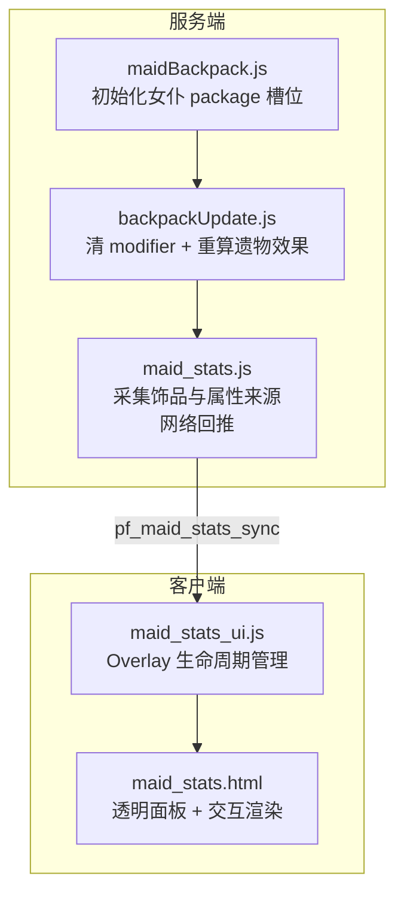
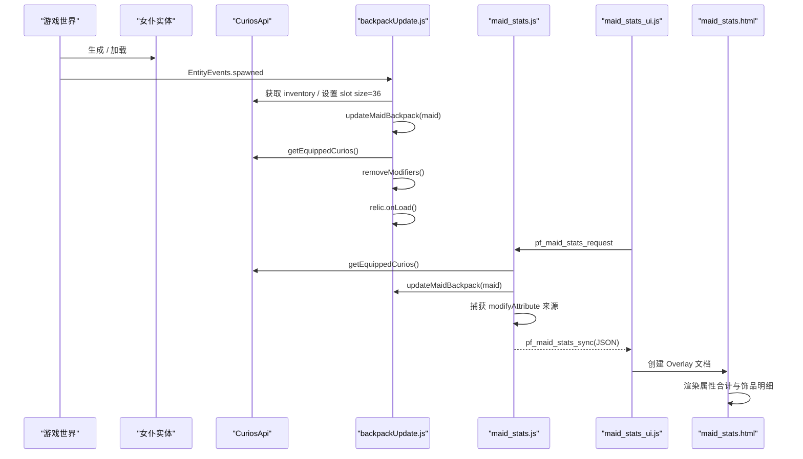
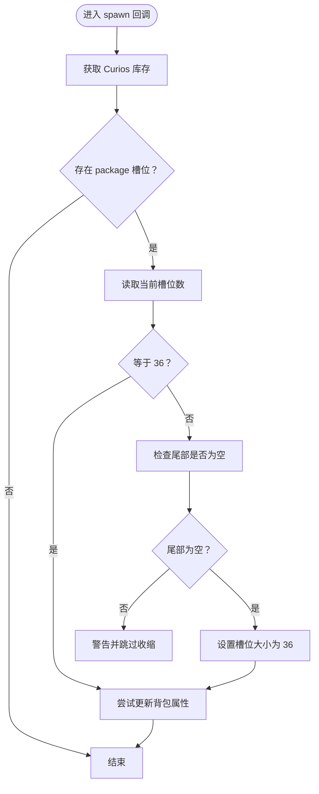
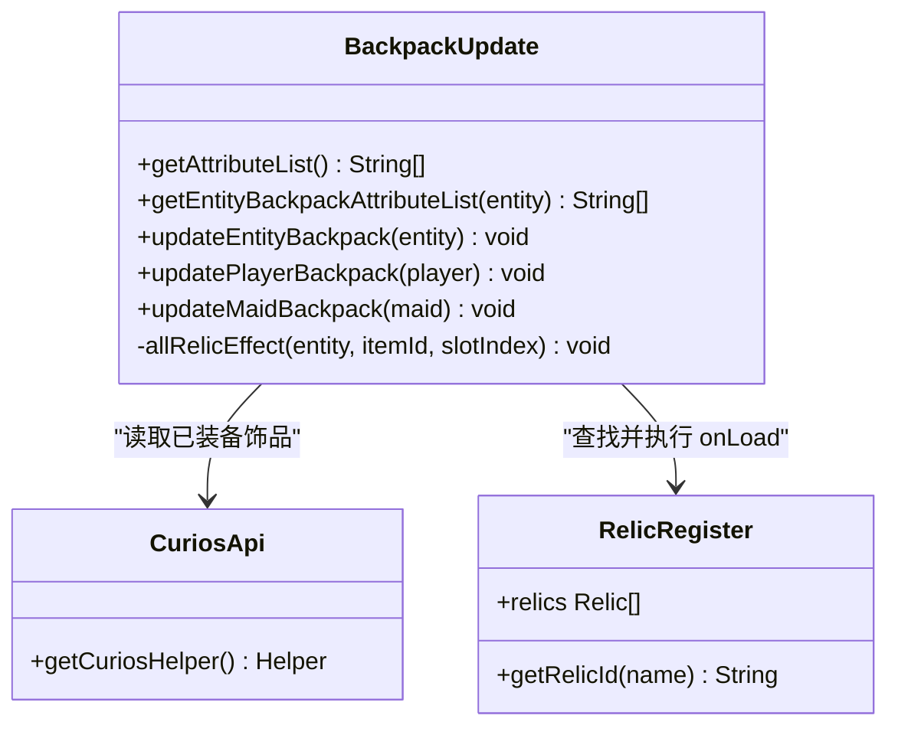
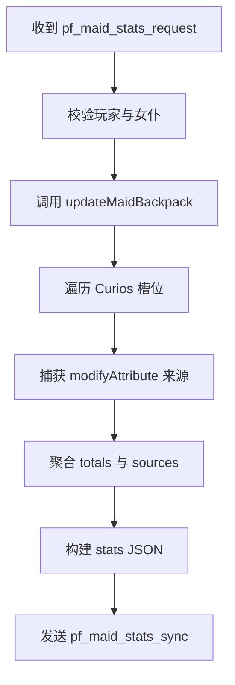
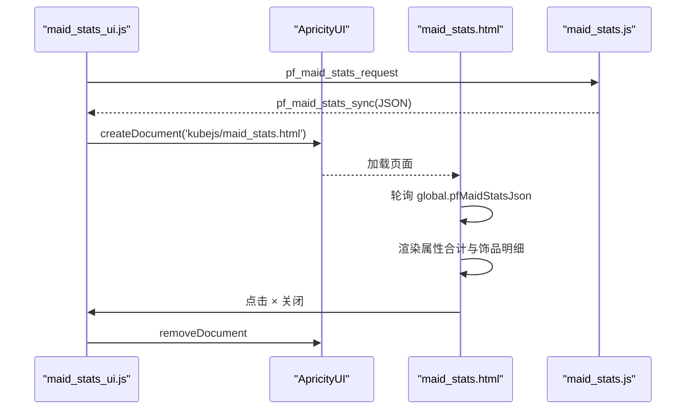
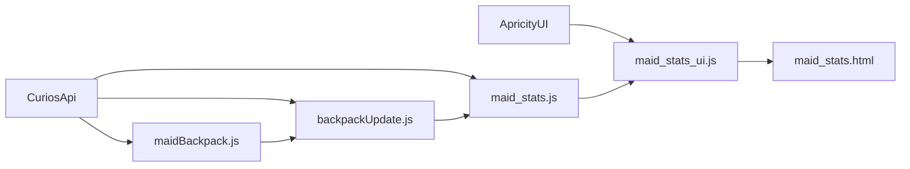

# 女仆饰品系统

<cite>
**本文引用的文件**   
- [maidBackpack.js](file://kubejs/server_scripts/backpack/maidBackpack.js)
- [backpackUpdate.js](file://kubejs/server_scripts/backpack/backpackUpdate.js)
- [maid_stats.js](file://kubejs/server_scripts/backpack/maid_stats.js)
- [maid_stats_ui.js](file://kubejs/client_scripts/ui/maid_stats_ui.js)
- [maid_stats.html](file://apricity/kubejs/maid_stats.html)
</cite>

## 目录
1. [引言](#引言)
2. [项目结构](#项目结构)
3. [核心组件](#核心组件)
4. [架构总览](#架构总览)
5. [详细组件分析](#详细组件分析)
6. [依赖关系分析](#依赖关系分析)
7. [性能与稳定性](#性能与稳定性)
8. [故障排查指南](#故障排查指南)
9. [结论](#结论)

## 引言
本模块为“女仆饰品系统”，围绕 TLM 女仆的 Curios 饰品槽位、遗物属性重算、以及客户端可视化统计面板展开。其目标是：
- 为女仆提供独立的 6×6 饰品背包页；
- 在女仆装备或卸下饰品时，重新计算并应用遗物对女仆属性的影响；
- 在服务端按饰品逐件捕获属性来源，并通过网络同步到客户端；
- 在客户端以 ApricityUI Overlay 的形式，叠加显示女仆当前饰品明细与属性合计。

该方案不直接修改 TLM 原 curios.json，而是通过 KubeJS 脚本与数据文件协作完成扩展。

## 项目结构
围绕女仆饰品系统的代码主要分布在以下位置：
- 服务端逻辑：`kubejs/server_scripts/backpack/`
- 客户端 UI 控制：`kubejs/client_scripts/ui/maid_stats_ui.js`
- 客户端 HTML 面板：`apricity/kubejs/maid_stats.html`

**图表来源**
- [maidBackpack.js:18-59](file://kubejs/server_scripts/backpack/maidBackpack.js#L18-L59)
- [backpackUpdate.js:51-97](file://kubejs/server_scripts/backpack/backpackUpdate.js#L51-L97)
- [maid_stats.js:419-458](file://kubejs/server_scripts/backpack/maid_stats.js#L419-L458)
- [maid_stats_ui.js:123-184](file://kubejs/client_scripts/ui/maid_stats_ui.js#L123-L184)
- [maid_stats.html:235-383](file://apricity/kubejs/maid_stats.html#L235-L383)

**章节来源**
- [maidBackpack.js:1-60](file://kubejs/server_scripts/backpack/maidBackpack.js#L1-L60)
- [backpackUpdate.js:1-98](file://kubejs/server_scripts/backpack/backpackUpdate.js#L1-L98)
- [maid_stats.js:1-460](file://kubejs/server_scripts/backpack/maid_stats.js#L1-L460)
- [maid_stats_ui.js:1-199](file://kubejs/client_scripts/ui/maid_stats_ui.js#L1-L199)
- [maid_stats.html:1-387](file://apricity/kubejs/maid_stats.html#L1-L387)

## 核心组件
- 女仆饰品槽位初始化：确保女仆拥有 `package` 槽位，并将其大小固定为 36（6×6）。
- 女仆属性重算：清空相关属性上的旧 modifier，再遍历当前饰品执行遗物 onLoad，将效果应用到女仆。
- 饰品属性统计：按饰品逐项捕获 modifyAttribute 调用，汇总属性来源，并以 JSON 形式返回给客户端。
- 客户端 Overlay：创建透明文档，监听服务端数据，渲染属性合计与饰品明细，支持关闭按钮与 ESC 关闭。

**章节来源**
- [maidBackpack.js:18-59](file://kubejs/server_scripts/backpack/maidBackpack.js#L18-L59)
- [backpackUpdate.js:51-97](file://kubejs/server_scripts/backpack/backpackUpdate.js#L51-L97)
- [maid_stats.js:302-415](file://kubejs/server_scripts/backpack/maid_stats.js#L302-L415)
- [maid_stats_ui.js:17-184](file://kubejs/client_scripts/ui/maid_stats_ui.js#L17-L184)
- [maid_stats.html:235-383](file://apricity/kubejs/maid_stats.html#L235-L383)

## 架构总览
女仆饰品系统采用“服务端负责状态与计算，客户端负责展示”的分层设计：

**图表来源**
- [maidBackpack.js:57-59](file://kubejs/server_scripts/backpack/maidBackpack.js#L57-L59)
- [backpackUpdate.js:51-97](file://kubejs/server_scripts/backpack/backpackUpdate.js#L51-L97)
- [maid_stats.js:419-458](file://kubejs/server_scripts/backpack/maid_stats.js#L419-L458)
- [maid_stats_ui.js:123-184](file://kubejs/client_scripts/ui/maid_stats_ui.js#L123-L184)
- [maid_stats.html:235-383](file://apricity/kubejs/maid_stats.html#L235-L383)

## 详细组件分析

### 女仆饰品槽位初始化（maidBackpack.js）
该模块负责：
- 使用 CuriosApi 获取女仆的 Curios 库存；
- 定位 `package` 槽位；
- 若槽位数量不是 36，则收缩至 36；
- 收缩前检查尾部是否有物品，避免丢失；
- 收缩完成后调用全局 `updateMaidBackpack` 重算属性。

**图表来源**
- [maidBackpack.js:23-55](file://kubejs/server_scripts/backpack/maidBackpack.js#L23-L55)

**章节来源**
- [maidBackpack.js:18-59](file://kubejs/server_scripts/backpack/maidBackpack.js#L18-L59)

### 女仆属性重算（backpackUpdate.js）
该模块实现统一的“背包重算”逻辑：
- 维护需要清理和重建的属性列表，包括通用属性和搓脚服务属性；
- 对非玩家实体（女仆）仅清理自定义搓脚属性，避免误删其他模组 modifier；
- 先 removeModifiers 清空旧值，再遍历所有 Curios 槽位执行 relic.onLoad；
- 暴露 `updateEntityBackpack`、`updatePlayerBackpack`、`updateMaidBackpack` 三个入口。

**图表来源**
- [backpackUpdate.js:3-49](file://kubejs/server_scripts/backpack/backpackUpdate.js#L3-L49)
- [backpackUpdate.js:51-97](file://kubejs/server_scripts/backpack/backpackUpdate.js#L51-L97)

**章节来源**
- [backpackUpdate.js:1-98](file://kubejs/server_scripts/backpack/backpackUpdate.js#L1-L98)

### 饰品属性统计与服务端网络（maid_stats.js）
该模块负责：
- 定义女仆饰品布局（6×6）、部位标签、服务属性标签、通用属性标签；
- 临时替换全局网格辅助函数，使现有遗物逻辑能在 6×6 语义下运行；
- 通过拦截 `modifyAttribute` 捕获每个饰品的属性来源；
- 汇总属性总量与来源，并构造 JSON 负载；
- 处理客户端请求，校验目标女仆与距离，最终发送 `pf_maid_stats_sync`。

**图表来源**
- [maid_stats.js:302-415](file://kubejs/server_scripts/backpack/maid_stats.js#L302-L415)
- [maid_stats.js:419-458](file://kubejs/server_scripts/backpack/maid_stats.js#L419-L458)

**章节来源**
- [maid_stats.js:1-460](file://kubejs/server_scripts/backpack/maid_stats.js#L1-L460)

### 客户端 Overlay 与渲染（maid_stats_ui.js 与 maid_stats.html）
客户端侧由两部分组成：
- JS 控制层：管理 Overlay 文档的生命周期、监听服务端数据、判断是否处于女仆容器界面；
- HTML 面板层：透明背景、凸起灰面板、属性合计与饰品明细渲染、悬浮详情提示、关闭按钮。

**图表来源**
- [maid_stats_ui.js:123-184](file://kubejs/client_scripts/ui/maid_stats_ui.js#L123-L184)
- [maid_stats.html:235-383](file://apricity/kubejs/maid_stats.html#L235-L383)

**章节来源**
- [maid_stats_ui.js:1-199](file://kubejs/client_scripts/ui/maid_stats_ui.js#L1-L199)
- [maid_stats.html:1-387](file://apricity/kubejs/maid_stats.html#L1-L387)

## 依赖关系分析
- 外部依赖：
  - CuriosApi：用于读取女仆的 Curios 库存、槽位操作。
  - ApricityUI：用于创建与管理 Overlay 文档。
- 内部依赖：
  - maidBackpack.js 依赖 backpackUpdate.js 的全局方法；
  - maid_stats.js 依赖 backpackUpdate.js 的重算能力与全局遗物注册表；
  - maid_stats_ui.js 依赖 maid_stats.html 的 DOM 结构与交互逻辑。

**图表来源**
- [maidBackpack.js:18-59](file://kubejs/server_scripts/backpack/maidBackpack.js#L18-L59)
- [backpackUpdate.js:51-97](file://kubejs/server_scripts/backpack/backpackUpdate.js#L51-L97)
- [maid_stats.js:419-458](file://kubejs/server_scripts/backpack/maid_stats.js#L419-L458)
- [maid_stats_ui.js:17-184](file://kubejs/client_scripts/ui/maid_stats_ui.js#L17-L184)

**章节来源**
- [maidBackpack.js:18-59](file://kubejs/server_scripts/backpack/maidBackpack.js#L18-L59)
- [backpackUpdate.js:51-97](file://kubejs/server_scripts/backpack/backpackUpdate.js#L51-L97)
- [maid_stats.js:419-458](file://kubejs/server_scripts/backpack/maid_stats.js#L419-L458)
- [maid_stats_ui.js:17-184](file://kubejs/client_scripts/ui/maid_stats_ui.js#L17-L184)

## 性能与稳定性
- 槽位收缩仅在女仆生成或区块重载时触发一次，避免频繁 IO。
- 属性重算采用“先清空后重建”的策略，防止重复叠加；对女仆只清理自定义搓脚属性，降低误删风险。
- 统计过程在服务端捕获 modifyAttribute，避免客户端计算误差；客户端仅做渲染与交互。
- Overlay 文档在女仆容器关闭时自动移除，减少内存占用。

[本节为通用指导，不直接分析具体文件]

## 故障排查指南
- 女仆打开 Curios 为空：
  - 确认 `package` 槽位是否存在且大小为 36；
  - 检查 spawn 回调是否被正确绑定；
  - 查看控制台是否出现“跳过收缩”警告。
- 饰品属性未生效：
  - 确认遗物 onLoad 是否正确注册；
  - 检查 `updateMaidBackpack` 是否在槽位变化后调用；
  - 核对属性列表中是否包含对应搓脚属性。
- 统计面板不显示：
  - 检查客户端是否处于女仆容器界面；
  - 确认 `pf_maid_stats_sync` 是否收到 JSON；
  - 查看 ApricityUI 文档是否成功创建。

**章节来源**
- [maidBackpack.js:39-55](file://kubejs/server_scripts/backpack/maidBackpack.js#L39-L55)
- [backpackUpdate.js:51-97](file://kubejs/server_scripts/backpack/backpackUpdate.js#L51-L97)
- [maid_stats_ui.js:123-184](file://kubejs/client_scripts/ui/maid_stats_ui.js#L123-L184)

## 结论
女仆饰品系统通过 KubeJS 脚本与 CuriosApi、ApricityUI 协作，实现了女仆独立饰品槽位、属性重算与可视化统计。其设计清晰分层：服务端负责状态与计算，客户端专注展示与交互。整体方案在保证稳定性的同时，提供了良好的可观测性与用户体验。

[本节为总结性内容，不直接分析具体文件]